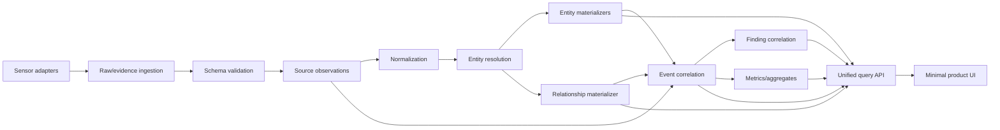

# Materialization architecture

## Target pipeline



The normative materializer registry is [materializers.yaml](schemas/materializers.yaml).

## Stage contract

| Stage | Responsibility | Input/output | Idempotency/update | Failure/replay/SLO |
| --- | --- | --- | --- | --- |
| Sensor adapter | Authenticate source; capture losslessly; assign source metadata | Native record → raw ref + adapter record | Source-native ID/revision or versioned fingerprint | Bounded retry; adapter DLQ; no canonical logic; source-specific freshness |
| Raw ingestion | Encrypt/store exact payload and integrity metadata | Bytes → evidence ID | Tenant + content/source identity | Write before acknowledge; immutable; retention/legal hold; <1 min |
| Schema validation | Validate envelope/native schema; quarantine malformed | Adapter record → valid/quarantined | Observation candidate ID + schema | Quarantine with reason; schema registry; replay after fix |
| Source observation | Normalize source statement without resolving identity | Valid source record → observation | Observation ID | Append corrections/tombstones; tenant/schema replay |
| Canonical normalization | Normalize domains/IDs/times/taxonomies | Observation → normalized identifiers/attributes | Observation + normalizer version | Pure/replayable; unknown values retained |
| Entity resolution | Link/create/candidate/merge/split | Normalized observation + catalog + decisions → resolution facts | Decision ID/rule/catalog version | Review queue; replay; manual constraints; <2 min |
| Entity materializer | Produce current/bitemporal canonical entity | Resolution + observations → entity versions | Entity + materializer version | Transactional ledger/outbox; replay/backfill; <2 min |
| Relationship materializer | Produce typed relationship ledger/projections | Relationship assertions + resolutions → edge versions | Typed tuple + source validity/version | PostgreSQL authority, Neo4j/CH projections; reconcile; <5 min |
| Event correlator | Produce canonical events/activities | Observations + resolved IDs → event versions | Event/correlation decision ID | Late/out-of-order aware; split/restate; <2 min |
| Finding materializer | Correlate signals into workflow findings | Events + state + graph + coverage → finding versions | Finding dedup key + generation | Update/close/reopen; DLQ; <5 min |
| Analytical materializer | Compute canonical-grain aggregates | Events/entities/relationships/findings → metric facts | Metric + grain + window + version | Rebuildable ClickHouse views/tables; coverage included |
| Query API | Enforce tenant/permissions; serve consistent projections | Canonical stores → versioned APIs | ETag/snapshot cursor | Degraded-state indicators; no frontend identity joins |

## Materializer boundaries

Combine closely related entity materializers by invariant, not page:

- **Catalog:** AI Product, Application Surface templates, providers/models, connector/server product metadata.
- **Identity:** users, groups, service/workload identities, accounts, credentials.
- **Estate:** tenant applications/installations, devices, agents, model deployments/routes, MCP clients/servers/tools, connectors, data/knowledge/memory, gateways/sensors/enforcement.
- **Relationship:** one typed bitemporal ledger with authorization/dependency/activity projections.
- **Activity:** application interactions, model/tool/action/data/policy events.
- **Agent run:** session/run/step current state plus event timeline.
- **Decision:** policies, approvals, decisions, exceptions, enforcement coverage.
- **Finding:** root-cause correlation and workflow.
- **Cost/outcome:** economic and verified-result attribution.
- **Evidence/coverage:** raw lineage, sensor health/capabilities/freshness.

## Storage roles

| Need | Store | Reason |
| --- | --- | --- |
| Immutable raw/evidence | Tenant-scoped object storage + PostgreSQL metadata | Cheap durable payloads, integrity/retention/access audit |
| Operational canonical state | PostgreSQL | Transactions, constraints, bitemporal ledgers, manual corrections, outbox |
| Relationship traversal | Neo4j projection | Dependency/impact/effective-access queries; rebuildable |
| Event/analytics | ClickHouse | High-volume time-series, aggregation, trends, finding inputs |
| Search | OpenSearch-compatible index | Aliases, facets, permitted event/evidence metadata |
| Cache | Redis | Read acceleration and short-lived coordination only |

## Transaction and delivery model

1. PostgreSQL mutations and outbox rows commit in one transaction.
2. Projectors consume outbox with at-least-once delivery and idempotent projection keys.
3. ClickHouse/Neo4j/search watermark tables record projection version per tenant/shard.
4. Reconciliation compares canonical ledger counts/hashes/watermarks to projections.
5. Failed records enter durable DLQs with tenant/source/schema/error/retry metadata.
6. Backfill uses the same adapters/contracts as live flow with a distinct run ID and throttling.

## Tenant isolation

- Every operational primary/unique/foreign key begins with or includes `tenant_id`.
- Global catalog tables are physically/logically separate from tenant tables.
- Topics/partitions, object-storage prefixes/keys, ClickHouse sort/partition keys, Neo4j node keys, Redis keys, search documents, DLQs, and watermarks include tenant.
- Merge/split/manual decisions cannot reference another tenant’s entity.
- Logs/metrics avoid raw tenant/user/content unless explicitly authorized.

## Failure behavior

- Raw write failure: do not acknowledge source.
- Validation failure: quarantine; no downstream projection.
- Resolver failure: observation remains durable/pending; current inventory is not deleted.
- Projection failure: canonical commit remains; lag/coverage becomes visible.
- Finding failure: events remain queryable; materializer-lag finding/alert opens.
- Source outage: mark source stale; lower coverage/confidence; never infer asset absence.
- Partial legacy backfill: reconciliation report identifies missing/duplicate/conflicting rows; no completion marker until repaired or explicitly waived.

## Observability

Per tenant/source/materializer:

```text
ingest rate and bytes
validation/quarantine rate
oldest pending observation
resolver latency/backlog/candidate rate
merge/split/conflict rate
watermark and event-time lag
DLQ depth/retry age
projection reconciliation drift
finding duplicate/close/reopen rate
evidence-link completeness
schema/version distribution
```

Current Quilr 1 Redis queue/marker behavior is not reused as durable work state because a live test demonstrated duplicate claim and source analysis found pop-before-work/lost-retry paths. [Q1-STORE](../../quilr-platform-analysis/09-data-models-and-storage.md).
