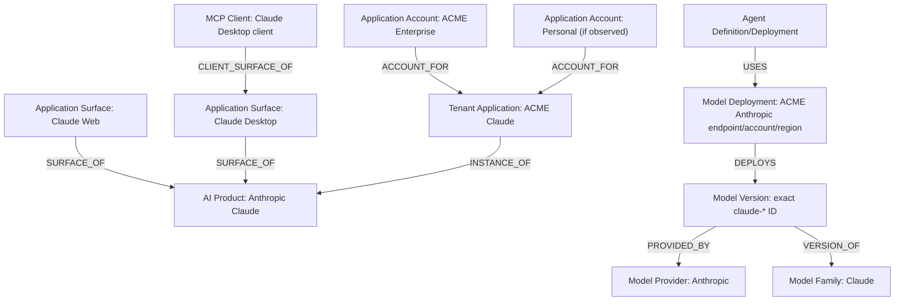

# Claude cross-sensor resolution

## Observations

| Source | Native observation | Canonical interpretation | Confidence |
| --- | --- | --- | --- |
| Browser extension | origin/domain `claude.ai`, browser/user/interaction/file fields | Claude Web `Application Surface`; usage/upload event | High if catalog domain mapping is active |
| Endpoint process | signed/bundle/package/path evidence for `Claude.app` | Claude Desktop surface + installation + process activity | Depends on bundle/signing evidence; name alone is weak |
| LLM Gateway | `provider=anthropic`, exact `model=claude-*`, request/user/API-key context | Anthropic provider, Claude model family/version, tenant deployment/route, model invocation | High for exact provider-qualified model ID |
| MCP observation | client labeled Claude Desktop and server/tool configuration/activity | MCP Client related to desktop surface; distinct server/tool entities and call events | Endpoint config is useful; external gateway IDs/schema required for authority |
| Connector inventory | Anthropic enterprise account/subscription/provider account ID | Tenant Subscription, Application/Connected Account | High with provider IDs |
| Internal agent | agent definition/deployment invokes Anthropic API | Agent→Model Deployment dependency plus invocation/run events | Requires stable agent/deployment/run identity |

## Canonical graph



## What merges

- Browser and endpoint observations can link to the same **AI Product** only through catalog-backed domain/bundle/vendor evidence.
- Multiple observations of the exact same desktop installation merge using device plus strong application identity.
- Repeated exact provider-qualified model IDs merge into one Model Version.
- Repeated connector records with the same provider tenant/account ID merge into one tenant account/subscription.

## What remains separate

- Claude Web and Claude Desktop are separate surfaces.
- Enterprise and personal accounts are separate even if the same person uses both.
- Claude model family/version/deployment are not the Claude application/product.
- MCP Client is not the desktop application; it is related to its surface/installation.
- Each MCP server deployment and tool remains distinct.
- Agent Definition/Version/Deployment/Run are separate lifecycle layers.
- Browser uploads, model invocations, and tool calls are events, not inventory objects.

## Uncertain matches

- `Claude.app` by process name alone.
- “Claude Desktop” MCP client without a strong client/installation ID.
- Browser user email without provider account/tenant ID.
- A configured endpoint model that has never been invoked.
- An agent invocation without definition/deployment/run correlation.

These create candidates/relationships with stated confidence, not silent merges.

## Product presentation

The AI Applications list shows one “Anthropic Claude” tenant row with facets:

```text
Surfaces: Web, Desktop
Accounts: 1 enterprise, N personal/unknown
Observed sources: Browser, Endpoint, LLM Gateway, MCP, Connector
Models: exact active Claude versions/deployments
Agents: dependent agent count
Users/devices
Management/owner/findings/spend
First/last seen and coverage
```

The row’s Sources & Observations view exposes every native domain, process/bundle/path, gateway model/provider record, MCP client/server configuration, connector account ID, confidence, source time, and raw evidence link.

## Mistaken merge and new alias

A split selects the misassigned observations/aliases, creates the corrected entity/surface/account, replays relationship/event/finding/metric projections, and preserves the old decision. A new verified domain or bundle ID is added as a validity-bound catalog alias; old observations retain the catalog version used when resolved.
