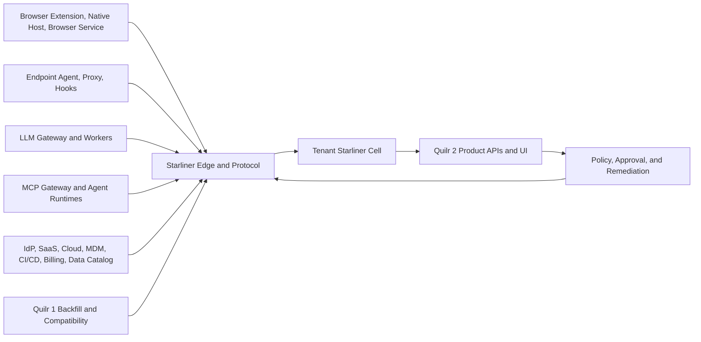

# System Context and Scope

## Product/runtime landscape

## Owned products

### Browser product

Owns browser interception, page context, upload/copy/paste/prompt observation, browser-local decisions, native-host file/OCR/DLP integration, and browser deployment health.

### Endpoint product

Owns local discovery, process/network attribution, IDE hooks, endpoint DLP/proxy enforcement, device/runtime context, local policy enforcement, updater, and endpoint health.

### LLM Gateway

Owns provider routing, request/response handling, gateway policy enforcement, DLP/Guardian integration, token/latency/cost observations, provider outcomes, and gateway health.

### MCP Gateway / agent runtimes

Own backend/client/server/tool execution, native authentication, tool-call lifecycle, local policy enforcement where deployed, and source-native effects.

### Quilr 2 / Starliner

Owns evidence admission, canonical identity and relationships, cross-source activity, findings, analytics, policy authority, approvals, commands, effect verification, unified APIs, and customer workflows.

## External authorities

| Domain | Expected authority |
|---|---|
| Employment and organization | HRIS/directory |
| Human authentication | OIDC issuer/directory |
| SaaS account/subscription | Provider/connector |
| Device management posture | MDM/EDR |
| Cloud workload/deployment | Cloud/orchestrator |
| Model deployment/account | Provider catalog/account |
| Source/build/artifact | Forge/build/registry |
| Secrets/credentials | Issuer/secret manager |
| Billing | Provider/billing system |
| Data asset ownership/classification | Data catalog/DSPM |

External systems produce source observations. Their records are not copied into canonical state without resolver and authority rules.

External and owned integrations are classified by the [integration role taxonomy](platform/11-integration-role-taxonomy.md): runtime sensor, discovery connector, telemetry importer, control/PEP connector, or response connector. A vendor package may implement multiple roles without inheriting authority across them.

## In-scope customer questions

- What AI applications and surfaces are in use?
- What agents, models, MCP servers, and tools exist?
- Who owns and uses them?
- What data and systems are involved?
- What activity was observed, by which source, and with what confidence?
- What is approved, unmanaged, unowned, stale, risky, or not evaluable?
- What changed?
- What should the customer do?
- Can Quilr observe, decide, enforce, and verify on the affected surface?
- What cost and adoption are attributable?

## Explicit non-goals

- Rendering every source field by default
- Treating raw prompts/files/tool payloads as ordinary analytics data
- Automatically promoting tenant-private names into the global catalog
- Guaranteeing identity from names, paths, emails, or aliases
- Using an LLM to create ungrounded findings
- Building separate browser/endpoint/gateway/MCP inventories
- Replacing native product runtime APIs
- Using a graph, cache, search index, or analytics store as operational authority
- Big-bang replacement of Quilr 1
- Treating the 32-domain completeness lens as 32 services, repositories, or navigation sections
- Treating a ticket, mock, fixture, self-test, or dashboard as production capability proof
