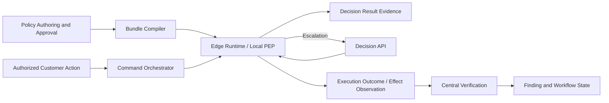

# Reference Architecture

## End-to-end data path

```mermaid
flowchart LR
  N["Native Source"] --> A["Typed Source Adapter"]
  A --> E["Starliner Edge Runtime"]
  E --> W["Edge WAL / Outbox"]
  W --> I["Authenticated Ingest"]
  I --> V["Immutable Evidence"]
  V --> O["Normalized Observations"]
  O --> R["Continuous Resolver"]
  R --> C["Canonical Ledgers"]
  C --> X["Central Transactional Outbox"]
  X --> P["Projectors"]
  C --> F["Activity / Finding / Metric Materializers"]
  F --> X
  P --> API["Unified Query APIs"]
  API --> UI["Customer UI"]
```

## Control path

## Platform processing stages

1. Authenticate producer and resolve tenant/cell from trusted registry state.
2. Validate protocol, schema, source profile, certification, privacy, size, integrity, and idempotency.
3. Durably commit accepted evidence and central handoff before acknowledgement.
4. Normalize source semantics without assigning canonical IDs.
5. Resolve source objects and claims to canonical entities conservatively.
6. Materialize entity, identifier, claim, lifecycle, and relationship ledgers.
7. Correlate independent observations into canonical activity.
8. Evaluate finding admission with coverage and identity assurance.
9. Produce canonical metrics, cost, and outcome attribution.
10. Project read models and serve versioned APIs.

## Storage roles

| Need | Authority/role |
|---|---|
| Safe immutable evidence bytes | Tenant-scoped object storage or partitioned evidence store according to capacity profile |
| Evidence metadata/idempotency | PostgreSQL |
| Canonical operational ledgers | PostgreSQL |
| Durable integration/event log | PostgreSQL outbox plus Kafka-compatible log |
| High-volume event analytics | ClickHouse projection |
| Deep graph traversal | Rebuildable graph projection |
| Search | Rebuildable search projection |
| Hot decision context/cache | Redis-compatible bounded state |
| Standing authorization evaluation | ReBAC projection with versioned model |
| Long-running remediation | Durable workflow engine |
| Keys/secrets | KMS/HSM/secret manager |

## Transaction rules

- Ingest acknowledgement requires durable evidence admission and handoff.
- Canonical mutation and central outbox commit in one PostgreSQL transaction.
- Projectors consume at least once and use deterministic idempotency keys.
- Cursors advance only after durable observation admission.
- Replay never mutates original evidence.
- Corrections and tombstones append.
- Late and out-of-order evidence is accepted and may restate projections/findings.
- Source outage lowers coverage but preserves inventory.

## Deployment

Global control plane:

- contract/profile/release registry;
- catalog release metadata;
- certification definitions;
- tenant-to-cell routing metadata;
- trust-anchor metadata;
- no customer evidence when residency forbids it.

Tenant data cell:

- ingest, evidence, normalization, resolution, materializers;
- canonical PostgreSQL;
- projectors;
- APIs, decision, policy, approval, command, connectors;
- retention, export, backup, audit, and observability.

Profiles:

- developer;
- shared regional SaaS;
- dedicated customer cloud;
- single-tenant on-prem;
- air-gapped later.
