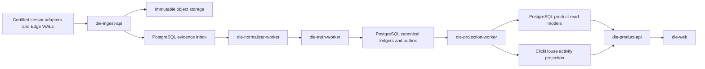

# Runtime, Storage, Workers, and Scaling

Status: **normative physical topology for the pass**

## Cell topology



## Deployment units

### `die-ingest-api`

- stateless replicas behind regional routing;
- verifies workload identity, tenant, artifact/capability, schema, size, privacy and idempotency;
- commits evidence metadata/inbox and object reference before `accepted`;
- returns per-record dispositions;
- does not normalize or resolve identity synchronously.

### `die-normalizer-worker`

- one governed artifact hosting profile-specific modules;
- claims leased evidence partitions;
- deterministic by evidence bytes, profile, catalog, and normalizer version;
- writes versioned normalized observations;
- never assigns canonical IDs;
- reprocessing writes a candidate version before promotion.

### `die-truth-worker`

- owns resolver, source bindings, canonical inventory, relationships, activity and coverage;
- partitions by tenant and resolution/aggregate key;
- serializes conflicting aggregate mutations;
- commits canonical mutation and transactional outbox together;
- supports merge/split/correction impact and replay;
- cannot read ClickHouse as authority.

### `die-projection-worker`

- consumes canonical outbox at least once;
- writes PostgreSQL product read models and ClickHouse activity rows;
- stores checkpoints and source versions;
- builds candidate namespaces for rebuild;
- cannot create entities, relationships, activities, confidence, or lifecycle facts.

### `die-product-api`

- stateless authorized replicas;
- reads versioned pass contracts;
- never calls sensors for customer inventory/activity;
- exposes freshness and degraded state;
- initiates bounded export jobs through an internal job module;
- does not perform background identity or projection work in request handlers.

### `die-maintenance`

- owns projection build/activation/rollback, integrity scans, retention,
  repair, bounded export and explicit signed tenant/producer administration;
- runs bulk work through tenant-scoped leases, fencing and lower-priority quotas;
- mutates producer/control state only through short-lived dedicated credentials;
- does not normalize, resolve identity, mutate canonical truth, or implement
  Quilr 1 extraction/backfill/coexistence.

## PostgreSQL ownership

Suggested logical schemas:

```text
evidence
  admission
  object_reference
  sequence_state
  quarantine
  work_partition

control
  tenant
  producer
  installation
  certification
  expected_population
  authorization_revision

source
  normalized_observation
  source_object
  source_claim
  snapshot

identity
  binding
  decision
  conflict
  merge_split_history

canonical
  entity
  entity_version
  relationship
  relationship_version
  activity
  activity_version
  coverage_interval
  outbox

product
  overview
  inventory_item
  entity_detail
  relationship_summary
  coverage_summary
  projection_checkpoint

maintenance
  projection_generation
  integrity_run
  retention_job
  repair_job
  export_job

audit
  event
```

Exact DDL, indexes, partitions, RLS, schema migrations, and retention are
required implementation and release artifacts. Missing or failing work remains
active engineering; it is not a permission gate for independent code paths.

## ClickHouse ownership

ClickHouse contains only rebuildable:

- canonical activity projection;
- safe evidence-search projection;
- bounded activity aggregates;
- source/producer operational time series where approved.

Every row includes tenant, canonical/evidence IDs, projection version, source watermark, event time, ingest time, retention class, and authorization-safe filter dimensions.

No identity merge, ownership, lifecycle, coverage denominator, or canonical mutation originates in ClickHouse.

## Work and partition model

| Stage | Partition key |
|---|---|
| ingest idempotency | tenant + producer + epoch + sequence/idempotency key |
| normalize | tenant + source profile + producer/source object |
| resolve | tenant + resolution key or source-object namespace |
| canonical activity | tenant + correlation/aggregate key |
| product projection | tenant + canonical aggregate |
| ClickHouse projection | tenant + time bucket + activity partition |
| maintenance/bulk lifecycle | tenant + operation kind + target/generation |

Partition reassignment uses leases with fencing tokens. A stale worker cannot commit after lease loss.

## Backpressure

Priority order:

1. ingest durability and receipts;
2. tenant/security/audit state;
3. live normalization and truth;
4. interactive product reads;
5. live projections;
6. reconciliation;
7. bounded evidence replay and normalization reprocessing;
8. rebuild/export/retention/repair.

Queues are bounded. Lag and coverage impact are visible. Batch work cannot starve live traffic.

## Rebuild

```text
declare projection/version/tenant scope
→ pin canonical input watermark
→ create candidate namespace
→ replay idempotently
→ validate counts, members, invariants, authorization, samples
→ catch up to current outbox
→ compare customer-impact diff
→ atomic alias/checkpoint promotion
→ monitor
→ retain prior namespace for rollback
→ expire under policy
```

Canonical state is never cleared to rebuild a projection.

## Scaling and HA

Exact replica counts require a certified profile. Architecture requires:

- failure of one stateless replica does not lose accepted data;
- worker scale-out preserves partition fencing and idempotency;
- largest supported tenant and noisy-neighbor tests pass;
- ClickHouse and PostgreSQL have backup/restore and capacity headroom;
- bulk replay/reprocessing/rebuild can pause independently;
- all roles expose readiness, lag, oldest age, throughput, rejects, retries, saturation, tenant fairness, watermark, and version;
- on-prem or small deployments may colocate roles only under an explicitly certified profile.

## Technology admission

Adding Kafka, a graph database, external search, Redis, or another service requires:

- measured unmet requirement;
- named query/workload;
- authority remains unchanged;
- failure and recovery design;
- tenancy/privacy assessment;
- backup/restore and SLO;
- cost and operational owner;
- rebuild/removal plan;
- approved ADR.

The separate migration/coexistence track owns its extractor, workers, state,
quotas, parity and cohort controls. It may submit typed immutable legacy evidence
through the frozen admission extension seam, but no migration runtime or state is
part of this bounded topology.
