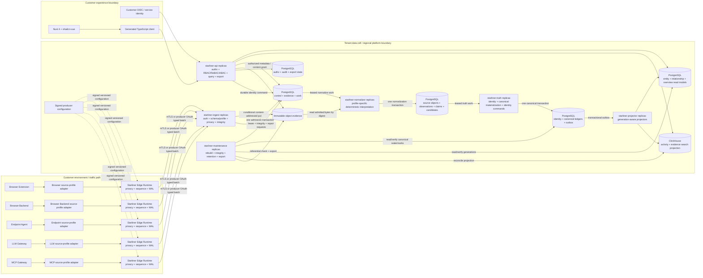

# Frozen System Architecture

## Architectural style

The platform is a modular monolith with distributed execution roles:

- one repository and release train;
- one internal domain model;
- one canonical PostgreSQL authority per tenant cell;
- compile-time module boundaries;
- no synchronous internal service mesh;
- role-specific processes communicate only through committed database state;
- one container digest is promoted; a role flag selects the entry point;
- roles scale and fail independently.

This avoids a single-process bottleneck without creating independently drifting microservices.

## Complete runtime topology



Arrows between central roles represent durable PostgreSQL handoffs, not synchronous RPC. Object storage and ClickHouse crossings are explicitly non-transactional and reconciled. The UI never crosses the API boundary.

## Deployable roles

| Role | Responsibility | Reads | Writes | Scaling key |
|---|---|---|---|---|
| `starliner-ingest` | producer authentication, admission, integrity, privacy validation, immutable evidence and receipts | producer/certification registry | evidence metadata, object body, ingest receipt, normalize work | requests/second and bytes/second |
| `starliner-normalizer` | deterministic profile-specific interpretation | evidence and source-profile registry | normalized observations, source objects, claims, relationship/activity candidates, truth work | admitted records and CPU |
| `starliner-truth` | identity resolution and canonical materialization | normalized ledgers, identity policy, current canonical state | bindings, identity decisions, entities, relationships, activity, coverage, audit, central outbox | tenant/aggregate partitions |
| `starliner-projector` | rebuildable product and analytical projections | canonical outbox and ledgers | PostgreSQL read models, ClickHouse projection, checkpoints | outbox partitions and destination latency |
| `starliner-api` | authenticated and authorized product queries and operator corrections | read models, selected canonical/evidence metadata, authz state | audit, export jobs, correction commands | query class and tenant |
| `starliner-maintenance` | projection rebuild, partition creation, retention tombstones, integrity scans, export/repair, and explicit producer enrollment/certification commands | authoritative ledgers, signed control manifests and work state | versioned maintenance state; producer registry only under dedicated control credential | scheduled or explicit jobs |
| `die-web` | Nuxt customer application | `starliner-api` only | no domain truth | HTTP requests |

Every role except the web application is built from `project-starliner`. `die-web` remains in `quilr-platform-nuxt`.

Producer bootstrap is not an undefined external dependency. The maintenance artifact exposes a non-public `producer apply/revoke/certify` command over the same typed Go use cases. It accepts an authenticated, signed, revisioned manifest; validates tenant scope, workload subject, artifact/contract/profile/test-pack digests, capability modes and expected-population bindings; then mutates `die_control`, appends audit and enqueues the producer projection in one transaction. Every active capability gets at least a producer-scoped population of one; an approved deployment or authoritative connector may bind a larger typed population. It runs with the short-lived `die_control_admin` database role. Ingest, API and continuously running maintenance replicas never have that credential. A future shared/dedicated/BYOC control plane may call the use case through a private transport, but may not redefine its transaction.

The tenant-root scope has an equally explicit one-time path: `maintenance tenant bootstrap` consumes the signed `tenant-bootstrap-manifest`, creates exactly one tenant scope, its depth-zero closure row, authorization revision `1`, bootstrap ledger entry, audit head/event and idempotent result in one serializable transaction under the short-lived `die_authz_admin` role. An identical retry is a no-op; any different root/revision for that tenant is rejected. The public admin API cannot create, reparent or delete a tenant root.

## Logical module boundaries

```text
contracts
├── envelope and receipts
├── typed source profiles
├── normalized observation
├── canonical/read DTOs
└── generated Go/Python/TypeScript SDKs

platform core
├── admission
├── evidence
├── producer registry
├── normalization
├── identity
├── canonical
├── materialization
├── projection
├── coverage
├── authorization
├── query
├── export
├── audit
└── operations
```

Dependency direction is inward:

```text
transport adapters
→ application use cases
→ domain modules
→ ports
← PostgreSQL/object/ClickHouse adapters
```

Domain packages may not import HTTP, Kubernetes, a sensor repository, Nuxt code, or a database driver. Storage adapters implement domain ports.

`starliner-api` is deployed in read and admin surfaces from the same artifact. Read replicas are data-read-only apart from export/identity-command handoff and audit append. Admin replicas hold a distinct `die_authz_admin` connection used only by the authorization administration application module for one revision-checked transaction. This is not a second truth service and it cannot mutate canonical ledgers.

## Authority map

| Truth | Authority |
|---|---|
| producer enrollment/capability/certification | PostgreSQL producer registry |
| immutable admitted evidence metadata | PostgreSQL evidence ledger |
| immutable admitted evidence body | content-addressed object storage |
| normalized source semantics | versioned normalized ledger in PostgreSQL |
| source identity and claims | PostgreSQL source-object/claim ledger |
| canonical identity and lifecycle | PostgreSQL identity/canonical ledger |
| typed current/historical relationships | PostgreSQL canonical relationship ledger |
| canonical activity membership and history | PostgreSQL canonical activity ledger |
| coverage and gap state | PostgreSQL coverage ledger |
| customer inventory/read summaries | rebuildable PostgreSQL read models |
| activity/evidence search | rebuildable ClickHouse projection |
| authorization grants and scope hierarchy | separate PostgreSQL authorization schema |
| evidence access/export audit | append-only PostgreSQL audit ledger |

Object storage, ClickHouse, caches and UI state cannot assign identity or mutate lifecycle.

## No internal synchronous chain

Ingest does not call normalizer. Normalizer does not call truth. Truth does not call projector. Each commits a durable handoff in the same transaction as its output. This bounds failure, removes cascading latency, and makes replay deterministic.

The API does not call workers or live sensors. It reads stable projections and exposes their watermarks.

## Transaction boundaries

1. **Admission:** insert/confirm evidence object reference, evidence metadata, receipt and normalize work atomically after the immutable object is durable.
2. **Normalization:** insert immutable normalized outputs and enqueue truth work atomically.
3. **Truth:** acquire tenant/aggregate fence; append claims/decisions/canonical versions; update current pointers; enqueue canonical outbox atomically.
4. **Projection:** apply one outbox change idempotently to a named projection generation and advance its checkpoint atomically for PostgreSQL; ClickHouse uses insert idempotency plus checkpoint reconciliation.
5. **Correction:** authorize and preview; append correction/identity decision/canonical versions/outbox/audit atomically.

There is no distributed transaction across PostgreSQL and object storage or ClickHouse. The object is written first under a content-addressed conditional key; a failed database commit leaves an unreferenced object eligible for delayed garbage collection. ClickHouse is always recoverable from canonical state/outbox.

## Multi-tenancy minimum

Full deployment-model selection is outside this pass. Tenant correctness is not:

- every row and object key is tenant bound;
- tenant comes from authenticated identity, not request payload;
- workers lease tenant-scoped work;
- product queries receive an authorization filter before planning;
- PostgreSQL RLS is defense in depth;
- ClickHouse queries require explicit tenant predicate through a restricted query adapter;
- no cross-tenant cache keys or counts.

## Technology decisions

- central implementation: Go;
- contracts: JSON Schema 2020-12 plus OpenAPI 3.1;
- canonical store/work coordination: PostgreSQL;
- immutable evidence body: S3-compatible object API;
- activity/evidence search: ClickHouse;
- product UI: existing Nuxt 4 + Vue + shadcn-vue;
- telemetry: OpenTelemetry;
- no Kafka, Redis, Neo4j or external search engine in the minimum pass;
- no remote policy engine in the product-read authorization hot path.

An event broker or graph/search projection may be added only after measured thresholds are exceeded, and only as a rebuildable adapter.

## Architectural fitness rules

CI rejects:

- imports from domain modules into transport/storage packages;
- product API imports of sensor-native clients;
- writes to canonical tables outside `canonical` and `identity` repositories;
- ClickHouse mutation paths from ingest or API;
- producer contracts containing canonical IDs;
- source payload fields not defined by a typed profile or namespaced extension;
- queries without tenant and authorization filters;
- projection code that cannot rebuild into a fresh generation;
- evidence acknowledgements before durable admission;
- deferred finding/policy/cost modules linked into the pass executable.
