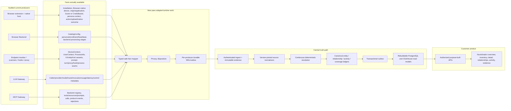

# Connected Asset Inventory and Evidence Graph

**Status:** normative target semantics, bounded by the audited capability register

## Decision

The DIE pass builds one connected, evidence-backed estate. It does not place four sensor tables behind one navigation shell, and it does not invent edges merely because two observations look related.

The central platform preserves these separate layers:

1. source producer and source-native object;
2. product or definition;
3. installation, deployment, account, route, or configuration;
4. runtime process/workload or session;
5. source-scoped user/caller context and independently proved execution identity;
6. device or gateway placement;
7. configured components, models, MCP servers, repositories, tools, resources, or prompts;
8. observed activity;
9. claim, relationship, coverage, and evidence support.

The exact support boundary is [Sensor capability and field traceability](16-sensor-capability-and-field-traceability.md). `adapter_derivable` means the current sensor captures enough native information to build a new adapter; it does not mean the adapter, WAL, reconciliation, canonical materializer, API, or UI already exists.

## Non-fabrication rule

Every visible fact must trace through:

```text
native source field or callback
→ certified adapter transformation
→ typed source-profile field
→ normalized claim/relationship/activity candidate
→ central identity or materialization decision
→ read model
→ API field
→ UI field
```

When any link is absent, the product returns or displays the correct state:

- `unknown`: the source did not establish the value;
- `source_scoped`: a native object exists but is not cross-source canonicalized;
- `unresolved`: candidates exist but no deterministic binding is allowed;
- `unsupported`: the installed producer/capability cannot observe it;
- `partial` or `gap`: the capability should observe it but coverage is incomplete;
- absent: the entity or relationship itself is not supported and must not be synthesized.

## Canonical layers

| Product concept | Canonical types used in this pass | Source boundary |
|---|---|---|
| Applications | `application_product`, `application_surface`, `application_deployment`, `application_account` | Browser directly supports origins/surfaces; Endpoint supports installations; product/account objects require stable source or catalog IDs. |
| Agents | `agent_definition`, `agent_deployment` | Endpoint `AgentData` supports local definition/deployment derivation. Gateway agent fields are source-scoped unless stable and explicitly instrumented. |
| Runtime | `workload`, `session` | Endpoint `ProcessInfo` supports processes; gateways support request/session context within their own authority. |
| Models | `model_product`, `model_family`, `model_version`, `model_deployment`, `model_route`, `provider_account` | Endpoint directly supports configured model-product claims only. LLM Gateway may support the richer layers where provider/configuration IDs exist. |
| MCP | `mcp_server_product`, `mcp_server_deployment`, `mcp_tool`, `mcp_resource_definition`, `mcp_prompt_definition` | Endpoint supports server configuration/deployment, not tool/resource/prompt definitions. MCP Gateway registry supports those definitions. |
| Agent components | `agent_hook`, `agent_skill`, `agent_plugin`, `configured_permission_rule`, `repository` | Directly derived from the corresponding Endpoint `EntityKind` payload. A configured permission rule is not enterprise entitlement. |
| Placement | `device`, `browser_installation`, `endpoint_installation`, gateway/backend deployment types | Browser and Endpoint device identities remain separate until a deterministic binding exists. No current Browser producer emits a stable browser profile. |
| Identities | `person`, `directory_account`, `service_principal`, `workload_identity`, `application_account` | Current sensors provide source-scoped identity claims with varying assurance. Enterprise resolution requires exact issuer/subject or a future authoritative connector. |
| Evidence context | `source_producer`, `source_object`, `resource`, `artifact_or_package` | Used for provenance, activity resources, coverage, and authorized evidence navigation. |

Definition, deployment, runtime, session, and activity never share one identity simply for UI convenience.

## Current source-to-canonical boundary



No source assigns canonical IDs. No normalized relationship assumes subject and object came from the same producer. Each endpoint is a fully qualified source reference containing tenant, producer, profile, namespace, type, and source ID.

## What each owned source contributes

### Browser

Directly adapter-derivable:

- extension/browser installation and version;
- Browser-native device, heartbeat, OS/browser/extension context;
- application name and origin/surface;
- persona display/email as a source claim;
- authentication context `Guest` or `CredsBased`;
- application/action/upload/native-outcome activity and safe labels;
- component health signals.

Not directly supported today:

- stable browser-profile identity;
- automatic Browser-device to Endpoint-device identity;
- personal versus organization classification from the extension;
- enterprise person identity;
- durable snapshot/gap semantics without new sensor/runtime work.

The current extension values normalize as:

```text
Guest      → flyby
CredsBased → authenticated_unknown
```

The Quilr 1 field `account_usage_type=personal|guest|corporate` is read downstream, but the audited writer was not found. It is not admitted as a stronger claim until its exact writer and authority are proved.

### Endpoint

Directly adapter-derivable from the audited code:

- `DeviceContext`: serial-derived device ID, hostname, OS type/version;
- `UserContext`: username and optional ID/email/full name/authenticated state/group strings;
- `ProcessInfo`: PID, parent, start, executable, command line, and owner UID/SID;
- `ApplicationData`;
- `McpServerData`;
- `HookData`;
- `SkillData`;
- `AgentData`;
- `ModelData`;
- `ControlledRepoData`;
- `PermissionData`;
- `PluginData`;
- prompt-turn activity, process/proxy/hook lifecycle seams, and native decision/effect seams.

Important semantic boundaries:

- `UserContext` is observation context. It is not automatically process owner.
- `ProcessInfo` UID/SID can support `executed_as` only after an exact account mapping.
- `PermissionData` is a local configured command rule, never `has_permission_to`.
- `ModelData` supports configured model-product claims, not model versions or deployments.
- Endpoint does not currently emit MCP tool/resource/prompt definitions.
- raw prompt, path, command line, file, body, and credential content is prohibited or minimized according to the field register.

### LLM Gateway

The gateway contributes its routed truth:

- authenticated tenant/caller/API-client claims and their source paths;
- provider, provider-account/configuration, model, endpoint, route group/mode;
- invocation status, stream stage, token/cache/reasoning counts;
- upstream/Quilr/guardrail/total/first-response latency;
- blocked/anonymized/monitored and guardrail outcome fields;
- request/conversation/trace/correlation/session IDs;
- optional agent/run/workflow fields only when instrumentation supplies them;
- safe tool names/call IDs and feature-shape flags.

It does not prove endpoint placement, requests that bypass the gateway, or equivalence between an optional agent label and an Endpoint agent.

### MCP Gateway

The gateway contributes:

- registered backend/server ID, tenant, transport/type, status, catalog and safe authentication mode;
- tool/resource/prompt capability definitions and capability-fetch coverage;
- tool-call request/backend/tool/session/caller/surface/transport/timing/status/DLP context;
- initialize/list/read/prompt/session/progress/cancel protocol activity;
- rejected-request stage/reason/status/method/tool context;
- surface-specific health and delivery state.

Agent keywords, names, user-agent strings, email, IP, and timing do not prove an Endpoint agent or enterprise person. Raw arguments/results, headers, tokens, authorization material, and arbitrary event bodies do not enter the ordinary profile.

## Local agent identity and presentation

A current-pass local agent deployment key is:

```text
tenant
+ resolved agent definition
+ exact Endpoint device
+ source-authority installation/configuration scope
```

An authoritative native deployment ID supersedes the composite when available. Project, workspace, repository, process, session, run, and version do not split the stable deployment.

Observation user and execution identity are separate facts:

- `observed_user`: who the Endpoint context says it was observing;
- `execution_identity`: exact owner from `ProcessInfo` UID/SID or another explicit native identity;
- `person`: only when exact issuer/subject or an authoritative mapping resolves the account.

A deployment remains visible when execution identity is unknown. The UI displays the unknown state; it does not substitute the observation user. If a source authority explicitly defines a deployment as user-bound, exact execution identity may participate in that source's identity key.

## Supported relationships

The executable allowlist is [Relationship support](registers/relationship-support.csv). Representative current relationships are:

```text
browser_installation INSTALLED_ON browser_source_device
persona_or_source_account USED application_surface
application_surface HAS_ACCOUNT application_account       # stable account ID required

endpoint_installation INSTALLED_ON endpoint_device
application_deployment INSTALLED_ON endpoint_device
agent_deployment INSTANCE_OF agent_definition
agent_deployment DEPLOYED_ON endpoint_device
workload DEPLOYED_ON endpoint_device
workload EXECUTED_AS directory_account                    # exact UID/SID mapping required
agent_deployment EXECUTED_AS directory_account             # exact owner/native identity required
application_deployment CONFIGURED_TO_USE mcp_server_deployment
application_deployment CONFIGURED_TO_USE model_product
application_deployment CONFIGURED_WITH agent_hook/agent_skill/agent_plugin/configured_permission_rule
application_deployment CONFIGURED_FOR repository

model_route ROUTES_TO model_deployment
application_deployment | workload | agent_deployment  CALLED model_deployment  # exact typed actor required
workload USED model_product                                                    # product-level observation when no deployment ID exists

mcp_server_deployment EXPOSES mcp_tool/mcp_resource_definition/mcp_prompt_definition
application_deployment | workload | agent_deployment  INVOKED mcp_tool         # exact typed actor required
```

The relationship ledger stores independent observing, subject, and object producer IDs. A Browser source object can therefore relate to an Endpoint source object only when an accepted cross-producer proof supplies both qualified references. There is no same-producer endpoint assumption.

## Cross-sensor bindings

| Desired binding | Current status | Production rule |
|---|---|---|
| Browser installation → Endpoint device | new capture required | Authenticated local IPC plus tenant/audience/nonce/expiry-bound signed assertion. |
| Browser persona → Endpoint/directory identity | unsupported automatically | Exact trusted issuer/subject or authoritative identity connector; email is insufficient. |
| Endpoint agent → LLM invocation | new capture required | Signed request-bound attribution or exact authoritative gateway-client mapping. |
| Endpoint agent → MCP invocation | new capture required | Signed request-bound attribution or exact authoritative gateway-client mapping. |
| Endpoint MCP configuration → MCP Gateway deployment | unresolved by default | Exact gateway deployment/server ID in configuration or authoritative mapping. |

The Browser local-binding assertion addresses the Browser installation and exact Endpoint device. It does not require or invent a browser profile. Endpoint absent, IPC failure, invalid assertion, tenant mismatch, or missing certification leaves the sources separate and coverage explicit.

## Configured, entitlement, and observed are different

| Semantic | Meaning | Example |
|---|---|---|
| `configured` | A captured configuration declares an association. | An application is configured to use an MCP server. |
| `entitlement` | An authoritative access source asserts a role, permission, credential, or effective access path. | A directory group has a repository permission. |
| `observed` | A sensor directly observed an operation or execution. | A gateway-native caller invoked an MCP tool. |

Current owned sensors support only the structural/configured/observed subset listed in the relationship register. Endpoint local `PermissionData`, user group strings, observed use, and a process running as a user do not prove enterprise entitlement.

## Customer read model

The list/detail API is a server-built projection over canonical ledgers:

- `GET /die/v1/inventory/agent-deployments`
- `GET /die/v1/inventory/agent-deployments/{agent_deployment_id}`
- `GET /die/v1/entities/{entity_id}/relationships`
- `GET /die/v1/activity`
- evidence/source endpoints in the OpenAPI contract.

`die_read.agent_deployment_current` is disposable and rebuildable. It contains:

- agent definition/name, version, kind, locality;
- device;
- observation user;
- independently proved execution identity;
- lifecycle and first/last observed;
- configured MCP total/local/remote counts;
- configured model/component/repository counts;
- source count, ambiguity, coverage, and identity assurance.

The hydrated detail adds configured MCP servers, models, hooks, skills, plugins, command-permission rules, repositories, recent activity, field provenance, source observations, and evidence links. It does not require per-row sensor calls or frontend joins.

## UI information organization

The full screen contract is [Customer information architecture](17-customer-information-architecture.md). The key rule is progressive disclosure:

- overview shows estate size, change, coverage, freshness, and unresolved truth;
- inventory tables show a small stable column set;
- the right inspector shows identity, device, configuration, recent activity, and evidence summary;
- the full detail page provides relationships, timeline, sources, coverage, and provenance;
- raw sensor payloads are never the primary customer experience.

For local agents, the default table is:

- Agent
- Version
- Device
- OS
- Observed user
- Execution identity
- Local/remote
- Configured MCP servers
- Last observed
- Coverage

The inspector groups:

1. Agent details
2. Device details
3. Observation and execution identity
4. MCP servers
5. Models
6. Hooks, skills, plugins, configured rules, repositories
7. Recent activity
8. Relationships
9. Sources, coverage, and evidence

Unknown fields are labeled; unsupported sections explain the missing capability. The UI does not display “no access” when no entitlement connector exists.

## Future authoritative connector boundary

The four current producers cannot provide:

- complete enterprise people, group, and organization hierarchy;
- complete role, permission, credential, and effective-access graph;
- filesystem ACL reachability;
- AWS/Azure/GCP estate and IAM;
- SaaS and source-control inventory/permissions;
- cloud agents or traffic outside Quilr coverage;
- every resource an identity could potentially reach.

These are recorded in [Future authoritative connectors](18-future-authoritative-connectors.md) and [the connector backlog](registers/future-connector-backlog.csv). Until a connector profile is implemented and certified, entitlement coverage is `unsupported` or `unknown` and no corresponding edge auto-materializes.

## Materialization invariants

- Source records carry source IDs, never canonical IDs.
- One record may deterministically produce several source objects only when the versioned normalizer and capability register declare the transformation.
- A relationship materializes only after both qualified source endpoints bind and the exact relationship-support rule passes.
- Field selection follows the authority register and retains selected claim/evidence support.
- Loss of one source ends only that source's support.
- Process exit ends the workload, not the installed agent deployment.
- Version change updates deployment history, not identity.
- Project/repository change updates relationships/activity, not deployment identity.
- Materializers mutate canonical truth; projectors consume the transactional outbox and build disposable query views.
- Replaying the same admitted evidence under the same normalizer/resolver/materializer versions produces the same canonical generations and read models.

## Certification gates

Before the connected estate is advertised:

- every profile kind has an explicit support state;
- every admitted field has a privacy and product disposition;
- every automatic relationship has an executable evidence rule;
- source collision and same-name fixtures cannot merge unrelated objects;
- Browser/Endpoint device and identity joins fail closed without exact proof;
- observation user never becomes execution identity implicitly;
- Endpoint permission rules never become enterprise entitlements;
- signed cross-sensor attribution rejects tenant, issuer, audience, nonce/request digest, expiry, signature, and artifact mismatches;
- configured relationships never become observed operations;
- unsupported/new-capture/future-connector edges cannot auto-materialize;
- adapter/WAL crash, replay, partial receipt, snapshot, gap, and privacy certification pass;
- canonical rebuild produces identical list/detail/relationship/activity outputs;
- API/UI contract tests prove each visible field's source, support, coverage, and authorization state.

## Build status

The responsibility boundaries, target contracts, and non-fabrication rules are frozen by this package. Production implementation may begin only against those evidence-gated contracts.

This does **not** claim:

- that current sensors already emit the Starliner profiles;
- that new signed cross-sensor bindings or reconciliation exist;
- that every schema field is supported by every producer;
- that complete enterprise exposure is available;
- or that the package is internally valid until its validators and contract tests pass.
