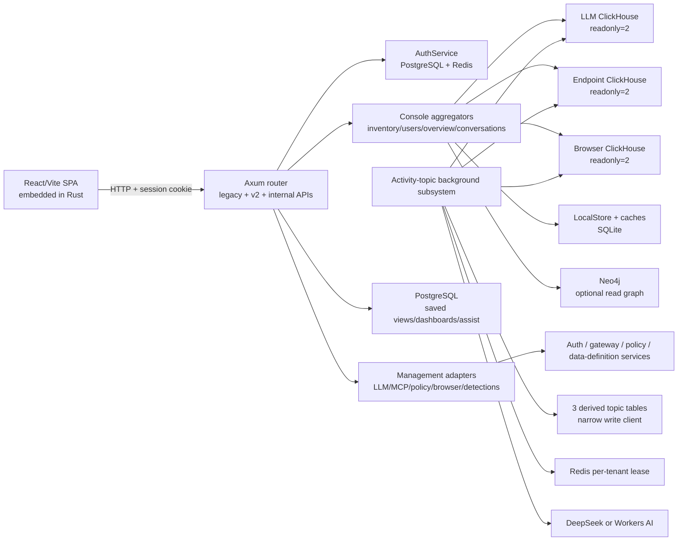

# Architecture

## Runtime boundaries

The root image starts three processes: config-manager Gunicorn on 8000, Compliance DLP on 8282, and this Rust server on 2002. Only the Rust/SPA implementation is primary scope here. The shell command traps TERM/INT and signals all three; an isolated Rust exit does not directly kill the two Python siblings.

## Dependency direction

`main.rs` → `Config` → `AppState` → route/service/storage adapters. Route adapters use domain/console modules and shared state; the frontend consumes the generated v2 client and selected handwritten legacy clients. Build-time flows run in the opposite contract direction: Rust Utoipa → checked-in OpenAPI → Orval TypeScript → Vite assets → Rust embedding.

## Trust boundaries

1. Browser to Axum: cookie/session, Origin/CSRF, request validation.
2. Axum to data stores: tenant/subscriber scope must derive from trusted principal, not caller widening.
3. Axum to external management services: fixed roots and validated path segments.
4. Source records to local caches/exports: sensitive values are bounded/redacted.
5. Background classifier to AI provider: content blocks are treated as untrusted data and persisted topic outputs exclude full bodies.
