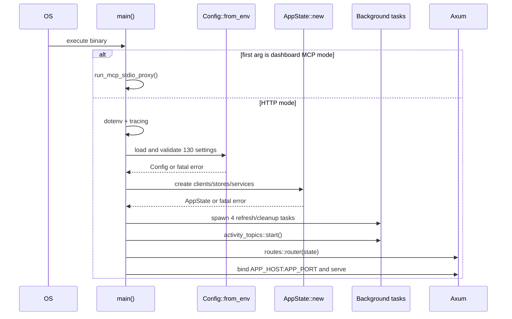

# Runtime Entry Points

| Entry | File/symbol | Invocation | Initialization or loop | Failure |
| --- | --- | --- | --- | --- |
| server | src/main.rs::main | binary execution | loads env/tracing/config/state, spawns background loops, binds Axum | fatal on config/state/bind/server error |
| dashboard-agent-proxy | src/main.rs::main | first CLI argument equals AGENT_MCP_MODE_ARGUMENT | runs custom dashboard MCP stdio proxy only | returns proxy result |
| OpenAPI-export | src/bin/export_platform_openapi.rs::main | cargo run --bin export_platform_openapi | serializes Utoipa document | nonzero on write/format error |
| router | src/routes/mod.rs::router | called by main/tests | mounts health, legacy APIs, v2, internal admin, SPA | construction is synchronous |
| local-store-refresh | local_store::run_refresher | tokio::spawn at startup | refreshes config/directory/analytics mirrors | logs/retries; detached |
| endpoint-conversation-refresh | local_store::run_endpoint_conversation_refresher | tokio::spawn | refreshes selected Endpoint conversation snapshots | detached |
| deployment-refresh | local_store::run_deployment_refresher | tokio::spawn | refreshes deployment projections | detached |
| dashboard-cleanup | CustomDashboardService::run_cleanup | tokio::spawn | removes expired dashboard run artifacts | detached |
| topic-start | activity_topics::start | startup | always starts mirror; conditionally starts writer/classifier | background failures do not stop HTTP |
| topic-mirror | activity_topics::mirror | spawned by start | waits for schema then syncs 90-day read mirror | indefinite retry |
| topic-generation | activity_topics::generation | TOPIC_GENERATON_ENABLED | ensures three tables then supervises classifier | indefinite retry |
| topic-supervisor | activity_topics::runner::supervise | generation ready | per-tenant Redis leadership and bucket processing | cycle error logged; loop continues |
| frontend | frontend/src/main.tsx | browser loads embedded index | mounts React StrictMode App | throws when #root absent |
| session-boundary | frontend/src/app/SessionBoundary.tsx | wildcard route | loads session and selects auth/self-service/admin route tree | 401 routes to auth; other errors retry panel |
| Vite-dev | frontend/vite.config.ts | npm run dev | serves SPA on 5173 and proxies two API prefixes | development only |
| verification | scripts/verify.sh | manual/CI | install, regenerate, frontend checks, Playwright, drift, fmt, clippy, test, build | set -e; first failure stops |
| Jenkins-image | Jenkinsfile | Jenkins branch build | BuildKit image build and registry push | pipeline failure |
| GitHub-subtree-CI | better-console-backend/.github/workflows/ci.yml | push main/PR when subtree is repo root | runs scripts/verify.sh | context mismatch when used from monorepo root is unresolved |
| GitHub-root-build | .github/workflows/build.yml | push/PR main or quilr-preprod | delegates language detection/build | pinned run detected repo but skipped build |
| container | Dockerfile CMD | container start | starts Gunicorn, DLP setup/service, Rust; traps TERM/INT | wait returns when any child exits; siblings may remain until container runtime acts |

## Startup sequence

## Shutdown

**Verified:** `main.rs` calls `axum::serve(...).await` without `with_graceful_shutdown`. Detached task handles are not retained for explicit drain/cancel. In the container, the outer shell forwards TERM/INT to process IDs. **Potential issue requiring validation:** in-flight HTTP/background cleanup behavior on termination is not explicit in Rust.
