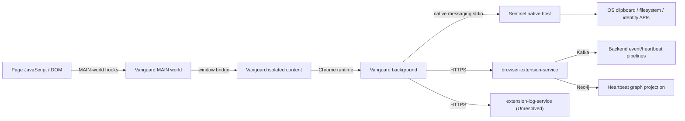

# Sensor Role and Boundaries

**Analysis status:** Complete for the pinned source scope.  
**Evidence rule:** Current-behavior statements use the mission labels; target behavior is `Proposed`.  
**Purpose:** Define what the compound sensor can truthfully observe, enforce, and prove.

## Actual role

**Verified in source:** the sensor is a three-layer compound system:

1. Vanguard runs in Chrome/Chromium as MAIN-world and isolated-world content
   scripts, a background service worker, and popup/options UI.
2. Sentinel runs as a native process connected through Chrome native messaging
   and uses local OS/filesystem APIs.
3. browser-extension-service accepts authenticated HTTP records, aggregates
   heartbeats, publishes Kafka records, and writes heartbeat projections.

It is both passive and active. It passively observes browser navigation, DOM
interactions, Chrome extensions/downloads, and selected native clipboard/file
signals. It actively holds/replays browser uploads, modifies/blocks/restores
clipboard data, deletes/restores downloads, applies prompt policies, and
enables/disables extensions. Policy decisions and action requests are not proof
of effect; effect messages and page state must be retained separately.

## Trust and runtime boundaries

The page-to-extension window bridge and the native stdio process boundary are
security-sensitive. Backend tenant attribution comes from UserContext, not
solely from body fields.

## Supported environments

- Browser: Chrome/Chromium extension APIs and Plasmo runtime.
- Native: explicit Windows and macOS clipboard/search/identifier paths.
- Linux: no functional clipboard adapter and unsupported system-identifier
  fallback; no complete Linux claim.
- Offline: partial browser retry only; not a durable outbox. Native output and
  backend heartbeat pre-publish state are not offline-safe.

## Definitive non-capabilities

This sensor does not discover all machines, cloud instances, serverless
functions, CI/CD runners, ephemeral agents, MCP servers/tools/backends, agent
definitions, GitHub repositories/folders/files, prompt files, or Markdown
skills. It does not provide gRPC. It does not prove server-side application
behavior, account ownership, or actual network transfer completion solely from
a page action.
