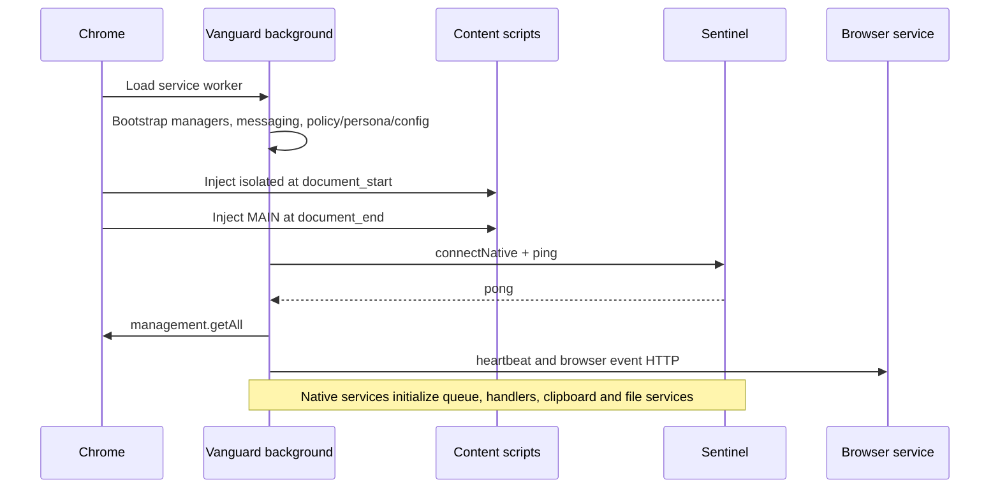
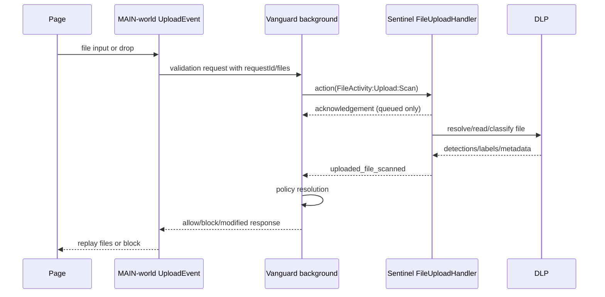

# Runtime Lifecycle

**Analysis status:** Complete for the pinned source scope.  
**Evidence rule:** Current-behavior statements use the mission labels; target behavior is `Proposed`.  
**Purpose:** Trace initialization, steady state, shutdown and major failure paths.

## Entry-point ledger

| Entry ID | Layer | File and symbol | Invocation | Initialization or processing model | Shutdown | Failure behavior | Status |
| --- | --- | --- | --- | --- | --- | --- | --- |
| EP-001 | Extension | src/background/index.ts module body | Plasmo service-worker load | Constructs bootstrap and messaging services | Service-worker suspension; explicit listener cleanup varies | Startup catches/logs selected failures | Implemented |
| EP-002 | Extension | src/contents/content.ts config | Injected at document_start on <all_urls> | Creates isolated-world content/frame runtime | Page/frame unload and cleanup controllers | Errors logged; some paths continue | Implemented |
| EP-003 | Extension | src/contents/mainContent.ts config | Injected at document_end in MAIN world on <all_urls> | Starts main-world pub/sub and interception | pagehide and cleanup controllers | Logs uncaught window errors | Implemented |
| EP-004 | Extension | src/popup/index.tsx root | User opens extension popup | Renders popup UI and action handlers | Component abort controller | UI catches/logs request failures | Implemented |
| EP-005 | Extension | src/options/* roots | User opens extension options/diagnostics | Renders management and diagnostic UI | Component cleanup | UI error state | Implemented |
| EP-006 | Extension | chrome.webNavigation callbacks | Navigation lifecycle | Emits PageLoadEvent into process chain | Listeners removed by service cleanup | Invalid/missing frames skipped or logged | Implemented |
| EP-007 | Extension | chrome.management.getAll and callbacks | Bootstrap and extension lifecycle | Batch discovery then individual lifecycle handling | Listeners can be removed | API errors produce failed/empty operations | Implemented |
| EP-008 | Extension | ContentPubSub event listeners | DOM pointer/input/copy/paste/change events | Normalizes and publishes to classifiers | Abort/unsubscribe | Per-event exceptions logged | Implemented |
| EP-009 | Extension | UploadEvent.start/event handlers | File input or drag/drop | Holds upload and asks background/native for resolution | Cleanup and simulated replay | Normal errors fail open; 60-second path cancels | Implemented |
| EP-010 | Extension | interceptor.js injected bootstrap | MAIN-world load | Monkey-patches page network APIs | pagehide cleanup | Per-interceptor errors logged | Partially implemented |
| EP-011 | Extension | ChromeNativeMessaging.connect | Bootstrap/native need | Opens Chrome native messaging port | Disconnect listener | Unavailable host disables agent-dependent paths | Implemented |
| EP-012 | Extension | sendHeartbeat middleware | Bootstrap/periodic call | POSTs persona heartbeat | No persistent loop ownership in function | Network errors logged/retried on next interval | Implemented |
| EP-013 | Extension | PackageLog.send | Resolved browser event | Generates envelope and HTTP POSTs | None | Failed individual request enqueues FailedLogQueue | Implemented |
| EP-014 | Extension | PackageExtensionLogs.sendBatched | Initial extension discovery | Generates batch and POSTs to extension-log-service path | None | Returns false; no FailedLogQueue enqueue | Implemented |
| EP-015 | Extension | DiagnosticService state machine | User starts diagnostic | Coordinates collection, snapshot, compression and dispatch | CLEANUP event removes listeners/state | Caches failed upload for download/retry | Implemented |
| EP-016 | Native | src/main.rs main | Native host binary process start | Initializes infra/services/event broker then native loop | Process exit/agent disable and task termination | Missing dependencies/config can abort or log | Implemented |
| EP-017 | Native | start_native_messaging_loop | Native-host feature startup | Blocking framed read in Tokio task, action routing | EOF breaks loop | Malformed action emits err_action; read failure emits failed_transmission | Implemented |
| EP-018 | Native | EventBroker consumer loop | SystemEvent queue receives event | Selects chain key and executes handlers | Task cancellation/process exit | Handler timeouts/tolerance per chains.json | Implemented |
| EP-019 | Native | ClipboardMonitorService.start | ServiceManager startup/config update | Starts OS adapter listener/poller | Service stop/restart | Unsupported OS default does not observe clipboard | Partially implemented |
| EP-020 | Native | FileIndexService.start | ServiceManager startup | Initial/index watcher updates SQLite | Service stop | I/O/database failures logged or propagated by service | Implemented |
| EP-021 | Native | FileUploadHandler.handle_event | FileActivity:Upload:Scan | Concurrent search/scan then zipped result serialization | Handler completion | Per-file error emits empty result; handler errors propagate | Implemented |
| EP-022 | Native | FileDownloadHandler.handle_event | FileActivity:Download:Scan | Scans named download | Handler completion | Errors returned through handler model | Implemented |
| EP-023 | Native | SystemIdHandler.handle_event | PersonaActivity:FetchIdentifiers:Scan | Builds/loads SystemID and emits native message | Handler completion | Collection warnings; top-level IDs empty by implementation | Partially implemented |
| EP-024 | Backend | BrowserExtensionServiceApplication.main | Spring Boot process start | Builds MVC/security/data/stream/scheduler context | Spring shutdown and bean cleanup | Bean/config/dependency failures abort startup | Implemented |
| EP-025 | Backend | UserActionController.logUserInteraction | POST /browser/interaction/log | Validate, create reuse records, initiate ingest | Request completion | Catches all and returns 400 with message | Implemented |
| EP-026 | Backend | UserActionController.logBrowserEvent | POST /browser/interaction/log/v2 | Directly calls ingestRiskEvents | Request completion | Service response determines result | Implemented |
| EP-027 | Backend | UserActionController.logBrowserEvents | POST /browser/interaction/events | Loops synchronously through logUserInteraction | Request completion | One thrown failure returns 400; nested method itself catches | Implemented |
| EP-028 | Backend | PersonaController.recordHeartbeatV2 | POST /browser/personas/v2/heartbeat | Validates tenant/device then writes process-local bucket | Request completion | 400 missing tenant/device; other errors propagate | Implemented |
| EP-029 | Backend | HeartbeatBatchScheduler.run | Spring schedule fixedDelay 5 minutes | Publishes each bucket then deletes it | Spring scheduler shutdown | Exception retains bucket for next run except false-return publication is not thrown | Implemented |
| EP-030 | Backend | HeartbeatKafkaThread.call | Bean-managed Kafka consumer thread | Poll, deserialize, ingest and commit | Wakeup/close | Malformed-only poll commits without write; ingestion failures control commit path | Implemented |
| EP-031 | Test | VTest stdio MCP server | Developer test command | Exposes browser-test automation tools over stdio | Process termination | Test-only errors | Experimental |
| EP-032 | Build | Project-Vanguard package scripts | pnpm/npm scripts and Plasmo | Build/test/package extension | Process exit | Build/test exit status | Implemented |
| EP-033 | Build | project-sentinel Cargo targets | cargo build/test with feature/OS target | Builds native-host/agent binaries | Process exit | Unavailable path dependencies/toolchain prevent build | Configured but runtime-unverified |
| EP-034 | Build | browser-extension-service Maven/Spring scripts | Maven/CI/container start | Compiles/tests/packages Spring application | Process exit | Maven/test status | Implemented |

## Startup sequence

## Upload execution sequence

**Potential issue:** the native result array does not carry the original
per-file ID and is positionally zipped/merged. A mixed multi-file batch can
misassociate results if upstream processing order differs.

## Shutdown and failure

The browser service worker can be suspended; listener cleanup is component
specific. Sentinel exits its native loop on EOF, while other service tasks end
with the process or disable flow. BES uses normal Spring shutdown. None of these
layers currently performs a coordinated drain of a compound-sensor outbox
because that outbox does not exist.
