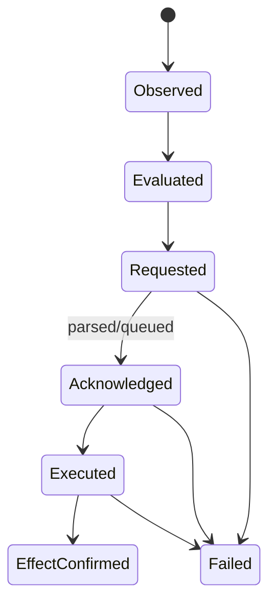

# Policy, Control, and Enforcement

**Analysis status:** Complete for the pinned source scope.  
**Evidence rule:** Current-behavior statements use the mission labels; target behavior is `Proposed`.  
**Purpose:** Trace 24 current and proposed controls through request, decision, acknowledgement and effect evidence.

| Control ID | Control/capability | Plane | Request/trigger | Decision input | Requested action | Acknowledgement | Effect evidence | Failure-open/closed | Implementation status | Availability | Evidence | Source |
| --- | --- | --- | --- | --- | --- | --- | --- | --- | --- | --- | --- | --- |
| C-001 | Allow original prompt no justification | Browser | Resolved DLP policy | PolicyResult/browser_action | Allow | UI/action completion | Final prompt/action event when logged | Typically allow | Implemented | Available through adapter mapping only | Verified in source | Project-Vanguard/src/types/controls.d.ts |
| C-002 | Allow original prompt optional justification | Browser | Resolved DLP policy | Policy/action config | Prompt optionally then allow | User interaction result | Event outcome/final prompt | User path dependent | Implemented | Available through adapter mapping only | Verified in source | Project-Vanguard/src/types/controls.d.ts |
| C-003 | Allow original prompt mandatory justification | Browser | Resolved DLP policy | Policy/action config | Hold until justification then allow | User interaction result | Justification/outcome record | Blocks/holds until resolution according to template | Implemented | Available through adapter mapping only | Verified in source | Project-Vanguard/src/types/controls.d.ts |
| C-004 | Redact prompt | Browser | Resolved DLP policy | Detections and action mode | Replace prompt with final text | User/action resolver | prompt_changed and final detections | Path dependent | Implemented | Available through adapter mapping only | Verified in source | Project-Vanguard/src/types/controls.d.ts |
| C-005 | Block prompt | Browser | Resolved policy | Mode/action | Suppress submission/show block | UI resolution | Outcome/action_taken when logged | Intended fail closed for matched action | Implemented | Available through adapter mapping only | Verified in source | Project-Vanguard/src/core/contents/templates/prompts/block.ts |
| C-006 | Suppress/hold page actions | Browser | Policy/template state | Resolved policy and DOM target | Stop events/hold input | Local state | DOM action and activity record | Path dependent | Implemented | Available through adapter mapping only | Verified in source | Project-Vanguard/src/core/utils/ContentPubSub.ts |
| C-007 | Allow upload | Browser | Upload scan/policy result | Native result and policies | Reinject files/simulate upload | MAIN-world validation response | upload policy outcome log | Normal errors fail open | Implemented | Available through adapter mapping only | Verified in source | Project-Vanguard/src/core/mainWorldContent/UploadEvent/index.ts |
| C-008 | Block upload | Browser | Upload scan/policy result | Sensitivity/policy | Prevent/reject page upload | Validation response | blocked milestone/outcome | 60-second timeout cancels; normal errors fail open | Implemented | Available through adapter mapping only | Verified in source | Project-Vanguard/src/core/services/uploadManager.service.ts |
| C-009 | Modify upload | Browser/native | Policy/scan | File scan and page workflow | Potentially alter/replay allowed selection | Native/bridge response | Outcome log | Implementation is page-flow specific | Partially implemented | Available through adapter mapping only | Verified in source | Project-Vanguard/src/core/mainWorldContent/UploadEvent |
| C-010 | Cancel file scan | Native | FileActivity:Cancel:Cancel | SystemEvent ID/request | Cancel scan | file_scan_cancelled | Handler result | Best effort | Implemented | Available through adapter mapping only | Verified in source | project-sentinel/chains.json |
| C-011 | Delete downloaded file | Native | FileActivity:Download:Delete | Path/original event | Filesystem delete | downloaded_file_removed | Native result | Handler error path | Implemented | Available through adapter mapping only | Verified in source | project-sentinel/chains.json |
| C-012 | Restore downloaded file | Native | FileActivity:Download:Restore | Original path/state | Filesystem restore | downloaded_file_restored | Native result | Handler error path | Implemented | Available through adapter mapping only | Verified in source | project-sentinel/chains.json |
| C-013 | Modify clipboard | Native | ClipboardChanged:Copy:Modify | Original event and replacement data | Set clipboard content | clipboard_content_modified | Native result | Handler error path | Implemented | Available through adapter mapping only | Verified in source | project-sentinel/chains.json |
| C-014 | Block/delete clipboard | Native | ClipboardChanged:Copy:Block | Original clipboard event | Clear/delete clipboard | clipboard_content_deleted | Native result | Handler error path | Implemented | Available through adapter mapping only | Verified in source | project-sentinel/chains.json |
| C-015 | Restore clipboard | Native | ClipboardChanged:Copy:Restore | Saved/original content | Restore clipboard | clipboard_content_restored | Native result | Handler error path | Implemented | Available through adapter mapping only | Verified in source | project-sentinel/chains.json |
| C-016 | Disable third-party extension | Browser | Admin/user extension settings | Extension ID and admin_status | chrome.management.setEnabled false | Chrome API callback/promise | Lifecycle callback/log | API failure leaves extension state | Implemented | Available through adapter mapping only | Verified in source | Project-Vanguard/src/core/ExtensionManagement/index.ts |
| C-017 | Enable third-party extension | Browser | Admin/user extension settings | Extension ID and admin_status | chrome.management.setEnabled true | Chrome API result | Lifecycle callback/log | API failure leaves state | Implemented | Available through adapter mapping only | Verified in source | Project-Vanguard/src/core/ExtensionManagement/index.ts |
| C-018 | Remove-mark third-party extension | Browser/UI | Admin status remove | Extension ID/settings | Marks/options/user uninstall flow | State/UI | uninstall callback if user completes | Does not silently uninstall in shown path | Partially implemented | Available through adapter mapping only | Verified in source | Project-Vanguard/src/core/ExtensionManagement/index.ts |
| C-019 | Update native configuration | Native | AgentUpdate:Configuration:Update | CopyConfig and other settings | Persist/restart services | config_updated | Handler result | Config parse/handler error | Implemented | Available through adapter mapping only | Verified in source | project-sentinel/src/handlers/agent_configuration_update_handler.rs |
| C-020 | Disable native agent | Native | AgentUpdate:Configuration:Disable | Disable action | Persist disable and stop behavior | Handler/native lifecycle signal | Process/service state | Failure depends handler | Implemented | Available through adapter mapping only | Verified in source | project-sentinel/src/handlers/agent_disable_handler.rs |
| C-021 | Update native log level | Native | LogActivity:Update:Update | Log configuration | Change log level | log_level_updated | Handler result | Handler error | Implemented | Available through adapter mapping only | Verified in source | project-sentinel/src/handlers/log_update_handler.rs |
| C-022 | Persona update/delete | Native/backend | Persona action or API | Persona/token/context | Persist/update/delete persona | persona_updated or deletion_in_progress | Backend/native state | Delete-in-progress is not completion | Implemented | Available through adapter mapping only | Verified in source | project-sentinel/chains.json |
| C-023 | Proposed Starliner control command | Platform to adapter | Signed/versioned command | Tenant, target sensor/enforcement point, action and expiry | Translate to existing native/browser action | Durable received/accepted/rejected result | Canonical ControlResult with effect evidence | Must fail closed on invalid signature/target; domain action policy-specific | Placeholder | Requires substantial sensor changes | Proposed | Target adapter |
| C-024 | gRPC control plane | None | No implementation | None | None | None | None | N/A | Documentation-only | Not observable by this sensor | Verified in source | All pinned repositories |

## Enforcement state model

Current records often contain outcome/action fields, but a production adapter
must populate only states demonstrated by evidence. A policy mode cannot be
promoted directly to `EffectConfirmed`.
