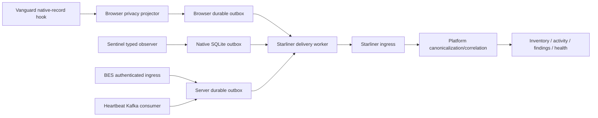

# Adapter Architecture

**Analysis status:** Complete for the pinned source scope.  
**Evidence rule:** Current-behavior statements use the mission labels; target behavior is `Proposed`.  
**Purpose:** Specify the compound adapter components, placement, inputs, outputs and acceptance criteria.

| Component ID | Component | Placement | Inputs | Outputs | Responsibilities | Durability | Current/new | Dependencies | Acceptance criterion |
| --- | --- | --- | --- | --- | --- | --- | --- | --- | --- |
| A-001 | Compound sensor instance registry | Vanguard plus Sentinel/BES registration | tenant, device, browser profile, extension install, native install | stable sensor_instance_id and component_instance_ids | Persist IDs, rotate on reinstall, bind browser/native/backend components | Browser IndexedDB/native SQLite/backend registry | New | Identity policy | Same IDs survive restart and distinguish profiles/reinstalls |
| A-002 | Browser native-record observer | Vanguard around PackageLog and PackageExtensionLogs | Versioned native browser records | Adapter-native record stream | Capture before network mutation; never block user path on telemetry | Local outbox enqueue | New thin hook | Project-Vanguard | All emitted browser record types reach test sink with source IDs |
| A-003 | Browser privacy projector | Vanguard adapter module | Native event/check | Safe SourceObservation/CanonicalActivity candidates | Allow-list fields, hash/tokenize sensitive values, attach evidence refs | Before outbox | New | Privacy policy | Raw prompt/password/path/header never enters safe summaries |
| A-004 | Browser durable outbox | Vanguard IndexedDB or companion local service | DeliveryEnvelope | Pending/in-flight/terminal queue | Idempotency, ordering, retry, backoff, quota, quarantine | Durable local | New | Starliner envelope | Offline/restart/replay scenarios pass without duplicates/loss |
| A-005 | Native observer API | Sentinel event broker/handlers | SystemEvent, SystemAction and typed results | Versioned native observation/result stream | Expose capture/ack/effect separately and redact secrets | Native SQLite outbox | New stable boundary | project-sentinel | Every chain action has received/attempted/effect result IDs |
| A-006 | Native file correlation fix | Sentinel FileMetadata/FileActivityResponseItem | Per-file request ID | Result containing same file ID | Eliminate positional association | N/A | Minor source change | File handlers and Vanguard types | Mixed success/error multi-file batch maps by ID |
| A-007 | Native identity repair | Sentinel system identifier module | Raw platform IDs | Quality-labelled device/sensor identifiers | Populate safe top-level fields or explicitly omit; never empty-as-valid | SQLite | Substantial source change | Identity/privacy policy | Stable instance ID verified across restart and empty ID rejected |
| A-008 | BES ingress adapter | browser-extension-service UserActionService | EventLogRequest plus UserContext | DeliveryEnvelope source/native records | Central auth binding, version validation, outbox enqueue before async publish | Server SQLite/Postgres/Kafka-outbox depending deployment | New | BES and Starliner SDK | HTTP accepted record is durably queued or request fails explicitly |
| A-009 | Heartbeat adapter consumer | BES heartbeat Kafka sidecar/consumer | HeartbeatBatch | SensorHealthEvent and inventory observations | Map freshness/capability/version; track producer gaps | Server durable outbox | New | Kafka/Starliner | Late/duplicate/malformed heartbeat scenarios are deterministic |
| A-010 | Extension-inventory feed adapter | Vanguard tee or extension-log-service | ExtensionListingCheck | BrowserExtension SourceObservation/lifecycle activity | Require browser profile and sensor IDs; map permission fields | Durable outbox | New | Missing service contract if server-side | Discovery and lifecycle fixture round trip |
| A-011 | Schema registry/version gate | Shared adapter library | native schema ID/version | Validated typed records or quarantine | Reject unsupported version, preserve raw evidence metadata | Outbox/quarantine | New | Starliner contracts | Unsupported version does not poison stream and emits health signal |
| A-012 | DeliveryEnvelope builder | Shared adapter SDK | Mapped record, IDs and timestamps | DeliveryEnvelope | Origin/evidence quality, record/body hash, idempotency, correlation and safe summary | Outbox | New | Starliner contracts | Golden fixtures validate against pinned contracts |
| A-013 | Starliner delivery worker | Local/server adapter | Pending envelopes | accepted/duplicate/rejected/retry statuses | Batch, authenticate, retry with jitter, respect backpressure | Outbox status machine | New | Starliner API | Offline/replay/partial acceptance tests pass |
| A-014 | Control command receiver | Native/backend adapter | Signed versioned platform command | Existing SystemAction/extension policy operation | Authorize target/action/expiry; translate; persist result | Durable command/result journal | New | Platform control contract | Invalid/expired command rejected; effect evidence returned |
| A-015 | Coverage/health reporter | All components plus platform adapter | Manifest, outbox, heartbeat, hook counters | SensorHealthEvent/metrics | Report per-layer reachability and blind spots | Outbox | New | Capability manifest | Browser/native/backend degradation distinguished |
| A-016 | Evidence reference store | Server/operator plane | Restricted raw payloads | Immutable/restricted evidence reference | Encrypt, authorize, expire and audit raw content | External authoritative evidence store | New | Security/retention service | Canonical records contain refs/hashes, not raw sensitive content |
| A-017 | Correlation service | Platform | Source observations/events across sensors | Canonical entities/relationships/findings | Tenant-scoped matching with confidence and weak-ID controls | Platform state | Platform responsibility | Canonical model | No sensor-side auto-merge on email/hostname/domain |

**Design constraint:** browser, native and backend adapters share contracts and
compound identity but retain independent durability/health. Combining them
into one logical sensor must not hide which component captured an observation.
