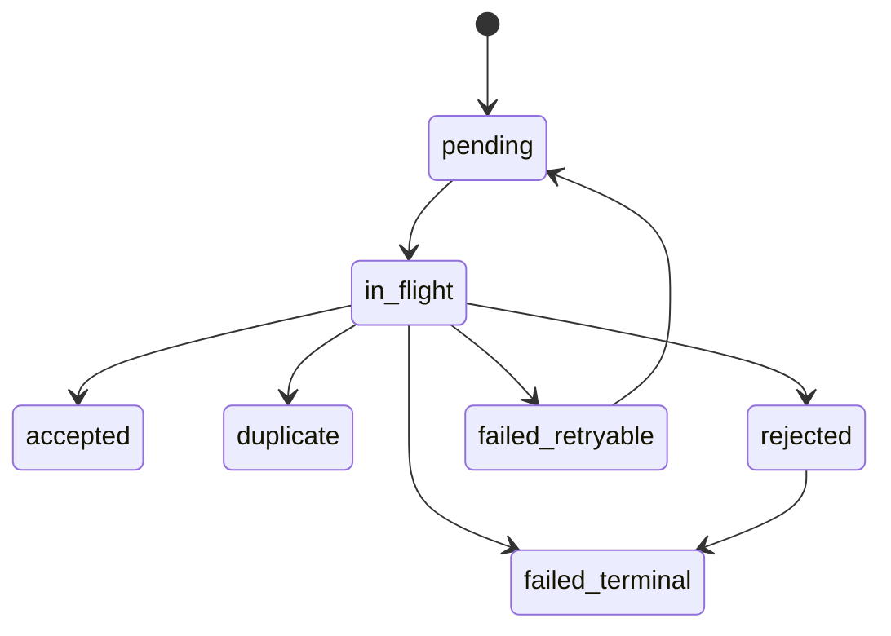

# Starliner and Outbox Integration

**Analysis status:** Complete for the pinned source scope.  
**Evidence rule:** Current-behavior statements use the mission labels; target behavior is `Proposed`.  
**Purpose:** Map source records into DeliveryEnvelope and define durable, idempotent delivery.

## Required envelope fields

Use the pinned `DeliveryEnvelope` contract: tenant, record type/schema version,
sensor ID, adapter/contract/certification versions, runtime instance, record
origin, evidence quality, occurrence/correlation IDs, idempotency key,
body/record hashes, and a privacy-safe summary.

## Outbox state

Enqueue must be durable before a sensor/backend reports acceptance. The
idempotency key is stable across retries and must include tenant, source sensor
instance, native schema/version and source record identity. A new random key per
attempt defeats deduplication. Ordering is per sensor instance/record family,
not a claim of total order across browser/native/backend clocks.

## Placement

- BES can host the MVS outbox for already-delivered browser events.
- Vanguard needs its own outbox/tee for extension inventory and offline/browser
  loss visibility.
- Sentinel needs a local outbox or reliable bridge for native-only results.
- Rich diagnostic evidence must use a separate restricted evidence store.

The existing FailedLogQueue is not an outbox: it is not transactional,
immediate enqueue persistence is absent, batch discovery is excluded, and
there are no accepted/duplicate/rejected states.
