# 03 — Architecture

This chapter reconstructs the verified cross-repository architecture at the pinned revisions. Subsystem maps and symbol-level evidence are linked from the [module reference](06-module-and-file-reference.md). Dotted diagram edges are explicitly inferred, unresolved, or negatively traced as their labels state.

## Endpoint Lua scripting boundary

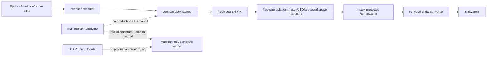

Verified: the active monitor directly uses sandbox/collector primitives and bypasses engine/signing. Dotted reachability labels reflect repository-wide caller searches. See [the scripting analysis](06-endpoint-core-scripting.md).

## Endpoint DLP popup boundary

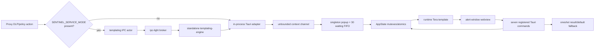

Verified: both proxy paths call the same adapter, which always attaches a oneshot sender. Consequently proxy notifications described as nonblocking still occupy the core's blocking FIFO; only the originating request is detached. The templates execute across the Rust/webview trust boundary and return decisions through `log_dlp_decision`. See [the templating-engine analysis](06-endpoint-core-templating-engine.md).

## Sentinel-core compile-time boundary

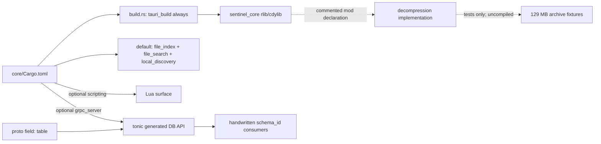

The `grpc_server` mismatch and absent decompression edge are verified source facts, not inferred runtime failures. `compress-tools` is optional, while the excluded archive source imports it unconditionally. Exact dependency versions are unresolved because lockfiles are ignored. See [the core crate-shell analysis](06-endpoint-core-crate-shell-tests-and-decompression.md).

## Endpoint system-monitor runtime topology

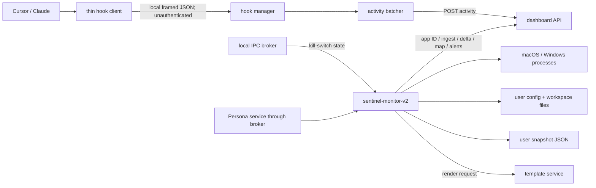

The broker, filesystem, HTTP, hook socket/pipe, process-control, and template-service edges are verified. The hook endpoint intentionally has broad local access but no caller authentication. The kill-switch consumer validates message shape but not sender identity. Deployed OS/broker ACLs beyond the checked code remain unresolved.

Startup is `main → logging/config → kill-switch listener → fixed 6 s gate → Orchestrator → Persona loop → context/snapshot/map → ten joined workers`. Only process discovery and enforcement are power-gated. See [runtime topology](06-endpoint-system-monitor-runtime-discovery-and-state.md) and [sync/hook topology](06-endpoint-system-monitor-sync-enforcement-and-hooks.md).

## Endpoint template-service runtime topology

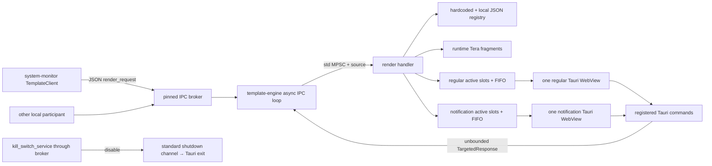

Verified trust/state boundaries: broker identities are claimed rather than authenticated by this consumer; local template directories and registry files affect privileged WebView content; active/queued state is not persisted; queues omit sender identity. There is one native window per category, not one per configured concurrent slot. See [the complete template-service analysis](06-endpoint-template-service.md).

## Email-discovery privilege boundary

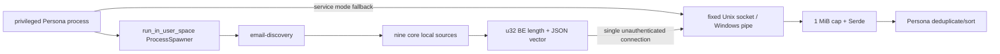

The fixed names are `/tmp/sentinel-email-discovery.sock` and `\\.\pipe\sentinel-email-discovery`. Unix applies no explicit socket mode or peer credential check; Windows grants a null DACL and performs no client SID check. This is the actual user-to-privileged trust boundary. See [the helper analysis](06-endpoint-email-discovery.md).

## Endpoint diagnostics topology

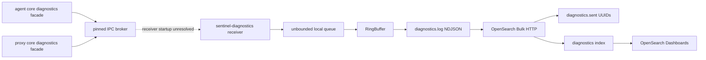

The producer edges are active. The dotted edge marks verified receiver implementation without a checked launcher: its core default registration is commented out. Receiver dispatch trusts the broker-routed JSON structure, local files use host-default permissions, and the committed local OpenSearch stack disables security. See [the complete diagnostics analysis](06-endpoint-diagnostics-receiver.md).

## Endpoint infra platform/process topology

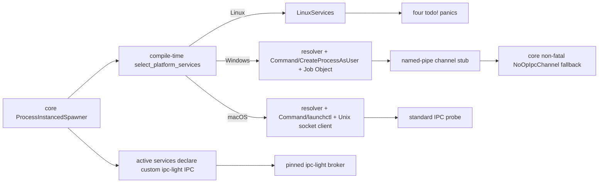

The active process services skip the standard infra IPC probe and use the pinned broker. macOS and Windows process services still depend on infra for address preparation, binary resolution, stale-child cleanup, process creation, and lifecycle handles. Linux reaches runtime panics at its first requested adapter. Windows user-session process creation omits the per-spawn environment map, while macOS user-session tracking binds a handle through newest-name `pgrep`, not an OS-returned child handle. Full verified flows are in [the infra chapter](06-endpoint-infra-platform-runtime.md).

## Endpoint proxy runtime topology

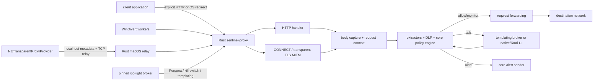

All solid edges are verified call, socket, or broker relationships. Windows rewrites intercepted TCP to the proxy and maintains client-to-server masquerade state. The active macOS path does not pass file descriptors: Swift opens a new localhost TCP connection to a Rust relay, prefixes JSON metadata, then bridges Network Extension flow bytes. The retained SCM_RIGHTS control messages and Rust/Swift UDP forwarders are legacy or unreachable from the current active branch.

### macOS startup and trust-boundary sequence

```mermaid
sequenceDiagram
    participant R as Rust redirector
    participant M as NE manager
    participant S as Swift provider
    participant U as Unix control listener
    participant L as localhost relay
    R->>M: start tunnel
    M->>S: startProxy
    S->>U: one initial connect attempt
    Note over S,U: U is bound only afterward; failure continues startup
    R->>U: bind/chmod control socket
    R->>L: bind random localhost relay/heartbeat ports
    U-->>S: relay address, only if control channel connected
    S->>L: JSON metadata + relayed TCP bytes
```

The ordering above is a verified startup race. Relay and heartbeat listeners accept localhost peers without authentication or peer-credential validation. See [packet-redirection architecture](06-endpoint-proxy-packet-redirection.md).

## Endpoint build-to-install topology

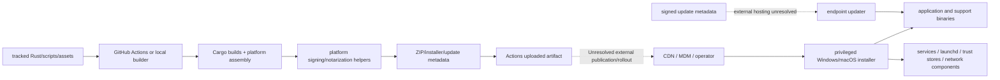

Solid edges are verified in workflows/builders/installers. Dotted edges identify missing external deployment evidence, not verified repository processes. The updater uses a lock and staged extraction but does not atomically replace the complete installed set. Multiple legacy/manual/Python paths coexist beside the current workflow and do not form one consistent release pipeline. See [the complete delivery analysis](06-endpoint-build-release-install-and-update.md).

## Endpoint support-tool boundary

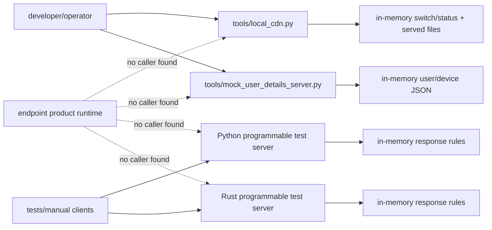

The dotted edges deliberately state negative repository reachability after searches; external/manual use remains possible. These servers are support/test entry points, not established production components. See [the root/tools/tests analysis](06-endpoint-root-tools-tests-and-documentation.md).
