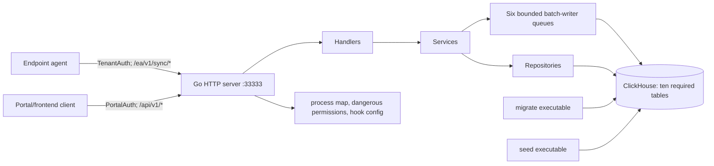

# Dashboard/API Server Deep Reference

This file covers `sentinel-dashboard/api_server/v2` at dashboard commit `cd755d37c14b8b86623a15a4dbae41d33b226b2b`. Paths in this document are relative to the dashboard repository unless stated otherwise.

## Scope and confidence

- **Verified:** every handwritten Go source file, both ClickHouse schema trees, all Go tests, all data catalogs, the API Dockerfile, Compose definitions, environment templates, root Jenkins pipeline, and GitHub security workflow were inspected.
- **Verified:** the server route table below is transcribed from `api_server/v2/cmd/server/main.go:132-190`, not inferred from frontend calls or documentation.
- **Unresolved:** the Go toolchain is not installed in the analysis environment, so the code and unit tests could not be compiled or executed locally. Integration tests additionally require a migrated live ClickHouse instance.
- **Security handling:** the committed `api_server/v2/.env` was inspected without reproducing its credential values here. It is tracked by Git and contains a concrete ClickHouse password and other environment-specific connection values.

## Package and file map

| Path group | Role | Status |
| --- | --- | --- |
| `cmd/server/main.go` | Production bootstrap, router, lifecycle, tenant-policy migration mode | Active runtime entry point |
| `cmd/migrate/main.go` | PaaS/SaaS ClickHouse schema runner | Active administrative entry point |
| `cmd/seed/main.go` | Development user seeder | Active administrative entry point; unsafe for production without modification |
| `internal/config` | Environment parsing and defaults | Active configuration |
| `internal/database` | ClickHouse connection and startup table validation | Active adapter |
| `internal/auth` | Context keys and internal HS256 token helper | Context helper active; token helper not wired into production router |
| `internal/middleware` | Tenant HMAC, portal token decoding, gzip, CORS, request ID | Active request boundary |
| `internal/handler` | HTTP parsing, validation, response status, static catalog caching | Active controllers, except `AuthHandler` in production |
| `internal/service` | Ingest transformations, async enqueue, activity metadata, dashboard orchestration, internal auth | Active business orchestration, except `AuthService` in production |
| `internal/repository` | ClickHouse SQL, batch writers, aggregation and overlays | Active data-access layer; several compatibility/test helpers noted below |
| `internal/model` | Transport, storage projection, dashboard, policy, and catalog types | Active types and validation |
| `clickhouse_schema` | Self-hosted `ReplacingMergeTree` DDL | Active migration input |
| `clickhouse_schema_saas` | ClickHouse Cloud `SharedReplacingMergeTree` DDL | Active migration input when `DEPLOYMENT_MODE=saas` |
| `data/*.json`, `data/hook_config` | Agent configuration payloads and compiled tenant-policy catalog | Active runtime/build data |
| `tests` | Build-tagged live-ClickHouse integration suite | Test-only; not invoked by visible CI |

## Runtime topology

Every solid edge above is directly registered or called in source. There is no queue broker or separate worker process: the six writers are goroutines in the API process.

## Server startup and shutdown

### `main.main`

**Location:** `api_server/v2/cmd/server/main.go:25-241`  
**Type:** runtime entry point  
**Confidence:** Verified

Execution order:

1. Defines `--migrate-tenant-policy` and `--dry-run`; the second only has meaning with the first.
2. Loads a `.env` from the process working directory with `godotenv.Load`; the error is discarded.
3. Replaces the default logger with JSON `slog` at info level.
4. Calls `config.Load`. Missing `CLICKHOUSE_PASSWORD` or an invalid `CATALOG_NAMESPACE_SECRET` is fatal with exit status 1.
5. Creates a cancelable root context, opens ClickHouse, pings it, and validates all ten required tables. Any failure exits before serving.
6. Constructs repositories. If tenant-policy migration mode is enabled, calls `runTenantPolicyMigration`, cancels, and exits without constructing HTTP services.
7. Constructs six generic `BatchWriter` instances for entity state, ID mapping, edges, activity, alerts, and hook events; starts the configured number of worker goroutines for each.
8. Constructs services, handlers, the Chi router, and middleware in the order documented below.
9. Starts `http.Server.ListenAndServe` in a goroutine, then blocks for `SIGINT` or `SIGTERM`.
10. On signal, calls `Server.Shutdown` with a fixed 30-second deadline. A shutdown error exits immediately, before writer cancellation/drain.
11. On successful HTTP shutdown, cancels the writer parent context and calls `Stop` on all six writers. `Stop` waits without its own deadline while workers flush their local buffers.

**Failure behavior:** an unexpected `ListenAndServe` error calls `os.Exit(1)` from the serving goroutine, bypassing deferred `chDB.Close` and the graceful writer drain. A successful shutdown logs `server stopped gracefully`.

### `runTenantPolicyMigration`

**Location:** `api_server/v2/cmd/server/main.go:243-286`  
**Status:** administrative flow

It reads the latest policy rows from `TenantPolicyRepository.ListAll`, decodes each stored JSON document, applies `model.MigrateLegacyPolicy`, and optionally rewrites changed rows using `updated_by=system-migration`. Decode, encode, and per-row upsert failures increment `failed` and are logged as warnings, but the function still returns `nil`. Therefore the CLI exits successfully even when some policies failed to migrate. This is verified behavior, not merely a logging concern.

## Middleware and trust boundaries

Production middleware order is Chi `Logger` → `Recoverer` → repository `RequestID` → repository `CORS`, followed by route-group middleware.

### `TenantAuth(secret)`

**Location:** `internal/middleware/tenant_auth.go`  
**Protected routes:** agent sync and the tenant/app settings route.

- With a nonempty secret, the only accepted credential is `Authorization: Bearer <tenant>:<subscriber>:<signature>`.
- `signature` must be lowercase hexadecimal HMAC-SHA256 over `<tenant>:<subscriber>` with the configured secret. Comparison uses `hmac.Equal`.
- There is no issuance timestamp, expiry, nonce, key identifier, or replay state.
- With an empty secret, both `X-Tenant-ID` and `X-Subscriber-ID` are required and trusted directly. Missing values are `400`, not `401`.
- Parsed identity is placed in context and is the tenant/subscriber used by services and SQL. Tenant values sent in entity or hook-event bodies are not used for storage tenancy.

### `PortalAuth()`

**Location:** `internal/middleware/portal_auth.go`  
**Protected routes:** every registered dashboard/frontend endpoint.

- Accepts `Bearer` followed by either one base64url payload segment or a three-segment JWT-like string.
- Decodes JSON claims `id`, `email`, `tenantIds`, `subscriberId`, and `exp`.
- Requires a future `exp`, a nonempty first tenant ID and subscriber ID, and exact equality between those claims and `X-Tenant-ID` / `X-Subscriber-ID` request headers.
- **Verified:** it never parses or verifies a JWT header, algorithm, or signature. For three segments it ignores segments zero and two. `portal_auth_test.go::TestPortalAuth_ThreeSegmentToken` deliberately uses a fake signature and expects success.
- Stores user ID and email in context; role is set to the empty string.

**Potential issue requiring validation:** the comment says signature verification is delegated to a portal reverse proxy, but both `docker-compose.yml` and `docker-compose.dev.yml` publish API port 33333 to the host. Requests reaching that port can mint their own payload if no untracked network control exists. No such external control is present in this repository.

### Other middleware

- `RequestID` trusts an inbound `X-Request-ID`; otherwise it generates a UUID. It copies the ID to both request and response.
- `GzipDecompress` activates only when `Content-Encoding` equals exact lowercase `gzip`, replaces the body, removes the header, and sets content length to -1. Invalid gzip is `400`.
- `CORS` lives misleadingly in `internal/middleware/jwt_auth.go`. It reflects an origin only if exact-equal to a configured string, always sets credentials/method/header policy, and returns `204` for every OPTIONS request even when the origin is not allowed.
- Chi `Recoverer` catches handler panics and returns 500; its behavior comes from the external Chi dependency.

## Production HTTP interface

Unless noted, JSON errors have `{"error":"..."}`. Handler JSON decoding is generally lax: unknown fields are accepted unless a section explicitly notes `DisallowUnknownFields`.

| Method and path | Auth | Handler | Inputs and response | Verified side effects / errors |
| --- | --- | --- | --- | --- |
| `GET /v1/health` | None | `Health` | `200` `{status:"ok",clickhouse:"ok",version:"2.0.0",timestamp}`; `503` degraded shape on ping failure | ClickHouse ping per call |
| `POST /ea/v1/sync/discovered-apps` | Tenant + optional gzip | `IngestHandler.IngestApps` | JSON array of `SyncRequest`; `200 IngestResponse` | Enqueues state/mapping/edges and reads settings; 413 over batch; 503 only if enqueue context fails |
| `POST /ea/v1/sync/activity` | Tenant + optional gzip | `ActivityHandler.IngestActivity` | Array of `ActivityRequest`; `200 {accepted:n}` | Enqueues activity rows |
| `POST /ea/v1/sync/hooks-activity-logs` | Tenant + optional gzip | `HookEventsHandler.Ingest` | One `HookEventBatchRequest`; `200 {accepted:n}` | Enqueues opaque hook events |
| `POST /ea/v1/sync/alerts` | Tenant + optional gzip | `AlertHandler.IngestAlerts` | Array of `AlertRequest`; `200 {accepted:n}` | Enqueues alert rows |
| `GET /ea/v1/sync/delta` | Tenant + gzip middleware (no body) | `DeltaHandler.GetDelta` | `since` epoch ms; optional `os_type`; streamed `{cursor,settings}` | Reads settings; late errors are embedded in an already-200 JSON document |
| `GET /ea/v1/sync/policy` | Tenant | `TenantPolicyHandler.Sync` | optional nonnegative `since`; `Last-Version`; `200 {version,policy}` or `304` | Reads latest policy/default |
| `GET /ea/v1/sync/process-map` | Tenant | `ProcessMapHandler.GetProcessMap` | Raw JSON file | Five-minute in-memory cache; stale fallback |
| `GET /ea/v1/sync/dangerous-permissions` | Tenant | `DangerousPermissionsHandler.GetConfig` | Raw JSON file | Five-minute in-memory cache; stale fallback |
| `GET /ea/v1/sync/hook-config` | Tenant | `HookConfigHandler.GetHookConfig` | Merged JSON config | Base plus optional tenant override, cached five minutes |
| `PUT /api/v1/tenants/{tenant_id}/apps/{app_id}/settings` | Tenant | `SettingsHandler.Update` | `UpdateSettingsRequest`; `204` | Inserts immutable settings version row |
| `GET /api/v1/dashboard/overview` | Portal | `DashboardHandler.GetOverview` | `OverviewResponse` | Aggregated reads; two-minute service cache |
| `GET /api/v1/frontend_apis/inventory_overview` | Portal | `GetInventoryOverview` | paginated app-overview response | Entity/catalog/settings/edge reads |
| `GET /api/v1/frontend_apis/inventory_overview/{app_id}/related_entities` | Portal | `GetInventoryOverviewRelated` | filters and optional child `type`; response includes application, counts and page | Edge plus app-name compatibility reads |
| `GET /api/v1/dashboard/assets` | Portal | `ListAssets` | pagination, type, search, sort and asset filters | Aggregated entity reads plus catalog/settings overlays |
| `GET /api/v1/dashboard/assets/inventory` | Portal | `ListAssetInventory` | same, but type limited to Application/Agent | 30-day inventory query |
| `GET /api/v1/dashboard/assets/{id}` | Portal | `GetAsset` | optional `os_type`; `AssetDetail` | Asset, devices and related entities |
| `PATCH /api/v1/dashboard/assets/{id}/policy` | Portal | `UpdatePolicy` | `{execution_policy,os_type}`; `200 {status:"updated"}` | Settings insert and overview-cache invalidation |
| `GET /api/v1/dashboard/kpis` | Portal | `GetKPIs` | optional `type`; `KPIResponse` | Aggregates plus catalog/settings overlays |
| `GET /api/v1/dashboard/search` | Portal | `SearchAssets` | `q`, optional `type`; up to 20 `SearchResult` rows | Read only |
| `GET /api/v1/dashboard/relationships` | Portal | `GetRelationships` | `GraphData` | Reads entities/edges/activity |
| `GET /api/v1/dashboard/activity` | Portal | `ListActivity` | page plus activity filters | Paginated activity query |
| `GET /api/v1/dashboard/tool-calls` | Portal | `ListToolCalls` | page plus tool/activity filters | `ARRAY JOIN` projection of activity tools |
| `GET /api/v1/dashboard/activity/conversations` | Portal | `ListConversations` | page plus activity filters | Conversation-grouped activity query |
| `GET /api/v1/dashboard/activity/conversations/{conversation_key}` | Portal | `GetConversation` | optional `event_limit` | Full activity turns plus capped hook events |
| `GET /api/v1/dashboard/alerts` | Portal | `ListAlerts` | page and alert filters | Paginated alerts query |
| `GET /api/v1/dashboard/policy` | Portal | `TenantPolicyHandler.Get` | `TenantPolicy` | Latest or compiled default |
| `PUT /api/v1/dashboard/policy` | Portal | `TenantPolicyHandler.Put` | strict `TenantPolicy`, optional `If-Match` | Inserts a new policy version |
| `GET /api/v1/dashboard/dangerous-permissions/config` | Portal | static handler | Raw dangerous-permissions JSON | Same cache as agent endpoint |

**Contradiction:** `AuthHandler.Login`, `AuthHandler.Me`, `AuthService`, internal HS256 generation/validation, and `UserRepository` exist, and the integration-test router registers `/api/v1/auth/login` and `/api/v1/auth/me`. Production `cmd/server/main.go` instantiates none of them and registers neither route.

## Entity discovery ingestion

### Transport and validation

`model.SyncRequest` fields are `id`, `canonical_id`, `entity_type`, `name`, `discovered_at`, `last_seen_at`, `tenant_context`, `device_context`, `user_context`, `governance`, raw `entity_context`, and optional string map `properties`.

Accepted canonical entity types are `Application`, `McpServer`, `Hook`, `Skill`, `Agent`, `Model`, `ControlledRepo`, `Permission`, and `Plugin`. `identity.NormalizeEntityType` also recognizes documented lowercase and short aliases. Empty type defaults to `Application`; unknown strings remain unchanged and are rejected.

The handler requires nonempty `id` and `canonical_id`, limits `name` to 512 bytes, and limits body/batch by configuration. It does not require a nonempty name/device/user, validate timestamps, validate body tenant values, validate governance enums, or validate raw entity-context shape.

### `IngestService.Process`

For each request, in execution order:

1. Normalizes/defaults entity type and takes `canonical_id` exactly as the server entity ID; it does not derive the ID.
2. Computes lowercase trimmed `normalized_name`.
3. `extractProperties` decodes the appropriate typed context and copies recognized scalar fields. Agent-provided `properties` overwrite extracted values on key conflict.
4. `toEntityStateItem` builds a device/user observation. Invalid/missing last-sync times silently become server time; invalid last-access time becomes null. Application legacy governance fields fill only empty envelope governance values.
5. Enqueues state, then ID mapping. A failure after the first enqueue does not roll the first item back.
6. Extracts any `relationships` array from raw entity context without checking target IDs, target types, or relation names. Edge enqueue failures are warnings and do not fail the request.
7. For non-Application records with `app_canonical_id`, enqueues an Application → child edge named `has_<lowercased canonical type>`; failure is likewise suppressed.
8. Builds one response mapping `{agent_id,canonical_id,settings}`.
9. After the loop, reads settings for the unique IDs using the OS of the first request only. The service comment assumes all items share a device; the handler does not enforce that. A settings read failure is logged and response mappings are returned without settings.

**Persistence semantics:** `200` means items reached in-memory channels, not ClickHouse. The three queues are independent; state, mapping, and edges are not a transaction. A later permanent writer failure can drop already-accepted data.

### Category assignment

`model.DetermineCategory` scores eight categories. Title/type keyword matches add 10, other context matches add 1, one negative keyword subtracts 5 from every category, and recognized sources add 10 or 15. A winner needs a score of at least 10. Ties follow the fixed order Development, Security, Automation, Communication, Storage, Web, Productivity, System. Otherwise the result is `General`. Non-Application records preferentially use the first nonempty entity-specific kind (`agent_type`, provider, transport, permission/hook/plugin/event/trust type) directly as category.

## Activity, tools, conversations, alerts, and hook telemetry

### Activity ingestion

`ActivityRequest` carries prompt text, authenticated user, arrays for tools/skills/MCP servers/files, project/model/application, legacy decision, optional action, arbitrary metadata, time, and optional device/user objects. Decision is blank or `allow|deny|warn`; action is blank or `allow|monitor|warn|redact|block`; nonblank time must be RFC3339.

`ActivityService.Ingest` normalizes nil arrays to empty, defaults decision to `allow`, fills blank authenticated user from user email, creates a new UUID, flattens metadata, and enqueues. Because a new UUID is created for every HTTP attempt, client retries create distinct rows rather than replacing the previous row.

Metadata scalar strings, booleans and numbers become `Map(String,String)`; `rule_ids` becomes its own array; nil/nested values are dropped. The code estimates a 4096-byte cap and alphabetically removes only non-reserved fields. **Potential issue:** `approxMetadataBytes` does not account for JSON escaping and never removes oversized reserved values or rule IDs, so the documented 4 KiB guarantee is not absolute.

### Activity reads

- Activity and tool pages clamp invalid or greater-than-100 page size to 25, rather than clamping to 100.
- Invalid `from`/`to` query timestamps are silently ignored.
- Activity filters cover decision, action, app, project, model, device/host/user, reason, session/conversation and time.
- Tool calls are produced by `ARRAY JOIN tools`; ID is activity UUID plus the array index. Time and metadata remain activity-level because storage has no per-tool timestamp.
- `conversationKeyExpr` is session ID when present, otherwise activity UUID. `conversation_id` participates in filtering/direct lookup but does not replace session ID as the list grouping key.
- Conversation listing first pages keys, then fetches all matching turns with a fixed 10,000-row query limit. It de-duplicates versions by UUID and orders turns oldest first.
- Direct conversation retrieval matches activity metadata conversation or session ID and hook-event conversation or session ID. Event limit defaults to 500 and caps at 2,000. No such explicit cap is applied to returned activity turns.

### Alerts

Alerts accept blank entity type or one exact canonical entity type, optional RFC3339 time, and otherwise unvalidated app/action/email/device/OS/properties. Server time and a new UUID fill missing time/identity. Reads filter by entity type, app, action, email, device, OS and time, with the same 25/default-100 maximum page behavior.

### Hook events

The body has `tenant`, `useremail`, `device_id`, and `batch`; body tenant is ignored. Each event needs nonempty `_id` and `event`; unknown event names and unknown fields are accepted, and `data` is stored as opaque JSON text. One server timestamp is captured for the whole batch. ReplacingMergeTree uses event ID within tenant/subscriber as its eventual replacement key.

## Settings, delta, and tenant policy

### Entity settings

The settings route accepts category, approval status, criticality, execution policy, OS, aliases, notes and `updated_by`. Empty governance values are valid; nonempty approval values are `NeedsReview|Approved|Blocked`, criticality `NotCritical|Critical`, and execution `Allowed|Blocked`. Unknown OS normalizes to the global empty OS. The URL `tenant_id` is never read or compared with the authenticated tenant. `updated_by` is client controlled. A successful insert returns 204.

Dashboard policy patch is a separate interface accepting `Allowed|Blocked|Quarantined`. `AppStateRepository.UpdatePolicy` reads current category/governance fields, then inserts a settings version. It does not prove that the entity exists. If OS is omitted, its grouped lookup can select an arbitrary observed OS. It writes `aliases=[]` and does not read/preserve current aliases, so a policy-only update can make the latest settings version lose aliases.

### Delta stream

`since` is parsed as signed integer; negative values are accepted. `cursor` is server `UnixMilli` captured before querying. `SettingsRepository.StreamDelta` returns rows with `_version >= since` and OS equal to requested OS or global. Because comparison is inclusive, using the previous cursor can repeat boundary rows. The handler writes and may flush status/body before the repository completes; query/scan/marshal failures become an `error` member in a partial 200 response instead of an HTTP error status.

### Tenant policy

The policy document consists of schema/version plus DLP, skills and blocked-permission sections. `PolicyVersion` serializes as a decimal JSON string but accepts strings or numbers when decoding. The compiled catalog has schema 1, five app IDs, 13 classifier/category IDs, two states, three DLP actions, one default seed state, three default skills, six default blocked permissions, and 15 legacy classifier mappings.

`TenantPolicy.Validate` verifies catalog app IDs, canonical classifier IDs, states, actions, skill actions, required IDs and duplicate rule tuples. **Contradiction:** its comment says identifiers are intentionally not whitelisted, while the implementation explicitly calls `IsCatalogApp` and `IsCanonicalCategory`.

GET returns the compiled default at version 0 when no row exists. PUT has a fixed 256 KiB limit, rejects unknown fields, ignores client version, defaults schema 1, rejects future schema, validates the document, parses optional integer `If-Match`, and inserts a version. Stored JSON has version zero because the handler clears it before encoding; reads overwrite it with row `_version`.

`TenantPolicyRepository.Upsert` performs a `Get`, compares `If-Match`, computes a millisecond version (forcing at least current+1), then performs an insert. There is no ClickHouse transaction or conditional insert, so two simultaneous writers can both pass the same precondition; version uniqueness is not guaranteed across concurrent server instances.

Agent sync returns 304 only when `since > 0 && since >= version`; `since=0` returns a default version-0 policy. `Last-Version` is always set after policy load succeeds.

## Static agent configuration

- `data/process_map.json` has `platform` data for mac/windows and three exclusion-rule entries. The handler validates only JSON syntax and caches raw bytes for five minutes.
- `data/dangerous_permissions.json` has two IDE descriptors and 13 permission definitions. `DangerousPermsCatalog` provides typed regex validation used by its unit tests, but the HTTP handler serves the raw file and does not invoke that validation at request time.
- `data/hook_config/base.json` declares config version `2026.07.07-1`, defaults (`fail_open`, `timeout_ms`) and agent definitions for Claude, Codex, Copilot extension/CLI, Cursor. `HookConfigHandler` recursively merges objects from `overrides/<tenant>.json`; arrays and scalars replace wholesale. Tenant IDs must match `^[A-Za-z0-9_-]+$` before being used as a path. Missing/malformed/empty overrides fall back to base. Base reload failure serves stale data if any; no base at all returns 500.
- `data/tenant_policy_catalog.json` is embedded by `data/embed.go`. Model package initialization parses it and panics on malformed catalog/defaults. **Contradiction:** a comment says catalog updates need no server recompile, but Go `embed` fixes the bytes at build time; deployment needs a new binary image.

## Batch writer concurrency and durability

### `BatchWriter[T]`

**Location:** `internal/repository/ch_batch_writer.go:31-193`

- `NewBatchWriter` allocates a bounded channel and stores max batch, interval, worker count, retries, DB and callback.
- `Add` blocks until the item enters the queue or the caller context ends. Any context end is returned as `ErrBufferFull`, even when the cause was request deadline/cancellation rather than capacity.
- `Start` creates an internal context and launches `workers` goroutines. Each worker owns its own buffer and ticker.
- A worker flushes at `batchSize`, on every ticker, or drains its local buffer plus currently queued items on cancellation.
- `flushWithRetry` makes `retries + 1` attempts, each with a fresh 30-second context. Retry delays are 200 ms, 800 ms, 3.2 s, and so on (`200ms * 4^(attempt-1)`). Exhaustion increments dropped count and logs; it does not requeue or surface the error to the original HTTP request.
- `Stop` cancels and waits for all workers. There is no stop timeout.
- `Stats` reports queued length/capacity and atomic totals, but no production route, metric exporter, or health check consumes it. Final drain logs are the only production exposure found.

**Potential configuration failures:** `Config.Load` has no range validation. Negative channel capacity panics; nonpositive ticker duration panics; zero workers leaves queues without consumers; nonpositive batch size changes flush behavior; and negative retries makes the retry loop perform no insert while recording dropped data. Invalid integer strings silently use defaults.

Six writers times the worker count means buffers and flush batches are partitioned per goroutine. Ordering between tables and between workers is not guaranteed. Database retry after an uncertain insert can produce duplicates; ReplacingMergeTree may later collapse identical keys, but activity/alert HTTP retry creates fresh UUIDs and therefore persists duplicates.

## ClickHouse storage model

The self-hosted and SaaS trees have the same columns, keys, partitions and TTLs; the engine differs (`ReplacingMergeTree` vs `SharedReplacingMergeTree`). `_version` is normally nanosecond epoch at insertion; policy versions use milliseconds.

| Table | Replacement/order key | Partition / retention | Writers and readers |
| --- | --- | --- | --- |
| `endpoint_entity_device_state` | tenant, subscriber, type, entity, device, user email | month of last sync; TTL 180 days | entity writer; dashboard repository |
| `endpoint_entity_settings` | tenant, subscriber, app, OS | tenant/subscriber; no TTL | settings/admin/policy writes; ingest delta/dashboard reads |
| `endpoint_id_mapping` | tenant, subscriber, agent ID | tenant/subscriber; no TTL | mapping writer and legacy `IDMappingRepository` |
| `endpoint_users` | tenant, email | tenant; no TTL | seed/internal auth |
| `endpoint_activity_log` | tenant, subscriber, UUID | month of event time; TTL 90 days | activity writer and dashboard/activity queries |
| `endpoint_alert_log` | tenant, subscriber, UUID | month of event time; TTL 90 days | alert writer/query |
| `endpoint_entity_edges` | tenant, subscriber, source, target, relation | month reported; no TTL | edge writer; relationship/overview queries |
| `endpoint_app_catalog` | name | global; no TTL | no compatible writer found; the committed app-intel loader writes legacy `app_catalog`; dashboard enrichment reads this table |
| `endpoint_tenant_policy` | tenant, subscriber | tenant/subscriber; no TTL | policy repository |
| `endpoint_hook_events` | tenant, subscriber, event ID | month time; TTL 90 days | hook writer/conversation read |

ReplacingMergeTree de-duplication is eventual. Repository code handles this inconsistently: many state/settings queries use `argMax`, catalog uses `FINAL`, conversation helpers de-duplicate UUIDs in Go, while ordinary activity/alert list queries do not use `FINAL` or an explicit latest-version reduction.

### App/dashboard query behavior

The 2,389-line `AppStateRepository` is the main read model:

- All application data queries include tenant and subscriber predicates.
- `ListAssets` groups Applications/all views by entity and OS, and other typed views by entity ID; supported sort columns are whitelisted, but no secondary stable tie-breaker is added.
- `ListAssetInventory` permits only Applications and Agents, uses a 30-day window, deduplicates Applications by normalized name and Agents by type/ID. The window predicate is based on the aggregate first observation (`min(last_synced_at)`), so a long-lived entity first observed before the window can be excluded even if recently seen.
- Inventory overview normally includes only application names that appear as child `app_name`; `include_empty=true` disables this. Explicit edges are combined with a lowercased app-name compatibility path. Same-named application records can therefore associate one child with multiple application IDs. Related entity previews are ranked and capped at ten per type; ID fetches chunk at 1,000.
- `GetAsset` chooses an aggregated OS row, fetches at most 100 devices, and suppresses device/related read errors by returning partial detail. Per-device scan errors are skipped.
- `OverlayCatalog` then `OverlaySettings` implements precedence: observed data < catalog < settings. The overlay helper correctly prefers exact OS over global settings.
- `GetKPIs` and `GetOverview` perform their own settings loops without deterministic ordering; a later global row can overwrite an exact-OS row despite comments stating specific should win.
- Catalog query failures return empty enrichment without surfacing an error.
- Search requires nonempty query, returns at most 20 rows, has no ordering, and can return entity+OS duplicates.
- Relationship graph reads Application → Model/Agent/McpServer edges and then user → application nodes. Several subordinate query errors are suppressed, producing partial 200 graphs.
- Overview suppresses device, trend, and activity-summary subquery failures. Its recent-activity projection omits action, metadata and rule IDs, so those fields differ from the full activity interface.
- Overview cache entries live for two minutes in an unbounded map. Only `DashboardService.UpdatePolicy` invalidates them; settings writes, ingestion and catalog changes do not.
- `UpsertDeviceState` is a synchronous older transformation used by tests/compatibility, not the production ingest path found in `cmd/server`.

## Configuration reference

| Environment variable | Type / default | Required | Consumer and behavior |
| --- | --- | --- | --- |
| `CLICKHOUSE_PASSWORD` | string, none | Yes, nonempty | `Config.Load`; startup/migrate/seed fail without it |
| `CLICKHOUSE_ADDR` | string, `localhost:9000` | No | ClickHouse address |
| `CLICKHOUSE_USERNAME` | string, `default` | No | ClickHouse auth |
| `CLICKHOUSE_DATABASE` | string, `sentinel` | No | ClickHouse auth/current database |
| `CLICKHOUSE_TLS` | exact string `true`, else false | No | Enables verified TLS config |
| `CLICKHOUSE_HTTP` | exact string `true`, else native | No | Driver protocol |
| `CLICKHOUSE_MAX_OPEN_CONNS` | int, 25 | No | max open; idle is integer half |
| `TENANT_AUTH_SECRET` | string, empty | No | HMAC mode when set; trusted tenant headers when empty |
| `CATALOG_NAMESPACE_SECRET` | UUID, DNS namespace UUID default | No | Parsed and stored; no production consumer was found after ID derivation moved agent-side |
| `JWT_SECRET` | string, development default | No | Internal `AuthService`; inactive in production route table |
| `JWT_EXPIRY_HOURS` | int, 24 | No | Internal token expiry; inactive production auth flow |
| `CH_FLUSH_WORKERS` | int, 4 | No | workers per each of six writers |
| `CH_QUEUE_CAPACITY` | int, 10000 | No | channel capacity per writer |
| `CH_BATCH_SIZE` | int, 500 | No | local worker flush size |
| `CH_FLUSH_INTERVAL_MS` | int, 2000 | No | worker ticker |
| `CH_FLUSH_RETRIES` | int, 3 | No | retries after initial insert attempt |
| `MAX_BATCH_SIZE` | int, 1000 | No | ingest/hook/activity/alert item cap |
| `MAX_REQUEST_BODY_BYTES` | int converted to int64, 10485760 | No | those ingest request bodies |
| `REQUEST_TIMEOUT_SECONDS` | int, 30 | No | HTTP read timeout; write timeout is twice it |
| `PROCESS_MAP_PATH` | `data/process_map.json` | No | raw JSON handler |
| `DANGEROUS_PERMISSIONS_PATH` | `data/dangerous_permissions.json` | No | raw JSON handler |
| `HOOK_CONFIG_DIR` | `data/hook_config` | No | base/override handler |
| `CORS_ALLOWED_ORIGINS` | comma-separated localhost defaults | No | exact-match CORS; whitespace is not trimmed |
| `DEPLOYMENT_MODE` | exact `saas`; all else PaaS | No | migration executable schema directory only |

`getEnvInt` silently falls back on malformed input. Empty environment values cannot override a nonempty default because `getEnv` treats empty as absent. Booleans are case-sensitive exact comparisons.

## Build, migration, seed, and deployment

- `go.mod` declares Go 1.24.1, ClickHouse driver, Chi, `golang-jwt`, UUID and godotenv. JWT remains a direct dependency even though production portal auth does not use it.
- Docker builds three static Linux executables in `golang:1.24-alpine`, then copies them, both schema trees and data into Alpine 3.20. Runtime user is non-root `appuser`.
- Migration chooses a local or `/app` schema directory, lexically sorts `.sql` files, and splits each file on every semicolon. It has no migration ledger or transaction; files are designed around idempotent `IF NOT EXISTS` DDL. A semicolon in future SQL strings/comments would be split incorrectly.
- Seed inserts a hardcoded administrative email, tenant, subscriber, role, and known development password hashed with unsalted SHA-256, then verifies by email. The integration router has login routes; production does not, but the credential is still persisted when seed runs.
- Production Compose starts API/frontend only and uses tracked `api_server/v2/.env`; it expects external ClickHouse/migration state. Development Compose starts ClickHouse 24.8, migrate, seed, API and frontend in dependency order, and publishes both ClickHouse ports and API port.
- Jenkins polls SCM every minute, builds API/frontend images in parallel and pushes them via a shared library. It contains no test stage.
- Visible GitHub Actions only delegates a DevSecOps workflow. Whether that external reusable workflow compiles or tests Go is **Unresolved** because its implementation is not in this repository.

## Tests and verification status

Non-integration unit tests cover activity metadata, activity grouping/de-duplication, event-data parsing, app-name alias groups, tenant policy defaults/validation/migration, hook configuration merge/traversal, dangerous-permission regex/catalog integrity, hook-event validation, and portal middleware—including fake signatures.

The `tests` package has `//go:build integration` on every file. `TestMain` loads environment, connects to live ClickHouse, requires migrations, creates a unique tenant/user, starts a different `httptest` router, and cleans rows with asynchronous ClickHouse deletes. It uses 200 ms writer flushes and sleeps/polls where needed.

**Contradictions and gaps:**

- The integration router registers login and me endpoints absent from production and omits several production routes (alerts, overview, relationships, tool calls, static configs).
- `CLAUDE.md` documents `api_server/v1`, a nonexistent `--migrate-clickhouse` server flag, and a PostgreSQL requirement; current v2 has a separate migrate executable and ClickHouse only.
- No visible pipeline runs `go test` or `go test -tags=integration`.
- No tests cover batch-writer retries/exhaustion/shutdown/range failures, production route parity, portal requests through a real reverse proxy, simultaneous policy If-Match writers, overview cache growth/invalidations, or many large AppStateRepository failure paths.

## Dead, legacy, incomplete, and ambiguous code

- **Dead-code candidate in production:** `AuthHandler`, `AuthService`, internal JWT helpers, `UserRepository.GetByID/GetByEmail`, and JWT configuration are reachable from integration-test setup but not production bootstrap.
- **Dead-code candidate:** `IDMappingRepository.Upsert` is superseded by the mapping batch writer in production; no production caller was found.
- **Compatibility/test helper:** `AppStateRepository.UpsertDeviceState` has no production caller.
- **Misnamed file:** `internal/middleware/jwt_auth.go` contains only CORS.
- **Unused production configuration candidate:** `CatalogNamespaceSecret` is parsed and can fail startup, but no v2 production consumer was found.
- **Incomplete observability:** writer stats exist but are not exported; there are no repository-defined metrics or trace initialization.
- **Unresolved:** `endpoint_app_catalog` has no compatible loader/seed command. `app-intel/update_clickhouse.py` exists but writes legacy unprefixed `app_catalog`; no compatibility view or alias was found. See [the app-intel analysis](06-dashboard-app-intel.md).
