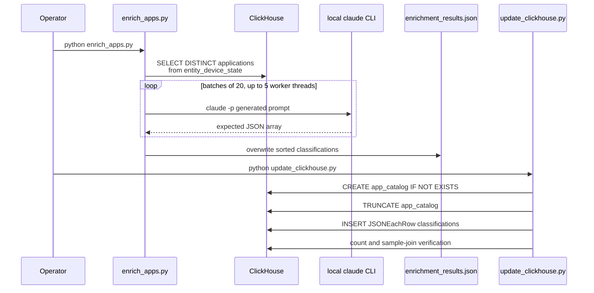

# Dashboard application-intelligence pipeline

This file accounts for every path under `sentinel-dashboard/app-intel/` at dashboard commit `cd755d37c14b8b86623a15a4dbae41d33b226b2b`.

## Inventory and status

| Path | Type | Role | Status |
|---|---|---|---|
| `app-intel/.env` | tracked configuration | ClickHouse and enrichment-tool settings | Fully analyzed; contains concrete credentials and is not reproduced here |
| `app-intel/README.md` | operations documentation | Describes the two-stage enrichment and load workflow | Fully analyzed; several claims contradict the scripts |
| `app-intel/enrich_apps.py` | Python script | Extracts observed applications, asks the local `claude` CLI to classify batches, and writes JSON | Fully analyzed; manual/administrative entry point |
| `app-intel/update_clickhouse.py` | Python script | Recreates the logical contents of an application catalog from the JSON artifact | Fully analyzed; manual/administrative entry point with destructive behavior |
| `app-intel/enrichment_results.json` | generated data artifact | 885 application classifications consumed by `update_clickhouse.py` | Fully analyzed and classified as generated |

`python3` successfully parsed both scripts with `ast.parse`. Import-time execution was not attempted beyond a dependency probe: the host Python lacks `requests` (and the script also requires `python-dotenv`). The scripts were deliberately not run because they invoke a private ClickHouse instance, the local `claude` executable, and, for the loader, `TRUNCATE TABLE`.

## Actual workflow

All table names in this diagram are the names the scripts actually use. This matters because they do not match the running API's table names.

## Cross-component incompatibility

**Contradiction:** both scripts reference legacy unprefixed tables:

- `enrich_apps.py` reads `${CLICKHOUSE_DATABASE}.entity_device_state`.
- `update_clickhouse.py` creates, truncates, inserts into, counts, and joins `${CLICKHOUSE_DATABASE}.app_catalog` and joins `${CLICKHOUSE_DATABASE}.entity_device_state`.
- The API migrations and repositories at this same dashboard commit use `endpoint_entity_device_state` and `endpoint_app_catalog`; `repository.(*ClickHouseRepository).GetCatalogByNames` reads `endpoint_app_catalog FINAL`.

Therefore, this committed loader does **not** populate the catalog consumed by the committed API. A separately maintained compatible loader or a database-side alias/view was not found in the requested repositories.

**Unresolved:** whether a deployed environment contains compatibility views named `entity_device_state` and `app_catalog`, or whether operators patch the scripts outside version control. No deployment artifact supplies such aliases.

## `enrich_apps.py`

### Entry point and configuration

The module-level `main()` is invoked by the `if __name__ == "__main__"` guard. It calls `load_dotenv()`, reads the following environment variables, fetches raw applications, enriches them, and overwrites the configured output file.

| Setting | Type/default in code | Consumer and behavior |
|---|---|---|
| `CLICKHOUSE_ADDR` | string, no default | Combined with a scheme and used as the HTTP endpoint; missing input produces a malformed URL later rather than an explicit configuration error |
| `CLICKHOUSE_USER` | string, no default | HTTP Basic Authentication username |
| `CLICKHOUSE_PASSWORD` | string, no default | HTTP Basic Authentication password; secret |
| `CLICKHOUSE_DATABASE` | string, no default | Interpolated into SQL as an identifier without validation |
| `CLICKHOUSE_TLS` | string, default `false` | Only the case-insensitive literal `true` selects `https`; otherwise `http` |
| `AI_MODEL` | string, default `sonnet` | Included in the prompt text as metadata; it is **not** passed as a model-selection CLI flag |
| `BATCH_SIZE` | integer, default `20` | Number of application records in each Claude request; malformed text raises `ValueError` during startup |
| `MAX_WORKERS` | integer, default `5` | `ThreadPoolExecutor` worker limit; malformed or invalid values fail at startup/executor construction |
| `OUTPUT_FILE` | string, default `enrichment_results.json` | File overwritten with the final sorted JSON array |

The tracked `.env` also defines several API-oriented variables not read by either app-intel script. Concrete values and credentials are intentionally not copied into the analysis.

### Symbols

#### `clickhouse_query(query)`

- Builds `http://` or `https://` from `CLICKHOUSE_TLS`, then calls `requests.post` with the SQL in the `query` query-string parameter and Basic Authentication.
- Calls `raise_for_status()` and returns raw response text.
- Always leaves Requests' certificate verification enabled. It does not set a timeout, retry policy, content limit, or response-format validation.
- Exceptions propagate to the caller.

#### `get_raw_applications()`

- Queries distinct `entity_device_state` rows whose `entity_type` is `Application`.
- Groups by `normalized_name` and obtains one value of `display_name`, `installation_path`, `executable_path`, `publisher`, `version`, `entity_context`, and `command_line` with ClickHouse `any(...)` aggregation.
- Requests `JSONEachRow`, splits the response into lines, and decodes each nonblank line with `json.loads`.
- **Inference:** because every contextual column is aggregated independently with `any`, the resulting fields are not proven to originate from the same device observation.
- SQL/HTTP/JSON failures propagate and terminate `main()`.

#### `enrich_batch(batch)`

1. Renders the batch records directly into a detailed classification prompt.
2. Executes `claude -p <prompt>` with captured text output and a 180-second timeout.
3. On timeout, nonzero exit, or JSON-decode failure, returns an `error: true` placeholder for every input record.
4. Otherwise strips optional Markdown code-fence lines, decodes the entire remaining output, and accepts it if its top-level value is a list.

The successful-list path performs no schema validation: it does not require one output per input, verify names/correspondence, reject extra fields, or constrain `app_type`, `category`, `risk_level`, or `approval_status` to the prompt's enumerations. Thus syntactically valid but mismatched model output is persisted.

**Potential issue requiring validation:** observed application names, paths, command lines, publishers, and context are embedded verbatim in the model instruction. A maliciously controlled observation could contain prompt-like content. No quoting or isolation mechanism separates source data from instructions.

The error placeholders set `risk_level` to `NeedsReview`, although `NeedsReview` is described as an approval status rather than a risk value. The loader later filters all `error: true` objects, so this inconsistent value is not inserted by the normal flow.

#### `enrich_all_applications(apps)`

- Chunks the list using `BATCH_SIZE`, submits all chunks to a `ThreadPoolExecutor(MAX_WORKERS)`, consumes futures with `as_completed`, and appends their returned records.
- Prints progress as completed record count versus original input count.
- For returned error placeholders, it records the placeholder `name` values in a `failed` list.
- For an unexpected exception raised by a future, it prints an error but does **not** add that batch's inputs to `failed`; those applications silently disappear from both the result and failure list.
- Sorts all returned objects by case-insensitive `name`. A returned item lacking a string-compatible `name` can make sorting fail.

Completion order is nondeterministic, but the final sort normally makes output order deterministic for distinct names.

#### `main()`

- Loads dotenv settings.
- Calls extraction and concurrent enrichment.
- Writes the complete JSON with `indent=2` using a direct `open(..., "w")` overwrite; there is no temporary-file/atomic-replace protocol.
- Prints summary counts and the failed-name list.
- Extraction, configuration, file-system, and unexpected transformation errors are fatal and uncaught.

## `update_clickhouse.py`

### Entry point and configuration

The guarded `main()` reads `enrichment_results.json`, filters records where `error` is truthy or `name` is falsey, creates/truncates a ClickHouse table, inserts JSONEachRow, then issues count and sample queries.

| Setting | Type/default in code | Consumer and behavior |
|---|---|---|
| `CLICKHOUSE_ADDR` | string, no default | HTTP endpoint construction |
| `CLICKHOUSE_USER` | string, no default | Basic Authentication username |
| `CLICKHOUSE_PASSWORD` | string, no default | Basic Authentication password; secret |
| `CLICKHOUSE_DATABASE` | string, no default | Unvalidated SQL identifier interpolation |
| `CLICKHOUSE_TLS` | string, default `false` | Selects HTTPS only for literal case-insensitive `true` |
| `INPUT_FILE` | string, default `enrichment_results.json` | JSON array to load |

### Symbols

#### `clickhouse_query(query, data=None)`

- Sends the SQL as an HTTP query parameter.
- For inserts, sends the prepared JSONEachRow body; otherwise sends no explicit body.
- Raises for non-success HTTP status and returns response text.
- Has certificate verification enabled but no timeout or retry.

#### `create_table()`

Creates `${database}.app_catalog` if absent with seven string columns (`name`, `display_name`, `app_type`, `category`, `vendor`, `risk_level`, `approval_status`) and a `ReplacingMergeTree` ordered by `name`. No version column, uniqueness constraint, enum constraint, or validation constraint is declared.

#### `truncate_table()`

Issues unconditional `TRUNCATE TABLE ${database}.app_catalog`.

#### `insert_data(data)`

- Converts each supplied object to one JSON line and posts `INSERT ... FORMAT JSONEachRow`.
- The caller only filters `error` and empty `name`; it does not constrain fields or enum values. ClickHouse rejects unknown/missing/incompatible input according to its JSONEachRow behavior, but no repository-specific prevalidation exists.

#### `main()`

1. Loads dotenv and decodes the input file as JSON.
2. Keeps non-error records with truthy names.
3. Creates the table if necessary.
4. Truncates the entire table.
5. Inserts all accepted records in one request.
6. Prints `count()` and a ten-row sample join with application observations.

There is no transaction spanning truncate and insert. A failure after truncation leaves the legacy catalog empty. Errors are uncaught and fatal. The verification count is printed but not compared to the input count; the process does not fail on a mismatch unless the query itself errors.

The sample uses a `LEFT JOIN` followed by `WHERE c.name != ''`, which removes unmatched rows and therefore behaves as a matched-only diagnostic rather than showing missing catalog coverage.

## Generated artifact profile

`enrichment_results.json` is a JSON array of 885 records. Every record has exactly these keys: `name`, `description`, `vendor`, `category`, `app_type`, `risk_level`, and `approval_status`. No record carries the error-placeholder key. Exact and case-insensitive duplicate-name counts are both zero.

| Field | Observed values/counts in committed artifact |
|---|---|
| `app_type` | Background Service 688; CLI Tool 137; Desktop Application 50; System Driver 8; Browser Extension 2 |
| `category` | System Utility 617; Development 131; Security 70; AI/ML 21; Communication 15; Productivity 13; Browser 12; Entertainment 6 |
| `risk_level` | Low 843; Medium 30; High 12 |
| `approval_status` | Approved 860; NeedsReview 25 |

These values match the enumerated choices in the prompt. That observation validates the shape of this particular artifact, not the pipeline's future output validation.

**Generated classification:** the script names this file as its default output and writes the same array shape. It is committed and is operational input to the manual loader, but it is not used by the Go build or dashboard container builds.

## README consistency audit

| Documentation claim | Code evidence | Result |
|---|---|---|
| ClickHouse communication always uses HTTPS | Both scripts use HTTP unless `CLICKHOUSE_TLS=true` | Contradicted |
| The database is hardcoded to a named environment | Both scripts require/interpolate `CLICKHOUSE_DATABASE` | Outdated/contradicted |
| Users should create `.env` | `.env` is already tracked with concrete values | Contradicted repository state and unsafe guidance |
| The loader creates/replaces the catalog | It uses `CREATE IF NOT EXISTS`, then unconditional `TRUNCATE`, then insert | Partially confirmed; destructive/non-transactional semantics omitted |
| The workflow enriches applications from the dashboard | It reads `entity_device_state`, while the API writes/reads `endpoint_entity_device_state` | Contradicted at this commit unless an uncommitted DB alias exists |
| The results become the API's catalog | Loader writes `app_catalog`; API reads `endpoint_app_catalog` | Contradicted at this commit |

## Security, failure, and operational notes

- **Verified:** tracked `.env` contains database credentials. Values are excluded from this documentation.
- **Verified:** both scripts use Basic Authentication and support TLS, but TLS is opt-in and the README's sample does not set it.
- **Verified:** Requests certificate verification is enabled; no custom CA path is supported.
- **Verified:** neither script sets network timeouts except the 180-second subprocess timeout around Claude.
- **Verified:** no retry/backoff exists for ClickHouse calls or model batches.
- **Verified:** the loader is destructive and non-transactional.
- **Verified:** SQL table identifiers are formed from a trusted-configuration environment value without identifier validation.
- **Verified:** application observation data crosses from ClickHouse into an external/local AI subprocess prompt; the repository does not document data classification or consent controls for that transfer.
- **Unresolved:** which Claude CLI version, authentication context, model, or data-retention policy was used to generate the committed artifact. `AI_MODEL` is prompt text only and does not enforce CLI selection.
