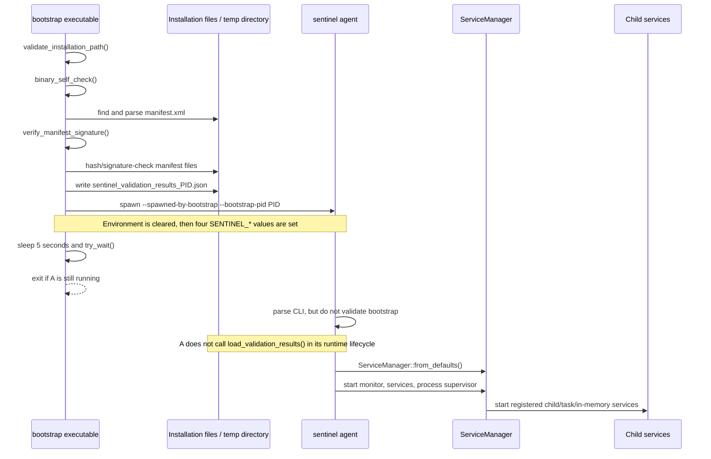
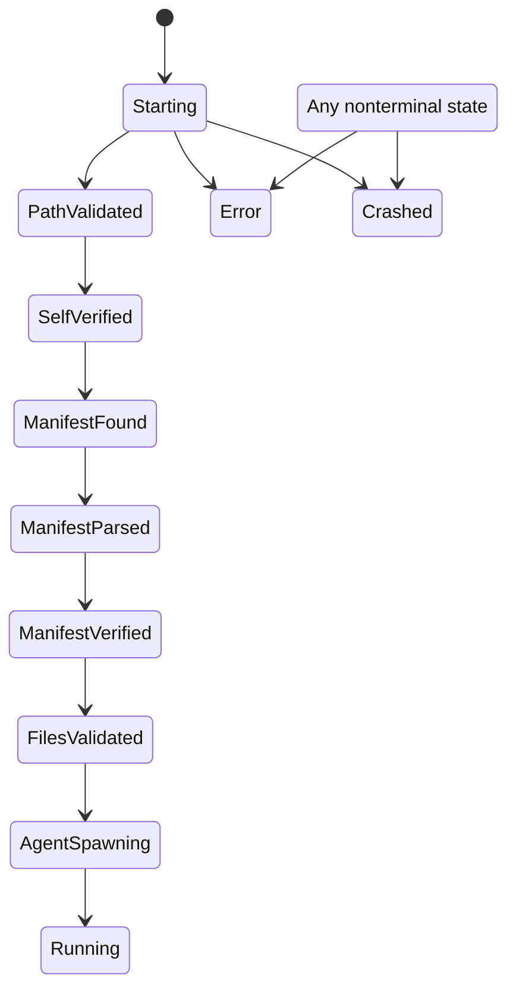

# Endpoint Agent and Bootstrap Deep Reference

This file covers the 12 tracked paths under `agent/` and the 23 tracked paths under `bootstrap/` at endpoint commit `a022e52bf2fff6a9445ebad96c3afeaf277e259f`. Paths are relative to `sentinel-endpoint-agent`.

## Scope and verification limits

- **Verified:** every source, manifest, test, fixture, and package file in these two directories was inspected.
- **Verified:** repository-wide searches were used when classifying the validation store, bootstrap arguments, environment variables, Windows service entry, and apparently unused compatibility code.
- **Unresolved:** Rust and Cargo are not installed in the analysis environment, so no crate was compiled and no test was executed. Test contradictions below are conclusions from direct control-flow inspection.
- **Potential issue:** platform-only code could have additional compile-time defects not visible without the Windows and macOS toolchains.

## File accounting

| Path group | Files | Role | Classification |
| --- | ---: | --- | --- |
| `agent/Cargo.toml`, `agent/LICENSE.txt` | 2 | Package metadata and commercial license | Active metadata |
| `agent/src/{lib,main,cli,error,init,shutdown,validation,windows_service}.rs` | 8 | Agent executable/library lifecycle, validation store, SCM adapter | Active, with disabled/incomplete controls described below |
| `agent/src/mod.rs` | 1 | An unreferenced alternate module declaration | **Dead-code candidate** |
| `agent/tests/integration_validation_pipeline.rs` | 1 | Validation-store tests and a synthetic callback | Test-only |
| `bootstrap/Cargo.toml`, `bootstrap/readme.md` | 2 | Package metadata and short design claim | Active metadata; README partially contradicted |
| `bootstrap/src/*.rs` | 12 | Bootstrap library and executable | Active entry point plus incomplete security implementations and compatibility helpers |
| `bootstrap/tests/*.rs` | 2 | Integration-named tests | Test-only; most flows are simulated rather than end-to-end |
| `bootstrap/tests/fixtures/*` | 7 | XML and JSON inputs | Handwritten test fixtures |

No file in this 35-path scope is generated or vendored.

## Actual process relationship



All solid calls are verified. The intended bootstrap-to-agent security assertion is absent from the active agent path.

# Agent executable

## Entry points and module exports

### `agent::main`

**Location:** `agent/src/main.rs:17-131`  
**Type:** Runtime entry point  
**Status:** Active  
**Confidence:** Verified

Execution order:

1. Scans raw arguments for exact `--service` before creating Tokio.
2. If present, unsafely sets `SENTINEL_SERVICE_MODE=1`.
3. On Windows only, calls `windows_service::run_as_service`, then exits 0 or 1. On non-Windows the function continues in console mode with the service-mode variable still set.
4. Builds a multithreaded Tokio runtime with all drivers enabled. Runtime construction failure prints to stderr and exits 1.
5. Blocks on private async `run`, which installs signal handlers and calls `init::run_with_shutdown`.
6. Maps `AgentError` variants to exit codes: bootstrap/PID errors 1, environment/validation 2, service creation/start 3, health/supervisor 4, and shutdown 5.

The `NotSpawnedByBootstrap` and `InvalidBootstrapPid` match arms are reachable only if a future caller returns those variants; the current lifecycle performs neither check.

### `agent` library exports

**Location:** `agent/src/lib.rs:1-14`

The library publicly exports modules `error`, `cli`, `init`, `shutdown`, and `validation`; exports `windows_service` only on Windows; and re-exports `AgentError`, `Args`, and `VALIDATION_STORE`.

`agent/src/mod.rs` separately declares nonexistent `services/init.rs` and `services/vault.rs`, but neither `lib.rs` nor any `mod` declaration includes `src/mod.rs`. **Dead-code candidate:** the file is not a Rust crate root or referenced module and therefore is not compiled by the standard Cargo targets.

## CLI and disabled bootstrap validation

### `cli::Args`

**Location:** `agent/src/cli.rs:6-23`  
**Type:** Public Clap transport structure

| Field / flag | Type | Default | Active effect |
| --- | --- | --- | --- |
| `spawned_by_bootstrap` / `--spawned-by-bootstrap` | `bool` | `false` | Parsed and logged; never enforced |
| `bootstrap_pid` / `--bootstrap-pid` | `u32` | `0` | Parsed and logged; never compared with environment |
| `service` / `--service` | `bool` | `false` | Struct field is not consumed; raw-argument detection in `main` controls SCM mode |

### `cli::parse_args()`

**Location:** `agent/src/cli.rs:36-60`  
**Signature:** `pub fn parse_args() -> Result<Args, AgentError>`

It disables Clap color, parses process arguments, maps a Clap conversion error to `InvalidBootstrapPid`, logs the two bootstrap fields, and returns them. The zero-PID rejection shown immediately below parsing is commented out.

**Contradiction:** its doc comment says the bootstrap flag “must be present” and PID validation is performed. Neither statement matches active code.

### `init::bootstrap_validation()`

**Location:** `agent/src/init.rs:24-86`  
**Signature:** `pub fn bootstrap_validation(_args: &Args) -> Result<(), AgentError>`

The function unconditionally logs that validation is skipped and returns `Ok(())`. The original flag, environment, PID-match, and low-Unix-PID code exists only inside a block comment. More importantly, `run_with_shutdown` comments out the call altogether at `agent/src/init.rs:342`.

**Verified security result:** a directly launched agent with neither flag nor bootstrap environment proceeds to service initialization.

## Shared lifecycle

### `init::run_with_shutdown()`

**Location:** `agent/src/init.rs:311-377`  
**Signature:** `pub async fn run_with_shutdown(mut shutdown_rx: mpsc::UnboundedReceiver<()>, on_ready: impl FnOnce(), skip_logging: bool, session_notify: Option<Arc<tokio::sync::Notify>>) -> Result<(), AgentError>`

Execution order:

1. Unless `skip_logging`, initializes a non-ANSI stderr tracing subscriber. `RUST_LOG` is used when valid, otherwise level `info`. Subscriber `init()` panics if a global subscriber was already installed.
2. Calls `cli::parse_args`.
3. Does not call `bootstrap_validation`.
4. Invokes `on_ready` before environment, diagnostics, service creation, or child-service startup. In SCM mode this reports `SERVICE_RUNNING` early to avoid SCM timeout.
5. Calls `env_initialization`.
6. Initializes diagnostics IPC with component name `sentinel_agent`.
7. Creates `ServiceManager::from_defaults()` and wraps it in `Arc`.
8. Starts the health monitor, then all services in dependency order, then the process supervisor.
9. Waits on `shutdown_rx.recv().await`. A closed channel also returns `None` and triggers shutdown; the result is not distinguished from a sent shutdown.
10. Calls `shutdown_gracefully` and returns.

**Implementation-only:** `load_validation_results()` is never called here. A repository-wide exact-symbol search finds calls only in `init.rs` unit tests. Thus bootstrap writes and passes a validation-results file, but the running agent does not consume it.

### `init::env_initialization()`

**Location:** `agent/src/init.rs:101-153`

- Calls `sentinel_core::utils::env::env::initialize_env()` and discards its return value.
- Reads `SENTINEL_INSTALLATION_PATH`; missing input falls back to the current executable's parent, then `.`.
- Reads and logs `SENTINEL_BOOTSTRAP_VERSION` and `SENTINEL_BOOTSTRAP_PID` if present; both are optional.
- Derives `QUILR_CONFIG_DIR` by string concatenation: `<installation_path>/.quilr` on both platforms. It does not create this directory.
- Returns only `Ok(())`; its `EnvironmentInitFailed` error is not constructed here.

**Potential issue:** string concatenation produces a slash-containing path on Windows. Rust accepts forward slashes in many Windows paths, but whether every downstream native consumer does is unresolved.

### Service lifecycle helpers

| Symbol | Location | Behavior |
| --- | --- | --- |
| `service_manager_init` | `agent/src/init.rs:170-182` | Calls `ServiceManager::from_defaults`; maps error to `ServiceManagerInitFailed` |
| `start_health_monitor` | `agent/src/init.rs:198-211` | Awaits `manager.start_monitor`; maps error to `HealthMonitorFailed` |
| `start_services` | `agent/src/init.rs:271-284` | Awaits dependency-ordered start; maps error to `ServiceStartupFailed` |
| `start_process_supervisor` | `agent/src/init.rs:224-231` | Starts supervisor synchronously; has no error return despite the `ProcessSupervisorFailed` enum variant |

The concrete default service graph is implemented in `core` and is documented with that subsystem.

## Shutdown and signals

### `shutdown::setup_signal_handlers()`

**Location:** `agent/src/shutdown.rs:115-190`

It creates an unbounded MPSC channel and spawns one task for Unix `SIGTERM` plus one for Unix `SIGINT` or Windows Ctrl+C. Signal-construction errors are logged but not returned, and the sender held by the failed task is dropped. Despite the doc comment, the function does not panic on setup failure. No SIGHUP or repeated-signal escalation exists.

### `shutdown::shutdown_gracefully()`

**Location:** `agent/src/shutdown.rs:35-89`

1. Best-effort `try_disable_kill_switch_for_shutdown` locates global `ServiceContext`, looks up `persona_broker_bridge.service`, downcasts it to `PersonaBrokerBridge`, and calls `agent_state_controller().set_enabled(false)`.
2. Sleeps one fixed second to let the proxy observe IPC state and drain.
3. Stops the health monitor; failure becomes fatal `ShutdownFailed` and prevents the service-stop loop.
4. Calls `stop_all_with_dependencies` with a per-service two-second timeout. Aggregate stop errors are warnings and are suppressed.

**Potential issue:** the documentation says total shutdown stays within 30 seconds, but the two-second budget is per service and the stop sequence is dependency ordered. This scope alone does not establish a hard aggregate bound.

## Windows SCM adapter

### `windows_service::run_as_service` and `run_service`

**Location:** `agent/src/windows_service.rs:48-278`  
**Platform:** Windows only

- Registers service name `SentinelAgent`; the binary must have been launched by SCM.
- Uses synchronous MPSC to relay Stop/Shutdown and Tokio unbounded MPSC for session changes.
- Reports `StartPending` with a 30-second hint, configures daily nonblocking logs under `C:\ProgramData\Sentinel\logs` with basename `agent.log`, overrides user-profile environment, then builds a `sentinel-svc` Tokio runtime.
- The control handler accepts Stop, Shutdown, Interrogate, and SessionChange. Stop immediately reports `StopPending` checkpoint 1 and wakes an OS relay thread.
- `on_ready` reports Running before `env_initialization` and before all services start. This avoids SCM error 1053 but means SCM may observe Running and then a later initialization failure.
- A heartbeat task sends new StopPending checkpoints every 20 seconds after stop begins. It is not explicitly cancelled; runtime teardown drops it.
- `handle_session_events` wakes the process supervisor only for `SessionLogon`, `SessionUnlock`, and `RemoteConnect`.
- The lifecycle result is mapped to the same 0–5 error-code groups, then reported through `SERVICE_STOPPED`.

### `override_user_profile_env_for_service()`

**Location:** `agent/src/windows_service.rs:336-410`

It enumerates `HKLM\SOFTWARE\Microsoft\Windows NT\CurrentVersion\ProfileList`, excludes only the three built-in service SIDs, expands `%SystemDrive%`, and selects the profile whose `AppData\Roaming` directory has the newest modification time. It then overwrites `USERPROFILE`, `APPDATA`, `LOCALAPPDATA`, and (when derivable) `USERNAME`.

**Inference:** newest roaming-directory modification time is being used as a proxy for the interactive user. The function does not query active Windows sessions, so this is not proof that the chosen profile is logged in.

## Validation store

### `validation::ValidationStore`

**Location:** `agent/src/validation.rs:21-147`  
**Storage:** process-global `Mutex<ValidationStore>` exposed as `VALIDATION_STORE`

The JSON schema consumed by `load_from_file` is:

```json
{
  "files": {
    "<file name>": {
      "is_valid": true,
      "error_message": null
    }
  }
}
```

The example is generated from exact repository structs and test fixtures. Unknown fields are accepted by Serde. False results without a message become `Invalid("Unknown error")`. A successful load clears old entries and sets `is_initialized=true`; read or parse failure leaves existing state unchanged. Missing names and invalid names both make `is_file_valid` return false. An empty initialized store makes `all_files_valid` false.

`load_validation_results` reads `SENTINEL_VALIDATION_RESULTS_PATH`, locks the global store, and delegates. Missing environment currently logs a standalone-mode warning and returns `Ok(())`.

**Dead integration candidate:** no runtime caller loads this store, and no core service query was found in exact searches. The public API and tests remain compiled.

## Agent error catalog

`agent/src/error.rs` defines nine variants. The following table distinguishes constructed active paths from nominal variants.

| Variant | Active construction/propagation in inspected agent code |
| --- | --- |
| `NotSpawnedByBootstrap` | None; enforcement disabled |
| `InvalidBootstrapPid` | Clap conversion mapping only; no PID comparison |
| `EnvironmentInitFailed` | None in `env_initialization` |
| `ServiceManagerInitFailed` | `ServiceManager::from_defaults` failure |
| `ServiceStartupFailed` | dependency-start failure |
| `HealthMonitorFailed` | health-monitor start failure |
| `ShutdownFailed` | health-monitor stop failure; service-stop failures suppressed |
| `ProcessSupervisorFailed` | No constructor in agent code because supervisor start returns `()` |
| `ValidationLoadFailed` | callable public loader and tests, but loader absent from lifecycle |

## Agent tests

- `validation.rs` unit tests cover fresh state, valid/invalid JSON, queries, counts, and missing file.
- `integration_validation_pipeline.rs` validates store behavior. Its “service manager callback integration” creates a synthetic name-prefix closure; it neither uses `ServiceManager` nor consults `ValidationStore` inside the callback.
- **Contradiction / test expected to fail:** `init::tests::test_bootstrap_validation_flag_required` asserts that `bootstrap_validation` returns an error for a false flag, but the function unconditionally returns `Ok(())`.
- **Contradiction / test expected to fail:** `init::tests::test_load_validation_results_missing_env_var` expects `ValidationLoadFailed`, but missing input deliberately returns `Ok(())`.
- Global environment mutation and the process-global validation mutex mean some unit tests share mutable process state; no serial-test mechanism is configured.

# Bootstrap executable

## `bootstrap::main` and `execute_bootstrap_sequence`

**Location:** `bootstrap/src/main.rs:45-157`  
**Status:** Runtime entry point  
**Confidence:** Verified

The executable installs an info-level tracing subscriber, initializes `Bootstrap` in `Starting`, asserts that state, and performs this fail-fast sequence:

1. `path_validation::validate_installation_path` → `PathValidated`.
2. `verification::binary_self_check` → `SelfVerified`; marks a separate boolean.
3. `ManifestInfo::new` searches next to the executable, then a user-relative location → `ManifestFound`.
4. `utils::read_xml` and `utils::get_agent_info` → `ManifestParsed`.
5. `signature::verify_manifest_signature` → `ManifestVerified`.
6. `file_validation::validate_all_files_with_results`; any overall failure is converted to generic `AgentSpawnFailed` exit 401 rather than retaining a 3xx validation exit → `FilesValidated` on success.
7. `spawn::spawn_agent` → `AgentSpawning`, then `Running` after the child remains alive for five seconds.
8. Bootstrap exits 0; it does not supervise the child after the initial check.

Failures are logged with `BootstrapError::exit_code` and terminate the bootstrap process. The state machine is not transitioned to `Error` or `Crashed` by `execute_bootstrap_sequence`, despite the top-level documentation claiming that behavior.

## Manifest discovery and parsing

### Discovery

`agent_validator::get_manifest_path` first tests `<current executable parent>/manifest.xml`. It then uses deprecated `std::env::home_dir` and appends:

- macOS: `Library/Application Support/Quilr/manifest.xml`
- Windows: `AppData\Local\Quilr\manifest.xml`

**Contradiction:** installation paths elsewhere consistently use `Sentinel`, not `Quilr`. On non-macOS/non-Windows no `MANIFEST_LOCATION` constant is declared, so the crate is not portable to Linux even though several functions have Linux fallback branches.

### Parser behavior

`utils::get_agent_info` recognizes text for `Version`, `Description`, `AgentExecutable`, `CertPath`, `CertID`, and `Signature`, and attributes `name`, `installation_path`, `hash`, and `file_type|type` on `Event::Start(File)`.

Verified limitations:

- It does not handle Quick XML `Event::Empty`, the event used by self-closing `<File ... />` elements.
- It does not select the current `<Platform target=...>` section; all recognized File start elements would be collected across platforms.
- It defaults missing `AgentExecutable` to `sentinel`, missing file type to Binary, and every other field to an empty string.
- It does not validate required values, semantic version format, duplicate names, absolute paths, hashes, certificate fields, or a nonempty file list.
- Unknown File attributes are discarded.
- Text decoding uses `unwrap()` and can panic rather than return `BootstrapError`.
- `utils::validate_file` always returns `Validity::Failure` and has no caller; it is a **dead-code candidate**.

### Committed root manifest compatibility

The committed `manifest.xml`:

- contains Windows and macOS sections with eight self-closing File elements each;
- contains no `CertPath`, `CertID`, `Signature`, or `hash` attributes;
- names monitor output `sentinel-monitor`, while the source crate binary is `sentinel-monitor-v2` and build scripts must rename it if this artifact is accurate.

Therefore the committed file cannot pass the active bootstrap sequence: parsing yields an empty signature, so signature verification fails with exit 213 before file validation. Even if a signature element were added without changing File syntax, the parser would collect zero files. Packaging scripts may generate a different deployable manifest; that separate path is analyzed with build/deployment.

## Bootstrap state machine

### `state_machine::Bootstrap`

**Location:** `bootstrap/src/state_machine.rs:15-143`

It owns an `InitState` and a separate `self_check` boolean. Valid non-error transitions are strictly sequential:



Once Error/Crashed, forward transitions fail. `mark_self_verified` is not coupled to entering `SelfVerified`. `set_state` calls a private debug-only transition logger, not `logging::log_state_transition`; the public structured logger is only used by its own tests and is a **dead-code candidate** in production.

## Path and self-verification controls

### Installation-path validation

`SENTINEL_DEV_MODE` bypasses every path check based solely on presence; its value is irrelevant.

- macOS canonical path must exactly equal `/Applications/Sentinel.app/Contents/MacOS/bootstrap` or `/Library/Application Support/Sentinel/bootstrap`. The containing directory must not be group/world writable.
- Windows lowercases the canonical full path and accepts it if it contains both `program files` and `sentinel`, both `programdata` and `sentinel`, or both `system32` and `sentinel`. It does not require a particular basename or directory boundary and performs no ACL validation.
- A Linux branch allows any path, but the missing Linux `MANIFEST_LOCATION` prevents a straightforward Linux crate build.

### Bootstrap self-check

`verification::binary_self_check` obtains `current_exe` then invokes platform `file_validation`:

- macOS calls `SecStaticCode::check_validity(STRICT_VALIDATE)` with the hardcoded requirement `certificate leaf[subject.CN] = "QUILR_DEV_SIGNING_CERT"`.
- Windows accepts any current executable with `.exe` or `.dll`; otherwise it accepts any existing path. It does not call WinVerifyTrust.
- Other-platform code only checks existence.

`defs::get_validation_string_cn` supports `pre-prod` and `prod` certificate IDs, but the self and file signature functions use the legacy development-only constant. **Dead-code candidate:** no caller of `get_validation_string_cn` was found.

## Manifest and file integrity

### `signature::verify_manifest_signature`

**Location:** `bootstrap/src/signature.rs:34-96`

It rejects an empty signature, base64-decodes it, reads the XML, removes the first literal capitalized `<Signature...>` element using string searches, normalizes CRLF to LF, hashes the bytes with SHA-256, and dispatches by platform.

- **macOS:** `verify_signature_with_certificate` checks only that certificate ID, hash, and signature arrays are nonempty, then returns success. It does not retrieve a certificate or perform cryptographic verification.
- **Windows:** requires a readable file at manifest `cert_path`, checks only for the PEM certificate header, parses signature bytes as DER P-256, and returns success. It does not parse the certificate public key or verify the signature against the hash.
- **Other platforms:** returns success after syntactic/base64/file steps.

**Contradiction:** the module header specifies RSA-PSS/SHA-256, while the Windows skeleton expects ECDSA P-256 DER. Neither platform implements the claimed end-to-end manifest signature verification.

The canonicalizer is not XML canonicalization: it removes only the first exact-case Signature element and normalizes line endings, without namespace, attribute-order, entity, or general whitespace normalization.

### `file_validation`

`validate_all_manifest_files` is a fail-fast API; the entry point instead calls `validate_all_files_with_results`, which partitions binaries before libraries, attempts every file, and records a `HashMap<String,FileValidationResult>` plus timestamp and overall status.

For each file:

1. `PathBuf::exists`, then `metadata().is_file`; `metadata` follows symlinks, despite the doc comment saying symlinks are rejected.
2. On macOS only, reject group/world writable mode bits.
3. On macOS, validate code signing against the hardcoded development CN; on Windows and other platforms, the file-signature function unconditionally returns success.
4. Stream the file in 8 KiB chunks, compute SHA-256, and compare the computed 64-character lowercase hex to the provided string case-insensitively. There is no explicit input-format check; malformed/short values simply mismatch.

**Potential issue:** path validation/hash/signature/opening are separate operations on a path, creating time-of-check/time-of-use windows. No file handle or inode identity is retained through spawn.

## Agent spawning and validation handoff

### `spawn::spawn_agent`

**Location:** `bootstrap/src/spawn.rs:77-145`

- Selects the first Binary whose name equals the manifest executable, equals `<executable>.exe`, or starts with `<executable>.`.
- Tests only `agent_path.exists`; a directory can pass this check before `Command::spawn` fails.
- Serializes results to predictable temp path `sentinel_validation_results_<bootstrap PID>.json` using `fs::write`, which replaces an existing file and applies platform/default process permissions. The file is not removed after handoff.
- Creates `Command`, supplies bootstrap flag/PID, and sets the child working directory.
- Calls `env_clear`, then sets only `SENTINEL_BOOTSTRAP_VERSION`, `SENTINEL_INSTALLATION_PATH`, `SENTINEL_BOOTSTRAP_PID`, and `SENTINEL_VALIDATION_RESULTS_PATH`.
- Spawns, blocks the bootstrap thread for five seconds, and calls `try_wait`. An alive child is success; bootstrap drops its handle and exits.

**Potential issue:** the results file can contain installation paths and integrity failure details and remains in the system temp directory. File permission and cleanup behavior require platform validation.

**Contradiction:** comments claim the agent receives and uses validation results, but the active agent lifecycle never loads them. Moreover bootstrap validates the child and then passes a path; it does not bind the file content cryptographically, and the agent performs no revalidation.

`build_agent_environment` returns only the package version and is unused by `spawn_agent`; it is a **dead-code candidate** retained for tests.

## Bootstrap errors

`BootstrapError` defines explicit 101–104, 201–216, 301–306, 401–404, and 500–501 groups plus generic framework/I/O/XML errors mapped to exit 1. Several precise variants are never constructed by the implementation, including certificate-chain/subject mismatch, most manifest semantic-validation variants, disk full, and out of memory. File validation failures in the main sequence are collapsed to `AgentSpawnFailed` exit 401, so their underlying 301–306 numbers are not preserved at process exit.

## Bootstrap tests and evidence quality

- State-machine, hash, serialization, and basic missing-file tests exercise their concrete functions.
- macOS signature tests explicitly accept arbitrary nonempty bytes because the implementation is a stub.
- Integration manifest “parsing” tests only load fixture text and search for substrings; they do not call `read_xml` or `get_agent_info`.
- `test_complete_verification_workflow_simulation` manually advances state and skips manifest signature verification, file signature verification, and process spawn.
- Fixture `<File ... />` elements are self-closing, so they do not test the parser's missing `Event::Empty` branch.
- No test executes `execute_bootstrap_sequence` end to end.
- No test proves Windows cryptographic verification, NTFS path/ACL enforcement, cleanup of the results file, or agent consumption of results.

## Feature traceability

| Feature | Entry point | Primary symbols | State/files | Tests | Status |
| --- | --- | --- | --- | --- | --- |
| Console agent | `agent/src/main.rs::main` | `run`, `run_with_shutdown` | core service graph | signal-channel unit test | Implemented |
| Windows service | raw `--service` | `run_as_service`, `run_service` | SCM, registry, file log | None visible | Implemented, Windows-only |
| Bootstrap-origin enforcement | Intended agent init | `parse_args`, `bootstrap_validation` | CLI + environment | Two contradictory tests | **Disabled** |
| Validation-result handoff | Bootstrap spawn | `serialize_validation_results`, `load_validation_results` | temp JSON, global mutex | Component tests only | **Disconnected / incomplete** |
| Bootstrap state sequencing | bootstrap main | `Bootstrap::set_state` | in-memory enum | Unit/integration tests | Implemented; errors do not update state |
| Installation-path control | bootstrap main | `validate_installation_path` | current executable path | Shallow platform tests | Partial; environment bypass, loose Windows match |
| Bootstrap self-signature | bootstrap main | `binary_self_check` | platform code-signing API | macOS callability only | macOS implemented for development CN; Windows placeholder |
| Manifest signature | bootstrap main | `verify_manifest_signature` | XML/certificate path | Syntax/stub tests | **Cryptographic verification not implemented** |
| Manifest file hashes | bootstrap main | `validate_all_files_with_results`, `verify_file_hash` | installation files | Extensive hash tests | Hashing implemented; committed/parser manifest incompatible |
| Child launch | bootstrap main | `spawn_agent`, `verify_agent_running` | process + temp JSON | Negative/serialization tests | Implemented five-second liveness check only |

## Cross-subsystem contradictions and unresolved questions

- **Contradiction:** bootstrap says only verified launches are accepted; agent accepts standalone launches and does not consume verification results.
- **Contradiction:** `bootstrap/readme.md` says the bootstrap “does not load any external library”; its Cargo package depends on numerous dynamically or statically linked external crates. Whether the sentence intended runtime shared libraries is not specified.
- **Contradiction:** comments call logging macOS unified logging, but `bootstrap/src/logging.rs` uses ordinary `tracing` and the executable installs a formatting subscriber.
- **Contradiction:** the parser exposes errors for platform selection, missing fields, versions, duplicates, and relative paths but implements none of those checks.
- **Unresolved:** whether packaging generates a signed, hashed, non-self-closing manifest that differs from the committed root file.
- **Unresolved:** whether deployment deliberately enables `SENTINEL_DEV_MODE`; build/deployment scripts are analyzed separately.
- **Unresolved:** how an `env_clear` child obtains every environment value required by core services on each operating system.

