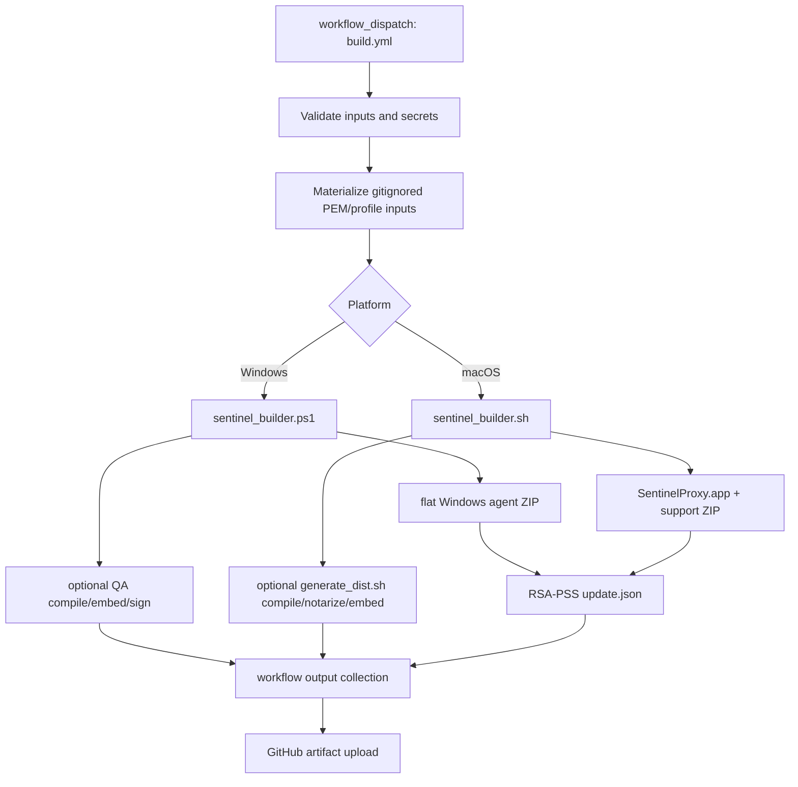

# Endpoint Build, Release, Installation, Update, and Removal

This chapter closes the endpoint repository's root build launchers, `.github/`, `build/`, `deployment/`, and `scripts/` trees at commit `a022e52bf2fff6a9445ebad96c3afeaf277e259f`. It distinguishes the workflow used by current GitHub Actions from older and operator-only paths. Source locations are relative to `sentinel-endpoint-agent/`.

## Evidence boundaries

- **Verified:** `.github/workflows/build.yml` invokes `scripts/builder/sentinel_builder.ps1` on Windows and `scripts/builder/sentinel_builder.sh` plus `scripts/distribution/generate_dist.sh` on macOS according to the selected mode.
- **Verified:** the root `build.sh`/`build.ps1`, `build/*.py`, `deployment/*.py`, and manual `scripts/installer`, `scripts/runner`, and `scripts/uninstaller` files have no caller from the current workflow or current builders.
- **Verified:** `scripts/README.md` still presents the manual installer/runner/uninstaller as operator commands. They are therefore classified as legacy/manual, not dead.
- **Unresolved:** external release automation, MDM, CDN publication, or Jenkins jobs could invoke any public script directly. Repository-only reachability cannot rule that out.
- Rust compilation and target-native Windows/macOS execution were not possible in the analysis environment. Shell syntax and Python parsing checks are recorded below; static incompatibilities are not presented as runtime test results.

## File-group classification

| Paths | Count | Classification | Analysis result |
| --- | ---: | --- | --- |
| `.github/CODEOWNERS`, `.github/SECRETS.md`, `.github/scripts/*`, `.github/workflows/*` | 6 | governance, current build CI, old branch CI, manual security prechecks | Fully analyzed |
| `build.ps1`, `build.sh` | 2 | old root launchers | Fully analyzed; legacy/manual |
| `build/build.py`, `build/deploy.py`, `build/provision_cert.py` | 3 | old manifest/sign/deploy pipeline | Fully analyzed; not current CI |
| `build/code_sign/*` | 4 | older developer/Intune certificate tooling and guide | Fully analyzed; manual/incomplete |
| `build/certs/dev/*`, `build/certs/readme.md`, `build/readme.md`, `build/deplyment_guide.md` | 7 | committed dev credential set plus old documentation | Fully analyzed; sensitive material and outdated prose identified |
| `deployment/*` | 6 | alternate Python deployment, rollback, wrapper builders, MDM profile, empty package placeholder | Fully analyzed; experimental/manual and defective |
| `scripts/builder/*` | 13 | current builders, update manifest generators, Windows signing vendor bundle, committed compiled mac installer | Fully analyzed; two generated/vendor artifacts grouped below |
| `scripts/ci/run_local.sh` | 1 | local mode-to-command mapper | Fully analyzed |
| `scripts/distribution/*` | 8 | current installers/updaters/uninstallers and mac compiler wrapper | Fully analyzed |
| `scripts/qa/*` | 2 | QA distribution compilers/checkers | Fully analyzed; both have gate defects |
| `scripts/installer/*`, `scripts/runner/*`, `scripts/uninstaller/*` | 7 | manual predecessor operations | Fully analyzed; active manual/legacy |
| `scripts/README.md`, `scripts/deployment_handoff.md`, `scripts/deployment_notes.md` | 3 | operator/release documentation | Fully analyzed against implementation |

The apparent count overlap is intentional: the 34 tracked `scripts/` paths include all rows from `scripts/builder` through the three documentation files.

## Actual release topology

Edges through the checked workflow and scripts are **Verified**. CDN upload, MDM publication, and endpoint rollout are absent; any downstream deployment edge would be **Unresolved**.

## Current GitHub build workflow

### Inputs and jobs

`.github/workflows/build.yml` is manual-only (`workflow_dispatch`) and defines independent `build_windows` and `build_macos` jobs. Platform selection is `windows`, `macos`, or `both`. Modes are `full-release`, `installer-only`, `embed`, and `update-json-only`; profile is `dev` or `release`. The workflow can download an input artifact for the two modes that operate on an existing ZIP.

The workflow exposes seven environment labels for embedding: `preprod`, `usprod`, `uspoc`, `india-prod`, `india-poc`, `secure`, and `quartz`. Both current platform builders accept only `quartz`, `preprod`, and `secure` (`sentinel_builder.ps1:66-68`; distribution shell validation). **Contradiction:** four workflow-valid selections are rejected downstream.

`scripts/ci/run_local.sh` mirrors the four modes and two platforms. It documents itself as the mode/flag source of truth, but repeats the same seven-value environment contract while routing values to three-value builders. It validates file existence for embed/update-json-only and supports a non-mutating `--dry-run`.

### Dependency and secret preparation

Both full build jobs:

1. check out the repository;
2. clone private `ai-internal-sdks` as a sibling for full-release;
3. rewrite the submodule SSH URL through `GH_PAT` and initialize the pinned IPC tree;
4. assume a fixed AWS role with OIDC for S3-backed `sccache`;
5. install `sccache` and configure Cargo/target caches;
6. materialize the compile-time scripting public key, updater private key, and development proxy CA inputs from base64 secrets.

The macOS binary-producing modes additionally import a Developer ID P12 into a temporary keychain and store a `notary-profile`; Windows optional signing writes SSL.com/HSM credentials to `scripts/builder/.env.codesign`.

**Contradiction:** `.github/SECRETS.md` describes platform/profile secrets as conditional, but workflow validation/materialization requires the base PEM set up front in modes where some values are not subsequently consumed. In particular, update-json-only still requires more than the updater key.

### Supply-chain behavior

- Actions use mutable major/minor tags rather than immutable commits (`actions/checkout@v4`, `actions/upload-artifact@v4`, `Swatinem/rust-cache@v2`, and similar).
- Windows downloads WinDivert 2.2.2 from GitHub and extracts it without a checked hash or signature.
- Windows installs `ps2exe` from the PowerShell Gallery without pinning a module version.
- The checked workflow contains no `cargo test`, Clippy, formatting, SBOM, dependency audit, or source scanner invocation.
- Secret cleanup removes the Windows `.env.codesign` and deletes the macOS temporary keychain. It does not explicitly erase every materialized PEM/profile file before the hosted runner is discarded.

**Potential issue requiring validation:** runner isolation may make residual files short-lived, but the repository does not independently guarantee secure deletion.

### Artifact-collection defects

The workflow's final existence test checks that the collection directory contains at least one file; it does not assert the expected product set. Static path tracing found these mode-specific discrepancies:

| Flow | Producer output | Collector behavior | Result |
| --- | --- | --- | --- |
| Windows signing | signing helper writes `<folder>/signed/` | collects original dist ZIP/installers | **Contradiction:** artifact can be named signed while containing unsigned originals |
| Windows embed | QA compiler mutates/copies an input under QA output | collector does not select a resulting agent ZIP and can retain the input `update.json` | Incomplete/stale artifact risk |
| macOS full release + installer injection | `generate_dist.sh` mutates a QA copy | collector selects the original `dist/` agent ZIP | **Contradiction:** uploaded agent ZIP can omit the requested injection |
| macOS embed | compiler operates on supplied ZIP/QA directory | collector does not establish a resulting agent ZIP and can retain old `update.json` | Incomplete/stale artifact risk |

These are verified path/data-flow discrepancies; whether an external consumer compensates after artifact upload is **Unresolved**.

## Current Windows builder

### Entry and modes

`scripts/builder/sentinel_builder.ps1` is the current Windows orchestrator. Its parameters at lines 31-91 support build, input-ZIP, sign-only, compile-only, embed, updater injection, signing, update manifest generation, interactive menu, and noninteractive operation. `scripts/builder/sentinel_builder.menu.ps1::Invoke-BuilderMenu` builds the corresponding interactive choices. `sentinel_builder.signing.ps1` is dot-sourced for signing helpers.

`New-Package` (`sentinel_builder.ps1:249`) requires these nine primary binaries and exits when any is absent:

`bootstrap.exe`, `sentinel.exe`, `ipc-light-broker.exe`, `sentinel-diagnostics.exe`, `sentinel-proxy.exe`, `templating-engine.exe`, `template-engine.exe`, `sentinel-monitor-v2.exe`, and `email-discovery.exe`.

It optionally stages DLP/H2 resources, redirector TOML, core and template-service HTML, icons, two hook binaries, the complete `system-monitor/v2/scripts` tree, WinDivert DLL/LIB/SYS, and development `cert.pem` plus `key.pem`. The ZIP is flat except for resource subdirectories.

**Security boundary:** `-PackageDevCert` deliberately places both the proxy root certificate and its private signing key in the endpoint package. That is a development/testing distribution mode, but neither the builder nor workflow prevents its use with a release profile.

### Build and signing behavior

The proxy is built with Windows packet redirector, DLP, OCR, and extraction features; other packages are named explicitly. The signing include file lists executable patterns but omits at least bootstrap, diagnostics, email-discovery, and WinDivert DLL/SYS artifacts. `Invoke-SignRelease`, `Invoke-PreSignInjected`, and `Invoke-SignZipOnly` copy/sign into `signed/`.

The SSL.com wrapper receives credential ID, username, password, and generated TOTP values through process arguments. **Potential issue:** command-line credential exposure depends on host process-list/audit policy; the code does not use a protected stdin/handle interface.

`scripts/builder/CodeSignTool-v1.3.2-windows/` is a committed third-party tool bundle:

- `jar/code_sign_tool-1.3.2.jar` is a 34,196,706-byte signed Java archive with `com.ssl.code.signing.tool.CodeSignTool` main class and bundled third-party dependencies;
- `release-notes.txt` identifies SSL.com CodeSignTool history through 1.3.2;
- `CodeSignTool.bat` locates an uncommitted bundled JDK, `JAVA_HOME`, or `java` on `PATH`;
- `conf/code_sign_tool.properties` fixes SSL.com OAuth/CSC/TSA endpoints;
- the JAR is **Vendored**, not repository-generated; no in-repository generation command or upstream checksum is committed.

### Update manifest

`New-UpdateJson` and `scripts/builder/generate_update_json.ps1` derive the ZIP version/name, compute SHA-256, serialize a canonical object with sorted compact keys, and sign it using RSA-PSS/SHA-256. The wire fields are:

| Field | Type | Meaning |
| --- | --- | --- |
| `version` | JSON string | package version |
| `checksum_sha256` | lowercase hex string | ZIP SHA-256 |
| `force_update` | JSON **string** | exact `"false"` by default, not Boolean |
| `manifest_signature` | base64 string | RSA-PSS signature of the three-field canonical JSON |

The updater private key is a gitignored file expected at `scripts/builder/updater_private_key.pem` and is materialized from CI secrets.

## Current macOS builder

`scripts/builder/sentinel_builder.sh` detects the workspace, optionally cleans, builds selected Rust binaries, creates `SentinelProxy.app`, signs/notarizes, and creates `dist/sentinel_package_v<VERSION>_mac_<profile>.zip`.

The application contains `sentinel-proxy` plus up to seven companion programs: `sentinel`, `ipc-light-broker`, `sentinel-diagnostics`, `sentinel-monitor-v2`, `templating-engine`, `template-engine`, and `email-discovery`. Unlike the Windows builder, a missing companion logs a warning and packaging continues. Hook clients are copied from `target/release` regardless of the selected debug/release target; missing hooks also warn.

The support directory receives proxy resources, configs, core/templates, template-service templates, icons, and hooks. The package may include the CA private key when `--package-dev-cert` is selected. `bootstrap` is built by broader Cargo commands but is not staged into the macOS app/package.

Signing order is extension binary, extension bundle, app binary, app bundle, then companion re-signing. The subsequent `codesign --verify --deep --strict` is authoritative for this script. Notarization captures `notarytool` output with `|| true`, interprets text status, treats `Invalid`/unclear as fatal, but treats stapler and `spctl` failures as warnings.

`generate_update_json_for_package` uses the same string-valued `force_update` and RSA-PSS canonical bytes as Windows.

## Installer compilation and QA distributions

### macOS production compiler

`scripts/distribution/generate_dist.sh` compiles `sentinel-endpoint.sh` through `wrapper.c`, signs the resulting Mach-O, optionally notarizes, and can inject that updater into an agent ZIP. `wrapper.c` embeds a shell script as bytes, creates a temporary executable, sets `SENTINEL_WRAPPER_BIN`, forks, executes `/bin/bash`, waits, unlinks, and returns the child status.

Verified wrapper limitations:

- a single `write` call is used; partial writes are not retried;
- compilation does not preflight `clang` or `xxd` before first use;
- `set -e` makes several later manual return-code captures unreachable when the command actually fails;
- the smoke check records the status of a command protected by `|| true`, so it reports zero;
- the `check` helper exits on the first failed check rather than completing a full report.

The committed `scripts/builder/quilr_endpointagent_mac_installer.zip` is a **Generated committed artifact**, not source: it contains two arm64 Mach-O executables named `sentinel-endpoint` and `sentinel-endpoint-uninstaller`. Readable embedded strings identify setup version 1.1.0 and the current distribution script family. The archive is not consumed by current workflow/build scripts and has no committed regeneration provenance beyond the distribution compiler pattern; exact source-to-binary equivalence is **Unresolved**.

### QA compilers

`scripts/qa/generate_qa_dist.ps1` compiles PowerShell installers, assembles QA output, and runs static/lifecycle checks. Static review found paths where native command failures are normalized before the result is recorded and a smoke return code can therefore remain zero. Its results are useful diagnostics, not a demonstrated release gate.

`scripts/qa/generate_qa_dist.sh` contains an extra standalone `EOF` after a heredoc. Under `set -e`, Bash attempts to execute `EOF` and exits before the intended checks/lifecycle phase. Additional guarded-command captures (`... || true; rc=$?`), an undefined `error` call, and the smoke-code pattern would prevent accurate aggregation even if the heredoc defect were removed. It can also select a builder/QA path in a way that recursively re-enters distribution generation. `bash -n` passes because the defect is syntactically valid shell.

## Active Windows installer/updater

`scripts/distribution/sentinel-endpoint.ps1` (setup version 1.3.1) is a single install/update program with optional embedded payload support.

### Install path

`Invoke-Install`:

1. requires elevation and a package ZIP;
2. obtains an updater lock and stops Sentinel/service processes;
3. uses `Test-ZipSafety`, staging, and package deployment;
4. installs hooks and resources under Program Files/user state;
5. optionally imports the bundled root into the current-user Root store;
6. writes machine Node CA/TLS settings and user Sentinel variables;
7. disables IPv6 on active adapters;
8. registers `SentinelAgent` as LocalSystem and a scheduled updater;
9. starts and checks only the main Sentinel agent.

The script captures invoking-user profile paths for a LocalSystem service. Authentication/signature validation behavior is always enabled unless the skip switch is used; the `VerifySignatures` switch is declared but never read. Authenticode validation is separately opt-in/off by default. TLS verification is disabled machine-wide for Node when certificate setup executes.

**Contradiction:** build/help material promises an environment parameter, but the script declares no `Env` parameter. `$script:EnvIsExplicit` is initialized false and cannot become true through the parser.

### Update path and state

`Invoke-Update` uses a signed `update.json`, a hard version floor, architecture-derived URL, SHA-256, ZIP safety, optional Authenticode, rollback ZIP, service stop/deploy/start, and a health check. It records the checksum only after health success.

- CDN updates enforce the version floor even on a fresh install; local ZIP installs use different selection logic.
- Scheduled updates update files but do not fully refresh the service/task configuration.
- `Save-Rollback` saves the incoming package when no prior rollback exists. On a first failed update, rollback therefore has the new package rather than the previously installed package.
- Rollback is file/package based and not a single OS transaction; service, certificate, environment, adapter, and extension changes are not atomically reverted.
- `Invoke-SelfTest` is a script-local static harness; no checked CI job calls it.

## Active macOS installer/updater

`scripts/distribution/sentinel-endpoint.sh` (setup version 1.1.0) is invoked directly or through the compiled wrapper.

### Defaults and trust effects

The implemented default environment is preproduction even though one help path says secure. Certificate trust and updater-manifest signature verification are enabled by default despite help text that presents them as opt-in. Node TLS verification is disabled in launchd/shell configuration. Work email is inserted into generated plist and shell content without escaping appropriate to all target syntaxes.

`run_install`:

1. resolves/extracts the ZIP;
2. stops the agent and Network Extension;
3. copies `SentinelProxy.app` and support data;
4. deploys hook binaries/scripts to the resolved user home;
5. writes `QUILR_ENV`, backend/DLP, email, template and installation paths;
6. optionally trusts the CA;
7. installs/activates the extension;
8. writes LaunchDaemon and updater schedule;
9. starts the agent.

The local ZIP path has no manifest checksum/signature. `verify_codesign_dir` checks executable regular files in the app's `Contents/MacOS` only; it does not verify the app bundle, system-extension bundle, or all support assets. `validate_zip_safety` exists but has no caller, so root-level unzip does not receive its intended traversal screening.

The required-binary test covers only `sentinel`, `sentinel-proxy`, `template-engine`, and `sentinel-monitor-v2`. Package version fallback searches lowercase `<version>`, while the root manifest uses `<Version>`.

### Update and rollback

`run_update` verifies RSA-PSS metadata, compares versions, downloads, hashes, code-sign checks, stops/deploys/starts, and checks the main agent. Important state behavior:

- the minimum safe version applies only when `is_installed` is already true, so a fresh CDN install below the floor can proceed;
- three download failures quarantine a version without an expiry;
- the last-downloaded checksum is written before deployment and is not restored if deployment rolls back;
- first-update rollback stores the new incoming ZIP as the current backup, so it cannot restore the previous install;
- rollback does not restore extension/certificate state;
- health checks only the `sentinel` process/service, not every packaged service or traffic interception;
- file, launchd, extension, certificate, hook, and environment mutations are not transactional.

## Distribution uninstallers

### Windows

`scripts/distribution/sentinel-endpoint-uninstaller.ps1` stops processes/services, removes files/certificate/current-user environment entries, removes update schedule/WinDivert, resets adapters, removes QUIC policy, and re-enables IPv6. Its current invocation path always forces continuation.

It omits the user variables `SENTINEL_TEMPLATE_DIR` and `SENTINEL_INSTALLATION_PATH`. When retaining the install directory, updater `.backup.prev`/`.broken` variants can remain. The final success banner is printed even after warning-only deletion or network restoration failures.

### macOS

`scripts/distribution/sentinel-endpoint-uninstaller.sh` always sets force mode and never asks for the confirmation described by help. `KEEP_INSTALL_DIR` is parsed and logged but never controls `remove_files`; the support directory is always removed. `--keep-data` protects selected hook/hidden paths but still removes user `Library/Application Support/Quilr` and `.../Sentinel` data.

`run_uninstall_native` and `run_step` both use the pattern `output="$(...)" || true` followed by `rc=$?`; the recorded status is therefore the success of `true`. Every wrapped phase is treated as successful. Shell cleanup omits `SENTINEL_TEMPLATE_DIR` and `SENTINEL_INSTALLATION_PATH`, and the final reminder also omits them. The direct `systemextensionsctl` fallback is commented/disabled even though top-level prose describes it. The script can print a fully restored success banner while extension/network/file residue remains.

## Manual predecessor scripts

Repository-wide searches found no current workflow/builder caller for these files, but `scripts/README.md` instructs humans to use them.

### Windows manual installer and runners

`scripts/installer/sentinel_installer.ps1` accepts ZIP path, trust, service, profiling, work email, and `quartz|preprod|secure`. It extracts a flat archive directly into an existing Program Files directory, preserving stale files, and only warns about missing key binaries. It copies hooks to LocalAppData, optionally trusts the CA in CurrentUser, and, whenever a cert is present, sets machine `NODE_EXTRA_CA_CERTS` plus `NODE_TLS_REJECT_UNAUTHORIZED=0`. Service mode registers LocalSystem with invoking-user paths and optional raw email/log values; standalone mode removes the service. It has no ZIP signature/hash/path-safety check and does not validate email syntax.

The PowerShell and batch runners disable IPv6 on active adapters before service or standalone launch. The PowerShell runner has no explicit elevation check or strict native-command error policy.

### macOS manual installer and runner

`scripts/installer/sentinel_installer.sh` defaults to `preprod` while its usage says `quartz`. `install_user_home` is declared but never called; `$HOME` is used for hooks, LaunchAgent, and shell files even though the README tells operators to execute the whole script with `sudo`. The effective target user can therefore be root or inherited-user dependent.

The script uses sudo internally but has no root/admin preflight, copies an optional CA private key to support without explicit file-mode enforcement, interpolates raw work email into plist/shell content, performs no archive signature/hash/safety validation, and copies hooks from a fixed path under `set -e` without an existence guard. If no email is supplied but a stale entry exists, line 622 executes `local tmp` at top level; Bash rejects `local` outside a function and terminates under `set -e`.

The macOS runner disables IPv6, sources support `quilr-env.sh`, sets `ulimit -n 4096`, then starts launchd or the agent. It assigns `SENTINEL_ALLOW_UNSIGNED_SCRIPTS=1` and `SENTINEL_INSTALLATION_PATH=...` without exporting them, so the child does not inherit those two assignments.

### Older uninstallers

The manual Windows uninstaller is in some respects more complete than the distribution successor: it confirms unless `-Force` and removes user template/install/log variables. It suppresses directory-deletion errors before printing removal success.

The manual macOS uninstaller confirms unless forced and has correct direct command status handling. `--keep-data` still does not preserve all user application-support data, and the advertised direct system-extension fallback is disabled. Its shell markers omit Sentinel template/install paths, but this predecessor installer does not write those two paths to RC files.

## Alternate Python deployment tree

These six files are not current CI inputs. All four Python sources pass bytecode parsing.

### `deployment/build_installer.py`

This is a PyInstaller wrapper around `deployment.py`. It builds a one-file executable, requests Windows UAC elevation metadata, auto-installs the latest unpinned PyInstaller when absent, and deletes build/spec directories after output. It does not establish reproducible PyInstaller/version inputs.

### `deployment/build_installer_macos.py`

This macOS-only app builder has fixed bundle/team defaults and a hard-coded Developer ID default. It builds proxy with DLP, redirector, OCR, and extraction features and assembles only sentinel, broker, and diagnostics companions.

- `run_cmd` creates a merged environment for `env_extra` but does not pass it to `subprocess.run`; `CODE_SIGN_IDENTITY` overrides supplied through that argument are inert.
- requirement checks demand Cargo, Swift, Xcode, codesign, and provisioning profiles even for skip-build/skip-sign/notarize-only shapes.
- `--skip-clean` documentation says Cargo clean is skipped, but `clean_build` never invokes Cargo clean.
- Cargo is executed under sudo.
- Swift companion build uses `check=False` and accepts any pre-existing output, including stale output.
- signing signs the app bundle and then re-signs companions; **Potential issue requiring validation:** post-bundle mutation may invalidate the outer seal, although the later deep verification is expected to detect it.
- text-parsed notarization, stapler, and `spctl` failures do not all fail the pipeline.

### `deployment/deployment.py`

The script exposes CA-check/profile-generation special modes and a normal privileged deployment. The normal path is currently blocked: `main` reads `args.workspace_root` at line 1399, but the parser defines no `--workspace-root` argument. Every ordinary deployment that reaches this line raises `AttributeError` before entering its main `try` block.

Additional verified discrepancies remain relevant if that blocker is repaired:

- Windows `CONFIG["Windows"]["binary"]` is already `sentinel-proxy.exe`; preflight appends `.exe`, checks `sentinel-proxy.exe.exe`, and the service path selects the proxy instead of main `sentinel`.
- preflight runs before extracting a present `sentinel_package.zip`; a fresh target with only the package fails for missing main binary.
- `start_proxy_for_cert_generation` ignores its `binary_name` parameter, resolves the configured main binary, and on macOS runs `sentinel` with proxy-only CLI flags.
- `--target-path` help calls the value a Cargo target directory, while it becomes installation/source path.
- MDM profile generation reads nonexistent `ENTERPRISE_ROOT_CA['cn']` although the structure contains `name`, `search_terms`, and `fingerprint`.
- configured fingerprint is never checked; default search text is placeholder organization data; “trusted” detection checks certificate presence/name, not a platform trust evaluation.
- SCEP is disabled and `scep_enroll` unconditionally raises a placeholder error.
- enterprise/prestaged paths print that proxy will use an enterprise CA but do not provision or configure the intermediate/private key needed to sign interception certificates. **Unresolved:** an external proxy configuration may supply it.
- macOS Node persistence writes a plist for only the CA variable, ignores the optional TLS-disable variable, does not load/chown it there, and edits `Path.home()/.zshrc` while deployment requires root.
- package extraction has no application-specific signature/integrity verification.
- `run_command(check=False)` discards the return code from callers that only consume stdout; service-start messages can therefore overstate success.

The committed `deployment/QuilrEA_KeychainAccess.mobileconfig` is a valid configuration-profile plist that grants TCC permissions to an old support-directory proxy path. Current packages place proxy in `SentinelProxy.app`. It grants Full Disk, Accessibility, SysAdminFiles, and AppleEvents access for System Events/Keychain Access under a code requirement. **Contradiction:** the path does not match current app-bundle deployment.

`deployment/sample-sentinel_package.zip/.gitkeep` is an intentional empty placeholder, not generated content.

### `deployment/uninstall.py`

This rollback script imports `deployment.py`. It kills broad process-name patterns, removes service/extension/Node/cert/QUIC/socket state, and optionally removes the app/logs.

- system-extension removal looks for nonexistent config key `app_bundle`, then a support-directory proxy; it usually falls to `systemextensionsctl`.
- `pkill -f` patterns are broad.
- `--keep-install-dir` has no effect: the false branch's directory removal is commented/pass and the true branch only prints a message. The support directory is never removed.
- `--remove-logs` removes only macOS paths; no Windows log removal exists.
- root execution edits root's `.zshrc` rather than necessarily the console user's.
- it removes QUIC/pf changes that `deployment.py` does not create.
- the default leaves the app bundle and support files while printing rollback complete.

## Old root build/sign/deploy pipeline

### Root launchers

`build.sh` and `build.ps1` build the proxy and workspace, then invoke `build/build.py`. The Python program unconditionally performs another Cargo build. `--no-cargo`/`-NoCargo` skips only the outer build, not the Python build. A normal invocation therefore builds twice.

### `build/build.py`

This manifest-oriented builder selects `dev|pre-prod|prod`, copies files enumerated by root `manifest.xml`, signs files, computes hashes, transforms to a flat runtime manifest, signs that manifest, and creates `package.zip`.

- `--platform` sets a global output selector, but manifest parsing uses host `platform.system()`, so cross-target selection is inconsistent.
- root `manifest.xml` requires obsolete `sentinel-monitor(.exe)` and core dynamic libraries not produced/staged by the current package path; the old builder is expected to fail when those files are absent.
- Windows binary signing can warn/continue when signtool is absent; top-level packaging still reports success.
- signing credentials are embedded in source/config and passed in command or PowerShell text. This analysis intentionally redacts them.
- optional `cryptography` imports can be absent; `sign_manifest` catches resulting errors and continues unsigned.
- its canonicalization leaves an empty/self-closing Signature element while bootstrap removes the element; the byte streams disagree.
- bootstrap's macOS verifier currently accepts nonempty inputs without cryptographic verification; its Windows path checks file/header/DER shape but does not validate the signature with a public key. The old pipeline therefore does not establish the documented end-to-end chain.
- runtime `CertPath` records a repository build-certificate path. The certificate is not copied into the output; Windows bootstrap requires that path to exist, so deployment away from the source tree lacks the referenced file.
- `get_platform_files` and `write_manifest` have no caller after repository-wide search.

### `build/deploy.py`

The old deployer targets `/Applications/Sentinel.app` or Program Files and copies only bootstrap, sentinel, and manifest. Because the manifest hashes additional files, bootstrap validation is likely to reject such a deployment. **Inference:** this conclusion follows from the verified file-list mismatch; target runtime execution was not performed.

Windows elevation uses `ctypes.windll.shell.IsUserAnAdmin()` rather than `shell32`, a **Potential issue requiring validation** on Windows. macOS stop uses broad `pkill -f`; verification return is ignored; bootstrap is started with piped stdout/stderr that are never consumed, creating a possible pipe-capacity stall. There is no persistent service registration. `AgentDeployer.deploy()` duplicates `main`'s sequence but `main` calls individual methods instead.

### Committed development signing material

`build/certs/dev/` contains a matching unencrypted EC private key, self-signed code-signing certificate, password-protected PKCS#12 container, and JSON configuration containing the container credential. Cryptographic inspection verified that the key's public component matches the certificate and that the container opens with the committed credential. The certificate is P-256, self-issued to a Quilr development signing identity, and valid from November 2025 to November 2027.

**Security finding — Verified:** anyone able to read this repository revision can use the committed private key and credential to create signatures under that development identity. It is not evidence of access to Apple/SSL.com production identities. The PEM ignore rule matches these paths, but Git continues tracking pre-existing files; the private key is mode 100644 and the P12 is mode 100755. This contradicts documentation and provisioner intent that key material be mode 0600 and never committed.

`build/provision_cert.py` generates the same class of self-signed P-256 cert, unencrypted PKCS#8 key, and passworded P12. If cert and key exist it returns before ensuring P12/config/keychain state. On macOS it imports into System keychain with broad `-A` access and misuses the P12 credential in a keychain partition-list command. On Windows it queries PFX data without supplying the PFX password, then adds only a public certificate; failures warn and provisioning still completes.

### Other code-sign utilities

`build/code_sign/dev_setup.py` reads current-working-directory `cert_config.json`. Help advertises `--config`, but `main` never parses it. It deletes same-name certs, creates a fixed `/tmp/temp_cert.p12`, and imports/trusts on macOS; sudo targets root's login keychain. Windows uses the same questionable admin API and imports into CurrentUser. Passwords appear in `security`/`certutil` command arguments. The fixed temp name creates a **Potential issue requiring validation** for concurrent/symlink-hostile local execution.

`build/code_sign/intune_mdm_deploy.py` also advertises but ignores `--config`. It reads both certificate and private-key files, but the key bytes are only measured/reported and never included in generated artifacts. The macOS profile embeds the public PEM. The generated Windows PowerShell expects an external PFX at a fixed default path, imports it as exportable into CurrentUser and, under admin/SYSTEM, LocalMachine My and Root; the generator neither creates nor copies that PFX. Verification scripts enumerate broad stores and the macOS script searches literal `Custom`, not configured certificate name. The generated guide's statement that private keys are not transmitted is consistent with output generation, but reading the unused key is unnecessary.

## Documentation consistency for build/deployment prose

| Claim | Source | Actual evidence | Result |
| --- | --- | --- | --- |
| old build creates a fully verified chain | `build/deplyment_guide.md`, `docs/certificate_management.md` | manifest canonicalization disagrees; bootstrap signature verification is stub/structural; cert path is not packaged | Contradicted |
| private keys are mode 0600 and never committed | old build/code-sign guides | tracked key is mode 100644 and matching usable credential set is committed | Contradicted |
| `dev_setup.py --config FILE` and Intune generator custom config work | `build/code_sign/README.md` | both `main` functions instantiate defaults without parsing the option | Contradicted |
| deployment supports normal invocation and `workspace_root` override | deployment docs | parser has no `workspace_root`; normal path reads it and raises before its try block | Contradicted/broken |
| Python deployment checks/extracts a package then deploys | deployment flow docs | binary preflight precedes ZIP extraction | Contradicted for fresh package-only target |
| SCEP mode enrolls a device certificate | `docs/deployment/modes.md` | enrollment function is an unconditional placeholder error | Documentation-only |
| enterprise mode uses a pretrusted CA for proxy signing | deployment docs | presence is checked but no signing intermediate/key is configured | Incomplete; external input unresolved |
| active build pipeline is root `build.sh`/`build.py` | `build/deplyment_guide.md`, root usage prose | current `build.yml` invokes `scripts/builder/*` | Outdated |
| current installer environment choices include seven workflow values | workflow/run-local help | builders accept only three | Contradicted |
| compiled QA scripts accurately gate checks | distribution docs | mac QA exits at stray `EOF`; several return codes are clobbered | Contradicted |
| mac uninstaller honors keep-install-dir and reports failures | uninstaller help | flag is inert; wrappers normalize failures to success | Contradicted |
| Windows distribution installer accepts environment selection | builder/distribution docs | installer declares no `Env` parameter | Contradicted |

## Build/deployment failure matrix

| Failure | Handling | Operational result |
| --- | --- | --- |
| required Windows package binary absent | builder exits | fatal |
| mac companion/hook absent | warning; package continues | partial package |
| Windows signing tool/credential/sign call fails | current signing helper fails selected operation; old builder can warn/continue | generation-dependent |
| updater private key absent | update manifest generation fails/returns failure | workflow or caller behavior determines final job |
| mac notarization Invalid/unknown | current builder exits | fatal |
| stapler/spctl failure | warning/ignored | package may continue without verified staple/assessment |
| QA native check failure | often normalized or early-exits before aggregate | unreliable gate |
| installer download/signature/checksum failure | reject/download counter/quarantine depending path | update not installed |
| install/service/extension partial failure | mixed fatal/warning cleanup | nontransactional partial host state possible |
| update health failure | rollback attempted | rollback package/state defects can prevent true restoration |
| distribution mac uninstall step failure | normalized to success by wrapper | residue can remain while success is printed |
| alternate Python ordinary deploy | missing parser attribute | fatal before main try block |
| old manifest signing error | logged and suppressed | unsigned package can still be produced |

## Static verification performed

- `bash -n` succeeded for tracked shell build/install/uninstall/runner files, including the QA script whose stray `EOF` is a runtime command rather than a syntax error.
- Python bytecode parsing succeeded for all four `deployment/*.py` files and the old `build/*.py`/`build/code_sign/*.py` sources checked during this pass.
- The committed installer ZIP was inspected as an archive; both payloads identify as arm64 Mach-O executables.
- The vendored JAR manifest and archive inventory were inspected without executing it.
- Certificate/key/container correspondence was verified without reproducing private bytes or the committed credential.
- No current workflow contains test/lint execution. Native packaging, signing, notarization, service installation, extension activation, and rollback were not executed because they mutate privileged host state and require target credentials/platforms.

## Open operational questions

- **Unresolved:** which artifact directory external release automation publishes and whether it compensates for current collection discrepancies.
- **Unresolved:** whether release profile packages ever intentionally include development CA private keys.
- **Unresolved:** deployed filesystem/registry/keychain ACLs for installer state, rollback packages, logs, hooks, templates, and CA keys.
- **Unresolved:** whether any external pipeline invokes old root/Python paths or runs tests/security gates absent from checked workflows.
- **Unresolved:** the trusted source, checksum, and update process for the vendored CodeSignTool JAR.
- **Unresolved:** whether the committed development signing identity has been trusted or accepted by any environment outside development; repository evidence cannot establish scope of downstream trust.

