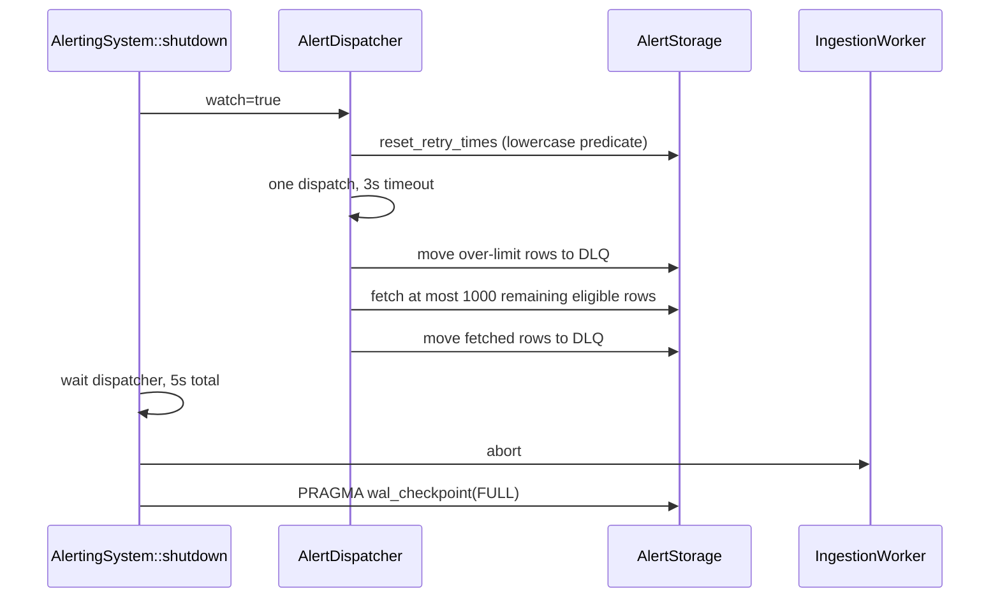

# Endpoint core: alert production, IPC transfer, persistence, and HTTP dispatch

This chapter accounts for all 33 tracked paths under `core/src/alerting/` and the active integration in `core/src/services/alert_broker_bridge.rs`. Producer call sites in the proxy are referenced only where needed to establish the active route; the proxy feature logic is documented separately.

## Actual active topology

All edges are verified. In particular:

- proxy startup calls `alerting::init_ipc("sentinel_proxy_alerting")` in `proxy/src/platform/common.rs`;
- `IPC_SENDER`, once set, makes `send_alert` choose the IPC route and skip the local global system;
- the active `AlertBrokerBridge` creates a separate non-global `AlertingSystem` and passes received payloads to it;
- the default HTTP URL is `BackendUrl::Alerting` plus `/bff/extension-log-service/endpoint-agent/events`.

## Public facade and global state

### `GLOBAL_SYSTEM`

**Location:** `core/src/alerting/mod.rs`  
**Type:** `OnceLock<AlertingSystem>`  
**Status:** global local-pipeline singleton; not used by the active bridge  
**Confidence:** Verified

`initialize` and `initialize_with_persona` construct and set this value once. A second set returns `AlertError::AlreadyInitialized`. The value cannot be cleared or replaced, including after shutdown.

### `IPC_SENDER`

**Location:** `core/src/alerting/mod.rs`  
**Type:** `OnceLock<AlertSender>`  
**Status:** active producer route

`init_ipc(process_id)` starts a background sender and attempts to set the singleton. A later call starts another sender before discovering that the singleton is already set; the new local sender is then dropped, eventually closing its worker channel. The established sender has no public shutdown operation.

### `INIT_STARTED` and `INIT_COMPLETED`

These atomics track only `initialize_standalone`; direct `initialize` and `initialize_with_persona` do not set them.

- `initialize_standalone` atomically claims `INIT_STARTED`, spawns directory/database/schema/global-system setup, sets `INIT_COMPLETED` only on success, and resets `INIT_STARTED` on failure.
- `shutdown` returns immediately unless `INIT_COMPLETED` is true.
- **Contradiction:** the public comment says `is_initialized` covers `initialize_standalone()` or `initialize()`. Direct `initialize()` does not set the flag.
- **Verified:** the active `AlertBrokerBridge` constructs `AlertingSystem` directly and never changes either flag.
- **Verified:** proxy shutdown calls the module-level `alerting::shutdown`, which is therefore a no-op for its IPC sender and for the bridge-owned system.

### `send_alert<A: Alertable>`

Execution order:

1. Calls `alert.serialize()`.
2. If the IPC singleton exists, calls its nonblocking `send` and returns `Ok(())` unconditionally.
3. Otherwise requires `GLOBAL_SYSTEM` and awaits `AlertingSystem::send`.

- **Potential issue:** IPC queue-full/background-stop drops are only logged inside `AlertSender::send`; `send_alert` still returns `Ok`.
- **Verified:** if IPC is initialized, the local database fallback is not attempted when IPC enqueue fails.

### Standalone setup

`initialize_standalone_inner` creates the database parent synchronously inside an async task, connects a SQLite alias through `DbManager`, registers `AlertSchemaModule` (running migrations), and calls `initialize`. Failures are logged by the caller and are not returned to the original invocation.

## Producer contract

### `SerializedAlert`

**Location:** `core/src/alerting/types.rs`  
**Type:** public transport model

| Field | Type | Meaning/lifecycle |
| --- | --- | --- |
| `id` | `Uuid` | primary correlation/storage key; generated by built-in payload implementations |
| `bytes` | `Vec<u8>` | opaque at creation/IPC/storage, but current dispatcher later assumes JSON |
| `content_type` | `&'static str` | persisted and transported; current dispatcher ignores it and sends JSON headers |
| `batch_family` | `&'static str` | persisted and used as grouping key |
| `http_config` | `Option<AlertHttpConfig>` | serialized/persisted/transferred; current dispatcher ignores it |

`json` sets `application/json`; `with_http_config` attaches a runtime config; `estimated_size` is struct size plus byte length; `is_batchable` is false only for an empty family.

### `Alertable` and `AlertableExt`

`Alertable::serialize` is required; the associated `batch_combiner` defaults to `JsonArray`. `AlertableExt::send` serializes then awaits global routing. `spawn_send` clones the serialized result into a detached Tokio task and only logs errors.

- **Verified:** the current pipeline never calls a producer type's `batch_combiner`.
- **Contradiction:** documentation says each family uses its declared combiner. Dispatcher always invokes `BatchCombiner::JsonArray`.

### `BatchCombiner`

Implemented variants are `Individual`, `JsonArray`, `NdJson`, and a function-pointer `Custom`. Their `combine` functions are unit-tested. They are usable as standalone public utilities; only `JsonArray` is selected by the dispatcher.

- **Contradiction:** empty `batch_family` is documented as “send individually.” Current grouping puts every empty-family alert in the same `HashMap` bucket and wraps that bucket in one JSON array.
- **Implementation-only limitation:** group iteration order is nondeterministic because a `HashMap` is consumed directly.

## Built-in payload schemas

### DLP `LogPayload`

**Location:** `core/src/alerting/log_payload.rs`  
**Batch family:** `dlp_alerts`  
**Check:** `CID_101`, `data_leak_prevention`, log type `prompt_request`

The serialized top-level keys are:

| Rust field | JSON key | Model |
| --- | --- | --- |
| `user` | `user` | `UserSection` |
| `agent` | `extension` | `AgentSection` |
| `check` | `check` | `CheckSection` |
| `client_details` | `client_details` | `ClientDetailsSection` |
| `application` | `application` | `SourceProcess` |

`LogPayloadBuilder::build` returns `None` unless all five sections are supplied. `Alertable::serialize` converts serialization failure into literal `{}` rather than returning an error.

#### `UserSection`

Fields are `username`, `accountname`, `machinename`, `client_ip`, optional `id`/`subscriber`/`tenant`, and omitted-when-empty `roles`/`permissions`. `from_persona` clones all identity fields; `minimal` emits empty username/accountname and no backend IDs.

These values include identity/tenant data and cross the process and network trust boundaries. DLP prompts and detection snippets may contain sensitive content as well.

#### `AgentSection`

Fields are fixed name `Quilr Endpoint Agent`, Cargo package version with fallback `0.1.0`, compile target OS/architecture, and optional-by-empty `device_id`. `SourceProcess` contains `process_name`, static/caller-provided `authenticationtype`, and optional-by-empty origin domain. `ClientDetailsSection` contains app name, reconstructed HTTPS URL, optional domain, and authentication type `-` by default.

#### `CheckProperties`

The full serialized data dictionary is:

| Field | Default from `new` | Transformation/meaning |
| --- | --- | --- |
| `context_id` | caller value | request correlation |
| `credentials` | omitted | optional email |
| `alert_type` | `finding` | fixed initial classification |
| `original_prompt` | empty | potentially sensitive original content |
| `final_prompt` | empty | post-policy content |
| `user_justification` | empty string | optional input normalized to empty |
| `control` | empty | policy slug |
| `action_name` | omitted | human-readable action |
| `mode` | empty | mapped enforcement mode |
| `summary` | empty | producer summary |
| `outcome` | empty | outcome string |
| `size` | 0 | `with_content` sets final UTF-8 byte length |
| `is_initial_sensitive` | false | producer decision |
| `is_final_sensitive` | false | producer decision |
| `business_justification` | omitted | optional type/value |
| `resolution_channel` | `proxy` | can be overridden |
| `alert_status` | `closed` | can be overridden |
| `action_taken` | omitted | optional action |
| `prompt_changed` | false | `with_content` compares strings |
| `detections_original` | empty | consolidated by detection name |
| `detections_final` | empty | consolidated by detection name |
| `payload_truncated` | false and omitted | set during oversize degradation |

`Detection` carries optional-by-empty name/code/id/type/reason, structured attributes (`attribute_name`, `category`, optional snippet), raw entities, class, and classification boolean. Consolidation performs a linear first-name match, preserving the first detection's metadata and appending later attributes/entities without deduplication.

Mapping helpers translate proxy verdicts/modes/scenarios and known entity names. Unknown verdict and scenario values silently map to `Allow` and `Request processed`. Unknown entity types map to class `Sensitive Data` and a generated reason.

### Upload `UploadLogPayload`

**Location:** `core/src/alerting/upload_payload.rs`  
**Batch family:** `upload_alerts`  
**Check:** `CID_22`, `upload`

Its top-level section layout matches `LogPayload`, but `check` uses `UploadCheckSection` without `log_type`.

`UploadCheckProperties` fields are `context_id`, optional credentials email, `file[]`, optional-by-empty `control`, optional resolution channel, mode, optional action name, optional summary, optional outcome, optional user justification, and omitted-when-empty suppressed controls. `with_outcome` clears summary; `with_summary` clears outcome.

Each `UploadFileInfo` carries optional `lastModified`, filename, size, JSON key `type`, detections, optional path, optional-by-empty label, metadata, and nested extracted files. The basic constructor derives a lower-case extension only when the suffix is at most ten characters and contains no slash. Path, modification time, label, and magic-byte kind are intentionally placeholders until supplied by later builder calls.

`UploadDetection` contains display/code names, attributes with raw entity/category/snippet, generated category ID, optional detection/action type, class, classification, and optional reason. Consolidation again uses the first matching name and appends attributes without deduplication.

`UploadMode` maps case-insensitive policy actions:

| Inputs | Mode | Action | Resolution channel |
| --- | --- | --- | --- |
| `block` | `Block` | block file upload | `Desktop` |
| `justify` | `Justify` | justification action | `Desktop` |
| `ask`, `prompt` | `Ask` | prompt action | `Desktop` |
| `toast`, `warn` | `Toast` | notify action | `Desktop` |
| anything else | `DoNothing` | none | none |

Outcome constants are `Acknowledge`, `Blocked`, `Custom Justification Provided`, `Cancelled`, and `Timeout`.

### Legacy helper models

`core/src/alerting/helpers.rs` exposes older/parallel `UserPayload`, `AgentPayload`, `SourceProcessPayload`, `ApplicationPayload`, and `DetectionPayload` shapes plus duplicate mapping functions. These are public helpers but are not the same JSON schema as current `LogPayload`: notably `AgentPayload` nests source process while current `AgentSection` has device ID and the top level carries process attribution separately.

- **Potential issue:** `UserPayload::extract_ip_from_peer` uses `split(':').next()`, which is suitable for simple IPv4 `host:port` text but not bracketed or unbracketed IPv6.

### Check IDs

`CheckId` maps Login=`CID_16`, CopyPaste=`CID_17`, Download=`CID_21`, Upload=`CID_22`, and DLP=`CID_101`. Only DLP returns a log type (`prompt_request`). Parsing is exact/case-sensitive and unknown IDs return `None`.

## IPC protocol and behavior

### Constants

| Constant | Value |
| --- | --- |
| `ALERTING_PROCESS_ID` | `alerting_service` |
| `BROKER_CHANNEL` | `ipc_light_broker` |
| startup delay | 2 seconds |
| initial/max reconnect delay | 5 / 30 seconds |
| lifecycle heartbeat interval | 30 seconds |
| sender queue capacity | 4,096 alerts |

### Wire models

`AlertIpcMessage` uses internally tagged JSON with key `type`:

- `alert` with one owned `AlertIpcPayload`;
- `batch` with `payloads[]`;
- `lifecycle` with a `ServiceLifecycleEvent`.

The payload contains UUID, JSON-serialized byte array, owned content type/family strings, and optional HTTP config. Lifecycle event names serialize in snake case and include process ID, epoch-millisecond timestamp, and optional context.

Converting an IPC payload back to `SerializedAlert` uses `Box::leak` for both strings. The bridge performs this for every alert, producing process-lifetime allocations.

### `AlertSender`

`start` creates a bounded Tokio channel and detached connection task. `send` is `try_send`: full or closed queues drop the alert and log one warning.

The task waits two seconds, connects as a duplex client, waits for `Connected`, registers the caller's process ID, waits for `Ack`, broadcasts `Started`, then selects among queued alerts, 30-second heartbeats, and broker messages. Broker `Shutdown` causes a best-effort stopped event and permanent normal exit. Connection errors cause unbounded reconnection with doubling delay capped at 30 seconds.

- **Potential issue:** an alert is removed from the local queue before `duplex.send`. If that send fails, the connection loop returns and the removed alert is not requeued.
- **Verified:** reconnect delay is never reset after a successful connection; accumulated failures affect later disconnect cycles.
- **Security boundary:** sender-supplied process IDs and broker message sources are not authenticated by the pinned IPC broker.

### Oversize degradation

The sender reserves 512 bytes below `ipc_light::message::MAX_MESSAGE_SIZE`. If the serialized `AlertIpcMessage` is too large it parses the inner bytes as JSON and progressively:

1. sets `payload_truncated`;
2. clears DLP prompt fields, size, and change flag;
3. trims DLP detections or upload per-file detections to one and attributes/entities to eight while clearing snippets;
4. if still oversized, drops detection arrays entirely;
5. drops the alert if the representation still exceeds the limit or if the bytes cannot be parsed/degraded.

This behavior is implementation-only data transformation: delivered content may differ materially from the original alert. Tests cover DLP and upload degradation.

### `AlertReceiver`

The singleton-like type has no state. `run` performs the same handshake as `alerting_service`, then parses every broker `Message` as `AlertIpcMessage`. Alert and batch payloads synchronously invoke the handler; lifecycle messages are logged. A JSON object with an `event` string is tolerated as a legacy non-alert broadcast; other malformed payloads log their complete contents.

- **Potential issue:** logging complete malformed payloads can put sensitive producer content in logs.
- **Verified:** receive/connect errors retry forever with capped exponential delay, also without resetting after successful connections.
- **Verified:** broker `Shutdown` exits normally and permanently rather than reconnecting.

## Active bridge ownership and queues

`AlertBrokerBridge::start` spawns one outer task that:

1. creates the alert database directory;
2. connects/registers the SQLite schema;
3. builds `PersonaAuthProvider` and a non-global `AlertingSystem`;
4. spawns a 60-second credential-refresh task;
5. creates a 1,024-entry payload channel;
6. spawns a dispatch task that converts and calls `AlertingSystem::send`;
7. reports `Running`;
8. selects between `AlertReceiver::run` and bridge shutdown;
9. reports `Stopped`.

The synchronous receiver handler uses `try_send`; a full bridge queue drops the payload. The system's next queue defaults to 1,000 and is fail-open, creating two independent drop boundaries after IPC reception.

### Shutdown ownership gap

`AlertBrokerBridge::stop` broadcasts shutdown and immediately emits stopping/stopped messages. It does not call `AlertingSystem::shutdown` and does not retain/await the outer, refresh, or dispatch join handles.

- **Verified:** bridge-queue payloads remaining when the dispatch task sees shutdown are dropped with the receiver.
- **Verified:** dropping a Tokio `JoinHandle` does not cancel its task; `AlertingSystem`'s stored handles have no custom `Drop` shutdown implementation.
- **Inference:** after the last `AlertingSystem` Arc drops, its worker's sender closes so the worker can final-flush, while its dispatcher is detached. The dispatcher's watch sender also drops; the exact long-running behavior follows Tokio watch semantics and should be runtime-validated.
- **Potential issue requiring validation:** a closed watch channel makes `changed()` return immediately with error; dispatcher code only handles the `Ok(true)` case, so a detached dispatcher may loop without its intended five-second wait.

## In-process system

### `AlertIngestor`

First uses `try_send`. When full:

- fail-open=true logs and returns `ChannelFull` after dropping;
- fail-open=false awaits channel capacity and can block the caller;
- closed returns `ChannelClosed`.

The production default is fail-open. The claimed `<50µs` target is not a measured repository guarantee, and fail-closed mode explicitly awaits.

### `IngestionWorker`

It accumulates a vector to `batch_size` or `flush_interval`, with receive biased ahead of timer. The first interval tick is consumed to avoid an immediate flush. On flush success it notifies one dispatcher waiter and clears the buffer. On storage failure it retains the entire buffer. Closing the channel triggers a final flush attempt.

`AlertingSystem::shutdown` aborts this task rather than closing its sender, so the worker's documented channel-close final flush is not part of that graceful path.

### `AlertingSystem`

`new`/`with_auth_provider` resolve storage from the global database registry, create the configured bounded channel, a `Notify`, watch shutdown channel, worker, and dispatcher, then spawn both. It retains worker/dispatcher handles and shutdown sender inside a standard `Mutex`.

`send` optionally logs alert metadata and delegates to the ingestor. `stats` returns pending database count (errors collapse to zero) and configured maximum channel capacity, not current queue use.

`shutdown` takes the three controls once, sends `true`, waits at most five seconds for dispatcher, aborts worker, and checkpoints SQLite WAL. If the dispatcher timeout elapses, the consumed join handle is dropped without `abort`, so the task is detached rather than forcibly stopped.

## SQLite schema and lifecycle

### Database selection

| Platform | `ALERT_DB_PATH` |
| --- | --- |
| macOS | `/Library/Application Support/Sentinel/data/alerts.db` |
| Windows | `./data/alerts.db` |
| other | `./data/alerts.db` |

Schema name is `alerts`; default registry alias is `alerts_db`. `AlertSchemaModule` supplies `AlertMigrator` and a stub generic handler. Every generic handler operation returns “use AlertStorage directly.”

### Final `alerts` table

| Column | Type/constraint | Writer/consumer |
| --- | --- | --- |
| `id` | string primary key | UUID string; save/fetch/delete |
| `payload_base64` | non-null text | base64 bytes |
| `content_type` | non-null text, default JSON | persisted but dispatcher ignores |
| `batch_family` | non-null text, default empty | dispatcher grouping |
| `status` | non-null string, default `PENDING` | pending/retry filters |
| `retry_count` | non-null integer, default 0 | retry/DLQ threshold |
| `next_retry_at` | nullable ISO8601 string | eligible retry filter |
| `created_at` | non-null ISO8601 string | ordering and DLQ first-failure value |
| `updated_at` | non-null ISO8601 string | update timestamp |
| `http_config_json` | nullable text | round-tripped but not applied |

Indexes cover `(status, created_at)`, `next_retry_at`, and `batch_family`.

### `alert_quarantine`

Primary UUID, original alert UUID, base64 payload, content type, batch family, reason, quarantine timestamp, retry count, and optional HTTP config. Indexes cover original ID and reason.

### `alert_dlq`

Primary UUID, original alert UUID, base64 payload, content type, batch family, failure reason, retry count, first-failure and DLQ timestamps, acknowledgment boolean/time/actor, and optional HTTP config. Indexes cover `(acknowledged, dlq_at)` and original ID.

### Migration sequence

Six migrations first create envelope-JSON v1 tables, then payload-agnostic replacements. Each of the last three drops and recreates its table.

- **Verified destructive behavior:** applying the payload-agnostic migrations to a populated earlier schema deletes all alerts, quarantined alerts, and DLQ records. Comments acknowledge this for the alerts table; quarantine and DLQ migrations do the same.
- Down migrations likewise drop current data and recreate simplified v1 tables.

### `AlertStorage::save_batch`

For each alert it base64-encodes bytes, serializes optional HTTP config, constructs a `PENDING` ActiveModel, and inserts it.

- **Verified:** the loop is not enclosed in a transaction.
- **Potential issue:** a failure after an inserted prefix produces a partial batch. The worker keeps and retries the full vector; already-inserted UUIDs can then cause primary-key errors on every retry.

### Fetch and conversion

`fetch_pending` selects uppercase `PENDING` or eligible uppercase `RETRY`, orders oldest first, and paginates. Model conversion validates UUID/status/timestamps/base64 with `Option`; invalid rows are silently removed via `filter_map`.

- **Potential issue:** corrupt rows remain counted/persisted but become invisible to delivery and DLQ conversion.
- `StoredAlert::to_serialized_alert` leaks content/family strings; no non-test runtime caller was found.

### Success/retry/failure

- `mark_sent` deletes rows; no SENT state is persisted.
- `mark_retry` updates one row at a time, increments count, and assigns a common retry time; no transaction.
- `mark_failed` writes `FAILED` but has no runtime caller outside tests.
- `fetch_exceeding_max_retries` selects `RETRY` where count is greater than or equal to the configured threshold.

### Graceful retry reset contradiction

`reset_retry_times` executes raw SQL with `WHERE status IN ('pending', 'retry')`, while every normal writer and filter uses uppercase `PENDING`/`RETRY`.

**Contradiction:** normally written rows are not reset, despite shutdown documentation claiming that all retries become immediately eligible.

### Quarantine and DLQ operations

Quarantine and DLQ moves use transactions: insert destination rows then delete originals. DLQ acknowledge updates requested IDs one by one. Retry-from-DLQ inserts the original alert ID with reset retry count and deletes the DLQ row in one transaction; a conflicting existing ID aborts that transaction.

- **Dead-code candidate:** no non-test caller or automatic validation path invokes `quarantine`, `fetch_quarantined`, or `count_quarantined`.
- **Contradiction:** README claims automatic poison-pill quarantine; no validator invokes it.
- DLQ max-retry and shutdown moves are active dispatcher paths; fetch/acknowledge/manual retry have no product interface in the inspected code.

## HTTP dispatch

### Configuration

`AlertDispatcherConfig::default` is:

| Setting | Default |
| --- | --- |
| batch size | 50 |
| flush interval | 2 seconds |
| in-memory capacity | 1,000 |
| max circuit delay | 90 seconds |
| nominal DB path | `./data/alerts.db` (not used by `AlertingSystem::new`, which receives an alias) |
| max retries before DLQ | 10 |
| log individual alerts | debug builds true, release false |
| fail open | true |
| require auth | release builds true, debug false |
| agent name | `quilr-endpoint-agent` |
| agent version | Cargo package version or `0.1.0` |

Development changes batch=5, flush=1, backoff=10, auth=false, logging=true. High-throughput changes batch=100, capacity=5,000, flush=1. Builder methods perform no nonzero/range validation.

Default `AlertHttpConfig` resolves base URL once from `QUILR_BACKEND_BASE_URL`, falling back to `https://preprod.quilr.ai`. Path is `/bff/extension-log-service/endpoint-agent/events`, method field is `POST`, timeout 30 seconds, HTTP-client retries 3, and headers include `channel: endpoint-agent` and `source: endpoint-agent`.

- **Contradiction:** alert HTTP docs name `QUILR_ALERT_API_URL`; implementation uses `QUILR_BACKEND_BASE_URL`.
- **Verified:** URL values are cached in `global/backend_url.rs` on first access.

### Authentication headers

The request profile merges extra headers, then overwrites/adds bearer `Authorization`, `tenant`, JSON content/accept, and User-Agent. When `require_auth` is true and token is absent, dispatch returns without fetching. Tenant absence alone does not block.

`PersonaAuthProvider` caches token and persona tenant in `RwLock<Option<_>>`; the bridge refreshes it every 60 seconds.

- **Potential issue:** failed/no-token/no-persona refresh returns without clearing an existing cache, so stale credentials remain.
- `refresh_after_auth_failure` notifies PersonaManager and refreshes, but dispatcher never calls it on a 401; all HTTP failures share one generic retry path.

### Dispatch loop and circuit breaker

The loop waits for shutdown, one worker notification, or a five-second poll. Periodic polls also move over-limit rows to DLQ. Closed state dispatches up to configured size. A failure opens the breaker. On its next loop wake, open state sleeps 1/2/4/8... seconds capped by config, then half-opens; half-open fetches one alert. Success closes/resets.

The type is still imported as `FibonacciBackoff`, but that name is an alias of an exponential doubling implementation.

- **Contradiction:** README and dispatcher header call this Fibonacci backoff.
- **Potential issue:** open-state `sleep` is not selected against shutdown, so shutdown recognition can be delayed up to the configured maximum before the three-second drain begins.

### Payload construction

Rows are grouped by `batch_family`; each family is byte-concatenated as a JSON array and converted through `String::from_utf8_lossy`. Every request uses the one default HTTP config.

- **Contradiction:** `content_type`, per-alert `http_config`, producer `BatchCombiner`, and individual/NDJSON/custom behavior are stored/documented but ignored.
- **Potential issue:** arbitrary opaque bytes or non-JSON content can produce invalid/lossily altered JSON while still being sent with `application/json`.
- The full payload string is emitted at debug level by `debug!("[ALERTING] send_request_with_profile...")`, potentially exposing prompts, detections, credentials, and file information in debug logs.

The shared HTTP client performs its own configured retries. A successful collected response causes deletion. Any terminal HTTP/network/parser error schedules the whole family batch for retry and opens the breaker. `mark_retry` errors are explicitly discarded with `.ok()`.

The retry timestamp uses the backoff's current value. The breaker advances only when it later enters open-state wait, so persisted retry scheduling and circuit sleep are related but not a single atomic operation.

## Shutdown and DLQ flow

Only at most 1,000 remaining rows are force-moved after the final attempt. Retry rows whose future time was not reset due to the case mismatch are not returned by `fetch_pending`; they can remain in `alerts`. “Moves all remaining alerts” is therefore not implemented for those cases.

## Tests and evidence limits

Unit tests cover type serialization/combiners, basic storage operations, worker count/time/channel-close flush, queue modes, config defaults, backoff, payload builders/mappings, IPC model round trips, and oversize degradation.

Important missing or misleading coverage:

- no test covers atomicity/partial failure of `save_batch`;
- no test covers the lowercase `reset_retry_times` predicate;
- no test demonstrates use of per-alert HTTP config/content type/combiner;
- dispatcher tests do not execute an end-to-end dispatcher HTTP success/failure/circuit sequence;
- PersonaAuth tests construct cache values directly and do not exercise PersonaManager refresh/401 behavior;
- active bridge tests cover construction/config/conversion only, not broker/database/system startup or shutdown ownership;
- IPC sender/receiver tests do not exercise live reconnection or send-loss behavior.

`integration_tests.rs` contains two distinct categories:

1. real-preprod direct `reqwest` tests, all ignored and dependent on `ALERTING_TEST_TOKEN`; and
2. local `test-server` direct HTTP tests.

Neither category drives `AlertingSystem`, dispatcher, persistence, bridge, or IPC. Their hand-built DLP JSON differs from current `LogPayload` (`agent` versus `extension`, older detection attributes, missing current sections/fields). The local test calls the default endpoint but asserts its path contains `interaction/event`, which the current `/endpoint-agent/events` path does not; that test is expected to fail by direct string comparison.

The environment `ALERTING_USE_LOCAL_SERVER` is documented but not read in this file. Four meta-runner tests are ignored and only print commands.

## Documentation audit

| Claim | Code evidence | Result |
| --- | --- | --- |
| crash-safe SQLite persistence | nontransactional batch saves and destructive upgrade migrations | Partially confirmed / overstated |
| zero-impact `<50µs` ingestion | target comment; no benchmark enforcement; fail-closed awaits | Not verified / contradicted in fail-closed mode |
| Fibonacci backoff | alias to exponential doubling | Contradicted |
| per-family combiner | dispatcher hardcodes JSON array | Contradicted |
| per-alert HTTP routing | config stored but ignored | Contradicted |
| arbitrary opaque payloads | dispatcher assumes JSON and lossy UTF-8 | Contradicted |
| empty family sends individually | empty values group together | Contradicted |
| poison pills automatically quarantined | storage API exists, no caller | Documentation-only |
| 30-second graceful drain | implementation allows 3 seconds and system waits 5 | Outdated |
| all remaining alerts moved to DLQ | fetch cap 1,000 plus ineligible retry rows | Contradicted |
| README Quick Start uses `DefaultAlertingProfile` as `initialize` config | signature requires `AlertDispatcherConfig` | Outdated/non-compiling example |
| `Alertable` has `http_config` method and `&self` combiner | trait has neither form | Outdated/non-compiling example |
| `SerializedAlert::new` and `ndjson` constructors | only `json` and `with_http_config` exist | Documentation-only |
| linked `docs/HLD.md`, `LLD.md`, `DDD.md`, etc. | no such paths under `core/src/alerting` | Broken links |

## File accounting

| Path/group | Role | Classification | Analysis status |
| --- | --- | --- | --- |
| `README.md` | subsystem guide | substantially outdated | fully analyzed |
| `mod.rs` | facade/global routing/init | active plus local fallback | fully analyzed |
| `types.rs`, `traits.rs`, `check_ids.rs` | public transport contracts | active, partly ignored by dispatcher | fully analyzed |
| `log_payload.rs`, `upload_payload.rs` | current producer schemas | active via proxy | fully analyzed |
| `helpers.rs` | parallel/legacy schema helpers | public compatibility utility | fully analyzed |
| `ipc/{constants,types,sender,receiver,mod}.rs` | broker transport | active | fully analyzed |
| `system.rs`, `ingestor.rs`, `worker.rs`, `dispatcher.rs` | in-process pipeline | active inside bridge | fully analyzed |
| `persona_auth.rs` | credential adapter/cache | active | fully analyzed |
| `storage.rs`, `entity/*.rs` | persistent models/operations | active, plus unexposed admin APIs | fully analyzed |
| `db_migrations.rs`, `db_module.rs` | schema creation/upgrades | active and destructive on old schema | fully analyzed |
| `db_handler.rs` | generic DB handler | intentional stub | fully analyzed |
| `profile.rs`, `http_config.rs`, `backoff.rs`, `error.rs` | configuration/retry/errors | active with legacy aliases | fully analyzed |
| `transport.rs` | duplicate transport abstraction | explicitly reserved/unused | fully analyzed |
| `integration_tests.rs` | direct HTTP real/local tests and pseudo-benchmarks | test-only; many ignored; not pipeline E2E | fully analyzed |

