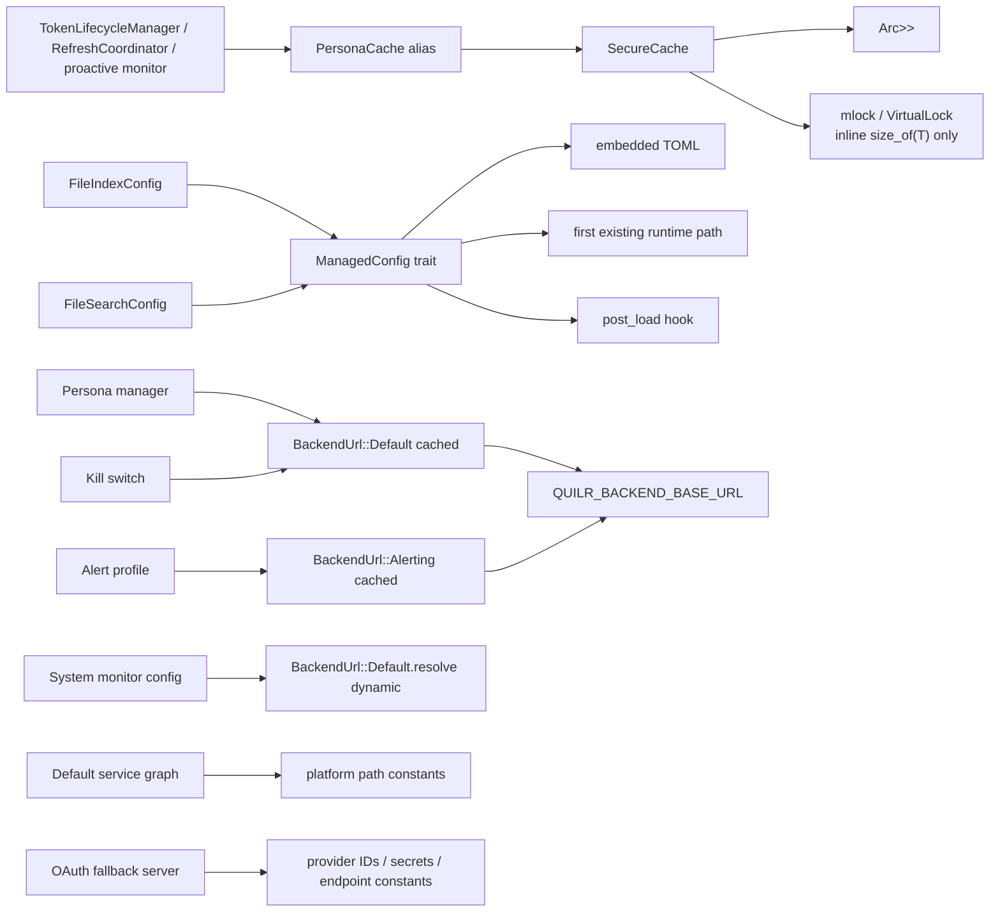

# Endpoint core cache, managed configuration, and global constants

**Repository/revision:** `sentinel-endpoint-agent` at `a022e52bf2fff6a9445ebad96c3afeaf277e259f`  
**Primary scope:** all six tracked files under `core/src/cache/`, `core/src/config/`, and `core/src/global/`  
**Contextual scope:** direct Persona, file, alerting, kill-switch, system-monitor, service-factory, proxy, templating, environment-manager, and OAuth consumers required to establish reachability  
**Evidence status:** Verified unless explicitly marked otherwise

## Scope inventory

| Path | Role | Reachability | Final classification |
| --- | --- | --- | --- |
| `core/src/cache/mod.rs` | Public re-export boundary | `core/src/lib.rs` exposes it; Persona imports `SecureCache` | Fully analyzed handwritten Rust. |
| `core/src/cache/secure.rs` | Generic one-item cache, page-lock attempts, tests | Active through `PersonaCache` | Fully analyzed handwritten Rust; security claims materially overstate mechanics. |
| `core/src/config/config_manager.rs` | Public managed-config trait, loader, path resolver, macro | Trait implemented by dormant file index/search configs; no `load()` caller found | Fully analyzed handwritten Rust; public but no production load path found. |
| `core/src/config/mod.rs` | Public module boundary | `core/src/lib.rs` exposes it | Fully analyzed handwritten Rust. |
| `core/src/global/backend_url.rs` | Environment/fallback URL mapping and lazy cache | Active Persona, alert, kill-switch, system-monitor; inactive auth profile | Fully analyzed handwritten Rust. |
| `core/src/global/constants.rs` | Platform resource paths and OAuth credentials/endpoints | Mixed active, dormant, placeholder, and unused constants | Fully analyzed handwritten Rust; checked-in credential recorded. |

The AST catalog contains 65 declarations in these six files: 21 cache-module declarations, eight managed-config/module declarations, 11 backend-URL declarations, and 25 constant declarations. The [semantic symbol reference](07-symbol-reference/endpoint-cache-config-global.md) documents every meaningful public/internal symbol; test-local details remain accounted for in the generated catalog.

## Component map

The diagram contains no inferred edges. The file index/search implementations compile against `ManagedConfig`, but no checked production call invokes their inherited `load()` method.

## SecureCache: actual storage and lifecycle

### Data structure

`SecureCache<T>` (`core/src/cache/secure.rs:60-68`) requires only `T: Zeroize` and derives `Clone`. It contains two independently shared locks:

| Field | Type | Meaning |
| --- | --- | --- |
| `inner` | `Arc<parking_lot::RwLock<Option<T>>>` | Single inline cached value. All cache clones share it. |
| `locked_ptr` | `Arc<parking_lot::RwLock<Option<LockedMemoryInfo>>>` | Raw pointer/size of the last successfully page-locked inline value. All clones share it. |

`LockedMemoryInfo { ptr: *mut u8, size: usize }` has manual unsafe `Send` and `Sync` implementations. Its pointer is obtained from `&T` after storing the value, and size is exactly `size_of::<T>()`. It does not describe heap allocations owned by the value.

### Public operation matrix

| Operation | Preconditions | Execution | Output / failure |
| --- | --- | --- | --- |
| `new()` | `T: Zeroize` | Creates empty shared locks | `Self`; cannot report error. |
| `store(item)` | `T: Zeroize` | Calls `clear`; writes `Some(item)`; attempts page lock | Always `Ok(())` in current code because `clear` never returns Err and lock failure is suppressed. |
| `get()` | `T: Zeroize + Clone` | Read-locks and clones the value | Always `Ok(Some(clone))` or `Ok(None)`; no current Err path. |
| `clear()` | `T: Zeroize` | Attempts unlock; assigns `None` under write lock | Always `Ok(())`; unlock errors only warn. |
| `is_empty()` | `T: Zeroize` | Read-locks and tests `Option` | Boolean. |
| `Default::default()` | `T: Zeroize + Clone` | Delegates to `new` | Empty cache. |
| `Drop::drop()` | every `SecureCache` clone | Calls `clear()` | Dropping any clone clears shared state for every surviving clone. |

No capacity, multi-key lookup, TTL, timestamp, expiration check, refresh, eviction policy, serialization, or persistence exists in this generic cache. Persona implements expiration outside it through `CachedPersona::is_expired`.

### Store and page-lock sequence

`store` (`secure.rs:92-105`) first clears old shared state, then holds the `inner` write lock while inserting and calling `lock_memory(&T)`. The platform path is:

- Unix: `mlock(ptr, size)`; on success records the pointer. It reads errno using `libc::__error()` and gives special warnings for `EPERM` and `ENOMEM`.
- Windows: `VirtualLock(ptr, size)`; on success records the pointer.
- Other platforms: warns unsupported.

Failure is nonfatal and not represented in the `Result`. Success logs byte count and raw pointer address at debug level.

**Potential portability issue requiring validation:** the Unix branch calls `libc::__error()`, an Apple/BSD-style errno accessor. The source is not target-gated more narrowly than `cfg(unix)`. Cargo/rustc are unavailable, so Linux compilation of this path could not be verified.

### Unlock and clear sequence

`unlock_memory` write-locks the pointer record, calls `munlock`/`VirtualUnlock`, warns on failure, then discards the record even when unlocking fails. `clear` invokes this before acquiring the `inner` write lock and assigning `None`.

Because pointer tracking and value storage use separate locks, unlock and value deletion are not one atomic operation. Concurrent `store`, `clear`, or clone `Drop` calls can interleave between the unlock phase and the later value mutation. **Potential issue requiring validation:** the recorded lock state can temporarily or persistently describe a value that another operation has already replaced/cleared, and an interleaving clear can delete a newly stored value after its own earlier unlock phase. No stress test covers this.

### Zeroization claim versus implementation

The module and type documentation repeatedly state that old/replaced values are automatically zeroized. The generic implementation does not call `T::zeroize()` anywhere. `clear` merely performs `*guard = None`, invoking the concrete type's ordinary `Drop`. A `T: Zeroize` bound makes the method available but does not itself call it.

Therefore:

- a type implementing `Zeroize` without a zeroizing `Drop` is dropped normally and is not explicitly wiped by this cache;
- the cache's `Drop` does not repair this—it delegates to the same `clear`;
- the test type derives both `Zeroize` **and** `ZeroizeOnDrop`, so tests do not exercise the generic-bound mismatch;
- the test named `test_replace_zeroizes_old` only asserts that the new value can be retrieved; it never observes or proves wiping.

This is a direct source contradiction, not a speculative vulnerability claim.

### Page-lock coverage

The page-lock call covers the address of the inline `T` and `size_of::<T>()`. For `String`, `Vec`, `Box`, and similar containers, the inline value contains pointer/length/capacity metadata while the content bytes live in separate heap allocations. The active `CachedPersona` contains many `String`, `Option<String>`, `Vec<String>`, and nested owned structures. Its token/PII bytes are therefore not directly included in the requested lock range.

Further, `get()` clones `T`, allocating another copy outside the cache and outside its lock tracking. The module's broad claim that pages containing sensitive data are locked is not supported for the active heap-owning type.

**Potential issue:** debug logs expose raw cache addresses when locking succeeds, which can disclose process-layout information to any party with log access. Production log access/retention remains unresolved.

### Clone/drop semantics

`#[derive(Clone)]` clones the two Arcs, so clones share a single item. The explicit `Drop` runs for every wrapper instance and calls shared `clear`. Dropping any one clone therefore empties the cache visible to all remaining clones; cleanup is not deferred until the last strong reference.

The active Persona construction deliberately creates several wrappers over the same state:

1. `TokenLifecycleManager::new` creates `PersonaCache::new()`.
2. It clones that wrapper into `RefreshCoordinator`.
3. Starting proactive monitoring clones/passes the cache again.

A monitor/coordinator/cache-wrapper lifetime ending can clear the manager's shared item. This can be security-conservative but is surprising cache ownership behavior and is undocumented. No test covers it.

## Active Persona specialization

`PersonaCache` is the public alias `SecureCache<CachedPersona>` (`persona/lifecycle/cache.rs:127`). That contextual type derives `Clone, Zeroize` but **not** `ZeroizeOnDrop`. It also defines a manual `Drop` that only calls `zeroize()` on `email` and `full_name`.

Although `CachedPersona`'s derive marks `access_token` and `refresh_token` for `Zeroize`, the manual `Drop` does not call `self.zeroize()`. Since `SecureCache::clear` also does not call it, token fields are not explicitly zeroized on the checked clear/drop path. The comments saying token fields are auto-zeroized are contradicted by the method calls present.

Active cache flows established in the completed Persona analysis:

- successful storage loads/population convert `PersonaWithToken` into a cloned `CachedPersona` and call `store`;
- `get_access_token` clones the entire cached persona, tests its externally implemented expiration, returns another token clone, and clears on expiration;
- 401 refresh clears before taking the recent-storage path, then stores a newly converted entry after backend/storage success;
- lifecycle stop/drop clears;
- proactive monitor and refresh coordinator share clones.

Every conversion/get produces additional owned token copies that the generic cache does not track or lock.

## Cache tests

Seven tests in `secure.rs:243-374` cover basic store/get, empty/clear, replacement retrieval, ten concurrent readers, idempotent clear, and the fact that store/get/clear still return success when page locking may fail.

They do not verify:

- memory contents after clear/replacement/drop;
- that `mlock`/`VirtualLock` succeeded or covered heap buffers;
- unlock after a successful lock;
- clone-drop shared clearing;
- concurrent writers/clear/drop;
- `Result` error behavior;
- expiration, because none exists;
- the concrete `CachedPersona` token wipe behavior.

Tests were inspected statically and not executed because Rust tooling is absent.

## ManagedConfig: actual loading model

### Public contract

`ManagedConfig` (`core/src/config/config_manager.rs:58-148`) requires `Serialize + DeserializeOwned + Default + Clone` and declares:

- `file_name() -> &'static str`;
- `embedded_content() -> &'static str`;
- optional `post_load(&mut self)`, default no-op;
- inherited synchronous `load() -> Self`.

`impl_managed_config!($type, $literal)` generates only `file_name` and `embedded_content`; the latter uses `include_str!($literal)`, so missing embedded input is a build-time error. Repository-wide searches found no actual macro invocation outside its documentation example. File index and search implement the trait manually because they customize `post_load`.

### `load()` execution order

1. Calls `Self::default()`.
2. Parses `Self::embedded_content()` as a complete `Self`.
3. On embedded success, replaces the default object wholesale; on error, logs and keeps it.
4. Calls private `resolve_config_path(Self::file_name())`.
5. If a path exists, reads it synchronously as UTF-8 text.
6. On read/parse success, replaces the current object wholesale with runtime deserialization.
7. On read/parse failure, logs and retains the prior object.
8. Always calls `post_load()`.
9. Returns the object. There is no Result or retained error.

The loader does **not** merge objects field by field. Missing runtime fields behave according to the target type's serde field/struct defaults, not according to values from the embedded object. The source comment itself admits fresh parsing, while module language calls the system “layered” and runtime files “overrides.”

For the two in-repository types, every field has a serde default path, so a partial runtime file is accepted; omitted fields revert to their field defaults and do not preserve a differing embedded field.

### Runtime path precedence

`resolve_config_path` builds, in order:

1. `<current_exe parent>/config/<filename>`;
2. `<current_exe parent>/<filename>`;
3. relative `config/<filename>` under the process working directory.

It returns the first path for which `exists()` is true. It does not require a regular file, test readability, canonicalize, reject symlinks, or continue to a lower-priority candidate when the selected path later fails to read/parse. If `current_exe` fails, only the CWD path remains.

`QUILR_CONFIG_DIR` is not consulted. `global::constants::ENV_CONFIG_PATH` is referenced only by tests for a separate `utils::env::EnvManager`; template-service separately reads the same literal environment name. This managed-config subsystem and that environment setting are disconnected.

### Error and security behavior

Embedded parse, runtime read, and runtime parse failures are logged and suppressed. This meets a narrow “return some configuration” goal, but the broad “malformed configs never crash” claim cannot cover user-defined `Default`/`post_load` panics, allocation failure, or a missing compile-time include.

The runtime path and parse error are logged; file contents are not. Any local actor able to create/replace a higher-priority config path can control accepted fields for a consuming process, subject to filesystem permissions outside this module. No signature, ownership, mode, or trust-root check exists.

This is synchronous filesystem I/O. No watcher, reload, save, environment merge, CLI merge, schema version, deprecation mapping, source provenance on the returned object, or validation result exists.

### Reachability and tests

`FileIndexConfig` and `FileSearchConfig` are the only non-documentation `ManagedConfig` implementors. Exact/candidate searches found no call to `FileIndexConfig::load`, `FileSearchConfig::load`, generic `ManagedConfig::load`, or `post_load`. The completed file-subsystem analysis already found those configurations constructed in tests/dormant paths and many fields inert.

**Dead-code candidate:** the runtime loader/path resolver and public macro have no production caller in the checked repository. External crate consumers remain unresolved because the trait and module are public.

There are no tests in `config_manager.rs` and no test found that executes these types through the inherited load algorithm. In particular, precedence, malformed high-priority behavior, partial replacement, post-load, and environment non-use are untested.

## BackendUrl mapping and lifecycle

### Exact dictionary

| Variant | Environment name | Fallback | Checked callers |
| --- | --- | --- | --- |
| `Default` | `QUILR_BACKEND_BASE_URL` | `https://preprod.quilr.ai` | Persona manager cached base, kill-switch cached base, system-monitor dynamic base/app-sync URL. |
| `Production` | `QUILR_API_BASE_URL` | `https://api.quilr.com` | No non-self/documentation caller found. |
| `Auth` | `QUILR_AUTH_API_BASE_URL` | `https://auth.quilr.com` | `AuthServerProfile`; that profile has no production caller found. |
| `Alerting` | `QUILR_BACKEND_BASE_URL` | `https://preprod.quilr.ai` | Active default alert HTTP profile. |

`config()` is private and returns a pair of static strings. Public `env_var()` and `fallback()` repeat the same match tables; no production caller of those metadata methods was found.

### Dynamic versus cached resolution

`resolve()` performs a fresh `std::env::var` each call, returning fallback on missing or non-Unicode input. It accepts an empty, whitespace-only, non-URL, HTTP, or trailing-slash value without validation.

`as_str()` accesses `RESOLVED_URLS`, a `once_cell::sync::Lazy<HashMap<BackendUrl,String>>`. The first access initializes **all four variants**, reading all three distinct environment names at that moment. Later environment changes do not affect any cached variant. `Display` delegates to `as_str` and can therefore trigger/freeze all values. The map contains every current enum variant, so `as_str`'s missing-key fallback is defensive/unreachable with the checked initializer.

System-monitor's `SyncConfig::default` calls `BackendUrl::Default.resolve()` twice, so it reads the environment dynamically for each field construction. A concurrent environment change could theoretically produce different bases in one config; ordinary process startup should keep them equal, but no synchronization is provided.

### Documentation contradictions

Alerting comments and proxy documentation repeatedly name `QUILR_ALERT_API_URL`; `BackendUrl::Alerting` actually reads `QUILR_BACKEND_BASE_URL`. No code reference to `QUILR_ALERT_API_URL` was found in this mapping. This is a configuration-name contradiction with direct operational impact.

The implementation calls itself a “single source of truth,” but proxy constants independently read `QUILR_BACKEND_BASE_URL`, and several clients use direct reqwest/base configuration. It is a shared core mapping, not a repository-wide exclusive source.

Only one backend-URL unit test formats Default and asserts the output is nonempty. It does not test environment precedence, empty input, dynamic versus cached behavior, mapping tables, or concurrent initialization.

## Global path and OAuth constant dictionary

### Configuration/support paths

| Constant | Platform/value | Visibility | Consumers and status |
| --- | --- | --- | --- |
| `ENV_CONFIG_PATH` | `QUILR_CONFIG_DIR` | `pub(crate)`; `allow(dead_code)` | Only separate environment-manager tests. Not used by `ManagedConfig`. |
| `SUPPORT_DIR` | `/Library/Application Support/Sentinel` on every target | public; `allow(dead_code)` | No internal consumer found. Value is macOS-specific despite unconditional definition. |
| `BUNDLE_REDIRECTOR_CONFIG` | macOS absolute support path; Windows relative `configs\redirector_config.toml` | public; only defined macOS/Windows | Active proxy process CLI argument; macOS sysext listener direct load. Relative Windows interpretation depends on child CWD. |
| `BUNDLE_DLP_PATTERNS_FILE` | macOS absolute support path, defined on all targets | public | Passed to proxy only under macOS cfg. No Windows-specific value. |
| `SUPPORT_CERT_PATH` | macOS support path; Windows Program Files | public; only macOS/Windows | Active proxy `--cert-path`. |
| `SUPPORT_KEY_PATH` | macOS support path; Windows Program Files | public; only macOS/Windows | Active proxy `--key-path`; private key location is non-secret path metadata. |
| `H2_DISABLE_FILE` | macOS support path; Windows Program Files | public; only macOS/Windows | Active proxy argument on macOS/Windows. |
| `BUNDLE_TEMPLATES_PATTERN` | macOS support glob; Windows relative `./templates/**/*.html` | public; only macOS/Windows | Templating UI's final Tera fallback pattern. |

Several constants are absent outside macOS/Windows while unconditionally referenced by source compiled in the core crate (`defaults/services.rs` and templating UI). **Potential portability issue requiring validation:** static source is incompatible with other targets unless enclosing modules are excluded by other build conditions not visible at these references. Rust tooling is absent, so a Linux build was not executed.

### OAuth provider constants

| Provider | Client ID | Client secret | Endpoints | Runtime status |
| --- | --- | --- | --- | --- |
| Google | literal `<placeholder>` | literal `<placeholder>` | Google token and OpenID userinfo HTTPS URLs | Exchange path would send placeholders. Active default-service factory disables OAuth fallback. |
| Microsoft | checked-in UUID-like ID | checked-in credential-like secret | Microsoft common v2 token and Graph `/v1.0/me` HTTPS URLs | Exchange code directly submits both constants. Active default-service factory disables OAuth fallback, but `PersonaManagerConfig` defaults true for other construction paths. |
| GitHub | literal `<placeholder>` | literal `<placeholder>` | GitHub token and `/user/emails` HTTPS URLs | Exchange path would send placeholders. Active default-service factory disables OAuth fallback. |

The exact Microsoft secret is intentionally not repeated in this analysis beyond its source location `core/src/global/constants.rs:74`. It is committed as a public constant and used at `persona/oauth/server.rs:545-550` in form data. Whether it is active, revoked, restricted, or rotated outside the repository is **Unresolved**.

All OAuth constants have `allow(dead_code)`, but they have real code consumers. The attribute suppresses compiler diagnostics; it is not evidence that the provider exchange functions are unreachable. The completed Persona analysis established that the active default graph forces OAuth off, while public/default Persona construction can still enable it.

## Failure and security matrix

| Area | Failure | Handling | Consequence |
| --- | --- | --- | --- |
| Cache lock | privilege/quota/memory/other platform failure | warning; store succeeds | Sensitive heap content remains swappable; caller cannot detect degradation. |
| Cache unlock | platform failure | warning, record discarded | Caller sees success; later retry impossible through retained record. |
| Cache clear/store/get | declared string error | no current producer | Result types suggest recoverable failures that implementation cannot return. |
| Cache zeroization | generic type lacks zeroizing Drop | no detection | Normal Drop only; `Zeroize` method is never called. |
| Cache clone drop | any wrapper ends | shared clear | Surviving owners experience cache miss; undocumented. |
| Embedded config malformed | logged error | struct default retained | Runtime file can still replace it. |
| Runtime path unreadable/malformed | warning/error | prior object retained; lower-priority paths not tried | Misconfiguration can silently use embedded/default after logs. |
| Post-load bad behavior | no guard | propagates panic if implementation panics | Contradicts absolute no-crash language. |
| Backend env absent/non-Unicode | fallback | preprod/auth/prod default chosen | Network can target fallback environment. |
| Backend env empty/invalid | accepted | later URL/client failure | No validation at mapping boundary. |
| Cached backend env changes | ignored after first as_str/Display | stale process-lifetime value | Dynamic `resolve` consumers can disagree with cached consumers. |
| OAuth placeholder credentials | submitted if paths enabled | provider error propagated by OAuth code | Google/GitHub fallback cannot authenticate with repository literals. |
| Checked-in Microsoft credential | compiled/submitted if enabled | no secret loader or rotation hook | Credential exposure boundary; external validity unresolved. |

## Documentation consistency summary

| Claim | Evidence | Result |
| --- | --- | --- |
| SecureCache automatically zeroizes any `T: Zeroize` on replace/drop | no call to `zeroize`; only assigns None | **Contradicted.** |
| Memory locking prevents secret swap persistence | locks inline `size_of(T)`, while active secret bytes are heap-owned | **Partially implemented / materially overstated.** |
| Cache has optional expiration checking | generic cache has no time field/method | **Documentation-only; Persona implements separate check.** |
| Drop cleanup occurs safely | every clone clears shared cache | **Implemented with undocumented shared-owner side effect.** |
| Managed config layers/merges runtime overrides | embedded/runtime objects replace prior object wholesale | **Contradicted by execution logic.** |
| Runtime lookup includes `./config` or executable directory | exact three paths implement these locations | **Confirmed, with first-existing/no-fallback nuance.** |
| `QUILR_CONFIG_DIR` controls managed configs | no reference in loader | **Not implemented / separate subsystem only.** |
| BackendUrl is repository-wide single source | proxy and other configurations also read values independently | **Overstated.** |
| Alert backend env is `QUILR_ALERT_API_URL` | mapping reads `QUILR_BACKEND_BASE_URL` | **Contradicted.** |

## Dead, incomplete, and unresolved items

- **Dead-code candidate:** `ManagedConfig::load`, `resolve_config_path`, and `impl_managed_config!` have no checked production caller/invocation. Public external use remains unresolved.
- **Dead-code candidate:** `BackendUrl::Production`, public URL metadata methods, `SUPPORT_DIR`, and `ENV_CONFIG_PATH` have no production internal consumer found.
- Google/GitHub client credentials are explicit placeholders; those provider exchange paths are incomplete without a different build/source mechanism, none of which exists here.
- The Microsoft credential's operational status is unresolved and cannot be inferred from source.
- Exact OS page-lock granularity, quotas, and the behavior of the unlocked heap allocations are delegated to the platform; the repository has no runtime verification/metric.
- No lockfile is committed, so exact `zeroize`, `parking_lot`, `libc`, and Windows crate patch/transitive implementations are unresolved from source manifests.
- Rust compilation/tests were not run because Cargo/rustc are unavailable.

