# Endpoint core crate shell, build interface, dormant decompression, benchmarks, examples, and integration harness

## Scope and evidence boundary

This chapter closes the 25 tracked paths that remained after the functional `sentinel-core` subsystems were analyzed. It covers the crate manifest and public root, the build script and database protobuf, a root-disabled archive extractor and its large binary fixtures, Criterion benchmarks, two diagnostic examples, static icons, the commercial-license file, and the crate-level integration-test tree.

**Verified:** all statements in this chapter are based on endpoint commit `a022e52bf2fff6a9445ebad96c3afeaf277e259f`. No Rust toolchain is installed in the analysis environment, so compile failures identified below are static source incompatibilities rather than captured compiler output.

**Unresolved:** exact dependency resolution is unavailable because every `Cargo.lock` is ignored and no lockfile is committed. Runtime behavior inside third-party archive libraries is not attributed to repository code unless the repository calls it in a demonstrable way.

## Reachability summary

| Area | Build/discovery mechanism | Actual reachability at the checked revision |
| --- | --- | --- |
| `core/src/lib.rs` | Library root for `sentinel-core` | Active; exports every listed module except `decompression`; `scripting` is feature-gated |
| `core/build.rs` | Cargo package build script | Active for every core build; always calls `tauri_build::build()` |
| `core/proto/db_service.proto` | Compiled by `build.rs` only with `grpc_server` | Default-off; generated output goes to Cargo `OUT_DIR`; handwritten consumers are statically incompatible with generated field names |
| `core/src/decompression/**` | Would require a root `mod decompression` declaration | **Dead-code candidate:** root declaration is commented out, so neither implementation nor its unit tests compile |
| `core/artifacts/test_artifacts/decompression/**` | Referenced only by tests inside the excluded module | Committed, normal Git binary blobs; unreachable in current Cargo test discovery |
| `core/benches/**` | Two explicit `[[bench]]` targets | Cargo can discover the targets, but both are statically incompatible with the current alerting API |
| `core/examples/**` | Cargo automatic example discovery | Developer-only explicit examples; production builders do not pass `--examples` or `--all-targets` |
| `core/tests/*.rs` | Cargo integration-test discovery | Five test executables containing 91 tests; no repository CI/build path invokes `cargo test` |
| `core/tests/common/**` | Must be included by a discovered test via `mod common;` | **Dead-code candidate:** no core test imports it, so its 12 internal tests and helpers are not compiled |
| `core/icons/**` | Tauri convention and packaging scripts | Copied into the installation support bundle; no handwritten Rust lookup was found |
| `core/LICENSE.txt` | `package.license-file` | Active package metadata; same bytes as `agent/LICENSE.txt` and `infra/LICENSE.txt` |

## File classification

| Path | Classification | Generated/vendored status | Principal evidence |
| --- | --- | --- | --- |
| `core/Cargo.toml` | Active package/build/dependency manifest | Handwritten | Workspace member and default member |
| `core/LICENSE.txt` | Active commercial-license notice | Handwritten | Referenced by `license-file = "LICENSE.txt"` |
| `core/build.rs` | Active Cargo build entry point | Handwritten | Cargo package convention |
| `core/src/lib.rs` | Active public crate root | Handwritten | Defines the compiled module surface |
| `core/proto/db_service.proto` | Default-off source schema for generated code | Handwritten source; generated Rust is not committed | `tonic_build::compile_protos`; `tonic::include_proto!` |
| `core/src/decompression/mod.rs` | Excluded module root/re-export | Handwritten, dead-code candidate | Parent declaration is commented out |
| `core/src/decompression/archive_extractor.rs` | Excluded recursive archive implementation and tests | Handwritten, dead-code candidate | No compiled parent; no external source reference |
| `core/artifacts/test_artifacts/decompression/L1Compression.zip` | Level-one archive fixture, 15,688,689 bytes | Curated binary fixture; no generator/upstream marker found | Referenced by excluded tests |
| `core/artifacts/test_artifacts/decompression/L2Compression.tar` | Level-two archive fixture, 36,717,056 bytes | Curated binary fixture; no generator/upstream marker found | Contains `L1Compression.zip` |
| `core/artifacts/test_artifacts/decompression/L3Compression.zip` | Level-three/multi-format archive fixture, 76,710,203 bytes | Curated binary fixture; no generator/upstream marker found | Contains nested 7z, ZIP, and TAR archives |
| `core/benches/alerting_benchmarks.rs` | Registered but compile-incompatible Criterion target | Handwritten legacy benchmark | Uses removed alerting symbols/methods |
| `core/benches/alerting_happy_path.rs` | Registered but compile-incompatible Criterion target | Handwritten legacy benchmark | Uses removed alerting symbols/methods |
| `core/examples/debug_proxy_startup.rs` | Developer diagnostic executable | Handwritten | Cargo example convention; read-only manager inspection |
| `core/examples/test_proxy_spawn.rs` | Developer process-spawn probe | Handwritten | Starts a real process service and performs no cleanup |
| `core/icons/icon.ico` | 32×32 Windows icon, 4,286 bytes | Curated static asset; original designer/source unresolved | Byte-identical to template-service icon |
| `core/icons/icon.png` | 512×512 RGBA icon, 36,392 bytes | Curated static asset; original designer/source unresolved | Byte-identical to template-service icon |
| `core/tests/common/{mod,assertions,bootstrap,fixtures}.rs` | Undiscovered shared test utilities and 12 internal tests | Handwritten, duplicated at workspace root | No `mod common` under `core/tests/*.rs` |
| `core/tests/integration_bootstrap_agent.rs` | Discovered 20-test integration executable | Handwritten, substantially stale | Exercises core manager, not bootstrap/agent binaries |
| `core/tests/integration_service_lifecycle.rs` | Discovered 21-test integration executable | Handwritten, substantially stale | Assumes retired Vault/TimeKeeper defaults |
| `core/tests/service_communication.rs` | Discovered 32-test integration executable | Handwritten, legacy-wrapper test | Directly invokes inactive wrappers and real default Vault storage |
| `core/tests/service_monitoring.rs` | Discovered seven-test integration executable | Handwritten | Directly drives monitor handlers with mock services |
| `core/tests/service_status_updates.rs` | Discovered 11-test integration executable | Handwritten, substantially stale | Expects two/three services instead of the active eight |

## Crate identity and build products

### Package metadata

`core/Cargo.toml` declares:

| Setting | Exact value | Effect |
| --- | --- | --- |
| Package name | `sentinel-core` | Rust crate name becomes `sentinel_core` |
| Version | `0.30.276` | Used by package metadata and `CARGO_PKG_VERSION` consumers |
| Edition | `2024` | Makes process-environment mutation an unsafe operation, among other edition changes ([Rust 2024 Edition Guide](https://doc.rust-lang.org/stable/edition-guide/rust-2024/newly-unsafe-functions.html)) |
| License file | `LICENSE.txt` | Resolves to `core/LICENSE.txt` |
| Library crate types | `cdylib`, `rlib` | Can produce a C-compatible dynamic library artifact and an ordinary Rust library |
| Doctests | `false` | Rustdoc examples are not compiled or executed by `cargo test --doc` for this crate |

The workspace root lists `core` in both `members` and `default-members`. Production packaging does not select `-p sentinel-core` directly, but every selected binary that depends on it builds the library transitively.

### Feature graph

| Feature | Default | Enables | Verified observations |
| --- | --- | --- | --- |
| `file_index` | Yes | No optional dependencies | Compiles the dormant file-index surface described in the file subsystem chapter |
| `file_search` | Yes | `file_index` | Compiles search coordination and providers |
| `local_discovery` | Yes | No optional dependencies | Compiles local Persona discovery sources |
| `grpc_server` | No | `tonic`, `prost`, `tokio-stream` | Activates protobuf generation plus `ipc::{grpc,server,client}`; checked source does not compile against the checked schema field names |
| `detection` | No | Empty list | Gates file-detection code that references absent metadata symbols |
| `scripting` | No | `mlua`, `ed25519-dalek`, `glob` | Activates the Lua subsystem and its compile-time public-key include |
| `compress-tools` | No | The optional dependency of the same name | Implicit Cargo feature created by `optional = true`; it is not named in the handwritten `[features]` table ([Cargo feature reference](https://doc.rust-lang.org/stable/cargo/reference/features.html#optional-dependencies)) |

**Verified:** uncommenting `mod decompression;` while retaining default features would compile an unconditional `use compress_tools::{...}` while the optional dependency is disabled. The source therefore requires both a root-module change and `compress-tools` feature activation (or a source/manifest refactor) before it can compile.

### Direct dependencies

The constraints below are manifest requirements, not resolved versions.

| Category | Direct requirements |
| --- | --- |
| Internal paths | `sentinel-diagnostics = ../diagnostics`; `infra = ../infra`; pinned `ipc-light` and `ipc-light-broker` submodule crates |
| Error/core helpers | `thiserror 2.0.17`; `anyhow 1.0.100`; `lazy_static 1.5.0`; `log 0.4.28`; `once_cell 1.21.3`; `regex 1.12.2`; `jsonpath_lib 0.3.0` |
| Async/runtime | `tokio 1.47.1` with `full,net`; `async-trait 0.1.81`; `tokio-util 0.7.16`; `futures 0.3.30`; `futures-util 0.3.30`; `bytes 1.5`; optional `tokio-stream 0.1` |
| Serialization/data | `serde 1.0.228` with derive; `serde_json 1.0.145`; `toml 0.9.8`; `uuid 1.18.1` with v4; `chrono 0.4.42`; `base64 0.22` |
| Filesystem/system | `directories 6.0.0`; `dirs 6.0.0`; `which 6.0.3`; `file-format 0.28.0`; `path-clean 1.0.1`; `walkdir 2.5.0`; `globset 0.4.18`; `ignore 0.4.25`; `dunce 1.0.5`; `tempfile 3.23.0` |
| HTTP/UI | `reqwest 0.12.24` with `json,rustls-tls,stream` and default features off; `tauri 2.0.0-beta` with `unstable`; `tera 1.19` |
| Concurrency | `num_cpus 1.17.0`; `rayon 1.11.0`; `parking_lot 0.12` |
| Scripting/signing | optional `mlua 0.10` with vendored Lua 5.4/serialize; optional `ed25519-dalek 2`; optional `glob 0.3`; `rand 0.9.2` |
| Vault crypto | `aes-gcm 0.10`; `hkdf 0.12`; `sha2 0.10`; `zeroize 1.8` with derive; `hostname 0.4` |
| Database | `sea-orm 0.12` with SQLite/Tokio-rustls/macros; `sea-orm-migration 0.12` with defaults off and Tokio-rustls |
| Telemetry/logging | `tracing 0.1`; `metrics 0.22`; `tracing-subscriber 0.3` with env-filter/chrono; `tracing-appender 0.2.3` |
| Optional gRPC | `tonic 0.12` with defaults off and transport/codegen/prost; `prost 0.13` |
| Compression/content | `zip 6.0.0`; `encoding_rs 0.8.35`; `lopdf 0.38.0`; `quick-xml 0.38.4`; optional `compress-tools 0.15.1`; `sevenz-rust 0.6`; `unrar 0.5.8`; `tar 0.4`; `flate2 1`; `bzip2 0.6.1`; `zstd 0.13.3`; `plist 1.6` |
| Server/support | `axum 0.7`; `tower 0.4`; `tower-http 0.5` with trace; `urlencoding 2.1`; `serial_test 3.2.0`; crates.io `testing 18.0.0` |
| Target macOS/Unix | macOS: `security-framework 3.0`, `core-foundation 0.10.1`, `io-kit-sys 0.4`, `libc 0.2`; all Unix: `libc 0.2` |
| Target Windows | `windows 0.58` with credential/foundation/registry/security/authorization/threading/memory APIs; `winreg 0.52`; `webbrowser 1.1.0` |
| Development | `tokio 1.47.1` with net/time/test-util; `mockito 1.6.1`; `tempfile 3.23.0`; `futures 0.3.30`; `criterion 0.5` with async Tokio/HTML reports; path `test-server` |
| Build | `tonic-build 0.12`; `protoc-bin-vendored 3`; `tauri-build 2.0.0-beta` |

**Dead-dependency candidates:** repository-wide lexical searches within the core package found no code reference to `lazy_static`, `directories`, `which`, `tower`, or `tower_http`; `metrics` appears only in commented telemetry code, and crates.io `testing` only in a doc comment referring to the core's own `db::testing` module. This is not a Cargo-level reachability proof because a build could rely on generated macro expansion or target-specific behavior not present in the checked sources.

### Locking and reproducibility

`.gitignore` ignores both `Cargo.lock` and `**/Cargo.lock`; no lockfile is tracked anywhere in the endpoint repository. Exact Tauri, archive-library, cryptography, and other transitive versions therefore depend on resolution time and registry state. The manifest version strings alone do not establish the deployed dependency graph.

## Public crate root

`core/src/lib.rs` begins with `#![allow(unexpected_cfgs)]`, suppressing diagnostics for undeclared `cfg` names in this crate. It publicly exposes `alerting`, `diagnostic_codes`, macro-imported `diagnostics`, `cache`, `config`, `db`, `defaults`, `file`, `http_client`, `ipc`, `ipc_clients`, `keystore`, `kill_switch`, `persona`, `logging`, `policy_engine`, `scheduler`, `service`, `services`, `templating_engine`, `time`, `utils`, and `vault`, plus nested `global::{backend_url,constants}`. `scripting` is public only when its feature is enabled.

**Verified:** `// mod decompression;` at line 14 is a comment, not a private module declaration. Consequently `core/src/decompression/mod.rs`, its `pub use archive_extractor::Extractor`, the implementation, and both internal tests are absent from all current crate variants.

## Build script and protobuf interface

### `build::main`

`core/build.rs:2-29` runs in this order:

1. Calls `tauri_build::build()` unconditionally, so even a library-only core build consults Tauri build behavior/configuration.
2. Under compile-time `cfg(feature = "grpc_server")`, emits rerun directives for `proto/db_service.proto` and `proto`.
3. Requests a vendored `protoc`; if lookup succeeds, sets `PROTOC` inside an explicit `unsafe` block. Lookup failure is silently ignored, allowing `tonic-build` to attempt its normal compiler discovery.
4. Configures generation of both server and client code.
5. Compiles `proto/db_service.proto` with include root `proto`; any compile error panics the build script and fails the package build.

No generated Rust is committed. `core/src/ipc/grpc/mod.rs:6` loads it from `OUT_DIR` using `tonic::include_proto!("quilr.db.v2")`.

### Wire schema

The schema package is `quilr.db.v2` and declares one service:

| RPC | Streaming | Request | Response | Declared purpose |
| --- | --- | --- | --- | --- |
| `HandleQuery` | Unary/unary | `QueryRequest` | `QueryResponse` | Singular table operation |
| `HandleReadStream` | Unary/server-stream | `QueryRequest` | stream `QueryResponse` | Large read result |
| `SyncBatch` | Client-stream/unary | stream `WriteOperation` | `SyncBatchResponse` | Offline/hybrid writes and acknowledgements |
| `HealthCheck` | Unary/unary | empty `HealthCheckRequest` | `HealthCheckResponse` | Serving state |

| Message | Field number and type | Meaning in schema |
| --- | --- | --- |
| `QueryRequest` | `table = 1` string; `operation = 2` string; `params_json = 3` string | Target table, operation name, UTF-8 JSON arguments |
| `QueryResponse` | `result_json = 1` string | UTF-8 JSON result |
| `WriteOperation` | `op_id = 1`; `table = 2`; `operation = 3`; `params_json = 4`, all strings | Client operation ID and write invocation |
| `SyncBatchResponse` | `acks = 1`, repeated string | IDs reported successful |
| `HealthCheckResponse` | `status = 1` string | Comment permits `SERVING` or `NOT_SERVING`; protobuf does not enforce an enum |

**Contradiction:** the checked Rust client/server destructure `QueryRequest { schema_id, ... }` and `WriteOperation { schema_id, ... }`, but the schema generates a `table` field. The `grpc_server` feature is therefore statically inconsistent. The schema also calls sync “Phase 3,” while the IPC module comment calls the package “v2.1” and the actual protobuf package is `v2`; neither label changes the wire package.

## Dormant archive extractor

### Intended flow versus compiled reality

```mermaid
flowchart TD
    Root["core/src/lib.rs"] -. "commented declaration; inferred intended edge" .-> Mod["decompression::mod"]
    Mod --> Extractor["Extractor::extract"]
    Extractor --> Timeout["Tokio timeout"]
    Timeout --> CPU["CPU_SEMAPHORE + spawn_blocking"]
    CPU --> Recursive["extract_archive_recursive"]
    Recursive --> Factory["get_strategy(MIME)"]
    Factory --> Zip["ZipStrategy"]
    Factory --> Seven["SevenZStrategy"]
    Factory --> Rar["RarStrategy"]
    Factory --> Tar["TarLikeStrategy"]
    Factory --> Fallback["FallbackStrategy / compress-tools"]
    Zip --> Record["shared result vector"]
    Seven --> Record
    Rar --> Record
    Tar --> Record
    Fallback --> Record
    Record --> Nested["magic-byte classification"]
    Nested -->|"CompressedSupported and depth < 5"| Recursive
```

The dotted edge is not implemented. Everything downstream is documented as dormant source behavior, not production behavior.

### Configuration and state

| Symbol | Exact value/type | Consumer | Actual effect |
| --- | --- | --- | --- |
| `MAX_EXTRACTION_DEPTH` | `u32 = 5` | Recursive coordinator | A context at depth 5 returns without extracting; initial depth is 0 |
| `MAX_EXTRACTION_TIMEOUT` | 300 seconds | Public entry | Used only when caller passes `timeout_secs == 0`; nonzero values greater than 300 are accepted |
| `COPY_BUFFER_SIZE` | 128 KiB | `copy_with_cancel` | Allocates one buffer per copy call and checks cancellation before each read |
| `CPU_UTILIZATION_PERCENT` | 75 | Global semaphore initializer | Permits `ceil(logical_cpu_count × .75)`, minimum one concurrent top-level extraction task |
| `STRICT_NESTED_MAGIC` | `true` | `make_fc_for_path` | The extension-only branch is compile-time unreachable in the checked source |
| `COMPRESS_TOOLS_GUARD` | process-global `std::sync::Mutex<()>` | Fallback strategy | Serializes entry into the fallback wait loop, not necessarily the lifetime of its worker thread |
| `CPU_SEMAPHORE` | lazy `Arc<tokio::sync::Semaphore>` | `spawn_with_cpu_limit` | Counts top-level blocking archive tasks, not Rayon ZIP workers |
| `ExtractionContext` | borrowed archive metadata, base directory, depth, shared vector, shared atomic flag | Recursive coordinator | Carries state through synchronous recursion |

There is no file-count, expanded-byte, compression-ratio, disk-space, per-entry-size, password, or memory quota in repository code. The “max timeout” name is not an enforced maximum.

### Strategy selection

`get_strategy` performs exact MIME-string matching:

| MIME | Strategy | Important behavior |
| --- | --- | --- |
| `application/zip` | `ZipStrategy` | Reads the complete archive into memory and processes entry indices in Rayon |
| `application/x-7z-compressed` | `SevenZStrategy` | Sequential `SevenZReader`, always with an empty password |
| `application/vnd.rar`, `application/x-rar-compressed`, `application/x-rar` | `RarStrategy` | Sequential unrar processing; no root-flatten peek |
| `application/x-tar` | `TarLikeStrategy` over raw file | Treats input as TAR |
| `application/gzip` | `TarLikeStrategy` over `GzDecoder` | Treats decoded stream as TAR, so a raw single-file gzip is not handled by this strategy |
| `application/x-bzip2` | `TarLikeStrategy` over `BzDecoder` | Treats decoded stream as TAR |
| `application/zstd` | `TarLikeStrategy` over `ZstdDecoder` | Treats decoded stream as TAR |
| Missing/other | `FallbackStrategy` | Delegates the whole archive to optional `compress-tools` |

**Contradiction:** the file header lists gzip, bzip2, and zstd as supported formats without qualifying that the implementation wraps every decoded stream in a TAR reader. It labels RAR individual support “pending,” yet `RarStrategy` and the direct `unrar` dependency are present. Build-time dynamic-library availability remains unresolved.

### Strategy execution details

#### ZIP

`ZipStrategy::detect_root` opens the archive and collects every successfully opened, `enclosed_name`-accepted path; unreadable or unsafe entries are dropped by `filter_map`. `detect_single_root` returns the first component only when all collected paths share exactly one component.

`ZipStrategy::extract`:

1. Reads the entire compressed archive with `fs::read` and shares the byte vector.
2. Reopens a `ZipArchive` once to count entries, then reconstructs a new archive reader for every index in the Rayon global pool.
3. Stops scheduling useful work only when the relaxed atomic cancellation check is observed.
4. Drops entries that cannot reopen, cannot be indexed, or lack `enclosed_name`.
5. Strips a detected root prefix, then applies the repository's lexical `safe_outpath` check.
6. Suppresses directory-creation failures and skips output-file creation failures.
7. Copies in 128-KiB chunks. Every copy error—not only cancellation—is converted to the string error `Cancelled`; the partial output file is not removed.
8. Returns successful file classifications. Any collected `Cancelled` aborts the strategy; other per-entry errors are ignored.

This implementation can consume at least the full compressed archive in memory and repeatedly reparses its central structure. The 75%-CPU semaphore does not bound Rayon worker count.

#### 7z

Root detection calls `for_each_entries` and suppresses its final error with `.ok()`, so a partial path set may determine flattening. Extraction skips directory entries without creating them explicitly, creates parents best-effort, and propagates file-creation/copy errors through the 7z callback. After iteration, only `sevenz_rust::Error::Io` with kind `Interrupted` becomes a returned cancellation error; every other final iteration error is suppressed and the partial vector is returned.

#### RAR

Root detection always returns `None`. The loop propagates open/header/skip errors and checks cancellation between headers. It computes a lexically validated output path, but actual extraction is delegated to `header.extract_with_base(target_dir)`. A per-entry extraction error is logged, breaks the loop, and the method returns `Ok(partial_entries)`. The repository does not remove partial files or return that extraction error.

**Unresolved:** whether the selected `unrar` version independently rejects every symlink/reparse/path traversal case cannot be established from this repository. The repository's computed `outpath` does not itself control the path used by the delegated extraction call.

#### TAR-like streams

Root detection and extraction each decode and scan the archive separately. Per-entry iterator errors in root detection are ignored. During extraction, entry iterator errors are skipped; path lookup errors, output-file errors, and top-level archive errors propagate. Directories are created best-effort. Any `copy_with_cancel` error creates an `<filename>_failed` marker through `record_failed_entry`, but passes a new throwaway vector, so the marker exists on disk and is not present in returned results; the strategy then reports `Cancelled` even for ordinary read/write failure.

#### Fallback

The fallback acquires a process-global mutex, starts an unretained OS thread that calls `compress_tools::uncompress_archive(..., Ownership::Ignore)`, and polls a standard channel every 100 ms. Success breaks; a worker error propagates; channel disconnection is treated as success. Cancellation returns immediately and releases the mutex even though the extraction thread is not stopped or joined. A subsequent fallback call can therefore overlap the still-running cancelled worker. On nominal completion, `WalkDir` reports every regular file under the target, including any file that existed before this extraction.

### Public entry and recursive coordinator

`Extractor::extract(file_check_result, temp_base_dir, timeout_secs)` always returns `io::Result<Vec<_>>`, but almost every internal extraction failure is logged/suppressed before the final `Ok`:

1. Creates a shared standard mutex vector and atomic cancellation flag.
2. Clones the input metadata/path state for a `'static` blocking task.
3. Maps timeout zero to 300 seconds; otherwise accepts the caller's value unchanged.
4. Acquires the lazy CPU semaphore and runs `extract_archive_recursive` in `spawn_blocking`.
5. Suppresses a normal recursive error, logging it unless its display text equals `Cancelled`.
6. On timeout, sets the atomic flag but does not await termination of the `spawn_blocking` work.
7. Immediately clones the shared vector, invokes the macOS-junk filter on all platforms, ignores that filter's return, and returns `Ok(pairs)`.

**Potential issue requiring runtime validation:** dropping a timed-out `spawn_blocking` future does not cancel its underlying synchronous closure. Repository strategies are cooperative, and the fallback worker is not cooperative at all. The public call can return while writes continue, so its returned vector and on-disk state need not be final.

`extract_archive_recursive` checks cancellation and depth, selects a strategy by the input's detected MIME, suppresses root-detection errors, derives `<stem>_<extension>` under the current base, and flattens only when that derived directory name exactly equals the single detected root. It records all extracted files—including nested archive files—before recursively expanding any file whose magic-byte classification is `CompressedSupported`. Each child error is discarded. Recursion is sequential at the archive level; only ZIP entries are internally parallel.

### Path and link boundary

`safe_outpath` applies `path_clean` to `base.join(candidate)` and checks lexical `starts_with(base)`. This rejects ordinary `..` traversal after cleaning, but does not canonicalize the base/output, inspect existing symlinks, or establish file-descriptor-relative containment. The fallback strategy bypasses this helper entirely. These are directly verified missing repository controls; whether dependency libraries provide additional protection is **Unresolved**.

### Helpers

| Helper | Verified behavior |
| --- | --- |
| `copy_with_cancel` | Allocates 128 KiB, checks relaxed atomic flag before each read, writes the full chunk, returns total bytes; propagates read/write errors |
| `make_fc_for_path` | Always invokes magic-byte detection because `STRICT_NESTED_MAGIC` is true; the dormant fallback maps zip/rar/7z/tar/gz/tgz extensions only |
| `detect_single_root` | Builds a set of first path components; empty or multiple sets return `None`; exactly one returns its lossy string |
| `record_failed_entry` | Creates a sibling `<name>_failed` empty file best-effort and appends default metadata to the supplied vector |
| `derive_output_dir` | Produces `<stem>_<ext>` or the stem alone; uses `unknown` if no UTF-8 stem |

## Archive fixtures

The three files are ordinary mode-`100644` Git blobs, not Git LFS pointers. Their provenance commit is `c5f3179f3ab0bd12b4b0a24d3b5838d4a027e503` (2025-11-14, “Feat: File Metadata (Magic bytes, file labels, decompression)”). No fixture-generation script or upstream attribution was found.

| Fixture | SHA-256 | Archive listing | Nested archive role |
| --- | --- | --- | --- |
| `L1Compression.zip` | `ad55a5ba116d0c899852a4ed2750293e3fad1cb21c213347beded96046b1ccc2` | 97 entries; 20,949,838 uncompressed bytes | No nested archive extension in its top-level listing |
| `L2Compression.tar` | `d10354a35d139817a2105aad9fb68776754a6b7a94a83b2cb03a1f5b386967a5` | 98 entries | Contains the complete 15,688,689-byte `L1Compression.zip` |
| `L3Compression.zip` | `49afe3778703a891716f54ad2d6c4bcf4d22c95c424b5c9d707c5c087a0ac52b` | 48 entries; 84,568,514 uncompressed bytes | Contains `L2Compression.7z`, `L2Compression.zip`, and misspelled `L1Compresion.tar` |

The fixtures contain repeated PDFs, Office documents, an EML message, JSON/text files, and directory trees named `Folder L1` through `Folder L3`. Filenames include an Entra integration guide and an email subject naming “Biological E.” **Potential issue:** repository history permanently stores large document/email fixtures whose licensing and data classification are not stated. Content sensitivity cannot be concluded from filenames alone and is **Unresolved**.

The fixtures deliberately include extension/content mismatches: `zee copy.txt`, `zee.jpg`, and `zee.txt` are byte-identical ASCII text; `test_renamed.pptx`, `test.docx`, and `test.pptx` are also byte-identical. This supports magic-byte testing rather than extension trust. No traversal, symlink, archive-bomb, password, corrupt-header, disk-full, or permission-denial fixture was found.

## Excluded decompression tests

Neither test is compiled because the parent module is excluded.

| Test | Exact behavior | Coverage limitation |
| --- | --- | --- |
| `test_parallel_zip_extraction` | Opens `L1Compression.zip`, always creates/writes `/Users/pranav/Quilr/repo/local/extraction/extraction_zip_test`, extracts with a 300-second timeout, prints all results, and asserts only nonempty output | Hard-coded developer path; duplicate `extraction_dir` binding; no containment/content/error assertion; not portable |
| `test_extract_with_timeout_progressive` | For all three fixtures, performs a nominal 300-second extraction into a temp directory, computes a second timeout as half the measured whole seconds rounded up/minimum one, compares result and filesystem sets only by printing, then asserts counts are nonzero and sometimes partial ≤ full | Equality assertion is commented out; fast full runs make the one-second timeout non-partial; background writes can outlive the call; no safety-adversarial cases |

## Criterion benchmarks

### Discovery and compile status

`core/Cargo.toml` registers `alerting_benchmarks` and `alerting_happy_path` with `harness = false`; `criterion_main!` supplies each binary entry point.

**Contradiction / verified static incompatibility:** current `Alertable` requires `fn serialize(&self) -> SerializedAlert`, and no `AlertPayload` symbol exists in the core source. Both benchmarks instead implement `fn to_alert_payload(&self) -> AlertPayload`, do not import either `Alertable` or `AlertPayload`, and instantiate `AlertPayload::dlp`. They therefore do not implement the current trait and reference an absent type. No benchmark result can be treated as evidence for revision `a022e52...`.

### `alerting_benchmarks`

`ComplexAlertData` synthesizes strings, three maps, detection/breadcrumb/stack vectors, and numeric metadata. `new(size_multiplier)` repeats content and creates `size_multiplier` detections plus five-times-as-many breadcrumbs. `estimated_bytes` is explicitly approximate: it adds `size_of::<Self>()`, string/map lengths, a fixed 100 bytes per detection, and vector string lengths; it omits collection allocation/capacity overhead and exact element representation.

| Criterion function | Inputs | What its timer actually surrounds |
| --- | --- | --- |
| `bench_handoff_time_single_thread` | multipliers 1, 5, 10, 50, 100 | `send_alert` call and local elapsed-time construction; errors discarded |
| `bench_multi_threaded_single_process` | 2, 4, 8, 16 Tokio tasks | One alert per task; returns maximum individual duration; computes but never uses total time |
| `bench_throughput` | 100, 500, 1,000, 5,000 sequential alerts | Loop of queue submissions, not storage/delivery completion |
| `bench_multi_threaded_throughput` | 2, 4, 8, 16 tasks × 100 | Concurrent queue submissions and task joins |
| `bench_clone_vs_move` | multipliers 1, 10, 100 | Clone of a retained value versus ownership move in `iter_batched` |
| `bench_serialization` | multipliers 1, 5, 10, 50, 100 | Legacy payload construction plus `serde_json::to_string` |

Initialization creates a temporary SQLite path, connects/registers alert schema, initializes a 50,000-slot global alert system, disables alert logs, and deliberately leaks the `TempDir`. It does not wait for queue drain before a sample ends. `send_alert(...).await.ok()` suppresses saturation/not-initialized errors, so measured operations are not conditioned on acceptance.

### `alerting_happy_path`

`SimpleStringAlert` and `RawStringAlert` differ only in the legacy field name (`content` versus `raw`). Both construct the legacy payload synchronously before the current send boundary would be reached; the “deferred serialization” label is unsupported by the code.

| Symbol/group | Verified fact |
| --- | --- |
| `STRING_100_CHARS` | Exactly 100 ASCII bytes |
| `STRING_512_BYTES` | **519**, not 512, ASCII bytes |
| `happy_path_100_chars` | Compares two equivalent legacy conversions and a no-send payload construction |
| `happy_path_512_bytes` | Same comparison; `direct_payload` passes an absent legacy payload type |
| `move_cost_only` | Times ownership moves while returning the moved value and elapsed duration to `black_box` |
| `payload_creation_only` | Times legacy conversion only |
| `string_serialization` | Times JSON-string serialization versus allocation/clone |
| `end_to_end_happy_path` | Sends 1,000 alerts but stops at queue handoff; it is not end-to-end persistence/upload |
| `multi_threaded_*` | Measures joined Tokio tasks; unused min/total variables exist in the 100-character group |
| `multi_threaded_throughput_simple` | 2–32 tasks, each submitting 100 alerts, for both constants |

## Cargo examples

### `debug_proxy_startup::main`

This Tokio example initializes a global tracing subscriber at DEBUG, calls `ServiceManager::from_defaults`, lists registered services and their states, requires `sentinel-proxy.service`, prints the dependency-derived startup order, and prints every nonempty dependency list. It does not start, monitor, or stop a service. Its conclusion that a proxy present in the order means the issue “must” be spawning is diagnostic prose, not a proof; validation, external resources, initialization, and later bridge failures remain possible.

### `test_proxy_spawn::main`

This example constructs defaults, checks the dependency-derived order, creates a new `LifecycleManager` over the manager's registry, and calls `start_service("sentinel-proxy.service")`. A successful call records `Running` and the example prints the state, then exits without `stop_service` or process-supervisor setup.

**Potential issue:** lifecycle stores the process handle in the shared registry, and no `Drop` implementation kills it. Dropping `std::process::Child` does not constitute repository cleanup logic. Running this developer example can leave a spawned proxy beyond the example's intended observation window; target behavior should be validated before use.

Production macOS/Windows builders select named packages and never use `cargo run --example`, `--examples`, or `--all-targets`; CI routes through those builders. The examples are not deployment entry points.

## Integration-test discovery and operations boundary

### What Cargo sees

Cargo creates one integration-test crate for each of the five direct `core/tests/*.rs` files. The nested `core/tests/common` directory is not automatically a crate or module, and none of those five files contains `mod common;`. Its helpers and `#[cfg(test)]` submodules are consequently undiscovered. This discovery model and the need to explicitly declare `mod common;` are defined by the [Cargo targets reference](https://doc.rust-lang.org/stable/cargo/reference/cargo-targets.html#integration-tests).

An identical copy of all four common files exists under workspace-root `tests/common`. Root integration files do use `mod common`, but the root is a virtual workspace manifest with no package, so those root tests are not core-package integration tests. They remain a separate pending scope.

The only endpoint GitHub workflows route full releases through `scripts/ci/run_local.sh` and the platform builder, which invokes `cargo build` for named binaries. Repository search found no `cargo test`, `cargo bench`, Clippy, or `--all-targets` invocation in checked workflow/builder files. Passing release CI therefore provides no evidence that any test or benchmark here compiles.

### Shared helpers: undiscovered and stale

| File/symbol group | Verified behavior | Problem |
| --- | --- | --- |
| `common::bootstrap` | Models PID/path/version/`validated`; mutates `SENTINEL_BOOTSTRAP_PID`, `SENTINEL_INSTALLATION_PATH`, and `SENTINEL_BOOTSTRAP_VERSION`; four internal tests | Uses `std::env::{set_var,remove_var}` without `unsafe` under edition 2024; no serialization around process-global environment |
| `common::fixtures::TestEnvironment` | Creates a `TempDir` and `ServiceManager::from_defaults` | Temp directory is not injected into manager services, so it does not isolate their filesystem/network/process effects |
| `common::fixtures::TestFixtures` | Synthesizes legacy Vault/TimeKeeper `ServiceInfo`, wrappers, wait loops, and four tests | Active defaults do not register those services; status channels immediately lose their receiver |
| `common::assertions` | Assertions for registration/state/order plus four tests | `all_default_*` knows only Vault and TimeKeeper; `vault_before_timekeeper` passes vacuously if either is absent |

### `integration_bootstrap_agent.rs` — 20 tests

Despite its “end-to-end Bootstrap → Agent” header, this file imports no bootstrap or agent crate symbol, starts no bootstrap executable, performs no CLI validation, and checks no exit code. Its private `BootstrapContext` merely mutates three environment variables.

| Test(s) | Verified exercise | Static/current-status assessment |
| --- | --- | --- |
| `test_bootstrap_context_creation` | Stores path/version and current PID | Narrow data-construction test |
| `test_bootstrap_environment_setup`, `test_bootstrap_environment_cleanup`, `test_missing_bootstrap_context_vars` | Unsafe process-global environment writes/removals | No serial marker; parallel tests can race; no agent consumer invoked |
| `test_service_manager_initialization`, `test_service_manager_services_registered` | Requires `vault.service` and `timekeeper.service` in defaults | **Contradicted:** active defaults contain eight different services; assertions fail |
| `test_services_start_in_correct_order` | Conditional Vault-before-TimeKeeper assertion | Vacuously passes when both are absent |
| `test_execution_order_contains_services` | Requires both legacy names in execution order | Fails against active defaults |
| `test_all_services_start_successfully` | Starts current default monitor/services, but tolerates start and wait failure | Can spawn actual broker/proxy/monitor/template processes; provides little asserted service evidence |
| `test_vault_service_operational`, `test_timekeeper_service_operational`, `test_both_services_healthy_after_startup` | Immediately assert retired registrations | Fail before their permissive startup logic |
| `test_services_stop_on_shutdown`, `test_graceful_shutdown_completes`, `test_shutdown_with_timeout` | Start current defaults, ignore startup/wait result, require all-stop success in two cases | Side-effectful and environment-dependent; not isolated |
| `test_service_manager_handles_missing_context` | Calls defaults after environment cleanup | Confirms only that core manager construction ignores those variables |
| `test_multiple_concurrent_state_checks` | Queries absent legacy states in ten tasks and asserts `Some` | Join count is ten, then state assertions fail |
| `test_concurrent_service_startup` | Compares two reads of absent Vault state | `None == None` passes; it does not start a service |
| `test_concurrent_state_changes` | Starts current defaults, then filters absent Vault `None` states and requires nonempty | Fails against active defaults; function name overstates read-only tasks |
| `test_complete_lifecycle_bootstrap_to_shutdown` | Sets variables, starts current default graph, prints absent legacy states, then stops | Does not validate handoff or require startup success; can exercise real processes/network/storage |

### `integration_service_lifecycle.rs` — 21 tests

This entire file treats Vault and TimeKeeper as defaults even though their registrations in `core/src/defaults/services.rs` are commented out.

| Group | Tests | Assessment |
| --- | --- | --- |
| Direct registration/state | `test_vault_is_registered`, `test_vault_initial_state`, `test_timekeeper_is_registered`, `test_timekeeper_initial_state`, `test_service_registration_enables_communication`, `test_service_state_not_started_initially`, both discovery tests | Fail against active defaults; “communication” checks registration only |
| Accessibility | `test_vault_service_accessible`, `test_timekeeper_service_accessible` | Wait errors are ignored but final `Some` requirement fails |
| Order | `test_vault_starts_before_timekeeper`, `test_execution_order_contains_services` | First is vacuous if missing; second fails |
| Monitor | `test_health_monitor_starts_successfully`, `test_health_monitor_can_be_stopped` | Exercises manager monitor start/stop only; no service status |
| Monitor + graph | `test_health_monitor_tracks_services` | Starts current defaults then requires absent legacy state entries; fails |
| Shutdown | `test_graceful_shutdown_succeeds`, `test_shutdown_with_timeout` | Starts real current defaults, ignores startup result, then asserts stop; target/environment dependent |
| Concurrent reads | `test_multiple_state_queries_concurrent` | Twenty joined reads succeed as tasks, then every absent state violates `Some` |
| Concurrent startup reads | `test_concurrent_startup_queries` | Ten tasks read legacy names but do not assert returned values; can pass without validating stated behavior |
| Negative discovery | `test_service_discovery_nonexistent` | Narrow negative lookup test |
| Manager consistency | `test_manager_consistency` | Immediately requires retired registrations; fails |

### `service_communication.rs` — 32 tests

These tests construct legacy wrappers directly; they do not exercise the manager's generic service-message placeholder or the active broker bridges.

| Group | Tests and verified behavior | Limitations/side effects |
| --- | --- | --- |
| Manual registration | Direct Vault/TimeKeeper registration, lookup, two-service count, duplicate rejection | Tests registry mechanics using inactive wrapper types; dropped status receivers mean status sends are ignored |
| Vault direct/messages | Store, list, delete, overwrite, 1-MiB store, concurrent ten-key stores | On macOS/Windows `VaultService::new` uses the actual default user Vault directory, not `TempDir`; fixed keys can overwrite/delete persistent data and tests can race each other |
| Purported retrieve tests | `test_direct_vault_store_and_retrieve`, `test_vault_message_retrieve_handler`, `test_vault_retrieve_nonexistent_key` | None invokes retrieve; comments claiming retrieve is `todo!()` are outdated because `VaultService::retrieve` is implemented |
| Empty/list consistency | `test_empty_vault_list`, delete/list test | Empty-list assertion depends on real Vault state; delete/list verification is commented out; comments claiming list is incomplete are outdated |
| TimeKeeper messages | Trusted/system time, sync, offset | `SyncWithNtp` and offset are wrapper placeholders returning zero; this is not NTP integration |
| Service-to-service | Gets time then manually calls Vault store; another manually sends Store | No managed routing, dependency injection, broker, or response correlation |
| Serialization | Six enum/request/response JSON round trips | Checks variant survival, mostly not exact JSON wire shape |

`VaultService::new` exists only for macOS and Windows. On any other target, this integration test has no applicable constructor and is statically incompatible. The endpoint CI targets those two operating systems, but the crate manifest itself does not declare an OS restriction.

### `service_monitoring.rs` — seven tests

This is the least stale direct integration file. It registers local `MockService` instances in a fresh manager, creates `ServiceMonitor` with an unconnected channel receiver, and directly calls public `handle_heartbeat`, `handle_error`, and `handle_crash` methods. Tests cover healthy status, crash/unhealthy state, independent services, critical-error threshold/recovery, snapshots, and concurrent direct handler/query access.

It does not start the monitor's receiver loop, send `StatusUpdate` through the channel, exercise a crash detector, or validate actual process/thread recovery. `register_test_service` discards registration errors. On non-Windows/non-macOS, the mock lacks the trait's required `register` implementation because its implementations are gated to those two OSes.

### `service_status_updates.rs` — 11 tests

| Test/group | Verified expectation | Current result/evidence |
| --- | --- | --- |
| Vault/TimeKeeper initial status and existence | Both registered as `NotStarted` | Contradicted by active defaults |
| Lifecycle and multiple-service operation | Start/stop both legacy defaults and observe Running/Stopped | Contradicted; calls actually target current graph before legacy assertions |
| `test_service_count_matches_defaults` | Exactly three services: Vault, TimeKeeper, proxy | Active default graph has eight |
| `test_service_execution_order` | Exactly `[vault.service, timekeeper.service]` | Active dependency graph differs |
| `test_service_restart` | Restart managed `vault.service` | Service not registered |
| `test_service_exists_from_defaults` | Legacy names exist | False |
| `test_service_not_registered_error` | Unknown lookup returns false/`None` | Narrow current-compatible test |
| Vault/TimeKeeper message handling | Direct wrapper calls | Vault has real default-directory side effects; TimeKeeper sync/offset not tested here |

## Test isolation and trust boundaries

- No core direct integration test uses `serial_test`, even though environment variables, process-global manager state, a one-time alert global, fixed Vault keys, and real filesystem locations are involved.
- `TestEnvironment.temp_dir` is not wired into default services.
- Several lifecycle tests can start the full eight-service graph, including child processes and network/storage integrations, while suppressing startup errors.
- Vault communication tests can modify the current runner user's application-support Vault. They do not create a temporary `VaultManager` as the in-module Vault unit tests do.
- The decompression test fixtures contain document/email artifacts, but no repository policy classifies or sanitizes them.
- No test verifies the default-off protobuf compilation, archive path/link confinement, cancellation completion, resource quotas, corrupt archives, or benchmark acceptance/durability.

## Icons and packaging

`core/icons/icon.png` is a transparent 512×512 RGBA image depicting a yellow/orange outlined document with an exclamation mark and a shield/padlock. `icon.ico` contains one 32×32, 32-bit icon. Their SHA-256 values are:

| File | SHA-256 |
| --- | --- |
| `icon.ico` | `ac1532d5d8c98b9af63ebc465f923de2c3343edbb546d593874378f321fc6613` |
| `icon.png` | `67a27166165b2cf2785c2f068b13c6bfa0d29c860110cb08f41ed9f6f825daaf` |

Both are byte-identical to `template-service/icons/{icon.ico,icon.png}` and were introduced together in commit `eb2b1c3be6e18dc78fa842605e7bc0dec3bc5db1` on 2025-11-28. The macOS and Windows builder scripts copy the whole directory into packaged support resources. `core/tauri.conf.json` does not enumerate an explicit bundle icon list, and no handwritten code opens these filenames. **Unresolved:** whether the exact unlocked Tauri build selects them by convention in every target bundle.

## License

`core/LICENSE.txt` is a nine-line Quilr.ai commercial notice: copyright 2025, all rights reserved, use restricted to a separate commercial agreement, with `info@quilr.ai` as the contact. It is byte-identical to the agent and infra crate license files. The workspace-root license has different bytes. The commercial agreement itself is not committed, so precise granted rights are **Unresolved** from repository evidence.

## Contradiction and debt ledger

| Claim/source | Actual code evidence | Result |
| --- | --- | --- |
| Extractor header calls the module safe, progressive, cross-platform, and denial-of-service resistant | Module excluded; no size/count/ratio quota; timeout can leave workers writing; fallback bypasses local path check | **Contradicted / documentation-only for production** |
| `MAX_EXTRACTION_TIMEOUT` name implies maximum | Nonzero caller timeout is not clamped | **Contradicted by implementation** |
| GZIP/BZIP2/ZSTD listed as generally supported | Each decoder is wrapped in `tar::Archive` | **Partially confirmed** for tar-wrapped streams only |
| RAR is “pending” | Direct `RarStrategy` and dependency exist; build/link success unresolved | **Partially contradicted** |
| Progressive tests verify returned files match disk | Equality assertion is commented out | **Contradicted** |
| Benchmark is current alerting performance evidence | Absent `AlertPayload`; wrong `Alertable` method; errors ignored; no durable wait | **Contradicted** |
| “512-byte” benchmark constant | Static ASCII length is 519 | **Contradicted** |
| “deferred serialization” benchmark | Legacy payload conversion happens synchronously in the caller | **Contradicted** |
| “end-to-end” benchmark | Timer ends after queue handoff | **Contradicted** |
| Bootstrap integration is end to end and checks security/exit codes | It only mutates environment and calls core manager | **Contradicted** |
| Vault/TimeKeeper are default services | Their definitions are commented; active graph has eight other services | **Outdated** across most direct integration tests and all common helpers |
| Vault retrieve/list are incomplete | Both are implemented in current wrapper/manager | **Outdated comments** |
| Service communication tests cover messaging | Most calls are direct wrapper methods; no active bridge/generic route | **Partially confirmed** only for enum handler methods |
| CI validates tests | Workflows call named-package builds only | **Not implemented** |

## Open questions

- Was decompression intentionally disabled because of safety/build problems, or simply not integrated after its feature branch?
- What is the approved provenance and data classification of the 129,115,948 bytes of committed archive fixtures?
- Does deployed Tauri select the two core icons by convention, or are they only copied as unused support resources?
- Which archive-library versions and path/link protections were present in any actual build, given the missing lockfile?
- Are the legacy Vault/TimeKeeper wrapper tests expected to be deleted, migrated to private/temp storage, or restored to a separate legacy feature?
- Does any external CI reusable workflow run tests beyond the checked endpoint workflow? No such invocation is present locally.

## Symbol reference

Every one of the 285 AST declarations across these Rust paths is indexed with exact location/signature and a semantic status in [the companion symbol reference](07-symbol-reference/endpoint-core-crate-shell-tests-and-decompression.md). The protobuf service, RPCs, messages, fields, Cargo features, dependency values, archive fixture metadata, and icon hashes are documented above because they are not all Rust AST declarations.
