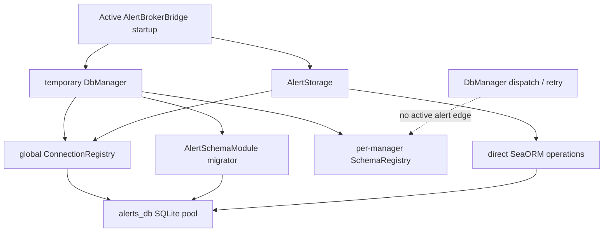

# Endpoint core: database connections, migrations, dispatch, and dormant gRPC bridge

This chapter accounts for all 34 tracked paths under `core/src/db/` at endpoint commit `a022e52bf2fff6a9445ebad96c3afeaf277e259f`: 23 Rust sources/module roots, six READMEs, one draw.io source diagram, and four sample-schema files. Direct contextual evidence was also checked in `core/Cargo.toml`, `core/build.rs`, `core/proto/db_service.proto`, `core/src/ipc/`, and the active alert bootstrap; those contextual paths are classified in their own completed chapters.

## Actual runtime role

The module contains a generic database plugin architecture, but the active endpoint uses only part of it.

**Verified active path:** `core/src/services/alert_broker_bridge.rs:119-150` creates a local `DbManager`, connects alias `alerts_db`, and registers `AlertSchemaModule` to run migrations. `AlertingSystem`/`AlertStorage` then retrieve the pool directly from the global `ConnectionRegistry`. The local manager is dropped when initialization returns, which drops its per-manager handler registry, connection cache, and retry dispatcher. The global static registry retains the pool.

**Verified inactive paths:** no production caller of `DbManager::execute_query_by_alias`, `execute_read_stream_by_alias`, DB field encryption/keychain, telemetry initialization, sample/testing helpers, or `run_db_server` was found. The file-index schema analyzed previously has a migrator/handler but no production `SchemaModule` registration.



The dashed edge is explicitly absent from active alert execution. Alert initialization depends on manager connection/migration, not manager query dispatch.

## Public architecture and ownership

`core/src/db/mod.rs` exports `DbManager`, `ConnectionRegistry`, `ConnectionInfo`, global registry accessor, `MigrationRunner`, `SchemaHandler`, `SchemaModule`, configs, errors, and telemetry initializer. `ipc_bridge` exists only under `grpc_server`. `samples` is gated by an undeclared feature. `testing` is declared as a module, but its module body is gated by another undeclared feature.

`DbManager` owns four independently cloned/shared pieces:

- an `Arc<ConnectionRegistry>` created by cloning the global registry; the registry clone shares the same inner alias map;
- a private per-manager `SchemaRegistry`;
- a `MigrationRunner` pointing at the shared global registry;
- a private per-manager map of connected aliases.

This creates two sources of connection reachability:

- `ConnectionRegistry` is process-global and used by direct modules such as alert/file storage;
- `DbManager::conns` is manager-local and used by manager dispatch.

They can diverge. Removing a global alias does not remove a manager's cached `Arc`; a new manager can see an existing global pool through migration runner but cannot execute against it until its own `connect` populates `conns`.

## Connection configuration and registry

### Configuration data dictionary

| Field | Type/default | Validation and runtime effect |
| --- | --- | --- |
| `DbConfig.backend` | `DbBackend`; default `SQLite` | SQLite implemented. PostgreSQL/MongoDB return `Config("…not yet implemented")`. |
| `url` | `String`; default empty | `validate` rejects empty, but no registry/manager caller invokes `validate`; driver handles it instead. |
| `max_connections` | `Option<u32>`; runtime default 5 | Passed to SeaORM; minimum fixed at 1. Zero/less-than-min semantics are not prevalidated. |
| `connect_timeout_ms` | `Option<u64>`; default 5,000 | Pool connect timeout. |
| `idle_timeout_ms` | `Option<u64>`; default 300,000 | Pool idle timeout. |
| `RetryConfig.max_retries` | `u32`; default 5 | Means up to six total attempts: initial plus five retries. |
| `initial_backoff_ms` | `u64`; default 50 | Doubled after each busy retry. |
| `max_backoff_ms` | `u64`; default 1,000 | Caps wait/doubling; no cross-field/range validation. |
| `MAIN_DB_ALIAS` | `"main_db"` | Convention and gRPC default; no special protection in registry/manager. |
| `SECURE_DB_ALIAS` | `"secure_db"` | Convention selected by dormant gRPC auth; no encryption or direct-call restriction. |

`DbConfig::build_sqlite_url` produces `sqlite://<lossy path>?mode=rwc`. It does not create parent directories, canonicalize, or URL-encode path characters. Active alert startup creates its parent first.

### `ConnectionRegistry`

The process-global singleton contains `HashMap<String, ConnectionInfo>` behind Tokio `RwLock`. `ConnectionInfo` exposes backend, `Arc<DatabaseConnection>`, exact config, and creation-time epoch milliseconds.

`get`/`get_pool` clone stored handles. `remove` removes and returns the entry but does not call a pool-close operation; other Arcs and manager caches can keep it usable.

`get_or_create`:

1. reads the map; exact config equality returns existing info and any difference returns `Config` with a diagnostic;
2. takes the write lock and double-checks;
3. **while holding the write lock**, asynchronously creates/connects the pool and applies pragmas;
4. inserts the result.

Holding the global write lock across network/filesystem connection and PRAGMA awaits serializes unrelated alias access/creation/removal during a slow connection. Exact equality means semantically equivalent `None` versus an explicit default also conflicts.

SQLite pool options are max configured/default 5, min 1, configured/default timeouts, and SeaORM SQL logging disabled. Creation emits diagnostic macros. `created_at` uses system time and becomes zero on pre-epoch failure.

The registry executes once through the pooled `DatabaseConnection`:

```sql
PRAGMA journal_mode=WAL;
PRAGMA synchronous=NORMAL;
PRAGMA foreign_keys=ON;
```

No busy-timeout PRAGMA is applied despite URL/config comments implying connection-string pragmas. **Potential issue requiring runtime validation:** SQLite `foreign_keys`/some pragmas are connection-scoped, while the code executes each statement only once against a pool rather than configuring each newly opened connection.

There is no enumerate, close-all, health-check, or shutdown API.

## Schema plugin and migration model

`SchemaModule: Send + Sync` supplies a static schema name, boxed object-safe migrator, and handler Arc. `SchemaHandler: Send + Sync` requires insert/update/find-by-id/find-all/delete-all/read-stream; custom command has a default `CommandNotFound` implementation. Inputs/outputs are untyped `serde_json::Value` at the framework boundary.

`GenericMigrator<M>` adapts a SeaORM `MigratorTrait` to object-safe `DynMigrator::up`. It calls `M::up(conn, None)` and maps all failures to string `Error::Migration`. The DB framework exposes no down, target migration, rollback, status, or dry-run operation. **Unresolved:** transaction/partial-migration guarantees depend on SeaORM and individual migrations; no repository wrapper adds recovery.

`DbManager::register_module` runs migration first, then puts the handler in its private registry. Registration has no rollback boundary. Handler registration cannot return an error and silently overwrites a same-name handler. The module value is not retained.

Active registration:

- `AlertSchemaModule` is registered under local manager alias `alerts_db`, after which the manager is dropped and direct storage uses the global pool.
- File index has no `SchemaModule`/production registration.
- Notes is unreachable sample code.

## `DbManager` dispatch and retry

`connect` delegates to the global registry then caches the pool locally. `get_connection` consults only the local map.

`execute_query_by_alias` obtains local connection and local schema handler, then dispatches:

| Operation token | Handler | Retry | JSON shaping |
| --- | --- | --- | --- |
| `insert` | `handle_insert` | Busy retry | Handler JSON returned. |
| `update` | `handle_update` | Busy retry | Handler JSON returned. |
| `delete_all` | `handle_delete_all` | Busy retry | `{ "deleted_count": count }`. |
| `find_by_id` | `handle_find_by_id` | No | `None` becomes JSON null. |
| `find_all` | `handle_find_all` | No | Vector becomes JSON array. |
| any other string | `handle_command` | Busy retry | Handler JSON returned; read-only custom commands are still assumed writes. |

Busy classification string-searches the rendered error for lowercase `database is locked`, uppercase `SQLITE_BUSY`, or `code: 5`. This can miss alternate driver wording or classify unrelated wrapped text. Each busy failure records/logs, sleeps exponential backoff plus random jitter capped by max, and logs retry. Backoff multiplication is unchecked for adversarial configurations. Once retries are exhausted, original error is replaced with `Error::Busy`. Retried handlers must themselves be safe after a partial effect; the framework supplies no transaction/idempotency wrapper.

`execute_read_stream_by_alias` times only handler stream construction. It neither retries nor wraps yielded item errors for DB telemetry; the optional gRPC runtime maps them later.

**Verified active limitation:** active alert writes call SeaORM storage methods directly, so none of the generic busy retry/query timers apply to them.

## Telemetry reality

`init_telemetry` contains only commented exporter setup, logs “initialized (stubs),” and always succeeds. `DbOperationTimer::drop` calculates elapsed seconds and discards them. `record_db_error` computes/discards a category and writes a tracing error. `increment_retry_count` writes a warning. All metrics macros/counters/histograms are disabled.

Consequently `Error::Telemetry` has no producer, no metric is recorded, and README claims that timers/counters “record” metrics are contradicted. The framework still produces tracing spans/logs where a subscriber is configured elsewhere.

## Security stubs and alias boundary

### At-rest hooks

`init_encryption_stub` flips a global `std::sync::Mutex<bool>` and warns that encryption is plaintext pass-through. Before initialization, encrypt/decrypt return `Error::Security`; afterward both clone and return the original string. Mutex poisoning panics via `unwrap`. No caller initializes or invokes them.

Keychain `read_secret` warns and returns `Ok(None)`; `write_secret` warns and returns `Ok(())` without storing. No caller exists. The security README checklist says stubs should return clear errors, but keychain operations report success/absence and encryption reports success after stub initialization.

Aliases alone do not encrypt/isolate data. Direct `DbManager`/registry callers can request any string alias. No active `secure_db` connection was found.

### Dormant gRPC authentication

The `grpc_server` feature is declared but off by default, no server call exists, and the source/proto mismatch described below prevents the checked code from compiling as written under that feature.

If corrected/activated, `authenticate_request` applies this exact static policy:

| Authorization metadata | `caller` | `allow_secure` |
| --- | --- | --- |
| `Bearer ea-internal-secret` | `internal_ea` | true |
| `Bearer ba-…` | entire token string | false |
| any other/missing/invalid | `anonymous` | false |

`caller` is never consumed. Anonymous and arbitrary `ba-` callers can still use `main_db`; authentication only affects secure alias selection. Secure access additionally requires exact `x-db-alias: secure_db`. The privileged credential is hard-coded in source/config-independent, and generic Tonic server setup has no TLS, request-size customization, interceptor, or graceful shutdown.

**Potential issue if deployed:** source-known static credential plus plaintext transport and unrestricted anonymous main-DB dispatch would be an inadequate network trust boundary. The bridge is not active/compilable in this revision, so this is not claimed as an exploitable production vulnerability.

## gRPC interface and compile blockers

`DbRuntime` implements generic `QueryRuntime`:

- singular query parses JSON, selects alias, and calls manager with default retry;
- read stream creates a 16-slot channel and detached forwarding task;
- batch write ignores `_op_id` and calls singular manager dispatch;
- health always returns `SERVING` without checking connections, schemas, migrations, or queries.

Sync batch is serial, stops at the first error, and provides no transaction/dedup/idempotency. Earlier acknowledgements are not returned if the RPC ends in error.

`map_db_error` maps SchemaNotFound→NOT_FOUND, Busy→UNAVAILABLE, Serialization→INVALID_ARGUMENT, CommandNotFound→UNIMPLEMENTED, and everything else—including QueryNotFound/Security/Pool/Migration—to INTERNAL.

**Verified static contradiction:** `core/proto/db_service.proto` declares `QueryRequest.table` and `WriteOperation.table`, but `core/src/ipc/server/mod.rs` destructures fields named `schema_id` from generated values. IPC usage/docs do the same. Enabling `grpc_server` regenerates structs from that proto and the checked Rust field accesses do not agree. Rust/Cargo are unavailable, so the expected compile error could not be executed.

There is no tracked `core/examples/grpc_server_demo.rs`, although both DB/bridge READMEs instruct running it.

## Testing and sample code

`core/Cargo.toml` declares features `grpc_server`, `detection`, `file_index`, `file_search`, `local_discovery`, and `scripting`. It does **not** declare `testing` or `samples`.

- `db/testing/mod.rs` gates its whole body with nonexistent `feature = "testing"`.
- sample module declaration gates on nonexistent `samples`.
- auth's three tests additionally require both gRPC and nonexistent testing.
- documented Cargo commands request unknown features and use `-p core` although the package name is `sentinel-core`.
- the sample directory lacks `minimal_schema/mod.rs`, so its module tree is incomplete even if the feature were added.
- the documented demo example is absent.

The test helper code itself creates random aliases and stores pools in the global registry. Neither `new_ephemeral_db` nor `TestDbHarness::Drop` removes them, so random entries/pools survive for the process; keeping only the `NamedTempFile` does not provide full registry RAII cleanup. No executable DB-core test covers connections, conflicts, retries, migrations, dispatch, telemetry, or security in the declared default feature set.

The sample notes migration creates `(id, body, created_at)`, but `NotesHandler` is intentionally skeletal: inserts/updates error, find-by-id returns None, find-all empty, delete-all zero, stream empty. It does not demonstrate persistence operations.

## Error and recovery matrix

| Failure | Handling | Notes |
| --- | --- | --- |
| Alias missing | `Pool` | Registry and manager produce different messages. |
| Existing alias/config mismatch | Diagnostic + `Config` | Exact struct comparison. |
| SQLite connect/PRAGMA failure | Diagnostic + propagated DB error | Entry not inserted; global write lock held during await. |
| Unsupported backend | Diagnostic + `Config` | PostgreSQL/MongoDB are enum-only placeholders. |
| Migration failure | Stringified `Migration` | Handler is not registered. No down/rollback wrapper. |
| Schema absent | `SchemaNotFound` | gRPC maps not-found. |
| Known handler operation absent | Usually `QueryNotFound` | gRPC maps INTERNAL, not UNIMPLEMENTED. |
| Custom command absent | `CommandNotFound` | gRPC maps UNIMPLEMENTED. |
| Busy write | Retry/log; eventually replacement `Busy` | Reads and direct active storage bypass retry. |
| Stream item error | Yielded unchanged by manager | Runtime maps to stream status; manager telemetry does not record item. |
| Encryption not initialized | `Security` | After stub init, plaintext success. |
| Keychain operations | Successful no-op/None | Cannot distinguish unavailable from absent. |
| Health | Static success | Failure-open with respect to DB readiness if bridge were active. |

## Concurrency and lifecycle

- Global registry uses one RwLock for all aliases and holds its write guard across pool creation.
- Separate managers share global pools but not handler registries/connection caches.
- Schema registry silently replaces same-name handlers under its write lock.
- Busy retry sleeps asynchronously and adds jitter; no global retry budget/circuit breaker exists.
- Stream forwarding has bounded capacity 16 and stops when receiver closes.
- Sync batch and migrations run sequentially.
- No pool close/shutdown or registry cleanup lifecycle exists.
- Testing random aliases accumulate globally.

## Documentation/diagram audit

`DB.drawio` is a three-page uncompressed diagrams.net 28.2.8 XML source created with the Electron app. It is repository-authored design source, not vendored/runtime code. It depicts generic IPC, secure auth, encryption/keychain, manager dispatch/retry/telemetry, and plugin components. Several boxes are architectural intent rather than active behavior.

| Claim | Actual evidence | Result |
| --- | --- | --- |
| DB toolkit runs standalone under testing/samples | Features absent; sample module root and demo absent | Contradicted/incomplete. |
| gRPC adapter is usable with documented command | Proto/Rust fields disagree; no demo/server entry | Contradicted. |
| Strict default-deny security | Secure alias is default-denied, but anonymous gets full main alias dispatch | Partially confirmed/overstated. |
| Timers/counters record metrics | Values/categories discarded; only logs | Contradicted. |
| Keychain stubs return clear errors | Read returns None; write success no-op | Contradicted. |
| Testing helper RAII avoids leaked connections | Global registry retains random alias/pool; no Drop removal | Contradicted. |
| PRAGMAs applied on connect | Three statements execute once after pool creation | Partially confirmed; per-connection effect unresolved. |
| Migration runner supports up/down framework | Wrapper exposes only up | Partially confirmed/outdated wording. |
| DB core contains no business schema | Sample only under unreachable gate; production schema external | Confirmed for active core. |
| Busy retry protects writes | Only manager-dispatched writes; active alert storage bypasses | Partially confirmed. |

## Per-file accounting

| Path/group | Role | Status |
| --- | --- | --- |
| `README.md`, four sub-READMEs, security/testing READMEs | Architecture/usage claims | Fully inspected and cross-checked. |
| `DB.drawio` | Three-page diagrams.net architecture source | Fully classified/audited; repository-authored, not runtime. |
| `mod.rs`, `config.rs`, `error.rs`, `naming.rs`, `traits.rs` | Public surface, config, errors, plugin contracts | Fully analyzed. |
| `connection/{mod,registry}.rs` | Global pool registry/creation | Fully analyzed. |
| `dispatch.rs`, `access.rs` | Per-manager handler registry and query/retry facade | Fully analyzed and active callers traced. |
| `migration/{mod,runner}.rs` | Object-safe migration adapter/runner | Fully analyzed. |
| `telemetry.rs` | Logging and disabled metric stubs | Fully analyzed. |
| `security/{mod,encrypt,keychain}.rs` | Explicit plaintext/no-op security stubs | Fully analyzed. |
| `ipc_bridge/{mod,auth,error_map,runtime,server}.rs` | Feature-gated DB/gRPC adapter | Fully analyzed; inactive and proto-incompatible. |
| `testing/{mod,init,harness}.rs` | Feature-gated helpers | Fully analyzed; gate undeclared and cleanup incomplete. |
| `samples/mod.rs`, three minimal-schema files | Toy schema/migration | Fully analyzed; feature/module tree incomplete. |

The AST catalog contains 138 declarations for the 23 Rust files. The companion [semantic symbol reference](07-symbol-reference/endpoint-database.md) documents the meaningful symbols.

## Unresolved

- Exact per-pool-connection PRAGMA enforcement at runtime.
- SeaORM migration transaction/recovery behavior for each external schema.
- Whether an untracked production build patches the proto or enables/starts the gRPC bridge.
- Intended source/configuration lifecycle for the hard-coded internal token.
- Intended shutdown/pool cleanup behavior and whether managers should share dispatch registries.
