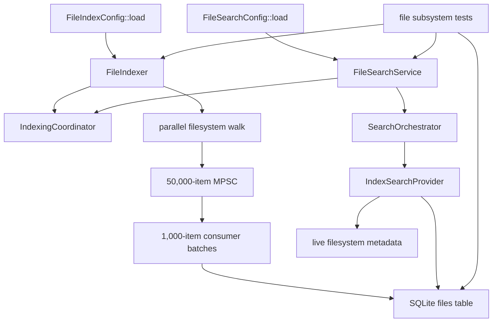
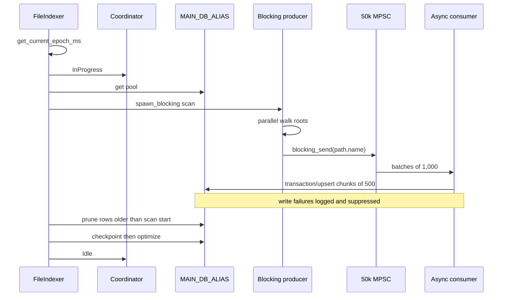

# Endpoint core: file index, search, and metadata utilities

This chapter accounts for all 41 tracked paths under `core/src/file/` at endpoint commit `a022e52bf2fff6a9445ebad96c3afeaf277e259f`: 35 Rust files, two embedded TOML configurations, three subsystem READMEs, and one libarchive build note. It distinguishes public/feature-compiled code from the agent's active runtime graph.

## Implementation status and runtime reachability

**Verified:** `core/Cargo.toml:168-172` enables `file_index` and `file_search` by default, while `core/src/lib.rs:16` exports `pub mod file`. `core/src/file/mod.rs` exposes both features and always exposes the shared file, DB, metadata, and utility modules.

**Verified:** repository-wide searches found no production construction of `FileIndexer`, `FileSearchService`, `SearchOrchestrator`, `FileIndexHandler`, or `FileIndexMigrator` outside `core/src/file/`. The active default-service graph analyzed in [the service-runtime chapter](06-endpoint-core-service-runtime.md) registers none of them. Only tests install the migration and wire the indexer/search objects.

| Capability | Default-feature compiled | Active default registration | Evidence-based status |
| --- | --- | --- | --- |
| `FilePath` and helpers | Yes | No registration needed | Implemented public utility. |
| SQLite index/walker/search facade | Yes | No production construction found | Implemented but dormant/dead-code candidate in the checked runtime. |
| Windows Search / Spotlight | Platform-gated source | No | Placeholder/inactive; both report unavailable and neither is constructed. |
| Detection/DLP branch | Non-default `detection` only | No | Incomplete: imports absent `FileScanResult` and `extract_metadata_and_label`. |
| File-type and label utilities | Yes | No label-extractor caller found | Public utilities; repository-local dead-code candidates. |
| Archive metadata/junk integration | Callers exist in decompression | No | `core/src/lib.rs:14` comments out the entire `decompression` module. |

**Unresolved:** an external `sentinel-core` `rlib`/`cdylib` consumer may call public APIs. No external consumer or C ABI for these Rust APIs was present, so repository-local nonuse is not proof of ecosystem-wide nonuse.



Every edge is a direct call/ownership relationship. The test edges are significant because no matching production-bootstrap edges were found.

## Module and public surface

| Actual module | Gate | Principal API |
| --- | --- | --- |
| `file::file` | Always | `FilePath`, two comparison normalizers |
| `file::file_db` | Submodules gated by `file_index` | public migration/DAL; crate-visible handler/model |
| `file::file_index` | `file_index` | re-exported `FileIndexConfig`, `FileIndexError`, `FileIndexer`; public coordinator/state modules |
| `file::file_search` | `file_search` (enables `file_index`) | re-exported `FileSearchService`; public config/models/orchestrator/providers |
| `file::file_metadata` | Always | label modules; re-exported type detector and result types |
| `file::file_utils` | Always | public `macos_junk` module |

`file_index/mod.rs:14` declares its unit-test module without `#[cfg(test)]`; the test functions themselves carry `#[tokio::test]`. The search unit-test module is parent-gated correctly. Integration tests require both file features, which are default features.

## Canonical file model

`file.rs:17-27` defines `FilePath`:

| Field | Type | Verified meaning |
| --- | --- | --- |
| `path` | `String` | Caller path. It is documented as absolute but not validated. |
| `name` | `String` | Last component converted lossily to UTF-8; empty if absent. |
| `size` | `u64` | Bytes; zero in path-only construction, live in hydrated/search values. |
| `last_modified` | `i64` | Epoch seconds; zero can mean unavailable. Search input uses milliseconds. |

`from_path_only` preserves the supplied string and zeros metadata. `new` lossily converts a `PathBuf`. `hydrate_from_fs` returns a new object; metadata errors propagate, while unusable modification time becomes zero. Comparison helpers lowercase on Windows and preserve strings elsewhere. They are unused and separate from DB normalization.

## Configuration and precedence

Both structs implement `ManagedConfig`. The directly used generic loader (`core/src/config/config_manager.rs:79-147`) constructs Rust `Default`, replaces it with successfully parsed embedded TOML, replaces that with the first successfully parsed runtime file at `<exe>/config/<name>`, `<exe>/<name>`, or `./config/<name>`, then invokes `post_load`. This is whole-value replacement, not field merging. Missing runtime fields use Serde field defaults rather than embedded values. Malformed TOML is logged and the preceding layer survives. Neither file config validates ranges.

### `FileIndexConfig`

| Setting | Rust default | Embedded value | Actual consumer |
| --- | --- | --- | --- |
| `enabled` | Windows true; otherwise false | true everywhere | **Unused by indexer.** |
| `enable_file_watching` | false | false | Unused; watcher absent. |
| `store_to_db` | Windows true; otherwise false | true everywhere | **Unused; every scan requires/writes DB.** |
| `max_file_size` | 100 MiB | 100 MiB | **Unused; walker avoids metadata and has no size check.** |
| `thin_batch_ms` | 300 ms | 300 ms | Unused; watcher absent. |
| `follow_symlinks` | true | true | Passed to walker. |
| `normalize_case_windows` | true | true | Unused; DAL lowercases unconditionally on Windows. |
| `index_interval_minutes` | 60 | 60 | Multiplied by 60 for sleep; zero/overflow unvalidated. |
| `index_paths` | empty | empty | Empty expands to home, roots/drives/mounts; roots can overlap. |
| `ignore_globs` | empty | empty | Empty expands to defaults; exact singleton `__NO_IGNORE__` clears. |

Public `DB_BATCH_SIZE` is 1,000 but unused; the consumer duplicates a local 1,000 literal. `INDEXER_CHANNEL_CAPACITY` is used at 50,000. Invalid individual globs are warned and omitted. `WalkBuilder` sets `standard_filters(false)` and `hidden(false)`, so `.gitignore` is not honored; only the custom `GlobSet` excludes entries.

### `FileSearchConfig`

| Setting | Default | Actual consumer |
| --- | --- | --- |
| `max_file_size` | 100 MiB | Stored, never enforced. |
| `search_paths` | Dynamic home/root/drives when empty | Stored, never scopes results. |
| `ignore_globs` | Dynamic only if loaded list empty | Stored, never used in search. Embedded TOML has a nonempty cross-platform list different from code defaults. |
| `search_provider` | `FileIndex`; Windows also permits `WindowsSearch` | `FileIndex` adds one provider. `WindowsSearch` adds none. No Spotlight variant exists. |

**Contradiction:** READMEs describe `SearchProviderKind`, native fallback, and APIs absent from source.

## SQLite schema and dispatch

`FileIndexMigrator` supplies one migration, `m20251117_000001_create_tables`:

```sql
CREATE TABLE files (
    id INTEGER PRIMARY KEY AUTOINCREMENT NOT NULL,
    path TEXT NOT NULL UNIQUE,
    name TEXT NOT NULL,
    last_seen BIGINT NOT NULL
);
CREATE INDEX idx_files_name ON files(name);
```

There is no size, modification-time, tenant, owner, or content column. Search obtains size/mtime live. The down migration drops the table.

**Verified:** `new_migrator()` is called only by file tests. `FileIndexHandler` has no `SchemaModule` and no production `register_and_migrate` call, so its claimed IPC dispatch is not active.

| Handler command | JSON input | Output / call |
| --- | --- | --- |
| `get_max_last_seen` | ignored | max timestamp; any query error becomes zero |
| `apply_batch` | `[{path,name}]` | transactional upsert, JSON null |
| `prune_old_files` | `{scan_start_time_sec}` | deleted count |
| `search_by_name` | `{name}` | exact-name model array |
| `delete_file` | `{path}` | JSON null |
| `delete_all_files` | ignored | deleted count |
| `post_prune_maintenance` | ignored | checkpoint/optimize, JSON null |

Standard CRUD/stream methods return `QueryNotFound`; unknown commands return `CommandNotFound`. `UpdateStateParams` exists without a command.

### DAL behavior

- `get_connection` fetches hard-coded global `MAIN_DB_ALIAS`; it never creates/migrates.
- `normalize_path` removes a trailing separator, absolutizes against current directory (fallback `/`), and lowercases Windows. It does not canonicalize, resolve `..`, verify existence, or consult config.
- `upsert_file` updates only `last_seen` on a path conflict.
- Watcher-oriented `IndexOp`/`apply_batch` are unused placeholders; operations run sequentially in one transaction.
- `apply_batch_from_index_data` builds all models, inserts 500-row chunks in one transaction, and rolls back on a propagated error.
- prune/delete-all are direct bulk deletes.
- maintenance runs WAL truncate checkpoint and optimize without a transaction.
- `get_max_last_seen` returns zero for missing table **and all other DB errors**, logging only the latter.

## Indexer lifecycle and data flow

`FileIndexer` owns cloned config, a watch coordinator, and a mutex-wrapped receiver for an eight-slot trigger channel. `with_channel` additionally returns a trigger sender.

`initialize` detaches a Tokio task, returns `Ok(())`, performs an initial scan, logs any error, then enters an infinite loop. It retains no join handle/cancellation/shutdown control. Multiple initialization calls create multiple tasks; only one can hold the receiver mutex.

The loop serializes jobs and selects between a received trigger and a fresh interval `sleep`, so manual work resets the schedule. It ignores `enabled`. Coordinator triggers use `try_send` and discard full/closed errors.



The producer skips nonexistent roots, ignores walker-entry errors, accepts regular files, and collects no metadata. The consumer counts dequeued records, not committed records. `write_batch_to_db` logs/suppresses every DB error. The run then logs the count as “Scanned and upserted” and prunes stale rows.

**Potential issue:** transient batch-write failure can be followed by deletion of previously indexed rows because the run remains successful. Prune/maintenance errors are nonfatal. Producer/consumer panics become `Internal`, but the peer task is not explicitly aborted. A final trusted-time failure occurs after state is Idle and DB effects completed yet still returns an error.

### Coordinator/state defects

The watch state starts `Idle`; `wait_for_completion` returns immediately for `Idle`/`Error`, waits through `InProgress`/`Resetting`, and returns if sender closes.

Search fallback reads state, enqueues a trigger if not InProgress, waits, then retries. **Verified race:** an Idle trigger does not change state; the immediate wait observes Idle and returns before the detached loop must consume the trigger. Error behaves likewise. Resetting enqueues another trigger. Thus “trigger, wait, retry” is not guaranteed.

`reset_db_index` sets Resetting then uses `?` to acquire DB. Acquisition failure leaves Resetting indefinitely, so waiters can hang.

## Search input, providers, and service

`FileSearchInput` makes name/size/signed millisecond time optional, but conversion requires all three in that order. Negative time is accepted and cast to `u64`. No name, range, maximum-size, or plausibility checks exist. Provider tolerance is ±2 bytes and ±300 seconds after millisecond division. Very large caller values pass through unchecked `u64`→`i64` arithmetic and require boundary validation.

`SearchProvider` requires `Debug + Send + Sync + 'static`, name, async search, and availability. Results are `Found(Vec<FilePath>)` or `NotFound`.

- `IndexSearchProvider` always reports available. It queries exact name and discards inaccessible/non-file/pre-epoch/mismatched candidates. Its async stream has no buffering/unordered combinator, so verification is sequential despite concurrency claims.
- Windows provider always reports unavailable and returns NotFound.
- Spotlight builds `mdfind` query `kMDItemFSName == '<name>'`, validates exact size only, always reports unavailable, is unexported, has no strategy variant, and is never constructed. **Potential issue if activated:** unescaped filename affects Spotlight query syntax (not shell syntax, because `Command` uses a direct argument).

`SearchOrchestrator::new` adds only index search for `FileIndex`; WindowsSearch yields zero providers. Search tries providers sequentially, suppresses/logs provider errors, and returns empty success. Batch search spawns one unbounded task per metadata.

`FileSearchService` holds duplicated Boolean/enum lifecycle locks; only the Boolean is read. Start/stop only flip locks and do not manage indexing/providers/tasks. `is_running` uses `try_read().expect`, so concurrent writer ownership can panic even though Tokio locks are not poisoned.

Path batch search returns one not-running error per input, otherwise spawns one unbounded task each, validates, searches, and follows the racy reindex path. It uses synchronous `Path::exists` in async code after the provider already performed live async metadata checks. Search config scope, ignores, and max size are unused.

The `detection` branch selects the first path, calls missing metadata APIs, and always creates an empty detection vector. With the feature off, compatibility `handle_upload_request_batch` ignores all inputs and returns an empty result vector. Legacy `Persona`/`FileDownloadMetadata` contain token/tenant/subscriber strings but have no caller.

## Metadata/type/label utilities

### `get_file_type`

It returns `FileCheckResult`, not `Result`. Detection failure yields partial path/name/size data with kind/route `None`, unlike `Default` which uses Other/Others.

Execution order:

1. collect path extension, filename, and size best-effort;
2. call `FileFormat::from_file`, returning partial data on error;
3. set detected extension/MIME/base kind;
4. refine detected ZIP by probing `ppt/presentation.xml`, `word/document.xml`, then `xl/workbook.xml`;
5. refine octet-stream/bin by reading at most 8 KiB and using BOM/shebang/text/JSON/XML/HTML heuristics;
6. route Office, PDF, Email, supported/unsupported compressed, or Others.

The JSON check is only leading `{`/`[` plus any colon; arrays without colons become text and invalid colon-containing shapes can become JSON. XML/HTML are also heuristics. EML may be identified from path extension, contradicting “ignores path extension.”

**Contradiction:** header docs name XZ/ZSTD as supported, but their explicit/MIME cases (and LZ4) are commented out; recognized archive/compressed values can route Unsupported.

### Label extraction

| API | Verified behavior | Limitations |
| --- | --- | --- |
| `get_email_labels` | Reads headers to first blank, unfolds whitespace, lowercases normal keys, expands semicolon `msip_labels` pairs. | Duplicate overwrite; malformed lines ignored; final header is lost if EOF has no blank terminator. Declared `EmailLabels` is never returned/constructed. |
| `get_office_file_labels` | Opens OOXML ZIP, parses `docProps/custom.xml`, scans selected `customXml/*.xml`. | Only required `property/@name/lpwstr`; strips only `vt:` prefixes; per-entry/XML parse failures suppressed; returns all properties. |
| `get_pdf_label` | Loads PDF, concatenates all decodable Info string/name entries, marks any XML subtype `XMP: present`. | Does not identify actual label keys or parse XMP label data. |

No tests/callers were found for these APIs.

### macOS junk filter

Default policy enables filtering with 1 MiB AppleDouble limit. `.Spotlight-V100`, `.Trashes`, `.fseventsd`, `.DS_Store`, and `Icon\r` are removed unconditionally. `._*`/`__MACOSX` candidates otherwise need Apple MIME/magic and size under the limit; a `._*` file without an exact stripped sibling in the input set is retained.

**Contradiction:** `counterpart_exists` calls `__MACOSX` handling “aggressive skip,” but its false return does not skip. Non-`._` entries still need MIME/magic/size; `._` without sibling is retained. The sole caller is uncompiled decompression.

## Error/recovery matrix

| Failure | Handling | Consequence |
| --- | --- | --- |
| Config absent/malformed | Log; use preceding layer | No semantic validation. |
| Invalid glob | Warn and omit | Weaker filtering. |
| Missing root / walker-entry error | Warn root / silently ignore entry | Successful scan may prune old rows. |
| DB connection failure | Set Error, propagate | No scan. |
| Batch DB failure | Log/suppress | Count rises; prune proceeds. |
| Task panic | Convert to Internal | State Error; peer not explicitly aborted. |
| Prune/maintenance failure | Log/suppress | State Idle. |
| Search DB/provider failure | Orchestrator suppresses | Empty success, indistinguishable from no match. |
| Candidate metadata failure | Discard candidate | Stale row retained. |
| Status lock busy | Panic | Batch/caller failure. |
| Reset connection failure | Propagate while Resetting | Waiters may hang. |

Index `Config`, `Notify`, `Filter` variants are not produced by active code. Search has both typed `Db` and string `DbError`; index provider uses the latter.

## Concurrency/performance/security boundaries

- Parallel walker runs in Tokio blocking pool; bounded channel applies backpressure; DB consumer batches 1,000 and transaction chunks 500.
- Search batch methods spawn one task per item without limit. Candidate checks are sequential.
- Concurrent misses can overflow the eight-slot trigger queue silently.
- Overlapping roots are not deduplicated before walking; SQLite reconciles paths but counts/I/O include duplicates.
- Every successful scan checkpoints/truncates WAL and optimizes.
- Synchronous `Path::exists` and config discovery can run on async threads.
- Embedded defaults follow symlinks and may scan home plus full root/drives without depth/count/time/cancellation limits. **Potential performance issue requiring measurement.**
- Direct callers can supply names/path metadata; no authentication exists because this is an in-process API. No active IPC/HTTP boundary was found.
- Search can return absolute local paths outside configured `search_paths` because scope/ignore fields are inert.
- Handler includes delete-all/maintenance commands but has neither registration nor permission checks in this revision.
- Document parsers accept untrusted Office/PDF/archive structures with no module-specific size/depth/time bound; text refinement alone is limited to 8 KiB.

## Tests

| File | Active coverage | Important limitation |
| --- | --- | --- |
| `file_index_unit_test.rs` | Five Tokio tests: normalization, CRUD, batch, prune, delete-all | Each replaces global `MAIN_DB_ALIAS` without `serial`; parallel interference possible. |
| `file_search/unit_test.rs` | Two tests: full conversion, missing-field error | About 480 further lines are commented obsolete tests; helper unused. |
| `file_index_integration.rs` | Four serial tests: manual migration/index/search/reindex | Proves manually wired behavior, not production registration. |

The fourth integration test's “wait for completion” exits when it sees `InProgress`; if scanning completes before observation it times out, otherwise it creates the file while scan may still run. The file can enter through the initial scan, while the actual Idle trigger/wait race can retry too early. Its assertion `second duration <= first duration` is scheduling-sensitive.

No tests cover config loading, ignored controls, invalid paths/globs, max size, write-failure-plus-prune, coordinator races, lock contention, native providers, label/type/junk utilities, detection feature, or production registration. Rust/Cargo were unavailable, so tests/optional compilation could not be executed.

## Documentation consistency audit

| Claim | Actual evidence | Result |
| --- | --- | --- |
| Use `FileIndexConfig::from_env_with_defaults` | Only `ManagedConfig::load` exists. | Contradicted. |
| Use `SearchProviderKind`, string search, score, native fallback | None exist. | Contradicted. |
| Watcher provides updates | No watcher implementation/registration. | Documentation-only. |
| enabled/store/max/thin/case fields control indexing | Indexer reads none. | Contradicted. |
| `.gitignore` standard filters apply | `standard_filters(false)`. | Contradicted. |
| Index state persists in DB | Watch channel only; no state table. | Outdated/contradicted. |
| Native providers selectable/available | Never constructed; false availability. | Planned, not implemented. |
| DB has size/time index and tolerant DB query | Only name index; exact name then live tolerance. | Contradicted. |
| Candidate FS checks concurrent/strict equality | Sequential and tolerant. | Contradicted. |
| DLP scan returns matches | Missing symbols; empty detections. | Incomplete/contradicted. |
| XZ/ZSTD supported | Cases commented out. | Contradicted. |

## Dead, legacy, incomplete

- **Dead-code candidate:** production service/schema wiring; construction/registration only in tests.
- **Placeholder:** watcher settings/`IndexOp`, Windows Search.
- **Inactive partial:** Spotlight.
- **Incomplete:** optional detection feature.
- **Dead-code candidates:** handler, `UpdateStateParams`, `DB_BATCH_SIZE`, comparison helpers, `EmailLabels`, compatibility Persona/download models, labelers, unused error helpers. External library use is unresolved.
- **Legacy:** large commented search-test suite with obsolete paths/signatures.
- **Documentation-only:** scores/fallback/watcher/stored state/size-time DB index/browser integration/DLP matches.
- **Uncompiled integration:** archive extractor because root module declaration is commented.

## Per-file accounting

| Path/group | Role | Status |
| --- | --- | --- |
| Three subsystem READMEs | Usage/design | Fully inspected; contradictions recorded. |
| `file_metadata/README_archive_extractor.md` | Windows libarchive build note | Fully inspected; belongs to uncompiled integration. |
| `file.rs`, root `mod.rs` | Model/helpers/gates | Fully analyzed. |
| `file_db/` five sources | Schema, migration, handler, DAL | Fully analyzed; registration absence searched. |
| `file_index/` six implementation sources | Config/state/coordinator/indexer/errors/API | Fully analyzed. |
| `file_index_config.toml` | Embedded config | Fully analyzed against loader/consumers. |
| `file_index_unit_test.rs` | Five tests | Fully analyzed. |
| `file_search/` six primary sources | Config/models/orchestrator/service/errors/API | Fully analyzed. |
| `file_search/providers/` four sources | Contract/adapters | Fully analyzed. |
| `file_search_config.toml` | Embedded config | Fully analyzed against code. |
| `file_search/unit_test.rs` | Active/commented tests | Fully analyzed. |
| `file_metadata/` six Rust sources | Type and label utilities | Fully analyzed. |
| `file_utils/` two sources | macOS filter | Fully analyzed. |
| `test/` two sources | Four integration tests/gate | Fully analyzed. |

The AST appendix contains 261 declaration records across the 35 Rust files. The companion [semantic symbol reference](07-symbol-reference/endpoint-file-index-search-metadata.md) documents meaningful declarations and groups trivial module/test symbols.

## Unresolved

- Whether an external host constructs these public APIs or installs the migration/handler.
- Whether any production build enables the statically incomplete `detection` feature.
- Whether production DB deployment externally creates a compatible `files` table.
- Intended partial-write/prune policy.
- Whether native providers are abandoned or pending.
- Whether whole-root indexing and absolute-path returns fit the intended trust model.
