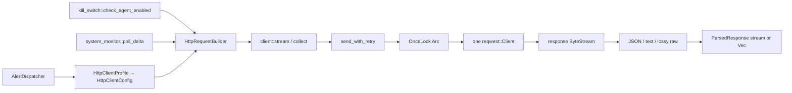

# Endpoint core HTTP client

**Repository/revision:** `sentinel-endpoint-agent` at `a022e52bf2fff6a9445ebad96c3afeaf277e259f`  
**Scope:** all 13 tracked paths under `core/src/http_client/`, plus direct callers and configuration dependencies needed to establish reachability  
**Evidence status:** Verified unless explicitly marked otherwise

## Actual role and reachability

This is a public fluent HTTP facade over one process-wide reqwest client. Three non-documentation caller paths were found:

| Consumer | Entry/call | Request purpose | Configuration path |
| --- | --- | --- | --- |
| Alert dispatcher | `core/src/alerting/dispatcher.rs:494-551`, `send_request_with_profile(...).collect()` | POST JSON array of stored alerts | Dynamic `AlertBackendProfile`; auth/tenant headers; alert config timeout/retries. |
| Kill switch | `core/src/kill_switch/state.rs:67-125`, `send_request(...).collect()` | POST device ID to agent-status endpoint | Default 30 s/3 retries; bearer/tenant/version/client headers. |
| System monitor v2 delta sync | `system-monitor/v2/src/sync/delta.rs:26-59`, `get(...).collect()` | GET governance delta by tenant/cursor/OS | Default 30 s/3 retries; tenant/subscriber headers. |

Persona validation, user-context, OAuth, heartbeat, and examples use `reqwest::Client` directly rather than this facade. No production use of the public PUT/DELETE helpers, raw response mode, callback terminal, `AuthServerProfile`, `DefaultProfile`, or `StreamingProfile` was found outside documentation/tests.

The diagram contains no inferred edge.

## Public surface

`core/src/http_client/mod.rs:225-241` keeps adapter/builder/client/parser modules private, makes error/profile/types public, and root-re-exports errors, three profiles, the profile trait, method enum, and parsed output types. Public functions return the public `HttpRequestBuilder` type through an otherwise private module; callers can chain its public methods but cannot import it through a public module/re-export.

| API | Location | Exact behavior |
| --- | --- | --- |
| `send_request(url, body)` | `mod.rs:304-306` | Default POST builder, 30 seconds, three retries after initial, JSON parsing. Header map initially empty. |
| `send_request_with_profile(profile, url, body)` | `382-389` | Calls `profile.to_config`, then profile-aware builder constructor. |
| `get(url)` | `404-406` | Empty-body default builder with method changed to GET. |
| `post(url, body)` | `423-425` | Exact alias of `send_request`. |
| `put(url, body)` | `440-442` | Default builder with PUT. |
| `delete(url)` | `455-457` | Empty-body default builder with DELETE. |
| `HttpRequestBuilder::collect` | `builder.rs:283-286` | Marks finalized, streams, returns all items; first item error aborts and drops prior results. |
| `HttpRequestBuilder::stream` | `303-308` | Marks finalized and returns parsed/raw output stream after headers have arrived. |
| `HttpRequestBuilder::with_callback` | `324-330` | Synchronously invokes `FnMut` per successful item; first error aborts. |

Dropping an unfinalized builder produces only a debug log (`builder.rs:120-127`); `HttpClientError::NotFinalized` is never returned.

## Data dictionary

### Request and method types

`RequestParams` (`types.rs:22-27`) is internal and clones finalized URL, method, exact-string-keyed headers, and body into the adapter. `HttpMethod` (`123-131`) has GET, POST, PUT, DELETE, PATCH, HEAD, and OPTIONS. `TryFrom<&str>` is ASCII-case-insensitive and accepts exactly those names; the builder silently logs/falls back to POST for invalid strings rather than producing `InvalidMethod`. OPTIONS parses successfully but the reqwest adapter rejects it as configuration error.

GET/HEAD retain and log the builder body but `build_request` does not transmit it. All other variants, including DELETE, receive the body.

### Parsed output

| Data point | Meaning and transformation |
| --- | --- |
| `ParserHint::Json` | Default; selects JSON unless request metadata selects text under rules below. |
| `ParserHint::Text` | Selects text unconditionally. |
| `ParsedContent::Json(Value)` | Parsed value. |
| `ParsedContent::Text(String)` | UTF-8 chunk text. |
| `ParsedContent::Raw(String)` | Parsing-disabled, lossy UTF-8 transport chunk; not bytes. |
| `ParsedResponse.content` | One of the prior variants. |
| `ParsedResponse.raw_data` | For JSON, `Value::to_string()` (normalized/minified, not original bytes); for text, JSON-string serialization including quotes/escapes; only raw mode uses the lossy chunk string itself. |

`ParsedResponse::Display` debug-formats content. `from_value` maps non-string values under a text hint to literal `"<invalid utf8>"`, although this does not test UTF-8 validity. Consumers kill-switch and delta sync parse `raw_data` back into typed JSON.

### Profile/configuration fields

`HttpClientProfile` (`profile.rs:89-202`) has defaults and produces public `HttpClientConfig` (`209-221`):

| Field/method | Default | Runtime status |
| --- | ---: | --- |
| `base_url` | None | Used only to prefix a non-`http://`/non-`https://` URL. |
| `timeout_secs` | 30 | Applied to every reqwest attempt. |
| `max_retries` | 3 | Used; means four total adapter-send attempts. |
| `retry_delay_ms` | 300 | Used as linear base delay. |
| `default_headers` | `Content-Type: application/json` | Moved into builder; exact-string-key merge/override. |
| `parser_hint` | JSON | Used. |
| `enable_cache` | false | **Inert:** copied to config, discarded by `with_config`; no cache exists. |
| `cache_ttl_secs` | 300 | **Inert:** copied then discarded. |
| `log_requests` | false | **Inert:** discarded; detailed request logging is unconditional at debug. |
| `log_responses` | false | **Inert:** discarded; parser response logging is unconditional at debug/error. |
| `user_agent` | `Sentinel-Agent/0.1.7` | **Inert:** discarded; no User-Agent header is added. The crate version is `0.30.276`. |

Profiles:

- `DefaultProfile` changes nothing.
- `AuthServerProfile` uses cached `BackendUrl::Auth`, 10 seconds, two retries, 200 ms base delay, and advertises a five-minute cache that is not implemented.
- `StreamingProfile` uses 300 seconds, one retry, and 1,000 ms delay. It does not change parser mechanics.
- README `DlpBackendProfile` does not exist.
- Active `AlertBackendProfile` lives in `alerting/dispatcher.rs:113-173`: it supplies config timeout/retries, JSON/Accept headers, optional bearer and tenant, extra headers, and a computed user-agent that is discarded.

`BackendUrl::Auth.as_str()` resolves `QUILR_AUTH_API_BASE_URL` once through a lazy process cache, falling back to `https://auth.quilr.com` (`core/src/global/backend_url.rs:64-138`). Alert and kill-switch base resolution is documented in their subsystem references. The HTTP README's `QUILR_DLP_API_BASE_URL` has no implementation reference.

## Builder transformation and header behavior

`HttpRequestBuilder::new` (`builder.rs:58-72`) sets POST, body, no headers/hint, 30-second timeout, parsing true, three retries/300 ms, and clones the singleton adapter.

`with_config` (`82-113`):

1. Treats only lowercase-prefix `http://` and `https://` as absolute.
2. Otherwise strips all leading `/`, strips trailing `/` from base, and joins with exactly one slash.
3. Moves headers/parser/timeout/retry fields into the builder.
4. Discards cache/logging/user-agent fields.

There is no URL parse/validation at build time. A scheme with different case is treated as relative, and an empty base/path can form syntactically invalid output. Invalid URLs surface later through reqwest and are mapped as network errors; `InvalidUrl` has no producer.

Builder `header`/`headers` operate on a case-sensitive `HashMap<String,String>`, while HTTP header names are case-insensitive. A profile's `Content-Type` and a caller's `content-type` can coexist. `client::stream` adds default JSON content type only if exact key `Content-Type` is absent. Reqwest conversion later makes names case-insensitive; duplicate differently cased map entries can overwrite according to nondeterministic hash iteration order. **Potential issue requiring validation:** caller intent can be nondeterministic when the same logical header is present under different casing.

Invalid method strings log and remain POST. Header syntax is validated only in `convert_headers`; an invalid header error then enters the general retry loop.

## Adapter, connection, and transport behavior

`DEFAULT_ADAPTER` (`adapter/mod.rs:58`) is a `OnceLock<Arc<DefaultHttpAdapter>>`. First access constructs `DefaultHttpAdapter { client: reqwest::Client::new() }`; all subsequent requests share the Arc/client and its dependency-managed pool.

The core manifest pins the semver request `reqwest = 0.12.24`, disables default features, and enables `json`, `rustls-tls`, and `stream` (`core/Cargo.toml:78`). No lockfile is committed, so the exact selected patch/transitive versions are unresolved from manifests; the committed runtime log names reqwest 0.12.28 in one Windows run.

The repository does not configure proxy rules, redirects, certificates, TLS versions, custom roots, compression, pool sizes, idle limits, DNS, connection timeout, or HTTP protocol. `Client::new` supplies dependency defaults. Therefore README's exact “10 idle connections per host” is **not verifiable from repository configuration**.

`DefaultHttpAdapter::send` (`reqwest_adapter.rs:42-74`) builds a request, sets a per-request duration, awaits headers, rejects every non-2xx status without reading its body, and returns `response.bytes_stream`. Body-stream errors become `NetworkError` without URL/status context. The response status and headers are not exposed to parser/caller.

Transport accepts both HTTP and HTTPS; no HTTPS-only policy exists. The rustls feature provides the HTTPS backend, but exact trust-root/verification behavior is delegated to dependencies and cannot be reconstructed completely without resolved dependency source.

## Retry, timeout, and failure behavior

`send_with_retry` (`client.rs:91-194`) retries **every** adapter error while `retries < max_retries`; it does not classify transient failures.

| Failure | Retried? | Final form |
| --- | --- | --- |
| Timeout/connect/request error | Yes | Typed timeout or string network error. |
| Any non-2xx status, including 3xx/4xx | Yes | `HttpStatus { status, url }`. |
| Invalid header | Yes | `InvalidHeader`. |
| Unsupported OPTIONS | Yes | `ConfigError`. |
| Response-body stream failure | No | Yielded `NetworkError`. |
| JSON/text parsing problem | No | Yielded parser error or, for text cases, silently dropped bytes. |
| Callback error | Not applicable | Callback cannot return a result. |

Default waits are 300, 600, and 900 ms. There is no jitter, retry-after support, cancellation token, idempotency key, method restriction, or shared retry budget. POST/PUT/DELETE may be replayed after an uncertain outcome.

Timeout is applied separately to each adapter attempt, not around the entire retry loop. Thus four default attempts plus sleeps can substantially exceed 30 seconds. The warning computes `(max_retries * retry_delay_ms) / 1000`, but actual sleep is the triangular sum of `base * 1..=max_retries`; it also ignores attempt durations. Multiplication is unchecked. The generated curl diagnostic uses `--connect-timeout`, which does not describe the code's request timeout.

Alerting adds a second, outer circuit/backoff/storage retry system. The HTTP client first repeats each batch up to its profile limit; the dispatcher then retains/fails the batch according to its own circuit behavior.

## Parser selection

`select_parser` (`parser/factory.rs:60-100`) receives the builder hint and **request headers**, not response headers. Selection is:

1. explicit Text → text;
2. exact request content-type value `text/plain` → text;
3. request Accept containing `text/plain` → text;
4. otherwise JSON.

Contrary to its comment, explicit JSON does not always take precedence: a `Some(Json)` hint with request `Content-Type: text/plain` selects text. Media-type parameters such as `text/plain; charset=utf-8` do not match the content-type branch. Because the adapter discards response metadata, automatic inference from response content type is impossible.

## JSON parser state machine

`parse_json_stream` (`parser/json_parser.rs:29-211`) owns the upstream stream, an unbounded byte buffer, and `rs_mode`.

Without an ASCII record separator (`0x1E`), it accumulates the entire response and emits exactly one JSON value at EOF. Nonempty whitespace and five case-insensitive tokens (`ok`, `success`, `accepted`, `created`, `done`) become JSON null. An exactly empty response emits no item because `Processing` ends directly; the later “empty buffer → null” branch is unreachable for a truly empty stream.

With RS present, it drains bytes before the first delimiter, parses a non-whitespace segment, then returns to `Processing`. That state always awaits another upstream chunk before looking for another delimiter already in its buffer. Consequences directly visible from the state transitions:

- at most one buffered delimiter is processed per received transport chunk;
- if no later upstream chunk arrives, remaining delimiters/data enter final-buffer state;
- final-buffer state discards everything when `rs_mode == true`;
- the conventional RS-before-record framing loses the final record unless another delimiter/future chunk advances it.

This contradicts reliable RS-delimited streaming. Parse errors for a processed segment are yielded and processing continues. An upstream byte-stream error is yielded and immediately ends, discarding buffered bytes.

For ordinary JSON, “stream” is O(total response size), not O(chunk size), and produces nothing until EOF. Debug logs include up to an intended 500 bytes for success and the full response on parse error. Slicing lossy text at byte index 500 can panic if that index is not a UTF-8 character boundary. **Potential issue requiring validation:** a multibyte response with an unlucky boundary can panic in debug-response formatting before parse completion.

## Text and raw parsing

`parse_text_stream` (`parser/text_parser.rs:22-64`) appends each transport chunk, clones the complete buffer into `String::from_utf8`, emits any valid prefix, and retains the invalid suffix. Fully valid chunks become separate output items based on network chunking, not lines/messages.

There is no EOF flush/error state. A terminal incomplete sequence is silently dropped. A permanently invalid leading byte with `valid_up_to == 0` is retained indefinitely; subsequent bytes remain blocked and are eventually dropped. The error enum's `ParseError` is not used here. Repeated buffer cloning can become expensive for a retained invalid/incomplete prefix.

`parse_response(false)` bypasses these parsers but still maps each arbitrary byte chunk to `String::from_utf8_lossy`; binary/non-UTF8 data is changed, framing follows transport chunks, and the API cannot return raw bytes despite documentation.

## Logging and security boundary

The caller controls URL, headers, and body. The adapter crosses the process/network trust boundary and accepts plaintext HTTP. Header and body syntax/serialization is otherwise delegated.

`send_with_retry` logs at debug on every attempt:

- full URL, including query parameters;
- the complete `HashMap` of headers;
- body content whenever its byte length is under 1,000;
- on retry, a generated curl command containing all headers/body.

No authorization/token/tenant/subscriber redaction exists. `log_requests = false` does not control these logs because that field is discarded. JSON parsing also logs response content irrespective of `log_responses`. The committed `logs.txt` demonstrates this path logging tenant/subscriber identifiers during delta sync. Alert dispatch additionally logs the full combined payload at debug before calling this client (`dispatcher.rs:523-527`).

**Potential issue:** debug/error collection can persist credentials, identifiers, request payloads, response data, and error bodies. Whether production enables/exports these levels is deployment-dependent and remains unresolved.

The generated curl command is never executed. It escapes single quotes in header values/body but not URL/header names; its risk here is log disclosure/misleading copy-paste behavior, not repository-side command execution.

## Error model

`HttpClientError` (`error.rs:31-96`) defines timeout, network, HTTP status, parse, JSON, invalid method/header/URL, config, adapter, IO, not-finalized, and unexpected variants.

Active producers are timeout, network, status, JSON, invalid header, and config. `ParseError` is produced only by its public helper/test. Repository-wide searches found no producer for `InvalidMethod`, `InvalidUrl`, `AdapterError`, `IoError`, `NotFinalized`, or `Unexpected`. `JsonError` preserves the source; network/status errors omit response body/headers.

`map_reqwest_error` prioritizes timeout, connect, and request classifications, then makes all remaining reqwest errors network strings. A URL parse/request construction error therefore does not use `InvalidUrl`.

## Concurrency and performance

- One lazily initialized reqwest client is shared; independent requests can run concurrently through dependency pooling.
- No HTTP-client task, semaphore, rate limit, queue, circuit breaker, or concurrency bound exists.
- Backpressure flows from a stream consumer to the reqwest byte stream; no intermediate channel is created.
- The callback runs synchronously in the polling task and can block it.
- `collect` retains every `ParsedResponse`; JSON output duplicates structured values plus serialized `raw_data`.
- Ordinary JSON parsing retains the whole body even under `.stream()`; RS buffering is unbounded until delimiters; raw/text memory follows chunks except invalid-prefix retention.
- `Vec::drain(..pos)` plus front removal shifts buffer data; repeated delimiter processing can be copying-heavy.
- Response sizes are unlimited at the repository layer.

Performance claims about exact pool size require resolved dependency defaults/measurement. The concrete buffering/copy behavior above is source-verified.

## Tests and build evidence

There are 38 test functions in the 12 Rust files:

- builder: 10 configuration/state tests;
- error: 9 formatting/conversion/type tests;
- profile: 6 default/conversion tests;
- reqwest adapter: 7 construction/header/request-builder tests;
- adapter singleton: 2 tests;
- module docs: one local profile test and two ignored network tests.

No test covers `client.rs`, either parser, retry classification/timing, timeout scope, response-body errors, redaction, cache/log/user-agent fields, real response headers/status/body, RS framing, invalid UTF-8, raw mode, callback behavior, or any of the three production consumers. No mock adapter injection setter exists outside private construction, although the adapter trait comment advertises mocking.

`core/Cargo.toml` sets `doctest = false`, so numerous examples are not checked. Two module network examples are explicitly `#[ignore]`. Cargo/rustc are unavailable in the analysis environment, so the unit suite could not be executed. CI inclusion will be finalized with the pending repository-wide workflow analysis; test presence is not treated as proof of CI execution.

## Documentation consistency audit

| Documentation claim | Code evidence | Result |
| --- | --- | --- |
| Built-in `DlpBackendProfile`, 60 s | No symbol/export; only README text | Documentation-only/contradicted. |
| Auth profile has three retries | `max_retries()` returns 2 | Contradicted. |
| Auth token validation cache / generic response caching | Fields discarded; no cache code | Contradicted. |
| Request/response logging is opt-in | Flags discarded; logging unconditional at fixed levels | Contradicted. |
| Profile User-Agent is applied | Field discarded; no header injection | Contradicted. |
| Parser inferred from response Content-Type | Response headers discarded; request headers passed | Contradicted. |
| All standard methods supported | OPTIONS enum/string accepted then adapter rejects | Contradicted. |
| Raw mode returns raw bytes | Lossy UTF-8 `String` per chunk | Contradicted. |
| Streaming uses O(chunk size) and incrementally parses large JSON | Ordinary JSON buffered to EOF; RS has loss behavior | Contradicted. |
| Exact empty JSON response returns null | Empty stream emits no item | Contradicted by control flow. |
| Retry on transient failures | Every adapter error, including 4xx/config/header, retried | Overstated/mischaracterized. |
| Comprehensive tests | No client/parser/retry/real-response tests; two network tests ignored | Contradicted. |
| 10 idle connections per host | Only `Client::new`; no repository pool configuration | Not verifiable from repository evidence. |
| `QUILR_DLP_API_BASE_URL` configures DLP profile | No implementation reference | Documentation-only. |
| Examples compile | Doctests disabled; profile examples include direct `.await` on non-Future builder | Not verified; at least one pattern is source-incompatible. |

## Dead, incomplete, and apparently unused elements

- Dead-code candidates after exact and serialized-form searches: error variants named above; `HttpClientError::parse_error` outside its test; raw/callback terminals and PUT/DELETE helpers in production; all three built-in profile values in production.
- `enable_cache`, `cache_ttl_secs`, `log_requests`, `log_responses`, and `user_agent` are public configuration fields with no execution effect.
- `parser_hint` builder setter is crate-private and has no caller; profile construction sets the field directly.
- Automatic response-header parser selection is described but structurally impossible with the adapter result type.
- Mock/alternate adapters can implement the private trait only inside the crate, but there is no public or crate-visible builder injection constructor/setter.

## Per-file accounting

| Path | Role | Status |
| --- | --- | --- |
| `README.md` | Usage/architecture/performance/config claims | Fully inspected and contradicted claims recorded. |
| `mod.rs` | Public root API, re-exports, extensive examples, ignored doc tests | Fully analyzed. |
| `types.rs` | Method/request/parser/output/stream types | Fully analyzed. |
| `error.rs` | Public error/result API and tests | Fully analyzed; active/unused variants searched repository-wide. |
| `profile.rs` | Profile trait/config/built-ins/tests | Fully analyzed; five inert fields and stale version identified. |
| `builder.rs` | Fluent state/configuration and terminals | Fully analyzed. |
| `client.rs` | Retry/logging/terminal execution/parser bridging | Fully analyzed. |
| `adapter/mod.rs` | Private adapter trait and singleton | Fully analyzed. |
| `adapter/reqwest_adapter.rs` | Reqwest construction, status/body stream, mappings | Fully analyzed. |
| `parser/mod.rs` | Private parser exports | Fully analyzed. |
| `parser/factory.rs` | Request-metadata parser choice | Fully analyzed. |
| `parser/json_parser.rs` | Full-buffer/RS state machine | Fully analyzed. |
| `parser/text_parser.rs` | Chunk UTF-8 buffering | Fully analyzed. |

The AST catalog records 170 declarations for these 12 Rust files. The companion [semantic symbol reference](07-symbol-reference/endpoint-http-client.md) documents the meaningful symbols.

## Unresolved

- Exact reqwest/rustls transitive versions and default redirect/proxy/trust-root/pool semantics: no lockfile is committed.
- Production tracing filters, exporters, retention, and access controls governing logged credentials/payloads.
- Whether external consumers rely on public APIs not called in this monorepo checkout.
- Whether the RS endpoint framing was intended as delimiter-after-record rather than standard delimiter-before-record; either way, buffered trailing data is discarded in active RS mode.
