# Endpoint core gRPC IPC and Persona broker client

**Repository/revision:** `sentinel-endpoint-agent` at `a022e52bf2fff6a9445ebad96c3afeaf277e259f`  
**Primary scope:** all eight tracked paths under `core/src/ipc/` and `core/src/ipc_clients/`  
**Contextual scope:** checked proto/build/feature definitions, already-analyzed DB runtime, pinned IPC broker, Persona bridge types/service, and active proxy consumers needed to establish reachability and contracts  
**Evidence status:** Verified unless explicitly marked otherwise

## Two unrelated IPC surfaces

The similarly named directories contain two different transports and runtime statuses:

1. `core/src/ipc/` is a default-off tonic gRPC surface intended for generic database requests. It is gated by Cargo feature `grpc_server`, has no active server entry in the default endpoint graph, and is statically inconsistent with the checked `.proto`.
2. `core/src/ipc_clients/persona.rs` is an active JSON client over the endpoint-pinned `ipc-light` duplex/broker API. Proxy startup launches its pull and broadcast tasks, and proxy DLP/policy/alert/request-context code consumes its commands/cache.

```mermaid
flowchart TB
    subgraph GRPC["Default-off database gRPC"]
        PROTO["core/proto/db_service.proto<br/>fields: table"] --> GEN["tonic include_proto generated code"]
        GEN --> SERVER["GenericDbService<R><br/>source expects schema_id"]
        GEN --> CLIENT["DbServiceClientExt"]
        SERVER --> RUNTIME["QueryRuntime"]
        RUNTIME --> DBADAPTER["DbRuntime / DbManager<br/>outside this scope"]
    end

    subgraph PERSONA["Active proxy Persona IPC"]
        PROXY["Proxy startup / consumers"] --> API["ipc_clients::persona"]
        API --> BROKER["endpoint-pinned ipc-light-broker"]
        BROKER --> BRIDGE["PersonaBrokerBridge<br/>persona_service"]
        BRIDGE --> PM["PersonaManager"]
        BRIDGE -->|"wildcard events"| LISTENER["broadcast listener"]
        LISTENER --> CACHE["public process-local PERSONA_CACHE"]
        API --> CACHE
    end
```

The proto-to-server edge is intended/generated but fails at the handwritten field accesses under the checked schema; it is shown to explain the build path, not to claim a successful build.

## File inventory

| Path | Role | Runtime status | Final classification |
| --- | --- | --- | --- |
| `core/src/ipc/README.md` | 364-line concatenated gRPC design/operations document | Documentation only; internally contradictory and stale | Fully analyzed handwritten documentation. |
| `core/src/ipc/usage.md` | Two uncompiled Rust usage snippets | References missing features/examples and wrong field/package names | Fully analyzed handwritten documentation. |
| `core/src/ipc/mod.rs` | Feature-gated module boundary | Default-off | Fully analyzed handwritten Rust. |
| `core/src/ipc/grpc/mod.rs` | `tonic::include_proto!` boundary | Generated at build when feature is on; output not committed | Fully analyzed handwritten generator boundary. |
| `core/src/ipc/server/mod.rs` | Generic tonic service and runner | Default-off; no production caller; currently proto-incompatible | Fully analyzed handwritten Rust. |
| `core/src/ipc/client/mod.rs` | Thin generated-client wrapper | Default-off; no production caller | Fully analyzed handwritten Rust. |
| `core/src/ipc_clients/mod.rs` | Always-compiled Persona client export | Active through proxy | Fully analyzed handwritten Rust. |
| `core/src/ipc_clients/persona.rs` | Request/response, public cache, poller, broadcast listener | Active proxy identity/auth channel | Fully analyzed handwritten Rust. |

The six Rust files contain 55 AST declarations. Generated prost/tonic declarations do not exist in the repository and are not counted. The [semantic symbol reference](07-symbol-reference/endpoint-ipc-persona-client.md) documents all meaningful handwritten symbols.

# Part I — Generic database gRPC

## Build and feature boundary

`core/src/ipc/mod.rs:10-17` exposes `grpc`, `server`, and `client` only under `feature = "grpc_server"`. The feature is absent from defaults and expands to optional `tonic`, `prost`, and `tokio-stream` dependencies (`core/Cargo.toml:167-177`). `futures`, async-trait, and Tokio are unconditional dependencies.

`core/build.rs:4-28` conditionally:

1. emits rerun directives for the proto;
2. obtains `protoc_bin_vendored::protoc_bin_path` and, on success, sets `PROTOC`;
3. configures tonic-build with both client and server output;
4. compiles `core/proto/db_service.proto` into Cargo's generated output directory;
5. panics the build on compile failure.

Failure to locate vendored protoc is silently ignored, allowing tonic-build to try its normal lookup. Generated Rust is not committed. `ipc/grpc/mod.rs` includes package `quilr.db.v2` at module root.

No lockfile is committed, so exact selected tonic/prost/tokio-stream patches are unresolved.

## Checked wire schema

The proto declares service `quilr.db.v2.DbService`:

| RPC | Shape | Fields |
| --- | --- | --- |
| `HandleQuery` | unary request/unary response | `QueryRequest { table, operation, params_json }` → `QueryResponse { result_json }`. |
| `HandleReadStream` | unary request/server stream | same request → stream of query responses. |
| `SyncBatch` | client stream/unary response | `WriteOperation { op_id, table, operation, params_json }` → `SyncBatchResponse { acks[] }`. |
| `HealthCheck` | unary/unary | empty request → `{ status }`. |

Field numbers are Query `table=1`, `operation=2`, `params_json=3`; Write `op_id=1`, `table=2`, `operation=3`, `params_json=4`. Strings receive proto3 empty-string defaults. No optional fields, oneofs, enums, pagination, explicit error payload, schema version, tenant, identity, or authorization field exists.

## Static source/proto incompatibility

`server/mod.rs` destructures both generated request types using field `schema_id`:

- `QueryRequest { schema_id, operation, params_json }` at lines 57 and 72;
- `WriteOperation { op_id, schema_id, operation, params_json }` at line 94.

The checked proto generates `table`, not `schema_id`. `usage.md` also constructs `schema_id`, while the README grpcurl example uses JSON key `schema`. None matches the proto. The DB adapter uses `schema_id` terminology internally, but that does not change generated fields.

**Verified static result:** enabling `grpc_server` against generated code from this proto produces missing/unknown field errors in the handwritten server and documented usage shapes. Cargo/rustc are absent, so the exact compiler output was not captured, but the field mismatch is direct source evidence.

## `QueryRuntime` contract

`server/mod.rs:17-28` defines an async public trait requiring `Send + Sync + 'static`:

| Method | Inputs | Output |
| --- | --- | --- |
| `handle_query` | cloned request metadata; schema/table identifier; operation; JSON string | one result JSON string or tonic Status. |
| `handle_read_stream` | same | `ReceiverStream<Result<String,Status>>` or initial Status. |
| `apply_write` | metadata, operation ID, schema/table, operation, JSON | unit or Status. |
| `health` | no request/metadata | status string or Status. |

The generic layer does not parse/validate JSON, validate identifiers, authenticate, authorize, impose timeouts, or define idempotency. It delegates all of those possible decisions to `R`. Stream output is restricted to Tokio `ReceiverStream`, not an arbitrary Stream.

The only implementation found is feature-gated `db::ipc_bridge::runtime::DbRuntime`. It was fully analyzed in the DB chapter: it applies a placeholder/hard-coded metadata auth model, calls DbManager, and is not started by production code.

## Generic server execution

`GenericDbService<R>` owns `Arc<R>`. `new` stores it without initialization or validation.

### Health

`health_check` ignores the entire request, calls `runtime.health`, and returns its string. Because `QueryRuntime::health` receives no metadata, this RPC cannot enforce per-request authentication through the generic trait.

### Unary query

The handler clones tonic metadata, consumes the generated request, delegates exact strings, propagates runtime Status through `?`, and wraps the returned string as `result_json`. It does not validate that the string is JSON.

### Read stream

The handler clones metadata and delegates. Each `Ok(String)` from the receiver becomes a query response; each Status is preserved. The `GrpcStream` alias boxes/pins the mapped stream as Send + `'static`. There is no buffering configuration in this layer beyond the runtime-provided receiver.

### Write batch

The service captures metadata once, then sequentially calls `inbound.message().await?` and `runtime.apply_write` for every operation. Only after each success does it append `op_id`. At EOF it returns all acknowledged IDs.

If stream decoding or operation N fails, the RPC returns Status immediately. Operations 1..N-1 may already have committed, but their accumulated ACKs are lost with the error response. There is no generic transaction, rollback, duplicate-op detection, per-item NACK, continuation, concurrency, batch limit, or retry.

### Runner

`run_generic_server(addr, runtime)` creates the service, adds it to a default tonic `Server::builder`, and awaits `serve(addr)`. It configures no TLS/mTLS, interceptor, auth, reflection, health reporter, compression, message-size override, concurrency/rate limit, graceful-shutdown signal, or observability layer. Bind/serve errors return boxed errors. There is no production caller; the DB wrapper is itself uncalled.

## Client wrapper

`DbServiceClientExt` stores a private generated `DbServiceClient<Channel>`. `connect`:

1. copies `AsRef<str>` destination;
2. maps `Channel::from_shared` failure to tonic `Internal` with `invalid endpoint` text;
3. immediately connects;
4. maps connection failure to `Unavailable`;
5. wraps the generated client.

There is no timeout, retry, lazy channel, TLS customization, certificate/pinning setup, proxy setting, user agent, metadata/interceptor, auth header, compression, message-size configuration, or channel getter. Since wrapper methods accept generated messages rather than `tonic::Request`, callers cannot attach request metadata through these helpers; the private inner client prevents direct wrapper-field access.

`handle_query`, `sync_batch`, and `health_check` delegate and strip tonic `Response` metadata/extensions. `handle_read_stream` returns the generated streaming response as an opaque Stream after a redundant identity `map_err`. The methods require `&mut self`, serializing access through a given wrapper borrow even though tonic clients can typically be cloned at the generated layer; this wrapper does not implement Clone.

No production or test caller was found.

## gRPC documentation audit

`ipc/README.md` appears to concatenate at least two architecture generations. It first describes the present generic server/client, then says no server implementation exists, then documents nonexistent `grpc/auth.rs`, `grpc/server.rs`, `grpc/service.rs`, `DbGrpcService`, and `run_server`, before returning to the generic design.

| Claim | Actual evidence | Result |
| --- | --- | --- |
| Module is DB-free | Handwritten `ipc/**` imports no DB; runtime trait is generic | **Confirmed for source directory.** Contextual DB adapter exists outside it. |
| It contains only generated types/no server | `ipc/server/mod.rs` and client exist | **Self-contradicted/outdated.** |
| Server manages TLS and authenticates every RPC | default tonic server has no TLS/interceptor; generic runtime receives metadata except health | **Contradicted.** |
| Exact source tree contains grpc auth/service/server files | only `grpc/mod.rs` exists | **Contradicted.** |
| README `wire_shapes` example can run with `cargo run -p core` | no such example tracked; package name is `sentinel-core` | **Contradicted.** |
| Usage DB example uses features `samples` and package `core` | no `samples` feature; documented imports resolve wrong crate name | **Contradicted.** |
| Query schema field is `schema_id`/`schema` | proto field is `table` | **Contradicted.** |
| Browser can use gRPC-Web without module changes | no Envoy/Connect/deployment config is committed | **Documentation-only / external topology unresolved.** |
| Security is deny-by-default | generic layer enforces none; checked DB adapter admits anonymous main alias and uses placeholder privileged token | **Contradicted/overstated.** |

`usage.md` is Markdown, not a compiled example or doctest. Core doctests are disabled. The tracked examples directory contains only proxy-debug/spawn examples; `wire_shapes` and `grpc_server_demo` are absent.

## gRPC tests and operational reachability

No unit/integration test in `ipc/**` exists. No CI command enabling `grpc_server` was found in completed workflow evidence. Default features omit it. The generated field mismatch prevents treating the feature path as buildable. No server address, CLI flag, service definition, deployment port, readiness check, or shutdown wiring starts it in the default endpoint graph.

# Part II — Active Persona broker client

## Public interface and active consumers

`core/src/ipc_clients/mod.rs` always exposes `persona`; it is not feature-gated. Proxy startup calls `start_persona_refresh_task()` once at `proxy/src/platform/common.rs:2508-2510`.

| Public item | Active checked consumers |
| --- | --- |
| `PersonaData` | Returned from `get_persona`; direct proxy cache readers construct request/alert user details. |
| `PERSONA_CACHE` | Direct reads in proxy request context and alert payload; public mutation is possible but no external write found. |
| `get_persona()` | Proxy DLP startup and state paths. |
| `get_access_token()` | Policy auth provider, DLP AI/config/app-detail paths. |
| `notify_auth_failure()` | DLP/AI unauthorized paths trigger main-agent refresh. |
| `clear_cache()` | Policy/AI unauthorized paths and internal broadcast handling. |
| `start_persona_refresh_task()` | Active proxy startup. |
| `is_authenticated()` | No caller found. |
| `is_broadcast_listener_connected()` | No caller found. |

System-monitor v2 implements a separate Persona IPC client and does not use this module. Template-service does not use this Persona client in checked searches.

## Persona data and wire dictionary

The client duplicates server-side `services::persona_broker_types` rather than importing it. The serialized shapes currently match:

| Field | Type/default | Producer meaning | Client lifecycle/sensitivity |
| --- | --- | --- | --- |
| `user_id` | required string | `user_context.user.id`, empty if absent | Cached/cloned; PII identifier. |
| `email` | required string | current Persona email | Cached/cloned/logged; PII. |
| `tenant` | required string | current tenant | Cached/cloned/logged; tenant boundary. |
| `subscriber` | optional string, serde default None client | included by `get_persona`, not some other handlers | Cached. |
| `fullname` | optional string | included by `get_persona` | Cached; PII. |
| `access_token` | optional string | included only by `get_access_token` handler | Returned directly to callers; normal `get_persona` cache entries contain None. Bearer credential. |
| `is_authenticated` | Boolean default false | server success builders set true | Governs cache fast path and broadcast pull/clear. |
| `device_id` | string default empty | Persona device ID | Cached; device identifier. |
| `groups` | vector default empty | `UserContext.groups` | Cached; authorization/organization context. |

`PersonaCommand` is `{ "command": string }`. `PersonaResponse` is `{ result, data?, error? }`; client recognizes exact results `success` and `not_authenticated`, treating anything else as an error. A success with absent data becomes `Ok(None)`.

## Process-local cache

`PERSONA_CACHE` is a public `OnceLock<Arc<std::sync::RwLock<Option<PersonaData>>>>`. `get_cache` lazily creates it. There is:

- no TTL, version, fetched-at time, tenant key, email key, zeroization, page locking, size bound, persistence, or expiration;
- ordinary String clones of identity and optional token data;
- no poison recovery: failed read/write locks are silently treated as misses/no-ops;
- public access, so any code in the process can bypass invariants and mutate/cache data.

This is separate from the previously analyzed `SecureCache<CachedPersona>` in the main agent. It does not inherit any of that cache's attempted security mechanics.

`clear_cache` assigns None when it can acquire the write lock and otherwise silently does nothing. Replaced/dropped token strings are not explicitly zeroized.

## One-shot request execution

`fetch_persona_from_ipc(command)` creates a new connection for every call:

1. Builds process identity `proxy_persona_client_<pid>_<epoch-ms>_<counter>`. Clock-before-epoch becomes 0; relaxed atomic counter distinguishes calls within a process/millisecond until wrap.
2. Opens pinned `DuplexChannel<BrokerMessage,BrokerMessage>` on `ipc_light_broker` in Client mode.
3. Awaits Connected; any other message is an error.
4. Sends broker registration under its generated identity and awaits Ack.
5. JSON-serializes the command and sends a Message to `persona_service`.
6. Establishes a five-second deadline **after** the command send.
7. Receives until deadline, ignoring non-Message frames, messages whose claimed source is not `persona_service`, and source-matching payloads that do not deserialize as a response.
8. Returns data/None/error according to result.
9. Drops the channel on return.

The explicit five-second timeout does not wrap channel creation, Connected wait, registration send/Ack wait, or command send. Those phases have no timeout in this function. Pinned transport configuration may impose its own lower-level behavior, but this caller does not establish an end-to-end deadline.

There is no request/correlation ID in command/response. The unique one-request connection reduces legitimate ambiguity, but response acceptance relies on the claimed `source == "persona_service"`. The pinned broker allows unauthenticated registration identities and does not cryptographically bind later source strings, so a connected process can spoof this source. Destination and response command are not validated at this layer.

## Public command behavior

### `get_persona`

It first read-locks cache and returns a clone only when cached `is_authenticated` is true. Otherwise it performs one-shot `get_persona`. On Some response it compares only `cached.access_token != data.access_token`; only when different does it write the new cache. It returns fetched data regardless of whether it updated cache. Error logs at debug and becomes None.

### `get_access_token`

Always performs one-shot `get_access_token`; it does not use/populate `PERSONA_CACHE`. It returns `(token, tenant)` only when response data and `access_token` are Some. Every other outcome, including broker/server error, collapses to None with no log here.

### `notify_auth_failure`

Sends the matching command and returns Ok for any successful/not-authenticated response from `fetch_persona_from_ipc`; it discards response data. The server performs refresh, responds, then broadcasts `token_refreshed` only when response result is success.

### `is_authenticated`

Always performs IPC; success data Boolean becomes result, all other states become false. No caller was found.

## Pull background task

`start_persona_refresh_task` spawns two unretained infinite Tokio tasks and returns immediately. There is no OnceLock guard, idempotence, cancellation token, shutdown method, join handle, or status return. Repeated calls create duplicate pollers and listeners with the same fixed listener identity.

The pull task:

1. sleeps five seconds;
2. requests `get_persona` every two seconds until Some, with no maximum/exponential backoff;
3. stores the first Some unconditionally;
4. thereafter sleeps 3,600 seconds before each refresh;
5. on Some, updates only when access token differs;
6. on None/error, logs and retains cache.

Each pull opens/handshakes/registers a fresh broker channel. Before authentication the two-second loop can generate sustained connection churn.

## Verified frozen-cache behavior

The server's `handle_get_persona` deliberately calls `build_persona_data(..., access_token=None, ...)`. Therefore ordinary initial `get_persona` cache data has `access_token == None`. Every later poll/broadcast pull also requests `get_persona` and receives `None` for that field.

The client's sole update predicate is token inequality. After the first authenticated entry:

`cached.access_token (None) == new.access_token (None)`

so subsequent data is skipped even if email, tenant, subscriber, fullname, device ID, groups, or authentication state changed. `get_persona`'s public fast path returns this cached authenticated clone without performing IPC. The hourly safety-net and authenticated broadcast handlers do not repair it.

Only explicit `clear_cache`, an unauthenticated broadcast, poisoning/missing initialization, or an external cache write can force a later replacement. The TOKEN_REFRESHED broadcast still pulls `get_persona` with no token and usually skips; token consumers remain fresh only because `get_access_token` bypasses cache and uses a direct command.

This directly contradicts comments saying persona/user-context broadcasts refresh downstream identity/policy context.

## None/stale-state behavior

Hourly `Ok(None)` only logs “Not authenticated” and does not clear an old entry. `pull_and_cache_persona` behaves the same. A direct `get_persona` will not even reach IPC while an authenticated cached entry exists. Thus missing broadcasts can leave stale authenticated identity indefinitely despite the hourly poll.

An explicit `auth_state_changed { is_authenticated:false }` clears cache and is the intended invalidation path. The bridge polls main state every 30 seconds and emits this transition when its local prior state changes, but delivery remains best-effort through the broker.

## Broadcast listener

The second task sleeps five seconds, then repeatedly performs a persistent Connect → Connected → Register → Ack handshake as fixed identity `proxy_persona_broadcast_listener`. Setup failures retry forever with 5, 10, 20, then 30-second capped delays. Successful registration sets a SeqCst connected atomic and resets the delay.

The receive loop parses **any** broker Message payload as `PersonaBroadcastEvent`; it does not check `msg.source == "persona_service"`, destination, timestamp, email/tenant correspondence, or freshness. Any structurally matching event is processed. Under the pinned unauthenticated identity/source model, another connected process can trigger cache pulls/clears with spoofed events. This is a trust-boundary gap, not evidence of an external attacker path.

On receive Err it sets connected false, exits, sleeps/backoffs, and reconnects. Non-Message frames, including any successful terminal/control message, are ignored; connected state changes to false only on Err. The public connected query has no caller.

Handling is sequential. For authenticated known events it awaits `pull_and_cache_persona`, which opens another connection and may wait indefinitely in handshake phases/five seconds in response phase; later broadcasts wait in the receive buffer meanwhile.

Event handling:

| Event | Client action | Producer reachability |
| --- | --- | --- |
| `persona_updated` | authenticated → pull; false → clear | Bridge poll emits only when email changes from last email. |
| `token_refreshed` | authenticated → pull; false → clear | Command refresh success and bridge token comparison emit. Pull usually skips frozen identity; direct token requests remain fresh. |
| `auth_state_changed` | authenticated → pull; false → clear | Bridge 30-second poll emits on Boolean transition. |
| `user_context_updated` | authenticated → pull; false → clear | Type/constructor/tests exist, but no production bridge emission call found. |
| unknown | debug log only | Any parsed string is accepted. |

Event `timestamp_ms` defaults to 0 during client deserialization and is ignored. Email and tenant are logged but do not select/validate the pull. A stale/replayed authenticated event can cause a pull; a spoofed/old unauthenticated event can clear cache.

The bridge's identity-change detection compares only email. Tenant, fullname, subscriber, groups, device ID, and user-context changes do not generate `persona_updated`; `user_context_updated` is never actively emitted. This compounds frozen-cache behavior.

## Concurrency and performance

- Cache comparisons use a read lock and later a separate write lock without rechecking; another writer can change data between them and be overwritten.
- Standard RwLock poisoning converts all later helper accesses into silent misses/no-ops. The public static lets outside code panic while holding a guard.
- Per-call IPC creates a new OS transport/handshake/registration rather than pooling; access-token hot paths can pay this every request/config fetch.
- Initial polling retries every two seconds indefinitely; listener setup retries forever; there is no rate/jitter/circuit budget.
- Multiple `start_persona_refresh_task` calls duplicate all work and can compete under one broker identity.
- Public cache reads clone entire PersonaData, including vectors/strings.
- Logs include email/tenant and errors; token values are not deliberately logged here.

## Security boundary

| Control | Actual behavior | Assessment |
| --- | --- | --- |
| Broker transport | Local pinned ipc-light channel | Local boundary; exact OS ACL behavior documented in pinned IPC chapter. |
| Registration identity | Client chooses string; broker trusts registration | No authenticated process identity. |
| Response source | one-shot client checks claimed string | Spoofable under broker model; no correlation/signature. |
| Broadcast source | not checked | Structurally valid Message from any source can affect cache. |
| Access token | server returns it to any accepted `get_access_token` command | Persona bridge performs no caller authorization; any broker client can claim/register and request token. This follows already-verified bridge/broker behavior. |
| Token cache | normal client cache typically holds no token; public schema permits it | No zeroization/locking; direct token return strings remain ordinary memory. |
| Tenant binding | tenant returned beside token | Client does not validate caller/request tenant; backend consumers trust returned pair. |
| Event replay | timestamp ignored | No freshness/replay defense. |

**Potential issue requiring validation:** local unprivileged process access depends on actual pinned channel filesystem/named-pipe permissions and deployment user boundaries. The protocol itself has no application authentication/authorization protecting bearer-token retrieval.

## Persona client failure matrix

| Failure | Public result | Cache effect | Retry/recovery |
| --- | --- | --- | --- |
| Connect/handshake/register/send error | string Err internally; most public getters collapse to None/false | unchanged | caller retry; background initial/listener loops retry. |
| Response timeout | Err `Timeout` | unchanged | later call/poll. |
| Unrelated frame/source/payload | ignored until response deadline | unchanged | continue receive. |
| `not_authenticated` direct response | Ok(None) | usually unchanged | explicit unauth broadcast must clear; initial poll retries. |
| Server error result | Err server text/`Unknown error` | unchanged | caller-dependent. |
| Cache read poison | treated as miss | IPC fetch; later write may also fail silently | no poison repair. |
| Cache write poison | silent no-op | stale/empty remains | none. |
| Broadcast connection loss | warn, connected=false | cached last state remains | reconnect forever. |
| Authenticated broadcast pull fails | debug only | stale cache remains | later broadcast/hourly poll. |

## Test analysis

There are no tests in `ipc/client`, `ipc/server`, or `ipc_clients/persona.rs`. The README/usage snippets are not compiled; doctests are disabled. Existing Persona bridge type/service tests cover serialization/handler helpers on the server side but not this client, live broker interaction, trust checks, cache behavior, or reconnection.

Missing coverage includes:

- feature-enabled gRPC compilation against proto;
- all gRPC unary/stream/partial-batch/error/metadata behaviors;
- TLS/auth/shutdown expectations;
- one-shot Persona timeout boundaries and spoof filtering;
- first fetch/cache fast path and None invalidation;
- same-token changed-identity/group/device refresh;
- broadcast source validation/replay;
- duplicate startup calls and shutdown;
- poison/concurrent update behavior;
- live proxy → broker → Persona bridge → manager contract.

Rust tests/builds were not run because Cargo/rustc are unavailable.

## Practical active traces

### Proxy token request

`proxy consumer`  
→ `sentinel_core::ipc_clients::persona::get_access_token`  
→ `fetch_persona_from_ipc("get_access_token")`  
→ pinned `DuplexChannel::with_config("ipc_light_broker")`  
→ Connected/Register/Ack  
→ `BrokerMessage::message(unique_id, "persona_service", {command})`  
→ `PersonaBrokerBridge::handle_message`  
→ `PersonaManager::get_access_token`  
→ response `PersonaData { access_token: Some, tenant, ... }`  
→ `(String,String)`  
→ backend DLP/policy consumer.

### Broadcast refresh

`PersonaBrokerBridge 30-second comparison or notify_auth_failure`  
→ wildcard `PersonaBroadcastEvent` without token  
→ fixed proxy listener  
→ parse known event (without source/freshness check)  
→ `pull_and_cache_persona`  
→ new one-shot `get_persona` connection  
→ response with `access_token: None`  
→ compare only token  
→ usually skip all field updates because cached token is also None.

## Unresolved

- Exact compile diagnostics for `grpc_server`; static field incompatibility is verified but toolchain is absent.
- Whether an external build patches the proto/handwritten source or supplies absent examples/features.
- Exact tonic transport defaults under the unlocked dependency graph.
- Whether any external consumer uses default-off gRPC client/server or public Persona cache/status functions.
- Effective deployment OS permissions preventing or allowing other local processes to connect to the broker and request access tokens.
- Whether duplicate broker registration of `proxy_persona_broadcast_listener` replaces, rejects, or competes under all runtime timings; pinned broker mechanics are documented, but duplicate-start behavior was not executed.

