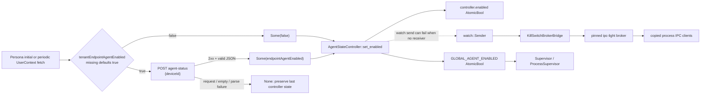

# Endpoint core kill switch

**Repository/revision:** `sentinel-endpoint-agent` at `a022e52bf2fff6a9445ebad96c3afeaf277e259f`  
**Primary scope:** all three tracked files under `core/src/kill_switch/` and `docs/core/kill_switch/architecture.md`  
**Contextual scope:** direct Persona callers, shutdown caller, active default-service wiring, already-analyzed broker bridge/supervision code, and IPC client call sites required to reconstruct the end-to-end path  
**Evidence status:** Verified unless explicitly marked otherwise

## Actual implemented capability

The checked implementation has one effective Boolean state. A Persona user-context refresh first evaluates the tenant flag; when the tenant remains enabled it immediately performs a device-status HTTP POST. A successful device Boolean is written to an `AgentStateController`. That write also updates a process-global atomic and attempts to publish through a Tokio watch channel. The active `KillSwitchBrokerBridge` subscribes to the shared controller and broadcasts state changes through the pinned IPC broker; copied clients in proxy, system-monitor, and template-service maintain process-local atomics and stop their processes on disable.

This is a **hybrid implementation**, not either architecture described in the committed draft:

- it no longer searches `userDevices` inside `/fetch-user-details`, despite the draft's “current architecture” section;
- it does not implement the draft's independent `AgentStatusClient`/`AgentStatusMonitor`, two source atomics, or combined setters;
- instead, the existing user-context refresh path conditionally performs both checks in series.

The dashed edge is a verified conditional behavior of the dependency contract, not an inferred edge. Tokio documents that `watch::Sender::send` fails when there are no receivers and in that case does not retain the sent value for a future receiver; the implementation drops this result. See the [Tokio watch Sender contract](https://docs.rs/tokio/latest/tokio/sync/watch/struct.Sender.html).

## Source inventory and status

| Path | Role | Classification | Final status |
| --- | --- | --- | --- |
| `core/src/kill_switch/mod.rs` | Public module/re-export boundary and extensive module documentation | Handwritten Rust | Fully analyzed; documentation contradictions cataloged. |
| `core/src/kill_switch/state.rs` | Backend decision, controller, process-global state, deferred persistence model, three internal tests | Handwritten Rust | Fully analyzed; active and incomplete behavior separated. |
| `core/src/kill_switch/tests.rs` | Additional controller and backend-decision tests | Handwritten Rust test module | Fully analyzed; network-dependent and global-state hazards recorded. |
| `docs/core/kill_switch/architecture.md` | Draft migration proposal and API-contract artifact | Handwritten design document | Fully analyzed as a draft; current/proposed claims checked against source. |

The AST catalog reports 37 declarations across the three Rust files. Meaningful production symbols are documented individually in the [semantic symbol reference](07-symbol-reference/endpoint-kill-switch.md); helper/test-local declarations remain accounted for in the generated endpoint-core catalog.

## Entry points and callers

### Backend decision entry

`check_agent_enabled` (`core/src/kill_switch/state.rs:67-136`) is public and re-exported by `kill_switch::mod.rs:122-129`. Two active Persona paths call it:

| Caller | Trigger | Effect |
| --- | --- | --- |
| `PersonaManager` initial context path, `core/src/persona/manager.rs:1150-1176` | Successful initial user-context request | Checks tenant/device state and calls controller only for `Some(bool)`. |
| `UserContextRefreshMonitor`, `core/src/persona/lifecycle/proactive.rs:482-526` | Every successful periodic user-context fetch | Performs the same decision and logs transitions; `None` intentionally leaves last-known state unchanged. |

`PersonaManager::with_agent_state_controller` receives the controller. The default service factory constructs it before `PersonaManager::initialize`, passes a clone into the manager, then stores the original in `PersonaBrokerBridge` (`core/src/defaults/services.rs:458-518`). The later kill-switch bridge factory retrieves that same instance from the already-registered Persona bridge (`defaults/services.rs:535-584`).

### Shutdown write

`agent/src/shutdown.rs:40,74-106` invokes private `try_disable_kill_switch_for_shutdown` before stopping services. It reads the global `ServiceContext`, downcasts `persona_broker_bridge.service`, and calls the shared controller's `set_enabled(false)`. Absence or downcast failure is logged and suppressed; the subsequent service-stop path is expected to terminate the proxy. This is a local graceful-drain signal, not a backend decision.

### State consumers

The process-global read API has two production consumers:

- `core/src/service/supervisor.rs:208-216,348-359` defers handling/restarting crashed services while false. It does not stop a currently running service simply because the flag changed.
- `core/src/service/process_supervisor.rs:191-204` calls `restart_crashed_processes` when true, allowing process-instanced services removed during disable to return through normal supervision.

The watch receiver's production consumer is the active `KillSwitchBrokerBridge` (`core/src/services/kill_switch_broker_bridge.rs:344-405`). This bridge was fully closed in the service-runtime analysis; its relevant behavior is summarized here because it is the cross-process continuation of this subsystem.

## Backend decision in execution order

`check_agent_enabled(user_context, access_token, tenant_id, device_id) -> Option<bool>` executes as follows:

1. It calls `UserContext::is_tenant_endpoint_agent_enabled()`.
2. `UserContext.tenant_endpoint_agent_enabled` is an `Option<bool>` serialized as `tenantEndpointAgentEnabled`; the helper uses `unwrap_or(true)` (`core/src/persona/types.rs:149-172`). Missing therefore means enabled.
3. False logs at info and returns `Some(false)` without a network request.
4. Otherwise it obtains the lazily cached `BackendUrl::Default.as_str()`. The controlling environment variable is `QUILR_BACKEND_BASE_URL`; fallback is `https://preprod.quilr.ai` (`core/src/global/backend_url.rs:64-138`). Changes to the environment after first resolution are not observed by `as_str`.
5. It appends exact path `/bff/extension-api-service/endpoint-agent/v1/agent-status` without general URL normalization.
6. It constructs the body with string interpolation: `{"deviceId":"<device_id>"}`.
7. It creates the default HTTP facade request and adds exact headers `Authorization: Bearer <access_token>`, `tenant`, `Content-Type: application/json`, `x-api-version: 3`, and `x-client-id: endpoint-agent`.
8. `collect()` uses the default facade: POST, 30-second per-attempt timeout, and three retries after the initial attempt. As documented in the HTTP chapter, all adapter errors including 4xx are replayed.
9. A final request error warns and returns `None`.
10. On success it takes only `responses.first()`. An empty vector warns and returns `None`.
11. It clones `ParsedResponse.raw_data`, then reparses it into private `AgentStatusResponse { endpoint_agent_enabled: bool }` using serde.
12. A valid response returns `Some(bool)`. Missing/wrong-typed fields or malformed JSON log the parse error and raw response and return `None`.

The HTTP facade itself normalizes a successful JSON value through `serde_json::Value::to_string()` before this second parse. Additional parsed responses, if any, are ignored. The endpoint's expected successful response is a single JSON object, but that expectation is a source comment; the backend implementation is not present here.

### Request data dictionary

| Data point | Type / requiredness | Origin | Validation/transformation | Consumer / sensitivity / failure |
| --- | --- | --- | --- | --- |
| `tenantEndpointAgentEnabled` | `Option<bool>`; optional during deserialization | User-context backend response | Missing defaults to effective true | Local decision. Crosses network trust boundary. Invalid type fails the broader user-context parse before this function. |
| `access_token` | borrowed string; logically required but empty accepted | Persona credential state | Prefixed with `Bearer `; no emptiness/syntax validation | Authorization header. Sensitive. HTTP debug diagnostics may log headers. |
| `tenant_id` | borrowed string; empty accepted | Persona tenant | Copied without validation | `tenant` header. Tenant identifier crosses trust boundary. |
| `device_id` | borrowed string; empty and arbitrary text accepted | `PersonaManager.device_id` / monitor argument | Embedded through `format!`, not JSON-escaped | JSON body. A quote/backslash/control character can create malformed JSON. |
| `AGENT_STATUS_ENDPOINT` | private `&str` constant | source | Exact concatenation to cached base | HTTP destination. |
| `endpointAgentEnabled` | required JSON Boolean | device-status response | serde rename into private field | Returned as `Some(bool)`; absent/invalid gives `None`. |
| `None` result | optional decision sentinel | request, empty-output, or parse failure | Caller does not call `set_enabled` | Implements last-known-state behavior, not an explicit true/false fallback. |

**Potential issue requiring validation:** body construction is not JSON-safe for an arbitrary `device_id`. Current device generation appears UUID-like, which avoids problematic characters in ordinary operation, but this function's public contract itself does not enforce that constraint.

**Potential issue requiring validation:** the error parse path logs the full normalized raw response, while the HTTP layer logs request headers and small bodies at debug. Production exposure depends on tracing filters and sinks, which remain unresolved.

## Controller state model

### Stored state

`AgentStateController` (`state.rs:166-173`) owns:

| Field | Type | Initial value | Writer | Reader / role |
| --- | --- | ---: | --- | --- |
| `tx` | `watch::Sender<bool>` | new: true; explicit constructor: argument | `set_enabled` | `subscribe`; bridge and tests. |
| `enabled` | `AtomicBool` | same constructor value | `set_enabled` via `swap` | `is_enabled`, transition helpers, IPC query. |
| `was_enabled` | `AtomicBool` | same constructor value | `set_enabled` via `swap` | `transitioned`, `just_reenabled`. |
| `GLOBAL_AGENT_ENABLED` | module static `AtomicBool` | process start: true | every controller's `set_enabled` | process supervisors through public read function. |

All atomic accesses use `Ordering::SeqCst`. There is no lock around the sequence of three atomic mutations and the watch send, so concurrent writers can interleave those individual operations even though each operation has sequential consistency.

### Constructors and global divergence

`new()` creates true local atomics/channel. `with_initial_state(enabled)` creates the requested local state. Both immediately drop the initial receiver bound as `_rx`. Neither constructor writes `GLOBAL_AGENT_ENABLED`.

Consequences directly supported by the code:

- `with_initial_state(false).is_enabled()` can be false while `is_agent_globally_enabled()` remains true.
- after one controller writes false, constructing a separate default controller leaves its local value true while the global remains false until either controller writes again;
- multiple controller instances do not share local/watch state, but their writes compete for the single global atomic.

The active default graph deliberately shares one instance between Persona and its broker bridge, avoiding an extra controller on that path. Tests and public callers can create additional instances.

### `set_enabled`

`set_enabled(enabled) -> Option<bool>` (`state.rs:204-238`):

1. atomically swaps `enabled` and captures `prev`;
2. atomically swaps `was_enabled` to the new value and discards the old result in `_was`;
3. stores the new value in `GLOBAL_AGENT_ENABLED`;
4. calls `tx.send(enabled)` and discards success/failure;
5. if `prev != enabled`, logs the direction and returns `Some(enabled)`;
6. otherwise debug-logs only when the unchanged value is false and returns `None`.

It attempts a watch send even for an unchanged value. With at least one receiver, Tokio watch sends a new version and a receiver can observe `changed()` despite the function returning `None`.

### Broken transition accessors

The declared purpose of `was_enabled` is previous-state retention, but the setter overwrites it with the new state before returning. Therefore after a completed `set_enabled`:

- `transitioned()` compares two equal atomics and returns false;
- `just_reenabled()` requires current true and `was_enabled` false, which cannot hold after that setter.

No production caller was found for either method. No test invokes them. They are public, active-looking APIs whose documented post-set behavior is contradicted by their implementation.

### No-receiver watch behavior

Both constructors discard the initial receiver. Tokio's watch contract states that `Sender::send` returns an error when there are no receivers and does not retain that value for a future subscriber. `set_enabled` ignores that result.

The active ordering makes the condition reachable: `PersonaManager::initialize()` can complete its initial user-context/device check inside the Persona factory before `kill_switch_broker_bridge.service` is constructed and subscribes. If the initial decision disables the controller during this window:

- local `enabled` becomes false;
- the process-global atomic becomes false;
- the channel's stored value can remain its initial true;
- the later bridge receiver can begin with true and receives no historical change notification.

The bridge's direct `get_state` handler reads the controller's local atomic, not the watch value. Copied process clients perform current-state queries at startup and after registration, providing a separate repair route for those implementations. **Unresolved:** no runtime test establishes the exact startup ordering against a live broker and backend, and other external/watch-only consumers could behave differently.

## Cross-process IPC continuation

The following bridge facts were established from `core/src/services/kill_switch_broker_bridge.rs` and its typed models during the completed service analysis:

1. The default graph registers the bridge after the IPC broker and Persona bridge and supplies their shared controller.
2. `start` returns after spawning a task; the task sleeps two seconds, then attempts the broker handshake up to five times with delays beginning at five seconds and capped at 30 seconds.
3. Only after successful registration does it subscribe to the controller.
4. Its event loop selects among broker messages, controller changes, and shutdown.
5. A watch change becomes wildcard broker event `kill_switch_state_change` with `enabled`, generated reason, and generated epoch-millisecond timestamp.
6. It implements `get_state` by reading `controller.is_enabled()` and replying to the message's claimed source.
7. Invalid JSON or payload without `command` is silently ignored; malformed typed commands receive error responses; unknown commands receive an error naming `get_state`.
8. It does not authenticate the requester, and the pinned broker does not cryptographically bind a message's source to the claimed registration identity.
9. A send/receive failure breaks into reconnect logic; after the fifth relevant failure the bridge reports Failed and returns. A failed broadcast is logged but the current inner event loop continues.
10. `stop`/cleanup signal the spawned task but do not retain/await its join handle; `stop` reports Stopped immediately. `register()` is `unimplemented!()` outside Windows.

The bridge creates generic reasons (`agent_reenabled_by_backend`, `agent_disabled_by_backend`) and does not carry a backend-provided reason or `PersistedAgentState.reason`.

### Process behavior and scope boundary

Repository-wide registration searches found copied IPC clients in proxy, system-monitor v2, and template-service. Their full file-level analysis remains in later subsystem scopes; only behavior necessary to establish this feature's reachability is stated here:

- each process-local client starts enabled, registers/listens, queries `get_state` initially and post-registration, and stores received state in a process-local atomic;
- proxy, system-monitor, and template-service startup paths consult that atomic and initiate process shutdown when disabled;
- proxy/Tauri additionally polls the atomic during operation;
- disable therefore terminates these process instances; it does not pause them and later “resume” the same process;
- core process supervision can restart crashed process services after the global flag returns true.

**Contradiction:** `core/src/kill_switch/mod.rs:46-77` says every process receives the signal and names `ipc-light-broker` as a child killed when the agent shuts down. No kill-switch client was found in the broker process itself. Remote disable does not call the agent-wide shutdown routine; the broker remains part of the control plane. “Future services” are a documentation requirement, not implemented coverage.

## Persistence model: declared but not implemented

`PersistedAgentState` is public, serializable, cloneable data:

| Field | Type | Constructor behavior |
| --- | --- | --- |
| `enabled` | Boolean | exact argument; helpers choose true/false. |
| `last_updated_ms` | `u64` | current system time since Unix epoch in milliseconds; clock-before-epoch failure becomes 0; `u128` is cast to `u64`. |
| `reason` | `Option<String>` | exact owned argument; `enabled()` uses `initialized_enabled`; `disabled(reason)` copies the string. |

No Vault store, retrieve, key lookup, serialization call, controller load, or controller persist implementation references this type or `VAULT_KEY_AGENT_ENABLED = "agent_enabled_state"`. Repository-wide searches find only exports, tests/docs, and comments. `state.rs:311-318` explicitly says integration is deferred.

**Dead-code candidate:** the persistence constant, type, and constructors have no production consumer in the checked repository. They are complete as a transport/storage shape but do not persist anything.

**Contradiction:** `state.rs:5-7` says state is persisted and loaded on startup, and module documentation gives example method calls. Those methods do not exist. Startup defaults true locally regardless of any Vault record.

## Failure, recovery, and fail-open/fail-last-known behavior

| Condition | Immediate handling | State consequence | Recovery path |
| --- | --- | --- | --- |
| Tenant flag false | Return `Some(false)` without HTTP | Controller set false by active callers | A later successful refresh with tenant true plus device true. |
| Tenant flag missing | Effective true | Proceeds to device request | No special recovery. |
| HTTP network/timeout/status/config error | HTTP facade retries up to four total attempts; final warning | `None`; controller unchanged | Next user-context refresh. |
| Successful HTTP with no parsed item | Warning | `None`; unchanged | Next refresh. |
| Missing/wrong `endpointAgentEnabled` or malformed body | Warning includes raw body | `None`; unchanged | Next refresh. |
| Controller watch send with no receiver | Error discarded | local/global change; watch value may remain stale | Direct IPC query if a client/bridge later becomes available; future write with receiver. |
| Bridge cannot connect/register | Exponential retry, then service Failed | no broadcast/query service | Service-runtime retry/supervision behavior; exact recovery after asynchronous Failed update is covered in service chapter. |
| Bridge loses connection | reconnect loop, capped attempts | broadcasts unavailable during outage | reconnect and client current-state query. |
| Client cannot query/listen | copied clients retain default/last local value | initial behavior is fail-open true | client reconnect/query loop. |
| Agent shutdown cannot locate controller | debug/warn and continue | graceful kill-switch notification omitted | ordinary service termination/hard-kill. |

The backend-decision failure mode is more precisely “retain last known controller state” than always fail-open. At process start, the last-known default is true, so first-check failure is fail-open. After a successful disable, later check failures retain false.

## Concurrency and state consistency

- Atomics are lock-free SeqCst operations, but `set_enabled` as a multi-step action is not atomic. Concurrent calls can interleave local, historical, global, and channel writes.
- The periodic monitor and initial fetch use the same controller but run as separate async work. Shutdown can also write false from a synchronous path.
- Watch delivery is latest-value notification, not a durable event queue; intermediate rapid values can be coalesced even when receivers exist.
- Ignored send results conceal the no-receiver case.
- `GLOBAL_AGENT_ENABLED` is process-global and tests mutate it without a visible mutex/serial-test annotation or reset.
- Multiple tests can run in parallel by the default Rust test harness. Assertions mostly inspect local controller state, but global residue can affect other tests/production-global readers in the same test binary.

**Potential issue requiring validation:** concurrent `set_enabled` calls can leave the controller-local atomic, global atomic, and watch value reflecting different writers because the operation is not synchronized as one transaction. A measurement or concurrency test is required to establish practical occurrence.

## Security and trust boundaries

| Boundary/control | Actual enforcement | Assessment |
| --- | --- | --- |
| Backend authentication | Bearer header supplied to device-status HTTP request | Token is used, but response identity/security depends on dependency TLS and backend; no application signature. |
| Tenant scoping | Caller-provided `tenant` header | No local validation that token, tenant, and device correspond. Backend must enforce it. |
| Device identifier | Caller-provided JSON string | No local syntax or ownership validation; interpolation is not escaped. |
| Transport | URL can be changed via environment; HTTP facade accepts HTTP or HTTPS | No scheme restriction in this subsystem. |
| Response validation | Requires 2xx and deserializable required Boolean | Does not validate response headers, content origin beyond TLS/URL, or additional fields. |
| IPC command authorization | Any message with parsable command can query current state | No authorization in bridge; message source is claimed under the pinned broker model. State query is read-only but exposes enabled status. |
| IPC broadcast authenticity | Client accepts broker-delivered typed event; broker identity model is unauthenticated registration | No cryptographic source authenticity in repository. |
| Persistence | None | No persisted secret/state exposure because the advertised storage is not implemented. |
| Logging | request/response/error tracing | Potential credential, tenant, device, and backend-response disclosure; production sink controls unresolved. |

There is no API in this subsystem that accepts an IPC command to set the controller state. Cross-process IPC exposes query and server-originated broadcast only; backend/Persona and local shutdown remain the writers found.

## Test analysis

Twelve kill-switch-scope test functions exist: three inside `state.rs` and nine in `tests.rs`.

### Covered behavior

- tenant false short-circuits to `Some(false)` in two tests;
- constructors' local default/explicit state;
- `set_enabled` transition return and local atomic behavior;
- repeated same-state calls return `None`;
- a receiver present before writes observes disable/re-enable;
- a synthetic long-running Tokio task exits after a disable notification.

### Important limitations

`test_tenant_enabled_proceeds_to_device_check` (`tests.rs:43-50`) is not ignored and does not use a mock server. It calls the fallback/configured backend with fake credentials and asserts only that the result is not `Some(false)`. With the default HTTP facade it may issue up to four real requests. The comment assumes network failure, but a reachable endpoint could return either false or another response. This is network-dependent, slow, and can create external traffic; it is not an isolated unit test.

No test covers:

- `transitioned()` or `just_reenabled()`;
- constructor/global synchronization;
- multiple controller instances;
- concurrent writers;
- a write before any receiver exists;
- malformed device IDs and JSON escaping;
- a mocked valid device response, empty response, 4xx, timeout, or malformed response;
- persistence type serialization or any Vault integration;
- a live end-to-end Persona → controller → bridge → broker → process-client flow;
- broker outage/reconnect and missed-transition recovery.

Tests that write controller state also mutate `GLOBAL_AGENT_ENABLED` and do not restore it. No serial execution mechanism is visible. Cargo/rustc are absent from the analysis environment, so these tests were inspected statically and not executed.

## Architecture-document consistency audit

The 658-line `docs/core/kill_switch/architecture.md` is explicitly marked `Draft — Pending Team Lead Approval` and dated 2026-02-18. It combines an obsolete “current” design, an external API specification, and a proposed future refactor. It must not be read as implementation documentation.

| Document claim | Source location | Actual code evidence | Result |
| --- | --- | --- | --- |
| Current decision searches `UserContext.userDevices` with optional numeric ID | Sections 2.1-2.3 | `state.rs:67-136` accepts token/tenant/string device ID and performs async HTTP | **Contradicted / outdated.** |
| Device status is a dedicated GET | title, scope, sections 1 and 3.2 | current request uses default POST | **Contradicted.** |
| Agent-status body contains email and deviceId | section 3.2 | current body contains only deviceId | **Contradicted.** |
| Agent-status path should match `/endpoint-agent/v1/agent-status` exactly | section 6.4 | code prepends `/bff/extension-api-service` in the constant | **Partially confirmed:** suffix matches; full request path differs from table wording. |
| Common optional `x-trace-id` and planned agent-status header | sections 3 and 5.1 | current request sends no trace ID | **Planned but not implemented.** |
| Independent `AgentStatusClient` and `AgentStatusMonitor`, 120-second configurable polling | sections 4-5 | no `core/src/persona/agent_status.rs`, corresponding types, field, or config | **Documentation-only.** |
| Controller has tenant/device atomics and combined setters | sections 4.5, 5.3 | controller has only effective enabled/was_enabled and `set_enabled` | **Documentation-only.** |
| Proposed pure `check_agent_enabled(bool,bool)` | section 5.2 | current function is async and performs network I/O | **Documentation-only.** |
| Two monitors are independent | risk matrix | current device check is nested inside every successful user-context handling path | **Contradicted for current implementation.** |
| Failure leaves the agent enabled | risk matrix/open question | failure leaves the previous controller value; only startup default is enabled | **Partially confirmed / imprecise.** |
| IPC query repairs missed transitions | risk matrix | bridge supports `get_state`; copied clients query at startup/post-register | **Confirmed for checked copied clients.** |
| Vault persistence model does not change | section 8 | the data type stays, but no persistence model is implemented | **Misleading: unchanged placeholder, not operational persistence.** |
| Every process receives disable and proxy resumes on re-enable | module documentation, not draft alone | only found copied clients receive; disable exits processes; supervisor later starts replacements | **Contradicted/overstated.** |

The draft's API examples are treated as **Documentation-only external specification**. This repository contains no backend implementation or captured contract test to verify that server behavior. Its heartbeat example also repeats the `deviceType` key, so even the example is internally malformed as a unique-field model.

## Dead, incomplete, and unused surface

| Item | Evidence-based classification |
| --- | --- |
| Vault key/type/constructors | **Dead-code candidate / placeholder:** no production reference; comments defer integration. |
| `transitioned`, `just_reenabled` | Public but no caller found; implementation cannot report a completed setter transition as documented. |
| `_was` local | Old previous value computed and discarded; suggests incomplete transition bookkeeping. |
| `SharedAgentStateController` alias | Public re-export; no internal use found beyond import/docs searches. External use unresolved. |
| Proposed AgentStatus module/monitor/setters/config | **Documentation-only.** |
| “future services must subscribe” | Policy statement, not implementation. |
| Proxy/client shutdown sender globals found in copied client modules | Contextual dead-code candidates because setters exist but reads were not found; final classification deferred to those file scopes. |

## Practical execution trace

The primary periodic path is:

`UserContextRefreshMonitor loop` (`persona/lifecycle/proactive.rs:415-526`)  
→ `UserContextClient::fetch_user_context`  
→ `UserContext::is_tenant_endpoint_agent_enabled` (`persona/types.rs:167-172`)  
→ `kill_switch::check_agent_enabled` (`kill_switch/state.rs:67-136`)  
→ `BackendUrl::Default.as_str` (`global/backend_url.rs:119-124`)  
→ `http_client::send_request(...).header(...).collect()`  
→ `AgentStateController::set_enabled` (`kill_switch/state.rs:212-238`)  
→ local/global atomics + watch send  
→ `KillSwitchBrokerBridge` watch branch (`services/kill_switch_broker_bridge.rs:344-405`)  
→ pinned IPC `BrokerMessage` wildcard broadcast  
→ copied process client local atomic  
→ process shutdown checks  
→ core `ProcessSupervisor` restart after global re-enable.

The tenant-disabled alternative stops before BackendUrl/HTTP. The request/parser failure alternative stops before the controller. The no-receiver watch failure alternative still updates local/global state but may skip broadcast until another state write or a current-state query repairs the downstream view.

## Unresolved questions

- Whether the backend contract at the checked deployment actually expects POST or the draft's GET, and whether the prefixed BFF path is correct.
- Whether `PersonaManager.device_id` is the backend-assigned numeric string expected by the draft or the locally generated UUID-like identity. The repository documents both concepts without a proven mapping.
- Whether the fallback preproduction endpoint accepts the current request shape and header set.
- Which tracing filters, exporters, retention, and access controls apply to HTTP credentials and payloads.
- Whether any external crate uses public transition helpers, shared alias, or persistence types.
- Whether any external process subscribes to the event without the copied client's current-state query repair.
- The exact runtime frequency of the user-context monitor under all configuration paths; the draft's universal 120 seconds is not accepted as source evidence.
- Whether a live startup can consistently hit the pre-subscription disable window; static ordering permits it, but runtime backend timing determines occurrence.

