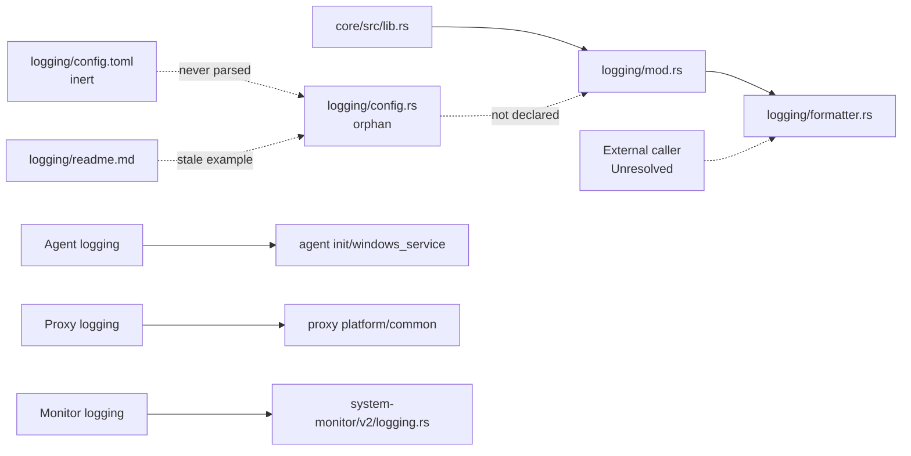

# Endpoint core logging module

**Repository/revision:** `sentinel-endpoint-agent` at `a022e52bf2fff6a9445ebad96c3afeaf277e259f`  
**Primary scope:** all five tracked paths under `core/src/logging/`  
**Contextual scope:** `core/src/lib.rs`, package dependencies, repository-wide imports/callers and environment names, active agent/proxy/system-monitor logging initializers, installer/spawner settings, and checked workflows  
**Evidence status:** Verified unless explicitly marked otherwise

## Executive finding

`sentinel_core::logging` is an always-compiled but internally uncalled logging helper, not the endpoint's active logging system.

- `core/src/logging/mod.rs` declares only `pub mod formatter`; `config.rs` is not a module and cannot be reached through the crate.
- No Rust call/import of `formatter::init_tracing`, `default_app_data_dir`, `LOG_LEVEL`, or `LoggingConfig` exists outside these files. The formatter surface is therefore a **Dead-code candidate for the checked in-repository graph**, while remaining public for an external crate.
- The active agent initializes stderr tracing in `agent/src/init.rs` or retained-guard daily file logging in Windows service mode. Proxy and system monitor have their own retained-guard file/console initializers. None delegates to this module.
- The committed `config.toml`, orphan `LoggingConfig`, README, and compiled formatter define three inconsistent configuration models.

The three Rust files contain 11 AST declarations. The [semantic symbol reference](07-symbol-reference/endpoint-logging.md) accounts for all of them.

## File inventory

| Path | Role | Compilation/reachability | Final classification |
| --- | --- | --- | --- |
| `core/src/logging/config.rs` | Environment-backed `LoggingConfig` | Not declared by `mod.rs`; no caller | Fully analyzed handwritten orphan source / dead-code candidate. |
| `core/src/logging/config.toml` | Three static sample values | Never included, parsed, copied, or referenced | Fully analyzed handwritten inert configuration artifact. |
| `core/src/logging/formatter.rs` | Public platform path resolver and tracing initializer | Compiled/exported; no repository caller | Fully analyzed handwritten public helper / production dead-code candidate. |
| `core/src/logging/mod.rs` | Module boundary | Always compiled; exposes only formatter | Fully analyzed handwritten Rust. |
| `core/src/logging/readme.md` | Usage/features document | Documentation only; example does not match source | Fully analyzed handwritten documentation. |

No file is generated or vendored. No test exists in the scope.

## Actual reachability

Dashed edges are absent/unresolved relationships. The active process initializers are contextual evidence and were not newly classified as part of this five-file count.

## Compiled public interface

Because `mod.rs` contains only `pub mod formatter`, the externally nameable surface is:

- `sentinel_core::logging::formatter::LOG_LEVEL`;
- `_APP_NAME`;
- `StorageError`;
- `default_app_data_dir()`;
- `init_tracing()`.

The leading-underscore constants `_DEFAULT_LOG_LEVEL` and `_DEFAULT_PREFIX` and `INIT` are private.

`LoggingConfig` is declared `pub` in its file but is not in the module tree. The README's claimed `logging::init_tracing` re-export does not exist; callers would have to use `logging::formatter::init_tracing`.

## Configuration matrix

| Source | Directory | Prefix | Level | Runtime status |
| --- | --- | --- | --- | --- |
| `config.rs::LoggingConfig::from_env` | `LOG_DIR`, default `logs` | `LOG_FILE_PREFIX`, default `app_log` | `LOG_LEVEL`, default lowercase `info` | Orphan, not compiled through module. |
| `config.toml` | `logs` | `agent` | lowercase `debug` | Never parsed or referenced. |
| `formatter.rs` | Platform app-data resolver | fixed `app_log` | `LOG_LEVEL`, default uppercase `INFO` | Compiled, no caller. |
| Active agent/proxy/monitor context | Each has independent logic | process-specific | primarily `RUST_LOG` | Actual runtime logging, outside this module. |

The README says both TOML and environment configure directory/prefix/level. Source provides no TOML parser, no serde derive, no `include_str!`, and no `config` module declaration. Even the orphan environment struct is not accepted by `init_tracing`, whose signature has no parameters.

The formatter ignores `LOG_DIR`, `LOG_FILE_PREFIX`, `RUST_LOG`, and `SENTINEL_LOG_DIR`. The latter two are the environment names used by active process logging and installers/spawners.

## `LoggingConfig` behavior

`LoggingConfig` has three public `String` fields. `from_env` reads independently:

- `LOG_DIR`, default `"logs"`;
- `LOG_FILE_PREFIX`, default `"app_log"`;
- `LOG_LEVEL`, default `"info"`.

Any non-Unicode/missing value is treated as absent because `env::var` returns an error and `unwrap_or_else` applies the default. Empty strings are accepted. There is no trimming, validation, allowed-level set, path normalization, secret classification, serde support, or merging with `config.toml`.

No consumer exists, so these values have no checked runtime effect.

## Platform data directory resolution

`default_app_data_dir` returns:

| Target | Precedence | Result |
| --- | --- | --- |
| Windows | `APPDATA`, then `LOCALAPPDATA` | `<base>/Sentinel`; error if both absent. |
| macOS | `HOME` | `<home>/Library/Application Support/Sentinel`; error if absent. |
| Linux | `XDG_DATA_HOME`, then `HOME` | `<xdg>/Sentinel` or `<home>/.local/share/Sentinel`; error if absent. |
| Other | none | `Config("Platform not supported")`. |

It does not create the directory, append a `logs` subdirectory, canonicalize, check writability, or reject empty environment values. It retains non-Unicode paths as `PathBuf`; `init_tracing` later rejects them when converting to `&str`.

Only `StorageError::Config` is constructed here. `Io`, `Cloud`, and `UnknownBackend` have no producer in this module or repository-wide exact searches.

## `init_tracing` execution

`init_tracing()` performs work in this order:

1. fixes prefix to `app_log`;
2. resolves the platform app-data path;
3. converts it to UTF-8 `String` or emits a tracing error;
4. obtains `LOG_LEVEL`, lazily freezing the first observed `LOG_LEVEL` environment value or `INFO`;
5. enters process-global `INIT.call_once`;
6. unwraps the optional path;
7. constructs daily `RollingFileAppender` with directory/prefix;
8. creates a non-blocking file writer plus `_guard`;
9. creates a synchronous stdout writer;
10. builds two formatting layers using local RFC 3339 time, ANSI disabled, and separate `EnvFilter::new(filter)` values;
11. globally initializes the tracing subscriber.

The default formatting flags for target/file/line/thread are not explicitly selected and therefore follow the resolved `tracing-subscriber` dependency behavior.

## Initialization and failure behavior

### Missing/non-Unicode directory

The source logs `Logging module NOT configured!` or invalid-UTF-8 error, then still enters `call_once` and executes `log_dir.unwrap()` on the first call. The first call therefore panics instead of providing console-only fallback. If a subscriber has not yet been set, the pre-panic tracing error may have no visible sink.

### Global subscriber conflicts

The function uses `.init()` rather than a returned `Result`/`try_init`. It performs no check for a subscriber established by an application. Exact panic behavior is supplied by the dependency, but the repository has no error branch. This matters for a library helper because all actual executables initialize their own subscriber.

### One-time state

`INIT` prevents the closure from executing more than once after a successful call. Subsequent path/level environment changes have no subscriber effect. `LOG_LEVEL` independently freezes at first access. There is no reload handle or shutdown/reset API.

### Worker guard lifetime

The non-blocking file `WorkerGuard` is bound to local `_guard` and dropped when the `call_once` closure returns. It is not returned, stored in a static, or intentionally leaked.

Repository evidence in the active logging implementations explicitly says the guard must remain alive and does so:

- `agent/src/windows_service.rs:436-459` returns it and the service stores `_log_guard` at line 165;
- `proxy/src/platform/common.rs:273-276,398` returns both file/stdout guards and `proxy/src/main.rs:109` retains them;
- `system-monitor/v2/src/logging.rs:15-19,74` returns guards and main retains them.

**Potential issue requiring validation:** the core helper's immediate guard drop contradicts this repository-wide lifecycle contract and may flush/close the non-blocking worker immediately after initialization. Exact behavior after drop belongs to `tracing-appender 0.2.x`; no core test/runtime artifact demonstrates working file output.

### Directory/appender failures

There is no explicit `create_dir_all`, writability probe, panic guard, or console-only fallback. `RollingFileAppender::new` does not return a `Result` in the source call. Any dependency-level failure is not mapped to `StorageError::Io`.

## Output behavior

When initialization succeeds according to source construction:

- stdout and file receive the same filter string;
- both use formatted text with `ChronoLocal::rfc_3339()` timestamps;
- ANSI is disabled for both;
- file rotation is daily;
- fixed prefix is `app_log`;
- directory is the platform app-data directory itself;
- no retention count, max byte size, compression, pruning, upload, or audit sink is configured.

No redaction, field allowlist, credential filtering, permissions hardening, or log-integrity mechanism exists in this module. Sensitivity depends on upstream tracing call sites. The active HTTP analysis already found credential/identifier/body logging elsewhere; this dormant formatter would forward such events if selected by an external caller and filter.

## Concurrency and resource behavior

- `Once` serializes first initialization.
- `LazyLock<String>` synchronizes and freezes level resolution.
- The file writer is intended non-blocking, but guard lifetime is not retained.
- stdout layer writes through `std::io::stdout` directly.
- No queue capacity/loss counter is configured through the builder; dependency defaults apply.
- No flush API or orderly logging shutdown is exposed.
- Daily files have no repository-controlled retention and can accumulate if the dependency does not prune.

Performance/memory/disk impact requires a live caller and dependency-level measurement.

## Actual process logging comparison

| Process/path | Active behavior relevant to contradiction |
| --- | --- |
| Agent console `agent/src/init.rs:319-329` | stderr formatter; `RUST_LOG` via `try_from_default_env`, fallback info. |
| Agent Windows service `agent/src/windows_service.rs:431-459` | daily `C:\ProgramData\Sentinel\logs/agent.log`, retained guard. |
| Proxy `proxy/src/platform/common.rs:276-399` | `RUST_LOG`, `SENTINEL_LOG_DIR`, writable candidates/fallback sink, file pruning, retained file/stdout guards. |
| System monitor `system-monitor/v2/src/logging.rs:15-87` | `RUST_LOG`, `SENTINEL_LOG_DIR`, writable check/fallback sink, pruning, retained guards. |

Thus the core formatter is not the “simple setup and global initialization across multi-crate projects” described in its README.

## Documentation consistency

| Documentation claim | Code evidence | Result |
| --- | --- | --- |
| Configurable directory, prefix, level | Compiled formatter configures only level | **Partially implemented.** |
| Dynamic `config.toml` or environment | TOML never parsed; only `LOG_LEVEL` read by compiled code | **Contradicted.** |
| Values loaded at startup | No caller/loader; LazyLock reads on first formatter access | **Contradicted.** |
| `use infra::{config::LoggingConfig, logging::init_tracing}` | No such infra modules; code is under sentinel-core and init is nested in formatter | **Contradicted.** |
| `init_tracing(config)` | Actual signature `init_tracing()` | **Contradicted.** |
| Console and rolling file logging | Layers are constructed, but helper is uncalled and drops guard immediately | **Partially confirmed in dormant construction.** |
| Runtime configuration | `Once`/`LazyLock` make successful initialization immutable | **Contradicted.** |

`config.toml` also disagrees with both Rust configurations (`agent/debug` versus `app_log/info` or `app_log/INFO`).

## Tests and operations

- No unit, integration, or doctest exercises these symbols.
- README snippets are not fenced/doctested; core doctests are disabled.
- Checked workflows contain no dedicated logging test.
- No committed artifact can be attributed to this formatter because no caller exists.
- Installers manage different service/stdout log paths and `RUST_LOG`; they do not deploy/copy this TOML.

## Dead/incomplete/unresolved ledger

### Dead-code candidates

- Entire compiled formatter public surface in the in-repository runtime graph.
- Orphan `LoggingConfig` and `from_env` (stronger: not in module tree).
- `config.toml`.
- `StorageError::{Io,Cloud,UnknownBackend}`.

### Incomplete

- Directory/prefix environment configuration promised in README.
- TOML loading.
- Guard retention and explicit flushing.
- Recoverable initialization/fallback.
- Retention and runtime filter reload.

### Unresolved

- Whether an external consumer calls `sentinel_core::logging::formatter`.
- Exact dependency behavior after immediate `WorkerGuard` drop and on invalid lossy `EnvFilter::new` input.
- Exact directory creation/file naming/permission behavior internal to `tracing-appender 0.2.x` without a committed lockfile or runtime execution.

## Coverage

- 5/5 tracked files fully inspected/classified.
- 11/11 Rust AST declarations accounted for.
- All config keys/defaults, path rules, error variants, side effects, dependencies, and known callers searched.
- 0 generated/vendored/skipped files.

