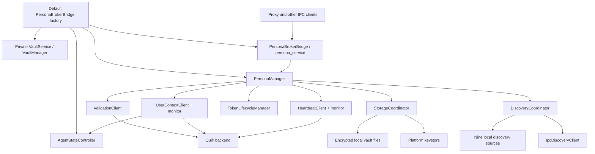
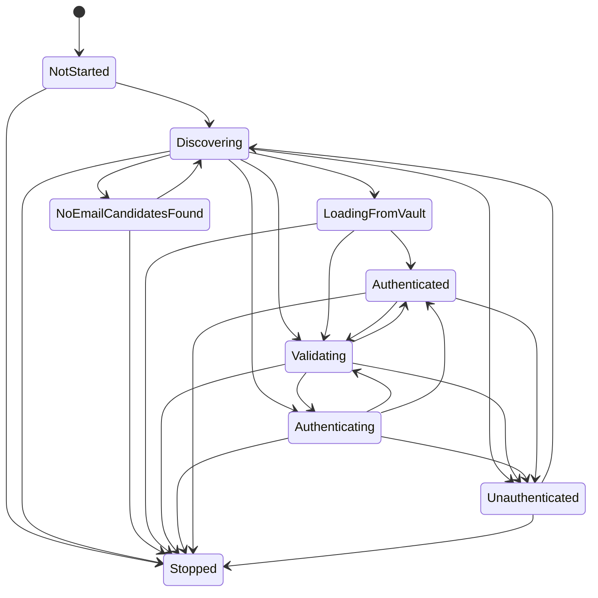
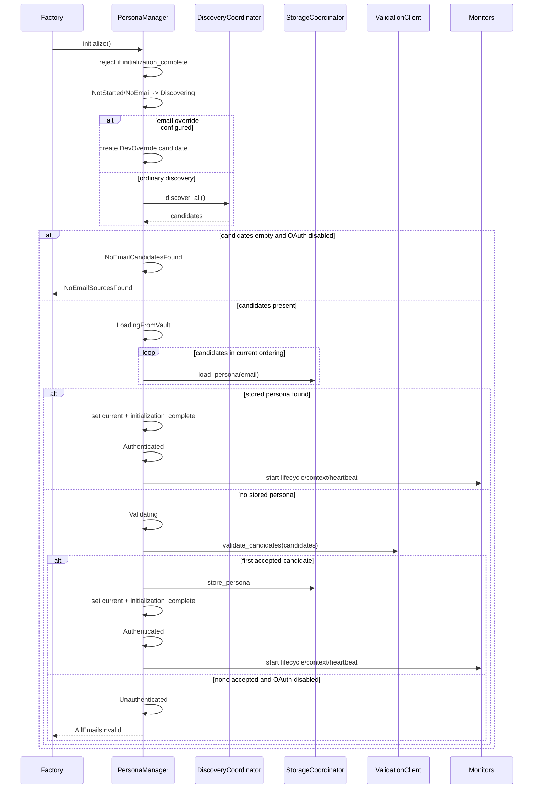

# Endpoint core: persona discovery, authentication, token storage, monitoring, and heartbeat

This chapter accounts for all 38 tracked files under `core/src/persona/` at endpoint-agent commit `a022e52bf2fff6a9445ebad96c3afeaf277e259f`. It also follows the active construction path through `core/src/defaults/services.rs`, the IPC exposure in `core/src/services/persona_broker_bridge.rs`, the shared secure cache in `core/src/cache/secure.rs`, and the immediately used `VaultService`/`VaultManager` operations. The larger Vault implementation is a separate subsystem and is not marked complete by this chapter.

## What the active runtime actually constructs

The default service graph does **not** use the public legacy `PersonaService` wrapper. The active `persona_broker_bridge.service` factory at `core/src/defaults/services.rs:438-535` does the following synchronously during service construction:

1. Creates a new, private `VaultService` with `VaultService::new`; it is not the inactive default-graph Vault wrapper.
2. Creates an `AgentStateController`.
3. Starts a dedicated OS thread and constructs a dedicated multi-thread Tokio runtime there.
4. Builds `PersonaManagerConfig::new`, then sets `enable_oauth_fallback = false` in **both** service and non-service branches.
5. Builds `PersonaManager`, attaches the state controller, applies the resolved email override if present, wraps the manager in `Arc`, attaches a weak self-reference for retry, and awaits `initialize()`.
6. Uses `expect` for manager creation and initialization. A non-deferrable error therefore panics this factory.
7. Retains the dedicated runtime in `PersonaBrokerBridge`, preserving monitor tasks started on it.

**Contradiction:** `PersonaManagerConfig::new` and `with_values` enable OAuth fallback by default, and the persona documentation describes that as the ordinary fallback. The only active default factory disables it in every environment because its `else` branch contains the same assignment.

**Verified:** in service mode, only `NoEmailSourcesFound` and `AllEmailsInvalid` are converted to successful deferred initialization. Other failures still propagate into the factory's `expect` and panic.

**Potential issue:** in standalone mode, an unavailable backend can become `AllEmailsInvalid` because candidate-level validation errors are suppressed. OAuth is disabled, so initialization returns an error and the active factory panics.

## Runtime component map

Every solid edge above is directly verified. The bridge is created only after `PersonaManager::initialize()` returns.

## Manager state and state machine

### Stored state

`PersonaManagerState` (`core/src/persona/manager.rs:214-232`) is protected by `std::sync::RwLock` and contains:

| Field | Type | Meaning |
| --- | --- | --- |
| `current_persona` | `Option<Persona>` | Manager-visible authenticated identity. Callers receive newly cloned `Arc<Persona>` values. |
| `state_machine` | `PersonaStateMachine` | A second, internally locked state cell. |
| `initialization_complete` | `bool` | Double-initialization gate. It is set on authentication and on service-mode deferral, but is not reset by logout. |

`PersonaManager::transition_state` holds the outer state read lock while acquiring the state machine's inner write lock. No inverse acquisition order was found in the Persona subsystem.

### Allowed transitions

`PersonaStateMachine::is_valid_transition` at `core/src/persona/state_machine.rs:164-216` is authoritative:

Same-state transitions are accepted as no-ops. `Stopped` is terminal.

**Verified defect:** `force_reauth` calls `clear_credentials`, which takes an authenticated manager to `Unauthenticated`, then immediately calls `initiate_oauth_flow`, which attempts `Unauthenticated -> Authenticating`. That transition is forbidden. The active implementation therefore cannot begin OAuth from the ordinary authenticated force-reauth path.

**Verified limitation:** `clear_credentials` does not reset `initialization_complete`; a subsequent `initialize()` after a successful prior initialization returns `VaultStorageError("Initialization already complete")`.

## Initialization and authentication flow

### Construction: `PersonaManager::new`

At `core/src/persona/manager.rs:342-426`, construction creates storage, discovery, validation, OAuth, lifecycle, user-context and heartbeat components; collects static `SystemInfo`; initializes state to `NotStarted`; and performs no authentication. Configuration strings are cloned into the consumers that need them. `StorageCoordinator::new` currently performs no I/O.

### `initialize` and `run_init_pipeline`

Execution details and failure semantics:

- `with_email` rejects only trimmed-empty values and strings lacking `@`; it stores the original, untrimmed string and performs no domain or syntax validation.
- Storage lookup iterates discovered candidates. `try_load_stored_persona` uses `if let Ok(Some(...))`; **all** storage errors are silently treated as a miss.
- Candidate validation is sequential and stops on the first success.
- `validate_candidates` suppresses every error from every candidate, not only invalid-email results. A backend outage therefore commonly becomes `Ok(None)` and ultimately `AllEmailsInvalid`.
- Upon success, the manager stores a clone of the persona in manager state, then gives newly allocated and separate `Arc<RwLock<Option<Persona>>>` clones to the monitors. These are not the same state cell.
- Initial user-context retrieval is awaited inline and can delay initialization; monitor creation follows it.
- No explicit manager transition to `Stopped` exists in `Drop`.

### Service-mode deferred discovery

`initialize` treats only `NoEmailSourcesFound` and `AllEmailsInvalid` as deferrable when the mere presence of `SENTINEL_SERVICE_MODE` is detected. It marks initialization complete, spawns a weak-reference retry task, and returns `Ok(())`.

The schedule in `service_mode_discovery_retry_loop` is fixed and not configurable:

| Stage | Delay before each attempt | Attempts |
| --- | ---: | ---: |
| 1 | 30 seconds | 3 |
| 2 | 60 seconds | 3 |
| 3 | 120 seconds | 3 |
| 4 | 240 seconds | 3 |
| steady | 300 seconds | forever |

The loop exits on authentication or when its weak manager can no longer be upgraded. The active factory correctly calls `attach_retry_weak` first.

**Potential issue:** retry always calls `run_init_pipeline`, which begins by transitioning to `Discovering`. `NoEmailCandidatesFound -> Discovering` and `Unauthenticated -> Discovering` work, but errors that leave the machine in `LoadingFromVault`, `Validating`, or another state can make later retries fail immediately on an invalid transition.

## Email discovery

### Coordinator policy

`DiscoveryCoordinator::discover_all` (`core/src/persona/discovery/mod.rs:274-347`) always tries IPC first. With the default `local_discovery` Cargo feature:

- nonempty real IPC candidates return immediately after deduplication;
- if **all** IPC candidates have the exact domain `mock.quilr.local`, local discovery also runs and the results are merged;
- absent/empty IPC results fall back to local discovery;
- local discovery returning zero candidates is still `Ok(vec![])`.

Without `local_discovery`, absent IPC returns `NoEmailSourcesFound`. The alternative feature-disabled email validator in `discovery/mod.rs:129-169` is a separate handwritten implementation from the regex-backed default-feature validator.

### IPC discovery and circular bootstrap

`IpcDiscoveryClient` (`core/src/persona/discovery/ipc.rs:121-389`) behaves differently by build profile:

- Debug builds enable a mock unless `SENTINEL_IPC_DISABLE_MOCK` equals `1` or case-insensitive `true`.
- `SENTINEL_IPC_MOCK_EMAIL` overrides the mock. Validation is only `contains('@') && len >= 5`; invalid overrides fall back to `ipc-mock-user@mock.quilr.local`.
- Release builds connect to broker channel `ipc_light_broker`, register client ID `persona_discovery_client`, require connected/ack events, send JSON `{"command":"get_persona"}` to `persona_service`, and wait inside a fixed five-second outer timeout.
- A successful response requires a JSON `result == "success"` and `/data/email` string. It becomes one `IpcBrowserExtension` candidate.
- Response source and destination are not validated by this client.
- `is_available` only proves connection/registration and does not issue a persona request; no non-test caller was found.

**Contradiction:** module documentation says this fetches identity from a browser extension. Repository-wide search identifies `persona_service` as `PersonaBrokerBridge`, which owns the same `PersonaManager` being initialized.

**Verified circular dependency:** the bridge is not constructed/registered until manager initialization finishes, but release discovery tries to query that bridge during initialization. Debug mock mode hides the cycle. In release service mode the request can time out and then local discovery can proceed.

### Local execution modes

With `local_discovery` enabled, `SENTINEL_SERVICE_MODE` selects a user-space subprocess; otherwise sources run in the current process.

`subprocess::run_local_discovery` starts nine Tokio `JoinSet` tasks: OS account, Outlook, Apple Mail, Thunderbird, Chrome, Firefox, Edge, Safari, and Teams. Each task is async, although many perform synchronous filesystem, registry, plist, or command work. Source errors, panics, and cancellations are logged and suppressed. Raw candidates are returned for coordinator deduplication.

In service mode, `spawned_discovery::discover_via_subprocess`:

1. Resolves `IpcAddress::for_service("email-discovery")` and binds before spawning.
2. Resolves the `email-discovery` executable and spawns it as a user-space child with `IPC_SOCKET`, `SERVICE_NAME`, `NO_COLOR`, and `--ipc-socket`.
3. Waits up to 30 seconds for one framed result.
4. Reads a four-byte big-endian length and at most 1 MiB of JSON.
5. Kills on read failure/timeout and cleans up the Unix socket.

The child binary (`email-discovery/src/main.rs`) runs the same nine sources, serializes `Vec<EmailCandidate>`, connects, and writes the frame. Missing address/connect/write failures exit with status 1.

**Security boundary:** Unix protection depends on socket filesystem permissions. The Windows named-pipe implementation explicitly installs a null DACL, permitting every local principal, and performs no client authentication. The code comment accepts this for the short lifetime. A local process that races the intended child could supply candidate JSON.

### Deduplication

`deduplicate_and_sort` (`discovery/mod.rs:451-477`) uses the exact `candidate.email` string as the `HashMap` key, merges distinct `all_sources`, replaces the primary candidate when an incoming `last_access_time` is newer, preserves the merged sources, and sorts descending by access time.

**Contradiction:** comments state that the key is normalized/lowercase. It is not. IPC, override, and OAuth values are not normalized, so differently cased or whitespace-bearing forms can survive as separate candidates. Equal timestamps inherit nondeterministic `HashMap` order.

### Source-by-source implementation matrix

| Source | Platforms and evidence | Extraction | Important limitations |
| --- | --- | --- | --- |
| OS account | macOS, Windows; `discovery/os.rs` | macOS parses `MobileMeAccounts.plist` account dictionaries; Windows checks several account/identity registry locations, `dsregcmd /status` UPN, and `USERNAME` + domain heuristics | Other OS returns empty. Windows registry results often use `SystemTime::now`. Individual parse/access failures are suppressed. |
| Chrome | macOS, Windows, Linux; `browsers.rs:21-363` | `Preferences` `account_info[].email`, `sync.username`, `profile.info_cache.*.user_name`; then Local State and profile dirs | Initially reads only `Default`; later profile loop accepts names beginning `Profile `. Custom profile directory names are omitted. Synchronous reads occur in async tasks. |
| Edge | same Chromium helper | Same fields under Edge-specific roots | Linux path name is synthesized as `microsoft-edge`; same profile limitations. |
| Firefox | all supported desktop platforms; `browsers.rs:365-485` | Every `Path=` from `profiles.ini`; regexes `services.sync.username` and `identity.fxaccounts.account.*` in `prefs.js` | No INI section/escape semantics; JavaScript string escaping is not decoded. |
| Safari | macOS only; `browsers.rs:487-576` | Safari plist account values and MobileMe account ID | Non-macOS returns empty. Parse/read errors are generally suppressed. |
| Outlook | macOS, Windows; `email_clients.rs:24-365` | macOS regexes emails only from `https://outlook.office.com/mail/<email>/` strings in `ProfilePreferences.plist`; Windows enumerates MAPI profile keys, runs PowerShell with execution-policy bypass, and checks WorkplaceJoin/IdentityCRL/Office Identity | macOS stringifies home with `unwrap`, so non-UTF-8 home can panic; binary plist/read failures become empty. Windows enhanced paths log discovered email addresses at info and include TODO-marked untested registry logic. |
| Apple Mail | macOS; `email_clients.rs:373-477` | V7-V10 `Accounts.plist`, both `EmailAddresses` and `AccountInfo.EmailAddresses` arrays | May produce duplicates; only listed schema versions. Other OS returns empty. |
| Thunderbird | all supported desktop platforms; `email_clients.rs:485-572` | `profiles.ini` `Path=` then regex `mail.identity.*.useremail` in `prefs.js` | Ignores other INI semantics and JS escapes; synchronous I/O. |
| Teams | macOS, Windows; `teams.rs` | New Teams app-settings GUID, macOS OneAuth/MSAL keychain JSON, classic Teams desktop config/settings; Windows new Teams storage/settings plus classic locations | Cookies/localStorage/IndexedDB are explicitly skipped. macOS invokes `security`; secrets enter subprocess output/process memory. Some debug/info paths log email/user identity. |

`common.rs` supplies regex validation, normalization, plist/JSON parsing, filesystem timestamps, effective-user home lookup, Windows AppData and registry-root discovery. Important behavior:

- environment `HOME`/`USERPROFILE` is preferred even in a privileged service;
- Unix fallbacks use `getuid`, not effective UID;
- root macOS fallback checks the active console user's home, then picks the first readable `/Users` entry without stable sorting;
- Windows fallback infers an active profile by most recent `AppData/Roaming` modification and excludes only three known system SIDs;
- `is_readable_file` checks metadata/file-ness but does not attempt to open the file.

## Backend email validation

### Interface

`ValidationClient::validate_email` (`core/src/persona/validation.rs:119-300`) calls:

`POST {base_url}/bff/auth/auth/browser-extension-email-register?message=true`

Generated request schema, directly from the private `ValidationRequest` type:

| JSON field | Rust type | Origin |
| --- | --- | --- |
| `email` | string | candidate, unchanged |
| `agent_version` | string | manager configuration |
| `platform` | string | compile-time `macos`, `windows`, `linux`, or `unknown` |
| `device_id` | string | manager configuration |

The Reqwest client has a ten-second total timeout and `Sentinel-Agent/{agent_version}` user agent when its builder succeeds. Builder failure silently falls back to an unconfigured `Client::new`.

Response handling:

| Response/failure | Result |
| --- | --- |
| 2xx with decodable `AuthApiResponse` | converted to `PersonaWithToken` |
| 404 with or without expected invalid body | classified non-retryable and becomes `Ok(None)` |
| Other 4xx | `BackendApiError`, not retried |
| 5xx | stringified `BackendApiError`, up to three total attempts |
| Reqwest timeout | `NetworkTimeout`, retried |
| Other Reqwest failure | `NetworkError`, retried |
| JSON decode error | `JsonError`, not retried |

There are three total attempts and only two sleeps, one and two seconds. **Contradiction:** documentation describes three retries and sleeps of one, two, and four seconds.

`validate_candidates` calls candidates serially and returns the first `Some`. It ignores every `Err` and ultimately returns `Ok(None)`. An ignored test documents the opposite expectation for network failure.

**Contradiction:** the EA header module says its headers are required on every backend request. Validation sends neither `x-client-id` nor `x-trace-id`.

### Authentication response model

`AuthApiResponse` (`types.rs:292-369`) requires token, optional `refreshToken`, id, subscriber, tenant, fullname, emailaddress, roles, and permissions. It also accepts optional extension-add timestamp, devices, locations, risk profile, sync timestamps, OS/extension/browser metadata, and last-access timestamp. Conversion uses only the core identity/token fields; every auxiliary field is discarded. It sets:

- `last_validated = SystemTime::now()`;
- `token_expires_at = None`;
- `user_context = None`;
- `device_id = generate_device_id()` independently of the ID sent in the validation request.

## Persona and context data model

### `Persona`

| Field | Type | Origin and lifecycle |
| --- | --- | --- |
| `id` | `String` | backend authentication response |
| `email` | `String` | backend `emailaddress`, not necessarily the input candidate |
| `profile` | `UserProfile` | backend name/email/roles/permissions |
| `subscriber` | `String` | backend |
| `tenant` | `String` | backend; used in user-context and heartbeat headers |
| `last_validated` | `SystemTime` | set locally during response conversion |
| `token_expires_at` | `Option<SystemTime>` | initialized `None`; active refresh also returns `None` |
| `user_context` | `Option<UserContext>` | fetched after auth; manager copy and storage are updated initially |
| `device_id` | `String` | separately generated during response conversion; missing stored JSON defaults to empty string |

`UserProfile` contains `fullname`, `emailaddress`, `roles: Vec<String>`, and `permissions: Vec<String>` without local semantic validation.

### `UserContext`

Serialized fields are `tenantEndpointAgentEnabled: Option<bool>`, `groups`, `isAdmin`, `department`, and optional `user`. Missing tenant flag is fail-open: `is_tenant_endpoint_agent_enabled()` returns `true`. `UserInfo` fields are display name, job title, location, id, and optional account state; absent `accountEnabled` defaults to `Some("ACTIVE")`.

`UserDevice` can deserialize numeric/string/null `id` plus `endpointAgentEnabled`/alias `extensionEnabled`, defaulting enabled. **Contradiction:** despite the type/module comments, `UserContext` has no `user_devices` field. Device-level state is obtained through a separate kill-switch API, not this model.

The type test uses `tenantExtensionEnabled`, which does not map to `tenantEndpointAgentEnabled`, and does not assert the tenant flag. The unknown property is silently ignored.

## Storage and data lifecycle

### Keys and storage placement

| Data | Primary location | Fallback/secondary | Key derivation |
| --- | --- | --- | --- |
| Access token | OS keystore via `KeychainAdapter` | encrypted Vault file only when keychain store fails | keychain alias `com.quilr.sentinel.persona.{email}`; Vault `persona_token_{sanitized_email}` |
| Refresh token | encrypted Vault | none | `persona_refresh_{sanitized_email}` |
| Persona metadata JSON | encrypted Vault | none | `persona_{sanitized_email}` |

Vault sanitization replaces `@` with `_at_` and `.` with `_`. Other characters are unchanged. **Potential issue:** this mapping is not injective; distinct source emails can collide with already transformed strings.

### Store

`StorageCoordinator::store_persona` (`storage/mod.rs:75-201`):

1. Tries keychain access-token storage.
2. On error, stores the access token through `VaultService::handle_message(Store)`.
3. Stores refresh token in Vault if present.
4. Stores persona metadata JSON in Vault.
5. If metadata storage fails, calls best-effort `clear_persona`, which can erase an earlier valid persona for the same email, then returns the metadata error.

**Contradiction:** comments call the operation atomic or best-effort atomic. It is a sequential multi-store operation without a transaction. If keychain succeeds, an old Vault fallback access token is not deleted.

### Load

`load_persona`:

1. Calls keychain load with `?`. A keychain **error** aborts; only `Ok(None)` tries the Vault access-token fallback.
2. Loads metadata from Vault.
3. Loads refresh token from Vault, suppressing errors and invalid UTF-8 as absence.
4. Returns a complete value only when both access token and metadata exist. Token-only or metadata-only states are logged and returned as `None`; they are not repaired.

**Contradiction:** storage documentation describes Vault fallback when the keychain is unavailable. Load does not fall back on a keychain error.

Manager startup further suppresses any `load_persona` error as a simple miss.

### Clear

`clear_persona` attempts keychain access-token deletion, Vault access-token deletion, refresh-token deletion, and metadata deletion. It logs and suppresses every failure and always returns `Ok(())`. There is no repository-wide enumeration/logout-all operation; manager clear targets only its current email.

### Vault interaction

The active factory-created `VaultService` uses `VaultManager` lazy metadata loading. `VaultManager::store`, `retrieve`, and `delete` call `ensure_metadata_loaded`. Data files are encrypted using the configured keystore, with an AES-256-GCM file-key fallback if keystore encryption fails. Metadata records the absolute path, alias, size, and timestamp.

`VaultAdapter` detects missing data by matching textual error strings such as `not found`/`NotFound`, rather than matching `VaultStorageError::FileNotFound` directly through the message abstraction. This is brittle but directly verified.

## Token cache and refresh lifecycle

### Cache

`TokenLifecycleManager` owns one shared `SecureCache<CachedPersona>`, a `RefreshCoordinator`, and an optional proactive monitor. The cache is a single optional persona, not keyed by email. `get_access_token(email)` returns the cached token without checking that the cached email matches the requested email; otherwise it loads the requested email from storage and caches that result.

`CachedPersona` copies identity, access token, refresh token, tenant, expiry, validation time, context, roles, permissions, subscriber, and device ID. Its custom `Drop` only clears `email` and `full_name`.

**Contradiction:** the cache comments claim automatic secret zeroization and memory locking. `SecureCache` locks only `size_of::<T>()` bytes of the containing struct, not heap allocations owned by its `String`/`Vec` fields. The custom `CachedPersona::drop` does not call its derived `Zeroize` implementation, so token heap buffers are not explicitly zeroized there. `get` also clones secrets into ordinary unlocked strings.

**Implementation-only behavior:** `SecureCache` clones share the same inner value, and dropping any clone calls `clear`; monitor-owned clone destruction therefore clears the shared cache.

### 401 refresh

`RefreshCoordinator::refresh_token` (`lifecycle/refresh.rs:88-168`) holds one global async mutex for all emails, clears cache, and reloads storage. If `last_validated` is less than 30 seconds old it returns the stored access token unchanged—even when the call was triggered by a 401 for that token.

The active `refresh_token_backend` ignores current access token, refresh token, and tenant and simply calls `ValidationClient::validate_email(email)` against the registration endpoint. The documented refresh-endpoint request, 401 handling, organization-offboarding behavior, retry code, and one-hour expiration assignment are entirely commented out.

On active success it stores and caches the replacement. It does not update `PersonaManager.current_persona` or monitor-private persona clones.

### Proactive refresh

`ProactiveRefreshMonitor` ticks immediately and then every 60 seconds. It skips when there is no persona or no `token_expires_at`; otherwise it refreshes when remaining lifetime is strictly below five minutes. Actual authentication conversion and active refresh both set expiration to `None`, so the active data path never reaches proactive refresh unless some external/test path injects an expiration.

After proactive refresh, only the monitor's private persona clone has expiration set to one hour from now. `stop` sends a oneshot then immediately aborts the task; it does not await graceful completion.

## User-context monitoring and kill-switch coupling

### HTTP interface

`UserContextClient` calls:

`GET {base_url}/bff/extension-api-service/endpoint-agent/v1/fetch-user-details`

Headers are bearer authorization, lowercase `tenant`, `x-client-id: endpoint-agent`, a random UUID `x-trace-id`, and a user agent. The client has `no_proxy`, five-second connect timeout, and ten-second total timeout if builder creation succeeds; fallback `Client::new` loses those settings.

There are three total attempts and sleeps of one and two seconds. Network errors and `BackendApiError` strings beginning `HTTP 5` retry; 401 becomes `NotAuthenticated`; 404 becomes a non-retryable backend error. Success reads the body as text and decodes `UserContext`. Parse failure logs the first 400 characters, potentially exposing returned user data.

**Contradiction:** this client does not use `build_ea_headers`; its literal client ID disagrees with the documented `ea;v{version};{metadata}` contract.

### Initial fetch

Manager initialization wraps the complete client retry operation in an outer 30-second timeout, not the 15 seconds claimed by the method comment. A timeout log always asks whether a mock server is running at `127.0.0.1:8080`, regardless of configured URL.

On success it optionally invokes the separate kill-switch check, updates the manager's `current_persona.user_context`, and tries to reload/update storage inside a five-second outer timeout. Load/store errors are swallowed.

### Periodic monitor

`UserContextRefreshMonitor` ticks immediately, so it can duplicate the just-completed initial fetch. It receives:

- a private cloned persona state, not `PersonaManager.state`;
- one access-token string fixed at monitor start;
- tenant and email derived from that clone;
- optional shared `AgentStateController` and device ID.

It updates only the private persona clone and storage. Therefore later `PersonaManager::get_persona()` does not reflect periodic context changes, while a newly reloaded stored persona can. A refreshed token is not propagated into this monitor, so future context calls continue using the old token. The loop prints diagnostic lines directly to stderr as well as tracing logs and logs token length/device identifier.

Interval `0` is accepted by public configuration and passed to `tokio::time::interval`, which panics. No interval validation exists.

## Heartbeats, system information, and device identity

### Heartbeat request

`HeartbeatClient::send_heartbeat` calls:

`POST {base_url}/bff/extension-api-service/endpoint-agent/v1/heartbeat?message=true`

It sends bearer authorization, `Tenant`, content type, and `build_ea_headers("heartbeat")`. Body keys are exactly:

| Key | Origin |
| --- | --- |
| `osName` | cached `SystemInfo.os_name` |
| `osVersion` | cached OS probe |
| `osArch` | compile-time architecture mapping |
| `agentVersion` | Cargo package version |
| `device` | cached generated device ID |
| `isRootUser` | privilege probe |
| `HEALTH_STATUS` | freshly collected network/system/peripheral strings |

Any 2xx succeeds. Non-2xx becomes `BackendApiError`; timeout becomes `NetworkTimeout`; other Reqwest failure becomes `NetworkError`. The client itself does not retry.

### Monitor

`HeartbeatMonitor` ticks immediately, checks only its private persona clone, reloads the access token from storage on every tick, and uses a fixed tenant. Failure is logged and the next configured interval is the retry. A 401 is not routed to `notify_auth_failure`.

`stop` sends shutdown and immediately aborts rather than waiting. Interval `0` panics. Manager clear explicitly stops this monitor; manager `Drop` stops it only if `try_lock` succeeds.

### System information

`SystemInfo::collect` caches OS name/version/architecture, package version, device ID, and privilege status. Health is dynamic:

- macOS network health checks default-route command output;
- Windows network health checks only loopback configuration;
- Linux network health is hard-coded `OK`;
- system health checks current-directory accessibility;
- peripheral health is hard-coded `OK`.

These probes run inside the async heartbeat task and some invoke blocking commands. **Contradiction:** comments describe lightweight nonblocking health collection.

On Unix, root status is `geteuid() == 0`, i.e. the agent process, not “the currently logged-in user” claimed by a comment.

### Device ID tiers

`generate_device_id` (`heartbeat/device_id.rs:109-143`) selects the first successful source and SHA-256 hashes it to 64 lowercase hexadecimal characters:

1. hardware UUID;
2. motherboard/board serial;
3. OS machine ID/GUID;
4. primary MAC plus hostname;
5. a newly generated synthetic UUID/time/process value.

Platform implementations use `ioreg`/system files on macOS, WMI/registry/adapters on Windows, and `/sys`, `/etc/machine-id`, and network-interface paths on Linux.

**Contradiction:** manager configuration says generate once and persist in Vault. No persistence exists. Synthetic fallback changes on every invocation.

**Potential issue:** manager configuration, `SystemInfo::collect`, and `AuthApiResponse::into_persona_with_token` each call the generator independently. When stable hardware sources are unavailable, one manager can use different IDs in validation, heartbeat, persona metadata, and kill-switch requests.

Validation tests expect UUID-v4 and uniqueness, while the implementation and device-id unit tests expect deterministic 64-hex output. These tests cannot all describe the same contract.

## OAuth implementation

The active default factory disables OAuth, but the public manager and alternate legacy wrapper can enable it.

### Coordinator and URL

`OAuthCoordinator::initiate_flow` creates `CallbackServer`, builds:

`{base_url}/login?state={state}&redirect_uri={urlencoded_callback_base}`

launches the OS browser, makes a best-effort notification, and waits up to 300 seconds for an email. `client_id`, `agent_version`, and `device_id` fields are stored but not used by this active flow. State is not URL-encoded; the active UUID value is URL-safe.

**Contradiction:** unit tests expect `/oauth/login`, while implementation uses `/login`.

### Callback server

`CallbackServer` binds sequentially to `127.0.0.1:45678..45688`, starts Axum route `/oauth/callback/:provider`, and sends the first resolved email through a oneshot. Providers are exactly `google`, `microsoft`, and `github`.

**Verified security failure:** callback handling explicitly logs a missing or mismatched `state` and proceeds. `PersonaError::OAuthStateMismatch` exists but this handler never emits it. Comments claim CSRF state enforcement.

**Verified resource leak:** the spawned `axum::serve` task has no graceful-shutdown future and its handle is not retained. Consuming or timing out the oneshot does not stop the listener because router state retains the sender. Repeated flows can leave servers occupying the entire fixed port range.

The login URL receives a callback base without provider suffix, while the callback route requires one. **Unresolved:** the untracked backend login page must select a provider and append its name; that behavior cannot be verified in these repositories.

Provider exchange behavior:

- Google posts authorization-code form data, gets `access_token`, then reads `email`; it does not check an `email_verified` field.
- Microsoft posts form data, calls Graph `/me`, and prefers `mail` then `userPrincipalName`.
- GitHub requests JSON token response and selects a primary **and** verified email.
- Provider error bodies are placed into returned/logged strings.
- The shared Reqwest client has no explicit timeout.

Google and GitHub credentials are literal placeholders. Microsoft client identifiers include a committed non-placeholder secret in `core/src/global/constants.rs:71-74`. This documentation intentionally does not reproduce credential material.

### Browser/notification adapters

- macOS spawns `open` and `osascript`.
- Windows uses `webbrowser::open` and PowerShell toast commands.
- Linux spawns `xdg-open` and `notify-send`.

Only spawn/API invocation success is checked; child exit status is not awaited. `show_notification` suppresses all platform implementation errors and always returns `Ok(())`, contrary to its error-returning documentation. Several tests invoke real browser/notification mechanisms rather than mocks.

### Alternate `TokenExchanger`

`oauth/token_exchange.rs` implements a separate Quilr `POST {base_url}/auth/oauth/token` code exchange with three total attempts and 500/1000 ms sleeps. No non-test constructor or caller was found after repository-wide symbol search: **Dead-code candidate**. It does not use EA headers. Its documented third 2000 ms sleep cannot occur because the final error returns without sleeping.

## Public interfaces and consumers

### Direct manager API

| Symbol | Inputs | Result/effect | Active consumers |
| --- | --- | --- | --- |
| `PersonaManagerConfig::new` | `Arc<VaultService>` | default backend/client/version/generated device, OAuth true, two 120-second intervals | active bridge factory, legacy wrapper/tests |
| `with_values` | all primary config values | same intervals/OAuth default | tests/integrations |
| `PersonaManager::new` | config | constructs components, state remains `NotStarted` | active bridge factory, legacy service, alert bridge fallback, tests |
| `with_email` | owned string | optional discovery override | active factory, policy tests |
| `with_agent_state_controller` | shared controller | enables kill-switch notifications | active factory |
| `attach_retry_weak` | owning `Arc` | enables service-mode background retry | active factory |
| `initialize` | none | discovery/storage/validation/monitor startup | active factory, legacy service/tests |
| `get_persona` | none | cloned manager-visible persona | broker, alerting, policy |
| `get_access_token` | none | cached/stored token or `None` | broker, alerting |
| `get_tenant_id` | none | reloads storage and returns tenant | policy engine |
| `get_state` / `is_authenticated` | none | current state | broker/tests |
| `notify_auth_failure` | none | active re-registration refresh | broker, alerting, policy |
| `clear_credentials` | none | stops monitors, best-effort delete, unauthenticated | direct tests; bridge does not expose it in the inspected command set |
| `force_reauth` | none | intended clear + OAuth; transition currently fails | tests only found |

### Broker interface

`PersonaBrokerBridge` registers process ID `persona_service` on the pinned `ipc_light_broker`. It exposes command responses for persona/token/auth status/auth-failure refresh and broadcasts state updates. Proxy helper functions in `core/src/ipc_clients/persona.rs` send to this destination and ignore unrelated broadcasts while awaiting command responses. The exact broker command schemas are documented in the core service-runtime chapter.

`core/src/policy_engine/mod.rs` asks the manager for stored tenant and notifies it after auth failure. `core/src/alerting/persona_auth.rs` uses persona/token and forwards 401 notifications. The proxy does not instantiate a local manager; it uses the IPC client.

## Configuration reference

| Setting | Source/default | Consumer | Failure/edge behavior |
| --- | --- | --- | --- |
| `QUILR_BACKEND_BASE_URL` | `BackendUrl::Default`; cached in backend URL layer, fallback preprod URL | all Persona backend clients | malformed URL fails later in Reqwest |
| `SENTINEL_OVERRIDE_EMAIL` | active factory resolver; service mode can source platform user settings before environment fallback | `with_email` | only empty/no-`@` rejected; original whitespace retained |
| `SENTINEL_SERVICE_MODE` | presence, value ignored | factory OAuth disable, subprocess discovery, deferrable retry, Vault self-heal behavior | even empty value enables mode |
| `SENTINEL_IPC_DISABLE_MOCK` | debug-only; `1` or case-insensitive `true` | IPC discovery | any other value leaves mock enabled |
| `SENTINEL_IPC_MOCK_EMAIL` | debug default `ipc-mock-user@mock.quilr.local` | IPC discovery | minimal validation, invalid falls back |
| `enable_oauth_fallback` | config default `true`; active factory forces `false` | initialization branches | active graph never launches browser fallback |
| `user_context_refresh_secs` | 120 | periodic context monitor | 0 panics task construction |
| `heartbeat_interval_secs` | 120 | heartbeat monitor | 0 panics task construction |
| initial context outer timeout | constant 30 seconds | manager inline fetch | wraps a client that can retry |
| storage update timeout | constant 5 seconds | initial/periodic context persistence | timeout suppressed |
| periodic context fetch timeout constant | 15 seconds | periodic monitor | separate from client's 10-second request/retries |
| IPC discovery timeout | fixed 5000 ms | release IPC client | not configurable |
| OAuth timeout | fixed 300 seconds | coordinator | does not terminate server task |
| callback ports | 45678-45688 | callback server | fixed range, leaked servers can exhaust it |

## Error and recovery matrix

| Condition | Classification and propagation |
| --- | --- |
| No candidates | `NoEmailSourcesFound`; service mode defers, standalone propagates when OAuth disabled |
| Every candidate invalid **or errored** | `AllEmailsInvalid`; service mode defers, standalone propagates |
| Candidate storage read error at startup | silently suppressed as a miss |
| Validation 404 | converted to candidate invalid (`None`) |
| Validation network/5xx exhausted | per-candidate error suppressed by `validate_candidates`; may become `AllEmailsInvalid` |
| Storage metadata write failure | best-effort deletes all credentials for email, returns Vault error |
| Keychain read error | prevents Vault fallback; manager startup suppresses it |
| User-context failure | logged/suppressed; authentication remains successful |
| Heartbeat failure | logged; next interval retries |
| 401 heartbeat | logged as backend error; does not trigger refresh |
| Refresh registration failure | propagated to reporting consumer |
| OAuth state mismatch | logged but allowed to proceed |
| OAuth timeout | `OAuthTimeout`; callback listener continues |
| Lock poisoning | usually mapped to `VaultStorageError`; `get_state`/`is_authenticated` panic via `expect` |
| Monitor stop | signal sent and task immediately aborted, no join |
| Manager drop while Tokio mutex held | relevant monitor may not be explicitly stopped by `try_lock`; owned monitor/lifecycle drops eventually run as fields drop |

`OrganizationOffboarded` and `RefreshInProgress` error variants have no active production producer in Persona after repository-wide search; organization-offboard behavior exists only in commented refresh code. `OAuthStateMismatch` likewise has no active producer in callback handling.

## Concurrency and performance

- Manager public state uses blocking `std::sync::RwLock` inside async methods; critical sections are short and contain no `.await`.
- Token lifecycle and monitor slots use Tokio mutexes. Manager API holds the lifecycle mutex across storage/network refresh work, serializing token calls.
- Refresh uses an additional single mutex across all emails.
- Nine local discovery tasks run concurrently, but many perform blocking file/registry/process operations directly.
- User-context and heartbeat intervals tick immediately on start.
- Each authenticated path creates three independent persona state clones: lifecycle, user context, and heartbeat. Updates do not converge automatically.
- Heartbeat reloads and decrypts storage on every tick; user-context uses a fixed copied token.
- Discovery has no overall in-process timeout; service subprocess has 30 seconds.
- Provider OAuth HTTP has no explicit timeout.
- Candidate validation is sequential, so total worst-case duration scales with candidate count and per-candidate retry time.

Performance concerns above are code-derived. Their production impact requires measurement.

## Security model and trust boundaries

| Control/boundary | Actual enforcement | Status |
| --- | --- | --- |
| Backend identity | validation endpoint response supplies persona/token | implemented; response trust rests on TLS/Reqwest platform roots |
| EA request tracing | heartbeat uses contract headers | partial; validation omits, context uses incompatible literal client ID |
| Token at rest | access token prefers OS keystore; Vault data encrypted | implemented with documented fallback gaps |
| Secret memory | `SecureCache` attempts lock/zeroize | partial; heap token buffers not covered as claimed |
| IPC discovery identity | broker registration and response JSON | no cryptographic peer identity; client does not verify response source |
| Subprocess discovery | framed JSON over temporary IPC | Windows null DACL/no peer authentication |
| OAuth CSRF | random state generated | **not enforced**; mismatch/missing state proceeds |
| OAuth listener exposure | binds `127.0.0.1` | implemented, but any local process/browser page can reach it |
| OAuth credentials | compile-time constants | placeholders for Google/GitHub; committed non-placeholder Microsoft secret |
| Tenant kill switch | absent tenant flag defaults enabled | fail-open by design in code |
| Device kill switch | separate backend check and controller | active when controller configured; not represented in `UserContext` |
| Log sensitivity | many logs include email, group list, display name, full device ID; parse errors include response snippets | Potential issue requiring validation against logging policy |

## Test analysis

Persona contains extensive unit tests plus `tests/integration.rs`; however many network/OAuth tests are ignored, environment-dependent, or assert construction rather than active semantics.

| Area | What is actually covered | Important mismatch/gap |
| --- | --- | --- |
| State machine | transition matrix, same-state, terminal state, concurrent access | strong direct coverage; manager flows such as force-reauth are not asserted to reach browser |
| Discovery | smoke tests on host, exact-string dedup, sorting, debug mock | no release broker integration, no case-normalization test, environment assumptions in release/debug |
| Validation | mock HTTP success/404/4xx and candidates | ignored network-propagation test contradicts suppression; platform test expects `darwin` while code returns `macos`; device-ID tests expect UUID/unique |
| Storage | store/load/clear and inconsistent states | keychain alias test expects a colon format while implementation uses a dot; platform keystore tests depend on host resources |
| OAuth | URL strings, callback construction and timeout, browser calls | tests expect `/oauth/login`; mismatch test times out due failed provider exchange rather than proving rejection; some tests launch real OS UI |
| Refresh | many Wiremock cases | several tests target the fully commented-out refresh-endpoint implementation and therefore do not describe active code |
| Heartbeat/context | client construction, body, monitor start/stop | no proof of manager-state synchronization; health probes are mostly shape assertions |
| Integration file | cold start/storage/refresh/reauth/concurrency | most meaningful external flows are `#[ignore]`; nonignored tests are environment-sensitive and accept broad outcomes |

The integration comment says storage is checked before discovery. Actual initialization discovers first and only checks storage for discovered emails.

## Documentation/code contradictions

| Documentation claim | Source | Actual evidence | Result |
| --- | --- | --- | --- |
| IPC identity comes from browser extension | discovery module docs | destination is active manager-owning `PersonaBrokerBridge` | Contradicted |
| Dedup key is normalized/lowercase | `deduplicate_and_sort` docs | exact string is map key | Contradicted |
| OAuth is default runtime fallback | manager/module docs | active factory disables it in both branches | Partially confirmed only for alternate callers |
| OAuth state protects against CSRF | OAuth server docs | mismatch/missing state explicitly proceeds | Contradicted |
| Callback server shuts down on success/timeout | coordinator docs | unretained Axum task has no graceful shutdown | Contradicted |
| Token refresh calls refresh endpoint and handles offboarding | refresh docs | active code re-runs email registration; described implementation is commented out | Planned/not implemented |
| Proactive refresh maintains active tokens | lifecycle docs | active personas have no expiration timestamp | Structurally present, inactive on normal data path |
| Storage is atomic and Vault fallback handles unavailable keychain | storage docs | sequential stores; load error aborts fallback | Contradicted |
| Tokens are automatically zeroized and memory-locked | cache docs | only struct-sized region is locked; custom drop omits token clearing | Contradicted/partial |
| User context carries device list | types docs | `UserContext` has no `UserDevice` field | Contradicted |
| All backend calls use EA headers | `ea_headers.rs` | validation omits; user-context format differs | Contradicted |
| Device ID is generated once and persisted | config docs | no persistence; multiple generation sites | Contradicted |
| Health collection is nonblocking | heartbeat docs | commands/filesystem probes execute in async task | Contradicted |
| Clear then initialize supports re-login | integration docs/tests | initialization flag is not reset | Contradicted |

## Dead, incomplete, and apparently unused code

- `oauth::TokenExchanger`: no production caller found; alternate backend exchange implementation.
- `PersonaError::RefreshInProgress`: no producer found; mutex serializes instead.
- `PersonaError::OrganizationOffboarded`: active producer absent; only commented refresh code.
- `PersonaError::OAuthStateMismatch`: declared and tested for formatting, but callback handler does not return it.
- `IpcDiscoveryClient::is_available`: no production caller found.
- `UserDevice`: public and tested for deserialization helper behavior indirectly, but not connected to `UserContext` or active kill-switch data path.
- `examples/service_integration_example.rs`: compiles simulated behavior with `PhantomData`, hard-coded example tokens/user, and example endpoints. It is documentation/demo code, not a real Persona consumer.
- `services/persona.rs`: exported legacy memory service wrapper, not registered by the active default graph.
- Multiple TODO blocks in local discovery and the entire refresh endpoint implementation are not active behavior.

## File accounting

| Path | Role | Final status |
| --- | --- | --- |
| `core/src/persona/mod.rs` | module exports and high-level documentation | fully analyzed; documentation contains active-path mismatches |
| `constants.rs` | user-context timeout constants | fully analyzed |
| `error.rs` | `PersonaError` and result alias | fully analyzed; inactive variants identified |
| `types.rs` | persona, context, auth response, states, discovery transport | fully analyzed |
| `state_machine.rs` | lifecycle transition enforcement | fully analyzed |
| `manager.rs` | main orchestrator | fully analyzed |
| `ea_headers.rs` | EA header builder | fully analyzed |
| `validation.rs` | backend email registration/validation | fully analyzed |
| `user_context.rs` | user-details HTTP client | fully analyzed |
| `discovery/mod.rs` | IPC-first orchestration/dedup | fully analyzed |
| `discovery/ipc.rs` | debug mock and broker lookup | fully analyzed |
| `discovery/subprocess.rs` | shared nine-source runner/frame writer | fully analyzed |
| `discovery/spawned_discovery.rs` | parent child-process/IPC orchestration | fully analyzed |
| `discovery/common.rs` | validation/parsing/home/registry utilities | fully analyzed |
| `discovery/browsers.rs` | Chrome/Edge/Firefox/Safari discovery | fully analyzed |
| `discovery/email_clients.rs` | Outlook/Apple Mail/Thunderbird discovery | fully analyzed |
| `discovery/os.rs` | OS account discovery | fully analyzed |
| `discovery/teams.rs` | Teams/OneAuth/MSAL discovery | fully analyzed |
| `storage/mod.rs` | hybrid storage coordinator | fully analyzed |
| `storage/keychain.rs` | keystore access-token adapter | fully analyzed |
| `storage/vault_adapter.rs` | Vault metadata adapter | fully analyzed |
| `lifecycle/mod.rs` | lifecycle facade/cache access | fully analyzed |
| `lifecycle/cache.rs` | cached representation | fully analyzed |
| `lifecycle/refresh.rs` | serialized 401 refresh | fully analyzed; main documented algorithm commented out |
| `lifecycle/proactive.rs` | token and user-context monitors | fully analyzed |
| `oauth/mod.rs` | OAuth orchestration | fully analyzed; inactive in active factory |
| `oauth/server.rs` | local callback/provider exchanges | fully analyzed |
| `oauth/browser.rs` | OS browser/notification adapters | fully analyzed |
| `oauth/token_exchange.rs` | alternate Quilr code exchange | fully analyzed; dead-code candidate |
| `heartbeat/mod.rs` | heartbeat exports | fully analyzed |
| `heartbeat/client.rs` | heartbeat HTTP client | fully analyzed |
| `heartbeat/monitor.rs` | periodic heartbeat task | fully analyzed |
| `heartbeat/system_info.rs` | static system and dynamic health probes | fully analyzed |
| `heartbeat/device_id.rs` | tiered hashed device ID | fully analyzed |
| `examples/mod.rs` | demo module export | fully analyzed; documentation-only/demo |
| `examples/service_integration_example.rs` | simulated integration | fully analyzed; not production behavior |
| `tests/mod.rs` | test module export | fully analyzed |
| `tests/integration.rs` | Persona integration tests | fully analyzed; ignored/environment-sensitive behavior recorded |

None of these 38 tracked files is generated or vendored. No file was skipped.

## Unresolved questions

- **Unresolved:** what deployed process, if any, is intended to answer the initialization-time `get_persona` IPC request before `PersonaBrokerBridge` exists.
- **Unresolved:** whether the backend login page appends a provider suffix to the callback base URI.
- **Unresolved:** whether external deployment configuration always sets an email override, masking the IPC bootstrap cycle.
- **Unresolved:** whether backend registration returns JWT expiration data elsewhere; the committed response model discards no explicit expiry because none is modeled.
- **Unresolved:** whether production logs are scrubbed downstream; source emits identity/context/device values.
- **Unresolved:** whether the committed OAuth provider secret has been revoked/rotated. Repository evidence cannot establish external secret state.

The subsystem-level symbol reference is [endpoint-persona.md](07-symbol-reference/endpoint-persona.md). The syntactic catalog in [endpoint-core.md](07-symbol-reference/endpoint-core.md) retains every declaration, including test helpers and private platform branches.
