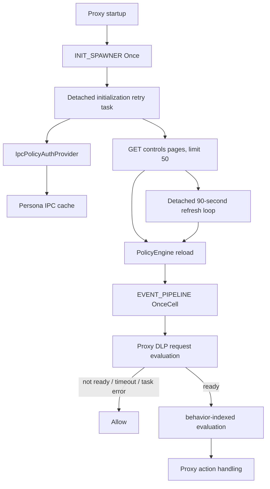

# Endpoint Core Policy Engine

**Repository:** `sentinel-endpoint-agent`  
**Revision:** `a022e52bf2fff6a9445ebad96c3afeaf277e259f`  
**Primary scope:** all four paths under `core/src/policy_engine/`  
**Context traced into:** proxy startup/auth, request enrichment, DLP evaluation/action consumption, global URL constants, Cargo features/dependencies, documentation, and CI  
**Declaration coverage:** all 87 AST-indexed declarations  
**Confidence:** Verified except where explicitly marked `Inference` or `Unresolved`

## Purpose and status

The policy engine is an active proxy subsystem. It fetches tenant-scoped control records from a backend, indexes active policies by behavior ID, evaluates enriched DLP/request events, maps the first matching policy to an action, and refreshes the policy set every 90 seconds.

Verified production path:

```text
proxy::platform::common::run_proxy
→ construct controls URL from BACKEND_BASE_URL + CONTROL_LISTING_ENDPOINT_PATH
→ start_policy_engine_init_with_auth_provider(IpcPolicyAuthProvider)
→ retry PolicyService::initialize until one fetch succeeds
→ install global EventPipeline
→ refresh policies every 90 seconds

proxy DLP sensitive-request path
→ RequestContext::to_enriched_event
→ event_pipeline_if_ready
→ spawn_blocking + 100 ms timeout
→ EventPipeline::evaluate_sync
→ PolicyService::evaluate
→ PolicyEngine::evaluate
→ proxy action match / UI / alert / forwarding behavior
```

This is not the separate policy-rule design described in the April 2026 proxy-v2 architecture draft. The implementation here is a remote `Policy`/control evaluator used from current proxy DLP code.

## File inventory

| Path | Role | Reachability | Generated/vendored | Analysis status |
| --- | --- | --- | --- | --- |
| `core/src/policy_engine/mod.rs` | Fetch/auth service, event pipeline, builder, global initialization | Active through proxy startup and DLP | Handwritten | Fully analyzed |
| `core/src/policy_engine/engine.rs` | Policy indexing, condition evaluation, action selection, reload/stats | Active behind `PolicyService` | Handwritten | Fully analyzed |
| `core/src/policy_engine/policy_base.rs` | Wire/domain types and indexed `PolicySet` | Active public model | Handwritten | Fully analyzed |
| `core/src/policy_engine/unit_test.rs` | Three Tokio tests and helpers/benchmark | Test-only contents; module declared in all builds | Handwritten | Fully analyzed |

`core/src/lib.rs:24` exposes `pub mod policy_engine`. Within it, `policy_base` and `PolicyAuthProvider`, `PolicyService`, `EventPipeline`, `EventBuilder`, and global access/start functions are public. `engine` is a private module and `PolicyEngine` is not re-exported.

Potential issue: `PolicyService::get_engine` is public but returns `Arc<PolicyEngine>` from a private module. Like the utility private-holder interface, this is not a clean externally nameable API. The checked repository uses it only nowhere; tests import the private child module because they reside inside the parent crate.

## Runtime topology



All edges are directly verified. The fail-open Allow branches are explicit in `proxy/src/dlp/mod.rs:1959-1989`.

## Public data model and wire schema

### `EnrichedEvent` and property values

| Field | Type | Meaning / producer behavior |
| --- | --- | --- |
| `event_id` | `String` | Proxy request-context ID or builder-generated UUID string; ignored by evaluator |
| `timestamp` | `i64` | UTC Unix seconds in current producers; ignored by evaluator |
| `behavior_id` | `String` | Exact lookup key into `PolicySet.behavior_index` |
| `properties` | `HashMap<String, PropertyValue>` | Flattened direct keys and selected JSON blobs |

`PropertyValue` is `#[serde(untagged)]` with variants `String`, `Bool`, `Number(i64)`, `StringArray`, `Json`, and `JsonArray`.

Verified serialization/deserialization implications:

- variant selection depends on data shape rather than a tag;
- floating-point numbers cannot become `Number(i64)` and are captured by `Json`;
- string arrays can match `StringArray` before the generic `Json` variant;
- non-string arrays are captured by `Json` before the later `JsonArray` variant, making `JsonArray` a deserialization dead-code candidate under the declared variant order;
- no executable constructor/reference to `PropertyValue::JsonArray` was found;
- comparison operators directly support only a subset of these variants.

The active proxy builder produces these keys when source data is present:

| Key | Property variant |
| --- | --- |
| `endpoint.host`, `endpoint.path` | `String` |
| `request.method`, `request.client_protocol`, `request.alpn` | `String` |
| `request.is_https` | `Bool` |
| `request_headers` | `Json` object |
| `dlp_request.sensitive`, `dlp_response.sensitive` | `String("true"/"false")`, not `Bool` |
| `dlp_request.verdict`, `dlp_response.verdict` | `String` |
| `process.pid` | `Number(i64)` |
| `process.name` | `String` |
| `app_details`, `user_details`, `dlp_request.extractions` | `Json` object |
| `user.groups` | `StringArray` |
| `event.name` | `String("upload")` only for `BID_203` |

Behavior IDs used by the DLP path are `BID_03` (Generative AI), `BID_203` (file upload), and `BID_24` (unapproved/non-Generative-AI SaaS). `RequestContext::to_enriched_event` can override its input to `BID_24` based on app category and approval state.

### Policy payload

All fields are deserialized from backend `content` elements. There are no Serde defaults or validation attributes beyond enum renaming and optional-field semantics.

| Field | Type | Evaluator use |
| --- | --- | --- |
| `id` | `i64` | Copied to matched decision and logs |
| `slug` | `String` | Copied to matched decision |
| `version` | `String` | Stored, not evaluated |
| `criticality` | `i32` | Ascending policy order; lower value first |
| `mode` | `PolicyMode` | `monitor` always Allows; `action` consults actions |
| `control_name` | `String` | Logs and matched decision |
| `control_description` | `String` | Stored, not evaluated |
| `schedule` | `String` | Stored, not scheduled/evaluated |
| `meta` | optional map of JSON | Stored, not evaluated |
| `posture` | `{ id, value }` | Stored, not evaluated |
| `behavior` | `{ id, value }` | `behavior.id` is the index key; value unused |
| `use_case` | `{ id, value }` | Stored, not evaluated |
| `trigger_conditions` | recursive list | Evaluated |
| `actions` | list | First recognized `meta.browser_action` selected |
| `is_active` | `bool` | False policies omitted from index |
| `is_internal` | `bool` | Stored, not evaluated |
| `subscriber`, `tenant` | optional strings | Stored, not checked against auth/event context |
| `created_at`, `updated_at` | `u64` | Stored, not evaluated |
| `created_by`, `updated_by`, `deletion_mode` | optional strings | Stored, not evaluated |
| `is_deleted` | optional bool | Stored, not evaluated; `Some(true)` is not filtered if active |

Potential issue requiring validation: enforcement relies on the backend and `Tenant` request header to return the correct policy set. The engine itself does not enforce `tenant`, `subscriber`, `is_deleted`, schedule, creator, or internal/external scope. A returned `is_active: true, is_deleted: true` policy is indexed.

### Conditions

`TriggerCondition` can contain an optional logical operator, optional `filter_condition`, and optional recursive `filter_group`. If both filter forms are present, group wins. If neither exists, the element is skipped.

`FilterCondition` fields `attribute_type`, `attribute_id`, `attribute_name`, `graph_property`, `is_graph_property_discarded`, and `extension_property` are metadata/logging only. Evaluation uses only:

- `agent_property`: property key/path; missing value makes the condition false;
- `condition`: operator; and
- `value`: untyped JSON operand.

Enums deserialize exactly as:

- `PolicyMode`: lowercase `monitor` / `action`;
- `LogicalOperator`: uppercase `AND` / `OR`;
- `ConditionOperator`: snake case names `is_equal_to`, `is_not_equal_to`, `is_in`, `is_not_in`, `contains`, `not_contains`, `does_not_contain`, `is_greater_than`, `is_greater_than_equal_to`, `is_less_than`, `is_less_than_equal_to`, `matches`.

Unknown casing/name causes the entire policy-page deserialization to fail; one invalid element rejects the page and therefore the full fetch attempt.

### Actions and decisions

Each action requires `type`, `name`, `meta`, while description/outcomes are optional. `ActionMeta` retains only `browser_action`, `blocked`, `prompt`, `justification_required`, and `remove_sensitive_data`; extra backend action metadata is ignored.

Only `browser_action` affects `PolicyEngine::determine_action`:

| Exact backend string | Decision enum | Decision `browser_action` |
| --- | --- | --- |
| `Block` | `Block` | `Block` |
| `Ask` or `Prompt` | `Ask` | `Ask` |
| `Justify` | `Justify` | `Justify` |
| `Allow_Original_Prompt_With_No_Justification` | corresponding long enum | normalized without underscores |
| `Allow_Original_Prompt_With_Optional_Justification` | corresponding long enum | normalized without underscores |
| `Allow_Original_Prompt_With_Mandatory_Justification` | corresponding long enum | normalized without underscores |
| `Allow_Prompt_After_Removal_Of_Sensitive_Data` | corresponding long enum | normalized without underscores |
| missing, `Allow`, `Warn`, wrong case, or any other string | `Allow` | `Allow` |

Verified: `blocked`, `prompt`, `justification_required`, `remove_sensitive_data`, action type/name, description, and outcomes do not affect selection. The first recognized browser action across the list wins. `PolicyActionType::Prompt` is never constructed by the engine; backend `Prompt` normalizes to `Ask`, though downstream proxy code still handles externally constructed `Prompt` values.

`PolicyDecision::allow` returns no matched policy, `browser_action: Some("Allow")`, and zero evaluation time. `PolicyEngine::evaluate` overwrites time for no-match results. A matched monitor policy returns `Allow` **with** matched policy metadata.

## Backend fetch and authentication

### Active URL and request

Proxy startup builds:

```text
<QUILR_BACKEND_BASE_URL or https://preprod.quilr.ai>
+ /bff/playbook-service/controls?message=true&limit=500
```

For every page, `fetch_policies` parses that full URL, removes any existing `limit` and `offset`, preserves other query pairs, then appends `limit=50` and the current zero-based offset. The active `message=true` remains; the constant's `limit=500` is always replaced by 50.

The request is `GET` with:

- `Authorization: Bearer <token>` via reqwest;
- `Tenant: <tenant>`;
- a per-request client timeout of 10 seconds; and
- at most five redirects.

The client is constructed with `expect`, so a builder error panics rather than returning from `PolicyService::new_with_auth_provider`.

### Auth providers

The public async trait returns `Option<(access_token, tenant)>` and has a default no-op unauthorized hook.

- `PersonaManagerAuthProvider` separately awaits current access token and tenant; either error propagates, empty/missing values become `Ok(None)`. Because these are separate reads, no atomic identity snapshot is guaranteed by this adapter.
- On 401 it calls `PersonaManager::notify_auth_failure` and discards that method's return value after propagating only its error.
- The active proxy's `IpcPolicyAuthProvider` obtains the pair from the Persona IPC cache and clears that cache on 401. It does not itself fetch/refresh immediately.

Missing auth fails the attempt with “Not authenticated”; global initialization retries in five seconds. Refresh failure retains old policies.

### Response and pagination

For each response:

1. buffer the entire body as text;
2. on 401, best-effort call `on_unauthorized`, then return an error containing URL and the first 500 body characters;
3. on other non-success, return status, URL, and the first 500 body characters;
4. parse the body as generic JSON;
5. require a top-level `content` field;
6. clone and deserialize `content` as `Vec<Policy>`;
7. append the page;
8. stop only when the page contains fewer than 50 policies; otherwise add 50 to offset.

There is no total-count use, page cap, duplicate-ID removal, ETag/conditional request, response-size limit, overall multi-page deadline, retry within a fetch, or validation that offset changed backend output. If a backend ignores offset and continually returns 50 records, this loop does not terminate and grows memory until an external failure/resource limit.

Error strings can include up to 500 response characters and full URLs, then are logged by initialization/refresh. Bearer tokens are not intentionally included, but response snippets may contain server-provided sensitive content. No redaction is applied.

## Policy indexing

`PolicySet::new(policies, version)`:

1. skips only `is_active == false`;
2. wraps every retained policy in `Arc`;
3. indexes it under exact `policy.behavior.id`;
4. sorts each vector by ascending `criticality`; and
5. counts retained entries, including duplicate IDs/records.

There is no ID, slug, behavior, tenant, deletion, schedule, duplicate, condition, action, or criticality-range validation. Equal-criticality policies have no explicit domain tie-breaker in the comparison closure.

`get_policies_for_behavior` performs a hash lookup but clones the entire `Vec<Arc<Policy>>`; lookup is O(1) average, while the returned-vector clone is O(number of policies for that behavior). The source comment's bare “O(1) lookup” omits the clone cost.

The engine starts with an empty version-1 set. Initial backend installation uses `reload_policies`, reads version 1, and installs version 2. Every refresh increments regardless of content changes.

## Evaluation semantics

### Top-level policy selection

`evaluate` records `Instant::now`, snapshots the applicable `Vec<Arc<Policy>>` under a read lock, releases the lock, and evaluates in sorted order. It returns the first matching policy. Later policies cannot override/strengthen it.

No applicable policy or no matching policy returns Allow. Event ID and timestamp are ignored. All applicable policy names and IDs are logged at INFO for every evaluation; full conditions, event values, condition values, modes, and actions are logged at DEBUG.

Potential issue requiring validation: policy/event logs can contain hostnames, request/header-derived JSON, user/app details, action metadata, and condition operands. Production log level, retention, and access controls determine actual exposure.

### Logical-condition algorithm

The engine walks conditions in input order with a mutable aggregate initially `true`:

- operator `None`: replace aggregate with the condition result;
- `AND`: `aggregate = aggregate && condition`, returning false immediately if false;
- `OR`: `aggregate = aggregate || condition`, returning true immediately if true.

This is neither a parser with conventional AND precedence nor a generally correct left-associative short-circuit evaluator for mixed future operators.

Verified examples derived from the implementation:

- `A=true, AND B=false, OR C=true` returns false at B without evaluating C.
- `A=true, OR B=false, AND C=false` returns true at B without evaluating C.
- a first valid condition marked `OR` starts from `true` and therefore returns true regardless of that condition.
- an empty condition vector returns false.
- a nonempty vector containing only malformed entries (neither filter nor group) skips all entries and returns the initial true.

Potential issue: a remotely supplied malformed nonempty trigger list can match and enforce an action, while an actually empty list cannot. No schema-level exclusivity/first-operator validation prevents this.

Groups recursively call the same algorithm. The parent operator combines only the group's final result; it does not define internal group logic. Recursion depth is not bounded in source.

### Property extraction

Extraction first tries exact `HashMap` lookup. If absent, it splits the path on `.`, searches longest-to-shortest prefixes, and only traverses a prefix stored as `PropertyValue::Json`. It constructs `$.<suffix>` and uses `jsonpath_lib::select`, returning the first node convertible to a property value.

Errors/no matches are silently ignored while shorter prefixes are tried. Paths are not escaped before becoming JSONPath, so dots/brackets/wildcards in JSON object key names have query semantics rather than literal-key semantics. `PropertyValue::JsonArray` is not a traversal root.

Nested JSON conversion supports strings, bools, i64 numbers, arrays of all strings, and generic arrays/objects. Null and non-i64 numbers return `None`; an empty array vacuously converts to an empty `StringArray`.

### Operator matrix

| Operator | Supported event shapes | Operand shape | Comparison |
| --- | --- | --- | --- |
| `is_equal_to` | String, Bool, Number | matching scalar; String↔Bool also supported | Strings ASCII-case-insensitive; numbers i64 only |
| `is_not_equal_to` | any existing property | any JSON | Boolean negation of equality; type mismatch therefore becomes true |
| `is_in` | String, Bool, StringArray | JSON array | String/bool matching; arrays test overlap with operand strings |
| `is_not_in` | any existing property | any JSON | Negation; unsupported types/non-array operand become true |
| `contains` | String, StringArray | JSON string | String substring after Unicode lowercase allocation; array exact ASCII-case-insensitive element |
| `not_contains`, `does_not_contain` | any existing property | any JSON | Identical negations; unsupported types/non-string operand become true |
| numeric comparisons | Number | JSON i64 | Supplied closure `>`, `>=`, `<`, `<=` |
| `matches` | String | JSON string regex | Regex cache by exact pattern; invalid pattern false |

Missing event property returns false **before** applying negation. Existing-but-type-incompatible values return false from the positive helper and therefore true for negated operators. This difference is verified and undocumented.

The regex cache is unbounded by pattern count, retries invalid compilation on every evaluation, and uses standard `RwLock::unwrap`. Concurrent misses may compile the same pattern more than once. A successful reload clears the cache after swapping the policy set.

## Reload, concurrency, and performance

`PolicyEngine` holds `Arc<RwLock<PolicySet>>` and `Arc<RwLock<HashMap<String, Regex>>>`; the outer `Arc`s are not needed for cloneability because `PolicyEngine` itself does not implement `Clone`, but allow shared internal ownership.

`reload_policies`:

1. reads current version and adds one;
2. builds/sorts a new set outside the lock;
3. swaps it under the write lock;
4. clears regex cache under a separate write lock; and
5. returns `Ok(())`.

The declared `Result<(), String>` has no ordinary `Err` construction. Poisoned locks panic. Concurrent reloads can read the same version and last-writer-wins; current production has one refresh loop, but the API does not serialize external callers. Evaluations already holding cloned policy `Arc`s complete against the old snapshot.

`EventPipeline::new` creates a bounded 1,000-event MPSC and a detached single consumer. Async `evaluate_event` waits for queue capacity and then a oneshot response without timeout. Dropped response receivers are ignored. Evaluation is synchronous on the Tokio task, not `spawn_blocking` there.

The active proxy bypasses the async queue and calls `evaluate_sync` inside `spawn_blocking` with a 100 ms timeout. Tokio timeout/drop does not cancel an already running blocking closure, so timed-out evaluations can continue consuming blocking-pool resources. The fallback is Allow.

The 90-second refresh loop and event consumer have no cancellation, shutdown, join, health, or backpressure metrics. Refresh starts 90 seconds after initialization, not immediately, because `interval_at` is anchored at `now + duration`.

## Resilient global initialization state machine

```mermaid
stateDiagram-v2
    [*] --> UNINITIALIZED
    UNINITIALIZED --> INITIALIZING: "first start call / Once"
    INITIALIZING --> INITIALIZING: "auth/fetch/load error; sleep 5s"
    INITIALIZING --> READY: "pipeline OnceCell set succeeds"
    READY --> READY: "subsequent start calls ignored"
```



Constants are `0`, `1`, and `2`, stored in `AtomicU8`. `event_pipeline_if_ready` uses Acquire load and returns the OnceCell only when state is `READY`; installation happens before the Release store.

Verified failure behavior:

- startup is nonblocking and active proxy proceeds immediately;
- first three and every tenth attempts are logged; intermediate errors are silent except for delay;
- failed attempts sleep exactly five seconds with no exponential backoff/jitter/cap/stop;
- no policies are visible until one entire paginated fetch and reload succeeds;
- a successful empty/all-inactive result marks the engine Ready and therefore produces Allow decisions;
- a panic in the detached task can leave state `INITIALIZING` forever because `Once` prevents another spawn;
- if `EVENT_PIPELINE.set` unexpectedly returns `Err`, the success branch neither breaks nor sleeps, and every repeated successful try starts another refresh task before failing the set. This state is not expected from ordinary single-spawner flow but is unhandled.

There is no `FAILED`, stopped, degraded, stale, last-success, retry-count, policy-age, or shutdown state.

## Fail-open and enforcement boundary

Verified Allow outcomes occur when:

- the global engine is not Ready;
- the proxy evaluation exceeds 100 ms;
- the blocking task fails/panics;
- no behavior policy exists;
- policies exist but none match;
- the first match is monitor mode;
- action mode has no recognized browser action;
- backend initialization succeeds with zero active policies.

The system therefore explicitly prioritizes request continuity during policy unavailability. This is a product/security posture, not automatically a vulnerability. Its acceptability depends on intended enforcement requirements.

Once an action decision is returned, proxy DLP maps it to blocking, prompt, justification, alerting, or allow behavior. Notably, `AllowPromptAfterRemovalOfSensitiveData` shares the immediate Block arm in the inspected DLP match; no removal operation appears in that branch before the blocked response. The completed proxy action analysis is in [the proxy DLP chapter](06-endpoint-proxy-dlp-ui-alerts.md).

## Security boundary

| Control/boundary | Actual enforcement |
| --- | --- |
| Backend identity | Reqwest URL/TLS behavior; configurable base can change target/scheme |
| Authentication | Bearer token from Persona/IPC provider |
| Tenant scoping | `Tenant` header; no returned-policy tenant verification |
| Policy integrity | Transport/schema deserialization only; no payload signature/hash |
| Policy activation | `is_active` only |
| Deletion/schedule | Not enforced |
| Input validation | Serde required types/enums; no semantic validator |
| Resource limits | 10-second per HTTP request, 5 redirects, 50/page; no page/total/response-size/regex-cache/recursion limits |
| Evaluation availability | Explicit fail-open in proxy |
| Secrets in logs | Token not formatted; URLs/body snippets/policy/actions/event operands can be logged |

Potential issue requiring validation: `BACKEND_BASE_URL` permits environment-controlled deployment configuration, and this layer does not require HTTPS explicitly. Whether production configuration policy prevents plaintext/custom endpoints is external to this source.

## Error and recovery matrix

| Failure | Handling | State/data result |
| --- | --- | --- |
| Missing token/tenant | Error; initialization retry after 5 s or refresh warning | Init remains unavailable; refresh retains old set |
| Auth provider error | Wrapped as anyhow error | Same |
| Invalid backend URL | Contextual error | Same |
| Request timeout/network/read failure | Contextual error | Same |
| HTTP 401 | Best-effort unauthorized hook; snippet error | Proxy clears Persona cache; outer loop retries |
| Other non-2xx | Status/URL/snippet error | Retry or retain old set |
| Missing `content` | Error | Retry or retain old set |
| One invalid policy | Whole content-page deserialization fails | Whole fetch discarded; old set retained on refresh |
| Reload lock poison | Panic, despite `Result` return | Task may die; global init can remain INITIALIZING |
| Evaluation lock poison | Panic | Proxy join branch falls back Allow |
| Invalid regex | Condition false; no log/cache | Recompiled every occurrence |
| Missing property | Condition false | Policy may not match |
| Malformed condition element | Skipped | All-malformed nonempty list returns true |
| Queue closed | Async evaluation returns “Failed to submit event” | Caller receives error |
| Consumer exits after enqueue | Oneshot returns “Failed to receive decision” | Caller receives error |
| Proxy evaluation timeout/task error | Warning | Allow |

## Tests

There are three `#[tokio::test]` functions and two helpers; the benchmark helper is not independently registered.

### `policy_evaluation`

Deserializes two inline policies and evaluates three events, but contains no assertions. Comments say the first matches monitor, the second blocks, and the third does not match; the function only prints decisions/timings and returns `Ok` if parsing/evaluation does not error.

### `test_complete_policy_flow`

Creates real Vault/Persona storage, stores a test identity, embeds a long JWT-shaped access token literal, and sends a real request to `https://preprod.quilr.ai/...`. It then spawns an infinite refresh loop, tests async/sync pipeline calls only by printing, and calls the benchmark.

Potential issue: this is network/environment/credential-dependent code inside the unit-test module, not an isolated mock-server contract test. The committed token-like value should be treated as sensitive-looking test data; whether it is valid, expired, revoked, or synthetic cannot be established statically.

### `benchmark_300_policies`

Generates 300 policies across 20 behaviors, warms 100 evaluations, times 10,000 matching-behavior and 10,000 missing-behavior evaluations, and prints throughput. It has no assertions and uses the normal test/logging environment rather than Criterion despite the workspace having Criterion benchmarks elsewhere.

Potential defect: the first throughput calculation divides by `avg_micros` without the zero guard used by the second calculation. A sub-microsecond integer average would panic on division by zero.

### `test_all_operator_combinations`

Despite its name, it tests logical `None`/AND/OR/group structure using only `is_equal_to`; it does not cover all `ConditionOperator` variants. It asserts matches for single, AND success/failure, OR first/second success, and missing behavior. The mixed-operator and nested-group cases only print results and have no assertions.

Its mixed action uses `browser_action: "Warn"`, which the engine does not recognize; the printed “Expected: Warning” result is actually normalized to Allow, and the absent assertion hides the disagreement.

No tests cover:

- backend pagination, page-size override, duplicate pages, max-page absence, 401 hook, timeouts, response errors, or malformed content;
- public custom auth provider behavior or global initialization states/races/panic;
- refresh retention/reload concurrency/versioning/regex clearing;
- missing `agent_property`, all-malformed condition lists, both group+condition, first operator AND/OR, or mixed short-circuit counterexamples;
- nested JSONPath, numbers, bools, arrays, contains/negations/numeric/regex operators, invalid regex, or type mismatch;
- recognized long actions, unknown action/case, monitor metadata, deleted/tenant/schedule filtering;
- queue capacity/closure/cancellation or 100 ms proxy fallback.

No checked CI workflow runs this Cargo suite. Rust/Cargo are absent from the analysis environment.

## Documentation consistency audit

| Claim | Source | Actual code evidence | Result |
| --- | --- | --- | --- |
| Main agent manages policy loading; proxy queries via IPC | Proxy startup comment | Proxy itself fetches policies; IPC supplies only auth | Contradicted / comment acknowledges transition incomplete |
| Refresh occurs every 90 seconds | `start_refresh_loop` docs | Fixed `interval_at(now+90s, 90s)` | Confirmed |
| Initialization automatically retries every 5 seconds | start docs | Fixed sleep on returned errors | Confirmed, but panic/set-failure gaps exist |
| Policy lookup is O(1) | `PolicySet` docs | Hash lookup plus O(k) vector/Arc clone | Partially confirmed |
| Policy JSON matches backend exactly | `policy_base.rs` comment | Extra action fields are ignored; several retained fields are not enforced | Not verifiable / overstated |
| `ActionMeta.browser_action` examples are Block/Ask/Allow | field comment | Block/Ask supported; exact `Allow` falls through to default Allow rather than recognized mapping | Partially confirmed |
| Prompt enum maps to Ask | enum comment | Backend Prompt produces `Ask`; legacy enum remains only for external construction/downstream matching | Confirmed with unused engine variant |
| All operator combinations are tested | test name/comment | Only equality plus logical combinations; mixed/group outputs unasserted | Contradicted |
| Complete policy flow uses inline demo policies | test comment | Test calls real preprod backend | Contradicted |
| Proxy policy-init diagnostic denotes initialized engine | emitted message/name | Event says “init started,” is emitted before diagnostics initialization, and is dropped | Contradicted if interpreted as readiness telemetry |

## Dead, incomplete, and unresolved items

- Dead-code candidate: `EventBuilder` and all methods have no repository caller; their `allow(dead_code)` annotations acknowledge this.
- Dead-code candidate: `PropertyValue::JsonArray` has no constructor/reference and is shadowed by earlier untagged `Json` during deserialization.
- Dead-code candidate: `PolicyActionType::Prompt` is not constructed by the engine, though proxy consumers/tests explicitly handle it as a public compatibility value.
- Dead-code candidate: `PolicyService::get_engine` has no caller and exposes a type hidden by a private module.
- Incomplete: policy validation, tenant/deletion/schedule enforcement, pagination bounds, shutdown, readiness health, cache limits, and semantic condition validation are absent.
- Unresolved: exact live backend schema/semantics, including whether it guarantees first operator null, valid exclusive filter forms, tenant-filtered/nondeleted policies, finite pagination, and only supported action strings.
- Unresolved: whether the committed JWT-shaped test string is synthetic or externally revoked/expired.
- Unresolved: external deployment rules enforcing HTTPS and trusted backend origins.

## Feature-to-code traceability

| Feature | Entry point | Primary symbols | State/external system | Tests | Status |
| --- | --- | --- | --- | --- | --- |
| Background initialization | Proxy `run_proxy` | `start_policy_engine_init_with_auth_provider`, `try_init...` | Once/atomic/OnceCell; backend | None | Active |
| Auth propagation | `PolicyAuthProvider` | proxy IPC provider, Persona adapter | Persona broker/cache | Real-network test uses Persona adapter | Active |
| Paginated policy fetch | `PolicyService::initialize`/refresh | `fetch_policies` | HTTPS API, token, Tenant header | No isolated tests | Active |
| Policy hot reload | initialize/refresh | `reload_policies`, `PolicySet::new` | In-memory RwLock snapshot | Benchmark constructs; no reload test | Active |
| Event enrichment | Proxy DLP | `RequestContext::to_enriched_event` | Request/DLP/app/user state | Proxy tests pending separate analysis | Active |
| Policy evaluation | `evaluate_sync` | `PolicyEngine::evaluate` and helpers | In-memory policies/regex cache | Three broad tests, incomplete assertions | Active |
| Async event queue | `EventPipeline::evaluate_event` | bounded MPSC + oneshot | In-memory queue | Real-network test only | Public, not active proxy path |
| Action enforcement | Proxy DLP match | `determine_action`, proxy action arms | UI, alerting, request response | Proxy tests pending | Active |
| Builder API | External/manual callers | `EventBuilder` | In-memory only | None | Dead-code candidate |
