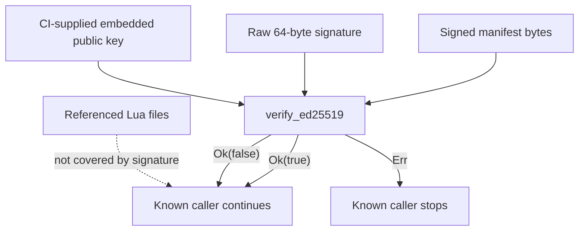

# Endpoint Core Lua Scripting

**Repository:** `sentinel-endpoint-agent`  
**Revision:** `a022e52bf2fff6a9445ebad96c3afeaf277e259f`  
**Primary scope:** all ten tracked files under `core/src/scripting/`  
**Context traced into:** `core/src/lib.rs`, `core/Cargo.toml`, workspace manifests, System Monitor v2 scanner/executor/converter/tests/scripts, package builders, distribution launch configuration, CI, `.gitignore`, and scripting design records  
**Declaration coverage:** all 105 AST-indexed declarations  
**Confidence:** Verified except where explicitly marked `Inference`, `Unresolved`, or `Potential issue`

## Purpose, build status, and actual reachability

The directory implements an optional embedded Lua 5.4 facility with two materially different execution designs:

1. a manifest-driven `ScriptEngine`, trigger model, event dispatcher, Ed25519 manifest verifier, and HTTP updater; and
2. reusable sandbox/host-API/result-collection primitives.

Only the second design is active in the checked production graph. `system-monitor/v2` enables the core `scripting` feature and directly calls `sandbox::create_sandboxed_lua` plus `ResultCollector` for each configured file-scan match. Its accepted ADR explicitly rejects `ScriptEngine` and signing for that flow. Repository-wide exact-name and qualified-path searches found no production construction of `ScriptEngine`, `EventDispatcher`, or `ScriptUpdater`, and no production call to `create_event_channel`, `run_trigger`, `check_and_update`, or the standalone `url_matcher::matches`.

```text
Active packaged path
system-monitor-v2 scanner rule
→ scanner::executor::execute_script
→ read <script_dir>/<configured script>
→ SandboxConfig { fs.read, platform.info, 10 s }
→ create_sandboxed_lua
→ set global scan_context
→ execute Lua synchronously
→ ResultCollector::take_result
→ scanner::converter::convert_results
→ EntityStore::upsert

Repository-locally uncalled path
ScriptEngine::new
→ ScriptBundleVerifier::verify_bundle [Boolean result discarded]
→ ScriptManifest::from_file
→ load enabled scripts
→ run_trigger / optional EventDispatcher
→ ScriptResult vectors

Repository-locally uncalled update path
ScriptUpdater::check_and_update
→ unauthenticated GET of configured URL
→ whole-body tar.gz extraction
→ ScriptBundleVerifier::verify_bundle [Boolean result discarded]
→ recursive non-atomic overlay copy
```

`core/src/lib.rs:33-34` compiles and exports the entire module only under `#[cfg(feature = "scripting")]`. The core crate's default feature set does not include it. `system-monitor/v2/Cargo.toml:44` enables it, making scripting part of the production monitor build even though the manifest engine is unused.

### Compile-time public-key prerequisite

`signing.rs:5` uses `include_bytes!("signing_public_key.pem")`. The PEM is not tracked, because root `.gitignore:15` ignores `*.pem`, and it is absent from the checked working tree.

- Verified: a clean local build that compiles `scripting` lacks that required source-time file. Rust/Cargo is unavailable in the analysis environment, so the exact compiler diagnostic was not executed.
- Verified: `.github/workflows/build.yml:145-160` and `:463-477` decode `SCRIPTING_SIGNING_PUBLIC_KEY_PEM_BASE64` to the expected path before the Windows/macOS production build; `.github/SECRETS.md:15-40` documents the same prerequisite.
- Contradiction: the older branch-specific `.github/workflows/ci-build.yml` invokes builders without materializing the PEM. It triggers only for `app-discovery-integration`, not `main`; whether that branch supplies the file elsewhere is Unresolved.
- Verified: the package builder selects `sentinel-monitor-v2`, so the monitor's dependency feature activates the compile-time include.

## File inventory

| Path | Implemented role | Actual checked-tree reachability | Generated/vendored | Status |
| --- | --- | --- | --- | --- |
| `core/src/scripting/mod.rs` | Public module tree, re-exports, error enum | Active module surface because monitor v2 enables feature | Handwritten | Fully analyzed |
| `core/src/scripting/sandbox.rs` | Lua library selection, global removal, require path, instruction hook, API gates | Active through monitor v2 executor | Handwritten | Fully analyzed |
| `core/src/scripting/host_api.rs` | Filesystem, process, platform, result, JSON, logging, workspace Lua functions | Active through sandbox; process API not granted by current monitor | Handwritten | Fully analyzed |
| `core/src/scripting/result_collector.rs` | Serializable result/entity DTOs and synchronized collector | Active; several fields/vectors are dropped downstream | Handwritten | Fully analyzed |
| `core/src/scripting/engine.rs` | Manifest loading, trigger filtering, sequential execution | Repository-locally uncalled public subsystem | Handwritten | Fully analyzed |
| `core/src/scripting/event_dispatcher.rs` | Bounded event intake and detached blocking dispatch | Repository-locally uncalled public subsystem | Handwritten | Fully analyzed |
| `core/src/scripting/manifest.rs` | Manifest and trigger JSON schema | Used only by locally uncalled engine | Handwritten | Fully analyzed |
| `core/src/scripting/signing.rs` | Embedded-key Ed25519 verification and unsigned bypass | Compiled; invoked only by locally uncalled engine/updater | Handwritten; embedded input externally supplied | Fully analyzed |
| `core/src/scripting/updater.rs` | HTTP tar.gz download, verification call, overlay installation | Repository-locally uncalled public subsystem | Handwritten | Fully analyzed |
| `core/src/scripting/url_matcher.rs` | Duplicate wildcard matcher | Tests only; engine has a private duplicate | Handwritten | Fully analyzed |

The absent `signing_public_key.pem` is not an inventory row because it is not committed. It is a secret-derived build input, not generated repository output.

## Active System Monitor v2 flow

`system-monitor/v2/src/discovery/scanner/executor.rs:11-42` is the sole production Rust consumer found for the core primitives:

1. Join configured `script_dir` and `ScanMatch.script` with no canonicalization or containment check.
2. Read the selected file as UTF-8 text; return a formatted `String` error on failure.
3. Create `ResultCollector` using the script filename as `script_id`.
4. Build `SandboxConfig` with exact capabilities `fs.read` and `platform.info`, a fixed 10,000 ms timeout, the discovered home directory, and `std::env::consts::OS`.
5. Create the Lua state.
6. Set `scan_context.path`, `match_type`, and, where representable after Unix epoch, `modified_at`.
7. Execute the script synchronously on the scanner task.
8. On success, return the collected clone; on Lua error, return `Err(String)` and discard partial results.

The scanner calls this once per match in a plain loop (`scanner/mod.rs:71-111`). It therefore serializes scan-script execution and blocks that async task during filesystem access and Lua execution. Its initial cycle and each interval cycle are also synchronous functions called from the async `run` loop.

The package builder copies the complete `system-monitor/v2/scripts/` tree into `support/hooks/scripts/` (`scripts/builder/sentinel_builder.sh:285-306`). The manifest in that tree lists seven enabled `on_scan` scripts, but the active scanner does not parse it; configured scan rules name files directly.

## Sandbox creation and boundaries

### Lua state initialization

`create_sandboxed_lua` executes in this exact order:

1. Request Lua table, string, math, package, and coroutine standard libraries.
2. Construct a fresh Lua VM with default `LuaOptions`.
3. Set global `loadfile` and `dofile` to nil.
4. If an `os` table exists, set `execute`, `remove`, `rename`, `exit`, and `tmpname` to nil.
5. Set global `io` to nil.
6. Replace `package.path` with `<script_dir>/?.lua;<script_dir>/?/init.lua` and clear `package.cpath`.
7. Install a wall-clock deadline hook checked every 1,000 Lua instructions.
8. Register capability-dependent and always-present host APIs under global `sentinel`.

No VM is reused: both `ScriptEngine` and the active v2 executor create a fresh state for each execution.

### Capability gates

| Exact capability string | Lua namespace | Effect |
| --- | --- | --- |
| `fs.read` | `sentinel.fs` | Arbitrary process-readable text/JSON/metadata/directory/glob access; it is not confined to `home_dir` |
| `process.list` | `sentinel.process` | Launches `ps`/`pgrep` on macOS/Linux or `tasklist` on Windows |
| `platform.info` | `sentinel.platform` | Returns caller-supplied OS/home plus compiled architecture |
| none | `sentinel.result` | Adds typed/open descriptors to shared in-memory output |
| none | `sentinel.json` | Serde JSON parse/encode |
| none | `sentinel.log` | Emits tracing events at info/warn/error |
| none | `sentinel.workspace` | Recursively scans selected filesystem roots for `.git` directories |

Capabilities are exact, case-sensitive string equality. Unknown values are silently inert. There is no manifest-level allow-list validation.

Potential issue: the name `fs.read` does not imply home confinement in code. `resolve_path` expands only leading `~/` or `~\`; absolute paths remain absolute and other relative paths are resolved by the process working directory. All filesystem helpers then use that path directly.

Potential issue: `workspace` is deliberately ungated and performs filesystem traversal. It checks conventional lower-case directories under `home_dir` and valid paths from `SENTINEL_WORKSPACE_DIRS`, whose separator is `;` on Windows and `:` elsewhere.

### Timeout semantics

The timeout is a Lua instruction hook, not an OS-level deadline:

- its deadline is computed while constructing the sandbox, before host API registration, event/context conversion, and script load/exec;
- the deadline is checked only every 1,000 Lua instructions;
- a script that completes before the next hook can exceed wall time without detection;
- synchronous Rust host callbacks (`read_to_string`, globbing, directory traversal, `ps`, `pgrep`, `tasklist`) are not interrupted while blocked;
- `ScriptEngine` classifies any `mlua::Error::RuntimeError` whose message contains `script timeout` as `ScriptError::Timeout`, including a script-generated runtime error with that substring;
- active monitor v2 does not perform that classification and converts the mlua error to `String`.

There is no memory limit, Lua instruction quota, host-call count limit, filesystem result cap, process-output cap, or concurrent-dispatch cap in this core module.

## Lua host API reference

### `sentinel.fs`

| Function | Input | Output and failure behavior |
| --- | --- | --- |
| `read_file(path)` | Lua string | UTF-8 file string; nil for every I/O/decoding error |
| `read_json(path)` | Lua string | Serde-converted Lua value; nil on I/O or JSON failure; conversion errors propagate |
| `exists(path)` | Lua string | Boolean from `Path::exists`; false also represents inaccessible/missing |
| `list_dir(path)` | Lua string | 1-based, filesystem-order basename table; silently skips entry errors and non-Unicode names; nil if opening directory fails |
| `glob(pattern)` | Lua string | 1-based full-path strings; invalid pattern and no matches both become an empty table; per-entry errors are dropped |
| `basename(path)` | Lua string | Final UTF-8 path component or empty string |
| `dirname(path)` | Lua string | Parent UTF-8 path or empty string |
| `modified_time(path)` | Lua string | Unix seconds as `f64`; nil on metadata/modified-time failure; pre-epoch duration becomes zero |
| `is_dir(path)` | Lua string | Boolean from `Path::is_dir` |

No helper writes files. Read-only operation does not by itself make returned file contents non-sensitive; scripts can emit data into results or logs.

### `sentinel.process`

`list()`:

- macOS/Linux: invokes `ps -eo pid,ppid,comm`, ignores exit status/stderr, skips header, whitespace-splits rows, parses PID/PPID with zero fallback, and joins remaining columns as `path`;
- Windows: invokes `tasklist /FO CSV /NH`, ignores exit status/stderr, naively splits each line on commas, strips quotes from the first two cells, parses PID with zero fallback, and returns `pid` plus `name` but no PPID/path;
- process-spawn or decoding failure produces an empty table.

`by_name(name)`:

- macOS/Linux: invokes `pgrep -il <name>`, parses each stdout line into `pid` and `name`, and otherwise returns empty;
- Windows: there is no platform body, so it always returns an empty table;
- the computed lowercase name is unused on every platform.

Because `Command` is used directly, the name is not shell-expanded. It is nevertheless passed as an argument after options without an explicit `--`; option-like names are delegated to platform `pgrep` interpretation.

### `sentinel.platform`, `sentinel.json`, and `sentinel.log`

- `platform.os()` returns the string placed in `SandboxConfig`, not a runtime query made by the callback.
- `platform.home_dir()` returns the caller-supplied path with lossy Unicode conversion.
- `platform.arch()` returns `std::env::consts::ARCH`.
- `json.parse(string)` returns a converted value or nil for invalid JSON.
- `json.encode(value)` first converts Lua to `serde_json::Value`; conversion failure is a Lua error, while serialization failure returns nil.
- logging functions accept a string and emit target `scripting` without redaction.

### `sentinel.workspace.repos()`

The API builds roots in this order: existing `home_dir/{code,workspace,projects,dev,src,repos}`, then existing, not-yet-seen `SENTINEL_WORKSPACE_DIRS` entries. It recursively opens physical directory entries through depth three. A directory with a `.git` **directory** is returned and not descended into; `.git` files used by some worktrees/submodules are not recognized. Entry `file_type()` does not follow symlinked child directories, preventing traversal through those children. Results are neither sorted nor canonicalized.

Depth semantics are verified by code/tests: the recursive call returns when `depth > max_depth`, so a repo root reached at depth three is included, while one reached at depth four is excluded.

Every call logs root and result counts. There is no result limit or cancellation check.

## Result and data model

All model fields are public and all result/entity structs derive `Serialize` and `Deserialize`; entity/result structs also derive `Default` except `RawRelationship`. Serde uses Rust field names with no rename policy.

### Top-level `ScriptResult`

| Field | Type | Producer | Active v2 consumer |
| --- | --- | --- | --- |
| `script_id` | `String` | Collector constructor | Not used in conversion |
| `applications` | `Vec<ScriptApp>` | `add_app` | Converted |
| `mcp_servers` | `Vec<ScriptMcpServer>` | `add_mcp` | Converted |
| `hooks` | `Vec<ScriptHook>` | `add_hook` | Converted |
| `skills` | `Vec<ScriptSkill>` | `add_skill` | Converted, with fields dropped |
| `agents` | `Vec<ScriptAgent>` | `add_agent` | Converted, with fields dropped |
| `models` | `Vec<ScriptModel>` | `add_model` | Converted |
| `controlled_repos` | `Vec<ScriptControlledRepo>` | `add_repo` | Converted |
| `permissions` | `Vec<ScriptPermission>` | `add_permission` | Converted |
| `plugins` | `Vec<ScriptPlugin>` | `add_plugin` | Converted |
| `events` | `Vec<ScriptEmittedEvent>` | Rust collector method only | Dropped |
| `errors` | `Vec<String>` | Rust collector method / engine execution failure result | Logged by scanner, not converted |
| `raw_entities` | `Vec<RawEntityDescriptor>` | `add_entity` | Dropped |

Implementation-only mismatch: committed monitor scripts make many `sentinel.result.add_entity` calls, but `scanner::convert_results` never reads `raw_entities`. Those descriptors are collected and then discarded after the scanner's typed conversions. `set_risk` is registered but is an unconditional no-op, although six committed scripts call it.

The Lua API does not register `add_event` or `add_error`, despite both methods and vectors existing in Rust.

### Entity field dictionary and Lua defaults

The callbacks accept a Lua table and generally suppress missing/wrong-typed fields rather than validate them.

| Entity | Fields and exact callback defaults |
| --- | --- |
| `ScriptApp` | `name: ""`; optional `version/install_path/vendor`; `is_dev_tool: true` |
| `ScriptMcpServer` | `name/app_name/transport: ""`; optional `command/url/description`; string-table `args/env_vars` with invalid elements dropped; `scope: "global"`; `risk_level: "low"` |
| `ScriptHook` | `app_name/event/hook_type: ""`; optional `command/matcher/description/binary_name/binary_path`; `risk_level: "low"` |
| `ScriptSkill` | `app_name/name/path: ""`; `scope: "global"`; `risk_level: "low"`; optional `content/description/license/model`; list fields default empty and drop invalid elements |
| `ScriptAgent` | `app_name/name/path: ""`; `agent_type: "custom"`; `scope: "global"`; `risk_level: "low"`; optional `description/content/model`; list fields default empty |
| `ScriptModel` | `app_name/name: ""`; `provider: "unknown"`; `scope: "global"`; optional `description` |
| `ScriptControlledRepo` | `app_name/repo_path: ""`; optional `name/trust_level`; all four `u32` counters/scores default zero |
| `ScriptPermission` | `app_name/command/permission_type: ""`; `scope: "global"`; `risk_level: "low"` |
| `ScriptPlugin` | `app_name/name: ""`; `plugin_type: "unknown"`; optional `version/description`; `risk_level: "low"` |
| `RawEntityDescriptor` | Lua key `type` maps to `entity_type`; `name: ""`; optional description/app/risk; attributes default to `{}` if absent or conversion fails; relationships default empty and malformed rows are dropped/defaulted |

There is no enum validation for entity type, relationship kind, scope, transport, risk level, hook/permission/plugin/agent type, provider, trust level, URL, path, name, counts, or score.

### Downstream data loss in the active converter

Verified active monitor conversion preserves typed core fields selectively:

- application `install_path` participates in ID and is passed into `ApplicationData`; script `version`, `vendor`, and `is_dev_tool` are ignored;
- skill preserves only app/name/path/scope/risk/description, dropping reference docs, helpers, resources, content, links, license, allowed tools, and model;
- agent preserves only app/name/path/type/scope/risk/description, dropping content, links, tools, model, MCP servers, and skills;
- raw entities and emitted events are not converted at all;
- result errors are logged;
- `script_id` is not propagated to entities.

No warning reports these dropped fields.

## Manifest engine

### Manifest schema

`ScriptManifest` requires:

- nonempty string `version` (the only semantic validation); and
- `scripts`, an array of `ScriptEntry`.

Each entry requires string `id`, `name`, `entry`, and `triggers`. Missing `capabilities` defaults to empty; missing `timeout_ms` defaults to 5,000; missing `enabled` defaults to true. Unknown JSON fields are accepted by default Serde behavior.

`TriggerDef` is internally tagged with key `type` and snake-case values:

- `{ "type": "on_scan" }`;
- `{ "type": "on_process_event" }`;
- `{ "type": "on_http_match", "patterns": [...] }`; and
- `{ "type": "on_event", "events": [...] }`.

There is no validation for duplicate IDs, empty names/entries/triggers, recognized capabilities, positive/reasonable timeout, path containment, event names, or patterns.

### Load and execution

`ScriptEngine::new` first calls the bundle verifier, discards its returned Boolean, initializes an empty engine, and calls `load_manifest`.

`load_manifest`:

1. requires `<script_dir>/manifest.json` to exist;
2. reads/parses and checks only the version;
3. clears the existing loaded-script vector;
4. skips disabled entries;
5. joins `script_dir` with the entry path;
6. warns/skips nonexistent script files;
7. reads each existing script as UTF-8 and appends it; and
8. logs the final count.

Potential issue: an absolute `entry` replaces the base path and `..` segments can escape it; neither join nor load canonicalizes/contains the result. A read error after the vector is cleared leaves an existing engine partially reloaded.

`run_trigger` filters in manifest order and runs every matching script sequentially. Successful results are appended. Every error is logged and converted to a default result containing that script ID and a one-element `errors` vector, so one script does not stop later scripts.

Before Lua execution it places optional JSON-compatible event data in global `__event_data`. `OnScan` has no scan-specific context in this design beyond caller-provided `event_data`.

### Trigger matching and URL pattern semantics

Scan/process triggers require exact enum equality. Event types require exact case-sensitive membership. HTTP patterns use a custom `*` splitter:

- `*` matches everything;
- a pattern without `*` is a substring match, not equality;
- when the first split part is nonempty, it must occur at URL offset zero;
- subsequent nonempty parts must occur in order;
- the last part is never required to end at the URL end, even without a trailing `*`.

`url_matcher.rs` duplicates this algorithm exactly; the engine calls its private copy instead of the public module function.

## Event dispatcher

`create_event_channel` returns a Tokio MPSC channel with capacity 256. `ScriptEvent` provides HTTP request data, process-spawn data, or a diagnostic event/payload.

`EventDispatcher::run` receives sequentially but immediately submits each item via `tokio::task::spawn_blocking` and drops the join handle. Consequences verified from control flow:

- execution completion order is unconstrained;
- draining the bounded receiver can create an unbounded number of outstanding blocking tasks because there is no semaphore/join set;
- a panic/task failure is not observed;
- closing the sender makes `run` return without waiting for already submitted tasks;
- successful entity/event results are discarded; only strings already present in `result.errors` are warning-logged.

The HTTP payload converts header pairs to `{name,value}` objects and redundantly re-extracts the URL from the just-created JSON to build its trigger. A malformed/missing URL would become empty, but this internally constructed value always has the string field.

No checked production producer, dispatcher construction, or spawned `run` call exists.

## Bundle signing and trust analysis

### What is signed

`verify_bundle` reads and verifies only raw `manifest.json` bytes against raw `manifest.json.sig` bytes. It does not hash, enumerate, or verify any Lua file referenced by the manifest.

Potential issue: even if the manifest signature were enforced, repository code permits a referenced Lua file to change without invalidating that signature.

### Verification result is not enforced by known callers

`verify_ed25519` returns:

- `Ok(true)` for a valid Ed25519 signature;
- `Ok(false)` for a signature whose byte length is not 64;
- `Ok(false)` for cryptographic verification failure; or
- an error for public-key decoding/key construction problems.

Both known callers use only `ScriptBundleVerifier::verify_bundle(...)?;`. They propagate `Err` but discard `Ok(false)`. Therefore a present invalid signature does **not** prevent `ScriptEngine` loading or `ScriptUpdater` installation.

This is a verified control-flow defect, not an inference.

### Unsigned bypass

If the signature file is absent, the verifier returns true only when `SENTINEL_ALLOW_UNSIGNED_SCRIPTS` is exactly `1` or `true`; otherwise it returns `SandboxViolation`. Other casing/values are false. The macOS distribution LaunchDaemon explicitly sets this environment variable to `1` (`scripts/distribution/sentinel-endpoint.sh:980-1003`). The runner script assigns it but does not export it in the checked lines, so that shell variable alone is not inherited by child processes unless later export behavior exists; repository-wide search found none.

The active v2 executor calls no verifier at all, so the environment bypass does not determine its trust decision. Its trust boundary is the configured script path and deployment filesystem controls.

### Embedded key parsing

PEM decoding removes every line beginning with `-----`, concatenates the rest, standard-base64 decodes it, then:

- accepts exactly 32 decoded bytes as a raw key; or
- for any decoded length at least 44, uses the final 32 bytes; or
- rejects shorter non-32 lengths.

It does not parse or validate an ASN.1 SubjectPublicKeyInfo structure or algorithm identifier. `String::from_utf8_lossy` is used before parsing. The key bytes are compiled into the binary.

## Script updater

`ScriptUpdater::new` obtains its version by permissively parsing `<script_dir>/manifest.json` as generic JSON. Missing/unreadable/invalid/non-string/missing version all collapse to `0.0.0`.

`check_and_update`:

1. creates `<update_url>?version=<current_version>` by string formatting, without URL parsing or percent encoding;
2. uses `reqwest::get`, therefore no repository-configured client timeout, redirect policy, authentication, custom trust roots, or response-size limit;
3. treats 304 as unchanged, non-success as an I/O-wrapped error, and success as a whole buffered body;
4. creates a temporary directory;
5. delegates gzip/tar extraction to `Archive::unpack`;
6. calls bundle verification but ignores false;
7. recursively copies extracted contents over `script_dir`;
8. rereads version and returns true.

Potential issues requiring validation:

- a URL that already has a query receives a second `?`; version content can alter the query because it is not encoded;
- there is no download byte cap, archive entry/expanded-size cap, total deadline, retry, or cancellation;
- repository code delegates archive path/link safety to the `tar` dependency and applies no additional checks;
- copy is an in-place overlay, not an atomic directory swap: stale destination files remain and any mid-copy error leaves partial state;
- there is no rollback, fsync, explicit permission/ownership application, engine reload, or process notification;
- signing covers only the manifest and false verification is ignored.

No checked caller starts the updater.

## Concurrency and lifecycle

- `ResultCollector` is `Arc<Mutex<ScriptResult>>`; every add method locks and unwraps, so mutex poison panics future calls.
- Each Lua callback holds a collector clone. While the Lua VM remains alive, `take_result` cannot normally win `Arc::try_unwrap`; it locks and clones the full result. Both checked execution paths keep `lua` in scope through collection.
- Manifest-engine scripts execute sequentially on the calling thread.
- Active v2 scripts execute sequentially in `scan_cycle` and block its Tokio task.
- Event dispatcher executions can overlap without a bound after receipt.
- There is no shutdown/cancellation primitive inside a running Lua script or host call.
- `ScriptEngine` has no synchronization or hot-update API beyond mutable `load_manifest`; sharing it through dispatcher `Arc` prevents that dispatcher from invoking mutable reload.

## Errors and recovery matrix

| Condition | Surface | Handling |
| --- | --- | --- |
| Missing engine manifest | `ScriptError::NotFound` in `load_manifest` | Engine creation fails |
| Missing bundle manifest in verifier | `ScriptError::Manifest` | Known callers fail |
| Missing signature, bypass off | `ScriptError::SandboxViolation` | Known callers fail |
| Present invalid signature | `Ok(false)` | Known callers mistakenly proceed |
| Invalid embedded PEM/key | `SandboxViolation` | Known callers fail |
| Manifest JSON/I/O/version empty | `Json`/`Io`/`Manifest` | Creation fails; reload may leave partial vector after a later script read fails |
| Missing individual script | warning | Skipped, engine continues |
| Script read error other than nonexistence race | `Io` | Load fails |
| Lua creation/setup/serialization/execution error | `Lua` or mlua error | Engine emits an error result and continues; v2 drops partial result and logs outer error |
| Deadline runtime message | `Timeout` only in `ScriptEngine` | Error result; active v2 uses formatted generic failure |
| Host filesystem/JSON/process failures | mostly nil/empty/false | Suppressed, generally indistinguishable from absent data |
| Collector mutex poison | panic | No recovery |
| Update HTTP/bytes/temp/extract/copy error | `ScriptError::Io` | Propagated; partial destination possible during copy |
| Dispatcher blocking task panic | dropped join error | Unobserved |

## Tests and execution evidence

Core-local tests total seven:

- `engine::test_url_matches`: four representative wildcard cases;
- `engine::test_trigger_matches`: exact scan match/nonmatch;
- `url_matcher::test_wildcard_patterns`: six cases for the duplicate matcher;
- four workspace traversal tests: single level, nested, stop inside repo, and depth limit.

There are no core tests for:

- manifest defaults/validation/reload partial state;
- script execution or timeout classification;
- capability gates or arbitrary-path semantics;
- filesystem/process/result/JSON/logging APIs;
- collector concurrency/poison/take clone behavior;
- event channel/dispatcher;
- public-key parsing, valid/invalid/missing signatures, or ignored false;
- unsigned environment parsing;
- updater networking/extraction/copy/rollback; or
- edge semantics of URL patterns.

`system-monitor/v2/tests/scanner_integration.rs` contains six async integration tests. One fixture-based test exercises a real sandbox and four typed entity classes; disabled and missing-script paths are covered. Three tests depend on the executing developer's real `~/.claude` or `~/.cursor` state and return early with an `eprintln!("SKIPPED...")` rather than using Rust's ignored-test mechanism. Those tests can therefore appear passed while making no assertions. Converter unit tests cover application, MCP tenant scoping, and skill user scoping, not dropped fields/raw entities/events/set-risk.

No tests were run in this environment because Rust/Cargo is unavailable and the secret-derived compile-time PEM is absent.

## Documentation consistency

| Claim | Source | Code evidence | Result |
| --- | --- | --- | --- |
| v2 bypasses manifest engine/signing and directly uses sandbox primitives | ADR-011 `:21-52`, `:199-204` | executor imports only sandbox/collector | Confirmed |
| timeout enforcement uses 1,000-instruction hooks | ADR-011 `:48-52` | `sandbox.rs:65-77` | Confirmed, but host calls are outside effective interruption |
| sandbox has capability-based access | ADR-011 | exact gates in `register_host_apis` | Partially confirmed: workspace/result/JSON/log are ungated and `fs.read` is unrestricted |
| all entity types flow through pipeline | ADR-011 `:97`, `:210` | nine typed vectors convert; raw entities/events do not | Partially confirmed |
| `add_entity` creates downstream strongly typed entities | `result_collector.rs:4-7` | collector stores raw vector; converter ignores it | Contradicted |
| `set_risk` communicates aggregate risk | committed scripts call it | registered callback does nothing | Documentation/script-intent only; not implemented |
| signing PEM is required for every scripting build | `.github/SECRETS.md` | `include_bytes!` and monitor enables feature | Confirmed |
| signing controls script-bundle integrity | names/comments/design | only manifest is verified; false is ignored by both callers | Contradicted |
| dangerous globals are removed | sandbox code/comment | listed globals are set nil | Confirmed only for the exact listed names; broader Lua surface not asserted |
| workspace access is safe to leave ungated because it is read-only | `sandbox.rs:113-115` | it traverses configured/local roots and exposes paths | Implementation confirmed; security sufficiency is not established |

## Dead, legacy, incomplete, and unresolved classifications

- Dead-code candidate: public `url_matcher::matches`; no caller beyond its own test, and engine maintains a duplicate.
- Repository-locally uncalled public subsystem: `ScriptEngine`, `EventDispatcher`, `create_event_channel`, and `ScriptUpdater`. They may be consumed by an external crate, so they are not labeled conclusively dead.
- Incomplete: `sentinel.result.set_risk` is a no-op; `add_event`/`add_error` have no Lua registration; raw entities/events are not converted.
- Partial security control: signature routines exist, but active v2 bypasses them, known callers ignore invalid-signature false, and Lua file bytes are not covered.
- Platform-incomplete: `process.by_name` has no Windows implementation.
- Duplicate/technical debt: two identical URL matchers; duplicated Unix `ps` blocks; numerous silent-default field decoders.
- Unresolved: exact production filesystem ownership/ACLs governing the packaged script directory.
- Unresolved: exact contents/provenance/rotation of the CI-supplied signing public key; repository evidence intentionally excludes the secret.
- Unresolved: dependency-level `mlua`, `tar`, and bare `reqwest` default behavior not fixed by repository code, including archive path/link hardening and the complete set of base globals loaded by `Lua::new_with`.
- Unresolved: whether external consumers use the public manifest, dispatcher, updater, emitted-event, or error-collection APIs.

## Verified flow diagrams

```mermaid
sequenceDiagram
    participant Scan as "v2 scanner"
    participant Exec as "executor::execute_script"
    participant SB as "create_sandboxed_lua"
    participant Lua as "fresh Lua VM"
    participant RC as "ResultCollector"
    participant Conv as "convert_results"
    participant Store as "EntityStore"
    Scan->>Exec: "ScanMatch + script_dir + home"
    Exec->>Exec: "read configured Lua file"
    Exec->>RC: "new(script filename)"
    Exec->>SB: "fs.read + platform.info + 10 s"
    SB->>Lua: "selected libs, nil globals, path, hook, APIs"
    Exec->>Lua: "set scan_context; exec"
    Lua->>RC: "add_* callbacks"
    Exec->>RC: "take_result (normally clone branch)"
    RC-->>Scan: "ScriptResult"
    Scan->>Conv: "all successful results"
    Conv-->>Scan: "nine typed Entity variants"
    Scan->>Store: "dedup app / upsert"
```



The dotted edge states a directly verified omission, not an inferred runtime call.
