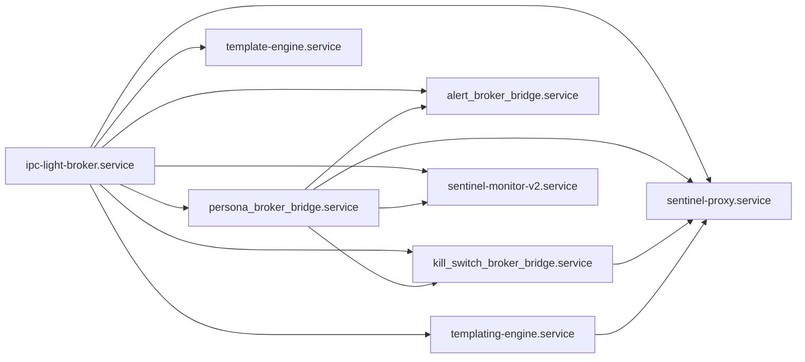
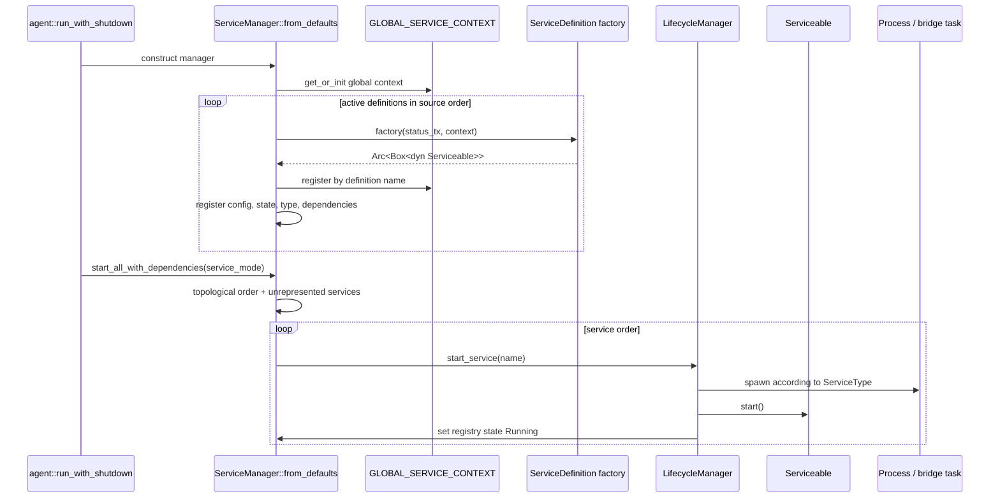

# Endpoint core: service runtime and default process graph

This chapter covers the endpoint workspace's service-management framework in `core/src/service/`, the active definitions in `core/src/defaults/services.rs`, and the wrappers and broker bridges in `core/src/services/`. It distinguishes code that is instantiated by `ServiceManager::from_defaults()` from public but inactive wrappers.

## Evidence boundaries

- **Verified:** `agent/src/agent.rs::run_with_shutdown` creates `ServiceManager::from_defaults()`, calls `start_all_with_dependencies(service_mode)`, starts monitoring, waits for shutdown, and calls `stop_all_with_dependencies()`.
- **Verified:** only the eight non-commented `ServiceDefinition` values returned by `core/src/defaults/services.rs::get_default_services` are in that default runtime graph.
- **Verified:** the service module publicly exports additional service types. Public export is not evidence that those types are instantiated.
- **Unresolved:** downstream consumers outside these three repositories could instantiate public `sentinel_core` service types.

## Active default graph

`get_default_services()` returns these definitions in source order. The order is the registration order, not necessarily the final startup order.

| Definition name | Factory result | Spawn type | Declared dependencies | `run_in_user_space` | Active status |
| --- | --- | --- | --- | --- | --- |
| `ipc-light-broker.service` | `IpcBrokerService` | process | none | true | active default |
| `persona_broker_bridge.service` | `PersonaBrokerBridge` | Tokio task | broker | false | active default |
| `kill_switch_broker_bridge.service` | `KillSwitchBrokerBridge` | Tokio task | broker, persona bridge | false | active default |
| `alert_broker_bridge.service` | `AlertBrokerBridge` | Tokio task | broker, persona bridge | false | active default |
| `templating-engine.service` | `TemplatingEngineService` | process | broker | true | active default |
| `sentinel-proxy.service` | `ProxyService` | process | broker, persona, kill-switch, templating | false | active default |
| `sentinel-monitor-v2.service` | `SystemMonitorV2Service` | process | broker, persona | true | active default |
| `template-engine.service` | `TemplateEngineService` | process | broker | true | active default |

All edges above are directly declared in `get_default_services`. The graph contains two differently named template-engine process services; this is not a diagram typo.

### Commented-out definitions

The same function contains commented definitions for `keystore.service`, `diagnostics.service`, `timekeeper.service`, `timekeeper_broker_bridge.service`, and `vault.service`. An older `persona.service` and `sentinel-monitor.service` are not active definitions either. Comments are retained source, not runtime registration.

### Default-graph contradictions in tests

- **Contradiction:** tests in `core/src/defaults/services.rs` and `core/src/service/manager.rs` expect nine defaults and look for Keystore, Vault, TimeKeeper, and old Persona services. The implementation returns eight and omits those services.
- **Contradiction:** manager tests assert registration of `vault.service`, `timekeeper.service`, and `persona.service`; `ServiceManager::from_defaults()` cannot meet those assertions with the current function.
- **Potential issue:** these are deterministic source/test mismatches, but no test execution result is claimed until the workspace can be built with its private and platform dependencies.

## Startup and registration sequence

The diagram's transition to `Running` is the lifecycle manager's registry transition; it does not mean every bridge has completed initialization or every process has completed an application-level readiness protocol.

## `ServiceManager` and global context

### Identity

**Location:** `core/src/service/manager.rs`  
**Primary symbols:** `StatusUpdate`, `ServiceContext`, `GLOBAL_SERVICE_CONTEXT`, `ServiceManager`  
**Status:** active runtime framework  
**Confidence:** Verified

### `StatusUpdate`

This unbounded-channel message is the manager's service-status input. Variants used by the implementation include state changes, heartbeat timestamps, crash notifications, and errors. The monitor consumes it and updates health/state bookkeeping. Bridge services also emit their own state changes from background tasks.

### `ServiceContext`

`ServiceContext` stores `Arc<Box<dyn Serviceable>>` values in an `RwLock<HashMap<String, ...>>`. Factories use it to retrieve earlier services by string name. It exposes registration, retrieval, and listing operations.

`GLOBAL_SERVICE_CONTEXT` is a `OnceLock<Arc<ServiceContext>>`.

- **Verified:** the first manager initializes it; it is not reset between manager instances.
- **Potential issue:** later managers share the same context and register values under the same names, while each manager has separate local registries and status channels. Tests that construct multiple managers in one process therefore do not receive an isolated global context.

### `ServiceManager::new`

Creates:

- registry maps for configurations, instances, states, recorded type IDs, user-space flags, communication channels, and process handles;
- dependency graph;
- unbounded status update channel;
- lifecycle manager and process supervisor;
- validation query field;
- health monitor state.

### `register_service` / `register_from_definition`

`register_service` rejects duplicate local names, adds config/state/instance data, and records a type ID. `register_from_definition` first verifies that all dependency names already exist locally, calls the factory, places the instance in the global context, registers the local instance, adds dependency edges, and records `run_in_user_space`.

- **Verified:** definitions therefore must be topologically registerable in their source order.
- **Verified:** `service_types` records `TypeId::of::<()>()`, not the concrete erased service type.
- **Potential issue:** `get_handle<T>` compares the requested `T` with that `()` ID before an unsafe Arc conversion. Ordinary concrete types can never match. `get_vault_service` and `get_timekeeper_service` depend on this path and cannot retrieve their named concrete types as implemented.

### `from_defaults`

Calls `new`, iterates `get_default_services`, and calls `register_from_definition`. Factory errors abort construction. Factories for the active persona bridge can panic because they create a Tokio runtime in a new OS thread and use `expect`/`panic` around Vault, agent-state, manager construction, and initialization.

### Dependency ordering

The dependency graph uses `HashMap`/`HashSet` and a Kahn-style topological sort. Services not represented in the graph are appended from `list_services()`.

- **Verified:** dependency constraints are respected when a valid order is returned.
- **Inference:** ordering among siblings or independent services is nondeterministic because iteration uses unordered hash collections. No explicit stable sort is applied.

### `start_all_with_dependencies`

Execution order:

1. Derive dependency order.
2. For each service, check its recorded `run_in_user_space` request.
3. Call lifecycle `start_service`.
4. In service mode, a user-space service start failure is logged and suppressed; the loop continues.
5. For other services, a start failure is returned immediately.
6. Poll the manager state for `Running` with a 30-second limit.
7. In service mode, readiness timeout/failure for a user-space service is also suppressed.

Because lifecycle code writes `Running` immediately after `Serviceable::start()` returns, the poll normally confirms a framework state transition, not a deeper readiness check.

### Validation-query disconnect

The manager and lifecycle manager each own separate optional validation-query storage.

- **Verified:** `ServiceManager::set_validation_query` only updates the manager field.
- **Verified:** start operations invoke the lifecycle manager's query.
- **Verified:** construction does not copy or share the manager field into the lifecycle manager.
- **Verified:** the agent does not set either query and does not load bootstrap results.
- **Potential issue:** even an external caller that calls the public manager setter does not gate lifecycle starts as the code is structured.

### Placeholder public operations

- `get_status_receiver` returns `None`.
- `get_health_status` returns `None`.
- the health-update subscription method creates a new channel whose sender has no producer relationship to the active monitor.
- generic `send_message` and `send_message_and_receive` return errors rather than route `service::messages` payloads.

These are **Placeholder** or incomplete public APIs. Their presence must not be described as operational messaging/health access.

### Shutdown

`stop_all_with_dependencies` reverses dependency order, applies a per-service timeout, tries all services, and returns the first observed error after the loop. Agent shutdown then stops monitoring. A process service's lifecycle stop performs graceful termination, waits, force-kills if needed, calls its wrapper's `stop`, attempts another force-kill, removes the process handle, and records `Stopped`.

## Registry and lifecycle state

### `ServiceState`

**Location:** `core/src/service/state.rs`  
**Type:** public serialized enum  
**Variants:** `NotStarted`, `Initializing`, `Running`, `Stopping`, `Stopped`, `Crashed`, `Retrying`, `Failed`

The doc comment presents intended transitions, but transition enforcement is distributed and incomplete. Registry state, each wrapper's immutable `state` field, and emitted `StatusUpdate` messages are distinct data sources.

- **Verified:** most wrappers never mutate their struct `state` field.
- **Verified:** lifecycle directly mutates registry state.
- **Verified:** monitor messages can subsequently mutate registry state.
- **Contradiction:** several service unit tests call `start()`/`stop()` and assert that the wrapper field changed; it cannot change because the methods take `&self` and do not use interior mutability for that field.

### `LifecycleManager`

**Location:** `core/src/service/lifecycle.rs`  
**Status:** active internal controller

`start_service` validates the starting state, optionally runs its own validation query, sets `Initializing`, spawns according to the configured type, calls `Serviceable::start`, stores a process handle only for process services, and then records `Running`. If spawning or wrapper start fails it records `Failed` and propagates an error.

`stop_service` validates state and treats process and in-process variants differently. For processes it uses the platform handle; for other variants it invokes `stop`. Cleanup through the separate `ServiceCleanup` trait is not dynamically available from the stored `Serviceable` trait object and is not called by this path.

### Spawn implementations

**Location:** `core/src/service/spawn/` and `core/src/service/spawner.rs`

| Spawn type | Implemented action | Retained control handle | Material limitation |
| --- | --- | --- | --- |
| memory | wraps direct service access | communication value may be returned | same-process failures are process failures |
| thread | starts a dummy std-MPSC receive loop | not stored by lifecycle | dropped endpoints cause loop exit; real service work still comes from `Serviceable::start` |
| Tokio task | starts a dummy Tokio-MPSC receive loop | not stored by lifecycle | same disconnect as thread path; active bridges spawn their own tasks |
| process | resolves and spawns binary, prepares IPC | process handle stored | custom-IPC wrappers bypass standard connectivity probe |

### Process spawn path

For a process service the spawner:

1. derives `IpcAddress::for_service` and asks `infra` to prepare it;
2. resolves the executable through the platform process interface;
3. creates a child command;
4. sets `IPC_SOCKET`, `SERVICE_NAME`, and `NO_COLOR`;
5. in service mode, propagates log/template-related variables and honors supported user-space spawning;
6. for the IPC broker, sets `IPC_LIGHT_PIPE_PATH_IPC_LIGHT_BROKER` on the child and, through an unsafe environment mutation, the parent process;
7. applies wrapper arguments and optional working directory;
8. kills stale children matching the binary stem;
9. spawns the child;
10. for standard IPC only, attempts three rapid connections with approximately 10 ms and 20 ms waits; failure falls back to `NoOp` rather than failing spawn.

`NoOp` reports sends as successful, receives zero bytes, and reports not connected. Thus standard-IPC failure is not a readiness failure either.

## Supervision, monitoring, and recovery

### `ProcessSupervisor`

**Location:** `core/src/service/process_supervisor.rs`  
**Status:** active process poller

It polls retained process handles at the interval from `SENTINEL_PROCESS_CHECK_INTERVAL_MS` (default 5,000 ms). An exited child is marked crashed and handed to `Supervisor`. Login/session changes reset eligible user-space services from `Failed`, or from `NotStarted` when no handle exists, to `Crashed` so normal recovery can act. When the global kill switch is enabled, it also seeks crashed process services without handles for restart.

### `Supervisor`

**Location:** `core/src/service/supervisor.rs`

It records crash counts/timestamps/consecutive crashes, checks `retry_on_crash` and maximum retries, writes `Retrying`, sleeps with exponential backoff based on `retry_timeout` capped at one hour, resets to `NotStarted`, calls lifecycle start directly, and increments the successful retry count. When global process restart is disabled, the service remains `Crashed`.

### Generic crash detectors

**Location:** `core/src/service/crash_detector.rs`

`CrashDetectorFactory` returns a detector by spawn type. `MemoryCrashDetector` always returns false and waits forever. Thread, process, and Tokio implementations have no handle access: nonblocking checks return false and blocking methods return `CrashDetectionFailed` errors. Private thread helper functions can inspect/join a supplied handle but are not connected to the public trait methods.

**Classification:** experimental/scaffolded alternative to the active process polling path.

### Health monitor

**Location:** `core/src/service/monitor.rs`, `health.rs`, `heartbeat.rs`

The monitor consumes the manager's unbounded `StatusUpdate` receiver. `HeartbeatTask` is a functional reusable producer and can run indefinitely or stop via a shutdown channel. In the active default graph, wrappers principally emit state changes; no active factory wires a heartbeat task to them.

Health tracker records include state, spawn time, crash/retry counters, last crash time, and consecutive crashes. The tracker's optional heartbeat interval is initialized as `None`, so heartbeat timeout detection is not enabled through the observed manager setup.

- **Potential issue:** the monitor's separate restart attempt sets a service to `NotStarted` and invokes `restart_service`; restart first calls stop, which rejects `NotStarted`. This makes that health-monitor restart path internally inconsistent. The active `Supervisor` recovery path calls lifecycle start after resetting state and does not share this exact sequence.

### Cleanup trait

`core/src/service/cleanup.rs::ServiceCleanup` defines synchronous cleanup with `Failed`, `Timeout`, and `AlreadyClean` errors. The comments promise invocation during graceful shutdown, crashes, and removal. Repository-wide inspection of lifecycle/manager paths did not find trait-object cleanup invocation.

**Contradiction:** documented invocation points are not implemented by the active framework. Individual wrappers' cleanup methods are callable directly and are unit-tested, but mostly no-ops.

## Active process wrappers

### `IpcBrokerService`

**Location:** `core/src/services/ipc_broker.rs`  
**Binary name:** `ipc-light-broker`  
**Registry definition:** `ipc-light-broker.service`  
**Status:** active process adapter

The wrapper returns custom IPC=true and user-space=true. Its process arguments are the literal service IDs `timekeeper_service`, `alerting_service`, `diagnostics_service`, `sentinel_proxy`, and `sentinel_agent`. Start and stop primarily emit/log status; process creation/termination is performed by lifecycle infrastructure.

- **Verified:** the pinned broker executable does not parse positional arguments, so this list has no effect in the pinned broker implementation. It also omits active `persona_service`, `kill_switch_service`, monitor, template, and actual proxy-alert sender identity `sentinel_proxy_alerting`.

### `ProxyService`

**Location:** `core/src/services/proxy.rs`  
**Binary name:** `sentinel-proxy`  
**Status:** active process adapter

It declares custom IPC and supplies a large hard-coded CLI configuration. Verified categories include DLP egress/enforcement, packet interception and TLS redirection inputs, justification duration 15, TTL 2, a `dummy/` model path, embedded support certificate/key constants, buffer/connection/keepalive/refresh/cache/request timeout values, bind address `0.0.0.0`, and platform pattern/HTTP2 data file paths. Exact flag/value pairs are indexed in the symbol catalog and configuration reference.

Working-directory search is development repo `proxy`, current-directory `proxy`, then executable parent. A unit test expects `None`, while the function normally returns the executable parent when `current_exe` succeeds.

### `SystemMonitorV2Service`

**Location:** `core/src/services/system_monitor_v2.rs`  
**Binary name:** `sentinel-monitor-v2`  
**Status:** active process adapter

It uses custom IPC, requests user-space launch, emits state messages, has no process arguments, and resolves working directory through repository/current/executable-parent strategies similar to the proxy.

### `TemplatingEngineService`

**Location:** `core/src/services/templating_engine.rs`  
**Binary name:** `templating-engine`  
**Status:** active process adapter

Custom IPC, user-space launch, no arguments. It prefers an executable-adjacent working directory.

### `TemplateEngineService`

**Location:** `core/src/services/template_engine.rs`  
**Binary name:** `template-engine`  
**Status:** active process adapter

This is a second default process adapter, distinct from `TemplatingEngineService`. It uses custom IPC, user-space launch, and no custom working directory.

- **Unresolved:** build/packaging analysis must establish which workspace artifact supplies `template-engine`; it is not established merely by this wrapper.

## Active in-process broker bridges

### Persona factory and `PersonaBrokerBridge`

**Locations:** `core/src/defaults/services.rs`, `core/src/services/persona_broker_bridge.rs`, `core/src/services/persona_broker_types.rs`

The factory creates a standalone `VaultService`, creates an `AgentStateController`, starts a new OS thread, builds a distinct Tokio runtime there, blocks on `PersonaManager::new` and `initialize`, and returns a bridge that retains the runtime thread bridge. These objects are not the inactive default Keystore/Vault/Persona service chain.

The factory reads `SENTINEL_OVERRIDE_EMAIL` and can obtain a current email from the user-store/service environment. Its OAuth fallback callback always resolves false. Construction failures use `expect`/panic rather than a recoverable factory error.

The bridge connects to IPC channel `ipc_light_broker` and registers identity `persona_service`. It accepts JSON payloads with a `command` field and supports:

| Command | Result data | Important effect |
| --- | --- | --- |
| `get_persona` | current persona identity data | reads manager state |
| `get_access_token` | access token or auth state | may refresh token; token crosses IPC boundary |
| `is_authenticated` | boolean/auth state | reads manager state |
| `notify_auth_failure` | command result | informs persona manager |

Responses target the incoming message's `source`. Persona change events broadcast with target `*`. It retries connection/registration up to five attempts with exponential delays beginning at five seconds and capped at 30 seconds. Once connected it checks authentication/email/token changes on a 30-second timer. Disconnects cause reconnection attempts.

- **Security boundary:** the pinned broker's source identity is supplied by its message envelope and broker registration does not authenticate OS identity. Access-token replies therefore rely on broker reachability and claimed registered identity rather than a demonstrated cryptographic authorization check.
- **Potential issue:** lifecycle records the bridge `Running` as soon as `start()` spawns its background task. The task may later emit `Running`, `Retrying`, or `Failed` based on actual connection/authentication.

### `KillSwitchBrokerBridge`

**Locations:** `core/src/services/kill_switch_broker_bridge.rs`, `kill_switch_broker_types.rs`

The bridge registers as `kill_switch_service`, reads/watches `AgentStateController`, answers the `get_state` command, and broadcasts `kill_switch_state_change` events to `*`. It sleeps two seconds before the first broker connection and uses a five-attempt exponential retry sequence. Its lifecycle/readiness split matches the persona bridge.

### `AlertBrokerBridge`

**Location:** `core/src/services/alert_broker_bridge.rs`

The background task opens the SQLite alert database at `ALERT_DB_PATH`, creates the database layer, `PersonaAuthProvider`, and `AlertingSystem`, refreshes auth cache every 60 seconds, and starts an `AlertReceiver` connected to the broker. A bounded Tokio channel of capacity 1,024 transfers alerts from a synchronous callback; `try_send` drops an alert when full.

Broker messages are converted to `SerializedAlert` and dispatched to the alerting system. Conversion uses `Box::leak` for the dynamic content-type and batch-family strings, creating process-lifetime allocations for each converted alert.

- **Potential issue:** bridge `start()` returns before database initialization and broker setup. Failure is reported asynchronously after lifecycle has recorded `Running`.
- **Potential issue:** receiver termination is handled as a stopped bridge at this layer; reconnection behavior depends on `AlertReceiver` internals, documented in the alerting subsystem chapter.

## Public but inactive service wrappers

The following are compiled and publicly exported from `core/src/services/mod.rs` but absent from the active defaults. “Inactive” means absent from the observed agent default graph, not unreachable to library consumers.

### `KeystoreService`

**Location:** `core/src/services/keystore.rs`  
**Type/status:** public memory-service adapter; inactive default

`new` configures `keystore.service`, three retries, and 5,000 ms retry timeout. On macOS/Windows `start` constructs `Keystore` around `TrustedEnvironment { sec_level: Unknown }`, calls `keystore.new()`, stores it under a standard `RwLock`, and emits initialization/running messages. Other platforms use `Keystore::new_instance`. `get_keystore` panics if called before initialization. Poisoned standard locks also panic through `unwrap`.

**Contradiction:** start/stop tests assert changes to `service.state`; the field is not mutated.

### `VaultService`

**Location:** `core/src/services/vault.rs`  
**Type/status:** public memory-service/domain adapter; inactive default but used directly by active persona factory and persona modules

Constructors support an uninitialized `VaultManager`, a `KeystoreService`, a direct `Keystore`, or an async constructor. On supported platforms the legacy `new` directly probes a keystore. `store`, `retrieve`, secret store/retrieve/delete, and `handle_message` expose the backing vault. The message handler converts successful operations into typed `VaultResponse`; on failure it returns `Err(String)` rather than the corresponding `*Error` response enum variants.

`start` spawns initialization: optionally pull the Keystore from `KeystoreService`, load vault metadata, migrate to two-factor encryption, ensure a master key, and emit `Running`. Each failure emits `Failed`; the synchronous method itself returns `Ok` after spawning.

- **Potential issue:** lifecycle can overwrite state to `Running` before this initialization finishes.
- **Contradiction:** tests expect the immutable wrapper `state` to become `Initializing` or `Stopped`.

### `TimeKeeperService`

**Location:** `core/src/services/timekeeper.rs`  
**Type/status:** public Tokio-service adapter; inactive default; placeholder behavior

Although it owns `Arc<TrustedTimeKeeper>`, `get_trusted_time` returns `SystemTime::now`. `SyncWithNtp` returns success with zero offset, and `GetTimeOffset` returns zero. Start/stop only send state messages.

- **Documentation-only:** claims of actual multiple-source/NTP synchronization are not implemented by this wrapper.
- **Contradiction:** unit tests expect mutation of the immutable state field.

### `TimeKeeperBrokerBridge`

**Locations:** `core/src/services/timekeeper_broker_bridge.rs`, `timekeeper_broker_types.rs`  
**Type/status:** public Tokio broker adapter; inactive default

It registers as `timekeeper_service`, accepts `get_time`, `get_system_time`, `sync_ntp`, and `get_offset`, replies to the message source, and broadcasts current time to `*` every 30 seconds. Its response models serialize millisecond timestamps and optional NTP offset. Because the underlying service is placeholder, trusted time and system time are both current system time and offsets are zero. The periodic broadcast timer's first Tokio tick is immediate.

The reconnect protocol is the same three-stage connect/Connected/register/Ack sequence and five-attempt exponential backoff used by other bridges.

### `PersonaService`

**Location:** `core/src/services/persona.rs`  
**Type/status:** public Tokio-service adapter; inactive default

It holds `OnceCell<PersonaManager>`. `start` spawns construction and initialization, then stores the manager and emits `Running` or `Failed`. It exposes persona lookup, token retrieval, and authentication state. `stop` emits status but does not take/drop the initialized manager or explicitly await its background tasks.

The active persona bridge does not instantiate this wrapper; its factory constructs `PersonaManager` directly on a dedicated runtime thread.

### `DiagnosticsService`

**Location:** `core/src/services/diagnostics.rs`  
**Type/status:** public process adapter; inactive default

`start` calls `crate::diagnostics::init_ipc(producer)` in the agent process and logs a diagnostic-start event. Its declared child binary is `sentinel-diagnostics`, with no arguments and no custom-IPC override. Process spawning would therefore attempt standard IPC then accept `NoOp` on connection failure.

### `SystemMonitorService`

**Location:** `core/src/services/system_monitor.rs`  
**Type/status:** legacy v1 process adapter; inactive default

This adapter targets `sentinel-monitor.service`/binary `sentinel-monitor`, custom IPC, no arguments, and resolves a `system-monitor/v1` development working directory before executable-parent fallback. V2 is the active replacement.

## Service protocols and data points

### Generic messages

`core/src/service/messages.rs` defines `VaultMessage`, `VaultResponse`, `TimeKeeperMessage`, `TimeKeeperResponse`, and wrapper enums `ServiceMessage`/`ServiceResponse`. JSON derives use Serde's default externally tagged enum representation. `MessageConfig::default` is a five-second request timeout and 10 MiB maximum size.

- **Verified:** serialization unit tests exercise the enum representations.
- **Verified:** the manager's generic messaging methods do not route them.
- **Verified:** persona storage calls `VaultService::handle_message` directly; typed messages therefore have in-process consumers even though manager transport is incomplete.

### Communication abstraction

`core/src/service/communication.rs::CommunicationChannel` has direct, std-MPSC, Tokio-MPSC, and platform IPC variants, with typed accessors and builder helpers. This represents an intended unified transport model. Active custom-IPC services bypass the standard platform channel and build `ipc-light` channels inside their bridge tasks.

### Errors

`ServiceError` variants cover not-found, already-running/existing, initialization, shutdown timeout, crash/max retries/retries exhausted, invalid config/not registered, crash detection, and failed state. Call sites do not use every variant uniformly; error/recovery mapping is cataloged in the error chapter.

## File classification

| Path/group | Role | Runtime classification | Analysis status |
| --- | --- | --- | --- |
| `core/src/defaults/services.rs` | default graph and factories | active | fully analyzed |
| `core/src/service/manager.rs` | registration, orchestration, public manager API | active, partly placeholder | fully analyzed |
| `core/src/service/lifecycle.rs` | start/stop transitions | active | fully analyzed |
| `core/src/service/registry.rs` | registry storage | active | fully analyzed |
| `core/src/service/dependencies.rs` | dependency graph/order | active | fully analyzed |
| `core/src/service/process_supervisor.rs`, `supervisor.rs` | child polling/retry | active | fully analyzed |
| `core/src/service/monitor.rs`, `health.rs`, `heartbeat.rs` | status and health model | active framework, heartbeat not wired by defaults | fully analyzed |
| `core/src/service/spawner.rs`, `spawn/*.rs` | spawn adapters | active with scaffolding | fully analyzed |
| `core/src/service/communication.rs`, `messages.rs` | generic transport protocols | public, incompletely wired | fully analyzed |
| `core/src/service/crash_detector.rs` | alternative crash detector strategy | scaffolded | fully analyzed |
| `core/src/service/cleanup.rs` | optional cleanup contract | public, framework invocation missing | fully analyzed |
| `core/src/service/{config,error,info,state,traits,mod}.rs` | service types and exports | active/public | fully analyzed |
| active wrappers/bridges described above | process and IPC adapters | active default | fully analyzed at service layer |
| inactive wrappers/TimeKeeper types described above | legacy/library services | not default-registered | fully analyzed at service layer |
| unit-test sections in these files | framework/wrapper tests | test code, multiple contradictions | fully analyzed |

Underlying alerting, persona, kill-switch, vault, keystore, and trusted-time domain implementations are analyzed in their own subsystem chapters; this chapter documents only their service-layer integration.
