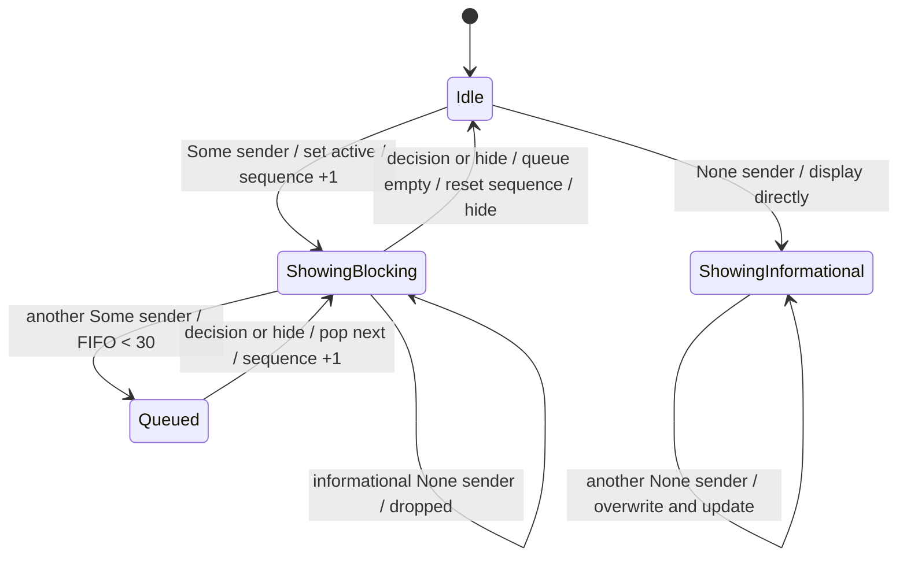

# Endpoint Core DLP Templating Engine and Legacy UI Assets

**Repository:** `sentinel-endpoint-agent`  
**Revision:** `a022e52bf2fff6a9445ebad96c3afeaf277e259f`  
**Primary source scope:** all five files under `core/src/templating_engine/`  
**Runtime-asset scope:** `core/tauri.conf.json`, all four files under `core/templates/`, and `core/ui/index.html`  
**Context traced into:** the core manifest/build script/global constants/process spawner, proxy Tauri entry, DLP policy-action dispatch, local UI adapter, standalone templating-engine binary, and templating IPC client  
**Declaration coverage:** all 51 AST-indexed Rust declarations in the five primary source files  
**Confidence:** Verified except where explicitly marked `Inference`, `Unresolved`, or `Potential issue`

## What this subsystem actually is

The core templating engine is a Tauri/Tera popup renderer used by the proxy's DLP enforcement flow. It converts detector output into highlighted HTML, maintains a singleton native webview window, queues blocking requests, exposes seven Rust commands to the webview, and returns an optional justification through a Tokio oneshot channel.

There are two checked deployment shapes for the same core UI:

1. **Integrated proxy mode.** `proxy/src/platform/tauri.rs::main_tauri` runs the proxy on a background Tokio runtime and calls `TauriContext::initiate_tauri` on the process main thread. `proxy/src/dlp/tauri_ui.rs::invoke_tauri_on_main_thread` sends contexts through a process-global `OnceCell<std::sync::mpsc::Sender<_>>`.
2. **Service mode.** The `sentinel-proxy` package declares a separate `templating-engine` binary at `proxy/src/templating_engine_main.rs`. It registers the claimed broker identity `templating_engine_service`, receives `PopupRequest` JSON, and sends each request through the same local adapter and core Tauri loop. The default agent graph separately launches `templating-engine.service` in service mode.

The newer `template-service/` crate is a separate implementation with its own state, registry, commands, templates, IPC protocol, and Tauri configuration. It is not the code described in this document and is still pending analysis.

The module-level claim that this is a “complete” DLP alert system is overstated. Verified gaps include an unregistered public submission command, an incompatible legacy template, ignored `default_justification` state inside the core, queue corruption in two active templates, unchecked user-event association, and no tests for the window/queue/command paths.

## File inventory

| Path | Implemented role | Checked reachability | Generated/vendored | Status |
| --- | --- | --- | --- | --- |
| `core/src/templating_engine/mod.rs` | Public module tree and design/usage documentation | Exported by `sentinel_core::templating_engine` | Handwritten | Fully analyzed |
| `core/src/templating_engine/models.rs` | DLP/event/config/state models, highlighting algorithm, five tests | Active through both proxy UI shapes | Handwritten | Fully analyzed |
| `core/src/templating_engine/defaults.rs` | Fixed theme/content/options defaults | Active in every popup construction | Handwritten | Fully analyzed |
| `core/src/templating_engine/commands.rs` | Eight Tauri command functions; seven are registered | Active webview boundary; `submit_justification` is not registered | Handwritten | Fully analyzed |
| `core/src/templating_engine/ui.rs` | Template discovery, Tauri lifecycle, singleton window, FIFO | Active through both proxy UI shapes | Handwritten | Fully analyzed |
| `core/tauri.conf.json` | Bundled asset root, CSP, event capability, identity/bundle metadata | Consumed by `tauri_build::build` and `generate_context!` | Handwritten | Fully analyzed |
| `core/ui/index.html` | Bundled bootstrap shell that invokes Tera rendering and replaces the document | Active first page for `alert-window` | Handwritten | Fully analyzed |
| `core/templates/alert.html` | Highlight/reason UI, queue counter, timer, response command, in-place reuse | Active for mandatory and optional/notification DLP paths | Handwritten | Fully analyzed |
| `core/templates/block.html` | Static blocked notice and automatic block decision | Active for adversarial/policy-block notifications | Handwritten | Fully analyzed |
| `core/templates/prompt.html` | AI-risk informational notice and acknowledgement | Active for policy `Prompt`/`Ask` notifications | Handwritten | Fully analyzed |
| `core/templates/index.html` | Older queue-oriented UI using obsolete variables/commands | Dead-code candidate for checked callers; externally selectable but incompatible | Handwritten legacy code | Fully analyzed |

## Component and runtime topology

```mermaid
flowchart LR
    DLP["proxy DLP policy-action dispatch"]
    Local["Integrated adapter\ninvoke_tauri_on_main_thread"]
    Client["Service-mode templating IPC actor"]
    Broker["ipc-light broker"]
    Standalone["templating-engine binary\nhandle_request_concurrent"]
    Chan["unbounded std::mpsc\nJustificationContext"]
    UI["TauriContext receiver thread\nand FIFO"]
    State["AppState mutexes/atomics"]
    Window["singleton alert-window\ncore/ui/index.html"]
    Tera["Tera templates from filesystem"]
    JS["registered Tauri commands"]
    Waiter["Tokio oneshot waiter"]

    DLP -->|non-service| Local
    DLP -->|SENTINEL_SERVICE_MODE present| Client
    Client --> Broker --> Standalone
    Standalone --> Local
    Local --> Chan --> UI --> State
    UI --> Window
    Window --> JS
    JS --> State
    State --> Tera --> Window
    JS --> Waiter
```



Verified: `SENTINEL_SERVICE_MODE` is tested only for presence, not value, in `proxy/src/dlp/mod.rs::use_external_templating_engine`.

## Entry points and startup

### Integrated proxy

`proxy/src/platform/tauri.rs::main_tauri`:

1. Creates proxy-done and Tauri-shutdown standard channels.
2. Spawns a 500 ms kill-switch poller on the caller's Tokio runtime.
3. Spawns a native thread, builds another multi-thread Tokio runtime, and runs the proxy there.
4. On proxy completion, sends both shutdown/done signals. Service-mode integrated execution additionally starts a thread that calls `std::process::exit(0)` three seconds after proxy completion if the process remains alive.
5. Creates an unbounded standard channel for `JustificationContext` and attempts to install its sender in the global `OnceCell`.
6. Calls `TauriContext::initiate_tauri` on the main thread and returns only after the Tauri event loop exits.

### Standalone `templating-engine`

`proxy/Cargo.toml` declares `[[bin]] name = "templating-engine"`. Its `main`:

1. Initializes a daily `templating-engine.log` nonblocking appender, defaulting to `SENTINEL_LOG_DIR`, `C:\ProgramData\Sentinel\logs`, or `./logs` depending on environment/platform.
2. Creates the UI-context and shutdown standard channels and registers the UI sender.
3. Spawns a multi-thread Tokio runtime thread.
4. Starts broker-based kill-switch listeners, waits two seconds, then requests UI shutdown if initially disabled or on a later enabled-to-disabled transition observed every 500 ms.
5. Runs a reconnecting broker listener. Each incoming message is handled in an independent Tokio task and completed responses pass through an unbounded Tokio channel because the duplex channel is not shared across tasks.
6. Calls the core Tauri loop on the main thread.

The standalone listener accepts only broker `Message` records whose JSON parses as `PopupRequest` and whose serialized `type` is `templating_popup_request`. Malformed/wrong-type messages are silently ignored. Broker registration identity is self-asserted; the endpoint-pinned IPC analysis documents that the broker does not authenticate or bind subsequent `source` fields to that identity.

### Core Tauri initialization

`TauriContext::initiate_tauri` executes as follows:

1. Builds an ordered list of template globs: nonempty `SENTINEL_DLP_TEMPLATE_DIR`; two Windows or two macOS fixed installation paths; then `BUNDLE_TEMPLATES_PATTERN`.
2. Calls `Tera::new` on each pattern and accepts the first successfully parsed set that contains `alert.html`. A directory containing only the requested `block.html` or `prompt.html` is rejected.
3. If no candidate qualifies, logs one final error and returns without starting Tauri or explicitly resolving any caller.
4. Creates `AppState` with no current context/event/sender, template `alert.html`, an empty FIFO, inactive gate, and sequence zero.
5. In setup, uses macOS `Accessory` activation policy and starts two unjoined native threads: one blocking on contexts, one blocking on shutdown.
6. Registers seven commands, builds the app with `generate_context!()`, and panics if app construction fails.
7. Prevents an exit request only when its exit code is `None`; explicit `AppHandle::exit(0)` is allowed to terminate.

Dropping the shutdown sender is treated identically to sending a shutdown value: `shutdown_rx.recv()` returning either `Ok` or `Err` closes the window if present and calls `exit(0)`. By contrast, closure of the context channel only logs an error and ends that receiver thread; it does not exit the app.

## Popup request flows

### Blocking request

```mermaid
sequenceDiagram
    participant D as DLP enforcement
    participant A as Local/IPC adapter
    participant R as Context receiver thread
    participant Q as AppState FIFO
    participant W as Webview template
    participant C as log_dlp_decision

    D->>A: original text, detections, default, timeout, options, alert.html
    A->>A: create oneshot; timeout_secs = max(input, 1)
    A->>R: JustificationContext with resp_sender Some
    R->>Q: claim active slot or enqueue (max 30 waiting)
    Q->>W: display current popup
    W->>C: decision + UserJustification + originalText
    C->>C: clear event only when IDs match
    C-->>A: Some(value), or None for exact closed/timeout
    C->>Q: pop/display next or reset/hide
    A-->>D: value; every timeout/cancel/None becomes configured default
```

The queue limit is 30 **waiting** blocking contexts, so at most 31 are represented by the active slot plus FIFO. Overflow immediately sends `None`; both adapters convert that into the request's configured default justification.

The local adapter's outer safety deadline is `input_timeout * 31 + 30` seconds. It uses the original `timeout_seconds`, while the UI context clamps the displayed value to at least one. Thus an input of zero produces a one-second UI timer but a 30-second outer deadline. The service-mode client independently uses `timeout * 31 + IPC_RESPONSE_TIMEOUT_SECS`, then adds two seconds around its actor response.

### “Non-blocking” request mismatch

Core queue code defines a nonblocking context as `resp_sender == None`: it displays immediately only if no blocking popup is active and otherwise drops it. No checked production constructor creates such a context.

Both integrated and service-mode notification paths call `invoke_tauri_on_main_thread`, which always creates a oneshot and sets `resp_sender: Some(resp_tx)`. Therefore DLP actions described by the proxy as nonblocking are nonblocking only to the originating request because they run in a detached task; inside the UI they occupy the blocking gate, enter the same bounded FIFO, and wait for a response/default timeout. The standalone service deliberately does not return a broker `PopupResponse` for a request whose `blocking` field is false.

This is a direct contradiction between `TauriContext::build_context_and_launch_window`'s classification and every known proxy caller.

### Policy-action mapping

| Proxy policy path | Template | Originating request waits? | Core treats as blocking? | Observable response use |
| --- | --- | --- | --- | --- |
| Adversarial detection before policy evaluation | `block.html` | No; detached | Yes | Discarded |
| `Block` / `AllowPromptAfterRemovalOfSensitiveData` | `block.html` | No; detached | Yes | Discarded |
| `Prompt` / `Ask` | `prompt.html` | No; detached | Yes | Discarded |
| `AllowOriginalPromptWithNoJustification` | `alert.html`, empty options | No; detached | Yes | Discarded |
| `AllowOriginalPromptWithOptionalJustification` | Auto: `block.html` for adversarial detection, else `alert.html` | No; detached | Yes | Discarded |
| `Justify` / `AllowOriginalPromptWithMandatoryJustification` | `alert.html` | Yes | Yes | Nondefault allows; default blocks |

Checked internal selection emits only `alert.html`, `block.html`, and `prompt.html`. The IPC schema and public `JustificationContext` accept an arbitrary template name without an allow-list. Tera can render only a name already loaded from the chosen glob, so this is not by itself arbitrary filesystem reading, but any installed HTML template is addressable by a syntactically valid request.

## Data model and data dictionary

### Detection and event models

| Field | Type | Origin and validation | Transformation/consumer |
| --- | --- | --- | --- |
| `Detection.entity` | `String` | Detector/IPC input; only `.trim()` emptiness is checked during highlighting | Case-folded substring search; retained in serialized `ContentConfig` |
| `category`, `sub_category` | `Option<String>` | Detector input; no format/length validation | Build `Entity.label`; categories become UI tags |
| `category_id`, `category_code_name`, `reason`, `detection_method`, `snippet` | `Option<String>` | Detector input; Serde defaults missing values to `None` and omits `None` on serialization | Preserved in `content.detected_entities`; not copied to `DlpEvent.entities` |
| `detection_type` | `DetectionType` | Missing Serde field defaults to `SensitiveContent` | Proxy chooses adversarial/block behavior; highlighter does not branch on it |
| `Entity.start`, `end` | `usize` byte offsets | Derived from lowercased search string | Used to slice original UTF-8 and serialized to webview |
| `Entity.label` | `String` | `category:sub_category`, category alone, or `UNKNOWN`; overlaps concatenate with `, ` | Tooltip/data attributes and event output |
| `Entity.confidence` | `f32` | Hard-coded `0.95` for every match | Serialized; no local decision uses it |
| `DlpEvent.id` | `String` | `event-<local timestamp_millis>`; empty on no match | Webview associates a decision with current event |
| `DlpEvent.timestamp` | `String` | Separate `chrono::Local::now().format("%+")`; empty on no match | Exposed by `get_current_dlp_event`; no internal persistence |
| `DlpEvent.original_text` | `String` | Original request text | Exposed to webview; held only in memory here |

`Detection` equality/hashing includes every field. Two detections with the same `entity` but different metadata remain distinct `HashSet` members.

Potential issue: timestamp-millisecond IDs are not guaranteed unique, and ID/timestamp use separate clock reads. No collision test or stronger identifier exists.

### Request, UI, and response models

| Data point | Type/default | Lifecycle and behavior |
| --- | --- | --- |
| `JustificationContext.original_text` | `String` | Consumed into `ContentConfig`; cloned into `DlpEvent`; sent to webview |
| `detections` | `HashSet<Detection>` | Consumed into content and searched; serialization order is not stable |
| `default_justification` | `String` | Stored in the context but never read by core UI/model/commands; adapters retain a clone and apply it on `None`, cancellation, or timeout |
| `timeout_secs` | `u64` | Local adapter clamps to at least 1; core casts with `as u32`, then turns the timer on iff the truncated value is positive |
| `justification_options` | `Vec<String>` | Local adapter splits a semicolon string, trims, and drops empties; core inserts the vector without value/length validation |
| `resp_sender` | `Option<oneshot::Sender<Option<String>>>` | `Some` means queued/blocking to core; taken exactly once by decision/hide; dropped on overwrite/state destruction |
| `template_name` | `String` | Used for Tera lookup and to decide whether the singleton window must be recreated |
| `UserJustification.event_id` | `String` | Supplied by webview; used only for conditional event clearing, not response-channel authorization |
| `value`, `comments` | `String` | No validation/limit; active `log_dlp_decision` sends only `value`; `_original_text` and `comments` are ignored |

The proxy CLI declares `--dlp-justify-timeout-secs` as an unconstrained `u64`, default 3. `ProxyConfig::default()` separately uses 30; normal `From<Args>` uses the CLI value. Values above `u32::MAX` wrap modulo `2^32` inside the UI while the adapter safety deadline remains based on the original `u64` and saturating arithmetic.

### Fixed defaults

`ThemeConfig::default` uses background `#1e1e1e`, panel `#252526`, accent `#4caf50`, warning `#ff9800`, and text `#ffffff`.

`ContentConfigBuilder::default` uses title `Potentially Sensitive Data Detected.`, description `Please review content before submitting to external website.`, empty original text, and an empty detection set.

`OptionsConfig::default` provides four reasons (`Authorized Business Purpose`, `False Positive`, `Manager Approved Exception`, `Testing Data (Non-Production)`), company text `Stay safe, Quilr it!`, logo/dismiss enabled, timer disabled, timeout 15, dismissed text `User dismissed alert`, and timeout text `User did not respond in time`. Popup construction immediately replaces timeout/options and recalculates `show_timer`; other option fields cannot be customized through `JustificationContext`.

## Highlight construction

`ContentConfig::build` performs these steps:

1. Clone `original_text`. If text or the detection set is empty, copy the raw text to `html_text` and return a `DlpEvent` with empty ID/timestamp/entities.
2. Unicode-lowercase the entire input.
3. Copy detection references and sort by entity byte length descending, then entity text lexicographically. Records tied on both keys retain the nondeterministic `HashSet` iteration ordering.
4. Trim each entity and skip empty values.
5. Lowercase the entity and find sequential **non-overlapping** occurrences. After one match, search resumes at its end, so overlapping repetitions such as `aaa` within `aaaa` are not both reported.
6. Build a display label. Scan all already collected ranges; on the first true overlap, widen it, append the label unless `existing.label.contains(label)`, and stop scanning. Otherwise append a new range with confidence 0.95.
7. Sort ranges by start byte.
8. Append unhighlighted original slices and highlighted original slices to an HTML string. Only attribute values are escaped. Text slices are copied raw.
9. Split the first colon in a possibly comma-combined label back into category/subcategory attributes and create a new event.

Verified behaviors:

- Search is case-insensitive for ordinary mappings and preserves original casing in output.
- Each distinct non-overlapping occurrence is highlighted.
- Nested matches are merged and their labels accumulated.
- Metadata other than category/subcategory is not represented in `Entity`.
- `contains` is substring comparison, not token comparison; one label can incorrectly suppress a different label that is its substring.
- Combined labels are not structurally parsed. For `PII:EMAIL, PII:DOMAIN`, `data-category` becomes `PII` and `data-sub-category` becomes `EMAIL, PII:DOMAIN`.

Potential issue: offsets are calculated in the lowercased UTF-8 string and then used to slice the original. Unicode lowercase mappings can change byte length. For example, an uppercase dotted-I mapping can yield a one-byte match end that is not a character boundary in the original; Rust string slicing then panics. No Unicode-offset test exists.

Potential issue: all body text, including text outside and inside highlight spans, is appended without HTML escaping. This is consumed with `{{ content.html_text | safe }}` on first render and assigned to `innerHTML` during reuse.

The code breaks after merging the first overlapping range. Length-descending processing appears intended to prevent a later, shorter match from bridging two prior disjoint ranges, but the repository supplies no invariant proof or bridge case. Whether all Unicode/duplicate arrangements preserve non-overlap is Unresolved; this document does not claim a demonstrated transitive-overlap defect.

## Queue and state machine



The `JustificationContext` transport into Tauri is an unbounded `std::sync::mpsc` channel. The 30-item cap applies only after the receiver thread dequeues a context and attempts to place it in `AppState.popup_queue`; it is not backpressure on producers.

`AppState` has separate mutexes for Tera, UI context, current event, response sender, template name, and queue. It has relaxed `AtomicBool`/`AtomicUsize` fields for active state and sequence. Popup construction updates UI context, event, and response sender in three separate lock sections. The webview is normally notified only afterward, but there is no atomic snapshot spanning these fields; a concurrent command invocation can observe mixed generations.

For a blocking popup, the receiver holds the queue mutex across check/claim/enqueue, releases it before window operations, and keeps `popup_active` true across queued displays. `display_next_queued_popup` pops under the mutex; if empty it clears active state, resets sequence to zero, and suppresses hide errors.

`get_queue_info` reads the relaxed sequence before locking the FIFO. Since the sequence increment occurs after the FIFO decision and without that lock in `display_popup_from_context`, `(position,total)` is a live, not transactional, snapshot.

## Window creation and reuse

For every selected context, `display_popup_from_context`:

1. Increments the sequence only if `popup_active` is true.
2. Builds highlighted content and a `DlpEvent`.
3. Builds fixed theme/options, casting timeout to `u32`.
4. Replaces context, event, and response sender.
5. If `alert-window` exists and the template name is unchanged, suppresses show/focus/emit errors and returns.
6. If the template changes, attempts to close the old window, sleeps the receiver thread for 150 ms even if close fails, stores the new name, and constructs another window with the same label.
7. Creates a 700×500 centered, decorated, fixed-size, always-on-top, taskbar-skipped, nonclosable webview with devtools off and content protection explicitly false. A build error panics.

Potential issue: if close fails during a template change, construction with the same label can fail and the unconditional `expect` can terminate the Tauri thread/process.

Potential issue: ignored show/focus/emit failures leave the response waiter alive until its outer safety timeout; the core does not fall back or send `None`.

The `content_protected(false)` setting explicitly permits OS screenshot/screen-capture behavior supported by the platform. A TODO says to enable it in production, but the checked code does not.

## Tauri command interface

| Command | Registered? | Inputs | Output/side effects | Failure behavior |
| --- | --- | --- | --- | --- |
| `render_alert_ui` | Yes | `AppHandle`, managed state | Serializes context, adds queue counters, renders current template; hides and returns empty if no context | Mutex/serialization unwrap can panic; render errors become raw error HTML |
| `get_current_dlp_event` | Yes | State | Clones `Option<DlpEvent>` including original text/entities | Poisoned mutex panics |
| `get_dlp_event_id` | Yes | State | Current ID or literal `<none>` | An entity-free event is `Some` with empty ID, so returns empty string |
| `log_dlp_decision` | Yes | Decision string, `UserJustification`, `originalText` | Conditionally clears matching event; always takes current response sender; sends `None` only for exact lowercase `closed`/`timeout`, else `Some(value)`; advances FIFO | Send/window errors suppressed; event ID mismatch does not prevent resolving current waiter |
| `hide_alert_window` | Yes | `AppHandle` | Takes current response sender, sends `None`, advances FIFO; returns `Ok(())` | Never reports absent window/hide failure despite documentation |
| `get_current_ui_context` | Yes | State | Clones full theme/content/options/template context | Poisoned mutex panics |
| `get_queue_info` | Yes | State | `(position, position + waiting_count)` | Nontransactional snapshot; poisoned queue mutex panics |
| `submit_justification` | **No** | App, state, `UserJustification` | Logs ID/value/comments, clears matching event, hides window | Does not signal waiter or advance FIFO; unavailable through checked handler |

`log_dlp_decision` does not validate decision vocabulary, event ID, value length, comments, or original text. Any decision other than the exact strings `closed` and `timeout` is treated as an affirmative `Some(value)`. Its `_original_text` argument and `UserJustification.comments` are ignored.

Potential issue: event ID is not an authorization condition for the response channel. A stale or compromised webview call with a mismatched `event_id` leaves `current_event` intact but still consumes and resolves the current `done_tx`, then advances the queue.

## Template and browser behavior

### Bootstrap shell: `core/ui/index.html`

The bundled `frontendDist` contains one HTML file. It reads global `window.__TAURI__`, invokes `render_alert_ui`, and on first success uses `document.open`/`document.write`/`document.close` to replace itself with the returned complete template document. Subsequent updates are expected to be handled by the installed template's `dlp-update-trigger` listener.

If `window.__TAURI__` is absent, it writes an error and then tests an impossible nested condition requiring that same value, so it cannot call the intended hide fallback. Render rejection writes the error through `innerHTML` and invokes hide.

The source inline script has no explicit nonce. This is not evidence that it is blocked: Tauri documents that bundled frontend assets are parsed at compile time and their script hashes/nonces are appended to the configured CSP. The exact resolved Tauri release is Unresolved because every `Cargo.lock` is ignored and absent. See the external dependency note below.

### `alert.html`

This is the only template with a queue counter and a broadly complete in-place update:

- Tera autoescapes ordinary title, description, category, company, and reason expressions.
- `content.html_text` is deliberately marked `safe`.
- It toggles highlight presentation, validates a nonempty selection when options exist, and sends `override`, `acknowledged`, `closed`, or `timeout`.
- Exact `closed`/`timeout` produce `None`; override/acknowledged produce `Some(value)`.
- It correctly does **not** invoke `hide_alert_window` after `log_dlp_decision`, because the Rust decision handler already advances the queue.
- On reuse it refreshes original text, highlighted HTML, deduplicated category tags, reasons, timer, and queue counter.

However, reuse inserts justification options with a JavaScript template literal into `select.innerHTML` without escaping. The option strings can originate in CLI/config and policy-provided overrides. It also assigns generated content HTML directly to `innerHTML`.

The page-level `SHOW_TIMER`, `SHOW_DISMISS`, dismissed/timeout texts, and references to timer/close elements are fixed by the first document render. Core production wrappers clamp every timeout to at least one, so checked callers always start with the timer enabled. Public direct callers can construct a zero-timeout context: zero→positive reuse cannot activate the initial false constant/elements, while positive→zero reuse retains the previous nonzero `TIMEOUT_SECONDS` and can keep/reset an inappropriate timer.

### `block.html`

The block notice contains no user content in visible body text. It shows a fixed policy message, optionally counts down, and on timeout or close sends decision `blocked`, value `blocked_automatically`, then calls `hide_alert_window`.

Contradiction: `log_dlp_decision` already displays the next queued popup before its promise resolves. The subsequent hide command then takes the **next** popup's sender, sends `None`, and advances again. With queued work, one request can therefore be silently defaulted/skipped for each completed block popup. `alert.html` contains a comment explaining and avoiding exactly this failure, but `block.html` was not updated.

On same-template reuse, only timeout state changes. That is sufficient for its static visible message, but it retains first-render timer enablement. The Tera-injected `ORIGINAL_TEXT` is also fixed from the first render; Rust ignores that command argument today.

### `prompt.html`

The prompt notice renders fixed AI-risk guidance plus detection-category tags. It sends:

- `acknowledged` with `User acknowledged AI risks and chose to continue`;
- `dismissed` with the fixed option default; or
- `timeout` with the fixed timeout default.

Like `block.html`, it calls `hide_alert_window` after `log_dlp_decision` and can consume/skip the next queued response sender. `dismissed` is not one of Rust's two `None` decisions, so it returns `Some("User dismissed alert")` if a caller actually consumes the result.

Its reuse handler updates only timer state. Detection tags are not refreshed, so consecutive `prompt.html` contexts can display categories from the first popup while decisions use the current event ID/state.

### Legacy `core/templates/index.html`

This file is incompatible with current state and command registration:

- it expects `window_title`, `description`, `theme_color_primary`, `theme_color_secondary`, `justification_options`, and `company_logo_path`, none of which exist at the top level of current `UiContext`;
- it invokes nonexistent `get_dlp_queue`;
- it invokes unregistered `submit_justification` with top-level camelCase/string fields rather than the command's required nested `UserJustification` object; and
- no checked template selector chooses `index.html`.

Tera loads the file because it matches the glob, but missing variables are render-time errors. A broker caller can request its name, at which point current context rendering should fail before its JavaScript runs. It is a Dead-code candidate, not a usable alternate UI.

## Security and trust boundaries

### Webview IPC boundary

The window exposes `window.__TAURI__` and seven application commands. Its inline capability grants `core:default`, `core:event:allow-listen`, and `core:event:default` only to `alert-window` on macOS/Windows. No remote URL is loaded; the webview starts from the bundled `index.html` custom-protocol asset.

The command handlers trust the webview to return the current event ID and a meaningful decision. There is no per-request nonce, command-side policy-action check, response-value allow-list, or binding between `done_tx` and `DlpEvent.id`.

### Template-source boundary

`SENTINEL_DLP_TEMPLATE_DIR` is the first search path and accepts any nonempty environment string. The agent process spawner sets it to a fixed installation directory only for `templating-engine.service` when `SENTINEL_SERVICE_MODE` is present. Integrated proxy mode instead falls through to platform paths/global constants unless an external environment sets it.

Who may modify those installed directories is outside the repository. Unresolved: production ACLs/ownership and installer integrity for runtime HTML templates. Modification is security-sensitive because templates execute JavaScript with access to registered Tauri commands.

### CSP and dynamic HTML

The configured CSP is:

`default-src 'self' http://ipc.localhost; script-src 'self' 'nonce-347394'; style-src 'self' 'unsafe-inline'; connect-src 'self' ipc: http://ipc.localhost;`

Active templates use the static nonce `347394`. The renderer copies untrusted/originating text into `content.html_text` without escaping and marks it safe. On the first render that HTML is embedded into a string passed to `document.write`; on reuse it is passed to `innerHTML`.

Potential issue requiring validation: raw input can alter the popup DOM and visual decision interface. Because the allowed nonce is fixed and visible, a crafted initial input may also be able to inject a nonce-bearing script into the dynamically written document and invoke exposed commands. Exact execution differs between `document.write` and subsequent `innerHTML`, and was not dynamically tested in the unavailable platform/Tauri runtime, so this is not stated as a confirmed exploit.

Tera's `.html` autoescaping protects ordinary expressions, but `safe` explicitly disables it. Tera also states that escaping is not contextual for JavaScript/CSS. Exact `json_encode` treatment of a `</script>` sequence in the resolved dependency version is Unresolved because no lockfile is committed.

### Sensitive-data exposure

The complete original text and detections cross from Rust into the local webview and remain in `AppState` until overwritten or process teardown. This subsystem does not persist them. `submit_justification` would log user values/comments if registered, but active `log_dlp_decision` has those logging statements commented out; the proxy later writes the selected justification to its traffic log.

## Error, failure, and recovery matrix

| Failure | Handling | Caller-visible result | Recovery |
| --- | --- | --- | --- |
| All template globs fail or omit `alert.html` | Log and return before app start | Context sender may later fail if receiver dropped; already waiting external code uses its safety/default path | None in core |
| Tera context serialization | `unwrap` | Panic | None |
| Tera render | Convert to HTML error page containing error text | Webview displays page as success response | Next update may retry |
| State mutex poisoned | `unwrap` | Panic in command/receiver | None |
| Existing window show/focus/event emit | Error discarded | Waiter remains pending | Outer timeout/default only |
| Template-change close | Log, sleep, continue | Same-label build may fail | Build `expect` can panic |
| Window construction/Tauri build | `expect` | Panic | None |
| Blocking FIFO full | Send `None`, ignore send error | Adapter returns configured default | Immediate rejection |
| Informational context while true core blocking slot | Log/drop | No response for a true `None` sender | None |
| Context channel closes | Log as error and stop receiver | App remains running | None |
| Shutdown channel value **or disconnect** | Close window best-effort; `exit(0)` | Process exits | None |
| Response receiver cancellation/timeout/`None` | Adapter collapses all cases | Configured default string | Mandatory policy treats default as block |
| Decision response send fails | Error discarded | Receiver already absent | FIFO still advances |
| Browser invoke failure | Template replaces UI with raw error HTML | Waiter remains pending | Outer timeout/default |
| `block`/`prompt` second hide | Takes next sender and sends `None` | Next queued caller defaults | FIFO advances a second time |
| Unicode offset mismatch | Rust string slice may panic | UI receiver thread/process failure depending unwind boundary | None |

There is no retry for template loading, rendering, window operations, or failed response delivery. There is no queue drain that explicitly sends a shutdown result; dropping stored/queued oneshot senders causes receiver cancellation, which adapters convert to defaults.

## Concurrency and performance

- The Tauri event loop stays on the main thread. A standard receiver thread serializes state/window setup.
- Template rendering happens synchronously in the command handler while holding both the Tera and UI-context mutexes, then the template-name mutex. No render cache beyond Tera's parsed templates is added.
- Highlight discovery is roughly detections × occurrences × existing ranges and performs a full input lowercase allocation plus HTML allocation. There are no text/detection length limits in core.
- Each popup clones content into state/event/command responses. `get_current_ui_context` can clone the entire original text, highlighted HTML, and detection set on every event.
- The input channel is unbounded; only the later FIFO is capped.
- Standalone IPC spawns one task per inbound broker message and uses an unbounded response channel. Each request then waits independently while the core serializes display.
- Atomics use relaxed ordering. Queue decisions are serialized by its mutex, but live sequence/queue reads are not one atomic snapshot.
- No worker threads are joined on shutdown.

Potential performance concern requiring measurement: large text plus many repeated detections can make matching/merging and repeated state clones expensive on the UI path. No benchmark or size limit for this subsystem exists.

## Tests and verification status

Only `models.rs` has tests. Five unit tests cover:

1. ordinary case-insensitive highlighting and category/subcategory attributes;
2. two non-overlapping occurrences of one email;
3. a nested email/domain overlap and accumulated labels;
4. two separated entities; and
5. nine scattered name/SSN/email detections with a loose minimum of six spans.

Missing coverage includes:

- all eight command functions and handler registration;
- Tauri startup/template discovery/window reuse/shutdown;
- FIFO ordering, overflow, queue counters, and actual nonblocking classification;
- service-mode IPC-to-window integration;
- `block.html`/`prompt.html` double-advance behavior;
- stale prompt tags and timer reuse;
- default values and serialization schemas;
- empty/no-match event IDs;
- timestamp-ID collisions;
- HTML/option escaping and CSP behavior;
- Unicode lowercase offset changes;
- overlapping repeated occurrences;
- malformed/oversized decision values and event-ID mismatch.

Rust/Cargo is absent in the analysis environment, so tests could not be executed. The source crate also sets `doctest = false`; the incomplete module usage example is not compiled as a doctest.

## Documentation consistency audit

| Claim/source | Code evidence | Result |
| --- | --- | --- |
| Module is a “complete” DLP alert system | Public submission command is unregistered; legacy UI is incompatible; queue/window paths lack tests | Contradicted |
| Overlapping detections are automatically merged | Nested overlap is implemented/tested; only first overlap is merged and no complete invariant/test is supplied | Partially confirmed |
| Timeouts auto-dismiss with configurable duration | Active adapters clamp to one, UI casts to `u32`, templates own timers, outer adapters apply defaults | Partially confirmed |
| `default_justification` belongs to the context consumed by core | Core never reads the field; adapter clone applies it outside core | Contradicted |
| `submit_justification` closes an event after user submission | Function exists but handler omits it; it also neither signals the waiter nor advances FIFO | Planned/legacy, not active |
| `hide_alert_window` returns errors when the window is absent/hide fails | It always returns `Ok(())` and suppresses hide failures in queue advancement | Contradicted |
| Nonblocking contexts bypass FIFO and drop during a blocking popup | Core implements this for `resp_sender: None`, but every known adapter always supplies `Some` | Implementation present, production callers contradict classification |
| Alert comment says a second hide would steal next `done_tx` | `alert.html` avoids it; `block.html` and `prompt.html` perform exactly that second hide | Confirmed warning; contradicted by sibling templates |
| Tauri initialization panics if template parsing fails | Individual failures are logged; exhaustion returns. Only app/window build uses `expect` | Contradicted |
| Module usage example is representative | Omits newer `Detection` and `JustificationContext.template_name` fields and imports `templating_engine` as if standalone | Outdated; doctests disabled |
| All shared state is protected by mutexes | Queue/context/event/sender/template/Tera are; active and sequence are atomics, and state generation is not transactional | Partially confirmed |

## External dependency facts used

These are dependency contracts, not repository implementation claims:

- Tauri documents that at compile time it parses bundled frontend assets and appends script hashes/nonces to the CSP. This explains why the un-nonced inline script in bundled `core/ui/index.html` is not automatically classified as blocked: [Tauri CSP documentation](https://v2.tauri.app/security/csp/).
- Tera documents that `.html` templates are autoescaped by default, that `safe` disables escaping, and that escaping is not contextual: [Tera documentation](https://keats.github.io/tera/).

Unresolved: the exact Tauri/Tera artifact versions and runtime semantics are not reproducible from the repository because `**/Cargo.lock` is ignored and no lockfile is committed. `core/Cargo.toml` requests `tauri = "2.0.0-beta"`, `tauri-build = "2.0.0-beta"`, and `tera = "1.19"`.

## Dead, incomplete, and ambiguous code

- `submit_justification`: public/macro-decorated but omitted from the only checked handler; incompatible with current queue semantics.
- `core/templates/index.html`: legacy context and command protocol; no checked selector.
- True `resp_sender: None` informational branch: public/internal capability with no checked production constructor.
- `JustificationContext.default_justification`: carried but unused by core.
- `UiContext.template_name`: serialized to the frontend but no current template reads it.
- `UserJustification.comments` and command `_original_text`: accepted but ignored by active decision logic.
- `ThemeConfig` customization: type fields are crate-private and popup construction always chooses defaults.
- Content protection: explicit production TODO remains disabled.

## Unresolved questions

- Which deployment ACLs and signature/integrity controls protect installed runtime templates and `SENTINEL_DLP_TEMPLATE_DIR` overrides?
- Can any production broker participant send a popup request to `templating_engine_service`, and what process-level controls restrict that boundary beyond the broker's self-asserted identities?
- What exact resolved Tauri/Tera versions are used by production builds without a committed lockfile?
- Does the target webview execute a crafted nonce-bearing script inserted through first-render `document.write` under this CSP? Static source establishes the unsafe composition and fixed nonce, but runtime validation is still required.
- Are external crates outside this repository constructing `JustificationContext` with `resp_sender: None`, zero/oversized timeouts, or additional installed template names?
- Was `dismissed` intended to be a cancellation equivalent to `closed`, or an affirmative justification? Current Rust treats it as `Some(value)`.
- Was `blocked` intended to return `None` rather than `Some("blocked_automatically")`? Current notification callers discard it.
- What event-ID uniqueness/association guarantee was intended for simultaneous proxy requests?

