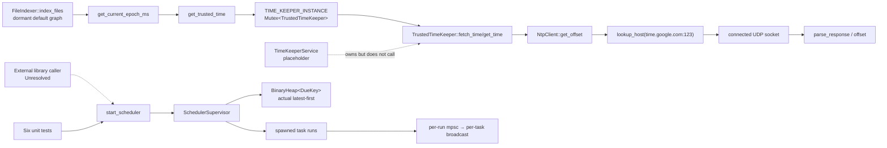
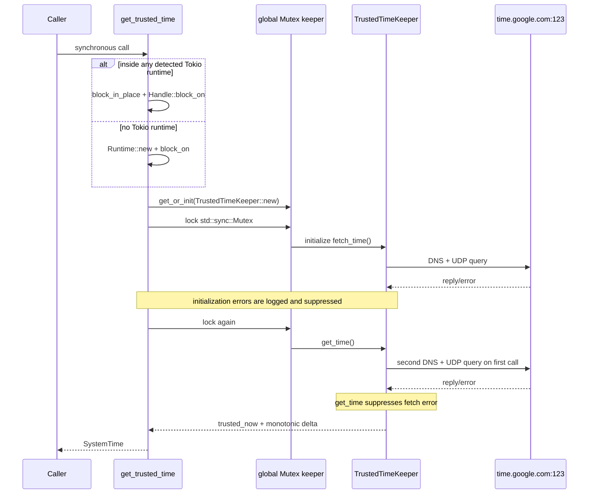

# Endpoint core time and interval scheduler

**Repository/revision:** `sentinel-endpoint-agent` at `a022e52bf2fff6a9445ebad96c3afeaf277e259f`  
**Primary scope:** all 12 tracked paths under `core/src/time/` and `core/src/scheduler/`  
**Contextual scope:** `core/src/lib.rs`, `core/Cargo.toml`, the previously analyzed file index and TimeKeeper service/bridge, diagnostic codes, repository-wide callers, tests, and checked workflows  
**Evidence status:** Verified unless explicitly marked otherwise

## Executive finding

The two subsystems share Tokio but are not integrated with each other.

- `core/src/time/` is an always-compiled synchronous facade over an asynchronous, single-server UDP NTP query. Its only handwritten repository consumer outside the time module is `FileIndexer::index_files`; that file-index runtime was previously found to have no active default-service registration. The separately named `TimeKeeperService` is a placeholder wrapper that owns a `TrustedTimeKeeper` but returns raw `SystemTime::now()` and does not call this module's NTP path.
- `core/src/scheduler/` is an always-compiled public interval-scheduler library. Repository-wide searches found no production construction or task registration outside its own six unit tests and Markdown example. It is therefore a **Dead-code candidate for the checked in-repository production graph**, while remaining a public library API that an external consumer could call.
- **Verified defect:** `DueKey::cmp` implements normal ascending `Instant` ordering even though Rust `BinaryHeap` is a max-heap and the comments say the comparison is reversed. The supervisor therefore peeks the latest key, not the earliest. A recurring latest task can reschedule itself to an even later key before the drain loop reaches older due tasks, starving those older tasks indefinitely.

The six time files plus five Rust scheduler files contain 116 AST declarations. `scheduler/readme.md` is documentation and is not part of that declaration count. The [semantic symbol reference](07-symbol-reference/endpoint-time-scheduler.md) accounts for every meaningful declaration.

## File inventory and classification

| Path | Role | Reachability | Final classification |
| --- | --- | --- | --- |
| `core/src/time/constants.rs` | Three UDP/NTP endpoint constants | Used by `NtpClient` | Fully analyzed handwritten Rust. |
| `core/src/time/error.rs` | NTP, adjustment, and facade errors | Active in time API; two NTP variants have no producer | Fully analyzed handwritten Rust. |
| `core/src/time/mod.rs` | Module exports, global keeper, synchronous public facade | Public; file-index caller | Fully analyzed handwritten Rust. |
| `core/src/time/ntp_client.rs` | DNS/UDP NTP request, timestamp parsing, offset calculation | Reached through facade/file index | Fully analyzed handwritten Rust. |
| `core/src/time/time_keeper.rs` | Host/NTP anchor and monotonic fallback | Reached through facade; separately owned but unused by placeholder service | Fully analyzed handwritten Rust. |
| `core/src/time/utils.rs` | Signed nanosecond `SystemTime` adjustment | Reached by keeper | Fully analyzed handwritten Rust. |
| `core/src/scheduler/api.rs` | Public task, event, policy, snapshot, and error types | Exported; no production caller found | Fully analyzed handwritten Rust; in-repository production dead-code candidate. |
| `core/src/scheduler/mod.rs` | Public re-export and architecture comments | Always compiled from `core/src/lib.rs` | Fully analyzed handwritten Rust. |
| `core/src/scheduler/readme.md` | 442-line usage/design document | Documentation only; not compiled | Fully analyzed handwritten documentation. |
| `core/src/scheduler/service.rs` | Public handle, supervisor actor, timers, execution | Used only by scheduler tests/README in repository | Fully analyzed handwritten Rust; in-repository production dead-code candidate. |
| `core/src/scheduler/state.rs` | Supervisor commands, mutable task state, heap key | Internal scheduler implementation | Fully analyzed handwritten Rust. |
| `core/src/scheduler/tests.rs` | Six simulated-time unit tests and seven helpers | Compiled only for core library tests | Fully analyzed handwritten tests. |

No file in this scope is generated or vendored.

## Actual component and reachability map



Dashed edges are explicitly unresolved or non-calling ownership relationships. No edge connects trusted time to scheduler timing; scheduler uses `tokio::time::Instant` exclusively.

# Part I — Trusted-time and NTP subsystem

## Public surface and actual callers

| Interface | Location | Behavior | Known repository consumer |
| --- | --- | --- | --- |
| `get_trusted_time() -> SystemTime` | `core/src/time/mod.rs:57-83` | Synchronously enters/builds a Tokio runtime, serializes on the global keeper, performs NTP refresh, and returns adjusted/fallback time | `get_current_epoch_ms`; module doc example is stale |
| `get_current_epoch_ms() -> Result<i64, TrustedTimeError>` | `core/src/time/mod.rs:89-95` | Converts the facade result to signed Unix milliseconds | `FileIndexer::index_files` at lines 161 and 206 |
| `NtpClient::query_ntp_server(server, timeout)` | `core/src/time/ntp_client.rs:140-198` | Public low-level DNS/UDP query returning an opaque-field `NtpResult` | `NtpClient::get_offset`; no external repository caller |
| `NtpClient::get_offset(&mut self)` | `core/src/time/ntp_client.rs:200-218` | Queries the fixed Google endpoint with a one-second receive timeout and stores either result or error | `TrustedTimeKeeper::fetch_time` |
| `TrustedTimeKeeper::new()` | `core/src/time/time_keeper.rs:33-40` | Captures two independent wall-clock reads and a monotonic anchor; constructs `NtpClient` | global singleton and placeholder `TimeKeeperService` |
| `adjust_system_time(base, offset_nanos)` | `core/src/time/utils.rs:5-30` | Checked add/subtract of a signed nanosecond offset | `TrustedTimeKeeper::fetch_time` |

`NtpResult` is public, but all six fields are private and there are no getters. Outside `ntp_client.rs`, callers can only hold or debug-format the value; the checked repository uses `get_offset` instead.

`GetTime`, `GetTime::get_time_now`, and `TimeSources::{HostSystemTime,NtpTime}` in `time_keeper.rs` have no implementation, match, constructor, import, or caller outside their declarations. They are **Dead-code candidates**.

## First and subsequent facade calls



On every later facade call, `initialize_trusted_time_async` still locks the singleton and calls `fetch_time`; it does not check an initialized/synchronized flag. `get_time` then locks it again and calls `fetch_time` again. Therefore **every call currently attempts two NTP queries**, not just the first call. The `OnceLock` initializes object ownership once; it does not make NTP initialization one-shot.

Each `MutexGuard<TrustedTimeKeeper>` is held across the entire async DNS/UDP fetch. All facade callers are serialized while network I/O is in progress. Poisoned mutexes panic because both lock sites call `unwrap()`.

## NTP query execution

`NtpClient::query_ntp_server` executes in this order:

1. Calls `tokio::net::lookup_host(server)` and maps lookup failure or an empty iterator to `NtpError::DnsResolve(server)`.
2. Selects only the first returned address.
3. Chooses `0.0.0.0:0` for IPv4 or `[::]:0` for IPv6.
4. Creates a Tokio `UdpSocket`, maps bind failure to `BindFailed`, connects it to the resolved peer, and maps connection failure to `SocketConnectionError`.
5. Builds a zero-filled 48-byte request with byte zero set to `0x23`.
6. Captures `t1 = SystemTime::now()` before awaiting `send`; send failure becomes `SendFailed`.
7. Allocates a 512-byte zero-filled response buffer and wraps only `socket.recv` in the caller-provided timeout.
8. Captures `t4 = SystemTime::now()`.
9. Parses timestamps at byte ranges 32–39 (`t2`) and 40–47 (`t3`), computes offset and nonnegative delay, and stores the four times, offset, and delay.

Only receive is bounded by `timeout_dur`; DNS, bind, UDP connect, and send have no explicit deadline. `get_offset` hard-codes `Duration::from_secs(1)` and `time.google.com:123`. There are no retries, multiple-server selection, environment/config overrides, or cached DNS addresses.

## Wire parsing and calculations

### Request

- `NTP_PACKET_SIZE = 48`.
- The request is 48 zero bytes except `packet[0] = 0x23`.
- No transmit timestamp, nonce, authentication field, or extension field is populated.

### Response conversion

`ntp_to_systemtime(secs, frac)`:

- rejects seconds lower than `2_208_988_800` as `InvalidReply`;
- subtracts that NTP-to-Unix epoch offset;
- converts the 32-bit fraction with `((frac * 1_000_000_000) >> 32)`;
- returns `UNIX_EPOCH + Duration(unix_secs,nanos)`.

The code has no NTP-era handling. **Potential issue requiring validation:** after the 32-bit seconds field wraps, values below the fixed epoch offset are rejected rather than mapped to a later era.

`parse_response(buf,t1,t4)` verifies only that `buf.len() >= 48`. It does not verify the received datagram length, leap indicator, version, mode, stratum, reference identifier, origin timestamp correspondence, or server transmit validity beyond both timestamps converting after the Unix epoch. The socket is connected to one resolved peer, but the protocol content is unauthenticated.

The offset formula is:

`((t2 - t1) + (t3 - t4)) / 2`

The delay formula is:

`(t4 - t1) - (t3 - t2)`

Negative/zero delay is clamped to zero. A positive `i128` delay is cast to `u64` without a range check before `Duration::from_nanos`; ordinary real timestamps remain far below that bound, but adversarial/extreme inputs are not explicitly guarded.

### Receive-result handling defect

At `ntp_client.rs:181-183`, the outer timeout error is mapped and unwrapped, but the inner `io::Result<usize>` is assigned to `_n` without `?` or inspection:

```rust
let _n = timeout(timeout_dur, socket.recv(&mut buf))
    .await
    .map_err(|_| NtpError::Timeout)?;
```

Consequences directly visible from the code:

- a UDP receive I/O error is not converted to `ReceiveFailed`; parsing proceeds against the zero-filled buffer;
- the number of received bytes is ignored;
- `parse_response` receives the full 512-byte slice, so its short-reply check can never fire from this call site;
- bytes beyond an actually short datagram remain zero and may cause later timestamp conversion failure instead.

`NtpError::ReceiveFailed` and `NtpError::NetworkError` have no constructor in the repository.

## Keeper state and time semantics

`TrustedTimeKeeper` owns:

| Field | Type | Written by | Meaning/lifecycle |
| --- | --- | --- | --- |
| `sys_time` | `SystemTime` | constructor, every successful/failed `fetch_time` attempt before NTP | Host clock snapshot taken before the network operation. |
| `trusted_now` | `SystemTime` | constructor, successful `fetch_time` | `sys_time` adjusted by the computed NTP offset. |
| `ntp_time` | `NtpClient` | constructor; `get_offset` mutates result/error | Retains only the most recent query result or error. |
| `anchor_mono` | `Instant` | constructor, successful `fetch_time` after NTP | Monotonic anchor paired with `trusted_now`. |

`fetch_time` overwrites `sys_time`, awaits the NTP offset, adjusts that pre-query wall-clock snapshot, and only then records `anchor_mono`. **Verified timing discrepancy:** the adjusted base precedes the network wait while the monotonic anchor follows it. The elapsed query time is therefore absent from the newly anchored `trusted_now`; `NtpResult.t4` is stored but never used to establish the base.

`get_time` calls `fetch_time` and deliberately ignores its error. It then returns `trusted_now + (Instant::now() - anchor_mono)`. On a failed first query the constructor's host-clock/anchor pair remains; after a later failure, the last successful adjusted pair remains. This is a silent fallback, not the explicit error promised by `TrustedTimeError` at the facade.

`Instant::checked_duration_since(anchor_mono).unwrap()` should succeed for an anchor captured in the past under normal monotonic-clock behavior, but the panic remains in source. `get_time_blocking` is a dead-code candidate and creates a new Tokio runtime unconditionally.

## Synchronous/async boundary

`get_trusted_time` branches only on `Handle::try_current().is_ok()`:

- within a detected runtime: `tokio::task::block_in_place` then current-handle `block_on`;
- outside a runtime: builds a new multithread Tokio runtime and blocks on it;
- runtime construction failure panics;
- lock poisoning panics;
- NTP failures do not propagate.

**Potential issue requiring validation:** the code does not distinguish Tokio runtime flavors before calling `block_in_place`. Exact behavior in every deployed Tokio/runtime configuration is an external dependency/runtime question; the repository contains no compatibility test.

`get_current_epoch_ms` maps a pre-Unix time to `TimeAdjustError::Overflow`, then casts `Duration::as_millis()` from `u128` to `i64` without range validation. Present-day values fit; extreme future values would wrap/truncate rather than return the declared overflow error.

`adjust_system_time` rejects offsets whose absolute value exceeds `u64::MAX` nanoseconds and uses checked `SystemTime` add/subtract. The negative branch computes `-offset_nanos` before its range check; `i128::MIN` is an unhandled negation-overflow edge.

## Active and placeholder relationships

### File index

`FileIndexer::index_files` calls `get_current_epoch_ms` before scanning and again to log elapsed seconds. Because every facade call performs two NTP queries, a full index run attempts four queries: two before setting `IndexingState::InProgress` and two after work succeeds. A failure does not surface as an error from `get_current_epoch_ms` because NTP errors are suppressed by `get_time`; only pre-epoch conversion can currently produce its `Err` in ordinary source paths.

The first timestamp is divided by 1,000 and used as the stale-row prune cutoff. Thus NTP adjustment affects persistence pruning if this dormant index runtime is activated.

### TimeKeeper service/bridge

The separately analyzed `TimeKeeperService` owns `Arc<TrustedTimeKeeper>` but cannot mutably call it and returns `SystemTime::now()` as a documented placeholder. Its `SyncWithNtp` and offset commands return zero. Its broker bridge converts those placeholder responses. No integration edge from that service/bridge to global `get_trusted_time` exists.

**Contradiction:** comments in the time module and service describe one trusted NTP-backed system, while the source implements two disconnected ownership paths: the global facade does real UDP attempts, and the service/IPC path returns host time/zero offset.

## Time errors and observability

| Error | Producer | Handling |
| --- | --- | --- |
| `DnsResolve(String)` | lookup failure or no resolved address | Stored in `NtpClient.error`; logged only during facade initialization; later fetch error suppressed. |
| `BindFailed(String)` | UDP bind error | Same. |
| `SocketConnectionError(String)` | UDP connect error | Same. |
| `SendFailed(String)` | UDP send error | Same. |
| `ReceiveFailed(String)` | None found | Dead enum path. |
| `Timeout` | `NtpClient::new` initial state; receive elapsed; initial `error` value | Same; one-second timeout only in `get_offset`. |
| `InvalidReply` | short parser input or NTP seconds before fixed offset | Propagates into keeper, then usually suppressed. Short condition is unreachable from query call because full buffer is passed. |
| `NetworkError(String)` | None found | Dead enum path. |
| `TimeAdjustError::Overflow` | checked time adjustment or pre-epoch epoch conversion | Adjustment errors are suppressed by `get_time`; epoch conversion returns the error. |

There are no metrics. Initialization failure uses `tracing::error!`; later per-call refresh failures are silently discarded. `NtpClient.result/error` are private and expose no status API.

## Time security and trust boundary

The module accepts unauthenticated UDP time from the first address returned for `time.google.com`. It performs no cryptographic server authentication or response-origin timestamp correlation, and its DNS resolution uses dependency/system defaults. This is a verified control absence, not by itself a claim of exploitability.

**Potential issue requiring validation:** code that treats this value as security-grade “trusted time” inherits DNS, network-path, host-clock, and protocol-validation assumptions not enforced in this module. No test exercises spoofed, replayed, malformed, high-delay, or hostile timestamps.

## Time documentation and test audit

- `time/mod.rs` doctest calls synchronous `get_trusted_time().await`; the function is not async. `core/Cargo.toml` sets `doctest = false`, so the contradiction is not compiled.
- The module says initialization performs NTP once; source performs two queries per facade call.
- Keeper comments say multiple sources including build time; only host time plus one Google NTP endpoint exist.
- `time_keeper.rs:48` says NTP is not implemented immediately before calling the implemented client.
- No test in the repository directly covers any time-module symbol, packet conversion, failure fallback, global locking, or runtime boundary.

# Part II — Interval scheduler

## Public API

`core/src/scheduler/mod.rs` publicly re-exports all `api` types plus `start_scheduler` and `SchedulerHandle`. `SchedulerConfig` is public in the private `service` module but is nameable because it appears through `start_scheduler`? It is **not re-exported** by `mod.rs`, and `service` itself is private. The README calls `SchedulerConfig::default()` after `use core::scheduler::*`, but that name is not among the explicit re-exports.

**Verified API contradiction:** `start_scheduler` is publicly re-exported with a parameter type whose defining private module/type is not re-exported. The exact compiler lint/error impact could not be executed because Rust/Cargo are absent, but the README's glob import does not expose `SchedulerConfig` from the shown exports.

The public handle operations are:

| Operation | Command/result | Source behavior |
| --- | --- | --- |
| `add_task(spec)` | `Add`; `Result<(),SchedulerError>` | Awaits bounded command send and oneshot ack; rejects duplicate IDs and zero event capacities. |
| `delete_task(id)` | `Delete`; `Result<bool,...>` | Removes state only; leaves heap keys and running executions. |
| `list_tasks()` | `List`; `Result<Vec<TaskSnapshot>,...>` | Iterates `HashMap`; order is unspecified. |
| `run_now(id,policy)` | `RunNow`; `Result<(),...>` | Requires present/enabled task, attempts immediate spawn, then mutates next schedule by policy. |
| `subscribe(id)` | `Subscribe`; `Result<Subscription,...>` | Returns a new Tokio broadcast receiver; no replay/history. |
| `shutdown(self)` | `Shutdown`; returns `()` | Best-effort send/ack, logs stopped even if supervisor was already gone. |

Every handle method can wait indefinitely on a full command channel or on an acknowledgement; `SchedulerError::Timeout` is declared but never used.

## Public data dictionary

### Task identity and results

- `TaskId(String)` is caller-chosen, public, hashable, displayable, serializable, and deserializable. Empty or very large identifiers are accepted. Duplicate exact strings are rejected; there is no normalization.
- `TaskOutcome` is `Success`, `Skipped(&'static str)`, or `Failed(String)` and derives serde. Scheduler-generated skipped reasons are `"Overdue"` and `"Concurrency limit reached"`; generated failure strings are `"timeout"` and `"join error: ..."`.
- `LogLevel` has `Trace`, `Debug`, `Info`, `Warn`, and `Error`; the scheduler does not filter or route by level.

### Events

`TaskEvent` is intentionally not serializable and contains:

- `Started { run_index, scheduled_at }`;
- `Progress { current, total, label }`;
- `Log { level, message }`;
- `Bytes(Vec<u8>)`;
- `Json(serde_json::Value)`;
- `Finished { outcome, duration_ms }`.

No semantic validation constrains progress, size of bytes/JSON/log strings, or ordering of action-emitted events. `Started` and `Finished` traverse the same bounded per-run MPSC as action events.

### Execution context

`TaskContext` exposes task ID, a bounded event sender, a fresh `CancelToken`, the actual spawn time as `now`, and the monotonic `run_index`. `TaskFn` is an `Arc<dyn Fn(TaskContext) -> TaskFuture + Send + Sync + 'static>` and each future must be `Send + 'static`.

The cancel token is never retained or cancelled by scheduler state. Delete, timeout, and shutdown do not call `cancel`. Cooperative cancellation is therefore a type-level hook without a scheduler control path.

### Timing and policy

- `IntervalSpec.every`: required `Duration`; no nonzero validation.
- `initial_delay`: first delay or `every` when absent.
- `jitter`: random nonnegative delay added independently at first scheduling and every reschedule.
- `Concurrency(NonZeroUsize)`: default one; construction validation is delegated to the caller's creation of `NonZeroUsize`.
- `ExecPolicy.timeout`: wraps the spawned action wait.
- `backoff_on_fail`: `None`, `Exponential {base,max}`, or `Fixed {delay}`; stored but never read by service code.
- `drop_if_overdue`: if true, suppresses a scheduled run outside grace.
- `overdue_grace`: explicit tolerance or a computed service default.

**Contradiction:** `api.rs:248` says `overdue_grace = None` is equivalent to zero tolerance. `service.rs:393-397` instead computes a nonzero default: 50 ms for intervals at most one second, otherwise three percent clamped to 20 ms–1 second. The test helper agrees with the implementation, not the API comment.

### Buffers and configuration

- `EventBuffer::default()` is 128 messages per per-run MPSC and 128 events per per-task broadcast ring.
- `SchedulerConfig::default().cmd_capacity` is 1,024.
- `start_scheduler` does not reject `cmd_capacity = 0`; it passes it directly to Tokio's bounded-channel constructor. Exact dependency panic text is external, but no repository validation exists.
- `SchedulerError::InvalidArg` is currently produced only for either event capacity being zero.

There are no environment variables, files, CLI flags, persistence schemas, network calls, feature gates, or runtime configuration discovery in the scheduler.

## Start and actor lifecycle

`start_scheduler`:

1. builds a bounded command channel;
2. creates a `CancellationToken`;
3. constructs empty task `HashMap` and `BinaryHeap` state;
4. gives the supervisor a clone of the command sender and cancellation token;
5. detaches `tokio::spawn(supervisor.run())` without retaining its join handle;
6. emits diagnostic code `SchedStarted` with capacity;
7. returns a handle containing sender plus another token clone.

The supervisor selects among sleep-to-heap-head, command receive, and token cancellation. Because the supervisor itself owns `cmd_tx`, dropping all external handles does not close `cmd_rx`. Dropping a handle also does not call `CancellationToken::cancel`. The comment that the external shutdown branch covers an owner-dropped handle is contradicted by the ownership graph.

Explicit `shutdown(self)` sends the command, the supervisor cancels its token, acknowledges, and exits the actor loop. It does not cancel, join, or await already spawned runs or event-forwarder tasks. Other cloned handles remain but subsequent sends fail once the supervisor/receiver is dropped. `shutdown` ignores both send and ack errors and still logs `SchedStopped`.

## Heap ordering defect

`DueKey::cmp` returns:

```rust
match self.when.cmp(&other.when) {
    Ordering::Equal => self.id.0.cmp(&other.id.0),
    non_eq => non_eq,
}
```

This is normal ascending ordering. `BinaryHeap` returns its greatest element from `peek`/`pop`; comments in both `state.rs` and `service.rs` acknowledge that a reversal is required but do not implement one.

```mermaid
sequenceDiagram
    participant H as Heap
    participant S as Supervisor
    Note over H: A due at t=10; B due at t=60
    S->>H: peek()
    H-->>S: B at t=60 (greatest/latest)
    S->>S: sleep_until(t=60)
    S->>H: pop B
    S->>H: push B next at t=120
    S->>H: peek()
    H-->>S: B at t=120 > now; stop drain
    Note over H: A at t=10 remains blocked
```

This is not merely reversed execution order. `process_due_key` pushes the processed task's next future occurrence before `on_timer_fire` examines the heap again. That new future key becomes the maximum and ends the drain, so an older task can remain indefinitely starved behind a recurring later task. Equal-time peers can similarly be blocked after one peer reschedules. The six tests each create only one task and do not expose the defect.

Stale keys from delete or schedule mutation are checked only after they reach the heap head. A stale far-future maximum can therefore delay valid earlier work until its own timestamp. There is no heap deletion/compaction or generation number.

## Add, timer, and rescheduling flow

### Add

`handle_add_task` checks exact ID uniqueness and event capacities, constructs `TaskState`, and, if enabled, computes:

`first = Instant::now() + initial_delay.unwrap_or(every) + random_jitter`

It sets `next_run`, pushes a heap key, and inserts the task. Disabled tasks are stored with no next run and there is no enable/update method.

`every = 0`, no initial delay, and zero/no jitter are accepted. **Potential issue requiring validation:** when such a task reaches the timer path, rescheduling from its scheduled instant yields the same due instant, enabling a synchronous drain-loop spin; concurrency checks do not prevent the repeated pop/reschedule loop.

### Scheduled run

When the selected heap key fires, the supervisor captures one `now` and loops while the heap head is not later. For a key whose task still exists and whose `next_run` exactly equals the key:

1. computes effective overdue grace;
2. if `drop_if_overdue && overdue`, broadcasts `Finished(Skipped("Overdue"),0)` and schedules from `now`;
3. otherwise schedules the next slot from the previous `scheduled_at`, then calls `spawn_run`.

Overdue and concurrency skips do not increment `run_count`, update `last_outcome`, or populate last-run metrics. They are visible only to live subscribers (and concurrency skip emits diagnostic `SchedTaskSkipped`).

Positive jitter is added to every next slot, so it cumulatively moves the cadence later. The implementation preserves phase from the previous jittered scheduled slot, not from an original fixed phase.

### Run now

`handle_run_now` verifies existence/enabled status, calls `spawn_run`, then applies:

- `RebaseFromNow`: new next = now + every + jitter;
- `PreservePhase`: retain old next;
- `OverrideNextAfter(delta)`: new next = now + delta, without jitter.

It updates/pushes only when the option value changes. Old heap keys remain and are later classified stale. Even when `spawn_run` declines due to the concurrency limit, `run_now` returns `Ok(())` and still applies the schedule policy.

## Run execution and event flow

`spawn_run`:

1. looks up task state and returns silently if absent;
2. compares `running` with `max_concurrency`;
3. on limit, broadcasts a skipped `Finished` event and returns;
4. otherwise increments `running` and `run_count`;
5. clones spec, broadcast sender, and supervisor sender;
6. detaches a run task;
7. creates a bounded event MPSC and detaches a forwarding task into broadcast;
8. sends `Started` through MPSC;
9. constructs context with a new, untracked cancellation token;
10. calls the action closure to obtain its future;
11. spawns that future as another Tokio task and awaits it, optionally inside `tokio::time::timeout`;
12. maps join failure or timeout to `Failed`;
13. sends `Finished` through MPSC;
14. sends `RunComplete` through the scheduler command channel.

There are three tasks per active run: the outer orchestration task, event forwarder, and action task.

**Potential issue requiring validation:** on timeout, source drops the action `JoinHandle` but never calls `abort` and never cancels the context token. Under the intended Tokio contract this detaches rather than stops the action, so timed-out work can continue emitting effects/events after the scheduler has reported failure and decremented `running`. The repository has no test that observes post-timeout action completion or overlapping replacement work.

If the supervisor has shut down or a task has been deleted, the final `RunComplete` send may fail or the handler may find no state; errors are ignored. A deleted running action is not stopped. `duration_ms` covers orchestration from before outer spawn through the observed join/timeout, not queueing from scheduled time.

## Event delivery and backpressure

- Every run has an independent MPSC of configured capacity.
- Each task has one broadcast ring created at add time.
- The scheduler and action await MPSC sends, so a stalled forwarder applies backpressure within that run.
- Broadcast sends ignore both no-receiver and lag-related outcomes. Receivers observe Tokio broadcast lag errors directly through the public `rx`.
- Subscription begins at call time and has no replay of `Started`, skipped outcomes, or previous runs.
- Different concurrent runs share a broadcast channel; their event sequences can interleave and only `Started` includes `run_index`. Progress/log/bytes/json/finished events do not carry run identity.
- Unbounded event payload sizes are allowed even though channel counts are bounded.

## Task state and snapshots

The actor-owned `TaskState` contains immutable-by-API `TaskSpec`, optional next run, live count, last completed outcome, started-run counter, broadcast sender, and last run index/start/finish timestamps. Only the first six fields are projected into `TaskSnapshot`; internal timestamps are not externally visible.

`run_count` counts admitted starts, not attempts or skips. `last_outcome` changes only on `RunComplete`, not immediate skip events. A completion from an older concurrent run can arrive after a newer one and overwrite `last_outcome`/last metrics; the stored `run_index` records which completion won, but snapshots omit it. The source performs no monotonic completion-index check.

## Scheduler errors and recovery matrix

| Condition | Result/side effect | Recovery |
| --- | --- | --- |
| Duplicate task ID | `AlreadyExists(id)` | Caller may choose another/delete first. |
| Missing delete | `Ok(false)` | No error. |
| Missing run/subscribe | `NotFound(id)` | Caller handles. |
| Run disabled task | `NotEnabled(id)` | No enable API exists. |
| Zero event capacity | `InvalidArg(...)` | Rejected before broadcast creation. |
| Zero command capacity | No source validation | Potential dependency panic during start; untested. |
| Command channel closed | `ChannelClosed` from non-shutdown methods | No reconnect/restart handle. |
| Ack sender dropped | `ChannelClosed` | Same. |
| Command/ack stalls | No timeout | Caller awaits indefinitely. |
| Concurrency limit | `run_now` still `Ok`; skipped event and diagnostic | No queue/retry. |
| Overdue drop | skipped event only | Reschedule from captured now. |
| Action panic/cancelled join | `Failed("join error: ...")` | Next periodic occurrence remains scheduled. |
| Action timeout | `Failed("timeout")` | No explicit abort/cancel; next occurrence remains. |
| Action returns failure | Stored/broadcast | `backoff_on_fail` is ignored. |
| Delete with queued key/run | State removed; stale key/run retained | Stale key ignored only when it reaches heap head. |
| Shutdown | Actor exits after ack | Running tasks not awaited/cancelled. |

There is no retry implementation, dead-letter mechanism, persistence, transaction, crash recovery, health API, metrics counter, or supervisor restart.

## Scheduler tests

All six tests use `#[tokio::test(start_paused = true)]`:

| Test | What it checks | Important omission |
| --- | --- | --- |
| `add_task_and_fire_once` | One task emits started/finished, increments action and snapshot | Only one heap key/task. |
| `run_now_rebase_from_now` | Immediate action and ~60-second rebased next run | Does not inspect stale old key. |
| `concurrency_limit_skips_extra` | Second manual run emits skipped at max one | Does not check schedule mutation or snapshot outcome. |
| `timeout_is_enforced` | Subscriber sees `Failed("timeout")` | Does not prove action cancellation. |
| `event_stream_propagates_progress_and_log` | One run's event ordering | No lag, multiple subscribers/runs, payload limits. |
| `snapshots_reflect_runs` | Started count and eventual `running = 0` | No concurrent completion ordering. |

`recv_n` says it drains with a timeout, but it only advances simulated time and awaits `rx.recv()` with no timeout. A missing event can hang the test.

No test covers multiple scheduled tasks, heap ordering, equal timestamps, stale keys, delete, duplicate/not-found/disabled paths, invalid capacities, zero interval/capacity, jitter bounds, overdue grace/drop, preserve/override timing, failure backoff, shutdown/drop semantics, action abort, broadcast lag, or concurrent completion order.

The checked workflows build/package but contain no `cargo test` step. Therefore the presence of these tests is not evidence that they run in CI. Rust/Cargo are unavailable in this analysis environment, so no compile/test execution was possible.

## Scheduler documentation consistency

| Documentation claim | Source | Code evidence | Result |
| --- | --- | --- | --- |
| Heap is earliest-first/min-heap | `mod.rs`, `state.rs`, `service.rs`, README | `DueKey::cmp` is not reversed | **Contradicted.** |
| Scheduler can cancel tasks | README line 7; cancellation table | No handle cancellation API; tokens are never retained/cancelled | **Contradicted.** |
| Dropping owner can trigger shutdown token | `service.rs:224` comment | supervisor and handles only hold clones; no Drop/cancel call | **Contradicted.** |
| `overdue_grace=None` means zero | `api.rs:248` | service computes 50 ms or clamped 3% | **Contradicted.** |
| Phase remains stable | README | random positive jitter is added cumulatively | **Partially confirmed** for scheduled-slot anchoring; overstated with jitter. |
| README quick-start imports `core::scheduler::*` and uses `SchedulerConfig` | README | package is `sentinel-core`; standard `core` is not this crate, and config is not re-exported | **Contradicted/uncompiled.** |
| Everything is awaitable/non-blocking | README | start is synchronous; action contract can contain arbitrary caller code | **Partially confirmed** for handle operations; not enforceable. |
| Timeout enforces maximum task runtime | module/API docs | scheduler stops waiting but does not explicitly abort/cancel action task | **Partially confirmed; potential detached work.** |
| Backoff policy defines retry behavior | API type | field is explicitly reserved and never read | **Planned but not implemented.** |
| Typical production uses include scans/heartbeat | README | no production scheduler caller/task spec found | **Documentation-only.** |

The README's “Extension Ideas” correctly labels retry, persistence, metrics/event-bus, priority tiers, and cross-process locking as future work. They are not described here as implemented.

## Scheduler security and resource boundaries

The scheduler performs no network, file, database, credential, or process I/O itself; caller-supplied actions define those effects. It has no authorization boundary between handle clones: any holder can add/delete/run/subscribe/shutdown. IDs and event payloads are trusted caller data.

Resource controls are partial:

- per-task concurrency is bounded;
- command/event queues are count-bounded;
- action/event payload memory is not size-bounded;
- number of tasks, subscribers, stale heap keys, and spawned task lifetimes are unbounded;
- deletion and shutdown do not reclaim running work;
- failed/backpressured completion sends can retain task futures until channel progress.

These are verified design properties. Performance or denial-of-service impact requires measurement in a real caller.

## Practical call graphs

### Epoch lookup

`FileIndexer::index_files` (`core/src/file/file_index/indexer.rs:160`)  
→ `time::get_current_epoch_ms` (`core/src/time/mod.rs:89`)  
→ `time::get_trusted_time` (`core/src/time/mod.rs:57`)  
→ `initialize_trusted_time_async` (`core/src/time/mod.rs:37`)  
→ `TrustedTimeKeeper::fetch_time` (`core/src/time/time_keeper.rs:44`)  
→ `NtpClient::get_offset` (`core/src/time/ntp_client.rs:200`)  
→ `NtpClient::query_ntp_server` (`core/src/time/ntp_client.rs:140`)  
→ `lookup_host` / `UdpSocket::{bind,connect,send,recv}`  
→ `parse_response` → `ntp_to_systemtime`  
→ `adjust_system_time`  
→ `TrustedTimeKeeper::get_time` (performs the query path again)  
→ Unix-millisecond conversion.

### Scheduler command

`SchedulerHandle::{add_task,delete_task,list_tasks,run_now,subscribe,shutdown}`  
→ bounded `mpsc::Sender<SupervisorCmd>`  
→ `SchedulerSupervisor::run`  
→ `on_cmd`  
→ operation-specific handler  
→ oneshot acknowledgement.

### Scheduled task

`SchedulerSupervisor::run`  
→ `heap.peek` (**latest key under current `Ord`**)  
→ `sleep_until`  
→ `on_timer_fire`  
→ `process_due_key`  
→ `reschedule_task_if_enabled` / heap push  
→ `spawn_run`  
→ outer run task  
→ event-forwarder task + action task  
→ optional timeout/join mapping  
→ `SupervisorCmd::RunComplete`  
→ `handle_run_complete`.

## Dead, incomplete, and unresolved classification

### Dead-code candidates

- All scheduler production APIs and internals: no checked production caller; retained as exported library surface and covered by tests.
- `GetTime`, its method, and `TimeSources`.
- `_system_time_to_nanos` (the parser duplicates a private converter instead).
- `NtpError::{ReceiveFailed,NetworkError}`.
- `TrustedTimeKeeper::get_time_blocking`.
- `SchedulerError::Timeout`.

### Incomplete/placeholders

- Scheduler `BackoffPolicy` is stored but not executed.
- Scheduler cancellation token has no controller.
- TimeKeeper service/IPC NTP and offset behavior is placeholder and disconnected from the real time module.
- Multi-source/build-time selection named in keeper comments is absent.

### Unresolved

- Whether an external crate dynamically/publicly consumes the exported scheduler or low-level NTP APIs.
- Whether deployed runtime flavor permits the facade's unconditional in-runtime `block_in_place` path.
- Exact platform DNS/network restrictions and whether UDP/123 to the fixed server is permitted.
- Exact compiler diagnostics for public `start_scheduler` exposing non-re-exported `SchedulerConfig`; Cargo is unavailable.
- Whether a lockfile/private build pins dependency behavior different from manifest constraints; no committed lockfile was found.

## Scope coverage

- 12/12 tracked files fully read and classified.
- 116/116 AST declarations accounted for semantically or in the companion symbol reference.
- All exact public symbols and fields documented.
- Repository-wide exact-name imports/callers, module exports, diagnostic registrations, tests, package metadata, and workflows searched.
- No generated/vendored files and no intentionally skipped files.

