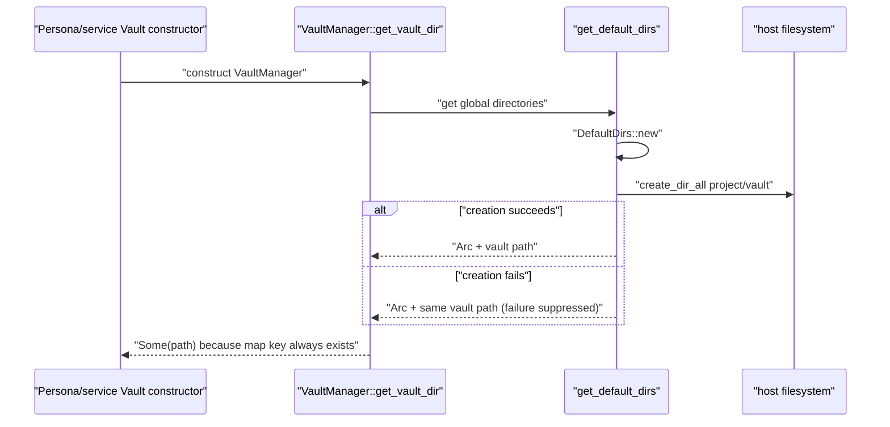

# Endpoint Core Utilities: JSON Configuration, Environment Cache, and Default Directories

**Repository:** `sentinel-endpoint-agent`  
**Revision:** `a022e52bf2fff6a9445ebad96c3afeaf277e259f`  
**Scope:** all seven tracked paths under `core/src/utils/`  
**Declaration coverage:** all 59 AST-indexed declarations  
**Confidence:** Verified except where explicitly marked `Inference` or `Unresolved`

## Scope summary

The `sentinel_core::utils` namespace publicly exposes three groups:

1. `config`: an exported but repository-locally dormant JSON configuration singleton, a minimal typed schema, and a separate unused error enum;
2. `env::env`: a process-global positive-value environment cache initialized during active agent startup; and
3. `file_system`: an active Vault-directory resolver plus a one-line empty placeholder module.

Verified reachability:

- `agent/src/init.rs:353` calls `env_initialization`, which calls `initialize_env` at line 101. No production code then reads that utility singleton except the dormant `ConfigManager` path.
- No production or test call invokes `ConfigManager::init_from_env`, `ConfigManager::instance`, or `reload`. Its internal loader/query methods are exercised only by its unit tests.
- `VaultManager::new` and `VaultManager::new_with_keystore` call `VaultManager::get_vault_dir`, which calls `get_default_dirs`. This includes the active private Vault constructed by the Persona factory.
- `file_system/file_manager.rs` contains one blank line and no declarations, imports, documentation, or implementation.

## File inventory and status

| Path | Role | Reachability | Generated/vendored | Status |
| --- | --- | --- | --- | --- |
| `core/src/utils/mod.rs` | Public namespace declarations | Always compiled through public `core::utils` | Handwritten | Fully analyzed |
| `core/src/utils/config/config_def.rs` | Minimal Serde JSON schema | Compiled; used by dormant manager and tests | Handwritten | Fully analyzed |
| `core/src/utils/config/config_manager.rs` | JSON singleton/load/reload/query API and tests | No production caller found | Handwritten | Fully analyzed; dormant public API |
| `core/src/utils/config/error.rs` | Second, incompatible `ConfigError` type | No caller/import found | Handwritten | Fully analyzed; dead-code candidate |
| `core/src/utils/env/env.rs` | Environment singleton/cache/API and tests | Singleton initializer active; reads used only by dormant manager/tests | Handwritten | Fully analyzed |
| `core/src/utils/file_system/default_dirs.rs` | Home-relative project/Vault paths and creation | Active through Vault constructors | Handwritten | Fully analyzed |
| `core/src/utils/file_system/file_manager.rs` | Empty public module | Compiled namespace only | Handwritten empty placeholder | Fully analyzed; placeholder |

## Module and visibility model

`core/src/lib.rs:30` declares `pub mod utils`. Every nested declaration in `utils/mod.rs` is also `pub`, yielding these public module paths:

```text
sentinel_core::utils::file_system::default_dirs
sentinel_core::utils::file_system::file_manager
sentinel_core::utils::config::config_def
sentinel_core::utils::config::config_manager
sentinel_core::utils::config::error
sentinel_core::utils::env::env
```

Verified: there are no convenience re-exports. The repeated `env::env` path and the separate `config::config_def`/`config::config_manager` paths are the actual API spelling.

## Typed configuration schema

### Data model

| Type / field | Rust type | Required in JSON | Default | Meaning / behavior |
| --- | --- | --- | --- | --- |
| `GlobalConfig` | object | yes, as top-level target | none | Holds `meta` and `file_system` |
| `GlobalConfig.meta` | `Meta` | yes | none | Metadata object |
| `GlobalConfig.file_system` | `FileSystem` | yes | none | Empty typed object |
| `Meta.version` | `Option<String>` | no | `None` | Unvalidated version text |
| `Meta.description` | `Option<String>` | no | `None` | Unvalidated description text |
| `FileSystem` | empty struct | yes | none | Accepts an object but retains no fields |

All three structs derive `Debug`, `Deserialize`, and `Clone`; none derive `Serialize`, `Default`, equality, or validation traits.

Verified Serde behavior from the declarations:

- Missing `meta` or `file_system` causes typed deserialization failure.
- Missing or JSON-null optional metadata fields becomes `None`.
- A non-string non-null value for either metadata field fails deserialization.
- No `deny_unknown_fields` attribute is present, so unknown fields are ignored in the typed form. They remain available in the manager's raw `serde_json::Value`.
- `FileSystem {}` carries no typed settings. JSON fields beneath `file_system` are accepted/ignored by the typed representation and remain only in the raw representation.
- No schema version check, semantic version parser, file-system field validation, migration, defaulting, or secret classification is implemented.

## `ConfigManager` design and actual behavior

### State


`ConfigManager` stores:

- `inner: RwLock<Arc<ConfigHolder>>`, where the private holder has `raw` and `typed`; and
- `path: PathBuf`, fixed at initial construction and used for reload.

`INSTANCE: OnceLock<ConfigManager>` owns the process-global instance for process lifetime. There is no reset, test reset, path change, file watcher, automatic reload, or shutdown API.

### Initialization sequence

`ConfigManager::init_from_env(var_name)` executes:

1. If `INSTANCE.get()` is already populated, return `Ok(())` without reading the supplied variable.
2. Call the module-level `get_env_value(var_name.to_string())`.
3. Convert the returned string directly to a `PathBuf`.
4. Call `path.exists()`; if false, synthesize `std::io::ErrorKind::NotFound` with the displayed path and return `ConfigError::Io`.
5. Read the full file as UTF-8 with `fs::read_to_string`.
6. Parse the text into raw JSON.
7. Clone the raw JSON and deserialize the clone as `GlobalConfig`.
8. Wrap the holder in `Arc`, then `RwLock`, and build the manager.
9. Attempt `INSTANCE.set`; if another thread won the race, return `AlreadyInitialized`.
10. Return `Ok(())`.

Verified discrepancy: the doc says an already initialized manager returns `Ok(())`. That is true for a call observing the instance at step 1, but two concurrent first calls can both pass the check; the loser returns `AlreadyInitialized` after doing environment and file I/O.

The existence check is not authoritative because the file can change before the later read. It also accepts an existing directory before `read_to_string` returns an I/O error.

### Reload and consistency

`reload` reads/parses/deserializes the path completely before taking the write lock. A load failure leaves the old snapshot installed. On success it takes the write lock and replaces the `Arc` in one assignment. Readers that already cloned the old holder retain it; subsequent reads see the new holder.

Verified: file I/O and JSON work are synchronous. The method is safe to call from ordinary threads, but calling it directly in async runtime work can block that runtime worker.

There is no compare/version check, debounce, serialization of concurrent reload file reads, file identity/canonicalization, signature verification, size limit, permissions check, or notification to consumers.

### Read APIs

| API | Result | Lock/error behavior | Important detail |
| --- | --- | --- | --- |
| `instance()` | `&'static ConfigManager` | `NotInitialized` if empty | Does not initialize lazily |
| `get_typed()` | new `Arc<GlobalConfig>` | Panics on poisoned read lock | Deep-clones `GlobalConfig`, then allocates a new `Arc`; it does **not** clone the stored holder `Arc` |
| `get_holder_arc()` | cloned stored `Arc<ConfigHolder>` | Panics on poisoned read lock | O(1), but the public return type and both fields are private |
| `get_value_pointer(pointer)` | cloned `serde_json::Value` | `LockPoisoned` or `NotFound` | Delegates pointer parsing/escaping to `Value::pointer` |
| `get_subconfig<T>(pointer)` | owned `T` | `LockPoisoned`, `NotFound`, or `Json` | Clones the raw subtree then deserializes it |

Contradiction: `get_typed` documentation calls the result a cheap `Arc` clone of the current typed config. Source clones the entire typed value and wraps that clone in a fresh `Arc`. Current schema size is small, but the implementation does not provide the advertised O(1) snapshot behavior.

Potential issue: `get_holder_arc` is declared `pub` with `#[allow(private_interfaces)]`, while `ConfigHolder` and its fields are private. The checked repository has no caller. External consumers cannot use the advertised raw/typed fields through this API. Its documentation's debug/export/schema-validation use cases are therefore not implemented as a usable public field interface.

### Error types

`config_manager.rs` defines its own eight-variant `ConfigError`:

| Variant | Origin / status |
| --- | --- |
| `Env(EnvError)` | Automatic conversion of module-level environment lookup errors |
| `Io(std::io::Error)` | Automatic conversion of file reads and the explicit missing-path error |
| `Json(serde_json::Error)` | Automatic conversion of raw parsing **and typed/subtree deserialization** |
| `Deserialize(String)` | Dead-code candidate; no constructor found |
| `NotInitialized` | `instance` before successful initialization |
| `NotFound(String)` | Missing JSON Pointer; carries original pointer |
| `AlreadyInitialized` | `OnceLock::set` race loser |
| `LockPoisoned` | `reload`, pointer query, and subconfig query lock failures |

Contradiction: documentation names `Deserialize` for typed parse failures, but every checked `serde_json` `?` converts into `Json`; `Deserialize` is never constructed.

`config/error.rs` separately defines another public `ConfigError` with `IoError`, `NotFound`, and `ParsingError`. No import, constructor, match, or caller was found. It is a repository-local dead-code candidate and is not interchangeable with `config_manager::ConfigError`.

### Configuration reachability contradiction

The active agent derives `QUILR_CONFIG_DIR` as `<installation_path>/.quilr`, explicitly a directory. The only core constant named for it is `ENV_CONFIG_PATH`, and the environment tests use that name. `ConfigManager::init_from_env`, however, treats the selected variable's value as a JSON **file** and calls `read_to_string` on it.

No production call binds `ENV_CONFIG_PATH`/`QUILR_CONFIG_DIR` to `ConfigManager::init_from_env`, so the incompatibility is dormant in the checked tree. If a caller used the apparent constant/manager pairing, an existing `.quilr` directory would pass `exists()` then fail as an I/O read.

## Environment manager

### Data model and lookup

`EnvManager` holds `RwLock<HashMap<String, Option<String>>>`; it is placed inside `Arc` and retained by `ENV: OnceLock<Arc<EnvManager>>`.

`EnvManager::get_env_value(&self, key)` executes:

1. Acquire a read lock with `unwrap`.
2. If the key is present, clone and return the stored `Option<String>`.
3. Release the read lock.
4. Call `std::env::var(key)`.
5. If the call returns any error, return `None` without caching it.
6. Acquire a write lock with `unwrap`.
7. Insert the successful value as `Some(String)`.
8. Return the same successful value.

Verified consequences:

- despite the `Option<String>` map value, only `Some` entries are inserted; negative results are not cached;
- missing variables and non-Unicode variables are both exposed as `None` and, through the free function, `MissingEnvVariable`;
- `EnvError::FetchFailed` is never constructed;
- successful values are cached indefinitely, so later `set_var`/`remove_var` changes are invisible;
- there is no invalidate, refresh, enumerate, set, remove, or precedence API;
- poisoned `RwLock` access panics rather than returning `EnvError`.

The public free function `get_env_value(var: String)` obtains the global manager and converts `None` to `EnvError::MissingEnvVariable(var)`. It requires ownership of the key string even though the method accepts `&str`.

### Singleton initialization behavior

`get_env()` is conventional lazy initialization: it gets or inserts one new empty manager and returns an `Arc` clone.

`initialize_env()` is different:

1. Always allocate a new `Arc<EnvManager>`.
2. Call `ENV.set(arc.clone())`.
3. Ignore whether the set failed.
4. Return the newly allocated `Arc` in either case.

Potential issue: after `ENV` has already been initialized, `initialize_env` returns a disconnected manager that is not the process-global manager. Concurrent first calls can likewise return different objects, only one of which wins `ENV`. The active agent discards its return value, so its first normal call establishes the intended singleton; the public API itself does not guarantee that its returned value equals `get_env()`.

The agent calls `initialize_env` before it sets `QUILR_CONFIG_DIR`. Initialization creates an empty cache and does not read the variable, so this ordering does not itself freeze the variable. A read before the set would also not cache the miss. A successful cached value from an earlier read would remain stale.

## Default directory service

### Platform path mapping

| Target | `BASE_DIR_PATH` | `DefaultDirs.base` | Project entry | Vault entry |
| --- | --- | --- | --- | --- |
| Windows | `AppData/Local` | `std::env::home_dir()` | `<home>/AppData/Local/Quilr` | `<home>/AppData/Local/Quilr/vault` |
| macOS | `Library/Application Support` | `std::env::home_dir()` | `<home>/Library/Application Support/Quilr` | `<home>/Library/Application Support/Quilr/vault` |

Verified: `base` stores only the home directory, not the project base. `dirs` has exactly the keys `Quilr` and `vault`. Names are fixed constants, so callers cannot inject path components during construction.

Static incompatibility: `BASE_DIR_PATH` has definitions only for Windows and macOS, while `DefaultDirs::new` is not target-gated. A different target has no matching constant definition in this module. Rust/Cargo are unavailable, so the compiler diagnostic could not be executed, but the missing-definition path is direct source evidence.

If `std::env::home_dir()` returns `None`, `DefaultDirs::new` executes `todo!()` and panics. It then clones and unwraps the already-checked value twice.

### Directory setup logic

`DefaultDirs::setup` iterates the two-entry `HashMap`, calls `validate_if_not_create`, and returns `DirectoryCreationFailed` only if that helper returns `Err`.

The helper behaves as follows:

1. If `PathBuf::exists` is true, return `Ok(true)` without checking that the path is a directory.
2. Otherwise call `create_dir`.
3. If creation returns `Ok`, return `Ok(true)`.
4. If creation returns `Err`, return `Ok(false)`.

Verified defect: creation/metadata failures are converted to `Ok(false)`. `setup` tests only `is_err()` and ignores the Boolean, so it returns `Ok(true)` even when a directory could not be created. As written, `validate_if_not_create` has no `Err` return path; consequently `setup`'s error branch is unreachable through ordinary calls.

`create_dir` uses `fs::create_dir_all`, then `fs::metadata(...).is_dir()`. It discards the underlying I/O error and exposes only `DirectoryCreationFailed`. Existing paths bypass the `is_dir` check, so an existing regular file is accepted as success.

`get_default_dirs` initializes a global `OnceLock<Arc<DefaultDirs>>`, calls `setup`, logs only if the returned `Result` is `Err`, retains the instance, and returns it. Because of the helper defect, creation failures are not logged there. There is no reattempt after the singleton is installed.

### Active Vault effect



Verified: `VaultManager::get_vault_dir` looks directly in the public map rather than calling `get_dir_by_name`. Since `DefaultDirs::new` always inserts the key after obtaining a home directory, it normally returns `Some(path)` even if creation failed. Vault file operations then encounter the failure later and report their own storage errors.

### Filesystem security boundary

The utility creates directories with host defaults/umask/ACL inheritance. It does not explicitly set owner, group, Unix mode, Windows ACL, integrity label, backup exclusion, encryption, hidden status, or symlink policy. It does not canonicalize the home directory or reject an existing symlink/path redirection.

Contradiction: `docs/core/vault.md` says the Vault directory is completely owned by the agent using OS discretionary access control. This utility has no explicit DAC enforcement. External installer permissions could exist, but none are applied here; ownership protection is therefore unresolved rather than verified.

## Configuration and data dictionary

| Name | Type | Origin/default | Consumer | Lifecycle / invalid behavior |
| --- | --- | --- | --- | --- |
| arbitrary `var_name` | `&str` | `ConfigManager::init_from_env` caller | Env cache, then config path | Missing/non-Unicode becomes `Env`; successful value cached forever |
| `QUILR_CONFIG_DIR` | environment string | Agent sets `<installation>/.quilr` | Environment tests; no manager production call | Directory semantics conflict with manager's file expectation |
| `ENV_CONFIG_PATH` | `&str` constant | `core/src/global/constants.rs` | Environment tests only | Exact value `QUILR_CONFIG_DIR` |
| `ConfigManager.path` | `PathBuf` | First successful initialization | `reload` | Immutable for process lifetime; relative paths remain relative |
| JSON Pointer `pointer` | `&str` | Query caller | `serde_json::Value::pointer` | Missing/invalid-resolution returns `NotFound` with original text |
| `meta.version` | `Option<String>` | JSON | Typed config consumers | No syntax/compatibility validation |
| `meta.description` | `Option<String>` | JSON | Typed config consumers | No length/content validation |
| `file_system` | empty `FileSystem` | Required JSON object | Typed consumers | Unknown settings discarded from typed view |
| environment cache key | `String` | Lookup caller | `EnvManager` | Successful value stored until process exit |
| environment cache value | `Option<String>` | `std::env::var` | Lookup caller | Only `Some` is ever inserted |
| `VAULT_DIR_NAME` | `&'static str` | `"vault"` | Directory map, Vault manager | Process lifetime |
| `PROJECT_DIR_NAME` | `&'static str` | `"Quilr"` | Directory map | Case-sensitive path segment/key |
| `BASE_DIR_PATH` | target-specific `&'static str` | Windows/macOS source constants | Directory constructor | No other-target definition |
| `DefaultDirs.base` | `PathBuf` | Current user's home | Public consumers/test | Never re-resolved |
| `DefaultDirs.dirs` | `HashMap<String, PathBuf>` | Constructor | Vault/direct public consumers | Publicly mutable if a caller owns `DefaultDirs`; global instance is behind shared `Arc` |

## Concurrency and failure matrix

| Area | Concurrent behavior | Failure behavior |
| --- | --- | --- |
| Config global init | `OnceLock`; check-then-load-then-set race | Race loser returns `AlreadyInitialized`; earlier completed init returns `Ok` |
| Config reads | Standard `RwLock`; typed/raw snapshots consistent within holder | Two APIs panic on poison; three return `LockPoisoned` |
| Config reload | Load outside lock, one atomic holder replacement under write lock | Old state retained on load/parse failure |
| Environment global init | `OnceLock<Arc<_>>` | `initialize_env` ignores loser and returns detached manager |
| Environment read | Read cache, release, read OS, then write cache | Lock poison panics; simultaneous misses duplicate OS reads; later write wins |
| Environment mutation | No utility mutation API; process may mutate OS environment elsewhere | Cached success never refreshes |
| Default directory init | `OnceLock<Arc<_>>` | Home absence panics; directory errors suppressed; instance retained |
| Directory creation | `create_dir_all`; HashMap iteration order unspecified | Underlying error discarded; existing non-directory accepted |

Potential issue requiring measurement: configuration queries clone JSON subtrees and `get_typed` deep-clones the typed structure. The current schema is tiny, so no material performance conclusion follows without a future expanded schema and measurements.

## Tests

### Configuration manager tests

Four tests create temporary JSON files:

- `init_and_get_typed` calls only the private loader and checks `meta.version`; it does not initialize the singleton or call `get_typed` despite its name.
- `pointer_and_subconfig` manually constructs a manager and checks one raw pointer plus typed `Meta` deserialization.
- `missing_file_returns_io_error` checks that the private loader returns the manager-local `ConfigError::Io`.
- `get_subconfig_retrieves_subtree` repeats `Meta` subtree behavior.

They do not cover environment/global initialization, reload, concurrent init/reload/read, poison behavior, missing required fields, invalid JSON/types, unknown fields, directory-as-path behavior, private-interface usability, or any unused error variant.

### Environment tests

Three tests mutate `QUILR_CONFIG_DIR`, query success/failure, and compare `Arc` pointers from two `get_env` calls.

Potential test defect: the tests mutate one process-global environment variable and share one process-global positive cache without serial-test annotations. If the successful-value test runs before the missing-value test, removing the OS variable does not remove the cached `"set"`, so the missing-value assertion can fail. Parallel execution can also interleave the unsafe environment mutations. The repository already depends on `serial_test` but does not use it here.

No test calls `initialize_env` twice or compares its returned loser with `get_env`.

### Default-directory test

`test_should_return_base_dir` calls the real global function and therefore can create directories in the test process user's home. On macOS it checks only that `base` exists. Its attempted per-directory assertions are inside `dd.dirs.iter().map(...)`, but the lazy iterator is never consumed; those assertions never execute. On Windows the runtime `if cfg!(target_os = "macos")` body is false and the test makes no assertion after causing initialization side effects.

No test covers creation failure, home absence, an existing file at a directory path, name lookup, singleton retry, permissions, symlinks, or unsupported targets.

Verified: no checked CI workflow runs this Cargo test suite. Rust/Cargo are unavailable in the analysis environment.

## Documentation consistency audit

| Claim | Source | Actual evidence | Result |
| --- | --- | --- | --- |
| `ConfigManager` swaps an `Arc` on reload | `config_manager.rs` module docs | Replaces `Arc<ConfigHolder>` under write lock | Confirmed |
| Readers obtain a cheap typed `Arc` clone | `get_typed` docs | Deep-clones `GlobalConfig` into a new `Arc` | Contradicted |
| Typed errors use `Deserialize` | `init_from_env` docs / enum name | All `serde_json::Error` values convert to `Json`; `Deserialize` unused | Contradicted |
| Already initialized returns `Ok(())` | `init_from_env` docs | Ordinary repeat does; concurrent first-call loser returns `AlreadyInitialized` | Partially confirmed |
| Advanced public holder access exposes both views | `get_holder_arc` docs | Holder type and fields are private; no caller exists | Contradicted as an external usable field API |
| Agent “validates required environment variables” | `agent/src/init.rs` `env_initialization` docs | Bootstrap values are optional; installation path has fallback; utility init validates nothing | Contradicted |
| `QUILR_CONFIG_DIR` identifies manager JSON | Name/comment implications | Agent sets a directory; manager expects a readable JSON file; no binding call exists | Contradicted/dormant |
| Setup throws/returns error if directories unavailable | `default_dirs.rs` comments | Helper converts creation error to `Ok(false)` and setup returns `Ok(true)` | Contradicted |
| Vault directory is protected by explicit OS DAC | `docs/core/vault.md` | Utility applies no explicit ownership/permission operation | Not verifiable; not implemented here |
| Vault reads configuration through ConfigManager | `docs/core/vault.md` diagram | Current Vault obtains its directory from `get_default_dirs`; no ConfigManager call | Contradicted |

## Dead, incomplete, and unresolved code

- Dead-code candidate: the entire `ConfigManager` production API is repository-locally uncalled; only private construction/loading/query paths are used in its own tests.
- Dead-code candidate: `config/error.rs::ConfigError`, manager-local `ConfigError::Deserialize`, and `EnvError::FetchFailed` have no constructor/consumer.
- Dead-code candidate: `DefaultDirs::get_dir_by_name` has no caller; active Vault reads the public map directly.
- Placeholder: `file_system/file_manager.rs` is empty.
- Incomplete: `FileSystem` has no fields, so the typed configuration's named subsystem is only a marker.
- Incomplete: directory setup cannot surface creation failure through its advertised public `Result` path.
- Unresolved: whether external crates use the public manager, environment, directory map, or empty module.
- Unresolved: deployed directory ownership/ACLs inherited from installers or operating-system policy.
- Unresolved: intended JSON filename and schema for `ConfigManager`; no committed production call or sample binding establishes them.

## Practical call graphs

```text
active agent startup
→ agent::init::env_initialization
→ sentinel_core::utils::env::env::initialize_env
→ ENV.set(new empty EnvManager)
→ return value discarded
```

```text
dormant ConfigManager::init_from_env(var_name)
→ utils::env::env::get_env_value(String)
→ get_env()
→ EnvManager::get_env_value(&str)
→ std::env::var
→ fs::read_to_string
→ serde_json::from_str::<Value>
→ serde_json::from_value::<GlobalConfig>(raw.clone())
→ OnceLock::set(ConfigManager)
```

```text
active Persona/Vault construction
→ VaultService/VaultManager constructor
→ VaultManager::get_vault_dir
→ get_default_dirs
→ DefaultDirs::new
→ DefaultDirs::setup
→ create_dir_all (failure can be suppressed)
→ dirs["vault"] clone
```
