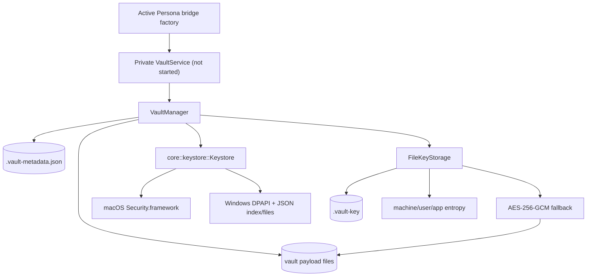
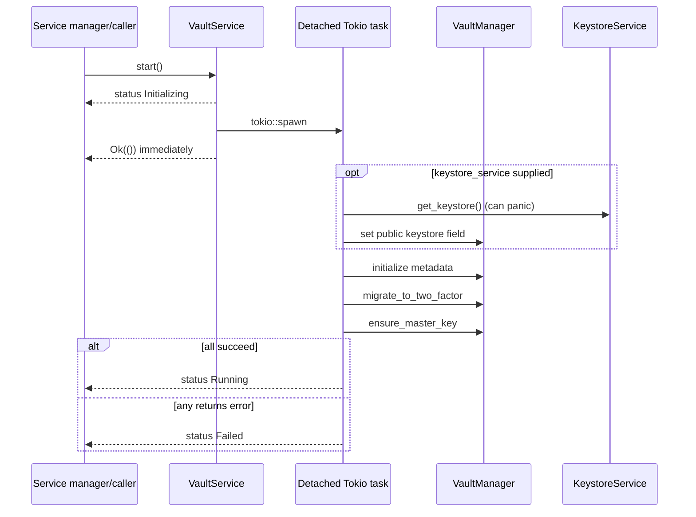
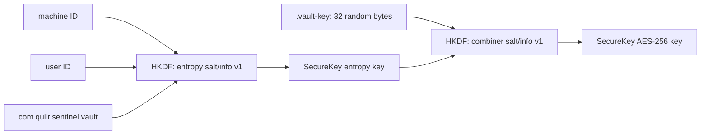

# Endpoint core: Vault persistence, key derivation, and platform keystore

This chapter accounts for 45 endpoint-agent paths at commit `a022e52bf2fff6a9445ebad96c3afeaf277e259f`: the 17 Vault/keystore core and service files, the 19 directly used keystore HAL files, four module-root files, and five Vault/keystore design artifacts. The Persona storage callers were analyzed in [the Persona chapter](06-endpoint-core-persona.md); this chapter follows their dependency through the actual file formats and macOS/Windows backends.

## Actual runtime position

The repository contains two different Vault construction stories:

1. `KeystoreService` and `VaultService` are public `Serviceable` wrappers, and `core/src/defaults/services.rs` still contains commented-out definitions for `keystore.service` and `vault.service`.
2. The active eight-service default graph registers neither wrapper. Its `persona_broker_bridge.service` factory directly creates a private `VaultService::new`, puts it in `PersonaManagerConfig`, and never calls that Vault service's `start` method.

This distinction changes behavior materially:

- the private Persona Vault has a `Keystore` immediately on macOS/Windows because `VaultService::new` constructs one synchronously;
- ordinary `store`/`retrieve` calls lazily load metadata;
- `migrate_to_two_factor` and `ensure_master_key` are invoked only by `VaultService::start`, so the active private Persona instance invokes neither;
- the inactive service wrapper's startup task can report `Running` or `Failed` asynchronously, but the active factory does not use that lifecycle;
- `VaultService::new` exists only under `cfg(any(target_os = "macos", target_os = "windows"))`. The unconditional `Default` implementation calls it. **Verified static contradiction:** on another target, that method is absent while the `Default` body remains. Cargo/rustc are unavailable in the analysis environment, so an actual Linux build could not be executed, but the conditional source does not provide a matching method.



Every solid edge is directly verified. Platform selection is compile-time. The Windows TPM edge is intentionally absent: committed `tpm.rs` forces its availability probe to `false`, and its cryptographic operations are placeholders.

## Public contracts and transport models

### HAL contract

`infra/src/interface/keystore/v1_0/keystore.rs` defines the OS-neutral `KeystoreInterface` trait:

```rust
pub trait KeystoreInterface {
    fn probe(&mut self) -> Result<KeystoreProbeResult, KeystoreError>;
    fn generate_algorithmic_string(&self, options: &KeyOptions)
        -> Result<AlgorithmString, KeystoreError>;
    fn check_key_existance(&self, options: &KeyOptions)
        -> Result<bool, KeystoreError>;
    fn generate_key(&self, options: &KeyOptions) -> Result<Keyblob, KeystoreError>;
    fn remove_key(&self, label: &str) -> Result<bool, KeystoreError>;
    fn encrypt(&self, algorithm: AlgorithmString, label: &str, data: Vec<u8>)
        -> Result<Vec<u8>, KeystoreError>;
    fn decrypt(&self, algorithm: AlgorithmString, label: &str, data: Vec<u8>)
        -> Result<Vec<u8>, KeystoreError>;
    fn verify(&self, label: &str, algo: AlgorithmString,
        signature: Vec<u8>, data: Vec<u8>) -> Result<bool, KeystoreError>;
    fn store_secret(&self, secret: &str, alias: &str) -> Result<(), KeystoreError>;
    fn retrieve_secret(&self, alias: &str) -> Result<Option<String>, KeystoreError>;
    fn delete_secret(&self, alias: &str) -> Result<bool, KeystoreError>;
}
```

The trait has no `Send` or `Sync` supertrait despite the HAL architecture document claiming both are required. Its method is misspelled `check_key_existance`; this spelling is the implemented public API.

### Key data dictionary

| Data point | Type / allowed values | Origin and consumers | Validation / lifecycle |
| --- | --- | --- | --- |
| `KeyScope` | `User`, `System` | `KeyOptions`, `Keyblob`, Windows metadata | Mostly metadata. The active Vault always requests `User`; no core authorization check enforces scope. |
| `SecLevel` | `Trusted`, `Software`, `Unknown` | Probe result, request, returned key metadata | Vault's `DEFAULT_SECLEVEL` is `Software`. macOS includes the Secure Enclave token only for `Trusted`. Windows currently probes to DPAPI/`Software`. |
| `Algorithm` | `ECC`, `RSA`, `AES` | Requested key family | Interface comments mark RSA/AES unsupported; active Vault uses ECC. Windows secret metadata stores the AES enum only as a placeholder. |
| `KeySize` | `K256`, `K384`, `K512` | Algorithm mapping and metadata | Vault always requests `K256`. Names are enum labels, not a generic numeric representation. |
| `HashAlgorithm` | SHA-224/256/384/512 | Optional request selector | Vault uses SHA-256. macOS/Windows mapping accepts different combinations. |
| `KeyUsageType` | Sign/Verify/Encrypt/Decrypt | Algorithm mapping | Vault middleware synthesizes Encrypt options for both encrypt and decrypt calls. |
| `KeyLifeTime` | Permanent/Ephemeral | OS key creation and Windows metadata | Vault requests Permanent. Windows persists even metadata marked Ephemeral; no expiration logic exists. |
| `AlgorithmString` | eleven ECDSA/ECIES variants | HAL-specific algorithm selector | Vault resolves to `ECIES_STANDARD_IV_963_SHA256_AES_GCM`; macOS maps that name to Apple's **VariableIV** constant. Windows DPAPI ignores the value during payload protection. |
| `KeyOptions.alias` | `String` | Vault fixed alias or other callers | macOS rejects empty/duplicate key labels. Windows utility rejects empty, over 255 bytes, and `< > : " / \\ | ? *`; core's own helper validates only through HAL. |
| `Keyblob` | alias, UUID-like ID, level, scope, algorithm, size, byte reference, usage, metadata | Returned by HAL key generation | Vault ignores the returned blob. macOS `key_ref` is exported public-key bytes; Windows DPAPI `key_ref` is a protected 16-byte UUID payload. |

`infra/src/interface/keystore/v1_0/types.rs` is a zero-byte orphan: `interface/mod.rs` does not declare it and it defines no types.

### Vault message API

`VaultService::handle_message` consumes the serde-derived `VaultMessage` variants declared in `core/src/service/messages.rs`:

| Request | Fields | Success response | Failure behavior |
| --- | --- | --- | --- |
| `Store` | `key: String`, `data: Vec<u8>` | `StoreSuccess` | Returns `Err("Store failed: …")`. |
| `Retrieve` | `key: String` | `RetrieveSuccess(Vec<u8>)` | Returns `Err("Retrieve failed: …")`. |
| `Delete` | `key: String` | `DeleteSuccess` | Returns `Err("Delete failed: …")`. |
| `List` | none | `ListSuccess(Vec<String>)` | Returns `Err("List failed: …")`. |
| `StoreSecret` | `alias`, `secret` strings | `StoreSecretSuccess` | Returns `Err("StoreSecret failed: …")`. |
| `RetrieveSecret` | `alias` | `RetrieveSecretSuccess(Option<String>)` | Returns an `Err` string. |
| `DeleteSecret` | `alias` | `DeleteSecretSuccess(bool)` | Returns an `Err` string. |

**Dead-code candidates:** corresponding `VaultResponse::*Error(String)` variants are serialized and unit-tested, but `handle_message` never constructs them. Repository-wide callers often match them defensively; actual service failures use the outer `Result::Err`.

The generic `ServiceMessage::Vault` and `ServiceResponse::Vault` wrappers exist, but the previously analyzed `ServiceManager::send_message` path is a placeholder. No route registers `VaultService::handle_message` with the manager. Persona calls the method directly through an `Arc<VaultService>`.

## Construction and lifecycle

### `Keystore::new_instance`, `new`, and `get_tee`

On macOS/Windows, construction starts with `TrustedEnvironment { sec_level: Unknown }`, calls `probe`, ignores the probe's `Result`, and retains the object whether it reached `Trusted`, `Software`, or stayed `Unknown`. It logs only successful probes. Unsupported platforms receive a phantom `Keystore` whose crypto and secret methods return `NotImplemented`.

The fixed Vault options in `core/src/keystore/types.rs` are ECC, K256, SHA-256 and **Software**. `Keystore::create_key_options` uses owner `sentinel-vault`; the private `generate_key_options` used by encrypt/decrypt omits the owner. The public async `Keystore::generate_key` is `todo!()` on macOS/Windows and has no production caller.

### `KeystoreService`

`KeystoreService::start` sends `Initializing`, synchronously probes and stores `Arc<Keystore>` in a standard `RwLock<Option<_>>`, then sends `Running`. On unsupported platforms it stores the placeholder and still reports `Running`. `get_keystore` panics when called before start or after a poisoned lock. `stop` only emits `Stopping` and `Stopped`; it neither clears the instance nor changes the public `state` field.

`register` returns unit on Windows and panics via `unimplemented!` elsewhere. `cleanup` is a no-op. The service is exported but inactive in the default graph.

### `VaultService` constructors

| Constructor | Manager keystore | Secret-operation keystore | Other behavior |
| --- | --- | --- | --- |
| `new_with_keystore_service` | Initially none | Initially none | Stores a cloned `KeystoreService`; `start` retrieves its keystore. |
| `new_with_keystore` | Supplied `Arc<Keystore>` | Same supplied value | Marked deprecated in comments. |
| `new` | Newly probed keystore | Same new value | macOS/Windows only; this is the active Persona path. |
| `new_async` | None | None | Performs no asynchronous initialization despite its name/documentation. File-backed Vault operations can still derive their fallback key on supported platforms. |

### `VaultService::start`



The task handle is not retained. `stop` cannot cancel or join it and only sends statuses. `state` remains `NotStarted` throughout; lifecycle state is externalized through the channel. The general lifecycle manager previously documented marks a service running when synchronous `start` returns, so this wrapper can later report a failed initialization after that transition.

`ensure_master_key` only checks that `VaultManager.keystore` is `Some`; it generates nothing. The next keystore-backed `store` is the first key-generation attempt.

## File Vault formats and data lifecycle

### Paths

`VaultManager::get_vault_dir` looks up `VAULT_DIR_NAME` in `get_default_dirs().dirs`. This chapter verifies the lookup, not the broader default-directory creation/permission implementation, which belongs to the filesystem subsystem.

Within that directory, the Vault uses:

| Path/name | Contents | Writer / reader |
| --- | --- | --- |
| `.vault-metadata.json` | Pretty JSON `VaultMetadata` | `save_metadata`; lazy `load_metadata_internal` |
| `.vault-key` | exactly 32 raw random bytes | `FileKeyStorage`; read for every file-key operation |
| `.two-factor-migrated` | literal `v1` | `migrate_to_two_factor` |
| caller-provided `file_name` | encrypted payload bytes | `store`, `retrieve`, `delete` |
| Windows `%LOCALAPPDATA%\Sentinel\keystore\<UUID>.bin` | DPAPI-protected placeholder key bytes | DPAPI key functions |
| Windows `%LOCALAPPDATA%\Sentinel\keystore\<UUID>.secret` | DPAPI-protected UTF-8 secret | DPAPI secret functions |
| Windows `%LOCALAPPDATA%\Quilr\keystore\registry.json` | DPAPI-protected JSON metadata/index/backend state | misleadingly named `InMemoryRegistry` |
| macOS generic-password item | service `com.sentinel.keystore`, account = alias, data = UTF-8 bytes | Keychain secret helpers |

Windows paths fall back to `%APPDATA%\Sentinel\keystore` and then `.\sentinel\keystore` for blobs; the metadata path independently falls back to `.` when `LOCALAPPDATA` is absent. The product names therefore differ (`Sentinel` versus `Quilr`) and the blob and index locations are separate.

### Metadata schema

`VaultMetadata` is `{ "files": [...] }`. Each `FileMetaData` contains:

| Field | Type | Meaning and actual use |
| --- | --- | --- |
| `filename` | `String` | Logical key; equality key for upsert, retrieve, delete and list. |
| `abs_file_path` | `String` | Constructed from the write path. Normal retrieval ignores it; migration trusts it as the path to read and overwrite. |
| `alias_reference` | `Option<String>` | `file-key` selects file-derived AES. Any other nonempty value selects the keystore path, but decryption always uses the fixed master alias rather than this stored string. Missing/empty is fatal. |
| `size` | `u64` | Encrypted byte length at store time. Not checked during retrieve or migration. |
| `timestamp` | `u64` | Unix seconds, with pre-epoch/system-clock errors silently becoming zero. Not used for ordering or expiry. |

`upsert_file` removes every same-name entry and pushes the new record; parsing accepts duplicates, and `get_file` uses the first one until the next upsert. There is no schema version, checksum, canonical-path validation, or size limit.

### Payload formats

File-key encryption uses:

```text
12-byte random AES-GCM nonce || ciphertext || 16-byte GCM tag
```

The `aes-gcm` crate returns ciphertext and tag together. The repository prepends only the nonce. There is no magic, algorithm identifier, version, associated data, filename binding, or metadata binding in the payload.

macOS keystore encryption returns the opaque Security.framework ECIES result. Windows DPAPI returns the opaque `CryptProtectData` output. Metadata is the only repository field that says which decoder to try.

## Store flow

```mermaid
sequenceDiagram
    participant C as Caller/Persona
    participant VS as VaultService
    participant VM as VaultManager
    participant KS as Keystore
    participant FK as FileKeyStorage
    participant FS as Filesystem

    C->>VS: store(file_name, bytes)
    VS->>VM: read-lock manager; store
    VM->>VM: lazy-load metadata
    alt keystore configured
        VM->>KS: encrypt(fixed master alias, clone of plaintext)
        alt keystore success
            KS-->>VM: platform ciphertext; alias=master alias
        else any keystore error
            VM->>FK: derive file+entropy key
            FK-->>VM: AES key; alias=file-key
        end
    else no keystore
        VM->>FK: derive file+entropy key
    end
    VM->>FS: File::create, write_all, flush ciphertext
    VM->>VM: mutate in-memory metadata
    VM->>FS: overwrite pretty JSON metadata
    VM-->>C: success
```

Execution facts and failure boundaries:

1. `file_name` is not validated. `PathBuf::push` accepts absolute paths and `..` components. **Potential issue requiring validation:** a caller able to supply an arbitrary Vault key can direct store/retrieve/delete outside the configured Vault directory. Active Persona synthesizes constrained names, but the public message model accepts arbitrary strings and no active IPC registration for it was found.
2. The plaintext `Box<Vec<u8>>` is cloned for keystore encryption. No explicit zeroization covers either copy.
3. Any keystore error, including permission errors, generation failure, or unsupported algorithms, triggers file-key fallback. Failure of both methods aborts before the payload write.
4. `File::create` truncates an existing target. The write is not temporary-file + rename and is not `sync_all`'d.
5. Payload and metadata updates are separate. A payload can be written/truncated and then metadata serialization/write can fail.
6. `update_metadata` mutates the in-memory vector before saving. A save failure leaves memory and disk disagreeing.
7. Empty and arbitrarily large buffers are accepted; each encryption path operates on a complete in-memory buffer.

On macOS, a missing software key is generated and then used for ECIES. Core ignores the key-generation result, so the later encrypt determines success. On Windows, generation writes a placeholder blob/index, but payload protection is direct DPAPI as detailed below.

## Retrieve and self-heal flow

After lazy metadata loading and whole-file read:

- `alias_reference == "file-key"`: use the two-factor AES key once;
- any other nonempty alias with a configured keystore: try the fixed `com.sentinel.vault.master` keystore alias, then the file key;
- any other nonempty alias without a keystore: try only the file key;
- empty/missing alias: return `DecryptionError` without testing any decoder.

The actual stored alias string is not passed to the HAL. A record containing `some-old-key` is treated exactly like `com.sentinel.vault.master`.

`should_self_heal_persona_entry` is true only when environment variable `SENTINEL_SERVICE_MODE` exists and the name begins `persona_`. In the `file-key` branch, a decryption failure invokes `delete`. In the configured-keystore branch, both keystore and file-key failures do the same. The no-keystore/nonempty-alias branch does **not** self-heal.

Self-heal deletes the unreadable payload and then tries to save metadata. It therefore intentionally destroys recovery evidence. Deletion failure is only logged and the original decryption error is returned.

`FileNotFound(file_name)` is based on the constructed path, independently of whether metadata contains the key. Conversely, a payload with no metadata cannot be returned.

## Delete and list

`delete` removes the payload first if it exists, removes every matching metadata entry, then overwrites metadata JSON. Metadata-save failure after payload deletion can leave a stale on-disk record. A missing payload is not an error and metadata is still removed.

`list` returns metadata filenames only. It does not scan disk, verify payload existence, sort, deduplicate malformed input, or hide internal-looking names.

No Vault payload secure-erasure routine exists. Normal deletion calls `tokio::fs::remove_file`.

## Two-factor file-key derivation

`FileKeyStorage::get_or_create_master_key` performs two HKDF-SHA256 stages:



Exact fixed domain strings are:

- `sentinel-vault-entropy-salt-v1`
- `sentinel-vault-entropy-key-v1`
- `sentinel-vault-combiner-salt-v1`
- `sentinel-vault-final-key-v1`

`SecureKey` wraps `[u8; 32]`, derives `Zeroize`/`ZeroizeOnDrop`, deliberately lacks `Clone` and `Debug`, and exposes byte references. The 64-byte combiner vector is explicitly zeroized. The raw file-key arrays, the vector returned by `fs::read`, the entropy derivation `String`, and plaintext/ciphertext buffers are not explicitly zeroized. The test named `test_secure_key_zeroing` does not inspect memory after drop; it only creates a key and lets it go out of scope.

### Entropy quality and fallback

`EntropySource::collect_best_effort` behaves as follows:

| Machine result | User result | Result |
| --- | --- | --- |
| success | success | `Full(machine, user, app)` |
| failure | success + hostname success | `Partial(hostname, user, app)` |
| failure | success + hostname failure | `Minimal("", user, app)` |
| success | failure | returns the user error |
| failure | failure | `InsufficientEntropy` |

`EntropyQuality::is_acceptable` returns false for `Minimal`, but no production caller invokes it. Minimal entropy is logged and used to derive the real encryption key.

macOS uses `IOPlatformUUID` and `libc::getuid`. **Contradiction:** comments claim the UID is privilege-stable, but the source contains no original-user/SUDO identity recovery; it uses the current process's real UID directly.

Windows uses `MachineGuid` and a SID. In service mode it does not query an interactive session. It scans `ProfileList`, excludes three system SIDs, and chooses the profile whose `AppData\Roaming` directory has the newest modification time. **Inference:** that heuristic can select a recently modified but noninteractive profile on a multi-user machine. If no profile qualifies, it uses the process-token SID, usually the service account according to the source comment.

Unsupported platforms return `UnsupportedPlatform`; file-key Vault storage is therefore not functional there despite the presence of a placeholder `Keystore`.

### `.vault-key` lifecycle

- Creation is an `exists` check followed by `fs::write`; concurrent first use can generate competing keys and whichever write finishes last determines future decryptability.
- Unix permissions are changed to `0600` **after** the file is created, leaving creation-time permissions governed by the process umask until `set_permissions` succeeds.
- Windows runs three `icacls` commands to remove inheritance and grant the current username and `SYSTEM`; all command spawn failures, exit statuses and stderr are ignored.
- A Windows service-mode access-denied read attempts an ACL repair and one reread. If the reread fails, the returned text reports the original error.
- `delete_key` removes Factor 1 without wiping it and is a dead-code candidate outside tests.

## Migration behavior

`migrate_to_two_factor` reads `.vault-metadata.json` state already held in memory and checks `.two-factor-migrated`:

1. An existing marker returns success without format verification.
2. Empty metadata writes marker `v1` immediately.
3. For each record, it trusts `abs_file_path`; a missing path is logged and skipped.
4. It first decrypts with the raw 32-byte file key, then tests the new derived key if that fails.
5. Old-format plaintext is re-encrypted in place with the new derived key.
6. A file readable with the new key is counted without rewriting.
7. Failure under both keys aborts immediately.
8. After the loop, it writes the marker even if some metadata paths were missing.

**Contradiction:** the method comment says failure leaves the Vault in old format. Earlier files are overwritten before a later failure; there is no transaction, backup or rollback. Restart reprocesses them, recognizing already-new files through the second decoder.

**Potential issue:** records previously encrypted through a platform keystore are also fed to the old/new file-key decoders; migration does not inspect `alias_reference`. Such a record causes migration failure unless its bytes happen to decrypt under a file key.

The marker and file rewrites use synchronous `std::fs` calls from the async startup task while holding the manager's outer Tokio write guard and the metadata read guard.

## macOS HAL

### Probe and key generation

`probe_secure_enclave` attempts one ephemeral Secure Enclave P-256 key. Success releases the key and yields `Supported`. A null key with any `CFErrorRef` is classified as `RequiresUserAuth` without examining its error domain/code; no error object release is visible on that path. A null key with no error is `Unsupported`. The trait collapses every non-success outcome to `KeystoreError::ProbeFailed`; there is no explicit software probe result.

This does not prevent active Vault encryption because its options request `Software`. `generate_key_dictionary` omits `kSecAttrTokenIDSecureEnclave` for software options, so even on Secure Enclave hardware the fixed Vault master alias is a software Keychain-backed EC key.

Key generation:

- validates nonempty and rejects an existing label;
- uses the alias itself as `kSecAttrLabel`;
- uses `kSecAttrIsPermanent` from the requested lifetime;
- generates an alias-hyphen-UUID application `key_id` but does not use it for lookup;
- exports the public key bytes into `Keyblob.key_ref`;
- never stores that `Keyblob` in Vault metadata.

`generate_secure_aes_key` is only a call to EC key-pair generation. It does not generate or wrap an AES key despite its name/comment.

### ECIES operations

Encrypt retrieves a keychain item by label, derives a public `SecKeyRef`, then calls `SecKeyCreateEncryptedData`. Decrypt retrieves the private reference and calls `SecKeyCreateDecryptedData`. `ECIES_STANDARD_IV_*` Rust enum values map to Apple `...StandardVariableIV...` constants, so the naming and actual algorithm constant disagree.

**Potential issue requiring validation:** returned `SecKeyRef` values are not released in the trait encrypt/decrypt/verify paths, and `check_key_exists` does not release its successful `SecItemCopyMatching` result. Exact ownership consequences depend on the Security.framework create/copy contract, but no balancing release is present in source.

`verify_signature_with_seckey_ref` stores the Boolean return in `_outcome`, ignores it, and returns `Ok(true)` whenever `cf_err` is null. The macOS verification test also passes digest bytes in the `signature` argument and signed bytes in the `data` argument. This helper is not used by Vault encryption, but it is part of the completed HAL surface.

`query_dictionary_construct` has a `persistent_reference` option and imports `kSecReturnPersistentRef`, but a true option pushes `kSecReturnRef`. Its local `return_persistent` and persistent-ref key are unused. The design artifact claiming persistent-reference lookup is therefore not implemented.

### Generic-password secrets

Secret storage is independent of EC key generation:

- Keychain class: generic password;
- service: `com.sentinel.keystore`;
- account: caller alias;
- value: UTF-8 bytes;
- empty alias/secret: invalid;
- maximum: `secret.len() <= 4096`, which is UTF-8 **bytes**, despite comments/errors saying characters;
- duplicate: `SecItemUpdate` upsert;
- retrieve: `None` only for `errSecItemNotFound`; invalid UTF-8 is an OS error;
- delete: Boolean existence result.

## Windows HAL

### Which `TrustedEnvironment` is active

Windows contains two implementations:

- `keystore_interface_impl.rs` implements the trait for the interface-layer `TrustedEnvironment` imported by core. It selects a backend through a process-global `OnceLock`.
- `trusted_environment.rs` declares a different Windows-local type with an instance `backend` field and implements the same trait. No non-test repository caller imports this type.

The second is a **dead-code candidate / parallel legacy implementation**. Its secret methods are `todo!()`. Tests in `keystore_interface_impl.rs` instantiate that legacy type, so they do not exercise the interface type used by core.

The active global backend is set with `get_or_init`, not `set`. If `get_backend_state` initializes it to `None` before `probe`, later attempts to select TPM/DPAPI are silently ignored. Ordinary core construction probes first, but tests share this global and one test explicitly reads it.

### Probe

`check_tpm_available` is a hard-coded `Ok(false)`. DPAPI's `verify_dpapi_access` is a hard-coded `Ok(true)`. The ordinary committed path therefore selects DPAPI and reports `SecLevel::Software`.

The TPM context has a separate inconsistency: an unsupported probe stores `Some(TpmContext { available: false })`, but later TPM functions check only whether the option is `Some`, not its `available` field. Direct calls after probing can therefore pass the availability gate. This does not change the active interface path after it selects DPAPI.

### DPAPI key and payload behavior

`generate_dpapi_key` does **not** generate ECC key material. It:

1. creates a UUID key ID;
2. takes another UUID's 16 raw bytes as placeholder material;
3. protects those bytes with DPAPI;
4. writes `<key_id>.bin`;
5. writes metadata and an alias-to-ID index in separate saves;
6. returns the protected placeholder in `Keyblob.key_ref`.

It clones the 16-byte material and calls `secure_wipe_memory` only on the clone; the original vector is not wiped. It does not reject a duplicate alias, so a direct repeated generation can overwrite index/metadata and orphan the older blob.

More importantly, `encrypt_with_dpapi` does not load this blob. It calls `dpapi_protect(data, label)`, and `dpapi_protect` names the description parameter `_description` and passes no description or optional entropy to Windows. `decrypt_with_dpapi` directly unprotects the ciphertext. The algorithm and stored/generated key are unused.

**Verified consequence:** Windows Vault ciphertext is protected by the current DPAPI user context, not by per-alias generated ECC material. The alias/index gate is checked by core before encryption/decryption, but the low-level ciphertext is not cryptographically bound to that alias. Deleting the alias makes core refuse normal decryption even though the DPAPI blob itself remains decryptable through the low-level API in the same context.

The DPAPI wrappers copy API-allocated output into Rust vectors. No explicit freeing call for the API buffers appears; repository comments instead say the OS manages them. **Potential issue requiring validation:** confirm allocation ownership against the exact `windows` crate/API contract.

### Windows metadata is a file, not the Registry

`registry_ops.rs` calls its abstraction `RegistryOperations`, but the only implementation is `InMemoryRegistry` backed by a JSON file. On Windows the complete JSON is DPAPI-protected before write. Its three maps are separate mutexes:

- alias → `KeyMetadataRecord`;
- alias → key ID;
- one `BackendStateRecord`.

Probe never calls `store_backend_state`; production use sees the default record unless another external caller initializes/stores it, and none was found.

Load behavior is fail-open to empty state: missing/read/decrypt/parse failures are logged and construction continues. A DPAPI decrypt failure tries the bytes as legacy plaintext JSON. A later write can replace an unreadable prior registry file with only newly accumulated state.

Each metadata/index mutation is persisted independently. The in-memory map changes before disk save; a save error is returned without rolling the map back. Key/secret generation writes the blob, metadata, and index as three nontransactional steps. No temporary-file/rename/fsync protects JSON writes.

### Windows secrets and deletion

Secrets use DPAPI directly, with the alias only selecting a registry index entry. Maximum `String::len()` is 4,096 bytes. Unlike macOS, duplicate aliases return `KeyAlreadyExists`; Persona's adapter compensates by deleting before storing.

Both `.bin` and `.secret` writers mark the file read-only. Their “secure” delete helpers then try to overwrite the same file before removing it. If the read-only flag blocks `fs::write`, delete logs the blob failure but still removes metadata and index, returning `true` while leaving an unindexed encrypted file. If overwrite succeeds, the source writes repeated `0xFF` bytes, not random data as its comments state.

ACL hardening uses `icacls` and ignores command results. The JSON index's helper likewise ignores inheritance/grant results.

### TPM status

The TPM module is explicit placeholder code:

- availability is forced false;
- key generation returns metadata and the formatted algorithm name as `key_ref` if its weak context gate is passed;
- existence always returns false;
- encrypt, decrypt and verify return `NotImplemented`;
- delete returns false.

No current committed Windows Vault path can provide hardware-backed payload encryption. Claims that TPM is implemented or preferred describe intended architecture, not runtime behavior.

## Concurrency and consistency

`VaultService` has an outer `Arc<tokio::sync::RwLock<VaultManager>>`. Store and retrieve take its **read** guard for the whole operation; start takes a write guard. Inside, metadata and its loaded flag have independent Tokio `RwLock`s.

Verified concurrency behavior:

- different payload operations can run concurrently after initialization;
- same-name stores can truncate/write the same file concurrently;
- `update_metadata` mutates under a lock and later calls `save_metadata`, which takes a new snapshot; concurrent saves can complete out of order and put an older snapshot on disk;
- multiple processes have no shared lock;
- first-use `.vault-key` generation is check-then-write;
- metadata JSON, marker and key-file operations include synchronous filesystem calls in async request/startup paths;
- encryption/decryption and JSON serialization operate on complete in-memory buffers;
- migration holds the outer manager write lock (from `start`) and its metadata read guard across synchronous I/O and crypto;
- no batching, streaming, pagination, retry, backpressure, file-size cap, connection pool or rate limit exists here.

**Potential performance concerns requiring measurement:** whole-buffer clones on keystore store, repeated machine/user entropy collection and key-file reads per fallback operation, blocking OS/key/filesystem calls on Tokio threads, and linear metadata lookup/list/upsert.

## Error and recovery matrix

| Condition | Handling | Persisted/visible outcome |
| --- | --- | --- |
| No Vault directory | Returned `MissingVaultDirectory` | No write. |
| Corrupt metadata JSON | Returned `MetadataError`; lazy-loaded flag stays false | All later operations retry and fail until repaired. |
| Keystore probe failure | Suppressed by `Keystore::get_tee` | Object remains Unknown; software macOS path may still work, manager can fall back to file key. |
| Key existence HAL error | Core treats as missing | Encrypt attempts generation; decrypt reports “Decryption key not found.” |
| Key generation error | Core encrypt ignores it | Later HAL encrypt fails; Vault then tries file-key fallback. |
| Keystore encrypt error | Logged warning, then file-key AES | Metadata says `file-key` on success. |
| Both encryption methods fail | Returned file-key error | Payload not created by this call. |
| Payload write partial/failure | I/O error | Truncated/partial target possible; metadata not updated. |
| Metadata save after payload success | Returned error | New payload may be orphaned; memory already includes record. |
| Keystore decrypt error | File-key fallback when metadata alias nonempty | Can recover stale/mismatched metadata. |
| Both decryptors fail for service Persona | Best-effort destructive self-heal | Payload/metadata may be deleted; original error returned. |
| Delete payload succeeds, metadata save fails | Returned I/O error | Disk metadata may still name deleted payload. |
| File-key length != 32 | `EncryptionError` | No regeneration; Vault remains unreadable until external repair. |
| Entropy changes | AES-GCM decryption failure | No recovery/key history. |
| Migration failure after prior files | Returned error, no marker | Earlier files remain converted; retry tests both formats. |
| Windows DPAPI registry load failure | Logged and suppressed | Empty in-memory state; keys/secrets appear absent. |
| Windows secret blob deletion failure | Logged/suppressed | Metadata/index removed; orphan file may remain. |
| Service startup initialization error | Detached task sends `Failed` | `start()` already returned `Ok`; public state field unchanged. |

`VaultStorageError` contains both `EncryptionError`/`EncryptionFailed` and `DecryptionError`/`DecryptionFailed` with identical display text. Current manager paths use the `*Error` variants; `*Failed` are dead-code candidates. `KeyInitializationError` also has no producer in the analyzed subsystem.

## Security boundaries

### Verified controls

- Vault payloads written through current `store` are encrypted through a platform backend or AES-256-GCM; there is no plaintext-success fallback.
- AES fallback authenticates ciphertext with GCM.
- file-derived final keys use domain-separated HKDF stages and `SecureKey` zeroizes its own array on drop.
- macOS secret operations use a dedicated generic-password service/account tuple.
- Windows secret/key/index bytes are DPAPI protected before their respective file writes.
- Unix `.vault-key` final mode is requested as `0600`.
- empty secrets/aliases are rejected and platform secret writers impose a 4,096-byte limit.

### Partial or absent controls

- filenames are not confined to the Vault directory;
- Vault payload/metadata writes are not atomic or transactional;
- metadata is plaintext and unauthenticated, even when payloads are authenticated;
- metadata's absolute paths are trusted by migration;
- no Vault directory/file permission enforcement appears in `VaultManager`;
- no tenant/user identity is included in logical keys or AEAD associated data;
- no key rotation, versioning, backup, recovery, or entropy-change migration exists;
- Windows alias metadata is not cryptographically bound to DPAPI payloads;
- Windows ACL command success is not checked;
- platform/private buffers and ordinary plaintext are not comprehensively zeroized;
- logs include aliases, filenames, paths, entropy quality, machine GUID, UID/SID at debug level, and detailed OS errors; they do not intentionally log secret values in this subsystem.

The user context that can read the keychain/DPAPI/file key is the effective trust boundary. The repositories do not show a separate authorization layer around direct in-process Vault calls.

## Test analysis

### VaultManager and file key

`core/src/vault/manager.rs` tests use temporary directories and cover master-key presence, encrypted roundtrip, multiple files, deletion, missing retrieval, overwrite, metadata reload, no-keystore roundtrip, a 1 MiB payload, empty data, and filenames with spaces/Unicode. The comment for no-keystore storage says data is plaintext; implementation and assertion only demonstrate encrypted roundtrip.

`file_key_storage.rs` tests cover deterministic same-machine derivation, persistence, factor deletion/change, combined-key inequality, and final Unix mode. Most crypto tests are platform-gated. No test covers concurrent first creation, creation-time permission windows, ignored `icacls` failure, corrupt length recovery, or service-profile changes.

Entropy tests cover determinism and platform happy paths. `is_acceptable` is not tested as an enforcement decision. Windows tests do not test the ProfileList selection heuristic. macOS's UID test is `cfg(unix)`, although its containing module is compiled only on macOS.

### Service wrappers

Vault tests cover config, message success, nonexistent retrieval, status messages and cleanup. They construct the default home-directory Vault for most cases rather than isolating every test. Several comments still say retrieve is unimplemented or no-keystore data is plaintext.

Both KeystoreService and VaultService tests assert that the public plain `state` field becomes `Running`/`Stopped`. Neither lifecycle method mutates that field, so those assertions contradict source and fail if run. Vault start-status tests wait for asynchronous `Running`; environment-dependent metadata/migration/keystore failures can instead produce `Failed`.

### macOS and Windows HAL

macOS tests are real Keychain/Secure Enclave integration tests with fixed aliases; they assume supported hardware and mutate the user's Keychain. The verification test's arguments are reversed, while the helper ignores the Boolean result. Secret tests also use the real Keychain and are not marked ignored.

Windows DPAPI/registry tests mutate real per-user storage on Windows unless a test manually supplies a temporary `storage_path`. Several `InMemoryRegistry::new` tests therefore load shared prior state; `get_all` nevertheless asserts an exact count of three. TPM tests share `OnceLock` context, making outcomes order-dependent after a probe stores `Some(available=false)`. The actual interface type's trait operations are not exercised by the small `keystore_interface_impl` tests.

No visible tests cover path traversal, malformed/duplicate metadata, payload/metadata crash consistency, out-of-order concurrent saves, multi-process access, migration of keystore-encrypted records, partial migration, unreadable marker, entropy identity change, DPAPI alias non-binding, read-only blob deletion, or backend-global initialization order.

Cargo/rustc are absent, so test execution and compile validation were not possible in this environment.

## Dead, legacy, placeholder, and incomplete code

| Code | Classification | Evidence |
| --- | --- | --- |
| `Keystore::generate_key` | Placeholder | `todo!()` on macOS/Windows; no caller found. |
| Public `KeystoreService` / `VaultService` graph definitions | Inactive/legacy wrappers | Definitions and dependencies are commented out of `get_default_services`. |
| `VaultService::new_async` preferred-in-docs claim | Incomplete behavior | Creates a no-keystore manager and performs no async initialization. |
| `VaultState`, `VaultResult` | Dead-code candidates | Definitions have no repository caller. |
| `VAULT_ENCRYPTION_KEY_ALIAS` | Dead-code candidate | Runtime uses `VAULT_MASTER_KEY_ALIAS`; only design docs mention the compatibility constant. |
| `EncryptionFailed`, `DecryptionFailed`, `KeyInitializationError` | Dead-code candidates | No producer found. |
| `EntropyQuality::is_acceptable`, `EntropyError::HkdfError` | Dead-code candidates | No production caller/producer. |
| Windows `trusted_environment.rs` type | Parallel legacy implementation | Core imports interface type; local type is found only in tests and its secret methods are `todo!()`. |
| Windows TPM backend | Placeholder/experimental | Probe forced false; crypto returns `NotImplemented`; generated key is metadata-only. |
| Windows `serialize_keyblob` / `deserialize_keyblob` | Placeholder utilities | No production caller; deserializer returns fixed placeholder fields. |
| `KeyIndexRecord`, `AuditLogEntry` | Documentation/test-only models | The actual index is a `HashMap<String,String>`; no audit writer exists. |
| Persisted `BackendStateRecord` | Unwired capability | Trait/test support exists; probe does not store it. |
| macOS `check_secret_exists` | Dead-code candidate | Upsert uses add-then-update directly. |
| macOS signing helper | Test-only in current repository | Only the HAL unit test calls it. |

Dead-code claims include exact/qualified repository-wide searches across source, tests, docs and registration tables.

## Documentation consistency audit

| Documentation claim | Source | Actual code evidence | Result |
| --- | --- | --- | --- |
| Vault AES key resides in Secure Enclave | `docs/core/vault.md` | Platform keystore path is ECIES/DPAPI; AES fallback derives from `.vault-key` + identifiers. | Contradicted |
| Metadata is appended to each payload | `docs/core/vault.md` | Separate plaintext `.vault-metadata.json`; payload has nonce+ciphertext only. | Contradicted |
| Vault directory is completely DAC-owned by agent | `docs/core/vault.md` | No directory permission operation in `VaultManager`; completed default-directory analysis finds creation/path selection but no general ownership enforcement. | Not verifiable / not enforced here |
| Vault supports only store/retrieve | `docs/core/vault.md` | Delete, list and platform-secret operations are implemented. | Outdated |
| `new()` uses `block_in_place`; `new_async()` is preferred initialized path | `docs/vault-keystore-integration.md` | No `block_in_place`; `new_async` only constructs a manager with no keystore. | Contradicted |
| Alias is `sentinel.vault.encryption.key` | same | Both constants equal `com.sentinel.vault.master`. | Contradicted |
| Software security “falls back to trusted if available” | same | fixed request is Software; macOS omits Secure Enclave token; Windows probe currently DPAPI. | Contradicted |
| All file I/O is async; writes spawn background tasks | same | migration/key/entropy paths are synchronous; payload write is awaited inline. | Contradicted |
| Keystore protected by `Arc<Mutex<Keystore>>` | same | manager stores `Option<Arc<Keystore>>`; service wraps its optional secret reference in Tokio `RwLock`. | Contradicted |
| Multiple threads can safely access Vault | same | memory is lock-protected, but same-file writes and metadata saves race and no process lock exists. | Partially confirmed / overstated |
| Metadata/delete/list are future work | same | all three are implemented. | Outdated |
| Keys never exposed plaintext; hardware used when possible | same | `.vault-key` is raw bytes; requested level is Software; Windows TPM is placeholder. | Contradicted |
| HAL trait is a separate crate and requires `Send + Sync` | `docs/hal/trusted_environment/keystore.md` | Trait lives inside `infra` and has no such bound. | Contradicted |
| Core implements pure-Rust ECDSA fallback and HMAC-chained audit logs | same | no such fallback/audit implementation in analyzed files. | Documentation-only |
| HAL enforces scope/privilege and software-key wrapping | same | scope is largely metadata; no common enforcement/audit policy exists. | Documentation-only / partial OS behavior only |
| Secure Enclave supports P-256/P-384/RSA-3072/RSA-4096 | `secure_enclave_1_0.md` | interface has no numeric RSA sizes; active mapping is EC only. | Contradicted |
| label is `<alias>:<uuid>` and persistent reference/thumbprint are returned | same | label is alias; key ID is alias-hyphen-UUID; `Keyblob` has no persistent-ref/thumbprint fields. | Contradicted |
| persistent reference is acquired with `kSecReturnPersistentRef` | same | query helper adds `kSecReturnRef`. | Contradicted |
| all CF objects are released | same | multiple successful query/key references have no visible release. | Contradicted / potential ownership issue |
| Draw.io includes `FileSystemManager`, `ConfigManager`, secure erase | `docs/drawio/Vault.drawio` | manager directly calls filesystem/default dirs; no secure-erase Vault operation. | Planned/outdated diagram |
| Windows keys never exported, all operations audited | Windows HAL module docs/readme | TPM is placeholder; DPAPI placeholder bytes are returned; audit model has no writer. | Contradicted |

The Draw.io file is hand-authored XML from draw.io 26.0.15, not generated source. Its three pages are retained as design artifacts but are not authoritative runtime diagrams.

## File accounting

| Path/group | Role | Final status |
| --- | --- | --- |
| `core/src/keystore/{mod.rs,types.rs,keystore.rs}` | Middleware export, fixed Vault options, cross-platform wrapper | Fully analyzed — handwritten |
| `core/src/services/{keystore.rs,vault.rs}` | Inactive service wrappers and direct Vault API used by Persona | Fully analyzed — handwritten |
| `core/src/vault/{constants.rs,error.rs,file_key_storage.rs,manager.rs,mod.rs,types.rs}` | Formats, manager, key-file lifecycle, metadata and errors | Fully analyzed — handwritten |
| `core/src/vault/entropy/{error.rs,kdf.rs,mod.rs,sources.rs,sources_macos.rs,sources_windows.rs}` | Platform entropy and two-stage HKDF | Fully analyzed — handwritten |
| `infra/src/interface/keystore/v1_0/{error.rs,keystore.rs,types.rs}` | HAL contract/errors plus one empty orphan | Fully analyzed — handwritten/empty |
| `infra/src/macos_hal/trusted_environment/v1_0/{def.rs,trusted_environment.rs,utils.rs}` | macOS HAL implementation | Fully analyzed — handwritten |
| `infra/src/macos_hal/trusted_environment/v1_0/tests/unit_test.rs` | Hardware/Keychain integration tests | Fully analyzed — handwritten tests |
| `infra/src/windows_hal/trusted_environment/mod.rs` | Windows HAL documentation/module export | Fully analyzed — handwritten |
| `infra/src/windows_hal/trusted_environment/v1_0/{def.rs,dpapi.rs,dpapi_windows_api.rs,keystore_interface_impl.rs,mod.rs,registry_ops.rs,registry_types.rs,tpm.rs,trusted_environment.rs,utils.rs}` | Windows active and legacy backends, storage/index and tests | Fully analyzed — handwritten |
| `infra/src/windows_hal/trusted_environment/v1_0/readme.md` | Windows design note | Fully analyzed — handwritten docs |
| `infra/src/{lib.rs,interface/mod.rs,macos_hal/mod.rs,windows_hal/mod.rs}` | Compile-time module roots | Fully analyzed — handwritten |
| `docs/core/vault.md` | High-level Vault design | Fully analyzed — handwritten docs, substantially outdated |
| `docs/hal/trusted_environment/{keystore.md,secure_enclave_1_0.md}` | HAL/Secure Enclave designs | Fully analyzed — handwritten docs, largely aspirational |
| `docs/vault-keystore-integration.md` | Integration guide | Fully analyzed — handwritten docs, materially outdated |
| `docs/drawio/Vault.drawio` | Three-page editable architecture artifact | Fully analyzed — handwritten XML design artifact |

No file in this 45-path scope is generated or vendored. `infra/src/interface/keystore/v1_0/types.rs` is intentionally present but empty.
