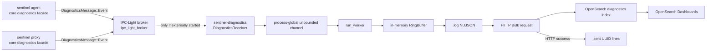

# Endpoint diagnostics: producers, broker receiver, local persistence, OpenSearch, and operations

This chapter accounts for all 15 tracked paths under `sentinel-endpoint-agent/diagnostics/` at commit `a022e52bf2fff6a9445ebad96c3afeaf277e259f`. It also traces the crate's live relationships into the endpoint agent, proxy, core service graph, builders, installers, deployment scripts, documentation, and checked CI workflows.

The exact AST-backed declaration catalog is [endpoint-diagnostics.md](07-symbol-reference/endpoint-diagnostics.md) (100 declarations). The semantic supplement is [endpoint-diagnostics-semantic.md](07-symbol-reference/endpoint-diagnostics-semantic.md).

## Scope and file classification

| Path | Lines | Classification | Runtime role | Status |
| --- | ---: | --- | --- | --- |
| `diagnostics/Cargo.toml` | 54 | Handwritten manifest | Package, binary, features, dependencies | Fully analyzed |
| `diagnostics/README.md` | 58 | Handwritten documentation | Crate quick start and local-operation claims | Fully analyzed; contradictions recorded |
| `diagnostics/build.rs` | 58 | Handwritten Cargo build script | Copies three Docker resources beside Cargo output | Fully analyzed |
| `diagnostics/docker/docker-compose.yml` | 78 | Handwritten Compose configuration | OpenSearch, Dashboards, one-shot setup container | Fully analyzed |
| `diagnostics/docker/index-template.json` | 31 | Handwritten OpenSearch configuration | `diagnostics*` dynamic index template | Fully analyzed; JSON parsed |
| `diagnostics/docker/saved-objects.ndjson` | 3 | Handwritten OpenSearch Dashboards configuration | Index pattern, saved search, time setting | Fully analyzed; every line parsed as JSON |
| `diagnostics/docker/setup.sh` | 194 | Handwritten executable shell script | Local start/stop/clean/status and test ingestion | Fully analyzed; `bash -n` passed |
| `diagnostics/src/bin/diagnostics.rs` | 134 | Handwritten Rust | Standalone receiver process | Fully analyzed |
| `diagnostics/src/ipc/client.rs` | 205 | Handwritten Rust | Producer-side broker sender | Fully analyzed |
| `diagnostics/src/ipc/mod.rs` | 5 | Handwritten Rust | IPC exports | Fully analyzed |
| `diagnostics/src/ipc/server.rs` | 169 | Handwritten Rust | Receiver-side broker client and dispatcher | Fully analyzed |
| `diagnostics/src/lib.rs` | 297 | Handwritten Rust | Public API, macros, HTTP sender, worker | Fully analyzed |
| `diagnostics/src/storage.rs` | 245 | Handwritten Rust | Memory buffer and append-only files | Fully analyzed |
| `diagnostics/src/types.rs` | 415 | Handwritten Rust | Payload, enum, and IPC wire types | Fully analyzed |
| `diagnostics/tests/opensearch_integration.rs` | 70 | Handwritten Rust test | Live-local OpenSearch integration test | Fully analyzed |
| `docs/diagnostics/USAGE.md` | 292 | Handwritten cross-scope documentation | Producer setup, codes, local verification, payload claims | Fully analyzed; contradictions recorded |

There are 2,016 lines in the 15-path package, plus the 292-line related guide, 100 indexed package declarations, five unit-test functions, and one integration-test function. No file in this subtree or the guide is generated or vendored. The OpenSearch template and Dashboards objects are authored repository configuration; no generator is declared.

**Unresolved:** Rust and Cargo are unavailable in the analysis environment, so this revision was not compiled or executed. JSON, NDJSON, YAML, and shell syntax were checked with locally available parsers. Runtime-only behavior of Docker, OpenSearch, and IPC-Light remains unexecuted.

## Actual status in the product

The crate contains two distinct paths:

1. A producer-side `DiagnosticsSender`, used through `sentinel_core::diagnostics`, serializes events and sends them through the pinned IPC-Light broker to `diagnostics_service`.
2. A standalone `sentinel-diagnostics` receiver can register as `diagnostics_service`, enqueue received payloads into a local append-only pipeline, and POST them to OpenSearch.

The first path is active in source. `agent/src/init.rs:357` initializes it as `sentinel_agent`; `proxy/src/platform/common.rs:2350` initializes it as `sentinel_proxy_diag`. Numerous core/proxy call sites use the core facade macros.

The second path is built and packaged, but no checked runtime registration proves that it starts:

- `core/src/services/diagnostics.rs` implements `DiagnosticsService`.
- Its `ServiceDefinition` in `core/src/defaults/services.rs:268-289` is commented out.
- `deployment/deployment.py` nevertheless lists `sentinel-diagnostics.service` in both `DEFAULT_RUNTIME_SERVICE_DEPS` and `DEFAULT_PROCESS_BACKED_SERVICES` and describes that graph as mirroring the core defaults.
- Builders, package layouts, manifests, uninstallers, and preflight checks include the executable.
- Repository-wide launch/registration searches found no independent launchd, Windows-service, scheduled-task, or direct-spawn registration for the diagnostics executable outside the commented core definition.

**Contradiction:** deployment metadata presents the receiver as an active broker-dependent child, while the actual default service graph does not register it. As checked, producers can enqueue to their IPC senders while no in-repository receiver is running.

## Verified runtime topology



The dotted edge is not an inferred network path; it marks an executable whose implementation is verified but whose product startup registration is unresolved.

## Crate and feature boundary

`diagnostics/Cargo.toml` declares package/library `sentinel-diagnostics`, binary `sentinel-diagnostics`, version `0.1.0`, edition 2021, and a proprietary license label. The workspace includes it in both `members` and `default-members`; `core/Cargo.toml` depends on it without feature overrides.

| Feature | Declaration | Actual conditional effect |
| --- | --- | --- |
| `default` | `embedded` | Enables an otherwise empty feature |
| `embedded` | empty | None found |
| `centralized` | `ipc-client` | Enables only the library's `IPC_SENDER`, `init_ipc`, and IPC branch in `emit` |
| `standalone` | `ipc-server` | None found |
| `ipc-client` | empty | None found; client module is always compiled |
| `ipc-server` | empty | None found; server module is always compiled |

Only three `#[cfg(feature = ...)]` sites exist, all for `centralized` in `src/lib.rs`. The binary can use `DiagnosticsReceiver` under default features because neither IPC module is gated. Feature names `embedded`, `standalone`, `ipc-client`, and `ipc-server` therefore classify intended modes but do not enforce them.

Dependency reachability:

| Dependency | Verified use |
| --- | --- |
| `ipc-light`, `ipc-light-broker` | Duplex broker client, registration, routing frames |
| `serde`, `serde_json` | Wire/file/backend serialization and parsing |
| `tokio` | Runtime, tasks, channels, timers, process execution |
| `uuid` | Payload IDs and sent-ID set |
| `chrono` | UTC payload timestamp |
| `tracing`, `tracing-subscriber` | Library, receiver, and operational logs |
| `thiserror` | `DiagnosticsError` derive/conversions |
| `reqwest` with Rustls | Health probes, bulk POST, integration query |
| `tempfile` | Unit test only |
| `bincode` | **Dead-code candidate:** no source, test, build, or script reference found |

`DiagnosticsError::Storage(String)` is also a **Dead-code candidate**: storage operations return `Io` or `Serialization`, and no constructor/reference was found.

## Producer path

### Core facade

`core/src/diagnostics/mod.rs` owns a separate process-global `OnceLock<DiagnosticsSender>`. Its `init_ipc(process_id)` starts the diagnostics crate's sender. Its `emit` constructs a new payload and sends it when initialized; before initialization it logs one warning and drops events. The core macros in `core/src/diagnostics/macros.rs` route here, not through `sentinel_diagnostics::emit`.

This distinction matters: initializing `sentinel_diagnostics::init(Config::default())` in a producer does not connect the core macros to that local storage worker. The guide's “two init calls” example therefore creates an idle local worker plus a separate IPC sender; core macro events still go only to IPC.

The agent initializes the facade after environment initialization and before service-manager creation. The proxy initializes it during startup, but at least one proxy diagnostic (`ProxyPolicyEngineInit`) is emitted earlier and is therefore constructed and dropped, as documented in the core diagnostics chapter.

### `DiagnosticsSender`

`DiagnosticsSender::start` creates an unbounded Tokio MPSC channel and spawns `sender_loop`; it must run inside an active Tokio runtime. `send` returns `()` and reports only a closed background channel through a warning.

`sender_loop` waits 500 ms, then attempts this handshake:

1. Connect a default-config client `DuplexChannel<BrokerMessage, BrokerMessage>` to `ipc_light_broker`.
2. Require a first broker frame of type `Connected`.
3. Send `BrokerMessage::register(process_id)`.
4. Require `Ack`.
5. Best-effort broadcast `ServiceLifecycleEvent::started(process_id)` to target `*`.
6. Select between queued payloads, a 30-second heartbeat interval, and inbound broker frames.

Each queued payload becomes `{"type":"event","payload":...}` and a broker message from the supplied `process_id` to `diagnostics_service`. Sender heartbeats are lifecycle messages broadcast to `*`; inbound broker heartbeats only produce trace output.

On broker `Shutdown`, the sender best-effort broadcasts `stopped` with context `broker_shutdown`, returns normally, and never reconnects. The facade's `OnceLock` cannot be reset, so subsequent process events are dropped through the closed sender.

On connect, handshake, serialization, receive, or send error, the outer loop:

- silently records the first failure by setting `warned = true` but emits no warning;
- emits debug logs only on later failures;
- drains and discards every currently queued event;
- sleeps 5, 10, 20, 40, then at most 60 seconds between attempts.

The delay is not reset after a successful reconnection. A failed send has already removed its payload from the channel, so that payload is lost before the drain.

**Potential issue:** the channel is unbounded while connected or sleeping, although explicit draining bounds retained data after each failed connection cycle. There is no delivery acknowledgement, persistence, producer-side retry of an individual event, queue metric, or flush API.

The `tokio::select!` `else` branch labelled “channel closed” is an **apparently unreachable branch while the connection remains live**: `Some(payload) = rx.recv()` is disabled when closed, but heartbeat and duplex-receive branches remain enabled, so `else` does not fire. The process-global facade also retains a sender for process lifetime.

## Receiver executable and startup

`diagnostics/src/bin/diagnostics.rs::main` executes in this order:

1. Initializes a formatting tracing subscriber. `RUST_LOG` is used when valid, and an INFO directive is added.
2. Calls `ensure_opensearch` before connecting to the broker.
3. Logs two warnings but continues if backend setup fails.
4. Calls `sentinel_diagnostics::init(Config::default())` to spawn the local worker.
5. Awaits `DiagnosticsReceiver::run` with a handler that reconstructs every received payload through `emit`. Missing `code` becomes the literal `UNKNOWN`; all other payload data is preserved except ID and timestamp, which are regenerated by `emit`/`DiagnosticPayload::new`.

That regeneration is a significant data transformation: the producer's UUID and UTC timestamp are not retained by the standalone receiver. Broker source/process ID is not placed into the new payload. The documentation's example `process_id` field is not part of `DiagnosticPayload`.

### OpenSearch availability logic

`opensearch_is_healthy` performs a two-second-timeout GET to `http://localhost:9200` and accepts any 2xx status. It does not validate service identity, OpenSearch version, index/template availability, or cluster-health state.

If that check fails, `ensure_opensearch`:

1. Resolves `docker/docker-compose.yml` relative to the current executable.
2. Runs `docker info`, suppressing both streams.
3. Runs `docker compose -f <file> up -d`, suppressing stdout and inheriting stderr.
4. Sleeps three seconds and probes again, up to 20 times.

The Docker commands have no timeout. The “within 60s” error excludes up to two seconds per HTTP request, command execution time, and the initial probe, so 60 seconds is not an actual overall deadline. Containers are not stopped at process shutdown.

`build.rs` copies the compose file, index template, and saved objects into `target/<profile>/docker`. It does not copy `setup.sh`. Repository-wide searches found no package/deployment staging step that copies this Docker directory beside the installed executable; the macOS app builder explicitly copies only the companion binary. Thus deployed `resolve_compose_file` normally has no repository-proven input. The binary then continues in disk-buffering mode.

**Unresolved:** an external package transformation may add these resources after the checked scripts run, but no such evidence exists in this repository.

### Receiver broker loop

`DiagnosticsReceiver::run` repeats the same connect/`Connected`/register-`diagnostics_service`/`Ack` handshake. It retries errors after 5, 10, 20, 40, and at most 60 seconds; the delay does not reset after reconnection. The first failure is silent despite comments promising a warning. Broker `Shutdown` is treated as normal completion and stops the receiver permanently.

For `MessageType::Message`, `dispatch_message`:

- invokes the handler once for `Event`;
- invokes it in vector order for every element of `Batch`;
- logs but does not pass `Lifecycle` to the handler;
- logs valid JSON with no `type` at debug as non-diagnostics;
- warns and logs the full source/error/payload for invalid JSON or other tagged-schema errors.

Other broker frame types are ignored with debug output except heartbeat and shutdown. There is no source allowlist, destination recheck, payload size/field-length limit in this crate, timestamp freshness rule, signature, authorization policy, or per-producer tenant identity. Transport-layer bounds and OS ACLs are covered in the pinned IPC chapters.

The handler is synchronous and runs inline on the receiver task. The standalone handler merely enqueues into an unbounded channel, but the public API permits a blocking or expensive callback to stop broker reads.

## Wire and stored data dictionary

All Serde enum variant values use snake case except the outer `DiagnosticsMessage` variant tag values, which are explicitly `event`, `batch`, and `lifecycle`.

### Diagnostic payload

| Field | Wire type | Required on input | Producer origin | Transformation / lifecycle |
| --- | --- | --- | --- | --- |
| `id` | UUID string | Yes | `Uuid::new_v4()` | Receiver executable discards and regenerates it; stored in `.log`, copied to OpenSearch field, used in `.sent` |
| `timestamp` | RFC 3339 UTC datetime | Yes | `Utc::now()` | Receiver executable discards and regenerates it; OpenSearch template maps it as date |
| `level` | `debug`, `info`, `warn`, `error`, `critical` | Yes | Macro/direct caller | Stored and indexed unchanged |
| `category` | `startup`, `shutdown`, `runtime`, `network`, `security`, `dlp`, `performance`, `config`, `ipc`, `database` | Yes | Macro/direct caller | Stored and indexed unchanged |
| `component` | `agent`, `proxy`, `bootstrap`, `service_manager`, `alerting`, `persona`, `vault`, `packet_redirector`, `dlp_engine`, `scheduler`, `policy_engine`, `database`, `ipc`, `http_client`, `diagnostics`, `unknown` | Yes | Direct caller or module-path inference | Stored and indexed unchanged |
| `code` | string or null | No; Serde default is null | Constructor always sets `Some(code)` | Receiver maps null to `UNKNOWN`; omitted on serialization when null |
| `message` | string | Yes | Caller | No length validation; stored, indexed, and sometimes printed in test output |
| `context` | arbitrary JSON or null | No; Serde default is null | Macro JSON object or direct caller | No schema/size/redaction validation; mapped as OpenSearch `flat_object`; omitted when null |

`Component::from_module_path` checks substrings in a fixed order: proxy DLP, packet redirector, proxy, agent, bootstrap, singular `::service::`, persona, vault/keystore, scheduler, policy engine, alerting, HTTP client, IPC, DB/database, diagnostics, then unknown. It is substring-based and not a security decision.

### Lifecycle and envelope

| Data point | Type/values | Meaning |
| --- | --- | --- |
| `DIAGNOSTICS_PROCESS_ID` | `diagnostics_service` | Receiver broker registration and producer target |
| `BROKER_CHANNEL` | `ipc_light_broker` | Fixed IPC-Light channel name |
| `DiagnosticsMessage.type` | `event`, `batch`, `lifecycle` | Internally tagged envelope discriminator |
| `Event.payload` | `DiagnosticPayload` | One diagnostic |
| `Batch.payloads` | array of payloads | Multiple diagnostics; receiver supports it, no repository producer constructs it outside tests |
| `Lifecycle.event.process_id` | string | Claimed producer identity |
| `Lifecycle.event.event_type` | `started`, `stopped`, `crashed`, `heartbeat` | Producer lifecycle classification |
| `Lifecycle.event.timestamp` | unsigned milliseconds since Unix epoch | `now_millis`; becomes zero if host time precedes epoch |
| `Lifecycle.event.context` | optional string | Sender uses `broker_shutdown` for broker-driven stop |

`ServiceLifecycleEvent::crashed` and the `Crashed` variant have no repository consumer/producer outside their declarations. `DiagnosticsMessage::Batch` is receiver-supported and test-covered but has no production constructor in the searched tree.

### Local files

For `db_path = "diagnostics"`, the worker owns:

- `diagnostics.log`: newline-delimited JSON `DiagnosticPayload` objects.
- `diagnostics.sent`: newline-delimited UUID strings.

Both paths are relative to process working directory unless the caller supplies an absolute base. Parent directories are not created. Files are opened per append using create+append and host-default permissions/umask; no explicit mode, owner, ACL, symlink defense, rotation, retention, deletion, truncation, encryption, or integrity check exists.

At startup, valid UUID lines from `.sent` are loaded into an in-memory `HashSet`. Read/UTF-8 failures and invalid UUID lines are suppressed by iterator flattening and conditional parsing. When reading `.log`, line read errors and invalid JSON records are likewise silently skipped.

## Storage and export lifecycle

```mermaid
sequenceDiagram
    participant E as emit
    participant Q as unbounded MPSC
    participant W as run_worker
    participant R as RingBuffer
    participant L as diagnostics.log
    participant O as OpenSearch
    participant S as diagnostics.sent
    E->>Q: DiagnosticPayload
    Q->>W: recv
    W->>R: push
    alt buffer reaches capacity/2
        W->>L: append each buffered JSON line + flush
    end
    Note over W: New sleep(delay) is created on each select iteration
    W->>R: drain on timer
    W->>L: append drained records
    W->>L: scan from beginning; exclude sent UUIDs
    W->>O: POST Bulk NDJSON
    alt HTTP status is 2xx
        W->>S: append each UUID + flush
    else network or non-2xx
        Note over W: batch remains unsent for later scan
    end
```

### Buffer semantics

`Storage::write` pushes into a mutex-protected `VecDeque`. It drains the complete buffer to disk whenever length is at least `capacity / 2` or an overflow was returned. With the default capacity 100, the flush threshold is 50, not 100. `read_batch` drains the buffer before scanning the log. A capacity of zero is accepted and effectively causes every write to flush; there is no validation.

**Contradiction:** documentation calls the NDJSON path crash-safe, but up to 49 default-capacity events can remain only in memory. Process termination before a threshold or worker timer loses them. `File::flush` is called after each append, but there is no `sync_data`/`sync_all` durability barrier.

On an append failure during a drained multi-item flush, earlier items may be written while the failing and remaining drained items are lost from memory. The worker logs write failures from its receive branch; failures during `read_batch`, including its pre-read flush, are silently ignored by `if let Ok(...)`.

### Batch scan and sent tracking

`read_unsent(limit)` scans the log from the beginning on every attempt and filters IDs through the in-memory sent set until it accumulates `limit`. `batch_size = 0` is accepted and prevents export while still allowing buffer-to-log flushes.

Successful transport status invokes `mark_sent`, which performs one open/write/flush per payload. Its result is discarded. Because IDs are inserted into the in-memory set before the `.sent` append, a sent-file write failure suppresses retry in the current process but permits retry after restart. A partial batch mark can also cause duplicate backend ingestion for the unmarked suffix.

The Bulk action does not set OpenSearch `_id`; the payload UUID is only an ordinary document field. A retried payload can therefore create a duplicate document.

Neither `.log` nor `.sent` is compacted. Memory used by the sent-ID set and scan time grow with all historical sends. Each attempt performs synchronous filesystem I/O on a Tokio worker task; this can block a runtime worker thread. Marking is also one filesystem open and flush per event.

### Worker scheduling and shutdown

`run_worker` creates `tokio::time::sleep(delay)` directly inside `select!`. Each received payload wins a select iteration and the sleep future is dropped and recreated. Under a sustained stream with no interval of `retry_delay_ms`, the send/flush branch can starve indefinitely.

The process-global `OnceLock` retains its MPSC sender permanently, and the loop has no receiver-closed, cancellation, or shutdown branch. Repeated `init` calls ignore new configuration. Worker startup failure logs and returns, leaving the global handle pointing at a closed channel; `emit` suppresses that send error.

When receiver `main` returns or the process is terminated, the Tokio runtime cancels the worker. No explicit drain, buffer flush, in-flight HTTP completion, or stopped-state signal runs.

## OpenSearch HTTP interface

`Sender::send_batch` posts to `Config.backend_url` with `Content-Type: application/x-ndjson` and this verified shape for every payload:

```text
{"index":{"_index":"diagnostics"}}
<serialized DiagnosticPayload JSON>
```

The target index is hard-coded in the action even when `backend_url` names another index. There is a per-request 30-second reqwest timeout, no overall worker deadline, authorization header, tenant header, custom CA, mTLS, compression, retry backoff separate from the periodic worker delay, or response-size bound for error text.

Network errors become `DiagnosticsError::Http`. Non-2xx responses are fully read as text, logged, and returned as HTTP errors. A 2xx response is treated as complete success without parsing the OpenSearch Bulk response's top-level `errors` flag or individual item statuses. Per-item failures returned with HTTP 200 are therefore marked sent.

## Configuration reference

The library exposes only programmatic `Config`; the binary uses `Config::default()` and has no CLI parser or diagnostics-specific environment-file loader.

| Setting | Type | Default | Validation and effect |
| --- | --- | --- | --- |
| `backend_url` | `String` | `http://localhost:9200/diagnostics/_bulk` | No URL validation until request; action still hard-codes index `diagnostics` |
| `db_path` | `String` | `diagnostics` | Base for `.log`/`.sent`; empty becomes `.log`/`.sent`; parent not created |
| `buffer_capacity` | `usize` | 100 | No bounds; threshold is integer `capacity / 2` |
| `batch_size` | `usize` | 10 | Zero disables export |
| `retry_delay_ms` | `u64` | 5,000 | Fixed worker poll/retry delay; zero produces a continuously ready timer |
| `RUST_LOG` | tracing filter | subscriber default plus INFO directive | Invalid/missing value falls back through `from_default_env` behavior and added directive |
| backend health URL | fixed string | `http://localhost:9200` | Not derived from `backend_url` |
| health request timeout | duration | 2 s | Per request |
| Docker readiness attempts | count | 20 | Three-second sleep plus each request duration |
| HTTP bulk timeout | duration | 30 s | Per POST |
| sender startup delay | duration | 500 ms | Fixed |
| IPC heartbeat period | duration | 30 s | Fixed |
| IPC reconnect delay | duration | 5 s doubling to 60 s | Fixed; never reset |

Changing the programmatic backend does not change executable health checks or Docker startup. No secrets are configured because the committed local OpenSearch has security disabled.

## Docker and Dashboards environment

The Compose file declares:

- OpenSearch `2.11.0`, single-node mode, security plugin disabled, 512 MiB minimum/maximum heap, memory lock, host port 9200, named volume `opensearch-data`, and a GET-based health check.
- OpenSearch Dashboards `2.11.0`, security plugin disabled, host port 5601, and a health check requiring the word `available`.
- A one-shot `curlimages/curl:8.5.0` setup container that mounts the Docker directory read-only, PUTs the template, and POSTs the saved-object import.

Port mappings have no loopback host address and therefore request the Compose default of binding on host interfaces. With both security plugins disabled, this is a local-development configuration and not an authenticated deployment topology.

The setup container uses `curl -s` without `-f` and its inline shell does not enable `set -e`; the final `echo` can make the container exit successfully even when template creation or import returned HTTP errors. `setup.sh` then reports success solely from the setup container exit code.

The index template applies to `diagnostics*`, one shard, zero replicas, five-second refresh, 2,000-field limit, dynamic mapping/date detection, all dynamically detected strings as keyword up to 1,024 characters, explicit `timestamp: date`, and `context: flat_object`.

The three saved objects are:

1. Index pattern `diagnostics*` with `timestamp` time field and level color formatting.
2. Saved search `Diagnostics - Clean View` with columns level/code/component/category/message/context sorted descending by timestamp.
3. Config object setting the default time picker from `now/d` to `now/d`.

`setup.sh start` verifies Docker, starts Compose, waits for both services, polls the setup container, posts a generated sample diagnostic, sleeps two seconds, and checks count. The template refresh interval is five seconds, so its own warning acknowledges the count may still be zero. `stop` retains the named volume; `clean` deletes it. `status` uses simple curl reachability and extracts count with grep/cut.

The script advertises `diagnostics/tests/send_dummy_data.sh`, which does not exist. Its test event uses code `DIAG-1300`, whereas library constructors impose no code registry validation.

## Security and trust boundaries

| Boundary/control | Verified enforcement | Status |
| --- | --- | --- |
| Producer to local facade | Process-global initialization only | No caller authorization; in-process Rust API |
| Producer to broker | IPC-Light connection and claimed registration ID | No diagnostics-layer authentication/signature/source binding |
| Receiver dispatch | JSON schema parse | No sender allowlist, tenant check, freshness, replay check, or limits in this crate |
| Local files | Host open/create/append defaults | No explicit permission, encryption, integrity, rotation, symlink, or directory control |
| Backend | HTTP status only | Default plaintext localhost; no credentials; no Bulk item-result validation |
| Docker ports | Security plugins disabled | Development-only exposure; port bindings are not constrained to loopback in Compose |
| Logged error/payload content | No redaction | Backend error bodies and malformed tagged IPC payloads can be logged in full |

Payload context is arbitrary caller-supplied JSON and existing call sites include hosts, URLs, and error strings. Its sensitivity depends on callers. The receiver and backend are therefore trust-boundary crossings for potentially identifying or operational data.

**Potential issue requiring validation:** if an untrusted local process can reach the broker, it can claim a source identity and send structurally valid diagnostics to the receiver. The actual exploitability depends on OS IPC ACLs and deployment identity described in the pinned IPC analysis.

**Potential issue requiring validation:** if the receiver runs in a privileged or attacker-influenced working directory, relative log paths and default open semantics create file-placement/symlink concerns. No exploit claim is made without deployed working-directory and ACL evidence.

## Error and recovery matrix

| Failure | Handling | Data consequence | Recovery |
| --- | --- | --- | --- |
| `init` outside Tokio runtime | `tokio::spawn` can panic | Initialization aborts | None in API |
| Repeated `init` | New config ignored | First config remains | Process restart only |
| Storage construction | Worker logs error and returns | Global handle remains but events silently fail to enqueue | None |
| Queue send after worker exit | Error ignored in `emit` | Event lost | None |
| Buffer/log append | Receive branch warns; timer branch suppresses error | Drained records after failure can be lost | Later events/timer only; no replay for lost memory |
| Sent-set mutex poisoning | `unwrap` panics worker | Worker stops | None |
| Log/sent corrupt line | Silently skipped | Corrupt log record never sent; corrupt sent UUID may resend | Manual repair only |
| Backend network/non-2xx | Batch remains absent from `.sent` | Retried on later timer | Fixed delay, barring timer starvation |
| Bulk HTTP 200 with item failures | Treated success | All batch IDs marked sent | No automatic recovery |
| `.sent` append failure | Result ignored | Current memory may suppress retry; restart can resend | Restart/rescan |
| IPC connect/transport error | Drops queued producer events; backoff | Events lost | Reconnect, delay up to 60 s |
| Broker shutdown to sender | Normal permanent stop | Later producer events lost | Process restart only |
| Broker shutdown to receiver | Normal main return | Worker canceled; in-memory buffer can be lost | External process restart only |
| Malformed IPC JSON | Debug or warning; full payload may log | Message discarded | Sender must resend |
| OpenSearch absent at binary startup | Warns, initializes storage, then receiver | Events can persist if file writes work | Worker periodically retries backend |
| Docker command hangs | No command timeout | Receiver startup blocked before IPC | External termination |

There is no circuit breaker, dead-letter queue, exponential backend retry, transaction, atomic file pair, graceful drain, or recovery/compaction command.

## Concurrency and performance

- Producer facade and local pipeline both use unbounded MPSC channels; there is no backpressure or memory limit at ingress.
- The memory ring itself is bounded, but its threshold drains at half capacity and cannot bound the upstream queue.
- Synchronous file open, scan, JSON parsing, write, and flush execute inside an asynchronous task.
- Historical `.log` and `.sent` grow without bound; startup memory and each log scan scale with history.
- `mark_sent` performs O(batch size) independent open/write/flush operations.
- The worker timer is recreated after each event, permitting sustained-ingress starvation.
- One batch POST blocks the worker from consuming new channel items for up to 30 seconds; the unbounded queue absorbs arrivals.
- Receiver dispatch is sequential; batches call the handler once per payload with no yield.
- IPC sender heartbeat and receive share one task with serialization/transmission; no bounded work queue or explicit fairness policy is configured.

These are verified structural characteristics. Throughput, memory growth rates, and latency impact require measurement; no benchmark exists in this crate.

## Build, packaging, and CI

Cargo automatically invokes `build.rs`. `OUT_DIR` is unwrapped. The script ascends three parents to the profile output directory, creates `docker`, and copies the three declared resources. Failure to resolve paths, create the directory, or copy files produces build-script warnings but does not fail the build. Only the copied files are registered with `rerun-if-changed`; `setup.sh` is neither copied nor registered.

Root/macOS/Windows builders compile `sentinel-diagnostics`, verify/stage/sign the binary in multiple package paths, and uninstallers kill/remove it. `manifest.xml` declares macOS and Windows installation paths. The macOS app-bundle builder signs this companion without special entitlements.

Neither checked GitHub Actions workflow runs `cargo test`, the diagnostics integration test, Docker setup, or an IPC contract test. The legacy `ci-build.yml` triggers only on `app-discovery-integration` and delegates builds to builder scripts; the on-demand workflow also delegates build/package modes. Successful-looking test files are therefore not evidence of CI execution.

## Tests

| Test | What it verifies | Important omissions |
| --- | --- | --- |
| `types::test_payload_serde_roundtrip` | One Warn/Security/Agent payload round-trip with JSON context | Missing/null fields, every enum value, unknown fields, invalid UUID/time |
| `types::test_diagnostics_message_event_roundtrip` | Event tag and one payload | Malformed/unknown tag and dispatch behavior |
| `types::test_diagnostics_message_batch_roundtrip` | Two-element batch ordering | Empty/large batch and receiver limits |
| `types::test_diagnostics_message_lifecycle_roundtrip` | Started lifecycle round-trip | Other lifecycle variants, timestamp failure/context |
| `storage::test_storage_full_cycle` | Three writes, read, mark, then empty read using temp directory | Restart, corruption, threshold/overflow/zero settings, partial I/O, compaction, concurrency |
| `test_send_to_opensearch` | Emits three events, sleeps, queries a live fixed OpenSearch, asserts at least one broad match | Not ignored/gated; no server setup; no exact IDs/count, Bulk item errors, cleanup, isolation, IPC, receiver, or file assertions |

The integration test uses fixed `/tmp/diag_integration_test`, does not remove prior `.log`/`.sent` files, and queries `message:Integration*`. Old matching data can satisfy its only assertion. It waits three seconds although the committed index refresh is five seconds, so new data may not yet be visible. It panics on query/JSON errors and does not assert the search response status.

**Contradiction:** `diagnostics/README.md` gives `--test opensearch`, but the Cargo integration-test target derived from the filename is `opensearch_integration`. The integration source says to use a nonexistent `docker-compose.opensearch.yml`. No test is ignored, so a broad `cargo test -p sentinel-diagnostics` attempts the environment-dependent integration test despite the README presenting it as a separate command.

## Documentation consistency audit

| Documentation claim | Source | Actual code evidence | Result |
| --- | --- | --- | --- |
| Macro examples may omit `DiagCode` | crate README; `docs/diagnostics/USAGE.md` | Both macro patterns require `$code:path` and call `.code_str()` | **Contradicted**; examples do not match the macro grammar |
| `component = ...` overrides inference | both guides | Every context pair becomes JSON; component always comes from `module_path!()` | **Contradicted** |
| Ring buffer is 100 and bounded | crate README | Ring capacity defaults 100, but upstream MPSC is unbounded and buffer flushes at 50 | **Partially confirmed** |
| NDJSON is crash-safe / diagnostics are always written | both guides and lib docs | Events remain in memory until threshold/timer; no graceful flush or fsync | **Contradicted** |
| `.sent` prevents resend on restart | crate README | Valid recorded UUIDs are filtered on restart; failed/partial marking can resend | **Partially confirmed** |
| Every new process needs local init plus IPC init | usage guide | Core macros route only through core's IPC sender; local crate worker is separate | **Contradicted** |
| Process name appears in payload | usage guide | `DiagnosticPayload` has no `process_id`; receiver discards broker source | **Contradicted** |
| `sentinel_core::service` maps to Agent | usage guide | `::service::` maps to `ServiceManager`, after a different Agent check | **Contradicted** |
| `init` complete example uses ordinary `fn main` | usage guide | `init` calls `tokio::spawn` and requires an active runtime | **Contradicted/incomplete** |
| Sender/receiver log a single first-failure warning | source comments | First error only flips `warned`; later errors log at debug | **Contradicted** |
| Receiver backoff is 5s to 30s | server doc comment | `max_delay` is 60 seconds | **Contradicted** |
| OpenSearch readiness maximum is 60 seconds | binary comment/error | HTTP and Docker command time are outside/beyond the sleep sum | **Partially confirmed** |
| Build places Docker resources beside binary | build-script docs | True only in Cargo profile output; checked packagers copy binary without directory | **Partially confirmed** |
| Local script can send dummy data via named test script | setup output | Advertised file is absent | **Contradicted** |
| README test target is `opensearch` | crate README | File target is `opensearch_integration` | **Contradicted** |
| Integration Compose file exists at documented name | integration source | No `docker-compose.opensearch.yml` exists | **Contradicted** |
| Deployment graph mirrors core default services | `deployment/deployment.py` | Diagnostics definition is commented out in core defaults | **Contradicted** |

## Dead, incomplete, and unused surfaces

- **Dead-code candidate:** `bincode` dependency.
- **Dead-code candidate:** `DiagnosticsError::Storage`.
- **Dead-code candidate:** empty feature labels `embedded`, `standalone`, `ipc-client`, and `ipc-server` as conditional controls.
- **Dead-code candidate:** `ServiceLifecycleEvent::crashed`/`LifecycleEventType::Crashed` in repository production code.
- **Implementation-only receiver capability:** inbound `DiagnosticsMessage::Batch`; no production sender constructs it.
- **Apparently unreachable branch:** sender's channel-closed `select!` `else` while heartbeat and duplex receive remain enabled.
- **Inactive product component:** `DiagnosticsService` and its receiver executable are implemented/built, but the only core default registration is commented out.
- **Placeholder operations:** no shutdown, flush, health, metrics, retention, compaction, authentication, or configuration-loading API exists.

Repository history shows the subsystem was introduced in commit `818b086e` (“Add centralized diagnostics pipeline with IPC infrastructure”). Commit `d069b83d` removed first-failure logging and socket-path diagnostics but left comments promising warning behavior, providing direct history for that inconsistency. History is explanatory evidence, not a claim that removed behavior remains active.

## Unresolved questions

- What deployed supervisor, if any, starts `sentinel-diagnostics` now that its core service definition is commented out?
- Are the Cargo-copied Docker resources added to final packages by an external release stage not committed here?
- What OS permissions apply to the broker endpoint and to the receiver's working directory in actual deployments?
- Is OpenSearch intended only for developer machines, or is a secured production backend/configuration supplied externally?
- Is regenerating receiver UUID/timestamp and dropping broker process identity intentional?
- Are Bulk item-level failures monitored outside this process?
- Is any external job responsible for `.log`/`.sent` rotation, retention, or cleanup?
- Does an external CI system run tests not represented in the two checked GitHub workflows?
