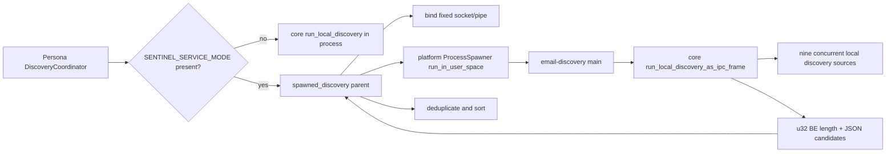

# Endpoint email-discovery helper: user-session discovery and IPC handoff

This chapter accounts for both tracked paths under `sentinel-endpoint-agent/email-discovery/` and traces their complete active relationship into the already-analyzed Persona discovery and platform-spawn code. Exact helper declarations are indexed in [endpoint-email-discovery.md](07-symbol-reference/endpoint-email-discovery.md); semantic entries are in [endpoint-email-discovery-semantic.md](07-symbol-reference/endpoint-email-discovery-semantic.md).

## Scope

| Measure | Verified value |
| --- | ---: |
| Tracked paths | 2 |
| Total lines | 149 |
| Rust declarations | 3 |
| Binary targets | 1 (`email-discovery`) |
| Helper-local tests | 0 |
| Direct dependencies | 5 dependency declarations/groups |

Both files are handwritten and neither is generated or vendored. Rust/Cargo is absent from the analysis environment, so the target was not compiled or run.

## Purpose and actual reachability

The package is a short-lived executable used by core Persona only when `SENTINEL_SERVICE_MODE` is present and IPC discovery has not already yielded a non-mock identity. `DiscoveryCoordinator::run_local_discovery` then calls `spawned_discovery::discover_via_subprocess`, whose binary resolver locates `email-discovery`, requests user-space execution, and receives one length-prefixed JSON candidate vector.

In non-service mode, Persona calls the same core `subprocess::run_local_discovery` function directly and does not start this binary. The executable does not implement discovery algorithms; it enables `sentinel-core/local_discovery` and invokes the core library's frame-producing wrapper.

## Manifest and build boundary

`email-discovery/Cargo.toml` declares package/binary version `0.1.0`, edition 2021, and no library. Its dependencies are:

| Dependency | Exact declaration | Active use |
| --- | --- | --- |
| `sentinel-core` | path `../core`, defaults off, `local_discovery` on | frame-producing public function and all source implementations |
| `tokio` | `1.47.1`, features `full` | async main, Unix stream/Windows pipe writes |
| `clap` | major 4, derive | `--ipc-socket` parser/help/errors |
| `tracing` | `0.1` | lifecycle/error records |
| `tracing-subscriber` | `0.3`, env-filter | stderr-only logger |

The package is a root workspace member and default member. Standard macOS/Windows builder scripts explicitly pass `-p email-discovery`, stage it, and include it in expected binary lists. Installer/uninstaller process/file lists name it. The newer `scripts/distribution/` and `scripts/qa/` trees contain no `email-discovery` reference found by repository-wide search; whether those paths include it implicitly or omit a required runtime dependency remains **Unresolved** until the scripts slice is fully analyzed.

No lockfile is committed, so exact Clap/tracing transitive versions are unresolved.

## Executable startup and inputs

### `Args`

**Location:** `email-discovery/src/main.rs:26-33`

Clap exposes one optional string flag, `--ipc-socket`. There is no validation for empty strings, path form, transport prefix, existence, or expected service name. Clap supplies help/version behavior and terminates on invalid CLI syntax through its generated parser.

### `main`

**Location:** `email-discovery/src/main.rs:35-78`

Verified execution order:

1. Initializes a tracing subscriber that writes non-ANSI logs to stderr.
2. Reads `RUST_LOG`; an absent or invalid filter becomes `warn`.
3. Parses CLI arguments.
4. Chooses `--ipc-socket` when present, otherwise `IPC_SOCKET` when its environment key exists.
5. If neither exists, logs an error and calls `std::process::exit(1)`.
6. Logs the selected path at info level.
7. Awaits `sentinel_core::persona::discovery::subprocess::run_local_discovery_as_ipc_frame()`.
8. Logs total frame bytes at info level.
9. Calls `send_frame`; any returned numeric error becomes the process exit code.
10. Logs completion and returns, which produces the normal zero exit status.

The CLI wins even when it is an empty string. An empty environment value is also accepted; connection then fails and exits 1.

## Discovery and frame production

The called core function runs these nine tasks in a `JoinSet`:

1. OS account.
2. Outlook.
3. Apple Mail.
4. Thunderbird.
5. Chrome.
6. Firefox.
7. Edge.
8. Safari.
9. Microsoft Teams.

Each returns `Result<Vec<EmailCandidate>, PersonaError>`. Successful vectors are appended without deduplication. A source error warns and is suppressed; a task panic/cancellation logs and is suppressed. The parent performs later deduplication/sorting.

`run_local_discovery_as_ipc_frame` serializes the resulting vector. Serialization failure logs and substitutes literal JSON `[]`. It casts the payload length from `usize` to `u32`, emits four big-endian bytes, then payload bytes. There is no producer-side maximum or checked conversion. The practical data source is a small set of email candidates, but this is not enforced at that boundary.

**Contradiction:** `main.rs:19-21` says any error exits nonzero. Individual discovery failures and serialization failure instead produce partial/empty results and can exit zero after a successful send.

## Child transport behavior

### `send_frame`

**Location:** `email-discovery/src/main.rs:80-126`

The async function takes a path and prebuilt byte slice and returns `Result<(), i32>`. It has two compile-time implementations:

| Target | Client | Sequence | Error behavior |
| --- | --- | --- | --- |
| Unix (including checked macOS/Linux cfg) | `tokio::net::UnixStream` | connect → `write_all` complete frame → flush | logs path/error and returns code 1 |
| Windows | `tokio::net::windows::named_pipe::ClientOptions` | open → `write_all` → flush | logs path/error and returns code 1 |

There is no child-side connect/write/flush timeout, retry, shutdown handshake, response read, peer authentication, or partial-result protocol. Parent timeout/process kill is the outer bound.

The child logs the complete IPC path. That path is not a secret, but it exposes the predictable local endpoint name in logs.

## Parent transport and lifecycle

**Primary location:** `core/src/persona/discovery/spawned_discovery.rs`

`IpcAddress::for_service("email-discovery")` resolves to the fixed `/tmp/sentinel-email-discovery.sock` on macOS/Linux and `\\.\pipe\sentinel-email-discovery` on Windows. It is not per-run, per-PID, or randomized.

Parent sequence:

1. Derives the fixed path and binds before spawn.
2. Resolves the child binary.
3. Builds `ProcessConfig` with `IPC_SOCKET`, `SERVICE_NAME=email-discovery`, `NO_COLOR=1`, the duplicate `--ipc-socket` argument, and `run_in_user_space(true)`.
4. Spawns through selected platform services.
5. Applies one 30-second timeout around accept plus complete frame read.
6. On a successful frame, retains candidates.
7. On read error or timeout, attempts child kill and uses an empty vector.
8. Spawns an unretained blocking task that waits up to five seconds for child exit and discards the result.
9. Removes the Unix socket path; Windows removal is a suppressed no-op/error.
10. Returns `Ok(candidates)` even after read error/timeout; bind/resolve/spawn failures return `PersonaError::NoEmailSourcesFound`.

**Contradiction:** child comments say the parent detects a nonzero exit. The ordinary parent hot path waits on IPC, does not concurrently inspect child exit, and ignores the later wait status. A child that exits before connecting normally causes the 30-second accept timeout. macOS spawn code can observe a nonzero `launchctl` wrapper exit during its PID poll and convert that into spawn failure; that is not a general child-exit monitoring path.

### Frame reader

The parent reads exactly four length bytes, maps zero to an empty vector without reading JSON, rejects lengths above 1,048,576 bytes before allocation, reads exactly the declared payload, and deserializes `Vec<EmailCandidate>`. JSON errors include a lossy preview of up to 120 payload bytes in the returned error, which the caller logs.

The producer always emits JSON and therefore never intentionally emits zero length. The parent accepts zero as a separate empty-result representation.

## Platform user-session behavior

### macOS

The infra spawner uses `launchctl asuser <uid> /usr/bin/env ...`. It appends all `ProcessConfig.env` pairs, then `HOME` and `USER` copied from the privileged parent environment, followed by binary and args. It polls by binary name, with special `AlreadyExitedHandle` success when the `launchctl` child exits zero before `pgrep` sees the short-lived helper.

**Unresolved:** whether the installer-populated privileged-process `HOME`/`USER` always identify the intended current console user, including fast user switching. The platform code claims that invariant but repository runtime evidence is absent.

### Windows

The infra spawner selects an active/RDP session, obtains/duplicates its token, builds the command line from binary plus arguments, and calls `CreateProcessAsUserW`. The `lpEnvironment` argument is `None`, and `build_command_line` does not incorporate `ProcessConfig.env`.

**Verified:** `IPC_SOCKET`, `SERVICE_NAME`, and `NO_COLOR` from the parent config are not explicitly passed by this Windows code path. The helper still receives the IPC path through `--ipc-socket`.

**Potential issue requiring validation:** discovery sources consult `HOME`, `USERPROFILE`, `APPDATA`, `LOCALAPPDATA`, `USERNAME`, and related environment state. The repository does not build a user-token environment block here. The effective environment and whether source fallbacks compensate on supported Windows deployments require runtime validation.

## Security boundaries

### Unix socket

Before bind, the privileged parent suppresses `remove_file` on the fixed `/tmp` path. It then calls `UnixListener::bind` without explicit permissions, ownership changes, parent-directory isolation, random suffix, or peer-credential validation. The accepted peer address is ignored.

**Potential issue requiring validation:** another local process may be able to connect before the intended child or interfere with the fixed path, depending on OS `/tmp` and socket-mode/ACL behavior. The repository does not establish prevention.

### Windows named pipe

The parent creates the first pipe instance and deliberately supplies a null DACL, granting all principals access so a user-session process can reach a SYSTEM-created pipe. It accepts one connection and performs no client SID/token verification.

**Potential issue requiring validation:** the broad grant and predictable fixed name permit a local client race in the code-visible model. First-pipe-instance prevents a competing server instance, not an unauthenticated client.

### Payload trust

The 1 MiB length cap prevents unbounded allocation. JSON schema validation ensures required `EmailCandidate` fields/types but no cryptographic integrity, nonce, request ID, source authentication, or post-receive email validation is present in this parent path. A successful local impostor could supply structurally valid candidates that are then deduplicated/sorted as discovery output. Whether OS access controls prevent this is unresolved.

## Error and recovery matrix

| Failure | Child behavior | Parent behavior |
| --- | --- | --- |
| missing CLI/env path | log + exit 1 | normally waits until timeout unless spawn wrapper catches exit |
| invalid CLI syntax | Clap-controlled nonzero termination | same qualification |
| individual discovery source failure | log, continue partial/empty | sees successful JSON frame |
| discovery task panic/cancel | log, continue | sees successful JSON frame |
| candidate serialization failure | send `[]`, can exit 0 | treats as no candidates |
| child connect/write/flush | log + exit 1 | read error or 30 s timeout, kill attempt, empty result |
| parent bind | child not spawned | fatal `NoEmailSourcesFound` after log |
| binary resolve/spawn | child absent | fatal `NoEmailSourcesFound`, cleanup |
| zero frame length | helper never emits | parent accepts empty vector |
| declared payload >1 MiB | helper has no cap | parent rejects, kill attempt, empty result |
| truncated/invalid JSON | child may have exited 0 after write | parent logs error with preview, kill attempt, empty result |
| parent timeout | no direct child notification | kill attempt, then detached five-second wait |
| socket cleanup failure | not involved | debug except not-found; result still returned |

There is no retry of the subprocess, transport, or source set in this layer. Persona's higher-level discovery/validation/fallback behavior determines later recovery.

## Concurrency and performance

- Tokio's default multi-thread macro runtime owns main and transport operations.
- Core discovery launches all nine sources concurrently and waits for every task; there is no per-source timeout in this wrapper.
- The entire candidate set is serialized and copied into one payload and again into a framed vector, then written in one logical `write_all` sequence.
- Parent caps inbound payload to 1 MiB but producer has no cap. No streaming/batching/compression/backpressure exists.
- Parent's 30-second timeout spans accept and all reads. Child has no local I/O deadline.
- Child reaping occurs in an unretained `spawn_blocking`; shutdown/result is not joined or observed.
- The global fixed endpoint name prevents safe concurrent parent discoveries on the same machine: a second bind path first removes the existing Unix socket name, while Windows first-instance creation conflicts. Whether application control flow serializes every invocation is not explicitly enforced here.

## Tests and documentation audit

The helper package has no unit or integration test file and `main.rs` contains no test module. Core supplies:

- one host-dependent smoke test for the nine-source function;
- one Unix frame round-trip using a PID-suffixed test socket;
- one cleanup-on-missing-path test.

Those tests do not launch this binary or cover CLI/env precedence, exit codes, stderr logging, Windows pipe/DACL/client, macOS/Windows user-session spawn, fixed-name collision, 1 MiB rejection, timeout/kill/reap, spoofed client, serialization fallback, or build/package presence. No checked CI command names this package.

| Documentation/comment claim | Evidence | Result |
| --- | --- | --- |
| any child error exits nonzero | source failures/serialization are suppressed into partial/empty success | Contradicted |
| parent detects closed socket/nonzero exit and falls back gracefully | parent generally waits IPC and ignores later exit status; bind/resolve/spawn return Err while read/timeout return empty Ok | Partially contradicted |
| socket/pipe name has a wildcard suffix | `IpcAddress::for_service` returns a fixed name | Contradicted |
| binding before spawn removes the connect race | it removes server-not-ready race, not unauthenticated-client race | Partially confirmed |
| Windows null DACL broad grant is acceptable because short-lived/single connection | grant and single connection verified; risk acceptance has no enforcement/test evidence | Policy assertion, not verifiable |
| both paths use the same discovery implementation | direct and helper both call core `run_local_discovery` | Confirmed |
| all nine sources run concurrently | `JoinSet` registers nine tasks | Confirmed |
| timeout kills child and returns empty list | read/timeout branch attempts kill and returns empty; kill result ignored | Partially confirmed |
| socket path is passed as env and CLI | parent config sets both; Windows user-session spawner ignores config environment but CLI remains | Contradicted on active Windows path |

## Per-file accounting

| Path | Role | Status |
| --- | --- | --- |
| `email-discovery/Cargo.toml` | package/binary metadata, feature/dependency boundary | Fully analyzed; handwritten |
| `email-discovery/src/main.rs` | CLI/logging/frame-production invocation/platform client write | Fully analyzed; handwritten |

## Unresolved questions

- Are fixed endpoint permissions/ACLs sufficient for intended child access while excluding other local clients on every supported deployment?
- Should the protocol include a nonce/authenticated peer and a per-run endpoint name?
- Should any discovery or serialization failure make the child nonzero, or is partial/empty success the intended contract?
- Should the parent watch process exit concurrently rather than wait the full accept timeout?
- Should Windows construct a user-token environment block and merge `ProcessConfig.env`?
- Can concurrent Persona discovery calls occur, and if so how is the fixed endpoint collision prevented?
- Do current distribution/QA pipelines include this binary even though their checked files do not name it?
