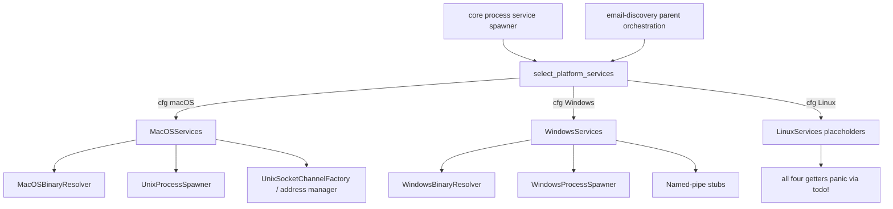
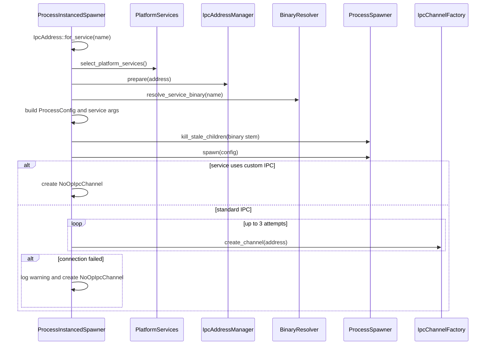

# Endpoint infrastructure: platform selection, process lifecycle, binary resolution, and IPC

This chapter closes the 46 previously pending `infra/` paths at endpoint-agent commit `a022e52bf2fff6a9445ebad96c3afeaf277e259f` (4,911 physical lines). The crate's 23 keystore/trusted-environment paths and four shared module roots were already analyzed in [Endpoint core: Vault persistence, key derivation, and platform keystore](06-endpoint-core-vault-and-keystore.md). The AST-backed declaration ledger remains [endpoint-infra.md](07-symbol-reference/endpoint-infra.md); the manually traced symbols for this scope are in [endpoint-infra-platform-runtime.md](07-symbol-reference/endpoint-infra-platform-runtime.md).

## Verified runtime position

`infra` is a Rust library crate, not an executable. Its active non-keystore purpose is to let `core` choose an OS-specific binary resolver, process spawner, IPC client factory, and IPC-address manager through `PlatformServices`.

The two production consumers found by repository-wide search are:

- `core/src/service/spawn/process.rs::ProcessInstancedSpawner::spawn`, which resolves and starts process-instanced services and optionally probes their standard IPC endpoint; and
- `core/src/persona/discovery/spawned_discovery.rs::discover_via_subprocess`, which uses the resolver and process spawner but implements its own Tokio Unix-socket/Windows-named-pipe server for the email-discovery exchange.

`core/src/persona/heartbeat/device_id.rs::hash_identifier` separately calls `infra/src/common_utils/hash.rs::hash_data` to SHA-256-hash a raw device identifier and hex-encode the 32-byte digest.

Every solid edge above is directly verified. Despite the selector module describing runtime detection, the choice is compile-time `#[cfg(target_os = ...)]`; no runtime OS probe occurs.

## Platform support matrix

| Capability | macOS | Windows | Linux |
| --- | --- | --- | --- |
| Selector object | `MacOSServices` | `WindowsServices` | `LinuxServices` |
| Binary resolution | Implemented | Implemented | `todo!` |
| Ordinary process spawn | `std::process::Command` | `std::process::Command` plus Job Object assignment | `todo!` |
| Interactive-user process spawn | `/bin/launchctl asuser` wrapper plus `pgrep` discovery | WTS session/token discovery plus `CreateProcessAsUserW` | `todo!` |
| IPC client | Synchronous `UnixStream` | `NamedPipeChannel` always returns `NotImplemented` | `todo!` |
| IPC server | Synchronous `UnixListener`, exported by concrete type | No `IpcServer` implementation | `todo!` |
| Address lifecycle | Creates parent directories; removes existing path | Prefix validation; no cleanup | `todo!` |
| Active standard-IPC probe | Functional but only used as a non-fatal connectivity probe | Always falls back to the core no-op channel | First getter call panics |

**Contradiction:** module comments repeatedly call Linux supported and describe shared Unix implementations. `infra/src/lib.rs` exposes `macos_hal` only on macOS, and every `LinuxServices` factory method is a `todo!` panic. Linux is selectable but not operational.

**Contradiction:** Windows process spawning and binary resolution are substantial implementations even though their parent module comments still call the entire Windows process layer a “Stub” deferred to Phase 4. Windows IPC really is a stub.

## Crate, build, and module topology

`infra/Cargo.toml` declares package `infra` version `0.1.0`, Rust edition 2024, with the repository-local commercial `infra/LICENSE.txt`. The workspace includes `infra` both as a member and default member; `core` imports it through the workspace dependency alias `infra_mac`, while Rust code refers to the crate name `infra`.

Dependencies used in this scope are `sha2`/`hex` (device-ID hashing), `thiserror` (interface errors), `tracing`, `which`, and platform crates (`libc` on macOS; `windows` on Windows). Keystore code accounts for `uuid`, `serde`, `serde_json`, Core Foundation, Security.framework, and most Windows cryptographic features.

- **Dead-code candidate / manifest debt:** `tokio = { features = ["full"] }` has no source reference anywhere in `infra`.
- **Dead-code candidate / manifest debt:** the Windows-only `zeroize` dependency has no source reference anywhere in `infra`.
- `hex` and `tracing` are repeated as dev-dependencies even though they are ordinary dependencies.
- No `build.rs`, executable target, benchmark, example, feature flag, or crate-specific integration-test directory exists.
- The repository's checked GitHub workflow and platform builders run `cargo build`; no checked CI command runs `cargo test`, `cargo check`, or `cargo clippy`.

### Inert module-index files

`infra/src/interface/mod.rs` declares `binary::v1_0`, `ipc::v1_0`, `process::v1_0`, and `platform::v1_0` inline and directly declares their child source files. Consequently these five filesystem module indexes are not part of that module tree:

- `infra/src/interface/binary/v1_0/mod.rs`
- `infra/src/interface/ipc/v1_0/mod.rs`
- `infra/src/interface/process/v1_0/mod.rs`
- `infra/src/interface/platform/mod.rs`
- `infra/src/interface/platform/v1_0/mod.rs`

They duplicate module declarations/re-exports but no `mod` statement loads them. **Dead-code candidate:** no textual include or alternate crate root was found. This is a source-layout inconsistency, not generated code.

The same issue leaves `infra/src/interface/keystore/v1_0/types.rs` undeclared; that previously analyzed file is empty. Other macOS and Windows `mod.rs` files are active because their parent modules use filesystem module declarations.

## Public contracts and data model

### Binary resolver

`infra/src/interface/binary/v1_0/resolver.rs::BinaryResolver` is `Send + Sync` and exposes:

- `resolve_service_binary(service_name) -> Result<PathBuf, BinaryError>`;
- `resolve_in_path(binary_name)`;
- `is_executable(path)`;
- `get_executable_dir()`; and
- `get_candidate_paths(service_name)`.

`BinaryError` contains `NotFound`, `PermissionDenied`, `NotExecutable`, `InvalidPath`, `ResolutionFailed`, `IoError`, `OsError`, and `NotImplemented`. In the checked implementations, `InvalidPath`, `OsError`, and `NotImplemented` are never constructed. Windows resolution also never constructs `NotExecutable`; it simply continues when an existing candidate is not a file.

No resolver validates that a service name is a simple basename. **Potential issue requiring validation:** the public contract accepts path separators and absolute names, so a future untrusted caller could alter search behavior. Active callers pass hard-coded service names from the registry or the literal `email-discovery`.

### IPC address and byte-stream contracts

`IpcAddress` contains one public mutable `String` field, `path`. `IpcAddress::for_service` emits:

- macOS/Linux: `/tmp/sentinel-{service_name}.sock`;
- Windows: `\\.\pipe\sentinel-{service_name}`.

The service name is not trimmed, suffix-normalized, escaped, or validated. For example, the interface test confirms that `vault.service` retains `.service` in the endpoint.

`IpcChannel` is a synchronous, mutable raw-byte stream contract: connect, optional-timeout connect, `send`, `recv`, `recv_timeout`, `shutdown`, and `is_connected`. It defines no message framing, length prefix, serialization, authentication, or peer identity. Callers must define these above the HAL. `IpcServer` similarly provides bind, accept, timeout accept, address, and shutdown. `IpcChannelFactory` creates only clients; there is no platform-neutral server factory. `IpcAddressManager` prepares, cleans, and validates names.

`IpcError` has 11 variants. The macOS implementation constructs connection/send/receive/closed/permission/timeout/address-in-use/OS errors. It never constructs `InvalidAddress`, `NotSupported`, or `NotImplemented`. The Windows transport constructs only `NotImplemented`; its address validator returns `std::io::Error` instead.

### Process configuration and state

`ProcessConfig` is a public mutable structure:

| Field | Type/default | Verified consumer behavior |
| --- | --- | --- |
| `binary_path` | required `PathBuf` | passed to `Command::new` or included in a Windows native command line |
| `args` | empty `Vec<String>` | appended in order |
| `env` | `None` or a `HashMap<String,String>` | ordinary spawners call `Command::env` for each entry; macOS interactive spawn emits `KEY=VALUE` arguments to `/usr/bin/env`; Windows native interactive spawn never reads the map |
| `working_dir` | `None` | ordinary spawners call `current_dir`; both interactive paths set a current-directory input |
| `ipc_address` | `None` | stored by builders and `spawn_service`, but neither concrete spawner reads it directly |
| `run_in_user_space` | `false` | honored only when the field is true **and** the `SENTINEL_SERVICE_MODE` variable exists |

`ProcessConfig::env` adds or overwrites one entry; `envs` adds many; neither clears inherited ambient variables. `ProcessSpawner::spawn_service` populates `SERVICE_NAME`, `IPC_SOCKET`, and `ipc_address`, but no production caller uses this convenience method. Core builds `ProcessConfig` itself.

`ExitStatus` is `Exited(i32)`, `Terminated(i32)`, or `Running`. Only `Exited(0)` is successful; `code()` returns a value only for `Exited`; `is_running()` matches only `Running`.

`ProcessHandle` requires PID, liveness, blocking/timed waits, force kill, nonblocking wait, and cached status. Its default `signal_graceful_stop` returns success without doing anything. Both Unix handle types override it with `SIGTERM`; both Windows handle types inherit the no-op.

`ProcessError` defines 13 variants. Concrete implementations construct only `SpawnFailed`, `BinaryNotFound`, `PermissionDenied`, `WaitFailed`, `KillFailed`, and `ProcessExited`. `ExitedWithError`, `TerminatedBySignal`, `InvalidEnvironment`, `IpcSetupFailed`, `OsError`, `NotSupported`, and `NotImplemented` have no implementation constructor in this scope.

## Process-instanced service flow

The standard IPC check is explicitly non-fatal. It attempts three immediate client creations with 10 ms and 20 ms sleeps between failures; if all fail, core returns a process handle paired with its private `NoOpIpcChannel`. `send` on that channel reports success while discarding bytes, `recv` returns zero, and `is_connected` is false. Therefore successful `ProcessInstancedSpawner::spawn` does not prove IPC functionality.

The active process services all return `uses_custom_ipc() == true`, so they skip the standard check: `ipc-light-broker.service`, `templating-engine.service`, `sentinel-proxy.service`, `sentinel-monitor-v2.service`, and `template-engine.service`. The infra IPC client is thus present mainly as a fallback/probe path; the core service graph communicates through the separate pinned `ipc-light` library.

## macOS implementation

### Binary resolution

`MacOSBinaryResolver::new` caches `current_exe().parent()` once; failure becomes `None`. `resolve_service_binary` removes one trailing `.service`, then checks candidates in this exact order:

1. cached executable directory plus binary name;
2. `/usr/local/bin/{name}`;
3. `/opt/sentinel/bin/{name}`;
4. two development paths computed from two parents above the executable directory, with `debug/{name}` and `release/{name}` appended;
5. `which::which(name)` only after all candidates are absent.

For an executable at `/repo/target/debug/sentinel`, the development calculation reaches `/repo/debug/{name}` and `/repo/release/{name}`, not `/repo/target/debug` and `/repo/target/release`. The sibling candidate still covers the current profile.

If an earlier candidate exists but lacks any `0o111` bit, resolution immediately returns `NotExecutable`; it does not continue to later candidates or `PATH`. `is_executable` follows filesystem metadata, requires a file, and accepts any owner/group/other execute bit rather than checking access for the effective identity.

The creation test asserts `is_some() || is_none()`, which is tautological. Other resolver tests require host `/bin/ls`, `/etc/hosts`, and a functional `PATH`; they are macOS-target unit tests, not isolated fixtures.

### Unix socket address lifecycle

`UnixSocketAddressManager::validate` rejects an empty string, byte length over 108, or NUL. It accepts relative paths, arbitrary extensions, and any directory despite comments about conventions. `prepare` validates, recursively creates a parent directory, and removes whatever filesystem entry exists at the target using `remove_file`; non-`NotFound` errors fail preparation. `cleanup` removes the target and treats absence as success.

**Potential issue requiring validation:** neither operation verifies that an existing target is a socket or owned by Sentinel. Active paths are derived from hard-coded service names under `/tmp`, but the public `IpcAddress::new` contract can name an arbitrary file.

No permission mode is set for created directories or sockets. Actual access follows process umask and OS defaults.

### Unix socket channel and server

`UnixSocketChannel` wraps `std::os::unix::net::UnixStream` and retains a cloned address that runtime code never reads. Important semantics:

- `connect` performs one blocking connect and wraps every error as `ConnectionFailed`.
- `connect_timeout` retries a blocking connect, initially sleeping 10 ms and doubling without a cap. It records `last_error` but never reads it, returns only `Timeout`, and can sleep beyond the requested deadline.
- `send` uses `write_all`; only `BrokenPipe` maps to `ChannelClosed`.
- `recv` performs one `read`, so callers can receive partial data. Normal stream EOF is `Ok(0)`; its `UnexpectedEof` branch does not convert ordinary peer closure to `ChannelClosed`.
- `recv_timeout` temporarily installs a read timeout, but `WouldBlock`/`TimedOut` is passed through `recv` as `ReceiveFailed`, not `Timeout`. Failure to restore blocking mode is ignored.
- `is_connected` clones the stream and returns `stream.take_error().is_ok()`. `Ok(Some(socket_error))` therefore still returns true. The comment about a zero-byte write does not describe the implementation.

`UnixSocketServer::bind` silently ignores every stale-path removal error, does not run the address manager, does not create parent directories, and then binds. `accept_timeout` switches the listener to nonblocking mode and polls every 10 ms; the saved `last_error` is unused and reset errors are ignored. `shutdown` only unlinks the pathname—the listener remains open—and returns an error when the path is already absent, contrary to the address-manager contract's idempotence guidance. `Drop` unconditionally tries to unlink the path and can race with a replacement socket at the same pathname.

Repository-wide search found no non-test `UnixSocketServer` consumer. **Dead-code candidate:** the concrete server and the platform-neutral `IpcServer` trait are exported but unused by checked production code; email discovery implements a separate async server.

### Ordinary child process

`UnixProcessSpawner::spawn` uses `Command` unless both interactive-user conditions are true. It appends arguments, adds configured environment entries, sets the working directory, and maps `NotFound`/`PermissionDenied` specially. It does not configure stdin/stdout/stderr, process groups, uid/gid, or a death signal.

`UnixProcessHandle` owns `std::process::Child` and caches an `ExitStatus` only after `wait`, `try_wait`, or a completed timed wait. Until that happens, `is_alive()` always returns true—even if the child has already exited. `wait_timeout` polls every 10 ms and can overshoot by one interval. `signal_graceful_stop` sends `SIGTERM` to the one PID; `kill` delegates to `Child::kill`. Neither action updates cached status until a wait occurs.

On Unix, a status with no code becomes `Terminated(signal)` when `ExitStatusExt::signal` yields a value, otherwise `Exited(-1)`.

### Stale-child cleanup

`kill_stale_children_unix` runs `pgrep -x {binary_stem}`, parses every returned PID, skips the agent's own PID, and runs `ps -o ppid= -p {pid}`. A parent is considered alive only if it is neither 0 nor 1 and `kill(ppid, 0) == 0`. All other cases—including permission failure probing a live parent, `ps` failure, and missing parent—lead to best-effort `SIGKILL` of the name-matched process.

This check is system-wide by executable basename; it does not verify executable path, owner, start time, cgroup/job, or an agent-issued marker. PIDs can change between `pgrep`, `ps`, and `kill`. **Potential issue requiring validation:** under identities that cannot signal another live parent, `kill(ppid, 0)` may classify a managed process as orphaned. Failures are logged and never block the new spawn, as the trait requires.

### Interactive-user macOS process

This path executes only when `run_in_user_space == true` and `std::env::var("SENTINEL_SERVICE_MODE").is_ok()`. Variable value is irrelevant; mere presence enables service mode.

Execution order in `spawn_in_active_user_session`:

1. `metadata("/dev/console")` supplies uid/gid; uid 0 is rejected. The gid is returned and discarded.
2. `/bin/launchctl asuser {uid} /usr/bin/env` is built.
3. Every `ProcessConfig.env` entry is appended as `KEY=VALUE`. Parent-process `HOME` and `USER`, if set, are appended afterward and can override same-named config entries.
4. Binary and arguments are appended; working directory is applied to the `launchctl` command.
5. The wrapper is spawned and retained as a `Child`.
6. After sleeps of 0.5 s, 1 s, and then 2 s per attempt (15 attempts total), code runs `pgrep -n -x {binary_filename}`.
7. Nonzero early wrapper exit is an error. Zero early exit yields an `AlreadyExitedHandle` with PID 0 and permanent `Exited(0)`. A discovered PID yields `LaunchctlProcessHandle` holding both that PID and the wrapper child.

`find_user_process_pid` accepts a uid argument but names it `_uid` and does not filter by user, parent, session, executable path, or launch time. It chooses the newest same-name process system-wide. **Potential issue requiring validation:** a pre-existing or concurrently launched same-name binary can be attached to this handle.

`LaunchctlProcessHandle` uses the wrapper child as its mutable liveness/wait oracle and the discovered PID for signals. All natural wrapper exits are reported as `Exited(0)`; its actual exit code and target status are discarded. `wait_for_exit` also discards `Child::wait` errors. `kill` sends `SIGKILL` to the discovered PID and then performs an unbounded blocking wait on the wrapper. There is no `Drop` reaping path.

`pid_exists` is used only by immutable `is_alive`; `kill(pid, 0)` failure, including permission denial, returns false. The wrapper-based `try_wait` avoids PID-reuse checks after a successful kill, but no identity proof exists before signaling.

**Unresolved:** repository tests do not execute the `launchctl`, console-user, `pgrep`, status-conversion, or wrapper-reaping path. Comments assert particular `launchctl asuser` wait/reparent behavior, but no repository runtime artifact demonstrates it.

## Windows implementation

### Binary resolution

`WindowsBinaryResolver` caches the current executable directory and strips one `.service` suffix. Candidates are:

1. executable sibling `{name}.exe`;
2. executable sibling `{name}`;
3. relative `{name}.exe`;
4. relative `{name}`;
5. `C:\Program Files\Sentinel\{name}`;
6. `C:\Program Files (x86)\Sentinel\{name}`;
7. `C:\ProgramData\Sentinel\{name}`;
8. `which(name)` and then `which({name}.exe)`.

The common installation candidates do not append `.exe`; they find an installed executable there only if the supplied/stripped name already contains that extension. Relative candidates are tested against the process working directory before the explicit `which` calls.

Windows `is_executable` means only “metadata exists and is a file.” During service resolution, its errors are discarded by `unwrap_or(false)` and the search continues, so a permission failure is normally converted into an eventual `NotFound`. The private inherent `get_candidate_paths` and trait method contain duplicated implementations.

### Named-pipe IPC status

`NamedPipeAddressManager` is the only implemented Windows IPC component. It requires a case-sensitive `\\.\pipe\` prefix and total string length greater than 10; it performs no validation of the remainder. `prepare` just validates; cleanup always succeeds.

`NamedPipeChannel` has no state and every operation except `is_connected` returns `IpcError::NotImplemented`; `is_connected` is false. `NamedPipeChannelFactory::create_channel` first calls that failing `connect`, so its following explicit `Err(NotImplemented)` is unreachable. The timeout factory ignores its caller-supplied timeout and passes a hard-coded five seconds, but the stub returns immediately.

No Windows `IpcServer` exists. Email discovery bypasses infra with `tokio::net::windows::named_pipe` and a null-DACL security descriptor; the core hook manager separately implements its own named-pipe server. **Contradiction:** the public IPC abstractions claim Windows named-pipe parity while checked infra transport cannot exchange a byte.

### Global Job Object

`AGENT_JOB_OBJECT: OnceLock<SafeJobHandle>` lazily creates one anonymous Job Object. `SafeJobHandle` has manual `Send`/`Sync` implementations based on the invariant that the handle is never closed or mutated. Code requests `JOB_OBJECT_LIMIT_KILL_ON_JOB_CLOSE`; every ordinary or interactive child is assigned immediately after creation.

Creation/assignment failures log warnings and spawning continues. If setting the kill-on-close limit fails, the valid job handle is still retained and children are still assigned, but the stated crash-kill guarantee is absent. The handle intentionally remains open for process lifetime; OS process teardown is expected to close it.

**Potential issue requiring validation:** assignment can fail when host job policies disallow it, and there is no test or health signal beyond a warning. The implementation deliberately fails open to an uncontained child.

### Ordinary Windows child

The ordinary path mirrors Unix `Command` argument/environment/directory setup. In service mode it tries to append stderr to `{SENTINEL_LOG_DIR}/{SERVICE_NAME-without-.service}-stderr.log`, taking values first from `ProcessConfig.env` and then ambient `SENTINEL_LOG_DIR`. Directory creation and file-open errors are silently ignored. Stdout is not redirected here.

`WindowsProcessHandle` has the same stale `is_alive` behavior as Unix: true until a wait method stores a status. It maps no-code termination to `Terminated(-1)`. Its inherited graceful-stop method is a successful no-op. Force kill does not update cached status until a wait.

### Stale-child cleanup

The Windows cleanup takes one ToolHelp process snapshot, builds a set of all PIDs, and records case-insensitive `{binary_stem}.exe` matches. A candidate is preserved whenever its recorded parent PID is nonzero and present anywhere in the snapshot; otherwise code opens it with `PROCESS_TERMINATE` and calls `TerminateProcess(..., 1)`.

The consistent snapshot avoids a second enumeration, but basename is still the only identity check. Parent PID reuse or an unrelated live parent can preserve an orphan; process PID reuse between snapshot and `OpenProcess` can target a different process. All failures are warning-only.

### Interactive-user Windows process

This branch is selected by the same field-plus-environment-presence rule as macOS. It:

1. enumerates nonzero `WTSActive` sessions;
2. appends `WTSGetActiveConsoleSessionId` if distinct;
3. only if both sources yield no candidate, enumerates `explorer.exe` PIDs and maps them to sessions;
4. tries each session with `WTSQueryUserToken`;
5. on failure, finds `explorer.exe` in that session, opens it, opens its token with `TOKEN_ALL_ACCESS`, and duplicates a primary token;
6. builds one mutable command-line string and sets desktop `winsta0\default`;
7. calls `CreateProcessAsUserW` with `CREATE_NO_WINDOW`, a null application-name pointer, a null environment-block pointer, and the optional working directory;
8. closes token/thread handles, assigns the process handle to the global Job Object, and returns `WindowsNativeProcessHandle`.

**Verified omission:** `spawn_in_active_user_session` never reads `config.env` and supplies no constructed environment block. Thus entries existing only in `ProcessConfig.env` are not explicitly provided by this code. This includes `SERVICE_NAME`, `IPC_SOCKET`, `NO_COLOR`, `SENTINEL_LOG_DIR`, and `SENTINEL_DLP_TEMPLATE_DIR`. Email discovery compensates for its socket specifically by also passing `--ipc-socket`; ordinary process services do not receive an equivalent generic CLI transformation.

The active default registry requests user-space spawn for:

| Service | Config-only values affected on Windows native path | Other verified path |
| --- | --- | --- |
| `ipc-light-broker.service` | `SERVICE_NAME`, `IPC_SOCKET`, `NO_COLOR` | core also writes `IPC_LIGHT_PIPE_PATH_IPC_LIGHT_BROKER` into the agent's ambient environment before spawn |
| `templating-engine.service` | above plus `SENTINEL_LOG_DIR` and `SENTINEL_DLP_TEMPLATE_DIR` | no generic CLI equivalents found |
| `sentinel-monitor-v2.service` | `SERVICE_NAME`, `IPC_SOCKET`, `NO_COLOR` | it uses ipc-light custom IPC |
| `template-engine.service` | `SERVICE_NAME`, `IPC_SOCKET`, `NO_COLOR` | it uses custom IPC |

`sentinel-proxy.service` is process-instanced but its active definition sets `run_in_user_space: false`, so it uses the ordinary `Command` path and receives its configured environment entries.

**Unresolved:** the null Windows environment block's exact ambient inheritance and the resulting behavior of each child require target execution; the repository has no tests of this branch. The verified defect is that the per-spawn map is unused.

`quote_windows_arg` quotes only arguments containing whitespace or quotes and replaces `"` with `\"`. It does not implement the full backslash-before-quote/trailing-backslash rules used by Windows command-line parsing. **Potential issue requiring validation:** arguments ending in backslashes before a closing quote or containing quote/backslash combinations may not round-trip. No unit test covers quoting.

`WindowsNativeProcessHandle` owns the native process handle and closes it on drop. Waits use `WaitForSingleObject`; exit codes are cast from `u32` to `i32`. Immutable `is_alive` returns true until an exit status has been cached, without querying the handle. Force kill calls `TerminateProcess` but does not cache termination. Like the ordinary handle, graceful stop is a no-op.

## Linux failure model

`select_platform_services` returns a valid zero-sized `LinuxServices` object on Linux. Each of its four `PlatformServices` methods then panics through `todo!`. This is not a compile-time “unsupported platform” failure: it is a runtime panic at first use.

The selector unit test calls `process_spawner()` and `binary_resolver()`, so `cargo test -p infra` on Linux is statically expected to fail that test. Rust/Cargo are absent in this analysis environment, so this was not executed. The Linux-specific test that merely checks zero size passes without exercising functionality.

## Configuration and data dictionary

| Name/value | Origin | Consumers and behavior |
| --- | --- | --- |
| `SENTINEL_SERVICE_MODE` | agent sets to `1` only when raw args contain `--service`; can also be ambient | presence selects interactive-user branch for configs that request it; value is not parsed |
| `SERVICE_NAME` | core `ProcessConfig.env`; `spawn_service` helper | child identity/log filename; absent from Windows native map handling |
| `IPC_SOCKET` | core `ProcessConfig.env`; helper | standard endpoint conveyed to children; email discovery also sends a CLI argument |
| `NO_COLOR=1` | core process spawner | attempts to suppress ANSI child output |
| `SENTINEL_LOG_DIR` | core for proxy/templating service in service mode, or ambient | Windows ordinary spawner stderr file; child service discovery |
| `SENTINEL_DLP_TEMPLATE_DIR` | core for `templating-engine.service` | template discovery in child; not read by infra itself |
| `IPC_LIGHT_PIPE_PATH_IPC_LIGHT_BROKER` | user ambient or core-derived standard path | written both to broker config and agent ambient environment |
| `/tmp/sentinel-{service}.sock` | `IpcAddress::for_service` | macOS/Linux standard IPC path, mode governed by OS/umask |
| `\\.\pipe\sentinel-{service}` | same | Windows standard IPC name; infra client is unimplemented |
| 108 bytes | Unix address validator | hard-coded maximum; bind can still reject an OS-incompatible path |
| 10 ms | Unix process/IPC poll base | process wait interval; socket connect initial backoff; server accept interval |
| 100 ms | launchctl-handle wait interval and core IPC delay cap | blocking polling |
| 15 attempts / 500 ms→2 s | macOS target PID discovery | roughly 27.5 seconds of sleeps before final failure |
| five seconds | Windows factory literal | ignores requested timeout, but stub returns immediately |

No infra-owned persistent data exists outside the separately documented keystore. Non-keystore transient state consists of process handles, socket/listener handles, the Windows process-lifetime Job Object handle, resolver directory caches, and cached process exit statuses.

## Security boundaries

- Process service names cross from the core registry into filesystem binary lookup and IPC naming. Active names are repository-defined constants; infra itself provides no validation boundary.
- Process environment, args, and working directories cross into separate OS processes. Ordinary spawners inherit the parent environment and add configured values; there is no allowlist or secret redaction.
- Core logs the full `ProcessConfig` with `Debug` before spawn. Current default values are paths/flags, but future secrets placed in the map would be logged. **Potential issue requiring validation.**
- Unix standard sockets have no explicit access mode, peer credential check, authentication, or message framing at this layer.
- The stale-process cleanup is privileged destructive behavior based on basename and parent liveness heuristics. It is non-fatal but can signal system-wide matching PIDs.
- macOS user-session attachment uses `pgrep` name matching without uid/session/path binding.
- Windows token duplication deliberately obtains an interactive user's primary token and creates a process on `winsta0\default`; failures return `SpawnFailed` and do not fall back to Session 0.
- Windows Job Object containment fails open when creation or assignment fails.
- Windows named-pipe address validation is syntactic only. Actual infra pipe security is unresolved because the pipe transport is absent.

## Error, cleanup, and recovery matrix

| Operation | Handled result | Suppressed/degraded result | Fatal result |
| --- | --- | --- | --- |
| Address preparation | maps filesystem errors to service initialization failure | none | process not spawned |
| Binary resolution | structured `BinaryError` becomes service initialization failure | Windows candidate permission errors can be converted to later `NotFound` | process not spawned |
| Stale cleanup | logs successes/warnings | every lookup/kill failure | never blocks spawn |
| Process spawn | maps OS kinds to `ProcessError` | Job assignment and stderr-log open failures | service initialization failure |
| Standard IPC connection | retries three times | all failures become `NoOpIpcChannel` | never fatal after successful spawn |
| Unix receive timeout | returned as `ReceiveFailed`, not `Timeout` | read-timeout reset failure | caller receives error |
| macOS wrapper target discovery | retry loop | lookup errors hidden until last attempt | spawn failure |
| Windows session/token acquisition | tries sessions and explorer token fallback | per-session failures logged/debugged | spawn failure when none works |
| Process status | cached after wait | immutable liveness can remain stale | wait errors propagate, except macOS launchctl `wait_for_exit` suppresses wrapper wait errors |
| Unix server shutdown | path unlink | Drop ignores unlink error | explicit shutdown errors on absence/permission |
| Windows native handle drop | closes process handle | close error ignored | none |

Neither process spawner automatically retries. Retry/restart policy lives in core's `ServiceManager`/`ProcessSupervisor`. Infra has no cancellation token, shutdown coordinator, metrics, health endpoint, or structured audit trail beyond tracing events.

## Concurrency and performance

- All IPC and process-wait methods in this crate are synchronous and may block their calling thread. Core calls process spawning from synchronous service-spawner code; email discovery moves only its later wait into `spawn_blocking`.
- Unix connect/accept timeouts are polling loops with blocking sleeps and no cancellation.
- `UnixSocketChannel` is declared `Send + Sync` through its fields and the trait requires both, but mutation requires `&mut self`; callers need external synchronization as documented.
- Windows Job Object initialization is thread-safe through `OnceLock`; no reset exists.
- Resolver current-executable directories are snapshots taken at object construction, not global caches.
- Every `select_platform_services` call allocates a new boxed zero-sized service object and each getter allocates another boxed implementation. Core invokes selection separately for spawning and IPC connection.
- Stale-child cleanup spawns `pgrep` and then one `ps` subprocess per candidate on macOS. Performance impact requires measurement.
- No backpressure, buffering policy, batching, or framing is supplied for IPC beyond the OS byte stream.

## Test analysis

There are 47 `#[test]` functions in the 46-file scope:

| Area | Count | What is actually checked | Important gaps |
| --- | ---: | --- | --- |
| Interface models | 5 | error display, IPC address construction, process builders/status | Linux IPC test makes no platform assertion; no malformed env/name tests |
| macOS resolver | 6 | PATH lookup, executable bits, candidates | host-dependent; creation assertion tautological |
| macOS address/channel/server | 9 | basic validation, factory construction, bind, failed timeout | fixed `/tmp/test-server.sock` can collide; no send/receive, timeout classification, shutdown, permissions, or Drop race |
| macOS process/factory | 8 | ordinary echo/env/not-found/PID/kill and factory type | no stale cleanup, service mode, console user, launchctl, PID binding, or status-loss tests; one test mutates global environment without restoring it |
| platform selection | 4 | zero-sized objects and selector getters | Linux selector test calls `todo!` and is expected to panic/fail |
| Windows resolver | 4 | candidate shape and missing binary | common system result is not asserted; creation assertion tautological |
| Windows address/stubs | 5 | prefix validation and constructors | does not assert every IPC operation is unimplemented or timeout argument behavior |
| Windows process | 6 | ordinary `cmd.exe` spawn/env/not-found/PID/kill | no Job Object, stale cleanup, WTS/token/native spawn, config-env omission, quoting, handle drop, or graceful-stop tests |

All tests are inline unit modules. Platform HAL modules compile only for their target. No checked CI job runs them; a successful release build is not evidence that these tests pass.

## Documentation consistency audit

| Documentation claim | Source | Code evidence | Result |
| --- | --- | --- | --- |
| Interface contains no implementation or application logic | `infra/src/interface/readme.md` | builders, status helpers, address generation, default spawner methods, and tests live in interface files | **Contradicted** |
| Platform selection happens at runtime | `infra/src/platform/selector.rs` module text | mutually exclusive compile-time `cfg` blocks | **Contradicted** |
| Linux uses shared Unix sockets/process spawning | interface/platform comments | all Linux getters are `todo!`; macOS HAL is not exposed on Linux | **Planned but not implemented** |
| Windows process implementation is deferred stub | Windows process parent comments | ordinary and native session spawning, Job Object containment, cleanup, and handles are implemented | **Outdated / partially contradicted** |
| Windows named pipes provide IPC | interface/factory docs | every channel operation is `NotImplemented`; no server | **Contradicted** |
| `recv_timeout` reports timeout | IPC trait docs | Unix timeout becomes `ReceiveFailed` | **Contradicted** |
| `is_connected` probes with a zero-byte write | Unix method comment | implementation calls only `take_error()` and treats `Ok(Some(error))` as true | **Contradicted** |
| server shutdown stops accepting | `IpcServer` docs | Unix shutdown only unlinks the path while listener remains open | **Contradicted** |
| address cleanup should be idempotent | address-manager docs | manager is idempotent; Unix server shutdown is not | **Partially confirmed** |
| `is_alive` reflects whether process exited | process trait docs | ordinary handles return true until a mutable wait caches status | **Contradicted** |
| process config IPC address is passed to child | field comments | concrete spawners never read `ipc_address`; only env entries built elsewhere carry it | **Partially confirmed** |
| Windows native child receives configured environment | core process comments and `ProcessConfig` contract | native path never reads `config.env` and passes null environment pointer | **Contradicted** |
| macOS active-user PID belongs to requested uid/session | user-session comments imply target tracking | uid parameter to finder is unused; newest same-name PID wins | **Not verifiable / implementation weaker than claim** |

## Dead, legacy, incomplete, and apparently unused code

- **Placeholder:** all four `LinuxServices` factory methods.
- **Placeholder:** the entire Windows named-pipe channel and factory.
- **Dead-code candidate:** five inert interface `mod.rs` files described above.
- **Dead-code candidate:** `ProcessSpawnerFactory` and `UnixProcessSpawnerFactory`; only inline tests construct them. Production obtains spawners from `PlatformServices`.
- **Dead-code candidate:** `ProcessSpawner::spawn_service`; no caller found.
- **Dead-code candidate:** `IpcServer` and `UnixSocketServer` outside tests.
- **Dead-code candidate:** `UnixSocketChannel.address`; the whole struct is annotated `allow(dead_code)` and methods never read the field.
- **Dead-code candidate:** `last_error` variables in Unix connect and accept timeout loops.
- **Dead-code candidate:** multiple error variants listed above have no constructor after repository-wide variant search.
- **Outdated:** interface prohibition on implementations; Windows process “stub” headings; Linux parity text.
- **Unused dependency candidates:** `tokio` and Windows `zeroize` in `infra/Cargo.toml`.

These are repository-wide static classifications. Public library APIs may have external consumers not present in the checked three repositories; that possibility is unresolved and is why exported items are labeled candidates rather than conclusively dead.

## File accounting

All 46 previously pending files are handwritten and neither generated nor vendored. They are grouped as follows:

| Group | Paths | Status |
| --- | ---: | --- |
| Manifest/license/common hash | 4 | Fully analyzed |
| Binary/IPC/process/platform interfaces and docs | 16 | Fully analyzed; five inert indexes identified |
| macOS resolver/IPC/process/docs/module indexes | 10 | Fully analyzed |
| Platform selector and three service adapters | 5 | Fully analyzed |
| Windows resolver/IPC/process and module indexes | 11 | Fully analyzed |

**Unresolved:** Rust/Cargo were unavailable, so target builds/tests, Win32/macOS API behavior, OS permissions, installer-created ACLs/umask, and actual process/session races could not be dynamically validated. These gaps do not change the source-level findings above.
