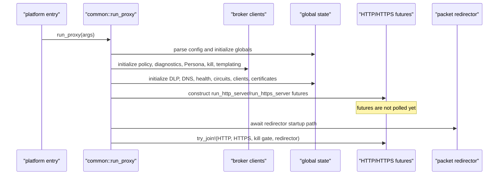
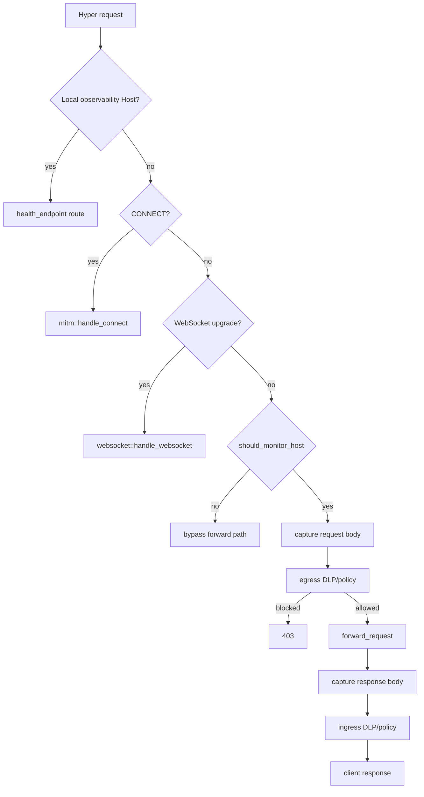

# Endpoint proxy: bootstrap, HTTP/TLS runtime, state, and forwarding

## Scope and evidence

This file accounts for the proxy package's executable/library shell and the active HTTP, HTTPS, TLS MITM, WebSocket, forwarding, body-capture, destination-resolution, health, kill-switch, and traffic-log paths. DLP internals and packet redirection are expanded in companion files.

**Verified revision:** endpoint-agent commit `a022e52bf2fff6a9445ebad96c3afeaf277e259f`.

Primary evidence:

- `proxy/Cargo.toml`, `.cargo/config.toml`, `build.rs`
- `proxy/src/{main,lib,args,config,constants,state,body,request_context,forward,http_handlers,mitm,websocket,cert_gen,destination_resolver,dns_cache,circuit_breaker,health_monitor,health_endpoint,kill_switch,kill_switch_ipc_client,templating_ipc_client,traffic_logger,request_profiler}.rs`
- `proxy/src/platform/{mod,common,macos,windows,tauri}.rs`
- `proxy/src/util/{mod,truncate}.rs`

The declaration-level companion is [endpoint-proxy.md](07-symbol-reference/endpoint-proxy.md); curated semantics are in [endpoint-proxy-runtime.md](07-symbol-reference/endpoint-proxy-runtime.md).

## Package and compiled surfaces

| Surface | Source | Invocation | Verified behavior |
| --- | --- | --- | --- |
| Library | `proxy/src/lib.rs` | Cargo library `sentinel_proxy` | Re-exports the HTTP/DLP/runtime modules. Packet redirection is exported only with a platform redirector feature; destination resolution is exported with `redirector`. |
| Main proxy | `proxy/src/main.rs::main` | Cargo binary `sentinel-proxy` | Parses `ProxyArgs`, handles macOS extension-management commands under feature gates, then chooses Tauri or native platform entry point. |
| Templating worker | `proxy/src/templating_engine_main.rs::main` | Cargo binary `templating-engine` | Runs a standalone IPC-driven popup engine; it is not a subcommand of the proxy binary. |
| Native Windows entry | `proxy/src/platform/windows.rs::main_windows` | `--disable-tauri` on the non-macOS branch | Creates a Tokio runtime and calls `common::run_proxy`. |
| Native macOS entry | `proxy/src/platform/macos.rs::main_mac` | `--disable-tauri` on macOS | Runs the proxy runtime on a background thread and reserves the main thread for the lazily started eframe justification loop. |
| Tauri entry | `proxy/src/platform/tauri.rs::main_tauri` | default UI selection | Runs the proxy in another runtime/thread and the templating UI on the main thread. Service-mode completion ultimately calls `process::exit(0)` after a three-second delay. |

**Contradiction:** `platform/mod.rs` declares `platform::windows` only for `target_os = "windows"`, but `main.rs` invokes it for every non-macOS target. The README calls this a Windows/Linux entry. Static source therefore does not provide the documented Linux build path.

**Verified:** `main.rs` duplicates most `lib.rs` module declarations, so the binary compiles a private copy of the module tree rather than importing the library crate. Unit tests importing `sentinel_proxy` exercise the library copy, not necessarily the binary's copy of global `OnceCell` state.

## Startup sequence

Execution order in `platform/common.rs::run_proxy` is:

1. Convert CLI/file settings to `ProxyConfig`; set global configuration and logging-related context.
2. Initialize the core policy engine through an authenticated Persona IPC call and initialize diagnostics IPC.
3. Construct and globally register the DLP engine and config manager.
4. Clean old processes, initialize alert IPC, DNS cache, health monitor, pool metrics, circuit-breaker map, and the process-wide shutdown broadcaster.
5. Start Persona refresh, kill-switch, and templating IPC clients. The proxy sleeps six seconds and then reads the kill-switch atomic; that atomic defaults enabled.
6. Initialize traffic logging, root certificate/TLS material, Hyper clients, `ProxyServiceState`, refresh tasks, addresses, TLS acceptor, and connection semaphore.
7. Construct the HTTP and HTTPS listener futures, start the packet redirector path, and only then poll the combined futures through `try_join!`.

**Contradiction:** comments state that listeners are bound before redirection is enabled, but calling an `async fn` only constructs a future. Neither `run_http_server` nor `run_https_server` executes its bind until the later `try_join!`; the redirector is started first. This creates a verified interception-before-listen race.

**Verified:** `run_proxy` does not call `initialize_logging`; the call is made by executable platform paths. A library consumer calling `run_proxy` directly does not obtain that setup automatically.

**Failure behavior:** many global initializers use `OnceCell`. Some repeat calls are ignored, others return errors. This matters in tests or a hypothetical in-process restart: the runtime is designed as one initialization per process, not a resettable service.

## Configuration loading and precedence

`config.rs` combines an optional H2-disable file and CLI-derived settings. The meaningful precedence rules are:

- Runtime CLI values populate the core scalar settings.
- File DLP patterns and API-fetched patterns are merged by exact regex text. API entries win collisions.
- API refresh replaces both the pattern set and derived domain set under locks; poisoned locks are recovered.
- A remote DLP endpoint and a local model path are mutually exclusive; the configuration path panics when both are supplied.
- Packet redirection requires packet interception. Loopback interception addresses are rejected; `0.0.0.0` derives a LAN IPv4 address through a UDP routing probe to `8.8.8.8`.
- New and legacy DLP-pattern JSON shapes are accepted. The manual file parser silently skips unknown transform names, while serde deserialization of an unknown `TransformOp` maps it to `JsonParse` (documented separately as a contradiction).
- Query and header stages are restricted by validation; one pattern can be marked `unique`.
- `formatted_dlp_domains` emits a `HashSet` debug representation. Despite the nearby sorting claim, output order is nondeterministic.
- Duration helpers multiply using saturating arithmetic.

**Implementation-only:** `fail_closed_on_unknown_dest` is parsed, stored, and logged, but no runtime decision reads it. The active transparent-destination path drops an unknown destination and accepts a process-attribution/SNI mismatch using attribution as authoritative regardless of this setting.

**Contradiction:** `ProxyConfig::default_for_test` does not reproduce all runtime defaults. Tests built on it establish behavior for the test fixture, not necessarily the shipped configuration.

## Listener and connection lifecycle

### HTTP listener

`run_http_server` binds the configured address/HTTP port and accepts until its shutdown receiver fires. Each connection:

- is rejected immediately when the kill-switch atomic is disabled;
- waits at most three seconds for a semaphore permit;
- snapshots process attribution once at connection acceptance;
- is served by Hyper in a detached task.

### Transparent HTTPS listener

`run_https_server` accepts the configured HTTPS interception port. The transparent handler reads at most 16 KiB while attempting to parse a TLS ClientHello, with a 500 ms timeout for each read. It then combines SNI and process-attributed destination metadata:

- matching data proceeds;
- a mismatch logs and treats process attribution as authoritative;
- a missing destination is dropped;
- a raw-tunnel fallback is available only through the redirector-enabled path.

**Verified:** without a redirector feature, transparent TLS connections reach a branch that closes them rather than establishing a raw bypass.

### Accept error classification

Both server loops treat `ErrorKind::Other` or an error string containing `24` as file-descriptor exhaustion. **Potential issue:** substring matching can classify unrelated errors containing those digits as EMFILE.

### Shutdown

The listener loops observe the broadcast and stop accepting. Their per-connection tasks are not retained or drained. `try_join!` therefore waits for listener futures, not for all active client connections. Kill-switch disable sends the same proxy shutdown signal.

## HTTP request paths

`http_handlers.rs` selects monitoring using DLP domain patterns, hard-coded bypass lists, and IP checks. CLI DLP domains are converted into patterns, so they normally participate in this decision. A computed browser-process flag is retained but its bypass branch is commented out and has no effect.

The local health/metrics branch trusts only the `Host` header. It has no authentication. A configured bind host of `0.0.0.0` accepts any host/IP with the matching port, and the string splitting is not IPv6-safe.

The non-monitored request path forwards the body without DLP capture. The monitored path captures and analyzes before forwarding, then may capture/analyze the response.

### Request context

`RequestContext` records request identity, endpoint, headers, query data, source application, Persona, app details, body state, DLP work, response state, policy decisions, and a one-alert guard.

- Header conversion uses a JSON object; duplicate header values overwrite one another.
- Query parsing ignores tokens without `=` and turns duplicate names into arrays.
- Missing Persona data is represented with `_pending_ipc_` fields.
- `to_enriched_event` exports the DLP sensitive flag as `PropertyValue::String`, not `Bool`.
- Full headers, user data, and extracted values can enter the policy event.
- GenAI classification may override the base behavior ID.
- The alert guard is shared by request and response work for the same context. An egress alert can suppress a later ingress alert; log-only egress sends an alert even for a clean finding.

**Verified defect:** final policy recording passes `ctx.direction_str()` values `"Request"`/`"Response"` to `record_dlp_result`, whose directional matcher expects lowercase. Final policy data is therefore placed in the generic `dlp` object rather than the existing `dlp_request`/`dlp_response` objects.

## Body capture and parsing

The body module exposes empty/full bodies, a capture routine, payload formatters, and content-type parsing.

### Small bodies

Frames are consumed into memory until EOF. A body read error or the 60-second overall read timeout is converted to an empty body and empty metadata; it is not returned to the caller as an error.

### Large-body path

Once the configured threshold is crossed, chunks are also written to a temporary file. This is not concurrent proxy streaming:

- the entire input is consumed before forwarding;
- every data chunk remains retained in a vector even after a temporary file is opened;
- non-data frames, including trailers, are discarded;
- file read/write failures can return the partial body rather than fail the request;
- the extraction-size limit bounds later file rereading, not the in-memory retained chunks.

**Contradiction:** source and README call this streaming; the active implementation buffers before forwarding and can use both memory and disk for the same large payload.

### Logging formatters

`format_payload_text` indexes `&text[..max_log_bytes]`. **Verified failure:** a non-ASCII string whose truncation byte falls inside a UTF-8 code point panics. The separate `util::truncate` helpers use character-boundary-safe truncation.

`parse_by_content_type` can log full pretty-printed JSON and form fields independent of the configured maximum log bytes. This is a sensitive-data logging boundary.

## Forwarding and circuit breakers

The practical chain is:

`handle_request` → `forward_request` → host circuit breaker → client selection → request rewrite → Hyper legacy client → fallback/retry → response`.

### Circuit breaker

- The runtime logs configured breaker thresholds, but new host breakers are constructed with hard-coded values: failure threshold 5, success threshold 2, open timeout 30 seconds, half-open maximum 3.
- The host map has no eviction.
- An open breaker constructs a 503 response with `Retry-After` and then discards it, returning an error. The monitored handler maps that error to 502; the bypass path maps it to 503. The constructed header never reaches the client.
- Transition from Open to HalfOpen allows the caller without incrementing the half-open counter. Concurrent callers can all observe/open-transition and proceed. The counter tracks total admissions and is never decremented, despite being described as concurrent capacity.

### Request normalization and retry

- Local/private-host detection uses colon splitting and is not IPv6-safe.
- Authority normalization strips ports and can corrupt IPv6 literals.
- The normal header path does not remove `transfer-encoding`, despite comments describing hop-by-hop removal.
- Safe HTTP/2 retry rebuilds a request with an empty body.
- The unsupported-version retry discards all original headers.
- A generic retry uses `HeaderMap::insert`, losing duplicate values. One 400 fallback uses append; the 404 fallback loses duplicates.
- Upload calls do not show a single application-wide deadline. Individual connection/request timing is composed from several settings.
- Upstream-proxy clients omit the explicit ten-second connect timeout and keepalive tuning used by direct clients.
- Some fallback branches discard the first response body without consuming it, reducing connection reuse and moving cleanup to drop semantics.

## TLS MITM and certificate management

`mitm::handle_connect` sends `200 Connection Established` before upstream proxy/certificate/TLS setup has completed. Subsequent failure is visible only as connection closure.

The MITM path is a second request pipeline, not a call back into the plain HTTP handler:

- it captures request/response bodies with its own logic;
- it logs request headers/body even when verbose traffic logging is not enabled;
- it captures response bodies even when ingress DLP is disabled;
- it lacks the plain listener's outer temporary-file cleanup;
- one CONNECT-level request ID is reused for all HTTP requests on that tunnel, including possible concurrent HTTP/2 streams;
- it does not populate source-process details through the same acceptance path.

Upstream HTTP CONNECT tunneling has no explicit timeout or proxy authentication. An HTTPS upstream proxy is unsupported and falls back to a direct connection, which can violate an expected forced-proxy boundary. Bytes received after the upstream CONNECT response headers are discarded.

Certificate behavior:

- Root cert/key are generated if absent and a leaf cert is generated per host.
- Existing corrupt cert/key files cause startup failure; they are not regenerated.
- Writes are non-atomic, parent creation/permissions are not established here, and key confidentiality therefore depends on deployment directory controls.
- Leaf certificates use DNS SANs; IP hosts are not encoded as IP SANs.
- The per-host server-config cache is unbounded and concurrent duplicate generation is possible.

## WebSocket path

WebSocket requests are upgraded locally and connected upstream with `connect_async`.

- No explicit upstream connection timeout, circuit breaker, DNS cache, kill-switch poll, or configured upstream-proxy client is used.
- `Uri::host()` is used when constructing the target; explicit URI ports can be lost, although the original Host header may still retain one.
- `Sec-WebSocket-Key` presence is checked, not its base64/length validity.
- If upstream chooses a subprotocol the client did not offer, the downstream response omits the protocol rather than rejecting the inconsistent handshake.
- Headers are copied with insertion, collapsing duplicates.
- A fresh `DlpEngine` is constructed per WebSocket instead of using the global instance.
- Monitoring and matching flags are snapshotted when the WebSocket opens; pattern refresh does not change an existing session.
- `max_frame_bytes` gates DLP analysis only. Oversized frames are still relayed, including in enforcement mode, and the transport has no repository-configured frame/memory ceiling.
- Log-only DLP spawns an unbounded task per message, so findings can complete out of order.
- Text previews slice by byte offset and can panic at a UTF-8 boundary.
- Relay uses `tokio::select!`; completion of either direction cancels the other immediately. A client-to-server DLP block sends a close to the upstream side, after which the client-facing forwarder is canceled.
- The raw bypass handshake reads at most 8,192 bytes with no timeout and can discard an upstream WebSocket frame that arrived in the same read as the handshake response.

Both `#[instrument]` annotations and handler logic unwrap the request ID extension. A caller outside the normal middleware can panic if that extension is absent.

## Destination and DNS state

### Destination cache

`DestinationCache::insert` has no production caller; repository-wide references are tests. The active resolver therefore always misses this cache. Its TTL/maximum settings do not affect current routing.

The former `DIOCNATLOOK` implementation is removed. Destination resolution is now:

1. accept process attribution when present;
2. otherwise accept SNI-only routing for a hostname;
3. otherwise return an error and close.

`validate_sni_matches_dest` returns true for every hostname without resolving it; only an IP-literal SNI can produce a mismatch. `fail_closed_on_unknown_dest` is not consulted.

### DNS cache

The DNS cache is used in the transparent raw-bypass path, not general Hyper forwarding. It resolves IPv4 addresses, while a literal IPv6 address can bypass lookup. Retry delay is linear (`base * attempt`), contradicting exponential-backoff documentation. Timeouts apply per lookup and per attempted address rather than to the whole operation. A maximum-entry value of zero still permits one insertion, and successful DNS results are cached before any candidate address is proven connectable.

### Process attribution map

The global process map has TTL lookup and a 60-second cleanup task. The configured maximum is not enforced; the eviction block is commented out. Process metadata can therefore grow until TTL cleanup and is not strictly capped.

**Inference:** the ALPN, uniqueness, and app-detail cache eviction tasks capture `DashMap::clone()` values. `DashMap`'s value clone is expected to make a separate map rather than share the original allocation, so asynchronous removals may not affect the global maps. This dependency behavior was not runtime-verified in this environment; treat the resulting unbounded-growth concern as an inference.

## Background refresh and external clients

- DLP config refresh starts even when DLP flags are off. Initial refresh retries every two seconds without a maximum until success.
- The DLP config task then performs up to five app-details refresh attempts. The standalone app-details task sleeps before its first fetch. Initial app details are therefore unexpectedly coupled to DLP-config success.
- DLP version selection computes the maximum version across active and inactive entries before conversion. A high inactive version can advance the cursor and suppress a later lower active configuration.
- App-details domain requests are fully parallel with no concurrency bound and use a dedicated ten-second client that ignores the configured upstream proxy.
- The global reqwest client has a fifteen-second timeout and optional upstream proxy. DLP config creates another client with no explicit timeout and no upstream proxy.

## Kill switch and templating IPC

The kill-switch atomic defaults `true`. Its listener sleeps five seconds before the first query. Response receipt has a five-second timeout, but connection, registration, and acknowledgment phases do not. Since proxy startup waits six seconds, a missing/slow broker usually leaves the default enabled and starts the listeners.

Persistent IPC handshakes have no timeout and can hang. The kill module declares a shutdown sender that is not consumed for task termination. Disable sends the proxy broadcast only on a true-to-false transition. Because listeners stop and the process exits, a later enable cannot restart the same proxy runtime.

The templating actor uses a bounded command queue of 64 and a 5-to-30-second reconnect delay. Nonblocking commands accepted by the actor can be silently discarded while disconnected. Blocking transport errors/timeouts return `Ok(default_justification)`, indistinguishable from a real default selection; the DLP caller commonly interprets that as failure to justify and blocks.

Duplicate request IDs replace the pending waiter. The MITM path's reused request ID makes collisions possible for concurrent prompts. Detection snippets originate from hash sets, so order and which entries survive caps can vary.

## Health and traffic observability

The health monitor records cumulative success/failure counts. `failure_window_secs` is unused; rates are lifetime ratios, not a sliding window. Active probes only log results and never update component health. `probe_consecutive_failures` is also unused, and targets are probed sequentially.

Restart handling stops only health-monitor loops, waits while the proxy continues serving, and then calls `process::exit(42)`. It does not first signal the main proxy broadcaster. Restart counters/backoff are process-local and reset after exit, so they do not persist across supervisor restarts. Probe target parsing is not IPv6-safe and thresholds are not validated.

The health endpoint reports version `0.1.0`, while the package manifest is `0.1.347`. Health and metrics routes are unauthenticated and health JSON exposes open-host state. Metrics omit connection, DNS, and destination-cache totals.

Traffic logging uses a fixed 10,000-entry queue and drains every 300 ms. File open/write is blocking std I/O inside a Tokio task. A write failure discards the already-drained batch, initialization does not verify path writability, shutdown has no final flush, and no rotation is implemented. The fixed relative default is `proxy_traffic.log`; URIs, DLP messages, and justification text can be persisted.

## Verified cleanup gaps

The plain HTTP handler has an outer request/response temporary-file cleanup. The DLP request helper can also clean a successful request path. The MITM pipeline has no equivalent outer guard:

- early request failures/blocks can leave a request temp file;
- response temp files are not passed through the response DLP evaluator and can remain;
- cancellation during detached connection handling has no centralized cleanup object.

## High-value unresolved items

- **Unresolved:** production filesystem owner/mode for CA private keys and traffic logs.
- **Unresolved:** whether deployment restricts the unauthenticated health endpoints at a network layer.
- **Unresolved:** actual DashMap clone semantics for the three eviction closures should be confirmed against the resolved `dashmap 5.x` source or a runtime test.
- **Unresolved:** whether upstream policy requires HTTPS-proxy chaining to be fail-closed; code falls direct.
- **Unresolved:** actual Hyper behavior and resource reuse when unconsumed fallback responses are dropped.
