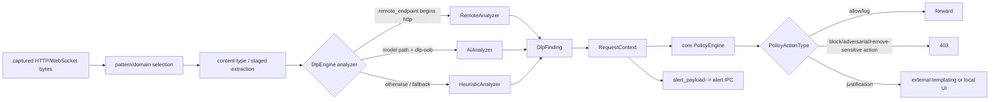

# Endpoint proxy: DLP, extraction, policy, UI, and alerting

## Scope

This reference covers:

- `proxy/src/dlp/**`
- `proxy/src/extraction.rs`
- DLP integration in `proxy/src/http_handlers.rs`, `mitm.rs`, `websocket.rs`, and `request_context.rs`
- `proxy/src/alert_payload.rs`
- the external templating and native/Windows UI adapters

All claims are verified at endpoint-agent commit `a022e52bf2fff6a9445ebad96c3afeaf277e259f` unless explicitly labeled otherwise.

## Actual DLP architecture

The term “ingress” in the configuration is used for response/server-to-client analysis; “egress” is request/client-to-server analysis. `RequestContext::direction_str` reports `Request` or `Response` after work is recorded.

## Analyzer selection and failure semantics

`DlpEngine::new` chooses exactly one primary analyzer:

1. A configured endpoint whose string begins with `http` selects `RemoteAnalyzer`.
2. Otherwise, with `dlp-oob` and a model path, it selects `AiAnalyzer`.
3. Otherwise it selects `HeuristicAnalyzer`.

### Heuristic analyzer

The heuristic analyzer applies repository-defined regular expressions and keyword rules to UTF-8 input. Non-UTF-8 conversion failure is treated as non-sensitive. This is fail-open for binary/unparseable content.

### AI analyzer

The analyzer constructs `quilr_rust_sdk::DlpDetector` with a reqwest client. **Verified contradiction:** the configured `model_path` selects this branch but is not supplied to the analyzer or SDK constructor in this module; the README describes local model inference.

Missing authentication, SDK errors, and no detections all produce a clean/non-sensitive result. A 401 clears the cached detector/auth state. No whole-analysis timeout is visible around the SDK call in this repository.

### Remote analyzer

The remote analyzer creates a default reqwest client with no explicit timeout and does not reject non-success HTTP status before attempting JSON decode. Network errors and invalid responses fall back to the heuristic analyzer; the former is logged and the latter is effectively silent at the decision boundary.

### Public wrapper

The public DLP wrapper checks whether the global engine was set. A missing engine returns a clean decision rather than failing the request. Across analyzers, unreadable input and service/model errors are predominantly fail-open.

## Finding and decision models

| Model | Important fields | Lifecycle |
| --- | --- | --- |
| `DlpFinding` | `sensitive`, detections/entities, adversarial signal | Produced by an analyzer and attached to request context/policy evaluation. |
| `DlpDecision` | allow/block/prompt-related state, finding, justification | Built by enforcement logic and used for response/alert outcome. |
| `Direction` | request/response semantics | Selects egress or ingress configuration. |
| `TransformOp` | URL/base64/JWT/HTML/JSON/OCR/document transforms | Applied in stage order before selectors. |
| `SelectorOp` | JSONPath or regex capture | Selects bytes from the current stage output. |
| `ExtractStage` | ordered transforms and selectors | File/API configuration model. |

**Contradiction:** the serde fallback for an unknown `TransformOp` is `JsonParse`, although a comment says an unknown operation does nothing. The manual file parser instead ignores unknown transform strings. The same typo can therefore change behavior depending on which parser produced the configuration.

JWT extraction calls `dangerous::insecure_decode` by design and logs decoded claims at debug. It extracts data but provides no authenticity decision; downstream policy must not treat the decoded claims as verified identity.

## Extraction pipeline

### Structured HTTP payloads

For a monitored pattern, stages transform `Bytes` and run selectors in order. Special JSONPath `$` returns the full body. Regex selectors can select a capture group. Header/query extraction has separate constraints validated at configuration load.

The content-type helper covers JSON, URL-encoded forms, multipart, text, image, PDF, and Office-like payloads depending on compiled features.

### Multipart

Boundary extraction takes the raw parameter text. It does not strip surrounding quotes or later parameters. A valid header such as `boundary="abc"; charset=utf-8` can therefore produce an unusable delimiter.

File metadata currently records filename as `unknown`. Size is the sampled extracted-text length, not the original upload byte count. A file is considered detected only when the selected extractor transform succeeds.

### Sampling

Large textual extraction samples at most 5,000 words across ten slices. This bounds analyzer input, not the original body capture cost. Content outside the slices is not evaluated.

### Text extraction

`TextExtractor` identifies encodings and normalizes text. It is invoked synchronously from the async HTTP path. Its cache uses xxh3-64 of the bytes as the sole key and retains complete extracted strings. The entry count is bounded, but there is no byte-size budget.

### PDF extraction

PDF extraction is compiled by `extract-pdf`/`extract-all`, uses the `pdf-extract` crate synchronously, and caches the full resulting text by xxh3-64. Failure means extraction does not contribute a file finding.

### Office extraction

Office processing opens ZIP/Excel formats synchronously. DOCX XML text recovery is a simple element-text traversal; it does not reproduce document formatting and does not fully XML-unescape/normalize all constructs.

**Potential issue requiring validation:** compressed ZIP expansion is not bounded by compressed input size or a documented uncompressed-byte ceiling in this module. The outer body/extraction sample limits do not prove a ZIP bomb cannot consume significant resources before sampling.

### OCR

`ImageOcrProcessor`:

1. decodes with `image::load_from_memory`;
2. rejects dimensions above 4,096×4,096;
3. converts to grayscale;
4. uses `tokio::task::block_in_place` and the current runtime handle to call async `uni_ocr`;
5. configures confidence threshold 0.7 and a 30-second OCR timeout;
6. rejects empty text;
7. caches successful text by xxh3-64, evicting an arbitrary first entry at the configured count.

**Potential issue requiring validation:** text/PDF/Office/OCR caches do not validate the source bytes after a 64-bit hash match. A collision would return another payload's extracted content. This is not claimed as an exploitable vulnerability; it is a correctness/security property that needs threat-model validation.

**Potential issue:** `block_in_place` requires an appropriate multithread Tokio runtime context. Calls from other runtime types/contexts are not defended here.

### Data retention

`RequestContext::record_extraction` stores the extracted strings, including sensitive values, in its JSON state. `to_enriched_event` and info-level serialized-event logging can propagate those strings to policy/logging. Alerts also retain original prompt snippets subject to their separate caps.

## Enforcement and policy engine

### Log-only mode

The code comment says analysis is asynchronous, but `handle_dlp_for_ctx` awaits engine analysis so the context is populated before forwarding. For both sensitive and non-sensitive findings it sends an alert. The clean alert summary is equivalent to “Detected 0 sensitive entities.” Because the context has a one-alert guard, a clean request alert can suppress a later sensitive response alert.

### Enforce mode

`evaluate_body` returns `Some` only for a sensitive finding. The internal `NonSensitive` match arm after that return contract is unreachable in the current path.

The core policy engine is called in `spawn_blocking` and wrapped in a 100 ms timeout. Missing engine, task spawn failure, timeout, or evaluation error results in `PolicyDecision::allow`. A timed-out blocking call is not canceled and can continue detached.

The complete serialized enriched event is logged at info before policy evaluation. That event includes headers/user/extraction properties where populated.

Policy action mapping:

| Policy result | Proxy behavior |
| --- | --- |
| no policy / Allow / NoJustification | allow, with outcome-specific alert fields |
| Block | return 403 |
| adversarial finding | always return 403 |
| MandatoryJustification | prompt; default/equality and timeout rules determine block |
| OptionalJustification | prompt/allow semantics depend on selection and cancellation |
| `AllowPromptAfterRemovalOfSensitiveData` | grouped with Block; no redaction/removal implementation runs |

**Contradiction:** the action name `AllowPromptAfterRemovalOfSensitiveData` describes transformed content, but current code blocks and never constructs a sanitized payload.

### Direction recording defect

After policy evaluation the handler calls `record_dlp_result(ctx.direction_str().as_str(), ...)`. `direction_str()` returns capitalized `Request`/`Response`; `record_dlp_result` matches lowercase. The final verdict is therefore stored in generic `dlp`, while extraction/initial finding remains under the directional object.

## Uniqueness behavior

A content pattern marked unique derives a SHA-1-based key and calls the uniqueness cache. The operational behavior is not “show one prompt and silently allow duplicates”:

- first sensitive occurrence marks the key and may prompt/block;
- a repeated occurrence inside TTL returns a blocking 403 without displaying a prompt;
- a successful justification clears the key;
- cancellation/default retains it.

Thus “suppression” suppresses the UI, not enforcement.

## Justification paths

### External templating IPC

The external path is selected whenever environment variable `SENTINEL_SERVICE_MODE` exists, regardless of its string value. It sends a structured request to the templating-engine broker client.

- transport failure, response timeout, and disconnected actor state can return the configured default as `Ok`;
- the DLP caller compares the answer to the default and commonly blocks;
- duplicate request IDs replace waiters;
- the MITM pipeline reuses its CONNECT request ID across requests, making collision possible on concurrent HTTP/2 streams;
- queue/frame capping limits prompt text, snippets, detection count, and iterative serialization size, but selection order from hash sets is nondeterministic.

### Tauri UI adapter

`invoke_tauri_on_main_thread` builds `JustificationContext`, sends it through a one-time global standard channel, and waits on a oneshot. The safety timeout is:

`timeout_seconds * (POPUP_QUEUE_MAX + 1) + 30 seconds` (saturating arithmetic).

If the trigger was never registered, it returns an error. Timeout, dropped response, or `None` selection returns the default.

For response-side prompts, `original_text()` reads only the request extraction object. An ingress-only response can therefore have no original prompt text. In mandatory mode, a missing/default response blocks.

### Native eframe UI

The native UI is compiled for macOS/Windows:

- semicolon-delimited options are trimmed; an empty list immediately returns the default;
- unsupported OSes return the default;
- Windows starts a persistent eframe loop on a new thread and moves/shrinks the idle window off-screen;
- macOS signals a main-thread trigger and waits up to min(configured timeout, three seconds) for initialization;
- only one prompt is accepted at a time. Any `Prompt` received while `current` is occupied is discarded without resolving its oneshot sender. The caller eventually times out and uses default;
- timeout returns the default; shutdown closes the viewport;
- entity names are parsed from an encoded token inside the message, not passed as a typed list.

**Potential issue:** the progress calculation divides by `active.req.timeout.as_secs_f32()`. The public constructor clamps timeout to at least one second, so the current public path avoids division by zero.

### Windows MessageBox POC

`obtain_justification_win_msgbox` is explicitly POC code and not the active native adapter. It presents only OK/Cancel and returns the configured default for either choice. Its `joined[..240]` truncation can panic on a multibyte UTF-8 boundary. Non-Windows builds immediately return default.

## Alert construction

`alert_payload.rs` transforms request context, DLP decision, policy action, and justification into the browser-extension-compatible alert payload and sends it through core alert IPC.

### Caps

- prompt/original text: 16 KiB;
- each detection snippet: 1 KiB;
- entity count: 64;
- detection count: 50.

**Contradiction:** comments claim every unbounded string is capped to fit IPC. Justification, reason, category, rule metadata, and several other strings do not have a final serialized-frame budget. A payload can still exceed transport limits.

Detection/entity input is often a `HashSet`; truncating after iteration makes the retained subset nondeterministic.

Blocked alerts keep the original sensitive prompt and original detections. Only final/transformed fields are empty. This is intentional repository behavior, not redaction.

The device section reads agent device ID from the request snapshot, while the user section can read the current global Persona cache. A refresh between those reads can create a mixed snapshot. Client IP extraction splits on `:`, which is incorrect for IPv6.

### Alert outcomes

Alert wording is derived from policy action and whether the request was allowed, blocked, justified, canceled, or defaulted. The comprehensive `tests/unit/alert_payload_tests.rs` exercises these matrices, but the file is not imported by `tests/unit/mod.rs`; Cargo's nested-module harness therefore does not run it.

## WebSocket-specific DLP

- It creates a new DLP engine per WebSocket.
- Pattern match/monitor flags are fixed at connection time.
- Enforcement analyzes text/binary frames up to the DLP threshold; frames above it are forwarded without analysis.
- Log-only work is spawned without a concurrency limit.
- On a client-frame block, the code sends the close toward the upstream destination and the surrounding select cancels the other relay direction. A client may observe an abrupt close rather than the intended policy close details.

## Error matrix

| Failure | Handling | Effective security behavior |
| --- | --- | --- |
| engine absent | clean/non-sensitive | fail-open |
| heuristic invalid UTF-8 | clean | fail-open |
| AI auth/network/SDK error | clean, 401 clears cache | fail-open |
| remote send/decode error | heuristic fallback | degraded local detection |
| extraction transform failure | no extracted file/text contribution | generally fail-open for that content |
| policy engine absent/error/100 ms timeout | allow | fail-open |
| mandatory UI missing/error/timeout | default returned; default comparison blocks | fail-closed at justification step |
| unique repeat inside TTL | 403, no prompt | fail-closed |
| alert IPC failure | logged/suppressed by caller path | request decision already made |

## Dead, legacy, and incomplete candidates

- `win_msgbox.rs`: POC adapter; no active caller found.
- Commented uni-ocr temporary-file implementation in `image_ocr.rs`: retained reference code, not compiled behavior.
- `OcrError::UnsupportedImageSize` is active; the external oversized-image test is an empty documentation placeholder.
- The AI branch's model-path semantics are incomplete relative to names/docs because the value is not consumed.
- `AllowPromptAfterRemovalOfSensitiveData` has no removal implementation.
- “Async log-only” documentation is outdated relative to the awaited analyzer call.

## Unresolved

- **Unresolved:** exact remote and private SDK response schemas outside the types directly deserialized here.
- **Unresolved:** platform OCR provider selection/quality and whether the 30-second `uni_ocr` option is enforced uniformly by every native provider.
- **Unresolved:** deployed alert broker maximum frame size and whether upstream core truncates/rejects oversized payloads beyond this module.
- **Unresolved:** policy configurations currently emitted by the dashboard/backend; repository code supports action variants that may not be deployed.
