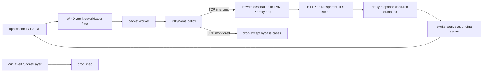
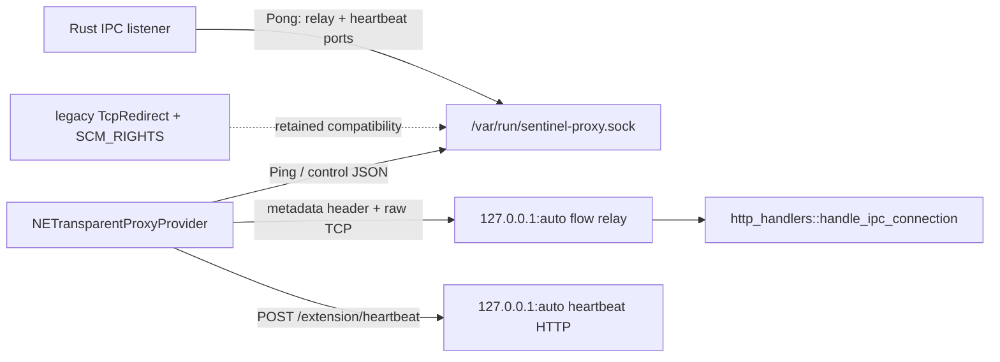

# Endpoint proxy: Windows WinDivert and macOS Network Extension

## Scope

This file reconstructs the active packet-interception implementations across:

- `proxy/src/packet_redirector/**`
- `proxy/swift/TransparentProxyExtension/**`
- Objective-C bridges in `proxy/src/packet_redirector/mac/*.{m,h}`
- `proxy/configs/redirector_config.toml`
- macOS app/extension plists and entitlements

All statements are verified at endpoint-agent commit `a022e52bf2fff6a9445ebad96c3afeaf277e259f` unless marked `Inference`, `Potential issue`, or `Unresolved`.

## Shared orchestration and configuration

`run_packet_redirector` requires `ProxyConfig.packet_redirection_config`. It calls `RedirectorConfig::load_with_runtime`, which:

1. reads TOML or writes a default file when absent;
2. overwrites TOML HTTP/HTTPS proxy ports with runtime ports;
3. overwrites the pfctl/health interval from proxy config;
4. derives/validates a non-loopback IPv4 address;
5. appends the current PID and executable filename to deny lists;
6. precomputes the monitored TCP ports from target, additional ports, and optional 443.

The default struct and committed TOML differ materially:

| Setting | Rust default | Committed TOML |
| --- | ---: | ---: |
| `priority` | `0` | `-1000` |
| `max_packet_size` | `1500` | `65536` |
| `udp_ports` | empty | `[80, 443]` |
| deny process names | empty plus runtime self append | explicit proxy/VPN/Teams/WebView list plus runtime self append on the shared loader |

`ProcessPolicy` gives deny PID/name priority. If both allow lists are empty, any non-denied or unattributed flow is eligible. If either allow list is nonempty, an attributed PID/name must match.

**Verified:** `sniff_mode` and `verbose` are configuration fields but do not change the platform capture flags/log subscriber in active code. `pfctl_check_interval_secs` remains named for a retired pfctl design and is not used by the current macOS extension.

### Orchestration lifecycle

- macOS creates an internal shutdown broadcaster, runs one NetworkExtension redirector, bridges Ctrl+C and proxy shutdown, then waits for the run future to stop.
- non-macOS creates a redirector per LAN-IP epoch and restarts it after a detected IP change. The check interval is clamped to at least ten seconds.
- `create_platform_packet_redirector` unwraps platform constructors and panics when no redirector feature is compiled.

**Contradiction:** comments describe “Windows/Linux,” but only the Windows implementation exists. A Linux build has no `PacketRedirector` return branch under the target/feature combinations shown.

## Windows topology

### Filter construction

The TCP WinDivert filter captures:

- outbound, non-loopback traffic to monitored destination ports whose destination is not the local LAN IP;
- outbound packets whose source is that LAN IP and source port is the HTTP or HTTPS proxy port.

When UDP ports are configured, a second outbound/non-loopback/destination-not-local clause captures those ports.

The implementation validates the expression using `WinDivertHelperCompileFilter` before opening handles.

### Worker initialization

`WinPacketRedirector::run`:

1. validates an IPv4 local IP;
2. opens a SocketLayer listener for process events;
3. creates `worker_threads` independent NetworkLayer handles at configured priority;
4. sets queue length 8,192 and queue time 2,000;
5. spawns packet workers;
6. spawns 60-second map observability/proc-map trimming;
7. optionally spawns 30-second UDP-flow and UDP-attribution cleanup;
8. waits for shutdown;
9. attempts to inject one wake connection per worker;
10. awaits every task, then shuts down the SocketLayer thread.

No validation rejects `worker_threads = 0`, `max_packet_size = 0`, multiplication overflow, invalid priorities, or zero UDP limits.

### Verified shutdown hang

The wake helper connects to `local_ip:target_port`. The filter's client clause explicitly requires `ip.DstAddr != local_ip`, so these wake packets do not reach the blocking worker handles. The handles are shut down only inside each worker after it exits; the outer run method awaits worker tasks before shutting them.

**Verified defect:** a worker blocked in `recv_ex` at shutdown can remain blocked indefinitely. The retained `worker_diverts` vector is never used to call `shutdown` before joining.

### Process attribution

The SocketLayer thread maps IPv4 TCP connect/accept events to `ConnKey` and removes entries on close. It resolves the executable filename with `OpenProcess` and `K32GetProcessImageFileNameW`. Every 2,048 socket events and every 60 seconds, an arbitrary batch is removed if the map exceeds 200,000 entries.

If the NetworkLayer worker reaches a SYN before the SocketLayer map, it synchronously snapshots `GetExtendedTcpTable`, scans for the complete tuple, resolves PID/name, and warms the map.

If both methods miss, code logs that it is “fail-open” but sets `should_intercept = true`. This is open with respect to application connectivity, but conservative/fail-closed with respect to inspection: unknown processes are intercepted.

### TCP rewrite state

- `flows_c2s[(client_ip, client_port)] = (server_ip, server_port)` drives response masquerading.
- `flows_s2c[(server_ip, server_port)] = (client_ip, client_port)` is populated and removed but not used for response lookup.
- process attribution is copied to the proxy-global `PROCESS_ATTR_MAP` before client traffic is rewritten.
- denied processes enter `WHITELISTED_SOCKETS_CACHE[(client_ip, client_port)]` and bypass later packets.

**Potential issue:** server tuple is not unique across multiple clients, so `flows_s2c` overwrites; its current use is cleanup only. The client tuple can also be reused after missing cleanup.

### FIN/RST cleanup defect

Cleanup runs before the normal outbound rewrite branch. For a client FIN/RST to a monitored original server it removes flow/process/whitelist state, then the same packet continues into monitored-port handling, can reattribute, reinserts the flow, and is redirected. Proxy-to-client packets are captured by an `outbound` filter clause, so the code's separate `!outbound` cleanup branch is not shown to cover the normal response path.

**Verified consequence:** TCP flow maps have no periodic TTL/size cleanup and the client FIN path can undo its own cleanup. `flows_c2s`, `flows_s2c`, and the whitelist can grow during long uptime and stale entries can affect port reuse.

When a proxy FIN/RST has no mapping, it is sent without source masquerading; the code itself warns that the client may ignore it and leave a zombie socket.

### Header and checksum rewrite

Client packets keep their source tuple, change destination IP to the LAN interface, and change destination port to HTTPS proxy only for original port 443; all other monitored ports use the HTTP proxy port. Proxy responses change source IP/port back to the original destination. IP/TCP checksums are recalculated before injection.

### UDP policy

The Windows UDP implementation does not proxy datagrams. For a configured monitored port it:

1. attributes `(local_ip, local_port)` using `GetExtendedUdpTable` plus a TTL cache;
2. passes a datagram when the process name is in `deny_processes`;
3. passes all destination port 53 or 8853 traffic;
4. drops unattributed datagrams;
5. drops every other monitored datagram and records telemetry.

**Contradictions:**

- The doc comment says the DNS exception is for system processes; code passes all DNS on those ports.
- `deny_pids` and both allow lists are ignored for UDP; only deny names are used.
- “flow tracking” is observation of blocked tuples, not forwarding state.

The UDP cache is keyed only by local IP/port. Port reuse within TTL can return a previous owner. Expired entries are refreshed on lookup but a failed refresh leaves the stale entry allocated until periodic cleanup. The tracker enforces count only through a non-atomic `len` check followed by insert, so concurrent new flows can exceed the configured maximum. Tracker-capacity errors are discarded by the packet policy.

### Packet parser

`NetworkUtils::parse_packet` supports IPv4 TCP/UDP. It validates a minimum IHL and minimum fixed TCP/UDP header bytes, then exposes mutable IP and transport header views. It does not validate IP version, IPv4 total length, TCP data offset/options, UDP declared length against the packet, fragmentation, or checksums before rewriting. Unsupported protocols return errors; because the filter selects TCP/UDP this is normally a malformed-input boundary.

After a receive error, the worker logs and immediately loops. A permanently failed handle can produce a high-rate error loop.

## macOS actual topology

### Startup ordering

`sysext::run` first calls the synchronous Objective-C `load_transparent_proxy_config`, which loads or creates an `NETransparentProxyManager`, saves it enabled, reloads it, and starts the VPN tunnel. Only after that returns does Rust call `start_listener`, which binds the Unix control socket, flow relay, and heartbeat server.

Swift `startProxy` immediately attempts one IPC connection. If it fails, startup continues and no reconnection loop is scheduled. `ensureIPCConnection` is called only by the retained UDP-forwarding path, while active UDP handling closes the flow instead.

**Verified startup race:** the extension can start before Rust binds `/var/run/sentinel-proxy.sock`; the Swift catch path then runs without IPC, has no flow-listener address, and rejects/bypasses TCP flows without an autonomous retry. The top-level proxy has no handshake barrier proving the extension reconnected.

### Objective-C manager behavior

- `load_transparent_proxy_config` takes the first manager returned, not specifically one whose provider bundle ID matches.
- It overwrites protocol configuration with provider `ai.quilr.agent.sentinel.extension` and server address `127.0.0.1`.
- Completion is pumped on the main run loop for up to 30 seconds; timeout returns false.
- `stop_transparent_proxy_config` also takes the first manager, stops it, sets `enabled = NO`, saves, and returns `success = YES` even when the save callback reports an error.

Extension activation uses `OSSystemExtensionRequest`, always accepts replacement, waits up to 30 seconds on a run loop, and returns false for timeout/failure. `install_extension` intentionally requests reinstallation even when status is already Active; WaitingForUser returns success after printing instructions. Status detection parses human-readable `systemextensionsctl list` output.

### Rust listeners

The Unix socket is removed if present, bound at `/var/run/sentinel-proxy.sock`, and chmodded `0600`. Control responses use a 10,000-entry channel and a single writer with a five-second writable timeout.

The flow relay and heartbeat servers bind random localhost ports and are announced in `Pong`. The redirector configuration used for Pong is loaded directly from the bundle resource constant, not the effective `load_with_runtime` config held by `NetworkExtensionRedirector`. Consequently runtime-appended PID/port overrides need not reach Swift.

**Trust boundary:** the flow relay accepts any localhost TCP peer and trusts a caller-supplied JSON `ConnectionMetadata` containing PID, executable path, source, destination, protocol, and domain. There is no token, peer credential, handshake secret, or validation that the protocol is TCP or the claimed process owns the connection. The heartbeat server accepts any local request whose first 256 bytes contain `/extension/heartbeat`, regardless of method or authentication.

**Potential issue requiring validation:** another local process can forge relay metadata and cause outbound proxy activity or keep the extension heartbeat healthy. Exploitability depends on local-user/process privileges and OS controls not represented in this listener.

### Flow relay lifecycle

Rust allows 4,096 concurrent relay handlers with a three-second permit wait and five-second timeouts for the 4-byte length and JSON body. Metadata is capped at 65,536 bytes. It then records attribution, reads global config, and passes the raw `TcpStream` to `handle_ipc_connection`.

Swift independently caps active relays at 200, pending flows at 64, and backpressure-mode pending flows at 16. It uses a five-second permit timeout. A relay:

1. opens the `NEAppProxyTCPFlow`;
2. connects to announced localhost IPv4 with a blocking `connect` in an async task;
3. performs a single blocking `send` of length-prefixed metadata and requires it to write the entire buffer;
4. sets nonblocking mode;
5. relays both directions;
6. cancels both directions when either completes or a five-minute timer fires.

**Contradictions:**

- Rust comments say no wall-clock flow cap; Swift imposes five minutes.
- Rust comments adjacent to limiter still mention 200 although the constant is 4,096.
- `MAC_ARCHITECTURE.md` documents Rust permits as 200 and an overall Rust 300-second timeout, neither matching active Rust code.

The Swift source address is hard-coded `0.0.0.0:0` for every TCP flow. Global Rust process-attribution entries overwrite at that single key. The direct IPC handler still receives the metadata object, but any later lookup by peer tuple cannot distinguish flows.

### Control-plane framing and legacy FDs

`MessageFramer` handles coalesced Unix stream messages, caps JSON at 1 MiB, and associates one queued SCM_RIGHTS FD only with `TcpRedirect`. The active Swift TCP path never sends this message or calls `sendWithFD`; flow relay is current. FD passing, ACK waiters/state, and tracked Unix streams are retained compatibility code.

Swift's `AsyncStream` keeps only the newest 64 control messages. Under load, older ACK/UDP/config/backpressure messages can be silently dropped. `sendDataWithFD` retries EAGAIN but does not handle a partial successful `sendmsg`.

FD accounting tracks only received SCM_RIGHTS descriptors, not all process descriptors. `TrackedStream::drop` always decrements. Its unit tests wrap ordinary untracked `UnixStream::pair` objects, which can underflow the global `AtomicUsize` counter. In `fd_to_unix_stream`, conversion takes ownership before later fallible steps; the caller closes the raw FD again on an error, creating a potential double-close/decrement path.

The FD monitor's `hard_limit` field is unused. It logs at 60–94%, enables backpressure only at 95%, and its task has no shutdown receiver. Comments saying 80% rejects streams do not match implementation.

### Heartbeats and recovery

Rust activates its global monitor after Pong, checks every ten seconds, declares timeout at 30 seconds, and attempts to start the tunnel again with a 30-second cooldown. The heartbeat POST merely records activity; it is not bound to the control connection or extension identity.

Swift sends HTTP heartbeats every ten seconds and treats three misses as control-connection death. When the heartbeat task itself invokes `handleConnectionDeath`, that method intentionally does not cancel it. Reconnection success calls `startHeartbeatMonitor`, but the stored task is still non-nil, so no replacement starts; the old task then breaks and leaves the property non-nil.

**Verified recovery defect:** after a heartbeat-triggered death/reconnect cycle, Swift can stop sending heartbeats permanently.

If reconnection never succeeds or its task is canceled, `isHandlingDeath` remains true, suppressing later recovery entries. When an old flow-listener address exists, IPC death does not enter the three-second grace buffer; flows continue until connects to the stale port fail three times.

### Active UDP behavior versus retained UDP code

Network settings intercept only outbound TCP and UDP port 443, for IPv4 and IPv6. `handleNewFlow` behavior is:

- if `shouldProxyUdp` is false, return false and bypass UDP;
- otherwise open every intercepted UDP flow and immediately close it with `ECONNREFUSED` to force TCP fallback.

It never calls `handleUDPFlow`. The entire Swift IPC UDP sender and Rust `udp_handler` are therefore dead-code candidates in the current flow; a call exists only while draining a grace buffer, but only TCP flows are ever appended to that buffer.

**Contradictions:**

- `RedirectorConfig.target_port`, `additional_ports`, `intercept_tls`, and `udp_ports` do not define macOS included rules. Swift hard-codes port 443 TCP+UDP.
- `intercept_tls = false` cannot disable the hard-coded TCP 443 rule.
- documentation describes UDP forwarding while active code deliberately rejects QUIC/UDP.

If reactivated, Rust UDP forwarding has additional properties: unbounded flow count; a race can create multiple sockets/listeners for one key; replies from any sender address are accepted and forwarded; a single flow ID is reused; ACK is sent before size/forward validation; and inactivity duration logging adds the timeout twice. These are dormant-path findings, not claims about the active port-443 close path.

### Swift filtering and fail-open paths

Process attribution reads the kernel-provided audit token and resolves PID/name/path. Self flow exclusion checks names and path substrings, followed by dynamic deny PID and exact case-sensitive process-name set membership (despite documentation saying case-insensitive matching; the set lookup itself is case-sensitive).

If initial IPC setup fails, network settings still activate. With no relay address, `handleNewFlow` returns false for TCP unless already in a grace period. **Inference:** Apple's `false` result means the provider declined the flow and the system may allow it outside this provider; exact OS fail-open behavior should be confirmed in a signed runtime test.

The extension supports IPv6 interception rules, but Rust `ConnectionMetadata` accepts IPv6 socket strings while attribution explicitly rejects IPv6. Swift `SocketAddress` decoding splits on every colon and cannot decode IPv6 strings received from Rust.

## macOS build identity and entitlements

Actual IDs:

- host: `ai.quilr.agent.sentinel`, team `W8FHSH4RM5`;
- extension: `ai.quilr.agent.sentinel.extension`;
- app group: `group.ai.quilr.agent.sentinel`;
- extension package executable: `SentinelProxyExtension`;
- minimum macOS: 13.0.

The build scripts sign with `proxy/swift/TransparentProxyExtension.entitlements`, whose network-extension value is `app-proxy-provider-systemextension`. The separately committed `TransparentProxyExtension/SentinelProxyExtension.entitlements` specifies `transparent-proxy`, sandbox, network client/server, and an absolute-path exception, but no build script references it.

**Contradiction:** code-signing documentation describes `com.sentinel.proxy*` IDs and entitlements unlike the actual signed file. Runtime entitlements/provisioning compatibility cannot be proven statically.

## Platform feature matrix

| Capability | Windows | macOS |
| --- | --- | --- |
| capture mechanism | WinDivert NetworkLayer | NETransparentProxyProvider |
| configured TCP ports | target + additional + optional 443 | hard-coded 443 |
| IPv6 | not supported | rules include IPv6; Rust attribution rejects it |
| TCP process attribution | SocketLayer + TCP table fallback | audit token in Swift metadata |
| TCP relay | packet rewrite to LAN-bound proxy | per-flow localhost TCP |
| UDP | configured ports blocked except bypass | port 443 bypassed if disabled, otherwise closed ECONNREFUSED |
| live config refresh | none | Pong/config-update fields; no producer of ConfigUpdate found |
| local IP restart | yes | no |
| shutdown | verified worker-unblock defect | listener shutdown + tunnel disable; active relay tasks detached |

## Dead and incomplete code inventory

- `compute_monitored_ips`, `resolve_ip`, `extract_host_from_regex`, `is_public_ipv4`: no active orchestration caller; port-based capture replaced domain-IP capture.
- macOS SCM_RIGHTS `TcpRedirect`, `sendWithFD`, ACK wait state, and `waitForAckAndRelay`: retained legacy path, no active Swift caller.
- macOS Swift/Rust UDP relay: current `handleNewFlow` closes UDP and does not call it.
- `ProxyMessage::ConfigUpdate`: decoder/handler exists; no Rust sender found.
- `HeartbeatAck`: retained decoder/test path; HTTP heartbeat is active.
- `CloseRequest`: decoded/logged but does not close an associated active flow.
- `sniff_mode`, `verbose`, `pfctl_check_interval_secs`, `hard_limit`: stored or logged but operationally unused in current platform loops.
- `flows_s2c`: write/remove bookkeeping with no lookup consumer.
- `UdpFlowTracker` is active only for blocked-flow telemetry and its error result is ignored.

## Unresolved

- **Unresolved:** signed runtime validation of the entitlement variants and provider class registration.
- **Unresolved:** WinDivert distribution semantics for multiple same-priority handles and exact timeout/error behavior of `recv_ex` under configured queue time.
- **Unresolved:** NetworkExtension behavior after `handleNewFlow` returns false and after the provider closes UDP with `ECONNREFUSED` for all affected applications.
- **Unresolved:** OS-level ability of a sandboxed extension to access `/var/run/sentinel-proxy.sock` under the entitlements file actually used.
- **Unresolved:** whether bundle resource deployment includes `redirector_config.toml`; failure falls back to Rust defaults and omits runtime self PID.
