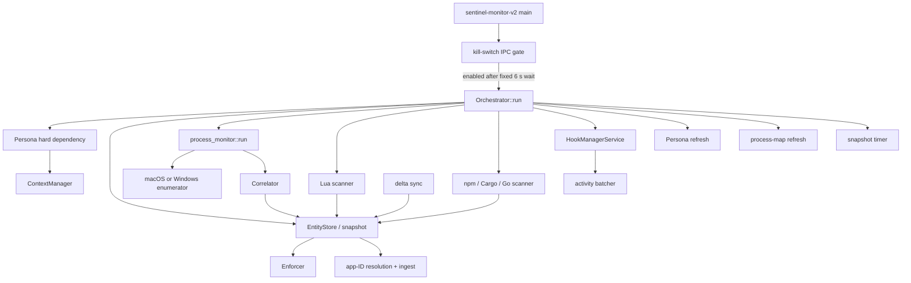

# Endpoint System Monitor v2: runtime, configuration, state, and process discovery

This chapter accounts for the runtime shell, configuration, identity/context, process enumeration, correlation, entity model, in-memory store, snapshots, power handling, Persona bootstrap, kill-switch gate, logging, and dormant DLP client under `sentinel-endpoint-agent/system-monitor/`. Synchronization, enforcement, hooks, Lua scripts, tests, and design-document consistency are covered in the linked companion chapters.

The structural symbol catalog is [endpoint-system-monitor-v2.md](07-symbol-reference/endpoint-system-monitor-v2.md). It indexes all 1,054 Rust and Lua declarations with exact locations and signatures. This chapter adds runtime meaning, reachability, failure behavior, and cross-module relationships.

## Scope and evidence

| Measure | Verified value |
| --- | ---: |
| Tracked paths under `system-monitor/` | 141 |
| Total lines in those paths | 41,624 |
| Rust source paths | 74 |
| Markdown paths | 43 |
| Lua paths | 12 |
| POSIX shell paths | 5 |
| JSON paths | 5 |
| Cargo manifests | 1 |
| Rust test declarations in source and `tests/` | 283 |
| Standalone binaries | 3 |

**Verified:** `system-monitor/v2/Cargo.toml` defines the library crate `sentinel_monitor_v2` and binaries `sentinel-monitor-v2`, `sentinel-hook-client`, and `sentinel-claude-hook-client`. It depends directly on `sentinel-core`, `template-engine`, and the endpoint-pinned `ipc-light` and `ipc-light-broker` crates.

**Unresolved:** Rust and Cargo are not installed in the analysis environment, so this revision was not compiled or executed. Static conditional-compilation evidence is called out where compilation depends on the target.

## Actual component map

Every solid edge above is directly registered in `system-monitor/v2/src/orchestrator.rs`. There is no database in this crate. Durable state is a single JSON snapshot plus hook JSON/config files and best-effort hook-event JSONL logs.

## Executable startup and shutdown

### `main` and `setup_shutdown_signal`

**Location:** `system-monitor/v2/src/main.rs`

`#[tokio::main] async fn main() -> anyhow::Result<()>` executes in this order:

1. Calls `logging::initialize_logging()` and retains the returned worker guards in `_guards` for process lifetime.
2. Calls `Config::load()`; an explicitly selected missing or invalid config is fatal.
3. Creates a `CancellationToken`.
4. Calls `setup_shutdown_signal`, which creates a capacity-one broadcast channel and spawns a Ctrl+C listener. The listener broadcasts `()` and cancels the token.
5. Stores a clone of the broadcast sender through `kill_switch::ipc::set_sysmon_shutdown_tx`.
6. Starts the kill-switch listener through `start_kill_switch_listener()`.
7. Sleeps exactly six seconds.
8. Reads the process-global atomic through `is_agent_enabled()`. A false value returns successfully without starting the orchestrator; the initial value is true.
9. Constructs `Orchestrator` and passes a broadcast receiver to `Orchestrator::run`.

**Contradiction:** comments say kill-switch IPC can use the stored shutdown broadcaster, but `SHUTDOWN_TX` is written and never read anywhere in `system-monitor/v2/src/kill_switch/ipc.rs`. A received disable event changes the atomic but does not broadcast shutdown. The orchestrator's bridge therefore reacts to Ctrl+C, not to the stored sender.

**Potential issue:** the gate is time-based rather than completion-based. `start_kill_switch_listener_with_process_ids` itself sleeps five seconds before a one-shot query. Broker connection, send, and response can exceed the remaining one second. The initial atomic is true, so missing, late, malformed, or failed IPC is fail-open.

### `Orchestrator::run`

**Location:** `system-monitor/v2/src/orchestrator.rs:41`

The orchestrator owns `Config`, `Arc<EntityStore>`, and the shared cancellation token. `new` hard-codes the store broadcast capacity to 256. `run` performs the following synchronous initialization before spawning the main service set:

1. Spawns a bridge that waits once on the supplied shutdown broadcast receiver and cancels the token.
2. Awaits `persona::init_persona`. This is a hard startup dependency: it retries with exponential backoff until a nonempty tenant arrives or cancellation occurs.
3. Writes `QUILR_TENANT_ID` and, when present, `QUILR_SUBSCRIBER_ID` with `unsafe std::env::set_var`.
4. Builds `ContextManager` from the Persona tenant and subscriber. Missing subscriber becomes the literal `default-subscriber`.
5. Makes a separate access-token IPC request, constructs a new `UserContext`, and replaces the context's user state.
6. Creates the platform power watch channel.
7. Loads a JSON snapshot; load/parse errors are warned and treated as an empty start.
8. Creates `Correlator`, loads the embedded default process map, then tries a backend process-map fetch. A successful response replaces the defaults, even if the returned platform map is empty.
9. Starts process-map refresh.
10. Selects macOS or Windows enumerator and enforcement actions with `#[cfg]` declarations.
11. Constructs `TemplateClient`, `Notifier`, `Auditor`, and `Enforcer`.

It then starts ten joined tasks/handles:

| Handle | Symbol | Timing/model | Error disposition |
| --- | --- | --- | --- |
| `discovery_handle` | `discovery::process_monitor::run` | discovery interval; sleep-aware | logs error, task ends |
| `scanner_handle` | `discovery::scanner::run` | startup then configured interval | logs error, task ends |
| `pkg_scanner_handle` | `discovery::pkg_scanner::run` | startup then configured interval | logs error, task ends |
| `enforcement_handle` | `Enforcer::run` | events plus sweep interval; sleep-aware | logs error, task ends |
| `delta_handle` | `sync::delta::poll_delta` | 2 s startup delay, configured interval | warns and retries forever |
| `ingest_handle` | `resolve_app_ids` then `sync_entities` | 1 s startup delay, fixed 5 s interval | warns and retries forever |
| `snapshot_handle` | `snapshot::save_snapshot` | configured interval | warns and continues |
| `persona_handle` | `persona::start_refresh_loop` | configured interval | implementation-owned retry |
| `hook_handle` | `HookManagerService::run` | event loop plus probe interval | logs error, task ends |
| `process_map_handle` | `sync::process_map::start_refresh_loop` | fixed 600 s refresh | warns and continues |

`persona::start_broadcast_listener` is also started, but its task handle is not retained or joined. The kill-switch listener is likewise process-global and not joined. After cancellation, `run` joins the ten retained handles, saves a final snapshot, and returns. It does not enforce a shutdown deadline; a child stuck in blocking file/process work or unbounded external work can delay the join indefinitely.

**Potential issue:** on targets other than macOS and Windows, neither `enumerator` nor `actions` is declared, but both are used unconditionally. Linux scan rules and fallback configuration exist, yet the orchestrator is statically incomplete for Linux. A compile check was not possible.

**Contradiction:** `system-monitor/v2/docs/architecture.md` describes nine core tasks and a macOS phase; current code additionally starts package scanning, app-ID resolution, Persona/process-map refresh, hooks, Windows enumeration/actions, and two unjoined listeners.

## Kill-switch IPC

**Locations:** `system-monitor/v2/src/kill_switch/mod.rs`, `system-monitor/v2/src/kill_switch/ipc.rs`

State is process-global:

| Datum | Type | Initial value | Writers | Readers |
| --- | --- | --- | --- | --- |
| `AGENT_ENABLED` | `AtomicBool` | `true` | startup query and broadcast listener | `main` startup gate; listener logs |
| `IPC_CONNECTED` | `AtomicBool` | `false` | broker connect callbacks | no functional reader found |
| `SHUTDOWN_TX` | `OnceLock<broadcast::Sender<()>>` | empty | `set_sysmon_shutdown_tx` | no reader found |

The module connects to the IPC broker as a participant, waits for `Connected`, sends a kill-switch query, then waits up to five seconds for a response. A background listener parses broadcast messages and updates `AGENT_ENABLED` for recognized event data. It does not validate the sending process ID against an allowlist before accepting state.

**Security boundary:** the enable/disable decision is inherited from a local broker message. Repository code supplies no cryptographic authentication or source validation at this consumer. Whether OS-level broker access controls prevent spoofing is **Unresolved** and must be established from deployment evidence.

**Failure behavior:** connect/send/parse/timeouts preserve the true default. Listener setup failure is logged. There is no durable last-known kill-switch state.

## Persona identity and context

### IPC bootstrap

**Locations:** `system-monitor/v2/src/persona/ipc.rs`, `system-monitor/v2/src/persona/mod.rs`

`fetch_persona_from_ipc(command)` creates a broker client, sends a JSON command, and parses `PersonaData`. Convenience calls use the Persona commands for full data and access token. `init_persona(config, cancel)`:

1. Waits `startup_delay_secs` unless cancelled.
2. Repeatedly requests Persona data.
3. Accepts only a response with a nonempty tenant.
4. Sleeps with exponential backoff bounded by `max_backoff_secs`.
5. Returns `Error::Persona` only on cancellation.

`ipc_timeout_secs` is carried in `PersonaConfig` but the reviewed IPC request path uses its own fixed response behavior rather than reading this setting. `max_backoff_secs = 0` can reduce later sleeps to zero. There is no configured retry count and no graceful default identity.

`start_refresh_loop` periodically calls `fetch_and_update`; `start_broadcast_listener` updates context on accepted Persona broadcasts. The broadcast task has no cancellation token and no retained join handle.

### `ContextManager`

**Location:** `system-monitor/v2/src/entity/context.rs`

`ContextManager` stores immutable `DeviceContext` and `TenantContext`, plus `UserContext` behind a standard `RwLock`. `user()` clones the whole user context. `access_token()` clones its optional token. Lock poisoning is suppressed by returning the inner value.

`UserContext.access_token` has `#[serde(skip)]`, so entity/snapshot serialization excludes it. The type derives `Debug`, however, and the field is not redacted from debug formatting. No current system-monitor debug call was found that prints the complete `UserContext`; accidental future disclosure remains a concern, not a verified leak.

Device identity is platform-specific:

- macOS invokes `ioreg` and extracts the platform serial. Failure yields an empty device ID.
- Windows first reads SMBIOS with `GetSystemFirmwareTable` using a 1 MiB allocation cap, then has WMI/PowerShell fallbacks. Failure yields an empty device ID.
- Hostname/OS details come from `sysinfo` or platform helpers.

The two `print_device_id_diagnostics` declarations are target-specific. `--test-device-id` appears in documentation/build exports, but no argument parser in `main.rs` invokes these functions. **Documentation-only:** the command-line diagnostic mode is not implemented in this binary.

## Configuration reference

### Resolution and deserialization

**Location:** `system-monitor/v2/src/config.rs`; committed instance: `system-monitor/v2/sysmon-config.json`

`Config::load` applies this precedence:

1. `QUILR_SYSMON_CONFIG`, if set. Missing, unreadable, or invalid JSON is fatal.
2. `sysmon-config.json` next to the current executable. Invalid/unreadable non-missing files are fatal.
3. `Config::default()` if the adjacent file is absent.

All top-level config structs use `#[serde(default)]`, so missing object fields take Rust defaults. `deserialize_per_os` accepts either a flat array or an object with `macos`, `windows`, and `linux` arrays and selects only the compile target's array.

There is no semantic validation pass. Negative values cannot deserialize into unsigned fields, but zero and extreme values are accepted. Consequences include:

- `ingest_batch_size = 0` reaches `slice::chunks(0)` and panics.
- `hook_manager.probe_interval_secs = 0` reaches `tokio::time::interval(Duration::ZERO)` and panics.
- `enforcement.sweep_interval_secs = 0` has the same interval problem.
- zero sleep-based scan/sync/snapshot values can spin or produce continuous I/O.
- `detection.cache_max_entries = 0` disables the capacity eviction condition rather than imposing a zero-entry cache.

### Exact setting table

| JSON path | Type | Rust default | Committed config | Consumer/effect |
| --- | --- | --- | --- | --- |
| `discovery.scan_interval_secs` | `u64` | 10 | 10 | process polling sleep |
| `discovery.correlation_ttl_secs` | `u64` | 300 | 300 | correlator cache eviction age |
| `discovery.app_folders` | per-OS `Vec<String>` | platform list | macOS 3; Windows 2; Linux 0 | path correlation |
| `discovery.wake_grace_period_secs` | `u64` | 5 | 5 | post-wake process monitor delay |
| `discovery.npm_bin_segment` | `String` | `/node_modules/.bin/` | same | npm-shim path recognition |
| `scan.enabled` | `bool` | true | true | disables scanner loop when false |
| `scan.scan_interval_secs` | `u64` | 1800 | 1800 | Lua discovery cadence |
| `scan.script_dir` | `String` | `SENTINEL_SCRIPT_DIR` or user `.sentinel/scripts` | omitted/default | script lookup root |
| `scan.rules.folders` | per-OS `Vec<ScanRule>` | seven common plus platform LM Studio path | explicit 8/8/7 | marker-to-script/hook mapping |
| `scan.rules.files` | per-OS `Vec<ScanRule>` | empty | empty | file-marker scripts |
| `sync.base_url` | `String` | `BackendUrl::Default.resolve()` | `http://localhost:33333` | delta, ingest, activity, alerts, process map |
| `sync.base_app_sync_url` | `String` | default backend `/bff/browser-extension/endpoint/app/add` | preprod HTTPS URL | application canonical-ID resolution |
| `sync.delta_poll_interval_secs` | `u64` | 60 | 60 | delta polling sleep |
| `sync.ingest_batch_size` | `usize` | 50 | 50 | gzip ingest chunk size |
| `enforcement.enabled` | `bool` | true | true | enforcer returns immediately when false |
| `enforcement.dry_run` | `bool` | false | false | skips kill but still posts audit |
| `enforcement.sweep_interval_secs` | `u64` | 10 | 10 | blocked-process sweep interval |
| `enforcement.wake_grace_period_secs` | `u64` | 5 | 5 | post-wake enforcer delay |
| `enforcement.backoff_initial_secs` | `u64` | 30 | 30 | sweep backoff base |
| `enforcement.backoff_max_secs` | `u64` | 600 | 600 | sweep backoff cap |
| `enforcement.max_consecutive_kills` | `u32` | 10 | 10 | sweep eligibility limit |
| `enforcement.popup_cooldown_secs` | `u64` | 25 | 25 | per-entity popup suppression |
| `snapshot.path` | `String` | user `.sentinel/v2/snapshot.json` | omitted/default | persistent JSON path |
| `snapshot.save_interval_secs` | `u64` | 30 | 30 | snapshot timer |
| `detection.dlp_base_url` | `String` | `QUILR_DLP_ENDPOINT` or preprod URL | preprod URL | dormant DLP client |
| `detection.timeout_secs` | `u64` | 30 | 30 | DLP request timeout |
| `detection.cache_ttl_secs` | `u64` | 300 | 300 | DLP cache TTL |
| `detection.cache_max_entries` | `usize` | 256 | 256 | DLP cache target bound |
| `persona.refresh_interval_secs` | `u64` | 1800 | 1800 | refresh cadence |
| `persona.startup_delay_secs` | `u64` | 5 | 5 | delay before first Persona query |
| `persona.ipc_timeout_secs` | `u64` | 5 | 5 | **Dead configuration candidate:** no consumer found |
| `persona.max_backoff_secs` | `u64` | 60 | 60 | Persona retry cap |
| `hook_manager.enabled` | `bool` | true | true | hook subsystem gate |
| `hook_manager.socket_path` | `String` | user `.sentinel/hook.sock` or named pipe | omitted/default | thin-client IPC endpoint |
| `hook_manager.integrity_check_interval_secs` | `u64` | 300 | 300 | integrity rescan |
| `hook_manager.session_idle_timeout_secs` | `u64` | 60 | 60 | queue/evaluator state expiry |
| `hook_manager.probe_interval_secs` | `u64` | 300 | 300 | proactive hook install probe |
| `pkg_scanner.enabled` | `bool` | true | true | package scanner gate |
| `pkg_scanner.scan_interval_secs` | `u64` | 1800 | 1800 | package scan cadence |
| `pkg_scanner.npm_enabled` | `bool` | true | true | global npm discovery |
| `pkg_scanner.npm_local_enabled` | `bool` | true | true | controlled-repo npm discovery |
| `pkg_scanner.cargo_enabled` | `bool` | true | true | Cargo-bin discovery |
| `pkg_scanner.go_enabled` | `bool` | true | true | Go-bin discovery |

### Environment interface

| Name | Classification | Consumer and failure/default behavior |
| --- | --- | --- |
| `QUILR_SYSMON_CONFIG` | non-secret path | exact config override; invalid is fatal |
| `QUILR_DLP_ENDPOINT` | non-secret URL | DLP default only; explicit JSON takes precedence |
| `SENTINEL_SCRIPT_DIR` | non-secret path | default Lua script root |
| `SENTINEL_LOG_DIR` | non-secret path | log directory override |
| `RUST_LOG` | non-secret filter | tracing filter; invalid filter falls back |
| `SENTINEL_INSTALLATION_PATH` | non-secret path | required to deploy hook thin clients; missing makes installation fail |
| `QUILR_THIN_CLIENT_PATH` | non-secret path | Cursor thin-client target override |
| `QUILR_CLAUDE_THIN_CLIENT_PATH` | non-secret path | Claude thin-client target override |
| `SENTINEL_HOOK_TIMEOUT_MS` | non-secret integer | hook client; invalid uses 500 ms |
| `SENTINEL_HOOK_FAIL_MODE` | security behavior | exact `closed` selects fail-closed; otherwise open |
| `SENTINEL_HOOK_SOCKET` | non-secret path | hook client IPC endpoint |
| `SENTINEL_HOOK_LOG_FILE` | potentially sensitive path/content | raw IDE event JSONL target |
| `SENTINEL_WORKSPACE_DIRS` | non-secret path list | core Lua workspace host API adds roots |
| `QUILR_TENANT_ID` | tenant identifier | written after Persona bootstrap for fallback consumers |
| `QUILR_SUBSCRIBER_ID` | subscriber identifier | written only if Persona supplies one |
| `HOME`, `USERPROFILE`, `USERNAME`, `USER`, `SystemDrive`, `APPDATA`, `LOCALAPPDATA`, `TEMP` | OS identity/paths | layered home/user/default-path resolution |
| `NPM_CONFIG_PREFIX` | package path | npm global bin root candidate |
| `CARGO_HOME` | package path | Cargo bin/index root |
| `GOBIN`, `GOPATH` | package paths | Go binary roots |

## Entity and governance model

**Locations:** `system-monitor/v2/src/entity/mod.rs`, `application.rs`, `artifacts.rs`, `governance.rs`, `context.rs`

`Entity` contains local UUID `id`, display `name`, discriminated `EntityKind`, governance, device/user/tenant contexts, `SyncState`, `discovered_at`, and `last_seen_at`. `EntityKind` has exactly nine variants:

| Variant | Payload | Primary discovery source | Enforced as process? |
| --- | --- | --- | --- |
| `Application` | `ApplicationData` | processes, Lua, npm/Cargo/Go | yes |
| `McpServer` | `McpServerData` | Lua | no |
| `Hook` | `HookData` | Lua | no |
| `Skill` | `SkillData` | Lua | no |
| `Agent` | `AgentData` | Lua | no |
| `Model` | `ModelData` | Lua | no |
| `ControlledRepo` | `ControlledRepoData` | Lua | no |
| `Permission` | `PermissionData` | Lua | no |
| `Plugin` | `PluginData` | Lua | no |

Default governance is `NeedsReview`, `NotCritical`, and `Allowed`; owner/category/domain and last-sync timestamp are absent; `is_new_entity` is true. `SyncState` transitions are controlled by store/ingest operations.

Deterministic UUID formulas are:

- `entity_id`: UUIDv5 URL namespace over application name, install path, and process name inputs used by the call site.
- `mcp_server_id`: UUIDv5 over `tenant_id:name`.
- `user_scoped_entity_id`: UUIDv5 over `tenant_id:email:entity_name`.

**Potential issue:** `user_scoped_entity_id` omits entity type. Skill, Agent, Model, and Plugin conversion passes an unqualified name; same-name entities of different variants for one tenant/email can therefore share an ID. `EntityStore::upsert` does not replace the existing `kind`, so first insertion can retain the wrong variant indefinitely. Hooks and permissions prefix application/event or application/command, and controlled repos use an application/path composite, which reduces their collision domain.

**Potential issue:** MCP identity omits parent application and transport. Same-name MCP definitions in separate applications collapse to one UUID.

## `EntityStore` semantics

**Location:** `system-monitor/v2/src/store/mod.rs`

The store owns:

- `DashMap<Uuid, Entity>` for entity state;
- a Tokio broadcast sender with orchestrator-selected capacity 256;
- atomic delta cursor;
- pending-governance map keyed by canonical-ID string, with timestamps.

Meaningful operations:

| Symbol | Verified behavior |
| --- | --- |
| `upsert` | inserts and emits `Added`; for an existing ID changes only `name` and `last_seen_at`, preserves kind/governance/sync/discovery data, and emits `Updated` |
| `apply_governance` | replaces governance and emits `GovernanceUpdated`; false if absent |
| `pending_sync` | returns `Never`, `Pending`, or `Failed` entities |
| `mark_synced` | updates sync state/time and Application canonical ID, applies buffered governance when found |
| `buffer_pending_governance` | records delta settings for unknown canonical IDs; eviction occurs only when this function is called |
| `remove` | deletes and emits `Removed` |
| `touch` | updates last-seen only |
| `update_privilege` | mutates an Application privilege string |
| `touch_and_enforce` | updates last-seen and emits `Rediscovered` |
| `find_by_process_name` / `find_all_by_process_name` | exact/canonical-aware Application searches |
| `find_by_name` | case-insensitive display-name search across all kinds |
| `find_by_canonical_id` | Application canonical ID, otherwise local entity ID string |

**Contradiction:** process-monitor documentation says exited applications become inactive and emit removal. The process loop untracks PIDs but neither removes the application entity nor sets `ApplicationData.is_active = false`. Stored applications remain active until overwritten by some other path; existing `upsert` would preserve the old `kind` anyway.

**Potential issue:** Lua rediscovery cannot refresh changing entity payloads such as version, URL, command, risk, or counts because existing upsert retains the complete old kind. Only name and timestamp change.

Broadcast send failures caused by having no receivers are ignored. Subscribers explicitly handle lag in enforcement and hooks, but there is no universal replay. Enforcement's periodic sweep repairs some missed Application events; other event consumers can miss transitions.

## Snapshot persistence

**Location:** `system-monitor/v2/src/store/snapshot.rs`

`Snapshot` contains only `version`, `entities`, and `delta_cursor`. `save_snapshot`:

1. Serializes pretty JSON.
2. Creates the parent directory asynchronously.
3. Writes a fixed sibling temporary name ending in `.json.tmp`.
4. Renames the temporary file over the target.

`load_snapshot` returns `Ok(None)` for not-found and deserializes the whole file otherwise. No migration or version compatibility check reads `version`. Unknown enum variants fail deserialization. Orchestrator catches all load errors and starts empty.

**Contradiction:** ADR 004 and architecture text describe cache metadata and entity eviction; the serialized structure contains neither. Delta pending-governance state, correlation caches, enforcement trackers, hook sessions, Persona, and DLP cache are not durable.

**Concurrency:** only the orchestrator's periodic/final writers normally call save, but the fixed temporary path has no lock. Overlapping external/library saves could race. Rename atomicity and replacement semantics are platform/filesystem dependent.

## Process enumeration and monitoring

### Platform interface

`platform::ProcessEnumerator` asynchronously returns `Vec<ProcessInfo>`. `ProcessInfo` carries PID, parent PID, normalized process name, executable path, command line, username/SID, regular-user classification, and start time.

- `platform/macos.rs` refreshes `sysinfo::System` in `spawn_blocking`, then maps process records.
- `platform/windows.rs` uses ToolHelp/native process APIs, token/SID lookup, process-time extraction, and command-line parsing with native/WMI fallbacks. Its 27 tests include environment/host-sensitive checks; they are not all hermetic.
- `platform/process_info.rs::normalize_name` strips Windows executable suffixes and normalizes display inputs.

**Potential issue:** Windows `is_regular_user` uses UID/SID heuristics, not a demonstrated current-session user match. The system can enumerate processes belonging to multiple regular users.

### Process table and PID lifecycle

**Location:** `system-monitor/v2/src/discovery/process_monitor.rs`

`ProcessTable` is keyed by PID; `ProcessKey` includes PID and name but is used as comparison data, not as the map key. `diff` reports new/changed and removed PIDs. A name change for a reused PID is detected; `start_time` is recorded but not used in reuse detection. Reuse by a process with the same name is invisible.

The async loop:

1. Pauses while `PowerState::Sleeping` and waits a configured grace period after wake.
2. Calls the platform enumerator.
3. Diffs against the table.
4. Untracks removed PIDs without mutating entities.
5. Skips process-map exclusions.
6. Correlates each new/changed process.
7. Creates or finds the corresponding Application entity.
8. Updates known executables/privilege where applicable.
9. Calls `touch_and_enforce` for a known app, producing `Rediscovered`; otherwise upserts a new entity.
10. Evicts expired correlator caches, replaces table state, and waits the configured interval.

Enumeration errors are logged and retried. The synchronous correlations/store changes happen on the async task. The loop is sleep-aware; the delta, ingest, scanner, package scanner, Persona, and process-map network tasks are not power-gated.

## Correlation and process maps

**Locations:** `system-monitor/v2/src/discovery/correlator.rs`, `src/defaults/mod.rs`, `src/defaults/default_process_map.json`, `src/sync/process_map.rs`, `src/sync/types.rs`

Resolution order is implementation-specific and includes:

1. exclusion-rule rejection;
2. npm shim detection via configured path segment;
3. backend/embedded process-name map, including optional command-line substrings;
4. alias cache;
5. application cache;
6. application-bundle/folder path extraction;
7. executable basename or raw process-name fallback.

The embedded JSON contains 183 macOS entries, 32 Windows entries, four command-line patterns total, and three exclusion rules. `default_process_map()` deserializes it with `expect`, so an invalid committed embedded file would panic at runtime. The two large JSON files under `system-monitor/docs/` are categorized documentation maps and are not loaded by the v2 code.

`ExclusionRule::matches` supports `starts_with`, `starts_with_number`, `is_empty`, `equals`, and `contains`. It ignores the serialized `field`; every rule is evaluated against process name. Matches are case-sensitive.

`fetch_process_map` calls `{base_url}/ea/v1/sync/process-map`, supplies tenant/subscriber headers, and selects `windows` on Windows or `mac` on all other targets. A successful empty response replaces embedded defaults. `start_refresh_loop` uses a fixed 600-second interval not exposed in `SyncConfig`.

The alias and application caches have a configured TTL, but cache hits do not refresh timestamps. `update_alias` and `update_app` have test callers but no production caller in the checked repository; therefore those caches remain empty in the current runtime unless an external library consumer calls them. The process map itself is active.

**Contradiction:** ADR 003 describes backend aliases populating two production caches and LRU-like refresh behavior. The ingest parser can deserialize aliases but `apply_ingest_response` does not insert them into the correlator.

## Power state

**Location:** `system-monitor/v2/src/platform/power.rs`

`power_state_channel` exposes a Tokio watch receiver initialized as `Awake`.

- macOS registers IOKit sleep/wake callbacks through unsafe FFI.
- Windows uses the configured Windows power APIs/message behavior.
- unsupported targets drop the sender, so receivers observe a closed channel and fall back to non-power-aware operation where guarded.

Only process monitoring and enforcement consume the receiver. **Contradiction:** ADR 019 says backend sync is paused while sleeping; delta, ingest, activity, Persona, and process-map loops do not read power state.

## Dormant DLP detection client

**Locations:** `system-monitor/v2/src/detection/mod.rs`, `cache.rs`, `stream.rs`, `types.rs`

`DetectionClient::detect` hashes text for its in-memory cache, then calls `stream_detect` against `{dlp_base_url}/dlp/v2/stream/detect` with bearer token and tenant header/body. The response parser consumes record-separator-delimited JSON frames, uses lossy UTF-8 conversion, skips malformed segments, and returns typed `DlpDetection` values. Only nonempty detection results are cached.

The cache stores insertion time and values in a mutex-protected map. Hits do not update age or recency. Capacity eviction selects the oldest insertion in O(n), making it FIFO-by-insertion, not LRU. With `max_entries = 0`, the `len >= max && max > 0` condition never evicts.

**Dead-code candidate:** repository-wide searches found no production construction or call to `DetectionClient`; uses are confined to its module tests. The hook evaluator always returns Allow and never invokes DLP.

**Contradiction:** ADR 013 names environment variable `DLP_BASE_URL`, calls the cache LRU, and shows hook/prompt call paths. Actual configuration uses `QUILR_DLP_ENDPOINT`; the cache is not LRU; and no production caller is wired.

## Logging

**Location:** `system-monitor/v2/src/logging.rs`

Initialization composes stdout and daily rolling file layers, reading `RUST_LOG` and using `SENTINEL_LOG_DIR` or a `.sentinel/logs` fallback. It retains nonblocking writer guards through the main `_guards` binding. File setup errors degrade to console logging. Cleanup selects the ten newest files whose names match the monitor prefix by modification time and suppresses cleanup failures.

Network helpers can log request and response bodies: `sync/http.rs` logs up to 4,096 bytes at debug and the complete body at trace. Activity payloads can include prompts and file paths; DLP payloads can include inspected text. Production logging policy, retention, and access controls are **Unresolved**.

## Error and failure matrix

| Failure | Handling | Result |
| --- | --- | --- |
| explicit config missing/invalid | `?` from `Config::load` | fatal before gate/orchestrator |
| log-file setup | fallback behavior | console continues |
| kill-switch broker/query/parse | log/default true | monitor normally starts |
| Persona unavailable | retry with backoff | startup waits indefinitely until cancel |
| token unavailable | optional | context runs without bearer token |
| snapshot missing | `Ok(None)` | empty state |
| snapshot corrupt/unknown enum | warning | empty state; cursor lost |
| initial process-map fetch | warning | embedded defaults retained |
| later successful empty process map | accepted | defaults replaced by empty maps |
| enumerator failure | logged in loop | retry next scan |
| child task returns error | wrapper logs | that subsystem stops; orchestrator remains alive |
| broadcast lag | consumer-specific warning | missed events; partial periodic repair |
| cancellation during blocking work | token cannot preempt blocking callback | shutdown may wait |
| final snapshot failure | error log | orchestrator still returns success |

## File classification for this chapter

| Path group | Role | Status |
| --- | --- | --- |
| `system-monitor/.gitignore`, `CLAUDE.md`, empty `readme.md` | repository metadata/minimal guidance | fully analyzed |
| `system-monitor/v2/Cargo.toml` | crate and target manifest | fully analyzed |
| `system-monitor/v2/src/{main.rs,lib.rs,orchestrator.rs,config.rs,error.rs,logging.rs}` | runtime shell | fully analyzed |
| `system-monitor/v2/src/{entity,store,platform,persona,kill_switch}/**/*.rs` | identity, state, platform, startup controls | fully analyzed |
| `system-monitor/v2/src/discovery/{correlator.rs,process_monitor.rs,mod.rs}` | live process discovery | fully analyzed |
| `system-monitor/v2/src/defaults/*` | active embedded process map | fully analyzed; committed input, not generated |
| `system-monitor/v2/src/detection/**/*.rs` | exported but currently uncalled DLP client | fully analyzed |
| `system-monitor/docs/{macos_process_map.json,windows_process_map.json}` | unused categorized reference maps | fully analyzed; documentation data, not generated |

No file in this group was classified as vendored or generated.
