# Endpoint System Monitor v2: synchronization, enforcement, hooks, and activity telemetry

This chapter documents the active backend interfaces, canonical-ID pipeline, enforcement control flow, notification/audit behavior, hook installation and integrity checking, thin-client protocol, per-session processing, and activity telemetry in `sentinel-endpoint-agent/system-monitor/v2`. Startup, state, process discovery, and base configuration are covered in [the runtime chapter](06-endpoint-system-monitor-runtime-discovery-and-state.md).

## Interface inventory

| Direction | Interface | Symbol(s) | Authentication visible in this crate | Status |
| --- | --- | --- | --- | --- |
| Agent → backend | `POST {base_app_sync_url}` | `sync::app_id::resolve_app_ids` | tenant/subscriber headers and optional bearer through shared helper | active every 5 s for unresolved Applications |
| Agent → backend | `POST {base_url}/ea/v1/sync/discovered-apps` | `sync::ingest::sync_entities` | tenant/subscriber headers and optional bearer | active every 5 s; gzip body |
| Backend → agent | `GET {base_url}/ea/v1/sync/delta?...` | `sync::delta::poll_delta` | tenant/subscriber headers; no bearer added in this direct core-client call | active configured cadence |
| Backend → agent | `GET {base_url}/ea/v1/sync/process-map` | `sync::process_map::fetch_process_map` | tenant/subscriber headers and shared behavior | startup + 600 s |
| Agent → backend | `POST {base_url}/ea/v1/sync/alerts` | `Auditor::report` | tenant/subscriber headers; no bearer | active on dry-run or successful block/quarantine kill |
| Agent → backend | `POST {base_url}/ea/v1/sync/activity` | `ActivityBatcher` | tenant/subscriber headers and optional bearer | active when hooks produce a completed prompt turn |
| Monitor → template service | pinned IPC event bus message | `TemplateClient::notify_block`, `notify_quarantine` | local broker participant identity only | active for user-facing successful kills |
| Hook client ↔ monitor | length-prefixed JSON over Unix socket/named pipe | `hook_client_common::ipc_client`, `HookIpcServer` | no request authentication | active when hook manager and installed client run |
| IDE → hook client | one JSON document on stdin; JSON/stdout or stderr/exit response | both thin-client binaries | inherited process invocation | active after hook install |
| Hook client → local file | raw event JSONL append | `append_hook_event` | filesystem permissions | active for all parsable and non-parsable input after stdin read |

## Shared HTTP behavior

**Location:** `system-monitor/v2/src/sync/http.rs`

`shared_client` lazily constructs one `reqwest::Client` with a fixed 30-second request timeout. Construction uses `expect`, so builder failure panics. `build_headers` always supplies `X-Tenant-ID` and `X-Subscriber-ID`; it adds `Authorization: Bearer <token>` only when the mutable context has a token that can be represented as a header value.

`post_json` serializes a request to a string, logs its truncated body at debug and complete body at trace, requires a successful status, and deserializes a JSON response. `post_bytes` sends raw bytes and returns status plus text without converting non-2xx into an error.

**Sensitivity:** activity bodies can include prompt text, file paths, user email, user groups, device ID, and project name. Full trace logging reproduces the serialized body. Deployment filter/retention controls are **Unresolved**.

## Application canonical-ID resolution

**Locations:** `system-monitor/v2/src/sync/app_id.rs`, `types.rs`

The app-ID stage exists because Applications require backend resolution before general ingest. `resolve_app_ids` selects pending Application entities whose `canonical_id` is absent, groups names into a request, posts to `sync.base_app_sync_url`, and applies `AppResolution` records.

The response envelope accepts optional `status` and `response`. Each `AppResolution` requires camel-case `appName` but treats `appId`, display name, governance/classification, block/browser flags, source, and newness as optional. `apply_resolutions`:

1. Matches returned application name to local entities.
2. Sets the canonical ID where supplied.
3. Maps backend fields into local Application/governance data.
4. Updates known aliases/executables where represented.
5. Leaves unresolved Applications pending for the next five-second cycle.

`lookup_canonical_id` supports child-parent linking by application display name. Its result is inserted into non-Application `entity_context` as `app_canonical_id` during ingest.

**Failure behavior:** transport, non-success, or parse failure returns an error to the orchestrator loop, which warns and retries after the fixed five-second loop delay. No separate backoff or circuit breaker exists.

## Entity ingest

### Request selection and serialization

**Location:** `system-monitor/v2/src/sync/ingest.rs`; models: `src/sync/types.rs`

`sync_entities` executes this pipeline:

1. Calls `EntityStore::pending_sync` for `Never`, `Pending`, and `Failed` states.
2. Removes Application entities without `canonical_id`; those remain in the store for retry.
3. Calls `pending.chunks(config.ingest_batch_size)`. A zero batch size panics.
4. Converts each entity with `to_discovered_entity`.
5. Defers a non-Application child with a nonempty `app_name` until a parent Application canonical ID can be found. Orphan children with empty app names are sent without `app_canonical_id`.
6. Truncates display `name` to 512 UTF-8 bytes on a character boundary.
7. Serializes JSON, gzip-compresses it, and posts to `/ea/v1/sync/discovered-apps` with content type/encoding headers.
8. On a successful HTTP status, parses `IngestResponse`, applies optional nested governance settings, then calls `mark_synced` with the returned canonical ID.

The outgoing `DiscoveredEntity` envelope has these exact fields:

| Field | Type/serialization | Origin |
| --- | --- | --- |
| `id` | UUID string | local entity ID |
| `canonical_id` | optional string, omitted if absent | Application resolver or local ID for other kinds |
| `entity_type` | string | `EntityKind::kind_label` |
| `name` | string, max 512 bytes | entity display name |
| `discovered_at`, `last_seen_at` | RFC3339 strings | entity timestamps |
| `tenant_context` | `{tenant_id, subscriber_id}` | `ContextManager` |
| `entity_context` | kind-specific JSON | serialized payload plus optional `app_canonical_id` |
| `properties` | optional map, currently always omitted | no active producer |
| `governance` | strings/options | local governance |
| `device_context` | device ID, hostname, OS type/version | context |
| `user_context` | username, email, null department/role, groups | context |

On non-2xx, transport failure, or response parse failure, the function only logs; affected entities are not explicitly changed to `Failed`, so their existing pending state causes a later retry. A successful response that omits an entity mapping leaves it pending.

**Contradiction:** `docs/entity-sync-contract.md` says all non-Application IDs are canonical and the backend need not assign a separate ID, yet the actual response model still requires nonoptional `canonical_id` for every mapping and `mark_synced` uses it. The request sends both local `id` and `canonical_id` for every kind.

**Contradiction:** the architecture document's Application payload and `ApplicationData` examples omit or rename current fields such as bundle ID, privilege, known executables, system/dev-tool flags, and the injected child `app_canonical_id`. The implementation's Serde output is authoritative.

## Delta synchronization

**Location:** `system-monitor/v2/src/sync/delta.rs`

`poll_delta` builds:

```text
GET {base_url}/ea/v1/sync/delta?tenant_id={tenant}&since={cursor}&os_type={os_type}
```

It calls `sentinel_core::http_client::get`, adds tenant/subscriber headers, collects the complete response stream, takes only the first collected response, and deserializes `DeltaResponse`. An empty response is treated as success with no cursor change. A nonempty server `error` is warned and also returned as `Ok(())`, preserving the cursor.

For a successful delta:

1. Calls `store.set_delta_cursor(delta.cursor)`.
2. For each setting, finds an entity by canonical ID.
3. Converts recognized governance strings. Unknown/missing approval → `NeedsReview`; execution → `Allowed`; criticality → `NotCritical`.
4. Applies governance and emits `GovernanceUpdated`, or buffers it by canonical-ID string for later `mark_synced`.
5. Sets the loop-local cursor to the response cursor.

The store cursor is changed before settings are applied in memory, but the durable snapshot is not synchronously written. A crash after the in-memory cursor update and before the next snapshot cannot advance the durable cursor; a replay occurs after restart. A crash after a later snapshot has captured a cursor necessarily also captures the current entity vector from the same save call, although independent store mutation can interleave.

**Contradiction:** ADR 006 and `docs/architecture.md` call the response chunked/incremental and discuss midstream errors. The code buffers the entire core HTTP response and reads only the first collected response object. There is no `SyncClient` trait.

**Potential issue:** the tenant ID is placed in a query string as well as a header. URL construction performs no explicit percent encoding for tenant or OS strings.

## Enforcement state machine

**Locations:** `system-monitor/v2/src/enforcement/mod.rs`, `actions.rs`, `notifier.rs`, `audit.rs`

Only `EntityKind::Application` can yield process matches. Other kinds can receive governance but the enforcer cannot translate them into process actions.

```mermaid
stateDiagram-v2
    [*] --> Evaluate: Added / GovernanceUpdated / Rediscovered / sweep
    Evaluate --> NoAction: Allowed
    Evaluate --> LogOnly: Audit
    Evaluate --> NotRunning: Blocked or Quarantined; no PID
    Evaluate --> DryRun: dry_run=true
    Evaluate --> NativeQuit: macOS app bundle
    NativeQuit --> Completed: app exits
    NativeQuit --> GracefulRoot: still running / unavailable
    GracefulRoot --> Wait3Seconds
    Wait3Seconds --> ForceSurvivors
    ForceSurvivors --> Completed: any kill reported
    Completed --> Notify: user-facing process and cooldown permits
    Completed --> AlertPost
    NotRunning --> ResetBackoff
```



### Event and sweep behavior

`Enforcer::run` returns immediately when disabled. Otherwise it subscribes to store events and creates a Tokio interval from `sweep_interval_secs`.

- `Added`: evaluates the entity.
- `GovernanceUpdated`: clears the entity's kill tracker and popup cooldown, then evaluates.
- `Rediscovered`: evaluates immediately without `should_enforce`; this is deliberate respawn enforcement.
- `Removed`: no action.
- broadcast lag: warns; periodic sweep remains.
- sweep tick: finds every blocked/quarantined entity and invokes only when `should_enforce` permits.

Power sleep pauses the event/sweep loop. After wake it sleeps the grace period and drains queued broadcast events, deliberately discarding them; the next periodic sweep covers blocked Applications.

### PID matching

The enforcer rescans OS processes rather than relying on `ApplicationData.pids` (which is not a populated field). It matches canonical/process names and known executables, records parent relationships, finds roots among matched PIDs, and distinguishes user-facing from system processes.

### Actions

For Blocked/Quarantined with live PIDs:

1. Dry-run logs and awaits `Auditor::report`; it does not notify.
2. On macOS bundle applications, `quit_application` invokes `osascript` under a five-second timeout, then waits a fixed three seconds and rescans.
3. Finds root PIDs and calls `terminate_gracefully` for each.
4. Sleeps one shared three-second grace period.
5. Rescans and force-kills survivors.
6. If any kill was reported, calls post-kill notification/audit behavior and records backoff/popup state.

macOS actions use `libc::kill(SIGTERM/SIGKILL)`, treating `ESRCH` as already gone. Windows uses `taskkill /T` then `/F /T`.

**Potential issue:** Windows graceful termination returns `Ok(true)` for a non-success status unless stderr contains exact lowercase text `not found`; other command failures can be treated as a sent termination. Force-kill checks non-success more strictly.

### Backoff and popup state

Per-name tracker state records consecutive kills and next eligible sweep time with exponential backoff bounded by config. `max_consecutive_kills` prevents later periodic sweep attempts. `Rediscovered` bypasses `should_enforce`, so the maximum does not stop enforcement of rediscovery events. A no-PID result resets the tracker.

Popup cooldown is separate. Notifications are sent only for processes classified as user-facing and when cooldown allows. Audit is independent of popup suppression.

**Contradiction:** ADR 020 says maximum attempts stop enforcement; actual event-driven rediscovery continues past the sweep limit. The ADR calls the setting `notification_cooldown_secs`; code/config use `popup_cooldown_secs`.

## User notification

`Notifier::notify` delegates blocked/quarantined UI to `TemplateClient`. `TemplateClient` connects to the pinned IPC event bus and sends `TemplateRenderRequest` messages to target `template_engine_service`. Requests include a generated request ID, title/description, process ID, and response options. The enforcer awaits the notification call, although connection/send failures are logged and not propagated.

**Contradiction:** ADR 008 documents a different wire payload (`entity_name`, `policy`, `reason`, `timestamp`). Current wire shape is the template-engine request imported from `template-engine`.

**Verified deduplication:** the actual template client tracks alert state/cooldown semantics and the enforcer has per-entity popup cooldown. This is not a guarantee that the external template process is running; IPC failure does not prevent process termination or backend audit.

## Enforcement audit/alert POST

`Auditor::report` constructs a one-element JSON array with:

```json
{
  "entity_type": "Application",
  "app_name": "<entity display name>",
  "action": "<lowercase policy>",
  "time": "<RFC3339 now>",
  "email": "<persona email or empty>",
  "device": "<device ID>",
  "os_type": "<OS string>",
  "properties": {"reason": "unapproved"}
}
```

This example is a direct field-for-field transcription of the `serde_json::json!` expression, not an invented server example.

The method uses a separate default `reqwest::Client`, has no explicit timeout, supplies no bearer token, and is awaited by enforcement despite comments calling it fire-and-forget. It retries once immediately. The retry branch checks only transport `Err`; a second non-2xx response is silently accepted.

**Contradiction:** ADR 009 describes a durable asynchronous mpsc audit service and a different event schema. There is no local durable audit queue. Process logs and best-effort HTTP are the only audit paths here.

## Hook installation configuration

**Location:** `system-monitor/v2/src/hook_manager/config.rs`

The static `AppHookConfig` registry has Cursor and Claude Code entries. Lookup occurs by bundle ID, known process name, or scan rule `hook_template`. Each entry resolves:

- application/template identity;
- configuration file (`hook_path`);
- deployed thin-client target (`thin_client_path`);
- process/bundle identifiers.

Target overrides are `QUILR_THIN_CLIENT_PATH` for Cursor and `QUILR_CLAUDE_THIN_CLIENT_PATH` for Claude. The source binary is resolved as `<SENTINEL_INSTALLATION_PATH>/<target filename>`.

## `HookManagerService`

**Location:** `system-monitor/v2/src/hook_manager/mod.rs`

When enabled, `run`:

1. Starts `IntegrityMonitor`; startup failure is warned but not fatal.
2. Starts `ActivityBatcher` and constructs `ActivityEvaluator`.
3. Constructs a per-session `SessionQueue` around that evaluator.
4. Spawns `HookIpcServer`.
5. Probes configured scan-rule markers immediately.
6. Subscribes to `EntityStore` Added events and listens for Application discoveries.
7. Re-probes at `probe_interval_secs` and sweeps idle evaluator state.
8. On cancellation, exits the event loop and awaits the IPC task.

An in-memory `installed_apps` set suppresses repeated installation for the process lifetime. It is updated only after successful config installation and integrity registration.

### Deployment pipeline

`deploy_thin_client` requires `SENTINEL_INSTALLATION_PATH`, creates the target parent, copies the packaged binary, sets Unix mode 0755, and on macOS attempts to transfer ownership to the detected home owner. Failure removes the new file in some ownership paths and prevents hook config installation.

`install_hooks_for_config` generates template JSON, calls `HookInstaller::install_merged`, registers expected content with the integrity monitor, starts watching the path, and caches the bundle ID.

### JSON merge semantics

**Location:** `system-monitor/v2/src/hook_manager/installer.rs`

`HookInstaller::install_merged` reads existing JSON when present, preserves unrelated top-level keys, replaces the complete `hooks` value with the generated hooks, and adds template-requested extra keys. It writes through a fixed `.tmp` sibling then renames. File/ancestor ownership repair is platform-specific.

**Contradiction:** ADR 021 says existing user hooks are preserved. Unrelated top-level configuration is preserved, but existing entries inside the `hooks` object are replaced wholesale; unrelated user hooks in that object are removed.

**Potential issue:** there is no file lock. Concurrent IDE or agent writes can race with the read/merge/fixed-temp/rename sequence.

### Integrity behavior

**Location:** `system-monitor/v2/src/hook_manager/integrity.rs`

The monitor stores expected hook JSON, extra keys, and binary command. It combines filesystem notifications with periodic checking. When content drifts it calls the merged installer again.

If the existing JSON is malformed, `install_merged` cannot parse it; restoration cannot proceed through the same path. Errors are logged. There is no cryptographic signature or authorization decision around local user edits.

## Hook IPC server

**Location:** `system-monitor/v2/src/hook_manager/ipc.rs`

Wire format in both directions is:

```text
[4-byte unsigned big-endian JSON length][that many JSON bytes]
```

`HookRequest` fields are `session_id`, `ide_type`, `event_name`, optional `tool_name`, optional arbitrary JSON `tool_input`, optional `command`, `file_path`, `prompt`, and `cwd`, plus integer timestamp. `HookResponse` contains `Decision` (`Allow`, `Deny`, `Ask`, `Justify`), optional message, and a vector of `DetectionInfo`.

Unix behavior:

- removes any stale socket path;
- creates its parent;
- binds a Unix listener;
- sets mode 0666;
- accepts connections and `try_acquire`s one of 128 semaphore permits;
- wraps the complete connection in a five-second timeout;
- removes the socket on normal cancellation.

Windows behavior:

- creates local named-pipe instances with `reject_remote_clients(true)`;
- retries first-instance access denied ten times at 200 ms;
- applies a permissive DACL and low integrity label on the first instance;
- uses the same 128-connection semaphore and five-second handler timeout.

**Security boundary:** neither transport validates caller identity, authenticates `HookRequest`, or bounds the declared frame length before allocating the JSON buffer. Unix mode 0666 permits any local account with path traversal access to connect; Windows deliberately permits non-elevated local callers. Remote named-pipe clients are rejected on Windows. A local process can submit fabricated prompts/events and receive policy decisions; current evaluator always returns Allow but can emit fabricated activity telemetry.

**Potential issue:** the server allocates according to a caller-provided u32 frame size, up to roughly 4 GiB, before JSON parsing. The five-second timeout limits duration but not allocation attempt.

## Session queue and evaluator

### `SessionQueue`

Each session ID maps to an mpsc channel of capacity 64 and a spawned worker. Requests within a session are FIFO; sessions run concurrently without a global count limit. `submit` waits for channel capacity and the response. If a worker is stale, it removes the map entry and retries once. Second failure or dropped oneshot fails open with Allow.

Workers time out after `session_idle_timeout`, call `Evaluator::on_session_idle`, and remove themselves from the session map. A race is possible if an old worker removes a newly inserted same-ID entry after replacement; the entry API reduces creation TOCTOU but the unconditional post-worker removal does not compare sender identity.

`AllowAllEvaluator` is a test/default placeholder. Production hook manager supplies `ActivityEvaluator`.

### `ActivityEvaluator`

The production evaluator always constructs `HookResponse::allow()` and never invokes policy, DLP, governance, or detection code. It records:

- prompt and cwd/IDE on `UserPromptSubmit` or `beforeSubmitPrompt`;
- distinct tools on `PreToolUse`, `preToolUse`, `PostToolUse`, or `postToolUse`, capped at 500;
- distinct file paths for Read/Write/Edit/MultiEdit/NotebookRead/NotebookEdit, capped at 500;
- flush on a new prompt, Stop/SubagentStop/stop, queue idle callback, or periodic idle sweep.

It emits empty `skills` and `mcp_server`, no model or app version, derives `project` from the final cwd path component, maps `claude` to `claude-code`, and maps response decision to allow/deny/warn. Because the response is always Allow, active events produce `decision = "allow"`.

**Contradiction:** ADR 015 presents policy/DLP enforcement as the hook objective. That ADR is Proposed, and current evaluator is telemetry-only/fail-allow.

## Activity batching

**Location:** `system-monitor/v2/src/sync/activity.rs`

`ActivityBatcher::start` creates an mpsc channel of capacity 1,000 and detaches `flush_loop`. `send` uses `try_send`; a full channel drops the entry with a warning. The loop batches at 100 entries or 30 seconds and makes at most two POST attempts separated by two seconds. Cancellation and channel close attempt one final flush. After two failures, the batch is dropped; there is no disk spool.

Exact `ActivityEntry` fields are:

| Field | Populated value in current evaluator |
| --- | --- |
| `prompt_text` | previous prompt |
| `authenticated_user` | Persona email |
| `tools`, `files` | accumulated distinct values |
| `skills`, `mcp_server` | always empty vectors |
| `project` | cwd basename |
| `model` | null |
| `app_name` | IDE type, with Claude normalized |
| `app_version` | null |
| `decision` | `allow` in active pipeline |
| `time` | flush-time UTC, not original hook timestamp |
| `device_information` | full sync device context |
| `user_context` | sync user context |

**Contradiction:** `docs/adr-activity-log-endpoint.md` shows a request without `device_information` or `user_context`; the agent includes both. The ADR's server storage/query/migration claims must be verified independently against `sentinel-dashboard` and are not established by endpoint code.

## Thin-client entry points

### Cursor: `sentinel-hook-client`

**Locations:** `src/bin/sentinel_hook_client/{main.rs,hook_event.rs,response.rs}`

The current-thread Tokio binary reads all stdin, strips a leading UTF-8 BOM, appends the raw text to JSONL, parses fields, and immediately prints allow on read/parse failure. Only `beforeSubmitPrompt`, `beforeReadFile`, `beforeShellExecution`, `beforeMCPExecution`, `preToolUse`, and `stop` are sent to IPC. Other events are called “fire-and-forget” in comments but are not sent; only the raw file append occurs.

Response mapping:

- Allow → `{"continue":true,"permission":"allow"}`.
- Deny → `continue:false`, `permission:"deny"`, message.
- Ask/Justify → `continue:true`, `permission:"ask"`, message.

### Claude: `sentinel-claude-hook-client`

**Locations:** `src/bin/sentinel_claude_hook_client/{main.rs,hook_event.rs,response.rs}`

It has the same read/BOM/log/parse pattern. Only `PreToolUse`, `UserPromptSubmit`, `PermissionRequest`, `Stop`, and `SubagentStop` use IPC. PostToolUse, SessionStart, and all other events are not forwarded.

Deny and Justify write a reason to stderr and exit 2. Allow/Ask return Claude's `hookSpecificOutput`, except Stop/SubagentStop return `{}`. Parse/read failures fail open.

### Client configuration and failures

**Location:** `src/hook_client_common/config.rs`, `ipc_client.rs`, `log.rs`, `message.rs`

Defaults are 500 ms, fail-open, platform default socket, and a `.sentinel` JSONL log. The client wraps connect/write/read/parse in one timeout. Windows retries pipe-busy up to three times with 50 ms sleeps. Errors print to stderr and produce Allow unless `SENTINEL_HOOK_FAIL_MODE=closed`, in which case they produce Deny.

`append_hook_event` spawns a blocking append task and does not await it. Raw hook input can contain prompt text, commands, paths, and tool input. File permissions, rotation, size limits, redaction, and retention are not established in this module.

## Verified flow traces

### Application discovery to backend governance

```text
ProcessEnumerator::enumerate
→ process_monitor::run
→ Correlator::correlate
→ EntityStore::upsert / touch_and_enforce
→ orchestrator 5-second ingest loop
→ app_id::resolve_app_ids
→ EntityStore::set_canonical_id
→ ingest::sync_entities
→ HTTP POST discovered-apps
→ apply_ingest_response
→ EntityStore::apply_governance + mark_synced
→ ChangeEvent::GovernanceUpdated
→ Enforcer::run
```

### Hook prompt activity

```text
IDE hook subprocess
→ thin-client main reads stdin and appends raw JSONL
→ hook_event::parse
→ HookEvent::is_blocking
→ ipc_client::evaluate
→ local framed JSON socket/pipe
→ HookIpcServer::handle_connection
→ SessionQueue::submit
→ ActivityEvaluator::evaluate
→ HookResponse::allow
→ IDE-specific response mapping

On new prompt/stop/idle:
ActivityEvaluator::build_entry
→ ActivityBatcher::send
→ flush_loop (100 entries or 30 seconds)
→ sync::http::post_json
→ POST /ea/v1/sync/activity
```

## Error/recovery matrix

| Component | Error | Handling | Data/control consequence |
| --- | --- | --- | --- |
| app ID | transport/status/JSON | warn by caller, retry next 5 s | Applications and children remain deferred |
| ingest | non-2xx/transport | warn inside function | pending entities retry |
| ingest response parse | warn | mappings not applied; retry |
| delta transport/parse | error to loop | retry configured interval |
| delta server `error` | warn, returns success | cursor unchanged |
| pending governance | entity absent | buffer with TTL metadata | applied on later sync; eviction only on new buffer calls |
| process kill | per-PID log and continue | possible partial process tree survival |
| notifier | internal best effort | enforcement continues |
| alert first non-2xx | retry immediately | second non-2xx unreported |
| hook install | warn/false | app remains uncached; later probe retries |
| integrity repair parse failure | warn | corrupt config remains |
| hook IPC overload | connection dropped | client fails open/closed by env |
| hook session channel failure | one retry then Allow | policy bypass by design |
| activity mpsc full | warning/drop | telemetry lost |
| activity POST twice fails | error/drop batch | telemetry lost |

## File classification for this chapter

| Path group | Role | Analysis status |
| --- | --- | --- |
| `system-monitor/v2/src/sync/**/*.rs` | backend ID, ingest, delta, process-map, activity, and HTTP contracts | fully analyzed |
| `system-monitor/v2/src/enforcement/**/*.rs` | process policy action, UI notification, alert POST | fully analyzed |
| `system-monitor/v2/src/template_client/mod.rs` | template-service IPC adapter | fully analyzed |
| `system-monitor/v2/src/hook_manager/**/*.rs` | install/integrity/server/session/activity orchestration | fully analyzed |
| `system-monitor/v2/src/hook_client_common/**/*.rs` | transport/config/protocol/log/message library | fully analyzed |
| `system-monitor/v2/src/bin/sentinel_hook_client/**/*.rs` | Cursor executable | fully analyzed |
| `system-monitor/v2/src/bin/sentinel_claude_hook_client/**/*.rs` | Claude executable | fully analyzed |

No file in this group is generated or vendored.
