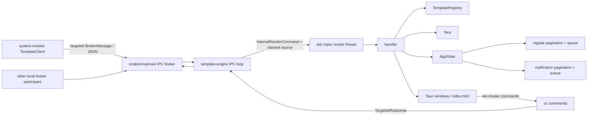
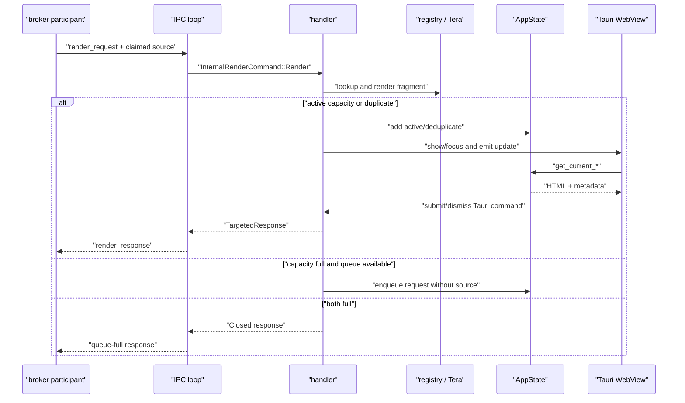

# Endpoint template service: IPC protocol, registry, state, Tauri UI, and tests

This chapter accounts for all 29 tracked paths under `sentinel-endpoint-agent/template-service/` at commit `a022e52bf2fff6a9445ebad96c3afeaf277e259f`. It covers the library and binary surfaces, startup/shutdown, kill-switch behavior, IPC protocol, template registry, rendering, state and response correlation, frontend/Tauri bridge, static assets, configuration, tests, packaging relationships, and documentation contradictions.

The exact declaration catalog is [endpoint-template-service.md](07-symbol-reference/endpoint-template-service.md). Its 172 entries give source ranges and signatures. The semantic supplement is [endpoint-template-service-semantic.md](07-symbol-reference/endpoint-template-service-semantic.md).

## Scope and classification

| Measure | Verified value |
| --- | ---: |
| Tracked paths | 29 |
| Total lines | 5,243 |
| Rust source/build paths | 18 |
| HTML paths | 4 |
| Markdown paths | 2 |
| Image paths | 2 |
| Cargo/Tauri configuration paths | 2 |
| POSIX shell paths | 1 |
| AST-indexed declarations | 172 |
| Rust test declarations | 32 |
| Ignored manual tests | 5 |

No path in this subtree is generated or vendored. The two icon files are byte-for-byte duplicates of `core/icons/icon.ico` and `core/icons/icon.png`; neither icon path is referenced by this crate and `tauri.conf.json` has an empty `bundle.icon` array. Their original source and intended consumer are **Unresolved**.

**Unresolved:** Rust and Cargo are unavailable in the analysis environment. This revision was not compiled or executed. Static behavior, registrations, and tests were inspected; execution-dependent Tauri/CSP behavior is explicitly marked unresolved.

## Actual component and process model

Every solid edge is registered in `src/main.rs`, `src/ipc/client.rs`, `src/ipc/handler.rs`, `src/ui/mod.rs`, or `src/ui/commands.rs`. The service has no database, cache server, HTTP client, queue broker beyond IPC-Light, or backend-template fetch client. Its live request state is process-local memory.

The endpoint core default graph independently registers both `templating-engine.service` (the older core Tauri implementation) and `template-engine.service` (this process). The root builder and distribution scripts build/stage both names. System Monitor v2 imports only this crate's protocol types with `default-features = false` and sends requests to `template_engine_service`.

## Crate and feature boundary

### Manifest and library

`template-service/Cargo.toml` declares package and binary `template-engine`, library crate `template_engine`, edition 2024, version `0.1.0`, and default feature `ui`.

`src/lib.rs` gates `config`, `error`, `registry`, and `state` behind `ui`. It always compiles `src/ipc/messages.rs` as hidden module `ipc_messages_inner` and publicly re-exports those types through `template_engine::ipc::messages`. This is the verified reason `system-monitor/v2/Cargo.toml` can depend on the package with `default-features = false` without Tauri or IPC runtime dependencies.

`build.rs` calls `tauri_build::build()` only with `ui`. `tauri-build` is an optional build dependency activated by that feature.

### Dependency reachability

| Dependency/group | Verified use |
| --- | --- |
| `serde`, `serde_json` | protocol, registry, Tera context, tests |
| `tokio` | runtime, signals, IPC loop, retry/timers, manual tests |
| `ipc-light`, `ipc-light-broker` | active full-service IPC and kill-switch clients |
| `tauri`, `tera` | active UI/window/command/template path |
| `tracing`, `tracing-subscriber` | active logging |
| `toml` | configuration parser |
| `regex`, `once_cell` | lazy CSS color validator |
| `html-escape` | escapes a Tera error placed into fallback HTML |
| `thiserror` | only `_TemplateEngineError`, which has no caller |
| `uuid` | no source/test use found; documentation example only |
| `chrono` | no source/test use found |
| `clap` | no source/test use found; binary has no CLI parser |
| `ctrlc` | no source/test use found; shutdown uses `tokio::signal::ctrl_c` |

The last four optional dependencies are **Dead-code candidates** after subtree- and repository-wide name/import searches. `thiserror` remains compiled because it is nonoptional, although its only enum is unused.

## Startup, runtime, and shutdown

### `main`

**Location:** `template-service/src/main.rs:36-96`

Verified execution order:

1. Initializes a global tracing subscriber. Parsing the literal `template_engine=debug` directive is unwrapped.
2. Loads `TemplateEngineConfig`.
3. Resolves a registry JSON path as `$QUILR_CONFIG_DIR/template_registry.json`, otherwise `$HOME/.sentinel/template_registry.json`, otherwise `$USERPROFILE/.sentinel/template_registry.json`. If all variables are absent, the formatted path is `/.sentinel/template_registry.json`.
4. Loads hard-coded and file-overlaid registry entries.
5. Builds a multi-thread Tokio runtime with `Runtime::new().expect(...)`.
6. Creates an unbounded standard-library render-command channel.
7. Spawns a Ctrl+C task on the Tokio runtime; it sends one unit value on a standard-library shutdown channel.
8. Stores a shutdown-sender clone in the kill-switch module.
9. Enters the Tokio runtime and starts the kill-switch listener.
10. Blocks the main thread for six seconds.
11. If the global agent-enabled atomic is false, returns without starting IPC or Tauri.
12. Initializes the process-global unbounded response channel; a second initialization panics.
13. Spawns the main IPC loop.
14. Calls `ui::initiate_tauri`, which blocks in Tauri's event loop unless setup fails early.

`default_timeout_seconds` is logged at startup but is not applied to any render request. Each request must carry `TemplateOptions.timeout_seconds`.

### Kill-switch gate and listener

**Location:** `template-service/src/ipc/kill_switch.rs`

The module starts with `AGENT_ENABLED = true`. Its startup task waits five seconds, then performs a separate one-shot query with a five-second response timeout. `main` waits only six seconds total before reading the atomic.

**Potential issue:** the six-second gate is fail-open and races the five-second delay plus broker connection/register/query/response work. Failure, timeout, or a response arriving after the gate leaves the initial true value in effect at startup.

After the one-shot query, a persistent participant registers as `template_service_kill_switch_listener`, resynchronizes with another query, and accepts JSON events named `kill_switch_state_change`. Reconnect delay begins at five seconds, doubles to 30 seconds, and resets to five seconds after a successful registration.

On a true-to-false transition, `apply_agent_enabled_state` uses `TEMPLATE_SERVICE_SHUTDOWN_TX` to signal the Tauri shutdown thread. That thread closes both possible windows and calls `AppHandle::exit(0)`. Unlike the system-monitor copy of this module, the service does consume its stored process-shutdown sender.

Consequences:

- A disable before Tauri startup sends into the channel; after the gate, `main` also sees false and returns.
- A disable after Tauri setup exits the process.
- A later enable cannot restart an already exited process; restart belongs to the external supervisor.
- `IPC_CONNECTED` is written but has no functional reader.
- `SHUTDOWN_TX`, the Tokio broadcast sender nominally intended to stop the listener, is set but never read; the listener has no internal cancellation branch.
- The consumer validates event shape/name but not `BrokerMessage.source`.

**Security boundary:** enabled state and shutdown are accepted from the local broker. The checked consumer has no source binding, authorization decision, or signature verification. The pinned broker permits clients to claim registration/source identifiers without cryptographic binding. Whether OS/deployment ACLs prevent a local process from spoofing these messages is **Unresolved**.

### Other termination behavior

- Ctrl+C triggers the standard shutdown receiver and Tauri exit.
- A broker `Shutdown` makes only `run_ipc_loop` exit normally. It does not signal the Tauri shutdown channel, so the UI process can remain alive but disconnected.
- Tera glob parsing failure is logged and `initiate_tauri` returns; `main` then returns success.
- Tauri builder failure panics through `expect`.
- An ordinary user-originated Tauri exit request with no code is prevented.
- Retained UI/IPC state is not persisted during shutdown.

## Complete configuration reference

### `template_engine.toml`

`TemplateEngineConfig::load` uses this precedence:

1. `$QUILR_CONFIG_DIR/template_engine.toml` when `QUILR_CONFIG_DIR` exists.
2. `$HOME/.sentinel/template_engine.toml`.
3. `$USERPROFILE/.sentinel/template_engine.toml`.
4. `/.sentinel/template_engine.toml` if none of the environment variables exists.

Any file read failure or TOML parse failure silently returns the complete default struct. Fields missing from a valid TOML file use Serde field defaults. Unknown TOML fields are accepted because unknown-field rejection is not enabled. There is no validation.

| TOML field | Type | Default | Active effect / absence behavior |
| --- | --- | ---: | --- |
| `max_concurrent_templates` | `usize` | 5 | Maximum regular active slots; zero makes every regular request queue |
| `default_timeout_seconds` | `u32` | 30 | Logged only; no request uses it |
| `max_queue_size` | `usize` | 50 | Regular pending queue bound; zero rejects every overflow request |
| `default_notification_timeout_seconds` | `u32` | 10 | Deserializes into `_default_notification_timeout_seconds`; never read |
| `max_concurrent_notifications` | `usize` | 5 | Maximum active notification slots; zero makes every notification queue |

Notification queue capacity is not configurable; `NotificationPaginationState::enqueue` hard-codes 50.

### Environment and fixed values

| Name/value | Consumer | Meaning and failure behavior |
| --- | --- | --- |
| `QUILR_CONFIG_DIR` | config and registry startup | Directory for TOML and `template_registry.json`; no directory creation |
| `HOME` / `USERPROFILE` | config and registry fallback | Home directory; missing values lead to root-relative `/.sentinel/...` |
| `SENTINEL_TEMPLATE_FILE` | registry | Deprecated extra registry JSON overlay; nonexistent path warns, unreadable file is silent |
| `SENTINEL_TEMPLATE_DIR` | `resolve_template_glob` | Highest-priority HTML directory when it exists |
| `SENTINEL_INSTALLATION_PATH` | `resolve_template_glob` | Third-priority template base after compile-time manifest path |
| `RUST_LOG` | tracing subscriber | Runtime log filter, plus literal debug directive |
| `ipc_light_broker` | both IPC clients | Fixed broker channel |
| `template_engine_service` | main IPC client | Fixed registered process ID and response source |
| `template_service_kill_switch_listener` | kill listener | Fixed listener participant ID |
| `template_service_kill_switch_query` | kill query | Fixed query participant ID |
| `kill_switch_service` | kill query | Fixed target service ID |
| 3 s | main IPC loop | Initial broker startup delay |
| 500 ms → 30 s; max 10 failures | main IPC loop | Exponential reconnect schedule and cumulative failure limit |
| 5 s → 30 s; unbounded | kill listener | Reconnect schedule |
| 6 s | `main` | Fixed kill-switch startup gate |

## IPC public interface

### Transport and registration

`run_ipc_loop` sleeps three seconds, connects a pinned generic `DuplexChannel<BrokerMessage, BrokerMessage>` as a client, expects `Connected`, registers `template_engine_service`, expects `Ack`, then selects between inbound broker frames and the global outbound response receiver.

The reconnect counter and delay are initialized outside the loop and are never reset after a successful connection. Because `connect_and_listen` returns only when that connection ends or broker shutdown arrives, failures accumulated across a process lifetime are cumulative. At the tenth error the task gives up; Tauri remains active and there is no supervisor-visible failure from this detached task.

Malformed inbound JSON, response-only message variants, and closed render-command sends are silently ignored. Outbound serialization/send failure tears down the connection and consumes a retry. The outbound channel is unbounded and has no backpressure.

### JSON schema

`TemplateIpcMessage` uses an internally tagged Serde enum with discriminator `type`. Enum values outside the tag retain Rust variant case because no rename rule is declared.

| `type` | Payload fields | Service behavior |
| --- | --- | --- |
| `render_request` | `request_id`, `template_name`, optional `template_type`, optional title/description/original_text/theme/criticality, required `options` | lookup, render, activate/deduplicate/queue/reject |
| `render_response` | `request_id`, `decision`, optional `justification`, optional `comments` | outbound; ignored when received |
| `dismiss_request` | `request_id` | removes only an active regular slot; no not-found response |
| `status_query` | `query_id` | reports regular state only |
| `status_response` | `query_id`, `active_template_count`, `queued_count`, `window_visible` | outbound; ignored when received |

`template_type` allowed serialized values are `Justify`, `Block`, and `Notification`. `criticality` values are `Info`, `Warning`, and `NeedsAttention`. `UserDecision` values are `Acknowledged`, `Override`, `Closed`, `Timeout`, and `NotificationDismissed`.

All `TemplateOptions` fields are required when deserializing a request; only programmatic Rust construction has `Default`. That default is timer true, 30 seconds, dismiss button true, four fixed justification strings, branding `Secured by Quilr`, no logo URL, and show-logo true.

No IPC-level authentication, sender allowlist, request-ID uniqueness check, field-length bound, or message-specific authorization exists in this service. Sender identity is copied from `BrokerMessage.source` and used as a response target.

## Registry and template selection

### Load order

`TemplateRegistry::load` constructs a `HashMap` using this overwrite order:

1. Eight hard-coded entries.
2. `template_registry.json` from the configured directory, if present and readable.
3. `SENTINEL_TEMPLATE_FILE`, if set, present, and readable.

Each file is first parsed as `Vec<TemplateRegistryEntry>`, then as `Vec<BackendTemplate>`. Parse failure warns. Ordinary registry-file read errors are silent. Later entries with the same key replace earlier entries.

### Hard-coded entries

| Key | Type | Template | Default title |
| --- | --- | --- | --- |
| `upload_blocked` | Block | `block.html` | `Upload Blocked!` |
| `sensitive_data_warning` | Justify | `alert.html` | `Hold On!` |
| `adversarial_prompt` | Block | `block.html` | `Request Blocked` |
| `notification` | Notification | `notification.html` | `Notification` |
| `block-application` | Block | `block.html` | `Application Blocked` |
| `block-application-by-organisation` | Block | `block.html` | `Application Blocked` |
| `justify-using-a-new-ai-app` | Justify | `alert.html` | `Justification Required` |
| `block-visiting-an-unapproved-ai-app` | Block | `block.html` | `Unapproved AI Application` |

### Backend-format conversion

Only active templates are considered. `BackendTemplate.content` must itself be a JSON string that deserializes to an object with mandatory `header` and `title`; invalid content is skipped. Mapping is:

1. Exact outer `type == "Notification"` → `notification.html` / `Notification`.
2. Otherwise presence of `justification_list`, even an empty array → `alert.html` / `Justify`.
3. Otherwise → `block.html` / `Block`.

The outer ID, name, version, channel, subscriber, tenant, placeholders, content-type, timestamps, updater, `acknowledged_buttons`, and arbitrary flattened content fields are not used in the resulting entry. `slug` becomes the registry key. There is no HTTP call that obtains these records.

## Render and state flow

### Selection and rendering

`handle_render` first looks up `template_name`. Unknown names immediately receive `Closed` plus `comments = "Unknown template_name: ..."`.

Notification routing is determined only by `request.template_type == Some(Notification)`, not by the registry entry's `template_type`. Therefore a request for the built-in `notification` with `template_type = null` enters regular state, while any registry entry can enter notification state if the caller overrides its type.

Request title/description override registry defaults. The request type string overrides the registry type string. Tera context receives title, description, original text, header, sanitized theme, options, a synthetic content object, and—for the notification path—criticality.

CSS color validation accepts `#` followed by 3 through 8 hexadecimal characters. Invalid values use fixed fallbacks. The three checked templates never reference `theme`, so this validation currently has no visible effect. They also do not reference `original_text`, `header`, `content`, `options.justifications`, or `options.logo_url`. `show_timer`, `timeout_seconds`, `show_dismiss_button` (regular templates), `branding_text`, and `show_logo` are used. The notification close button is unconditional.

Tera render errors do not reject the request. The handler stores a fallback HTML fragment containing an escaped error message and proceeds as if rendering succeeded.

### Regular state

`PaginationState` owns active slots, a current index, maximum active count, a FIFO `VecDeque<TemplateRenderRequest>`, and configurable maximum queue size. One `template-window` paginates all active slots; `max_concurrent_templates` does not create that many native windows.

Regular deduplication uses title equality only. On a duplicate it increments the existing slot's count, replaces its rendered HTML, refreshes `created_at`, and selects it. It preserves the first request's request ID, response target, type, and timeout.

**Verified response-correlation loss:** the new duplicate is treated as accepted, but no response is ever associated with or sent for its distinct request ID/source. Its rendered HTML can replace the original slot while its timeout metadata remains the original value.

### Notification state

`NotificationPaginationState` owns active notification slots, current index, maximum active count, and a hard-coded 50-entry FIFO. It deduplicates by exact `(criticality, title, description)`. A duplicate increments count, refreshes time, and selects the original slot; it preserves the original ID, target, HTML, and timeout.

**Verified response-correlation loss:** as with regular state, later deduplicated request IDs/sources have no response lifecycle.

`NeedsAttention` forces stored timeout to zero regardless of request options. Other notifications use the request timeout.

### Queue target loss

Both queues store only `TemplateRenderRequest`; they discard the source/response target carried by `InternalRenderCommand`. When a slot completes, the dequeue paths call `handle_render` with the just-completed slot's target (or the source of a dismiss request). A queued request originating from a different service will therefore be rendered with and ultimately respond to the wrong participant.

### Dismiss and status semantics

- Broker `dismiss_request` searches active regular slots only. It does not search notifications or either queue.
- If found, it responds `Closed` to the participant that sent the dismiss command, not to the stored original requester, then dequeues using that same participant as the queued request's target.
- If not found, it sends no response.
- Status reports only regular active/queued counts and `template-window` visibility. Notifications are excluded.

## Tauri and browser interface

### Setup and windows

`initiate_tauri` resolves and parses all template files, owns `AppState`, spawns one blocking render-command thread and one blocking shutdown thread, registers ten commands, builds the app, and enters the Tauri loop.

Template path precedence is:

1. Valid `SENTINEL_TEMPLATE_DIR`.
2. The compile-time `env!("CARGO_MANIFEST_DIR")/templates` directory if it still exists at runtime.
3. `SENTINEL_INSTALLATION_PATH/templates`, otherwise executable-adjacent `templates`.
4. Relative `templates/**/*.html`.

The regular window is 700×520, centered, undecorated, nonresizable, always-on-top, taskbar-skipped, closable, devtools-disabled, and explicitly not content-protected. Its builder error panics the render thread through `expect`; the process, IPC task, and Tauri loop can remain alive while later render-channel sends fail silently.

The notification window is 380×160 with similar properties. It is placed 20 pixels from the right and 40 pixels from the top on macOS, or 20 pixels from the bottom elsewhere, using the first monitor. Builder errors are only logged, leaving the corresponding notification active but not shown.

Native close handling is not connected to state removal/response emission in the checked Rust or JavaScript. **Potential issue requiring runtime validation:** because both windows are configured closable, native/OS close behavior may destroy or hide a window while its request remains active. Exact undecorated-window close affordances and Tauri event behavior are runtime-dependent.

### Tauri commands

The frontend can call:

| Command | Inputs | Effect |
| --- | --- | --- |
| `get_pagination_state` | none | regular totals/index/IDs |
| `get_current_template` | none | current regular HTML/type/title/timeout/count |
| `navigate_template` | signed direction | circular navigation and update event |
| `submit_decision` | ID, decision string, optional justification/comments | maps decision, sends response, removes ID, dequeues |
| `dismiss_template` | ID | invokes submit as `closed` |
| `get_notification_pagination_state` | none | notification totals/index/IDs |
| `get_current_notification` | none | current notification HTML/criticality/title/timeout/count |
| `navigate_notification` | signed direction | circular navigation and update event |
| `dismiss_notification` | ID | sends `NotificationDismissed`, removes ID, dequeues |
| `dismiss_all_notifications` | none | responds for active items, clears active and queued state, hides window |

Unknown decision strings map to `Closed`. `submit_decision` and `dismiss_notification` send a response even when the supplied ID was not active, using fallback target `decision_engine_service`; they also dequeue the next request regardless of whether removal succeeded.

`dismiss_all_notifications` responds once for each active notification, but clears the entire queued notification FIFO without sending responses for those queued IDs. The notification fragment's X button invokes this command, so closing one visible notification dismisses all active items and silently abandons all queued items.

### Browser state and timers

`ui/index.html` is a single handwritten HTML/CSS/JavaScript page used by both windows. It discovers the current Tauri window through `window.__TAURI_INTERNALS__`, injects rendered Tera fragments into `innerHTML`, and listens for `template-update` or `notification-update`.

The page registers `loadCurrentTemplate` on `DOMContentLoaded` and also calls it immediately, producing two startup loads in the ordinary parse sequence. A single set of page-global timer variables serves the current item in that window.

Every load/navigation clears the current interval and restarts from the full `timeout_seconds`; stored `created_at` is never consulted. Navigation away and back can therefore extend a request beyond its nominal timeout. Regular deduplication emits/show-focus behavior and likewise reloads the selected fragment while notification dedup re-shows the window.

JavaScript starts a timer whenever view timeout is greater than zero; the view model does not expose `show_timer`. A request with `show_timer = false` and a positive timeout has a hidden but active auto-dismiss timer.

The notification fragment and host page both use `id="pagination-dots"`. `getElementById` returns one element, and `inlineDots` is assigned with the identical lookup, so the intended separate inline/outer updates cannot both be addressed reliably. Exact browser selection depends on document order, but duplicate IDs are verified invalid DOM structure.

The alert input enforces trimmed length 20–140 before enabling/submitting. The backend receives the entered text as `justification` and literal comments `UI Submission`. The static `AI Usage Policy` anchors use `href="#"` and have no click handler or navigation target.

### HTML security boundary

Title and description are Tera substitutions. **Inference:** Tera's normal HTML autoescaping should escape them because the committed filenames end in `.html`, but dependency runtime behavior was not compiled or independently exercised in this environment. Rendered fragments are then injected by `innerHTML`. Registry template-file names and the template directory are locally configurable; a process/account able to modify those files controls markup rendered inside a privileged Tauri page.

Tauri configuration grants only `core:default`, event listening/default permissions to the two named windows and restricts platforms to macOS/Windows. It enables the global Tauri object and sets a CSP with a fixed script nonce, while `index.html` has a separate CSP meta tag allowing inline scripts. **Unresolved:** Tauri's final CSP injection/intersection and whether the inline script executes under this exact beta/runtime combination require a built application. External Google stylesheet/font origins are allowed. Both windows explicitly set `content_protected(false)`.

## Tests and operational integration

### Test inventory

| Location | Declarations | What is covered |
| --- | ---: | --- |
| `src/state/mod.rs` | 6 | regular add/navigate/remove/FIFO/bound; notification add/navigate/remove/dedup; one criticality-only assertion |
| `tests/test_render.rs` | 21 | protocol serialization, hard-coded names, Tera fragments/options/branding/criticalities, backend conversion/skip/override |
| `tests/manual_ipc_sender.rs` | 5 ignored tests plus 2 helpers | live broker/UI block, justify, and three notification examples |

The test named `test_needs_attention_no_timeout` constructs a slot with helper timeout 10 and asserts only that its criticality is `NeedsAttention`; it does not test the handler's forced-zero behavior.

No checked test covers `main`, config resolution/invalid TOML, IPC retry lifetime, malformed broker frames, kill-switch gate/shutdown, handler target correlation, regular deduplication, queued source preservation, dismiss/status limitations, Tauri commands, native windows, browser JavaScript, CSP, or cross-service system-monitor behavior.

`tests/test_spawn_render.sh` runs a package build, `cargo test -p template-engine`, then redundantly reruns `test_render`. Despite its header and step comments, it never starts, signals, or requests help from the binary; step four only tests file existence/size. Its displayed JSON uses obsolete `company_name` rather than `branding_text` and omits `criticality`. Serde would ignore `company_name`, while missing `branding_text: Option<String>` becomes `None`.

No checked repository CI workflow invokes this script or package's tests. External reusable workflows might do so, but their contents are outside the repository and are **Unresolved**.

### Build, install, and supervision relationships

- The root workspace includes `template-service`.
- macOS and Windows builder scripts pass `-p template-engine` and expect/stage the resulting binary.
- distribution/installer/uninstaller scripts include the binary in process and package lists and configure `SENTINEL_TEMPLATE_DIR`.
- `tauri.conf.json` sets `bundle.active = false`; packaging is done by repository scripts rather than Tauri bundling.
- Core's active `TemplateEngineService` declares `template-engine.service`, a broker dependency, custom IPC, and three maximum restart attempts. Its process wrapper resolves the executable name through generic service-name handling.
- System Monitor's `TemplateClient` has capacity 64, sends fire-and-forget requests, and discards inbound responses. Its block request uses `upload_blocked`; its quarantine request uses a `NeedsAttention` notification even though the enforcer kills/quarantines rather than merely suspends the process.

## Failure and recovery matrix

| Failure | Handling | Outcome |
| --- | --- | --- |
| config file absent/unreadable/invalid | suppressed | complete defaults |
| registry file unreadable | suppressed | prior registry layers remain |
| registry JSON invalid | warning | prior layers remain |
| backend inner content invalid/missing required fields | warning/skip | individual template absent |
| Tokio runtime creation | `expect` | process panic |
| kill query/listener connection | debug/retry | startup may fail open; listener retries forever |
| main IPC connection | exponential retry, max 10 cumulative errors | IPC task stops; UI remains |
| malformed/unsupported inbound message | ignored | no response |
| render-channel receiver gone | send error ignored | request lost |
| unknown registry name | immediate `Closed` | explanatory comments |
| Tera render failure | log + escaped fallback HTML | request remains active and visible if window works |
| regular/notification queue full | immediate `Closed` | request rejected |
| regular window creation | `expect` on render thread | render thread panic; process may remain |
| notification window creation | log only | active request can remain invisible |
| response channel uninitialized/receiver gone | send error ignored | response lost |
| Tauri builder failure | `expect` | process panic |
| Tera startup parse failure | log/return | process exits normally |
| poisoned state/Tera mutex | recovers inner value | operation continues |
| browser command failure | console error | decision guard reset only in send/dismiss paths |

## Documentation consistency audit

| Documentation claim | Source | Actual evidence | Result |
| --- | --- | --- | --- |
| startup sequence loads config/registry then IPC/Tauri | `docs/CONTEXT.md:66-80` | current `main` inserts runtime, Ctrl+C, kill listener, and fixed six-second gate | Partially confirmed; kill-switch sequence omitted |
| four hard-coded defaults | `docs/CONTEXT.md:156-163` | `get_hardcoded_defaults` returns eight | Outdated |
| response target travels with requests/state | context data-flow narrative | active slots retain target, but both queues discard it and dedup discards later IDs/targets | Contradicted for queue/dedup paths |
| alert/block fragments embed style tags | `docs/CONTEXT.md:229` | both files contain markup only; host `index.html` contains CSS | Contradicted |
| template lookup order is installation, Cargo, relative | `docs/CONTEXT.md:173` | actual order begins `SENTINEL_TEMPLATE_DIR`, then Cargo, then installation/executable, then relative | Contradicted/incomplete |
| all listed Tera context is available for templates | `docs/CONTEXT.md:218-228` | context is inserted, but current fragments ignore theme/header/original/content/justifications/logo URL | Confirmed as context; misleading as implemented presentation |
| NeedsAttention forces acknowledgment | `docs/CONTEXT.md:279`; `USAGE.md:330` | timeout is forced zero, but close emits `NotificationDismissed`; X also dismisses all | Partially confirmed |
| max concurrent templates means windows shown at once | `docs/USAGE.md:341` | one native window paginates multiple active slots | Contradicted |
| config defaults control default timeouts | `docs/USAGE.md:351-360` | both default-timeout config fields are not applied | Contradicted |
| backend templates dynamically load from backend API | `docs/USAGE.md:373-383` | registry accepts backend-shaped local JSON only; no HTTP client exists | Contradicted |
| `acknowledged_buttons` maps to block | both docs | conversion checks Notification, then `justification_list`; block is merely the fallback | Partially confirmed/misstates causal condition |
| status is engine state | `docs/USAGE.md:174-197` | response excludes all notification state | Incomplete |
| dismisses an active template | `docs/USAGE.md:163-173` | broker dismiss applies only to regular active state and does not use stored requester target | Incomplete |
| environment reference lists runtime variables | `docs/USAGE.md:364-370` | omits active `SENTINEL_TEMPLATE_DIR` and deprecated active `SENTINEL_TEMPLATE_FILE` | Incomplete |
| queue overflow responses and stateless memory | both docs | source confirms bounded queues/no persistence | Confirmed, with target-loss/dismiss-all exceptions |

## Dead, incomplete, and ambiguous elements

- **Dead-code candidate:** `_TemplateEngineError` and its five variants have no caller or conversion site.
- **Dead-code candidate:** optional `uuid`, `chrono`, `clap`, and `ctrlc` dependencies have no code/test use.
- **Dead-code candidate:** `IPC_CONNECTED` and kill-listener `SHUTDOWN_TX` have writers but no readers.
- **Dead-code candidate:** duplicate icons are not referenced by the empty Tauri icon list or subtree code.
- **Incomplete:** configuration default timeouts are parsed but inert.
- **Incomplete:** theming, original text, header, justification-list choices, and logo URL are accepted/constructed but unused by committed templates.
- **Incomplete:** broker status/dismiss APIs omit notification and queued-request semantics.
- **Potential issue:** `max_concurrent_* = 0` creates a permanently non-draining queue until its bound is hit, because there is no active request whose completion can trigger dequeue.
- **Unresolved:** production registry/config files, local broker ACLs, final CSP behavior, Tauri native-close behavior, and external CI are not present in the checked source.

## Per-file accounting

| Path/group | Role | Status |
| --- | --- | --- |
| `Cargo.toml`, `build.rs`, `tauri.conf.json` | crate/features/build/Tauri security and bundle metadata | Fully analyzed |
| `src/config.rs`, `src/error.rs`, `src/lib.rs`, `src/main.rs` | configuration, unused error, library boundary, executable startup | Fully analyzed |
| `src/ipc/{client,handler,kill_switch,messages,mod}.rs` | wire contract, broker clients, dispatch/render, response channel, kill switch | Fully analyzed |
| `src/registry/{db,models,mod}.rs` | registry overlays/backend-shaped conversion/models | Fully analyzed |
| `src/state/mod.rs` | regular and notification transient state/tests | Fully analyzed |
| `src/ui/{commands,mod}.rs`, `ui/index.html` | Tauri state/commands/windows and browser frontend | Fully analyzed |
| `templates/{alert,block,notification}.html` | committed Tera fragments | Fully analyzed |
| `tests/{test_render,manual_ipc_sender}.rs`, `tests/test_spawn_render.sh` | automatic, ignored manual, and developer shell tests | Fully analyzed |
| `docs/{CONTEXT,USAGE}.md` | architecture/integration claims | Fully audited against source |
| `icons/{icon.ico,icon.png}` | unreferenced duplicates of core icons | Fully classified; provenance unresolved |
