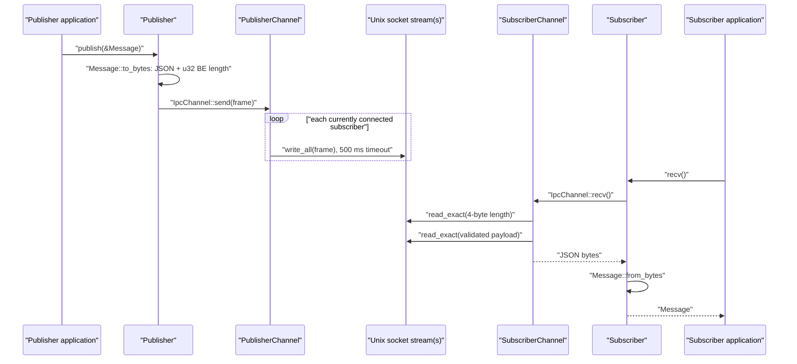

# Current IPC `main` — Module and Behavior Reference

**Repository revision:** `ipc-event-bus@0cf45bc50e4121d6a4521c58f1fa52a97c125e19`  
**Source scope:** 30 tracked paths; 14 Rust files; 1,864 Rust lines; one workspace crate (`ipc-light`).  
**Confidence:** Verified unless an entry is explicitly marked otherwise.

## Implemented boundary

Current `main` is a small Tokio-based, Unix-domain-socket broadcast library. It exposes one concrete JSON message type, one publisher per named channel, and subscribers that receive frames published after they connect. It does not contain the broker, procedural macro, typed/duplex APIs, Windows transport, schemas, rate limiter, metrics, health API, inspector CLI, or reconnect-after-disconnect behavior described in portions of `docs/architecture.md` and `product/prd.md`.

**Contradiction:** the root `README.md` calls the library cross-platform and names Windows named pipes, but `crates/ipc-light/src/platform/mod.rs` only declares and re-exports `platform::unix` under `#[cfg(unix)]`. `Publisher` and `Subscriber` import the Unix-gated factory functions unconditionally. No Windows source exists at this revision.

## Package and export surface

`Cargo.toml` defines a resolver-v2 workspace containing only `crates/ipc-light`. `crates/ipc-light/Cargo.toml` declares version `0.1.0`, Rust edition 2021, and direct dependencies on workspace Tokio/Serde/Serde JSON plus `async-trait`, `tracing`, `tracing-subscriber`, and `libc`. Three Cargo examples point to the root `examples/` directory.

`crates/ipc-light/src/lib.rs` publicly exposes the modules `config`, `error`, `logging`, `message`, `publisher`, `shutdown`, and `subscriber`; `platform` is private. It re-exports:

| Public item | Source | Actual role |
| --- | --- | --- |
| `Config` | `crates/ipc-light/src/config.rs` | Parses timeout/log environment values and computes per-channel override variable names. |
| `Error`, `Result` | `crates/ipc-light/src/error.rs` | Library error enum and result alias. |
| `Message`, `MAX_MESSAGE_SIZE` | `crates/ipc-light/src/message.rs` | Fixed JSON transport model and 65,536-byte serialized-payload limit. |
| `Publisher` | `crates/ipc-light/src/publisher.rs` | Owns an OS channel and broadcasts a serialized `Message`. |
| `Subscriber` | `crates/ipc-light/src/subscriber.rs` | Owns one connection and deserializes received payloads. |
| `ShutdownCoordinator` | `crates/ipc-light/src/shutdown.rs` | Process-global signal flag and timeout wrapper. |

The exhaustive declaration appendix is [ipc-current-main.md](07-symbol-reference/ipc-current-main.md).

## Wire model and framing

`message::Message` has exactly two public serialized fields:

| Field | Rust/JSON type | Source and lifecycle |
| --- | --- | --- |
| `content` | `String` / JSON string | Supplied to `Message::new`; serialized without transformation. |
| `timestamp` | `u64` / JSON number | Set to whole seconds since the Unix epoch. If the system clock precedes the epoch, `Message::new` logs a warning and uses `0`. |

`Message::to_bytes` executes in this order:

1. Serializes the entire `Message` to JSON with `serde_json::to_vec`.
2. Converts serialization failure to `Error::SerializationError { message_type: "Message", reason }`.
3. Rejects JSON payloads longer than `MAX_MESSAGE_SIZE` (65,536) with `Error::MessageTooLarge`.
4. Encodes the JSON byte length as a four-byte unsigned big-endian prefix.
5. Returns `prefix || JSON` in a newly allocated vector sized for both parts.

`SubscriberChannel::recv` reads exactly four prefix bytes, converts them to `usize`, rejects lengths greater than 65,536 before allocation, allocates exactly the validated length, and reads exactly that payload. `Subscriber::recv` then passes only the JSON payload to `Message::from_bytes`, which repeats the size check and calls `serde_json::from_slice`.

There is no schema version, type identifier, checksum, authentication, acknowledgement, persistence, replay, or compression field in the implemented frame.

## Channel-path resolution

`platform::generate_channel_path(channel_name)` first calls `Config::get_channel_path`. That method uppercases the channel name, replaces only `-` with `_`, and reads `IPC_LIGHT_PIPE_PATH_{TRANSFORMED_CHANNEL}`. A present value is returned verbatim.

Without an override on Unix, `get_runtime_directory` uses this precedence:

1. Existing directory named by `XDG_RUNTIME_DIR`.
2. Existing directory named by `TMPDIR`.
3. `/tmp/ipc-light-{uid}`. The fallback is created if absent and then assigned mode `0700`.

The default socket name is `{runtime_directory}/ipc_light_{channel_name}.sock`.

**Contradiction:** the function comment says successful resolution ensures a user-specific directory with mode `0700`; the XDG and `TMPDIR` branches merely verify existence and directory type and do not create a per-user child or change permissions. The socket itself is never explicitly changed to mode `0600`, contrary to `docs/architecture.md` and `product/prd.md`.

**Potential issue requiring validation:** channel names and per-channel override paths are not validated. An override pointing at an existing connect-failing file causes `create_publisher_channel` to treat it as stale and attempt to delete it. A channel containing path separators also affects the constructed filesystem path.

## Publisher creation and lifecycle

`Publisher::new` resolves the path and awaits `create_publisher_channel`:

1. If the path exists, the factory uses blocking `std::os::unix::net::UnixStream::connect` to distinguish an active socket from a stale path.
2. A successful probe returns `Error::ChannelAlreadyExists`.
3. A failed probe triggers `std::fs::remove_file`. Removal failure becomes `Error::StaleSocketFile`.
4. It calls `UnixListener::bind` inside a Tokio timeout nominally set to 5 seconds.
5. It creates `Arc<Mutex<Vec<UnixStream>>>`, a watch channel, and a background Tokio task.
6. The background task selects between a shutdown-watch change and `listener.accept()`. Each accepted stream is pushed into the mutex-protected vector.

**Potential issue requiring validation:** `UnixListener::bind` is a synchronous operation inside an async block with no suspension point. The surrounding Tokio timeout cannot preempt a blocking bind call; the `BIND_TIMEOUT_MS` label therefore does not guarantee a five-second upper bound.

`Publisher::publish` serializes the message and delegates to `PublisherChannel::send`. The channel locks the full subscriber vector, writes the same frame sequentially to every stream, and gives each write 500 ms. Failed or timed-out streams are collected and then removed in reverse index order. The method returns `Ok(())` even when there are no subscribers or every subscriber was removed; fire-and-forget success therefore means only that serialization and the broadcast loop completed.

On `Publisher` drop, the outer wrapper synchronously tries to remove its socket path and logs rather than panicking on failure. `PublisherChannel` then sends its watch shutdown signal and, if it owns an accept task, calls `tokio::spawn` to await that task for up to two seconds. The join is detached because `Drop` cannot await.

## Subscriber creation and receive lifecycle

`Subscriber::new` resolves the same path and calls `create_subscriber_channel`:

1. `Config::from_env()` is called, but any error is discarded through `unwrap_or_default()`.
2. It attempts `UnixStream::connect` at most ten times.
3. Failed attempts 1–9 sleep with delays of 100, 200, 400, 800, 1,600, and then 2,000 ms capped for remaining waits.
4. The tenth failure becomes `Error::ConnectionFailed`.

**Contradiction:** `IPC_LIGHT_CONNECT_TIMEOUT_MS` is parsed, validated to `1..=60000`, stored, and logged, but is never applied to an individual connect attempt or to the total retry loop. Invalid values are silently replaced by defaults in this path. The current implementation provides initial connection retry, not automatic reconnection after an established stream fails.

`Subscriber::recv` is single-message, mutable-receiver API. EOF, truncated prefixes/payloads, and other read errors become `Error::IoError`. A failed subscriber is not internally reconnected.

## Shutdown and process state

`shutdown::SHUTDOWN_REQUESTED` is a private process-global `AtomicBool` with relaxed ordering. `request_shutdown` changes it from false to true; public code cannot reset it. All `ShutdownCoordinator` instances read the same flag.

`ShutdownCoordinator::wait_for_signal` registers SIGTERM/SIGINT on Unix or Ctrl+C/Ctrl+Break on Windows, awaits the first signal, and sets the global flag. `shutdown_with_timeout` awaits a supplied future for up to the constant 30 seconds and only logs on timeout.

**Contradiction:** its warning text says it is “forcing exit,” but the timeout branch does not terminate the process or cancel external work beyond dropping the timed-out future.

`cleanup_socket_files` resolves current paths and attempts deletion; failures are logged and suppressed.

## Logging

`logging::init`, `init_json`, and `init_with_level` build and globally initialize a tracing subscriber. The first two read `IPC_LIGHT_LOG_LEVEL` through `EnvFilter::try_from_env` and fall back to `info` for a missing or invalid filter. These functions call `.init()`, so a second global initialization can panic; the sole logging test intentionally does not invoke them and therefore does not verify this behavior.

## Error model

| Variant | Constructed by runtime code | Treatment |
| --- | --- | --- |
| `ConnectionFailed` | Subscriber retry exhaustion | Returned; classified recoverable by `is_recoverable`. |
| `SerializationError` | `Message::to_bytes` | Returned. |
| `DeserializationError` | `Message::from_bytes`, `From<serde_json::Error>` | Returned. |
| `MessageTooLarge` | Serialize, deserialize, prefix validation | Returned before write/allocation. |
| `StaleSocketFile` | Stale path removal failure | Returned from publisher construction. |
| `ConfigurationError` | `Config::from_env` / `validate` | Returned to direct callers; suppressed by subscriber factory. |
| `IoError` | Bind and subscriber reads | Returned; classified recoverable. |
| `Timeout` | Nominal bind timeout | Returned; classified recoverable. |
| `ChannelAlreadyExists` | Active socket probe | Returned from publisher construction. |
| `Other` | Unsupported direction (`Publisher::recv`, `Subscriber::send`) | Returned internally through private trait use. |
| `ChannelNotFound` | No construction found | **Dead-code candidate** after repository-wide variant search. |
| `InvalidFrame` | No construction found | **Dead-code candidate** after repository-wide variant search. |
| `PermissionDenied` | No construction found | **Dead-code candidate** after repository-wide variant search. |

`Error::is_recoverable` is exercised by a unit test but no production caller was found. It marks all I/O errors recoverable without inspecting the underlying `ErrorKind`.

## Concurrency and backpressure

- One accept task exists per publisher.
- Subscriber streams are stored in one `Arc<tokio::sync::Mutex<Vec<UnixStream>>>`.
- Publishing holds this mutex across every awaited write. Concurrent publishes through separately synchronized access to the same publisher channel are serialized by the mutex.
- Writes are sequential, so worst-case broadcast delay scales approximately with the number of slow subscribers times 500 ms. This is a static concern; no benchmark at current `main` measures it.
- A subscriber that times out or produces an I/O error is removed. There is no queue, per-subscriber worker, batching, or retry.
- The accept task waits for the same mutex before adding a connection and can therefore be delayed by a long broadcast.
- No subscriber read timeout exists.

## Tests and scripts

The crate contains unit tests inside `config.rs`, `error.rs`, `logging.rs`, `message.rs`, `shutdown.rs`, and `platform/unix.rs`, plus `crates/ipc-light/tests/integration_test.rs`.

Verified behaviors include config parsing/validation, message framing size checks, error formatting, shared shutdown state, Unix receiver size checks, broadcast to three subscribers, late stream connection, stale socket cleanup, and publisher restart.

Limitations and contradictions in test evidence:

- `shutdown::tests::test_shutdown_with_timeout_exceeds` sleeps for two seconds while the production timeout is 30 seconds, so it executes the success branch and does not test timeout behavior.
- `integration_test::test_slow_subscriber_dropped` only verifies that five small publishes do not hang; it neither fills the socket buffer nor asserts that the subscriber was removed.
- `integration_test::test_message_timestamp` uses `timestamp > 0 || timestamp == 0`, which is true for every `u64` and does not test the clock fallback.
- Several config tests mutate process environment variables. The shell suite uses `--test-threads=1`, but no committed CI job runs that suite and ordinary parallel test execution could create interference.
- `.github/workflows/security-ci.yml` only calls an organization reusable DevSecOps workflow for pull requests to `main` or `quilr-preprod`; it contains no visible Cargo build/test invocation in this repository.
- `test_phase1.sh` assumes GNU `timeout`, hard-coded `/tmp` paths, and a socket name that differs from some other scripts. With `set -e`, its `((TESTS_PASSED++))` expression may terminate Bash on the first increment from zero; this requires execution validation.

**Unresolved:** Rust/Cargo are not installed in the analysis environment, so the test suite was not executed. Static inspection does not establish that current source compiles on its advertised platforms.

## Script/path contradictions

The example channel is `ipc_light_poc`, so current default naming produces `ipc_light_ipc_light_poc.sock`. On macOS, a valid `TMPDIR` normally moves the socket outside `/tmp`. Nevertheless:

- the examples print `/tmp/ipc_light_poc.sock`;
- `README.md`, `verify_poc.sh`, and `cleanup.sh` check/remove `/tmp/ipc_light_poc.sock`;
- `test_phase1.sh` sometimes checks `/tmp/ipc_light_ipc_light_poc.sock`;
- cleanup globs do not cover the XDG or `TMPDIR` location.

These are code-versus-script contradictions, not merely naming style differences, and can make verification or cleanup report the wrong state.

## Documentation status

`docs/architecture.md` and `product/prd.md` contain extensive target/product architecture. At this revision the following are **Documentation-only**: generic `Publisher<T>`/`Subscriber<T>`, `IpcMessage` derive macro, schema/type frame fields, bincode mode, Windows IOCP named pipes, reconnect-after-loss state machine, explicit 0600 socket permissions, SID restrictions, rate limiting, metrics/health state, inspector CLI, and the stated latency/throughput guarantees. The implemented protocol is the two-field `Message` JSON with a four-byte length prefix described above.

