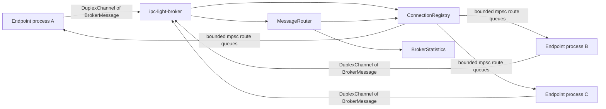

# Endpoint-Pinned IPC Revision — Module and Behavior Reference

**Revision:** endpoint submodule `libs/lib-ipc-event-bus` at `9ce5b25131d7de8e9dbf2b8b4c2f32939c98e46b`  
**Parent endpoint revision:** `sentinel-endpoint-agent@a022e52bf2fff6a9445ebad96c3afeaf277e259f`  
**Source scope:** 108 tracked paths, three Cargo crates, and 33,760 lines across the tracked Rust, TOML, Markdown, shell, and committed log files.  
**Confidence:** Verified by source at the pinned revision unless explicitly marked `Inference`, `Unresolved`, or `Potential issue`.

## Why this revision must be analyzed separately

The endpoint does not build against `ipc-event-bus` current `main`. Its Gitlink fixes the dependency at `9ce5b25`, while the separately requested IPC repository is at `0cf45b7`. Git ancestry inspection found that the pinned commit is not an ancestor of current `main` in the fetched graph. The pinned tree has 108 paths and three crates; current `main` has 30 paths and one crate.

**Verified:** endpoint components import the pinned `ipc-light` duplex API and `ipc-light-broker` protocol directly. The pinned broker is therefore runtime-significant to the endpoint even though it is absent from current IPC `main`.

| Capability | Endpoint-pinned `9ce5b25` | Current `main` `0cf45b7` |
| --- | --- | --- |
| Workspace crates | `ipc-light`, `ipc-light-macro`, `ipc-light-broker` | `ipc-light` only |
| Message API | Generic `IpcMessage` plus legacy `Message` | Concrete `Message` only |
| One-way frame | length + schema + type + JSON | length + JSON |
| Duplex transport | Unix and Windows implementations | Absent |
| Broker | Library and executable | Absent |
| Windows one-way transport | Named pipes | Absent |
| Rate limiter | Implemented in selected send paths | Absent |
| Tests/benchmarks | Unit, integration, chaos, load, soak, benchmark | Smaller unit/integration suite |
| Committed CI at revision | None found | Reusable security workflow |

The two wire formats and exported APIs are not interchangeable. Upgrading the endpoint submodule to current `main` would remove types and crates that endpoint code imports.

## Workspace, packages, and public surfaces

The root `Cargo.toml` is a resolver-v2 workspace with shared Tokio `1.35` (`full`), Serde, Serde JSON, and `anyhow` dependencies.

### `ipc-light`

`crates/ipc-light/Cargo.toml` declares `ipc-light` version `0.1.0`, edition 2021. It depends on the local macro crate, Tokio, Serde/JSON, `async-trait`, `tracing`, `tracing-subscriber`, `futures`, Unix `libc`, and Windows APIs. It declares two Criterion benchmarks and ten root-level examples, including `broker_poc`.

`crates/ipc-light/src/lib.rs` exports the following implemented surface:

| Item | Location | Role |
| --- | --- | --- |
| `Config` | `crates/ipc-light/src/config.rs` | One-way transport environment configuration. |
| `Error`, `Result` | `crates/ipc-light/src/error.rs` | Transport error enum and result alias. |
| `IpcMessage` derive macro | `crates/ipc-light-macro/src/lib.rs` | Generates schema and type constants. |
| `IpcMessageTrait` | alias of `message::IpcMessage` | Public trait alias used to disambiguate macro and trait. |
| `serialize_frame`, `deserialize_frame` | `message.rs` | Typed one-way framing. |
| `Message`, `MAX_MESSAGE_SIZE` | `message.rs` | Legacy concrete message and 65,536-byte limit. |
| `Publisher<T>`, `Subscriber<T>` | `publisher.rs`, `subscriber.rs` | Generic one-to-many publisher/subscriber API. |
| `MessagePublisher`, `MessageSubscriber` | `lib.rs` | Backward-compatible aliases specialized to `Message`. |
| `DuplexChannel<TSend,TRecv>` | `duplex/channel.rs` | Bidirectional typed channel. |
| `DuplexConfig`, `DuplexMode` | `duplex/channel.rs` | Duplex selection and tuning fields. |
| `SendHalf<T>`, `RecvHalf<T>` | `duplex/split.rs` | Mutex-sharing split API. |
| `LockFreeSendHalf<T>`, `LockFreeRecvHalf<T>` | `duplex/split_lockfree.rs` via `duplex/mod.rs` | Platform-specific independent halves. |
| `CorrelatedMessage<T>`, `CorrelationId` | `duplex/correlation.rs` | JSON wrapper and `u64` ID alias. |
| `generate_correlation_id` | `duplex/correlation.rs` | Process-global monotonic ID generator. |
| `DuplexAcceptor` | `duplex/acceptor.rs` | Multi-client server acceptor used by the broker. |
| `DuplexChannelPoC` | `duplex_poc.rs`, Unix only | Blocking experimental proof-of-concept API. |
| `ShutdownCoordinator` | `shutdown.rs` | Process-global shutdown signal state. |

### `ipc-light-macro`

`crates/ipc-light-macro/Cargo.toml` defines a proc-macro crate. `derive_ipc_message` parses `syn::DeriveInput` and emits an `ipc_light::message::IpcMessage` implementation.

### `ipc-light-broker`

`crates/ipc-light-broker/Cargo.toml` declares both library `ipc_light_broker` and binary `ipc-light-broker`. `src/lib.rs` publicly exposes configuration, errors, health/status types, broker messages, client registry types, router, and statistics snapshots. `src/main.rs` contains the executable-only `Broker` orchestrator.

The exhaustive declaration appendix is [endpoint-pinned-ipc.md](07-symbol-reference/endpoint-pinned-ipc.md).

## Typed one-way protocol

### `IpcMessage`

`message::IpcMessage` requires `Serialize + DeserializeOwned + Send + 'static` and two associated constants:

- `SCHEMA_VERSION: u32`
- `TYPE_ID: u16`

Its instance methods `schema_version()` and `type_id()` return those constants. `Message { content: String, timestamp: u64 }` implements the trait manually with schema `1` and type `1`.

### Macro-derived identifiers

`#[derive(IpcMessage)]` computes:

1. A pretty-debug string of the full `syn::DeriveInput`.
2. `SCHEMA_VERSION` as the low 32 bits of `std::collections::hash_map::DefaultHasher` over that string.
3. `TYPE_ID` as the `DefaultHasher` result for the Rust type name modulo 65,536.

**Potential issue:** the identifiers are hashes rather than an explicit compatibility contract. A schema hash can change when the macro's parsed/debug representation changes, and two type names can collide in a 16-bit space. Neither generated value is checked against a registry at compile time.

**Potential build issue requiring validation:** the macro formats `syn::DeriveInput` with `Debug`, while the manifest enables `syn` feature `full` but not visibly `extra-traits`. This environment has no Rust toolchain, so whether the pinned dependency resolution supplies the needed implementation was not compiled and remains `Unresolved`.

### One-way frame layout

`message::serialize_frame<T>` serializes a message to JSON and returns:

```text
0               4               8              10
+---------------+---------------+---------------+-------------------+
| remaining len | schema u32 BE | type u16 BE   | JSON payload      |
+---------------+---------------+---------------+-------------------+
```

The first `u32` is the size of `schema + type + JSON`, not the size of JSON alone. The fixed typed header after the length is six bytes. Serialization rejects a JSON payload larger than `MAX_MESSAGE_SIZE - 10`, where `MAX_MESSAGE_SIZE` is 65,536 and ten accounts for the full length/schema/type header.

`deserialize_frame<T>` expects bytes after the outer length prefix. It requires at least six bytes, extracts schema and type, rejects a schema unequal to `T::SCHEMA_VERSION`, rejects a type unequal to `T::TYPE_ID`, and deserializes the remaining JSON as `T`.

The error mapping is:

- Serde encode failure → `SerializationError`.
- Serde decode failure → `DeserializationError`.
- oversize → `MessageTooLarge`.
- short header → `InvalidFrame`.
- wrong schema → `SchemaMismatch`.
- wrong type → `UnknownTypeId` containing the received ID.

No checksum, signature, sender identity, acknowledgement, encryption flag, or compression flag is present.

### `Publisher<T>`

`Publisher::new(channel_name)` resolves a platform path, calls `Config::from_env().unwrap_or_default()`, and creates a platform publisher channel with `fire_and_forget` and `subscriber_drop_threshold`. It separately initializes a per-publisher `RateLimiter` from the same defaulted config.

`publish(&mut self, message)`:

1. Calls `rate_limiter.check_and_record()`.
2. Returns `RateLimitExceeded` if the sliding window is full.
3. Calls `serialize_frame`.
4. Delegates the frame to the platform channel.

**Verified:** invalid IPC environment configuration is silently replaced with all defaults in this path. A direct caller of `Config::from_env` receives the validation error; ordinary publisher construction does not.

### `Subscriber<T>`

`Subscriber::new(channel_name)` resolves the same path and creates the platform subscriber connection. `recv(&mut self)` obtains a validated length-delimited byte vector from the platform and passes it to `deserialize_frame<T>`. It does not automatically reconnect after the established transport closes.

### One-way Unix behavior

The Unix publisher:

- checks an existing path with a blocking Unix-stream connection;
- returns `ChannelAlreadyExists` if the probe connects;
- deletes the path if the probe fails;
- binds a Tokio Unix listener;
- changes the socket mode to `0600`;
- accepts subscribers into an `Arc<Mutex<Vec<SubscriberConnection>>>`.

In normal mode, a broadcast creates one future per subscriber and uses `join_all`, giving each write 500 ms. Failed subscribers are removed. In fire-and-forget mode it calls `try_write` instead of awaiting writable capacity and counts dropped messages per subscriber; a subscriber is removed after the configured threshold.

**Potential protocol-corruption issue:** Tokio `try_write` may return a successful byte count smaller than the supplied frame. The fire-and-forget code treats a partial count as a dropped message but leaves the already-written prefix/frame bytes in the stream. The next frame can then be interpreted as continuation data, desynchronizing a length-prefixed receiver. The code does not buffer and finish the partial write or close the connection immediately.

The Unix subscriber performs up to ten initial connect attempts with capped exponential sleeps and then reads the four-byte remaining-length prefix, validates the length, and reads exactly that many bytes.

### One-way Windows behavior

Windows uses Tokio named-pipe server/client objects. Publisher instances are created with `reject_remote_clients(true)`, preventing remote named-pipe clients. The publisher maintains multiple pipe instances and uses the same blocking/fire-and-forget delivery modes and drop accounting. Subscriber creation retries and message receive is wrapped in a five-second timeout.

**Contradiction:** `docs/security-implementation.md` describes same-user SID restrictions. `platform/windows.rs::get_current_user_sid` is a stub that always returns an error, and the result is only used by logging. No access-control list derived from the current SID is applied. Remote-client rejection is implemented; same-user enforcement is not.

### Paths and one-way configuration

The path override variable is `IPC_LIGHT_PIPE_PATH_{CHANNEL}`, with channel uppercased and `-` replaced by `_`. Unix fallback behavior follows XDG runtime directory, then `TMPDIR`, then a user-specific `/tmp/ipc-light-{uid}` directory. Windows builds a named-pipe path.

| Variable | Type/default | Validation | Runtime use |
| --- | --- | --- | --- |
| `IPC_LIGHT_CONNECT_TIMEOUT_MS` | `u64`, `500` | `1..=60000` | Parsed and logged; no one-way connect call uses the duration. |
| `IPC_LIGHT_LOG_LEVEL` | string, `info` | `trace/debug/info/warn/error` | Logging initialization. |
| `IPC_LIGHT_RATE_LIMIT` | `usize`, `10000` | `1..=1000000` | Per-`Publisher` sliding-window limit. |
| `IPC_LIGHT_FIRE_AND_FORGET` | bool, `false` | Rust bool parse | Chooses awaited write versus `try_write`. |
| `IPC_LIGHT_SUBSCRIBER_DROP_THRESHOLD` | `usize`, `1000` | `1..=1000000` | Removes repeatedly dropped subscribers in fire-and-forget mode. |
| `IPC_LIGHT_PIPE_PATH_{CHANNEL}` | path string | No validation | Replaces generated channel path verbatim. |

**Contradiction:** `IPC_LIGHT_CONNECT_TIMEOUT_MS` is documented as a connection timeout but no one-way connect operation consumes it. Ordinary publisher/subscriber paths also suppress its invalid value through `unwrap_or_default`.

### Rate limiter algorithm

`RateLimiter` stores an `Instant` for each admitted message in a `VecDeque`. Before admitting a message it removes timestamps older than one second, compares the remaining count to `max_per_second`, then appends the new timestamp. This is a sliding-window log.

**Contradiction:** comments call it a token-bucket algorithm. There are no tokens, refill calculation, or token capacity distinct from the one-second timestamp window.

Its state is per `Publisher` or per `DuplexChannel`, not globally per channel or subscriber. At the default limit it can retain up to 10,000 `Instant` values per active object.

## Duplex protocol and channel

### Duplex frame

`duplex::frame::DuplexFrame` carries:

| Field | Wire width | Meaning |
| --- | --- | --- |
| payload/remaining length | 4 bytes, big-endian | Bytes after this prefix. |
| schema version | 4 bytes | `IpcMessage::SCHEMA_VERSION`. |
| type ID | 2 bytes | `IpcMessage::TYPE_ID`. |
| direction | 1 byte | Encoded `Direction`; presently informational. |
| flags | 1 byte | Bit indicates optional header correlation ID. |
| correlation ID | optional 8 bytes | Present when the flag is set. |
| payload | variable | JSON. |

The base header is 12 bytes including the length prefix. With a correlation ID it is 20 bytes.

**Potential size-boundary issue:** decode validates the declared remaining length against a maximum derived by subtracting only the 12-byte base header. When the correlation flag is set, the optional eight bytes are not included in that subtraction. Such a frame can exceed the nominal total size by eight bytes while passing the outer check.

The decoder rejects unknown direction bytes and too-short correlation headers. The primary `DuplexChannel::send` sets `Direction::Send`; receive does not verify that the peer supplied the direction expected for its local role. Both endpoints use the same send direction, so it is metadata rather than access control.

### `DuplexConfig` and mode selection

`DuplexConfig` fields are:

- `mode: DuplexMode`, default `Auto`;
- `buffer_size: usize`, default 65,536;
- `rate_limit: Option<usize>`, default `None`.

Modes are `Server`, `Client`, and `Auto`. `with_config` creates a per-channel rate limiter only when `rate_limit` is `Some`.

**Dead-code candidate:** `buffer_size` is constructed, returned by `config()`, and asserted in tests, but no platform read/write/buffer allocation found in the repository consumes it.

**Potential issue:** `with_rate_limit(0)` accepts zero without validation. The constructed sliding-window limiter then rejects every ordinary `send` because its timestamp length begins equal to the zero maximum.

In `Auto`, construction first attempts the client role; if that fails it attempts the server role. **Potential startup race:** when two fresh peers start simultaneously, both can fail the client attempt and then both attempt to bind. One becomes a server waiting for acceptance; the other receives a bind/active-path error rather than retrying as client. Tests use deliberate ordering/delays and do not demonstrate simultaneous-start recovery.

Unix server construction binds, sets the socket to `0600`, then waits for the first client before returning a `DuplexChannel`. Client construction connects once. Windows uses local-only named pipes with fixed retry/timeouts.

### Send, receive, timeout, and rate limiting

Ordinary `send` performs the channel rate-limit check, builds a `DuplexFrame` with no frame-header correlation ID, and writes it. `recv` reads a frame, validates expected schema and type, and deserializes JSON. `recv_timeout` wraps `recv` in `tokio::time::timeout` and returns the library `Timeout` variant when elapsed.

`send_correlated` serializes a `CorrelatedMessage<T> { correlation_id, message }` JSON wrapper and writes it as a frame. `recv_correlated` reverses that operation.

**Verified bypass:** `send_correlated` does not call the configured rate limiter. The correlation value is placed inside JSON; it does not populate `DuplexFrame.correlation_id`. Thus the frame-level optional correlation field and the public correlated-message API are separate mechanisms, and the latter leaves the header flag unset.

`generate_correlation_id` uses a process-global `AtomicU64`, starts at one, and increments with relaxed ordering. IDs are unique within one process until integer wraparound; they are not randomized, persistent, or coordinated across processes.

### Split implementations

`DuplexChannel::split()` wraps the entire channel in `Arc<tokio::sync::Mutex<_>>` and returns `SendHalf` and `RecvHalf`. Each half acquires that mutex and holds it across its awaited send/read.

**Contradiction:** documentation/examples describe concurrent bidirectional operation. A pending receive holds the shared mutex and prevents the send half from acquiring it, so `split()` does not provide independent full-duplex progress when one operation blocks.

**Verified bypass:** the split `SendHalf` constructs/writes a frame directly and does not invoke `DuplexChannel`'s configured rate limiter.

`split_lockfree.rs` defines platform-specific independent read/write half types. They are publicly re-exported from `duplex/mod.rs`, but no method on `DuplexChannel` constructs them. Their public constructors require platform half objects that are not part of the principal root re-export surface. **Dead-code candidate:** no production consumer or test of these lock-free types was found in the pinned repository or parent endpoint repository.

### `DuplexAcceptor`

The acceptor binds a Unix listener or creates Windows server pipe instances and returns a new typed duplex object for each accepted connection. It is the broker's multi-client ingress.

`DuplexChannel::from_impl`, used to wrap an accepted platform stream, installs `DuplexConfig::default()` rather than the acceptor/broker configuration. Consequently an accepted channel reports the default/empty configuration metadata and has no configured rate limiter.

### Proof-of-concept channel

`DuplexChannelPoC` is Unix-only, blocking, string-based, and uses `/tmp/duplex_poc_{channel}.sock`. The module comments explicitly mark it validation-only and not production-ready. It uses its own framing and must not be treated as the production generic duplex implementation.

## Broker protocol

### `BrokerMessage`

`ipc_light_broker::message::BrokerMessage` is the typed message on every broker connection. It has fixed IPC schema `2` and type ID `700` and these serialized fields:

| Field | Type | Origin/meaning |
| --- | --- | --- |
| `msg_type` | `MessageType` enum, Serde snake-case | `register`, `ack`, `message`, `error`, `connected`, `shutdown`, or `heartbeat`. |
| `source` | `String` | Claimed originating process identifier. |
| `target` | `String` | Destination process ID or `*` for broadcast. |
| `payload` | `String` | Opaque application payload or status/error text. |
| `timestamp` | `u64` | Milliseconds since Unix epoch. |

Constructor helpers create registration, acknowledgement, routed message, error, connection, shutdown, and heartbeat forms. The broker does not inspect or validate application payload structure beyond the outer JSON type.

### Broker startup and topology

`ipc-light-broker/src/main.rs::main`:

1. Calls `BrokerConfig::from_env`; on error prints to stderr and exits status 1.
2. Initializes the global tracing subscriber.
3. Prints selected configuration.
4. Builds `Broker` with statistics, `ConnectionRegistry`, `MessageRouter`, and a Tokio broadcast shutdown channel.
5. `Broker::run` creates a `DuplexAcceptor` on the configured channel.
6. Spawns a periodic statistics logger.
7. Selects between accepting a connection and process signal handling.
8. Spawns a `ClientHandler` task for every accepted channel.
9. On signal, sends broker shutdown messages, signals handlers, sleeps 500 ms, and logs final counts.



### Broker configuration

| Variable | Default | Validation | Verified consumer |
| --- | --- | --- | --- |
| `IPC_LIGHT_BROKER_CHANNEL` | `ipc_light_broker` | nonempty | `DuplexAcceptor::new`. |
| `IPC_LIGHT_BROKER_MAX_CLIENTS` | `50` | greater than zero | `ConnectionRegistry::new`. |
| `IPC_LIGHT_BROKER_LOG_LEVEL` | `info` | trace/debug/info/warn/error | `init_logging`. |
| `IPC_LIGHT_BROKER_STATS_INTERVAL` | `60` seconds | greater than zero | Tokio statistics interval. |
| `IPC_LIGHT_BROKER_CONNECT_RETRIES` | `10` | greater than zero | **Dead-code candidate:** parsed/tested but no production read after configuration. |
| `IPC_LIGHT_BROKER_SHUTDOWN_TIMEOUT` | `30` seconds | greater than zero | **Dead-code candidate:** parsed/tested but shutdown uses a fixed 500 ms sleep and no timeout. |

### Registration lifecycle

For every accepted connection, `ClientHandler::run`:

1. Sends a `Connected` broker message.
2. Requires the first received message to be `Register`.
3. Takes `register.source` as the client's process ID.
4. Creates a bounded Tokio MPSC queue of capacity 100.
5. Adds the client to `ConnectionRegistry`, enforcing max clients and duplicate IDs.
6. Marks it registered and records a connection statistic.
7. Sends an acknowledgement.
8. Enters a `select!` loop over client input, routed queue input, and broker shutdown.
9. On normal loop exit removes the registry record and decrements active connections.

There is no cryptographic authentication, operating-system peer-credential check, or broker-issued process identity. Any process that can connect through the OS transport can claim an unused process ID.

**Potential identity-spoofing issue:** after registration, routed messages retain the message's caller-supplied `source`; the handler does not overwrite or require it to match its registered process ID. A connected client can therefore send a message represented to a recipient as originating from another ID. This is an authorization/integrity concern at the local IPC trust boundary, not evidence of remote exposure.

**Potential stale-registry issue:** the registry insert and active-connection increment occur before the handler sends its Ack. If Ack transmission fails, `?` returns from `run` before the later event-loop cleanup block. The registered client and active count can remain stale until another mechanism removes them; no guard-based cleanup covers this early exit.

### Registry and routing

`ConnectionRegistry` stores client records in an async `RwLock<HashMap<String, ClientConnection>>`. Each record contains the process ID, bounded route sender, status, registration timestamp, and last-activity time. Registration rejects duplicates and registrations beyond `max_clients`. Readers obtain cloned senders/status snapshots rather than direct transport access.

Targeted routing:

1. Looks up `message.target` in the registry.
2. Requires it to be registered.
3. Awaits `mpsc::Sender::send` into the recipient's capacity-100 queue.
4. Records routed statistics on success.
5. On error, generates an error `BrokerMessage` back to `message.source` when possible.

Broadcast routing iterates registered clients, skips the client whose ID equals `message.source`, and awaits each bounded queue send sequentially. A successful broadcast increments the broadcast count once, not once per delivered recipient.

**Potential backpressure issue:** a recipient whose route queue remains full can suspend the source handler inside routing indefinitely. There is no send timeout, per-target worker isolation at this layer, or disconnect threshold. Sequential broadcast can likewise be delayed by a slow recipient queue.

Because source is caller-controlled, broadcast's self-skip can also be manipulated by spoofing another registered ID.

### Shutdown

`Broker::shutdown` first calls `MessageRouter::broadcast_shutdown`, then broadcasts an internal shutdown signal to all handlers. Each handler's shutdown branch also attempts to send a shutdown message over its duplex connection. A client may therefore observe more than one shutdown message. The broker waits a fixed 500 ms and does not join every handler or apply `shutdown_timeout_secs`.

The statistics logger's Tokio interval is created immediately before its loop. Tokio intervals normally make their first tick immediately; **Inference:** a startup snapshot will generally be logged before the configured interval elapses.

### Statistics and health

`BrokerStatistics` uses atomics for routed/broadcast/error/connection counters and mutex-protected latency/error breakdown structures. It can return serializable snapshots and log them. Production routing records basic routed, broadcast, routing error, connection, and disconnection counts.

`HealthChecker` derives broker/client health statuses from registry state, statistics, and configured thresholds. **Implementation-only library surface:** no constructor/use of `HealthChecker` was found in `ipc-light-broker/src/main.rs`, and there is no HTTP, CLI, socket request, or other production health endpoint. Health behavior is exercised by tests, not exposed by the broker executable.

Typed error-category and latency-recording methods in `BrokerStatistics` are likewise exercised in tests but were not found on the production routing path. Broker documentation that implies an externally consumable health API or complete latency histogram reflects library capability, not an active runtime endpoint.

## Error and failure model

### `ipc-light::Error`

The pinned enum contains connection, serialization, deserialization, size, channel/path, configuration, I/O, invalid-frame, timeout, already-exists, permission, schema, unknown-type, rate-limit, and boxed contextual variants. `is_recoverable` classifies connection, timeout, and all I/O failures as recoverable without inspecting I/O kind. Repository-wide search found production construction for the principal transport/framing variants; `is_recoverable` itself was only found in tests.

### `BrokerError`

Broker errors cover client-not-found, already-registered, max-clients, registration, routing, connection, configuration, IPC wrapping, and shutting-down conditions. Handler task errors are logged by the spawned task and do not stop the accept loop. Accept failures are logged and the broker continues selecting. Signal-handler setup uses `expect`, so registration failure panics.

`BrokerConfig` failure is fatal before logging initialization. Runtime broker failure is logged and exits status 1.

### Failure-handling matrix

| Failure | Handling |
| --- | --- |
| Invalid one-way env setting through ordinary API | Suppressed; all defaults used. |
| Initial subscriber connect failure | Retried up to ten attempts, then returned. |
| Established subscriber disconnect | Read/write error; no transparent reconnect. |
| Oversize/invalid typed frame | Rejected before JSON deserialization. |
| Publisher subscriber write error/timeout | Subscriber removed; publish can still return success. |
| Fire-and-forget backpressure | Message/drop count; eventual subscriber removal; partial-write concern remains. |
| Duplex receive timeout | Converted to `Error::Timeout`. |
| Broker duplicate/max registration | Handler error/connection termination path. |
| Broker target absent | Routing error, with best-effort error response to claimed source. |
| Broker per-client route queue full | Await indefinitely; no timeout. |
| Broker accept error | Logged; accept loop continues. |
| Broker signal registration failure | Panic through `expect`. |
| Broker shutdown | Best-effort messages, fixed 500 ms wait, no handler join. |

## Concurrency and performance

- The one-way Unix normal publisher uses parallel write futures, unlike current IPC `main`'s sequential writes, but holds the subscriber-vector mutex while the joined futures are pending.
- Fire-and-forget avoids readiness waits but carries the partial-frame hazard described above.
- Rate limiting is O(number of timestamps expired/admitted) and stores one `Instant` per admitted event in the current second.
- A primary duplex object requires `&mut self`, serializing calls by ownership unless split.
- The ordinary split halves share one mutex and are not independently progressing.
- Broker transport handling is one Tokio task per accepted connection plus a periodic logger.
- Registry lookups use an async RwLock; route delivery occurs through bounded queues.
- Targeted and broadcast routing await queue capacity and have no timeout/backpressure policy.
- Broker counters are atomic; structured error and latency collections use mutexes.
- Static performance claims in documentation and benchmark source are not runtime measurements at this revision.

## Tests, benchmarks, examples, and scripts

The pinned tree contains:

- module unit tests throughout the three crates;
- `ipc-light` integration tests for cross-platform behavior, acceptors, duplex performance/platform/soak, one-way integration, size, reliability/config, schema, security, and type safety;
- broker server-mode, chaos, integration, and load tests;
- Criterion benchmarks for duplex, parallel writes, and broker routing;
- manual/load shell scripts and extensive Markdown reports;
- committed `logs/client.log` and `logs/server.log` runtime artifacts.

Ignored tests found by exact attribute search:

- `crates/ipc-light-broker/tests/chaos_server_mode_test.rs` duplicate-ID timing test, explicitly ignored with a TODO;
- three `crates/ipc-light/tests/duplex_soak_test.rs` tests, including long-duration/24-hour scenarios.

No `.github` workflow is present at the pinned commit. Therefore no committed CI configuration proves that any test, benchmark, example, or platform target runs automatically for this dependency revision.

**Verified stale example:** `examples/broker_poc.rs` calls `BrokerMessage::connected()` without the required target argument and later compares a `MessageType` enum as though it were a string. The manifest registers this file as a Cargo example. Static signatures and calls disagree; a build of all examples is expected to fail, but compilation is `Unresolved` because Cargo is unavailable.

**Unresolved:** Rust and Cargo are not installed in the analysis environment. None of the pinned tests/benches/examples were executed, and Windows behavior was not runtime-tested here.

## Generated, vendored, and artifact classification

- The entire tree is externally maintained source relative to the endpoint and is pinned through a Git submodule. It is a dependency, not generated endpoint output.
- Within the IPC repository, no Rust file is marked generated and no generator command was found; the Rust code is treated as handwritten.
- `.DS_Store` is an OS metadata artifact.
- `logs/client.log` and `logs/server.log` are committed runtime artifacts, not source and not generated by the build.
- Markdown under `product/`, `projects/`, and parts of `docs/` includes plans/reviews. Those claims are not treated as implemented unless matched to source.

## Dead, incomplete, or misleading surfaces

| Item | Classification | Evidence |
| --- | --- | --- |
| `DuplexConfig.buffer_size` | Dead-code candidate | Declaration/tests/accessor only; no transport consumer found. |
| Broker `connect_retries` | Dead-code candidate | Parsed/validated/tested; no runtime read. |
| Broker `shutdown_timeout_secs` | Dead-code candidate | Parsed/validated/tested; shutdown ignores it. |
| Lock-free split halves | Apparently unused/experimental | Exported, but no endpoint/broker production construction or tests found. |
| Frame-level `correlation_id` | Incomplete relative to public correlated API | Serializer supports it; `send_correlated` puts ID in JSON instead. |
| Windows `get_current_user_sid` | Stub | Always returns an error; used only for logging. |
| Broker health checker | Library-only/inactive runtime | Tests exist; broker executable never constructs/exposes it. |
| Typed latency/error stats | Partially integrated | API/tests exist; primary production route does not record them. |
| `Error::is_recoverable` | Apparently unused production utility | Only test callers found. |
| `DuplexChannelPoC` | Explicit experimental code | Module comments say validation-only/not production. |
| `examples/broker_poc.rs` | Stale/broken source candidate | Calls do not match current pinned protocol signatures/types. |

## Documentation contradictions

| Claim | Source evidence | Actual implementation | Result |
| --- | --- | --- | --- |
| Rate limiter is token bucket. | `rate_limiter.rs` comments/docs | One-second sliding timestamp deque. | Contradicted |
| Windows transport restricts access to the current SID. | security documentation | SID lookup is a stub; only remote-client rejection is enforced. | Contradicted |
| Ordinary split permits concurrent full-duplex I/O. | duplex documentation/examples | Send and receive halves hold the same mutex across await. | Contradicted |
| Broker has runtime health/metrics API. | broker docs | Data structures exist, but executable exposes no health interface and does not instantiate `HealthChecker`. | Partially confirmed/documentation overstates runtime surface |
| Broker retry and shutdown timeout variables control behavior. | config docs | Values are parsed but unused after load. | Contradicted |
| All declared examples match the API. | Cargo example declarations | `broker_poc.rs` has source-level signature/type mismatches. | Contradicted |

## Endpoint consumers

Repository-wide import and protocol searches in the parent endpoint found broker clients/bridges in core persona, timekeeper, kill-switch, and alert services; diagnostics client/server; template-service client and kill-switch integration; proxy templating/kill-switch/alert paths; and system-monitor persona/kill-switch/template paths. They manually implement the `Connected → Register → Ack` handshake over `DuplexChannel<BrokerMessage, BrokerMessage>`.

This means the broker message fields and registration/routing behavior cross a real process trust boundary inside the endpoint product. The detailed endpoint-side symbol and lifecycle traces are documented with those subsystems rather than inferred here.
