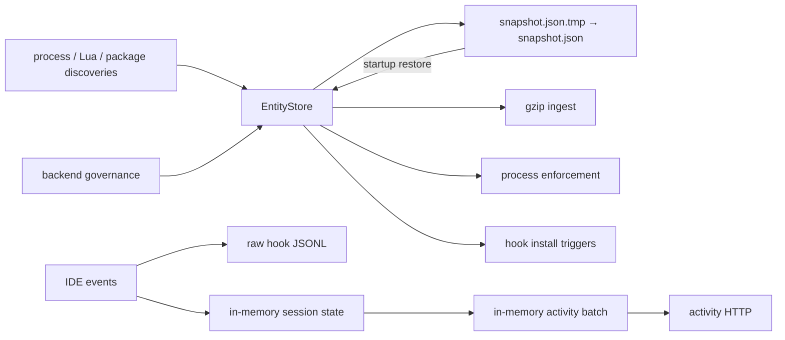
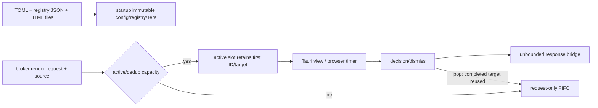
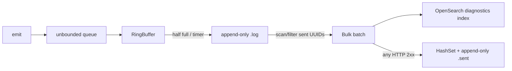

# 09 — Data Models and Storage

## Endpoint installation and update state

The distribution layer persists state outside the Rust data stores:

| State | Owner/writers | Readers | Update/delete/consistency |
| --- | --- | --- | --- |
| Windows Program Files install | installer/updater | service/binary resolver/uninstaller | staged extraction then copy, but broader install is not one transaction; uninstaller best effort |
| `/Applications/SentinelProxy.app` | mac installer/updater | launchd, resolver, Network Extension | bundle copied/replaced; rollback does not cover every extension/cert mutation |
| `/Library/Application Support/Sentinel` | mac installer/updater | configs/templates/hooks/updater/runtime | mutable support tree; current mac uninstaller removes it even with keep-install-dir |
| user `.sentinel` and Application Support | installers/hooks/monitor | hook clients/monitor | mixed keep-data semantics; distribution mac removal still deletes application-support data |
| OS service/schedule/plist | installer | OS supervisor/updater | created separately from file deployment; scheduled update does not fully refresh registration |
| certificate stores and CA files | installer/deployment tools | proxy/Node/system trust | no cross-store transaction; alternate enterprise presence checks do not configure signing key |
| rollback/checksum/quarantine files | updater | later update decisions | host-local, nontransactional; verified first-update and mac marker defects |
| test-server messages | Python process memory | unauthenticated control/Rust assertions | locked snapshots, explicit clear, lost on process exit |
| test-server PID files | temp directory | Rust/Python cleanup | cleanup documentation disagrees with active live-process handling |

No database migration applies to installer state. Atomicity is limited to individual filesystem/OS operations; package installation, certificate trust, service registration, network changes, and health confirmation do not share a transaction.

The remaining sections complete the cross-repository state synthesis for the pinned revisions.

## Endpoint scripting transient and file state

- `ScriptEngine` eagerly retains loaded source plus manifest entry in a process-local vector; reload clears then repopulates and can leave partial state on a later read error.
- Each execution owns a fresh Lua VM. Results accumulate in `Arc<Mutex<ScriptResult>>` and are cloned on collection while Lua callbacks retain references.
- The active v2 path converts successful results immediately into in-memory `EntityStore` entries; core scripting itself persists no database state.
- Manifest, signature, Lua modules, and update destination are ordinary filesystem state. Core applies no lock, transaction, atomic rename, fsync, ownership, expiry, or cleanup policy.
- `ScriptUpdater` extracts into a temporary directory, then overlays destination recursively; stale files remain and partial copy is possible.
- Event dispatcher uses a transient 256-slot MPSC channel, then detached blocking tasks; it has no durable queue/dead letter state.

See [Endpoint Core Lua Scripting](06-endpoint-core-scripting.md) for schemas, readers/writers, and lifecycle details.

## Endpoint templating transient state

- `AppState` is wholly process-local: parsed Tera templates; current serialized UI context; current simplified event; active oneshot sender; selected template; waiting FIFO; and active/sequence atomics.
- Original sensitive text and full detections are cloned into `ContentConfig`/`DlpEvent` and cross into the local webview. This subsystem writes no database/file record.
- Context ingress is an unbounded standard channel. The FIFO retains at most 30 waiting sender-bearing requests plus one active request.
- Event/context/sender are replaced under separate mutex acquisitions, not one transaction. A command can theoretically observe different generations.
- Popup completion takes the active sender once, emits `Some(value)` or `None`, then dequeues. Dropping state/queued contexts cancels outstanding receivers; adapters translate cancellation to configured defaults.
- Installed HTML files are persistent external state loaded at startup. Core neither hashes, watches, reloads, nor atomically snapshots them after Tera construction.

See [Endpoint Core DLP Templating Engine](06-endpoint-core-templating-engine.md#queue-and-state-machine).

## Dormant decompression state and committed fixture storage

- The archive extractor's only aggregate state is process-local: one lazy Tokio semaphore, one standard mutex around fallback polling, one shared mutex vector per public call, and one atomic cancellation flag.
- Output is ordinary filesystem state beneath a caller-supplied base. The repository creates directories/files incrementally, performs no transaction/atomic publish, retains partial files, and can return before cooperative/background workers finish.
- Lexical path cleaning is not canonical containment. Existing link state is neither recorded nor locked; dependency-level behavior remains unresolved.
- Fallback enumeration includes preexisting files under the target, so the returned set is not an ownership ledger.
- Three committed archive blobs total 129,115,948 bytes. L2 embeds L1; L3 embeds three alternate-format nested archives. No generator, upstream source, cleanup, expiry, or data-classification metadata is committed.
- Core Vault communication tests do not redirect storage into their temp directories. On supported targets, direct wrapper operations read/write the runner user's ordinary Quilr Vault metadata and payload files.

The implementation is excluded at the crate root, so none of these archive state transitions occurs in current production from this module. See [archive/storage evidence](06-endpoint-core-crate-shell-tests-and-decompression.md#dormant-archive-extractor).

## System monitor state and persistence

| State | Owner | Writers | Readers | Durability/consistency |
| --- | --- | --- | --- | --- |
| entities | `EntityStore::DashMap<Uuid, Entity>` | process/Lua/package discovery, sync | sync, enforcement, hooks, snapshots | process-local; per-key concurrent; upsert preserves old payload |
| change events | Tokio broadcast, capacity 256 | store mutation methods | enforcer/hook manager | transient; lag possible; send failure ignored |
| delta cursor | atomic `u64` | delta/snapshot load | delta/snapshot save | eventually persisted in JSON |
| pending governance | concurrent map | delta | `mark_synced` | process-local; insertion-triggered expiry |
| snapshot | pretty JSON `{version,entities,delta_cursor}` | timer/final save | startup | fixed temp + rename; no version migration/validation |
| correlator caches/maps | in-memory maps | embedded/backend/test-only update APIs | process correlation | no snapshot; TTL scans; successful backend replacement |
| enforcement trackers | per-name concurrent maps | enforcer | sweep/events | no snapshot; Rediscovered bypasses eligibility |
| hook installed set | `RwLock<HashSet>` | successful install | probe/event install | process lifetime only |
| hook expected files | integrity monitor | successful install | notify/periodic repair | expected state in memory; target JSON/binary durable |
| hook config files | IDE JSON under user home | installer/integrity, IDE/user | IDE/monitor | read-merge-write fixed temp; no transaction with thin client |
| raw hook log | append-only JSONL | detached client task | external/operator only | no rotation/retention in crate |
| hook sessions | `DashMap<session,mpsc sender>` and evaluator maps | local IPC events | workers/evaluator | idle-expiring; no durable state |
| activity buffer | mpsc 1,000 + batch vec | evaluator | flush loop | process-only; drop on full/two failures |
| DLP cache | mutex map | dormant client | dormant client | process-only; TTL/FIFO insertion |

There are no SQL/NoSQL tables, migrations, transactions, indexes, object storage, or durable queues in this crate. Requirements and historical documents that describe a relational/local database do not match v2.

## Template service state and persistence

| State | Owner | Writers | Readers | Durability/consistency |
| --- | --- | --- | --- | --- |
| registry map | `TemplateRegistry` | startup defaults + two file overlays | render handler | immutable after startup; later layer overwrites by exact key |
| parsed templates | `Mutex<Tera>` | startup only | render handler | process-local; poison recovered; files not hot-reloaded |
| regular active slots | `Mutex<PaginationState>` | handler/Tauri commands | view/status/window helpers | process-local vector; title dedup mutates old slot incompletely |
| regular pending FIFO | same | handler/dequeue | completion paths | bounded by TOML; contains request but not target/source |
| notification active slots | `Mutex<NotificationPaginationState>` | handler/Tauri commands | views/window helpers | process-local vector; composite dedup preserves first identity |
| notification pending FIFO | same | handler/dequeue/dismiss-all | completion paths | hard-coded 50; request only; dismiss-all drops it silently |
| response bridge | global unbounded Tokio MPSC | handlers/commands | IPC loop | process-local, no bound/durability/ack; send failure suppressed |
| enabled state | global atomic | kill query/broadcast | startup gate/transition logic | initial true; no persistent last-known value |
| shutdown sender | global OnceLock + standard MPSC | startup/kill transition/Ctrl+C | Tauri shutdown thread | first registration only; disconnect also causes exit |
| browser timer state | four JavaScript globals per WebView | load/navigation/tick/decision | current page functions | reset to full duration on every reload/navigation |
| registry/config/templates | ordinary local files | external installer/operator | startup | no in-process write, integrity check, hot reload, or migration |

There is no template-service database, object store, durable queue, transaction, migration, cache expiry, or restart recovery. Accepted active/queued requests disappear on process exit. The regular and notification mutexes are independent; no operation spans both atomically.

The missing source edge on FIFO and first-identity dedup behavior are verified data-model properties, not inferred network outcomes.

## Email-discovery transient state

The helper persists nothing. It temporarily owns Clap arguments, a `JoinSet` in linked core code, a raw candidate vector, JSON payload, framed vector, and one client stream/pipe. The privileged parent owns one bound fixed-name endpoint, one process handle, a maximum-1-MiB payload buffer, and the deserialized candidate vector.

Source results are appended in task-completion order and remain nondeduplicated in the frame. After receive, `DiscoveryCoordinator` deduplicates/sorts. Failure can collapse state to partial results or `[]` without an error marker. Socket files are removed before bind and after the parent path; named pipes rely on kernel cleanup. No durable queue, replay, transaction, checkpoint, request identifier, nonce, or audit record exists.

## Diagnostics transient and persistent state

| State/store | Owner | Writers | Readers | Durability/consistency |
| --- | --- | --- | --- | --- |
| producer MPSC | each `DiagnosticsSender` task | core facade calls | sender loop | unbounded, volatile; drained/discarded after connection errors |
| local MPSC | process-global DiagnosticsHandle | `emit` | worker | unbounded, volatile; no closure/shutdown path |
| RingBuffer | `Storage` mutex | worker receive | threshold/timer flush | capacity default 100, flush threshold 50; unflushed data lost on exit |
| `<db_path>.log` | LogFile | append per flushed payload | full historical scan | compact NDJSON, append-only, no fsync/rotation/deletion |
| sent-ID HashSet | LogFile mutex | startup load/mark | unsent filter | process memory grows with all historical IDs |
| `<db_path>.sent` | LogFile | mark after HTTP 2xx | next startup | UUID lines, append-only, partial marking possible |
| OpenSearch `diagnostics` index | external service | Bulk HTTP | Dashboards/test/operator | no transaction with sent file; automatic `_id`, so retries can duplicate |
| Docker named volume | Compose | OpenSearch | OpenSearch | survives `stop`; deleted by `clean` |

Every batch scan begins at the log's first line. Invalid/corrupt lines and read errors are silently skipped. A file append error after draining memory can lose the unwritten suffix. A successful HTTP status followed by mark failure can be retried/duplicated, while HTTP 200 Bulk item failures are incorrectly marked sent. No database schema migration, transaction, retention, compaction, encryption, checkpoint, or graceful-drain mechanism exists.

See [storage and export lifecycle](06-endpoint-diagnostics-receiver.md#storage-and-export-lifecycle).

## Endpoint infra transient state

The non-keystore infra runtime owns no database or durable application schema. Its state is OS-resource/transient:

| State | Owner | Creation/update | Cleanup/recovery |
| --- | --- | --- | --- |
| Unix socket pathname | address manager/server | manager may create parents/delete stale file; server bind creates socket | manager cleanup idempotent; server shutdown non-idempotently unlinks only; Drop retries unlink |
| Unix stream/listener handles | channel/server structs | connect/bind/accept | stream shutdown explicit; Rust Drop closes handles |
| child handles/status cache | four process handle types | spawn/native create; wait caches status | ordinary Drop does not explicitly kill/reap; Windows native Drop closes handle |
| macOS launchctl wrapper | `LaunchctlProcessHandle` | retained after wrapper spawn | waits may reap; no Drop reap; kill blocks waiting wrapper |
| Windows Job Object | process-global `OnceLock` | lazy first child assignment | intentionally process-lifetime; invalid initialization cannot retry |
| resolver directory snapshot | each resolver object | construction | object lifetime only |

Persistent keystore/DPAPI/Keychain state is documented separately in [Vault and keystore](06-endpoint-core-vault-and-keystore.md). Infra process/IPC has no transaction, lease, checkpoint, recovery log, or migration model.

## Endpoint proxy state and storage

The proxy has no repository-defined SQL schema. Its operational state is files, broker traffic, sockets, and process memory:

| State/store | Writers | Readers | Lifecycle/consistency |
| --- | --- | --- | --- |
| CA/key and generated host certificates | certificate manager | TLS MITM acceptor | file permissions and external provisioning vary; temporary artifacts have cleanup gaps |
| traffic log file | singleton logger task | external operator | async unbounded/buffered path; tests do not validate disk contents or shutdown flush |
| DLP extractor temp files | PDF/Office/extraction helpers | parser libraries | best-effort cleanup; several error paths can retain files |
| DLP config/policy set | config manager/core policy refresh | each request evaluator | in-memory replacement under locks; no local durable policy database |
| OCR/uniqueness/DNS/circuit caches | process globals/owned structs | request path | in-memory only; differing TTL/entry policies; lost on restart |
| request/process attribution maps | redirector/request state | request context/DLP/alerts | concurrent maps; Windows flow state lacks complete expiry; mac relay source collision overwrites |
| macOS Unix control socket | Rust listener | Swift `IPCClient` | stale path removed then bound/chmod `0600`; unlink on normal exit/next start |
| macOS relay/heartbeat sockets | Rust listener | Swift provider or localhost peers | random loopback ports, shared over control message, no application authentication |
| Swift pending/grace/UDP dictionaries | Network Extension process | flow/recovery tasks | process memory; newest-64 control buffer can drop messages; pending and backpressure caps differ |
| NE preferences/system-extension registration | Objective-C/SystemExtension APIs | OS Network Extension framework | first saved manager is used, not filtered by bundle; save/activation callbacks and timeouts govern |
| WinDivert kernel handles and flow maps | Rust Windows workers | packet loops | process lifetime; worker handles retained but not used to interrupt blocking receive |

No transaction spans body extraction, policy decision, user response, alert enqueue, forwarding, and audit logging. Partial completion is therefore possible at every boundary. Full lifecycles are in [runtime](06-endpoint-proxy-bootstrap-http.md), [DLP](06-endpoint-proxy-dlp-ui-alerts.md), and [redirection](06-endpoint-proxy-packet-redirection.md).
