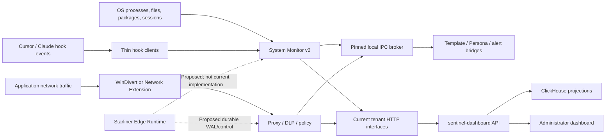

# 01 — Sensor Role and Boundaries

## Exact role definition

`Verified in source`: the Sentinel endpoint sensor is a compound set of privileged and user-session processes installed on a device. It combines periodic and event-driven local discovery, user/device context, IDE hook telemetry, inline network interception and DLP/policy enforcement, process enforcement, local UI, diagnostics, and best-effort delivery to the current dashboard/API.

It is not one executable and it is not the dashboard. The device-local sensor contains the agent/service host, System Monitor v2, proxy/packet redirectors, hook clients, template/UI helpers, diagnostics producers, email-discovery helper, Persona/policy/alert bridges, and pinned IPC broker. The dashboard/API is the current remote consumer and policy/configuration source.

## Attribute matrix

| Attribute | Verified answer | Evidence | Confidence |
| --- | --- | --- | --- |
| What is the sensor? | A multi-process endpoint observation and enforcement stack supervised by the endpoint agent | `agent/src/main.rs`; `agent/src/init.rs`; `core/src/defaults/services.rs`; [service runtime analysis](../../../repository-analysis/06-endpoint-core-service-runtime.md) | `Verified in source` |
| Where does it run? | Device-local macOS and Windows paths are implemented. Linux code/config exists but principal factories/orchestrators are incomplete | monitor/proxy/infra target-gated source; [architecture](../../../repository-analysis/03-architecture.md) | `Verified in source` plus `Contradiction` with broad support claims |
| What installs/invokes it? | Repository build/install/deployment scripts and OS service mechanisms stage/start binaries; agent default graph starts runtime components | [build/install/update analysis](../../../repository-analysis/06-endpoint-build-release-install-and-update.md) | `Verified in source`; effective production deployment `Unresolved` |
| Who owns it? | The agent/service host owns the default process graph; individual processes own local queues/caches/files | `ServiceManager`, component main functions | `Verified in source` |
| Privileges | Process enumeration/termination, WinDivert, Network Extension management, service/user-session spawning and certificate operations require OS-specific privileges | proxy/monitor/infra code | `Verified in source`; exact deployed accounts/entitlements `Unresolved` |
| Data sources | OS process tables, selected user configuration/marker files, package-manager directories, IDE hook stdin, HTTP/TLS/WebSocket streams, Persona/local discovery, backend policy/configuration/process maps | subsystem source and interface analysis | `Verified in source` |
| Trust boundary | It sits between local users/processes and OS/network/application surfaces, then crosses local IPC and tenant-scoped HTTP boundaries | [security model](../../../repository-analysis/12-security-model.md) | `Verified in source`; deployed ACLs `Unresolved` |
| Passive or active? | Both. Discovery/telemetry are observational; proxy and process actions can block/terminate/quarantine-like paths; hook evaluator is observational only | monitor/proxy/hook source | `Verified in source` |
| Inline or asynchronous? | Both. Proxy and hook response paths are inline; discovery, sync, diagnostics, refresh and scanning are asynchronous/periodic | monitor orchestrator; proxy handlers; hook clients | `Verified in source` |
| Offline operation | Native monitor state can recover from a local JSON snapshot and some components buffer in memory/files/SQLite. There is no unified durable acknowledged telemetry outbox | snapshot, ActivityBatcher, diagnostics, alerts, traffic logger | `Verified in source`; Starliner-grade offline delivery absent |
| Policies/commands received | Governance delta, process map, DLP/policy configuration, kill-switch state and local broker messages are consumed. No current general signed typed Starliner command channel exists | HTTP/IPC paths | `Verified in source`; signed control is `Proposed` |
| User-facing interface | Local justification/block/notification UI through Tauri/eframe/template service | proxy/template code | `Verified in source` |
| Administrator-facing interface | Current remote React dashboard and API expose inventory, activity, policies, relationships, alerts and settings | dashboard source | `Verified in source`; not device-local |
| Unique visibility | Local running processes and ownership hints, selected AI application/config artifacts, local IDE prompt-turn/tool/file metadata, process-attributed intercepted network flows, local DLP/policy/native actions | monitor/proxy/hooks | `Verified in source` with capture limitations |
| Definitively not known | Canonical enterprise identity, authoritative person/account/device ownership, full cloud/serverless/CI/container estate, exhaustive filesystem/package inventory, remote MCP tool catalogs, complete agent run/step lineage, provider cost, or independently verified native effects | negative source tracing and open questions | `Verified in source` where no path exists; external estate `Not observable by this sensor` |

## Runtime boundary

Solid edges are current source paths. Dashed Starliner edges are `Proposed`.

## Supported and unsupported environments

| Environment | Current observation | Current enforcement | Evidence/status |
| --- | --- | --- | --- |
| macOS workstation | Process enumeration, marker/package scans, hooks, Network Extension TCP interception, local UI | Process termination paths; proxy DLP/policy; UDP 443 is actively rejected when intercepted | `Implemented`; runtime deployment/version support `Configured but runtime-unverified` |
| Windows workstation | Native process enumeration, marker/package scans, hooks, WinDivert TCP/UDP interception, local UI | Process termination paths; proxy DLP/policy; monitored UDP blocking subset | `Implemented`; runtime deployment/version support `Configured but runtime-unverified` |
| Linux | Some config, docs and target-neutral code | Principal monitor/infra/proxy paths are incomplete | `Partially implemented` / `Contradiction`; not a supportable current coverage claim |
| Cloud VM | May look like a supported OS host if installed, but no cloud-instance identity/metadata capture was found | Same host-local paths only | `Inference` for generic host operation; cloud identity `Not observable by this sensor` |
| Container/Kubernetes | No complete container/cluster/namespace capture path found | No container-native control path found | `Not observable by this sensor` at current revision |
| Serverless | No device-local runtime/capture surface | None | `Not observable by this sensor` |
| CI/CD runner | May be seen only as ordinary processes/files if installed and markers match | No runner/job/pipeline identity | Runner-specific discovery `Not observable by this sensor` |
| Ephemeral host | Current snapshot/best-effort HTTP may emit partial data; no durable enrollment/outbox/epoch semantics | Host-local actions while running | `Partially implemented`; trustworthy lifecycle requires substantial changes |

## Current sensor modes

| Mode | Current support | Trigger/configuration | Exact qualification |
| --- | --- | --- | --- |
| Observe-only | `Implemented` for discovery and hook telemetry | monitor startup and enabled scanners/hooks | Hooks always allow; discovery creates local entities and syncs them |
| Monitor | `Implemented` | proxy log-only/DLP modes; health/traffic paths | Some log-only paths still await analysis and may emit clean alerts |
| Audit | `Partially implemented` | process enforcement auditor, alerts, diagnostics, activity | Delivery is not uniformly durable; audit is not one integrity-protected ledger |
| Warn/notify | `Implemented` | proxy/template/enforcer outcomes | UI transport failure can be suppressed/defaulted |
| Justification | `Implemented` in proxy UI | policy action and UI mode | Hook Justify mapping exists but active hook evaluator never returns it |
| Approval | No general administrator approval workflow in the endpoint | none | `Not observable by this sensor` / `Requires substantial sensor changes` |
| Redact/transform | Extraction transforms exist; enforcement action named removal exists | proxy DLP configuration | `Partially implemented`; `AllowPromptAfterRemovalOfSensitiveData` blocks and does not redact |
| Block | `Implemented` for selected proxy policy outcomes | local policy result/adversarial finding | Policy/analyzer absence/errors commonly fail open |
| Quarantine | `Partially implemented` in Application enforcement terminology/actions | governance on Application | Exact platform behavior and post-action verification are incomplete |
| Terminate | `Implemented` for governed Application processes | Enforcer event/sweep | Attempts/process outcomes are not independent effect proof |
| Offline | Native recovery only | snapshot/files/queues | No common durable acknowledged outbox |
| Degraded | Behavior exists but is not consistently emitted as a structured coverage record | errors/timeouts/queue loss/fail-open paths | `Partially implemented`; proposed `endpoint.gap` is not current |
| Safe mode | No verified general safe-mode state machine | none | `Not observable by this sensor` |
| Enrollment | Persona/tenant context and install paths exist | startup/local state | A Starliner sensor-instance enrollment/certificate flow is `Proposed`, not current |
| Updating | Updater/build/install code exists | updater/operator workflows | `Partially implemented`; artifact verification and effective rollout evidence have gaps |
| Diagnostic | `Implemented` producer API and optional receiver | agent/proxy initialization | Receiver launch absent from default graph; delivery can drop |
| Disabled | Kill-switch state can suppress/stop selected components | broker query/broadcast | Startup is time-racy/fail-open; semantics differ by component |

## Capture completeness boundary

The endpoint's visibility is neither continuous nor exhaustive across all sources:

- Process discovery is periodic and diffed by PID/name; same-name PID reuse can be missed.
- Removed processes do not make stored Applications inactive.
- File/config discovery is marker-driven and bounded, not a full filesystem monitor.
- Package discovery covers npm, Cargo and Go only.
- Hooks cover selected Cursor and Claude events; many events are merely raw-logged or ignored.
- Proxy visibility applies only to traffic routed/intercepted through its listeners and configured monitoring patterns.
- WebSocket frames above the analysis threshold are still forwarded without DLP analysis.
- macOS and Windows redirectors have different port, UDP, IPv6, attribution and bypass semantics.
- No absence signal is proof of no activity.

## Unique contribution versus non-authority

### What the endpoint can directly contribute

- Device-local observation context.
- Process-instance and executable/path observations.
- Selected installed/running application candidates.
- Selected local agent/model/MCP/hook/skill/plugin/permission/repository configuration candidates.
- Selected IDE prompt-turn/tool/file metadata.
- Selected process-attributed network request/destination metadata.
- Local DLP classification signals and policy/native action outcomes.
- Component lifecycle, diagnostic and operational signals where emitted.

### What must remain central or external

- Canonical IDs and cross-sensor merging.
- Authoritative human/directory/account identity.
- Enterprise ownership, approval and policy administration.
- Full MCP tool/resource/prompt catalogs and actual tool calls outside current hooks/proxy.
- Provider/model invocation, token, cost and billing truth.
- Cross-sensor findings, metrics and relationship materialization.
- Signed sensor/workload identity, certification and durable delivery until implemented.

## Initial adapter readiness statement

`Inference`, pending full field/interface closure: the endpoint is **not** adapter-ready without sensor changes. Inventory and selected activity facts are near existing code seams, but trustworthy production integration requires at minimum a stable source-native identifier repair, privacy mapping, authenticated component boundary, common durable outbox/acknowledgement path, structured health/coverage gaps, and separation of current backend canonical-ID assignment from source observation emission.

The final readiness verdict will be issued only in `29-minimum-viable-integration.md` and the final decision sheet after native record/field closure.
