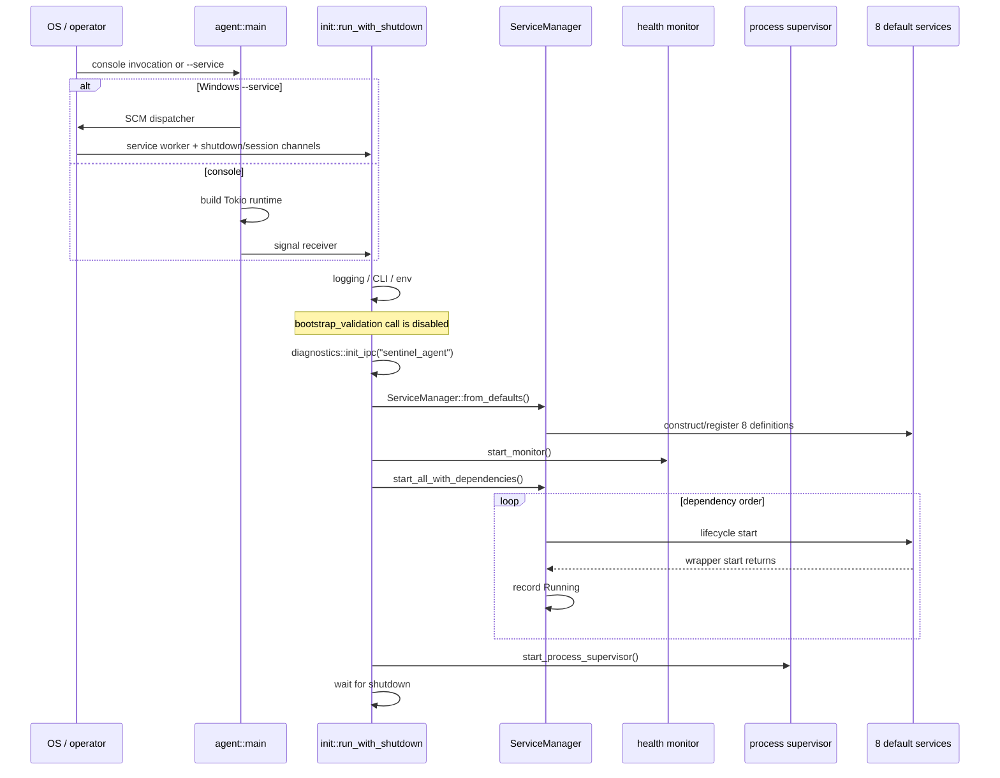
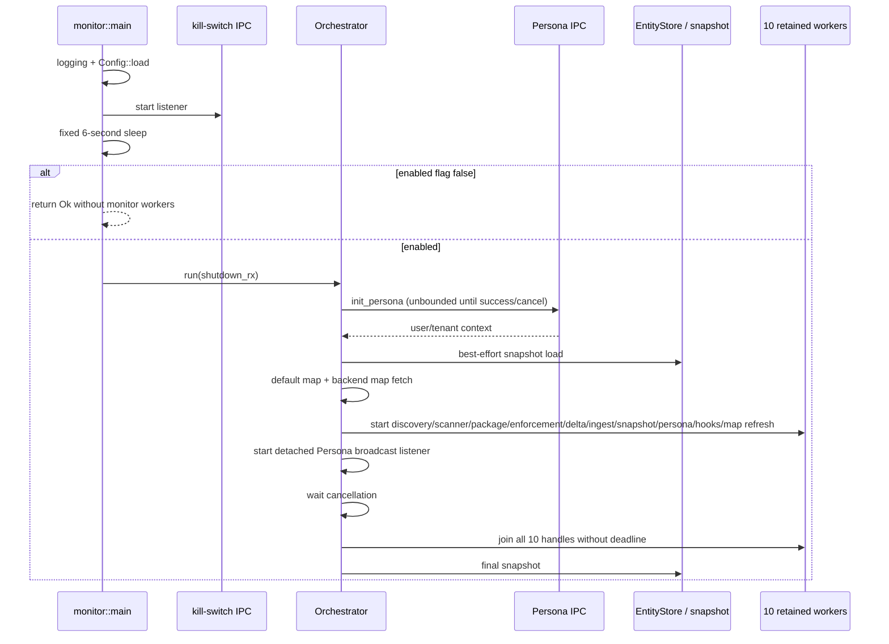
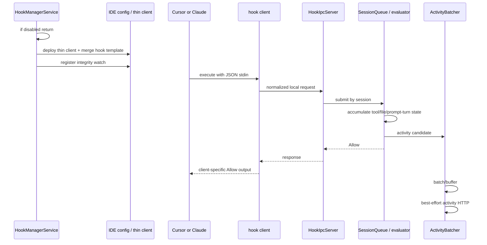
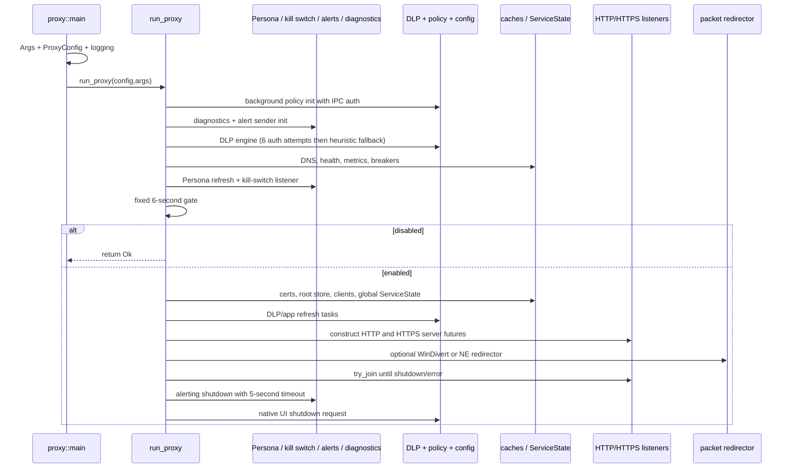
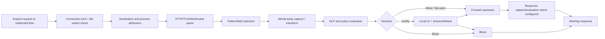

# 04 — Runtime Lifecycle

## Scope

This chapter reconstructs the lifecycle that exists at the pinned endpoint
revision. It does not insert a Starliner enrollment, capability-registration,
durable-admission, or remote-command phase into the current implementation.
Those are target-state subjects for chapters 18–20 and 29.

The companion entry-point table is
[runtime-entry-points.csv](../../../matrices/sensor-intelligence/endpoint-sensor/runtime-entry-points.csv).

## Lifecycle coverage summary

| Phase | Current implementation | Evidence/status |
| --- | --- | --- |
| Build/package | Platform builders compile, stage and sign endpoint components | `Implemented`; CI/artifact discrepancies recorded |
| Install | Privileged scripts install binaries, certificates, services, redirector components and configuration | `Implemented`; nontransactional |
| Initialize agent | Console or Windows SCM entry configures logging/environment and constructs service graph | `Active`; `Verified in source` |
| Enroll sensor instance | Persona/tenant initialization exists, but no stable Starliner sensor-instance enrollment/certificate flow exists | `Partial`; target enrollment is `Proposed` |
| Authenticate | PersonaManager and IPC token access authenticate current backend calls | `Active`; exact production token/cert lifecycle `Unresolved` |
| Load configuration | Wrapper CLI, config files, environment, embedded defaults and backend refresh tasks | `Active`; distributed precedence |
| Load policy | Proxy policy engine and monitor governance/process map/DLP refresh | `Active/partial`; readiness and fail-open behavior vary |
| Register capabilities | Default services register locally; no current external capability manifest is emitted | `Not implemented` as platform contract |
| Start capture | Monitor workers, hook server, proxy listeners and optional redirectors start | `Active`, conditional per platform/config |
| Observe/normalize | Process/file/package/hook/network paths build native records and context | `Active` with lossy conversions |
| Enforce | Proxy and Application process paths may block/prompt/terminate | `Active/partial`; hooks do not enforce |
| Buffer/persist | Entity map/snapshot, activity queue, alert SQLite, diagnostic buffers and logs | `Fragmented`; no common outbox |
| Export | Current HTTP and pinned-broker paths | `Active`, best effort or subsystem-specific |
| Acknowledge/retry | Per-client HTTP results/retry loops and alert dispatcher behavior | `Partial`; no common durable acknowledgement |
| Degrade/recover | Logging, retries, heuristics, fail-open branches, snapshots and child respawn | `Active but not one state machine` |
| Disable | Kill-switch can suppress or stop selected components | `Active but time-racy/inconsistent` |
| Shutdown | Reverse service stop; monitor cancellation/join/final snapshot; proxy listener join/cleanup | `Active`; detached-task and timeout gaps |
| Update/rollback | Separate distribution workflows | `Implemented/partial`; rollback not transactionally complete |

## Top-level installed runtime

```mermaid
stateDiagram-v2
    [*] --> Installed: installer completes
    Installed --> AgentStarting: OS service or console invocation
    AgentStarting --> GraphRegistered: ServiceManager::from_defaults
    GraphRegistered --> ServicesStarting: dependency order
    ServicesStarting --> Running: framework state reached
    ServicesStarting --> Failed: non-suppressed start error
    Running --> Degraded: child failure / source failure / auth or config gap
    Degraded --> Running: retry / refresh / respawn
    Running --> Disabled: kill-switch transition in selected processes
    Running --> Stopping: signal / SCM stop / component shutdown
    Disabled --> Stopping: component-specific shutdown
    Stopping --> Stopped: reverse stop attempts complete
    Stopping --> Failed: shutdown error returned
    Stopped --> [*]
```

`Inference`: `Installed` is a conceptual host state assembled from installer
side effects; the endpoint does not persist one authoritative installed-state
record. `Running` is a framework registry state, not proof that every listener,
policy cache, hook, redirector or backend path is healthy.

## Installation and update lifecycle

### Current flow

1. Platform build scripts compile Rust components and macOS Swift/Objective-C
   pieces or stage Windows WinDivert components.
2. Signing helpers sign an allowlisted subset and produce platform packages.
3. Update metadata builders hash artifacts and create RSA-PSS-signed metadata.
4. Install/update scripts stop or replace services, copy files, install
   certificates and redirector components, set environment/configuration, and
   start/validate selected processes.
5. Uninstall scripts attempt service, network, certificate and filesystem
   cleanup.

### Failure and recovery

- `Verified in source`: these scripts mutate multiple privileged host
  subsystems without one transactional commit/rollback boundary.
- `Potential issue`: a reported script success can coexist with incomplete
  network or certificate restoration.
- `Unresolved`: the effective production package feed, rollout rings, artifact
  digests, signed identities and rollback invocation.

## Agent initialization sequence



### Exact active service graph

| Source order | Service | Type | Dependencies | User-space request |
| --- | --- | --- | --- | --- |
| 1 | `ipc-light-broker.service` | process | none | yes |
| 2 | `persona_broker_bridge.service` | Tokio task | broker | no |
| 3 | `kill_switch_broker_bridge.service` | Tokio task | broker, Persona bridge | no |
| 4 | `alert_broker_bridge.service` | Tokio task | broker, Persona bridge | no |
| 5 | `templating-engine.service` | process | broker | yes |
| 6 | `sentinel-proxy.service` | process | broker, Persona, kill switch, templating | no |
| 7 | `sentinel-monitor-v2.service` | process | broker, Persona | yes |
| 8 | `template-engine.service` | process | broker | yes |

The source comments and tests describe other services, but their definitions are
commented out. They are not lifecycle states.

### Readiness limitation

`LifecycleManager` records a service `Running` after its wrapper `start()`
returns. Process wrappers rely on spawning and, for standard IPC, a shallow
connection probe that can degrade to a no-op transport. Custom-IPC services
bypass that standard probe. Therefore:

> `Verified in source`: service-manager `Running` means the framework completed
> its start step; it does not prove application listener readiness, policy load,
> Persona freshness, redirector health, hook installation or export health.

## System Monitor lifecycle



### Worker lifecycle

| Worker | Initial delay | Repetition/trigger | Cancellation behavior | Failure behavior |
| --- | --- | --- | --- | --- |
| Process discovery | none after setup | configured poll, power-aware | cancellation token | enumerator errors logged/retried |
| Lua scanner | source-configured | configured scan interval | checked between cycles; current script not preempted | top-level error ends worker |
| Package scanner | source-configured | configured interval | checked between cycles | scan errors logged; blocking tool limitations |
| Enforcement | none | store events plus sweep, power-aware | cancellation token | worker error logged then ends |
| Governance delta | 2 seconds | configured interval | select on cancellation/sleep | warning then retry |
| App-ID + ingest | 1 second | fixed 5 seconds | select on cancellation/sleep | warning then retry |
| Snapshot timer | none | configured interval | exits on cancellation | warning, continues |
| Persona refresh | module-defined | refresh/reconnect loop | cancellation token | module-specific retries |
| Hook manager | none | events + probe interval | cancellation and IPC task join | child failures warn |
| Process-map refresh | after initial fetch | configured refresh | cancellation token | retains current map on error |

`Unresolved`: exact production intervals after all file/environment overrides.

## Discovery and entity lifecycle

```mermaid
stateDiagram-v2
    [*] --> Observed: process / marker / package source
    Observed --> Candidate: parse and correlate
    Candidate --> Stored: EntityStore::upsert
    Stored --> AppIdResolved: Application backend lookup succeeds
    Stored --> PendingSync: unsynced entity
    AppIdResolved --> PendingSync
    PendingSync --> Synced: HTTP ingest success and mark_synced
    Synced --> Rediscovered: later upsert/observation
    Stored --> Governed: delta applies governance
    Synced --> Governed
    Governed --> ActionAttempted: Application enforcement
    Stored --> Snapshot: periodic/final JSON save
    Synced --> Snapshot
    Governed --> Snapshot
```

There is no verified native `deleted`, `expired`, or trustworthy `inactive`
transition for an Application when its process exits. A process exit is
observed by the process table but is not converted into removal/deactivation of
the stored Application.

## Hook lifecycle



### Hook lifecycle qualifications

- Installation is proactive, discovery-triggered, periodic and in-memory
  idempotent.
- Hook-file integrity is monitored after successful installation.
- Session state is process-local and can be swept after an idle timeout.
- The evaluator's decision state has only one current outcome: Allow.
- An activity enqueue/send failure does not change that inline Allow result.

## Proxy initialization sequence



The code comment says listeners are bound before redirector start, but
`run_http_server` and `run_https_server` are async functions whose bodies begin
when polled by the later `try_join!`. `start_packet_redirector` is invoked
before that `try_join!` poll. `Potential issue requiring validation`: the
commented race fix may not guarantee actual bind-before-redirector ordering.

## Network request lifecycle



Alternative paths bypass some stages: raw tunnel fallback, non-monitored
domains/fields, unsupported protocols, excessive WebSocket frame size,
handshake failure, absent attribution and configuration/auth failure.

## Export, buffering, and acknowledgement lifecycle

| Record family | Constructed in | Buffer/persistence | Export | Acknowledgement semantics |
| --- | --- | --- | --- | --- |
| Inventory entities | monitor store | memory + periodic JSON snapshot | gzip HTTP ingest | per-request success then local sync mark; no shared durable admission |
| Governance state | monitor delta | store + cursor in snapshot | inbound HTTP poll | cursor advances per implementation; no platform command receipt contract |
| Hook activity | evaluator/batcher | bounded process-memory queue | activity HTTP | best-effort; losses not represented as durable gaps |
| Alerts | proxy/core | broker queue then agent SQLite | authenticated HTTP dispatcher | subsystem-specific persistence/retry |
| Diagnostics | agent/proxy | broker and optional receiver buffers/files | optional OpenSearch bulk | can drop before receiver; bulk item failures not fully checked |
| Proxy traffic log | proxy logger | local async file logger | none in current code | no remote acknowledgement |
| Process enforcement audit | monitor auditor | request-local data | backend alert/audit HTTP | subsystem-specific HTTP result; no native-effect attestation |

`Verified in source`: there is no single ordering domain, sequence store,
durable sensor outbox, common admission receipt, resend window, gap record or
platform acknowledgement path covering all families.

## Degradation and recovery

| Failure source | Current behavior | Structured degraded state? |
| --- | --- | --- |
| Child process exits | supervisor marks crash and may retry with backoff | service state/logs; no platform coverage gap |
| Initial kill-switch query unavailable | fixed wait then current atomic default is used; generally fail-open | no common gap |
| Monitor Persona unavailable | waits/retries until success or cancellation | logs; monitor capture never starts |
| Process-map fetch fails | compiled defaults retained | warning only |
| Snapshot corrupt/missing | starts fresh | warning/info only |
| Lua scan top-level error | scanner worker can end | error log; orchestrator continues |
| Package/tool failure | error/log depending path; next cycle may continue | no coverage record |
| Activity queue/send failure | drop/warn/retry limitations | no durable loss record |
| DLP Persona unavailable at startup | heuristic analyzer fallback | warning; no platform capability downgrade record |
| Policy/DLP error | multiple paths fail open | logs/alerts vary |
| Destination unresolved | NAT/SNI/DNS fallback, tunnel, or drop | metrics/logs only |
| Diagnostics broker failure | payloads drop/reconnect | no source replay |
| UI timeout/close/failure | configured/default response selected | decision may be recorded, transport failure not uniformly separate |

The proposed `endpoint.gap`, `sensor.health` and coverage-profile records are
not current native emissions.

## Shutdown and cleanup

### Agent

1. signal/SCM sends to `shutdown_rx`;
2. `shutdown_gracefully` stops services in reverse dependency order;
3. each service has a timeout and all stops are attempted;
4. monitoring/supervision cleanup follows its owning helpers;
5. first collected shutdown error is returned as `AgentError::ShutdownFailed`.

### Monitor

1. Ctrl+C or kill-switch channel sends broadcast;
2. orchestrator bridge cancels the shared token;
3. ten retained handles are joined without a deadline;
4. detached Persona broadcast and shutdown-bridge tasks are not explicitly
   joined;
5. final snapshot is attempted; failure logs but does not change return to an
   error.

### Proxy

1. SIGTERM/SIGINT or kill-switch sends broadcast;
2. HTTP/HTTPS loops exit on their receivers;
3. redirector has platform-specific shutdown semantics and is not joined by
   `run_proxy`;
4. alerting shutdown gets five seconds;
5. native justify UI receives a shutdown request;
6. detached refresh/metrics/cleanup tasks end with process/runtime teardown.

### Template and diagnostics processes

These have independent shutdown channels/event loops. Their lifecycle is not
atomically coordinated with the remote state they may have queued.

## Current lifecycle state models

### Service framework

`ServiceState` declares:

```text
NotStarted | Initializing | Running | Stopping | Stopped |
Crashed | Retrying | Failed
```

Registry state, wrapper struct state and emitted `StatusUpdate` messages are
distinct. Tests expecting immutable wrapper fields to change contradict the
implementation.

### Proxy health

```text
Healthy → Degraded → Unhealthy → Critical
```

Transitions use configured failure windows/probes. Auto-restart is optional and
its full restart path is only partially integrated.

### Hook decision

Models allow `Allow`, `Deny`, and `Justify`; current evaluator execution always
returns `Allow`. The other values are protocol capability, not active decision
states.

## Runtime entry-point exclusions

- Cargo tests, examples, benchmarks and manual test servers are analysis and
  developer entry points, not installed sensor processes unless explicitly
  invoked.
- The dashboard API/frontend/migration/seed processes are remote consumer
  entry points and are not repeated as endpoint runtime owners.
- The generic gRPC server has no verified invocation and is marked dormant in
  the companion matrix.

## Evidence references

- `work/sentinel-endpoint-agent/agent/src/main.rs`
- `work/sentinel-endpoint-agent/agent/src/init.rs`
- `work/sentinel-endpoint-agent/core/src/service/**`
- `work/sentinel-endpoint-agent/core/src/defaults/services.rs`
- `work/sentinel-endpoint-agent/system-monitor/v2/src/main.rs`
- `work/sentinel-endpoint-agent/system-monitor/v2/src/orchestrator.rs`
- `work/sentinel-endpoint-agent/system-monitor/v2/src/hook_manager/**`
- `work/sentinel-endpoint-agent/proxy/src/platform/common.rs`
- [Runtime entry-point archaeology](../../../repository-analysis/04-runtime-entry-points.md)
- [Build/install/update archaeology](../../../repository-analysis/06-endpoint-build-release-install-and-update.md)

